# 1 系统与 MongoDB 架构

## 系统与 MongoDB 架构

每个数据库部署都在一个更大的系统中运行，该系统包括网络、应用程序、硬件和用户。要有效地扩展或优化 MongoDB，我们必须以系统设计师的心态来对待它，而不是这些力量本身所特有的特征，而这种响应在现实世界中很少简单。 [1]

我们在许多尺度上看到系统。我们的太阳系是行星的系统。地球有天气和气候系统，以及政治和社会系统，如国家和城市。城市包含机构系统，如大学，而大学又包含学术系统，如院系、教授和学生。工程学院有一个实验室系统，其中多台计算机通过桥梁和路由器组成的网络系统连接。每台计算机都是硬件和软件组件的系统，包括处理器、内存和应用程序。

城市中的商店是一个管理系统，例如计算机，并通过供应商和工厂进行库存补充流程的系统。城市之外，森林是一个生态系统，包含树木，每棵树都是根、枝和叶的系统。森林中的野猪具有生物系统，包括骨骼、神经、循环和消化系统。甚至野猪耳朵内的单个细胞也是一个系统，具有自己的内部子系统，如线粒体、细胞核和核糖体。


将所有这些不同系统统一起来的共同点是，它们的元素在系统内部相互作用，并与其他周围系统相互作用。

系统的性能往往不是由最强或最快的元素决定的，而是由最薄弱的环节决定。这有时被称为 **瓶颈** 或 **限制因素**。这是系统中显著限制系统整体性能或增长的元素。瓶颈会随时间变化。如果修复了一个瓶颈，另一个元素就会成为瓶颈。请记住，对一般系统成立的一切，对软件系统也成立。在后面的章节中，我们将探讨典型的软件瓶颈以及你可以用来修复它们的策略。

## 系统的特征

在本节中，我们将探讨在改变系统时可能遇到的潜在陷阱。我们将看到缓冲和延迟如何使理解系统的行为变得困难，以及变化如何导致意想不到的结果。

## 改变系统是一项风险业务

系统的元素可以以非线性方式相互作用。例如，学校是一个系统，其元素包括学生、教室、操场和篮球架。系统的行为并不总是以可预测的方式出现，如下所述：

-   **小变化可能产生大影响（蝴蝶效应）**：一件微不足道的行为可能导致巨大且不可预测的后果。例如，一个学生在操场上开始奔跑。另一个学生开始追赶第一个学生。不久，越来越多的学生看到好玩就加入进来。突然间，半个操场都在玩捉迷藏。
-   **反馈循环（连锁反应）**：这是一个直接的、逐步的过程，其中一个事件导致另一个事件。在食堂里，一个学生讲了一个笑话。如果好笑，几个人就会笑。他们的笑声让食堂里其他人好奇，不久后，每个人都在笑，甚至那些没听见笑话的人。笑声以自我增强的方式传播。这被称为 **正反馈循环**。
-   **整体大于部分之和（协同效应）**：系统可以产生比简单相加其组成部分更大的结果。在乐队练习期间，单一的鼓点听起来很简单。单一的长号音很酷。但当整个乐队一起演奏时，音乐听起来比单独声音的相加好得多。
-   **意想不到的结果（涌现）**：系统可以产生从个体部分看不出明显的结果。例如，在美术课上，学生把红色和黄色颜料混合得到橙色，这让他们感到惊讶。

非线性相互作用意味着小行动可能触发大变化，反馈循环可以放大其影响，元素可以以意想不到的方式协同工作，并产生新的结果。总的来说，人类很难理解系统不同元素之间的非线性相互作用，并且倾向于将行为视为一系列离散事件，这使得很容易忽略潜在的模式。

我们可以构建系统的模型并观察它们的行为。当然，现实世界总是比我们能构建的任何模型更复杂。系统的模型具有输入、存量、变量和反馈循环。图 1.1 显示了一个商店/库存系统的示例。

我们将使用此示例来解释存量、变量和反馈循环的概念。从左上角逆时针阅读，系统有交付的流入和销售的流出。商店中的产品存放在库存中，称为库存。

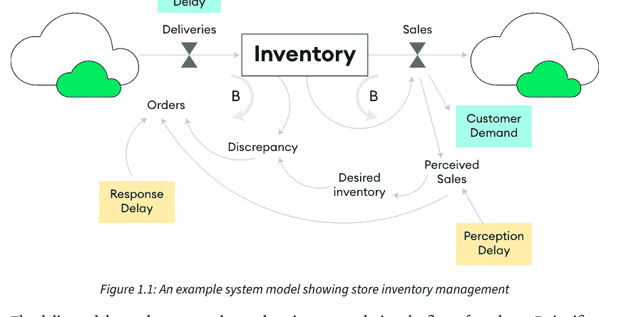

图 1.1：显示商店库存管理的示例系统模型

交付延迟和客户需求是调节产品流动的输入。B 表示平衡反馈循环。客户需求导致产品作为销售流出系统，减少库存。经理不想每天检查库存，因此存在感知延迟变量。延迟后，经理将感知到的销售与期望库存进行比较。经理不想对客户需求的变化过度反应，因此他们有一个响应延迟变量，限制向供应商订购的数量，供应商随后在延迟后交付更多产品。

该模型仅使用平衡反馈循环。另一种反馈循环是强化循环，通常会增加存量的规模。例如，在银行储蓄账户中，账户中的钱越多，你赚取的利息就越多，进而增加账户中的金额。

## 无延迟的系统很简单

假设经理希望库存保持 10 天的需求量，每天需求为 200 件。这意味着期望库存为 2,000。第 10 天，需求增加 10%。客户现在每天购买 220 件。经理增加订单数量，更多库存于当天交付。期望库存上升至 2,200。

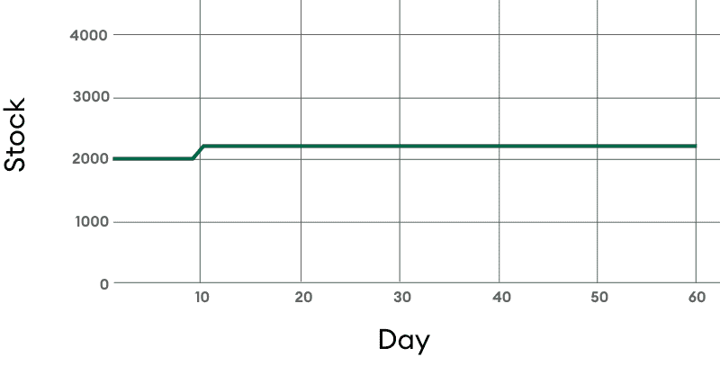

*图 1.2：在无延迟的简单系统中随时间的行为*

当系统中没有延迟时，可以立即对需求变化做出调整，使系统的行为变得直接且可预测。

## 存在延迟的系统可能表现出意想不到的行为

在复杂系统中，采取行动和看到其效果之间通常存在延迟，正如 Donella Meadows 所描述的那样：

> 由于复杂系统中的反馈延迟，问题变得明显时，可能已经不必要地难以解决。[1]

例如，如果库存订单需要几天才能到达，需求的突然增加可能无法及时解决。这种滞后可能导致过度修正或短缺，造成不稳定。理解和管理这些延迟对于保持系统平稳运行至关重要。

现在，让我们添加一些延迟：

-   **感知延迟：** 在更改订单之前，经理将销售额在 5 天期间取平均值
-   **响应延迟：** 经理在更改订单时弥补 40% 的库存短缺
-   **交付延迟：** 工厂需要 5 天交付订单

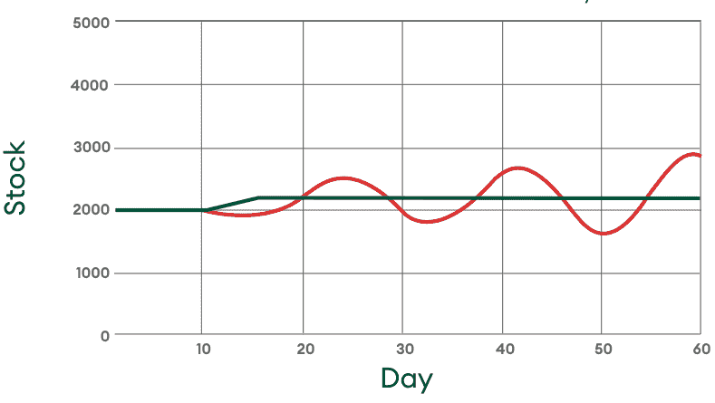

*图 1.3：由于订单调整延迟，需求上升后库存水平振荡*

如图 1.3 所示，第 10 天后，需求首先增加 10%，我们看到库存水平开始下降。然后，5 天后，经理调整订单以弥补 40% 的短缺。增加的交付开始到达，第 20 天，库存等于期望库存。然而，增加的交付仍在继续，到第 25 天，商店出现超库存。经理减少订单。循环继续，库存在缺货和超库存之间振荡。

## 尝试修复振荡

这里有三种你可以尝试修复这种不想要行为的选项：

-   更快的感知（减少延迟）
-   更快的响应（增加订单）
-   更慢的响应（减少订单）

闭上眼睛一分钟，决定你会先尝试哪一个选项。我们将检查每个选项的结果。

首先，我们将感知延迟从五天减少到两天，如图 1.4 所示。

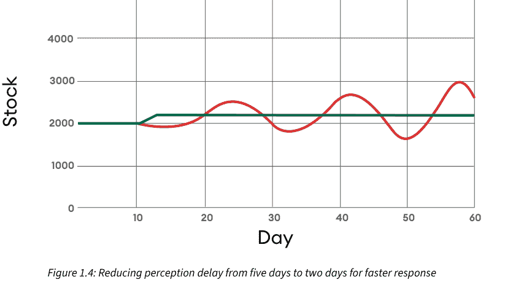

图 1.4：将感知延迟从五天减少到两天以实现更快响应

因此，经理更早做出反应，期望库存更快上升到 2,200，但如果有的话，振荡开始得稍早一些，而且略高。60 天标记前峰值库存现在为 2,994 件。更改感知延迟前为 2,981 件。

接下来，我们将尝试更快响应，通过更改订单以弥补 60% 的短缺，原本为 40%。如你所见，图 1.5 中行为变得更糟。振荡变得更大，峰值库存甚至更高达到 3,800，某些天会跌至 1,400。

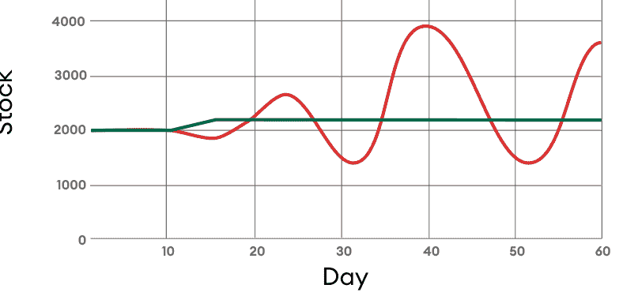

图 1.5：减少响应延迟——库存波动变大

最后，我们将尝试更慢的响应，将响应延迟（订单的变化）从之前的 60% 降低到 25%，如上一个示例所示。


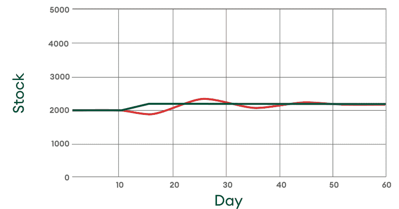

*图 1.6：较慢的订单变化减少库存振荡*

如图 1.6 所示，系统的行为现在好多了。库存仍然会振荡，但在需求变化后大约 20 天左右开始趋于接近期望库存。

## 系统会让我们感到惊讶

系统可能会以违反直觉的方式做出反应。在这个相对简单的系统中，商店经理的反应过于迅速。我们自然的倾向是更快地感知和响应，但这使得系统表现更糟。只有当我们尝试了一些看似违反直觉的做法（较慢的响应）时，系统的行为才得到改善。这对软件系统也同样适用，我们将在本章后面看到一些实际例子。改变某些变量可能会对整体行为产生重大影响，但其他变量可能几乎没有影响或没有影响。在这些例子中，我们看到感知延迟影响很小，但响应延迟却有影响。

真实系统总是比模型更复杂，可能存在隐藏变量或反馈回路。这个系统相对简单。更复杂的系统可能拥有多个存量和更多的反馈回路。系统本质上是振荡的。系统行为表现为随时间推移的一系列事件。我们人类的大脑不擅长理解非线性增长以及元素之间的相互作用。我们会假设当前瓶颈是什么，并尝试改进系统中的某些元素，除非限制因素得到改善，否则这些改进不会提升性能。

## 一个典型的软件系统

现在，让我们将我们对系统总体所讨论的内容应用到软件系统上。我们将从高层次来看一个典型的软件系统，如图 1.7 所示，并描述一些潜在的瓶颈。

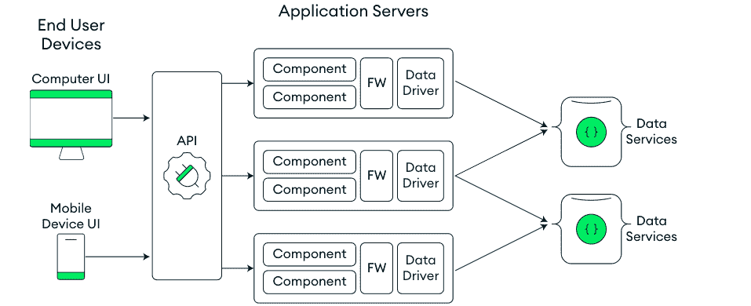

*图 1.7：软件系统的高层次视图，显示客户端到数据库的请求流程*

从左到右看，我们看到两个客户端。它们可能是台式电脑和移动设备。这些客户端通过互联网连接到应用程序编程接口（API）网关，后者发送请求并接收通知。API 网关连接到多个应用服务器。它们修改、路由并将客户端请求转发给在这些应用服务器上运行的一个或多个软件组件。每个应用服务器可以有多个使用一个或多个框架（FW）（如 Spring 或 Rails）的软件组件。这些通常包含数据服务抽象或对象建模组件，它们使用数据库特定的驱动程序（有时称为客户端库）与数据服务通信。

这些组件中的任何一个（它们运行的计算机或连接它们的网络）都可能成为整体应用性能或可扩展性的瓶颈。

以下是软件系统中性能瓶颈的两个示例：

- **API 网关瓶颈：** 随着系统变得流行，更多用户连接到 API 网关，API 会达到一个点，即处理如此多的连接和请求以至于 CPU 被完全利用。这可以通过查看运行 API 网关的计算机上可用的空闲 CPU 来识别。这可以通过垂直扩展运行 API 网关的计算机或云实例来解决。

- **框架瓶颈：** 应用程序软件可能会向框架发送看似简单的请求，但这些请求在内部可能会触发昂贵的数据库操作，例如对数据库进行全集合或表扫描。这种低效的查询会使用数据库的 CPU 和存储带宽，同时也会将不必要的数据发送回应用服务器。因此，会使用不必要的网络带宽，并且应用服务器需要额外的 CPU 资源来处理数据。

这种后者的瓶颈可以通过多种方式识别：

- 对应用程序进行分析可能会发现，框架的请求花费了意想不到的时间。
- 在开发过程中，可以使用端到端跟踪来追踪用户请求从客户端经过应用程序代码、框架和数据服务抽象，以查看在数据服务上运行了何种查询以及随后的 **输入/输出 (I/O)** 操作。
- 这可以识别读取或写入放大，即小的客户端请求导致不成比例的大型数据库操作。例如，客户端查询一个 32 字节的数据点可能会经过整个系统并导致数据库表扫描，从而无缘无故地通过 I/O 和缓存拉取 32 GB 的数据。这可以通过配置框架使其更高效来解决。

我们将在整本书中提供这些类型瓶颈和解决方案的具体示例，最终在 *第 15 章，调试性能问题* 中汇总多个具体案例研究。

识别潜在瓶颈只是优化软件系统的第一步。为了消除这些瓶颈，我们需要一种结构化的方法，应用性能工程原则。

性能工程原则涵盖从算法理论到 Little 定律的范围。通过应用这些原则，开发人员可以最小化瓶颈、提高可扩展性并最大化资源效率。在接下来的小节中，我们将探讨其中一些原则，并了解它们如何指导高性能系统的设计，您在阅读本书时可以牢记这些原则。

## 算法效率（复杂度）

算法和数据结构的选择通常是大多数计算机科学课程首次介绍性能的地方。随着输入规模线性或对数增长的算法，其性能会优于指数增长的算法。任何微优化都无法弥补本质上缓慢的算法。在现代系统中，这可能意味着使用内置库（通常以 C 或汇编优化）或利用并行算法。

## 避免过早优化

正如俗话所说：“先让它工作，然后再让它变快。”换句话说，在担心性能之前，专注于构建正确可靠的系统。

计算机科学家 Donald Knuth 也表达了这一观点，他曾著名地警告说“过早优化是一切邪恶的根源”。开发人员经常错误猜测是什么拖慢了他们的系统；分析工具经常在意想不到的地方发现性能瓶颈。现代处理器也可以以违背人类直觉的方式执行编译代码。

通过抵制过早优化的冲动，您可以保持代码的整洁和可维护性。您还可以确保您的性能工作基于真实数据，而非假设。

## 阿姆达尔定律（并行加速的极限）

阿姆达尔定律解释了为什么某些工作负载不会随着核心数量增加而成比例加速。如果程序的一部分 S 必须顺序运行，例如为了保护共享数据结构，那么即使拥有无限处理器，加速也限制在 1/S。例如，如果任务的 10% 是串行的，那么在最佳情况下整体加速接近 10 倍（假设其他 90% 在多个处理器上运行）。在使用多核处理器和分布式计算时，必须识别并减少工作负载的串行部分。

## 局部性和缓存

程序通常在短时间内反复访问相对较小部分的数据或代码。可以使用缓存来加速频繁使用的数据访问。系统在各个层级使用缓存：用于数据库结果的内存缓存，以及 CPU 缓存，通过存储昂贵操作的結果并重用它们来避免重新计算或缓慢访问。然而，缓存会引入复杂性，例如陈旧数据和内存开销。这就是为什么在以下笑话中提到它：

> 计算机科学中有 2 个难题：缓存失效、命名事物，以及差一错误。
> 
> Leon Bambrick


讽刺的是，现在对这个笑话也有了反驳：

> 计算机科学中有 2 个难题：我们只有一个笑话，而且它不好笑。
> 
> *Phillip Scott Bowden*

使用缓存（例如在 I/O 操作中）对于从慢速设备获得良好性能至关重要，但它也适用于分布式系统的其他层。

## 小定律（吞吐量与延迟）

性能是多维度的。有时目标是处理大量操作（吞吐量），而其他时候，优先事项是最小化单个操作从开始到完成之间的延迟（延迟）。在许多情况下，两者同等重要。

你可以增加并发来提高吞吐量（例如使用多线程、异步 I/O 或非阻塞事件循环）。然而，这些技术可能会引入影响延迟的排队延迟。并发操作过多可能会使系统进入低效状态。重要的是首先确定你的性能目标，然后据此进行优化。对于高吞吐量，使用并发最大化资源利用率（CPU、网络和磁盘）。对于低延迟，最小化等待和处理深度。平衡两者是一门艺术，需要在分析和基准测试的指导下进行。

总之，性能工程应以数据为驱动，使用分析器和监控工具来识别瓶颈。它应同时借鉴经典见解（如算法复杂度和阿姆达尔定律）和现代技术（如并行计算、向量化和分布式负载均衡）。将优化工作集中在收益最大的地方，并始终通过测量验证影响。

## 了解 MongoDB 架构

现在你已经了解了系统概览，是时候开始具体了解 MongoDB 系统了。在此之前，让我们先从高层次来看一下 MongoDB 架构。我们将在全书中深入探讨这些组件的每一个。

首先，了解 MongoDB 的基础非常重要。MongoDB 的创建是为了弥合传统关系数据库和简单键值存储之间的差距。核心思想是将两者的最佳特性（灵活性、速度和易于理解的数据模型）结合起来，同时提供强大的查询、索引和复杂聚合等功能。此外，从早期开始，MongoDB 就为多种语言提供了原生库、内置复制、通过分片实现水平扩展，以及直观的文档数据模型。

键值存储通常因其速度和简单性而受到赞扬。然而，MongoDB 超越了这种简单方法，允许你存储和查询具有丰富关系和结构的整个文档（对象）。另一方面，关系数据库将数据组织成具有预定义列和关系的表，并强制执行严格的模式。

在下一节中，我们将更仔细地查看 MongoDB 文档模型以及它与关系数据库的不同之处。

## 文档模型：MongoDB 的基础

在关系数据库中，数据通常规范化为单独的表以支持各种用例。这可能需要复杂的连接来生成特定于应用程序的视图。相比之下，MongoDB 鼓励你将数据建模为特定于应用程序的文档，针对应用程序的访问和使用方式进行优化。这种灵活性允许在单个文档中表示复杂的关系和分层数据。

JavaScript 对象表示法（JSON）是一种轻量级、人类可读的数据格式，用于在应用程序之间存储和交换数据。MongoDB 的文档模型将数据存储在称为二进制 JSON（BSON）的类似 JSON 的结构中。

这里有一个文档的示例：

```
### A simple document representing a user
user = {
  "name": "Jane Doe",
  "age": 30,
  "email": "janedoe@example.com",
  "address": {
    "street": "123 Main St",
    "city": "Anytown",
    "state": "CA",
    "zip": "12345"
  },
  "interests": ["hiking", "photography", "travel"]
}
```

这包含有关用户的多个属性。在关系数据库中，用户的兴趣将存储在单独的表中，每当你需要将用户的兴趣与其他用户信息一起使用时，都必须单独查询或进行连接。从性能角度来看，在 MongoDB 中，兴趣数组与用户信息一起存储，因此所有用户信息可以在一次访问中从存储中读取，并在一次查询中接收到应用程序中。此外，兴趣可以被索引，以便可以简单快速地查询所有对徒步感兴趣的用户，例如。

你是否曾尝试在关系数据库中建模分层数据？如果你尝试过，你会知道这通常感觉就像试图把方 peg 塞进圆孔。在 MongoDB 中，嵌套结构是自然契合的，无需复杂的连接或实体关系图。

## MongoDB 的关键架构组件

MongoDB 服务器使用单个 mongod 进程，可以在任何地方运行。你可以将 mongod 进程部署在许多类型的计算机上，包括笔记本电脑、企业内部数据中心内的自管服务器、企业管理的云实例以及由 MongoDB Atlas 管理的云实例。

我们将讨论的许多概念适用于此服务器进程；然而，它也是 MongoDB 分布式系统的构建块。生产中的基本部署通常至少是一个由三台计算机组成的 **副本集**，每台计算机运行一个 mongod 进程。其中一台是主节点，另外两台是次要节点。副本集的所有成员都拥有相同的数据副本。你将在 *第 5 章，复制* 中了解更多关于此的内容，但最重要的是要知道复制通过监控所有成员的健康状况，并在旧主节点出现故障时自动选举新的主节点，为你的应用程序提供高可用性。

当你水平扩展 MongoDB 时，你会将副本集视为第一个 **分片**，然后根据需要添加尽可能多的额外分片。每个分片都是一个副本集。每个分片保存数据的一个子集，而智能的 **路由器** 进程将操作定向到正确的分片，从而消除了应用程序需要知道数据如何分布的需求。你将在 *第 6 章，分片* 中了解更多关于此的内容。

Atlas 是一套集成的云数据库和数据服务套件，用于加速和简化你使用数据构建的方式。Atlas 扩展了 MongoDB 的灵活性和易用性，使你能够构建全文搜索、实时分析和事件驱动功能。

MongoDB 客户端库（或驱动程序）允许你的应用程序代码使用原生库和看起来像你所使用语言中任何其他 API 的 API 与数据库通信。你在首选编程语言中构造请求，驱动程序将其转换为 MongoDB 理解的消息。

MongoDB 为大多数流行的编程语言提供官方驱动程序，包括 Python、Java、C# 和 Node.js 等。你可以在 MongoDB 文档 https://www.mongodb.com/docs/drivers/ 中找到完整列表。

下面是一个使用 PyMongo，即 Python 的官方 MongoDB 驱动程序，连接到 MongoDB 并插入文档的简单示例：

```
from pymongo import MongoClient

### Connect to MongoDB
client = MongoClient('mongodb://localhost:27017/');
db = client['store_database'];
collection = db['products'];

### Define a product document with nested information
product = {
    "name": "Ergonomic Keyboard",
    "price": 129.99,
    "category": "Computer Accessories",
    "details": {
        "weight": 1.2,
        "dimensions": "18 x 6 x 1 inches"
    },
};

### Insert the document
collection.insert_one(product);
```

你在前面的代码中看不到的是客户端库所做的一切繁重工作：管理连接、将 MongoDB 线路协议与服务器通信、处理网络超时、实现重试逻辑，以及将 Python 字典转换为 BSON 并返回。

以下代码查询 products 集合中价格便宜的产品（少于 $100）：

```
### Find affordable products
affordable_products = collection.find({'price': {'$lt': 100}});
for product in affordable_products:
    print(f"Found affordable product: {product['name']}");
```

当 MongoDB 返回文档时，它会作为你语言中的原生数据结构到达，在本例中是 Python 字典。无需 awkward 转换。这种应用程序代码与数据库表示之间的自然映射对于开发人员生产力来说是一个显著优势。


## 数据服务系统

现在让我们聚焦于我们在图 1.7 中之前看到的整体软件系统中数据服务部分。

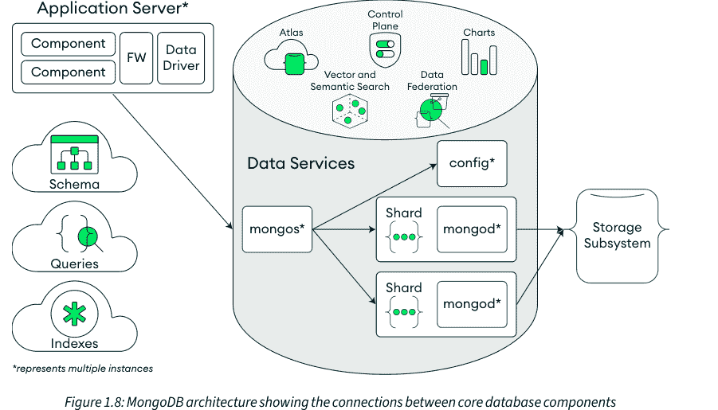

*表示多个实例

图 1.8：显示核心数据库组件之间连接的 MongoDB 架构

从左到右看图 1.8，我们看到应用程序服务器通过驱动程序或客户端库与数据服务进行通信。在此案例中，我们展示的是一个分片集群。对于更简单的部署，应用程序服务器可以不使用 mongos 和配置服务器而连接到单个副本集。诸如模式、查询和索引之类的概念元素在应用程序服务器和数据服务层之间共享。一些性能和可扩展性问题可能由这些概念元素引起，改变它们可能是改进的来源。

在此案例中，我们查看的是 Atlas 部署的图表，其中包括元素如 Atlas UI（包含监控和备份）、Atlas 控制平面、图表以及诸如向量和语义搜索以及数据联合等功能。

其余组件被视为 **核心** 数据库，具体如下：

- **mongod**：单个服务器进程。Atlas 可以在副本集（用于高可用性）和分片（用于水平扩展）中部署多个 mongod 进程。
- **mongos**：分片集群的路由器进程。它将查询路由到一个或多个分片，并将来自多个分片的结果合并为响应。
- **config**：存储分片集群元数据的特殊内部数据库。元数据反映了分片集群内所有数据的状态和组织。mongos 使用此元数据将读写操作路由到正确的分片。它还维护此数据的缓存。

最后，在 *图 1.8* 中，mongod 进程将通过存储子系统保存和检索数据。这可能是自托管 MongoDB 系统中的磁盘或云存储，例如以下：

- **Elastic Block Storage (EBS)** 在 AWS 和阿里云中
- **Managed Disks** 在 Azure 中
- **Persistent Disks (PD)** 在 GCP 中
- 本地连接的临时 SSD

使用 Atlas 时，我们将整体数据服务系统呈现为一个黑盒子，只有少量设置需要您考虑。Atlas 会为您处理细节。从 Atlas 角度来看，设置如下：

- 分片数量和副本集成员数量。
- 实例大小，决定了 **虚拟中央处理单元**（**vCPUs**）的数量、内存量和网络性能。
- 存储配置，包括设备的大小和吞吐量。吞吐量通常定义为 **每秒输入/输出操作数 (IOPS)**。

如果您在自己的云或物理服务器上自行管理 MongoDB，您可以看到 mongod 进程运行的服务器和软件内部的许多组件设置。这是一把双刃剑。您可以调整更多设置来提高性能。然而，您也有更多元素需要管理以及潜在的瓶颈需要探索。

现在，如果我们放大到 mongod，我们会发现它本身就是一个具有多个元素的系统。以下图表（图 1.9）显示了 MongoDB 服务器（mongod）内部的主要元素：

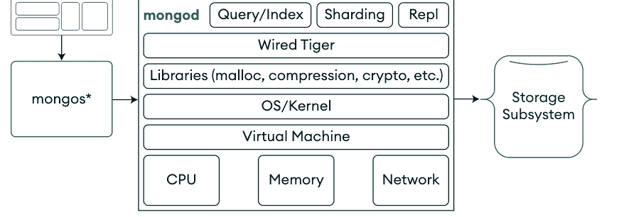

*图 1.9：MongoDB 服务器内部的元素*

## 查询引擎

MongoDB 的查询引擎接收您的查询，确定查找所需数据的最有效方式，并返回结果。它使用索引来优化查询执行，并将请求传递给存储引擎以执行操作。

索引就像书后面的目录。无需阅读书籍的每一页来查找主题，您可以使用目录直接查明包含该主题的页码。同样，在数据库中，索引有助于查询引擎更高效地定位数据。

MongoDB 提供的功能远不止键值存储。MongoDB 的查询和索引功能可与传统关系数据库相媲美（在某些方面甚至超越）：

- 您可以在任何字段上查询，而不仅仅是主键
- 您可以执行复杂的逻辑操作
- 您可以在嵌套文档和数组内部查询
- 您可以聚合和分析数据
- 您可以在任何字段组合上创建索引，包括数组和子文档
- 您可以向文档集合添加多个索引

索引使查询更高效。与性能的许多方面一样，索引也有成本。当创建/插入新文档时，每个索引都需要额外的写入操作到存储。同样，更新文档的索引字段时，需要额外的写入来更新索引。

您可以让查询系统提供 **解释计划**，其中提供查询运行的详细信息。这可以为查找潜在瓶颈和产生改进想法提供有价值的信息。

我们将在 *第 3 章，索引* 和 *第 12 章，高级查询和索引概念* 中更详细地介绍索引和查询。

## 存储引擎/WiredTiger

每个 mongod 进程需要在磁盘上存储数据。存储引擎是 MongoDB 的文件系统；它是负责管理数据如何在磁盘上存储、检索和维护的组件。自 MongoDB 3.2 以来，WiredTiger 一直是默认存储引擎。

存储引擎负责将数据和索引持久化到磁盘，从磁盘获取数据，以及处理磁盘上数据的压缩和加密。它还处理许多数据库中称为 **预写日志** 的日志。存储引擎还包含最近访问文档的内存缓存。您可以使用 wiredTigerCacheSizeGB 设置更改 WiredTiger 缓存的大小。剩余内存将由操作系统的文件系统（页面）缓存使用。您将在 *第 7 章，存储引擎* 中了解更多关于存储引擎的信息。

## 库

在开发 MongoDB 时，我们使用了许多其他构建块和库。这些也有可以更改以提高性能的设置。

从 MongoDB Server 8.0 开始，内存分配器（TCMalloc）的新版本支持每 CPU 缓存，而不是每线程缓存。这可以减少内存碎片并使数据库对高压力工作负载更具弹性。使用每 CPU 缓存可能需要修改一些系统配置设置。您可以在 *第 13 章，操作系统和系统资源* 中找到有关系统设置的更多详细信息。如果您真的知道自己在做什么，您可以更改诸如逻辑页面大小之类的控制，但这可能需要更改 MongoDB 源代码中的设置并重新构建服务器。再次说明，Atlas 提供默认值并实施最佳实践。

压缩算法更易于访问。您可以在创建集合时或通过启动服务器时的配置选项指定要使用的存储压缩算法。默认情况下，Atlas 使用一种名为 **Snappy** 的算法。运行自托管 MongoDB 时，您有四种压缩器选项：

- 无
- **Snappy**：最快，CPU 消耗最低；压缩数据不如其他算法多
- **Zstd**：Snappy 和 Zlib 之间的中间选择
- **Zlib**：最慢，CPU 消耗最高；压缩数据更好

您还可以在驱动程序和 MongoDB 服务器之间使用网络压缩。在这种情况下，您可以通过应用程序代码中的驱动程序选择压缩算法，无论服务器是否在 Atlas 上。

MongoDB 使用 OpenSSL 处理以下操作的 TLS/SSL 加密：

- 客户端-服务器连接（例如，mongod → MongoDB Shell）
- 复制和分片集群通信
- MongoDB 驱动程序连接到数据库

不同版本的 OpenSSL 在更高级别的实例/服务器上具有不同的性能特征和可扩展性。

## mongod 使用的其他系统组件

MongoDB 在操作系统内运行，而操作系统又由内核管理。在 Linux 等操作系统中，vm.dirty_ratio 和 vm.dirty_writeback_centisecs 等参数可调整内核管理虚拟内存的机制。它们改变了数据在从内存写入磁盘之前的处理方式。

MongoDB 可以在 **虚拟机 (VMs)** 内部运行。然而，您需要确保从 VM 角度正确配置它。例如，过度分配 vCPU 可能导致同一主机上运行的 VM 之间出现 CPU 竞争，从而降低性能。您可以在 https://www.mongodb.com/docs/manual/administration/production-notes/ 的 MongoDB 服务器生产说明中了解有关气球等概念以及如何为 VM 配置 MongoDB 的更多信息。

MongoDB 在具有不同内存量的网络系统中运行在许多类型的 CPU 上。这些通常取决于您部署 MongoDB 的云实例大小或计算机服务器。通常，更大的实例或服务器将具有更多 CPU、内存和更高的网络带宽。


正如我们之前所见，使用 Atlas 时，您可以选择不同类型和配置的云存储。在运行自己的云实例或自托管存储时，您通常也有相同的选项。此外，您可以选择不同的文件系统和设置，例如预读。当程序读取文件时，Linux 会预测未来的读取并将额外数据加载到内存中。这减少了磁盘访问操作的次数，使顺序读取更快。这将在第 13 章，操作系统和系统资源中更详细地讨论。

## 在现代数据平台中管理复杂性

让我们从单个 mongod 进程退一步，再次查看数据服务层。对您的应用程序而言，数据服务元素是一个组件，但实际上，它本身可以是一个复杂且独立的分布式系统，包含多个独立服务器。

MongoDB 的方法是提供一个数据服务 API，使用三个关键原则简化这种复杂性：灵活的数据模型、内置冗余和弹性，以及水平扩展。

## 具有严格功能灵活的数据模型

文档模型允许您自然地表示关系，同时在需要时仍支持严格的数据治理。一位 MongoDB 用户完美地解释了这一点：“我们可以将更新推送到应用程序，而无需协调复杂的数据库迁移。模式随着我们的代码演进，而不是与其对抗。”您可以在第 2 章，性能的模式设计中了解有关此灵活数据模型的更多信息。

## 内置冗余和弹性

MongoDB 并未将高可用性视为附加功能，而是通过复制将其弹性融入核心架构：

- **自动故障转移：** 如果主节点失败，选举会在几秒钟内确定新的主节点
- **自愈：** 当失败的节点恢复时，它们会自动追赶并重新加入副本集

同样，Atlas 提供了默认值，实施最佳实践，并简化了您需要考虑的设置数量。在自托管 MongoDB 时，您可以深入研究复制设置。例如，如果在自己的服务器上运行 MongoDB，您可以更改服务器参数以调整复制数据的批处理方式。更大的批次可减少网络流量和在从节点上所需 IOPS 的数量，但会增加写入的延迟。您还可以配置 **流控**，如果从节点落后，它可以通过减慢写入速度来防止复制滞后。您可以在第 5 章，复制中了解有关复制的更多信息。

## 具有智能分布的水平扩展

MongoDB 的分片功能可在保持相关数据在一起的同时，将数据分布到多个副本集：

- **自动平衡：** 随着数据增长，MongoDB 会持续在分片之间重新平衡数据
- **查询路由：** MongoDB 路由器（mongos）会智能地将操作定向到适当的分片
- **区域分片：** 您可以将数据分布与基础设施对齐（例如，将欧洲客户数据保留在欧洲服务器中）

MongoDB Atlas 通过自动化关键流程、实现最佳实践并提供内置功能来确保最佳性能，从而简化分片。您可以在 *第 6 章，分片* 中阅读更多相关内容。

## 性能工具

您可以使用性能监控工具来帮助查找潜在的瓶颈或限制因素。这些可能存在于我们之前提到的任何组件或元素中。更多细节将在 *第 14 章，监控和可观测性* 中提供。

mongod 和 mongos 进程会写入包含性能信息的日志文件。它们还支持 serverStatus 命令，该命令返回有关正在运行进程的信息。查询引擎可以“解释”查询的运行方式，并支持分析器功能。提供了命令行工具，例如 mongostat 和 mongotop，用于监控正在运行的 mongod 进程。

要监控各种系统资源的利用率，您可以使用操作系统命令、MongoDB Atlas 监控以及专门为监控多台服务器而设计的其他 GUI 工具。

对于系统资源 specifically，Linux 命令例如 top、vmstat、iostat 和 netstat 可用于在单台服务器上某一时刻监控 CPU、内存、存储和网络。诸如 dstat 和 sar 之类的工具可用于组合来自更简单工具的数据并在一段时间内查看。

MongoDB Atlas 监控提供历史和实时系统资源数据，该数据与数据库特定指标集成。它具有诸如 **实时性能面板 (RTPP)**、性能顾问、命名空间洞察和查询分析器等工具。您还可以为特定性能事件设置警报。

对于自托管部署，您可以使用图形工具，例如 Netdata、Prometheus + Grafana、Zabbix、Munin 或 Observium。您可以使用可观测性框架，例如 OpenTelemetry。最后，您可以使用商业 **应用性能监控 (APM)** 工具，例如 AppDynamics、Datadog、Dynatrace、LogicMonitor、New Relic、SolarWinds 和 Splunk Observability。

## 查找瓶颈

如本章开头所述，每个系统都有一个限制因素或瓶颈。系统有多个输入时，并不总是清楚限制因素是什么。我们需要找到当前瓶颈的元素或组件。为此，我们需要使用前面提到的工具来分析我们迄今为止提到的所有潜在瓶颈的性能。

总之，下表列出了在调整典型软件应用程序时可能遇到的潜在瓶颈。第一列显示您在 Atlas 和自托管系统上都可能遇到的潜在瓶颈。第二列显示自托管部署中您负责的额外瓶颈。正如您所见，使用 Atlas 可显著减少您需要考虑的瓶颈数量。

| Atlas 和自托管（私有云） | 自托管（私有云） |
|---|---|
| UI/应用程序代码 | 网络 |
| 框架 | 复制 |
| 驱动程序 | 存储引擎 |
| 网络 | 库（分配器、压缩和加密） |
| 模式/模型 | 操作系统/内核 |
| 查询 | 虚拟机 |
| 索引 | 内存（额外细节） |
| 分片 | CPU（额外细节） |
| 云存储 | 存储（额外细节） |
| CPU | — |
| 内存 | — |

*表 1.1：Atlas 与自托管（私有云）*

在本节的剩余部分，我们将更详细地查看两个示例瓶颈。

我们首先查看存储瓶颈，包括帮助我们识别它的测量指标和指标。在此示例中，我们的工作负载主要是读取数据：

- 稳态下 95% 的数据库操作都是使用 _id 字段（主键）读取文档
- 文档以随机顺序检索，这意味着 _id 值以与插入时不同的顺序被访问
- 数据集比数据库服务器上的内存大 10 倍，因此大多数读取操作无法通过缓存读取来满足，需要访问存储设备。
- 存储设备指定提供 4,000 IOPS

我们看到系统使用 mongostat 或 Atlas 监控每秒运行 5,500 次数据库操作。我们尝试通过扩展实例类型来提高性能。数据库性能保持在每秒 5,500 次操作。运行此实验后，我们知道瓶颈不是运行 MongoDB 服务器的系统的 CPU 或内存大小。我们再次将实例大小调小。

接下来，我们查看 I/O 的测量结果：

- 如果运行自托管实例，您可以使用 Linux 上的 iostat 命令查看 IOPS 数量
- 如果在 Atlas 中运行，您可以在查看监控时在最大磁盘 IOPS 指标上观察正在使用的 IOPS 数量

为了尝试提高性能，我们现在将存储 IOPS 从 4,000 增加到 8,000。数据库性能翻倍至每秒 11,000 次操作。我们经常在客户中看到这种情况。他们假设需要使用更强大的数据库实例，而实际上，他们真正需要的是来自存储子系统的更多 IOPS。

在第二个示例中，我们将重点关注图 1.8 的一个子集。在这里，我们有一个应用程序服务器与数据服务层交互：

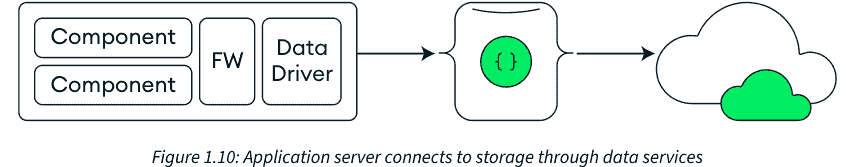

*图 1.10：应用程序服务器通过数据服务连接到存储*


最初，我们假设瓶颈出现在数据服务层或其下方，但查看 CPU 和 I/O 利用率时，我们发现 CPU 有空闲时间，且存储的 IOPS 和带宽未达到上限。因此，我们假设限制因素位于更上游。通过对应用服务器的测量，我们发现其 CPU 没有空闲时间，因此它是瓶颈。它没有产生足够的请求来完全加载数据服务或云存储层。

作为系统中服务的一般模型，请求进来后由服务内的多个线程执行。某些线程可通过共享资源交互；例如，在 MongoDB 服务器中，由一个线程运行的查询可能会占用存储引擎缓存中的空间，从而减慢其他线程。

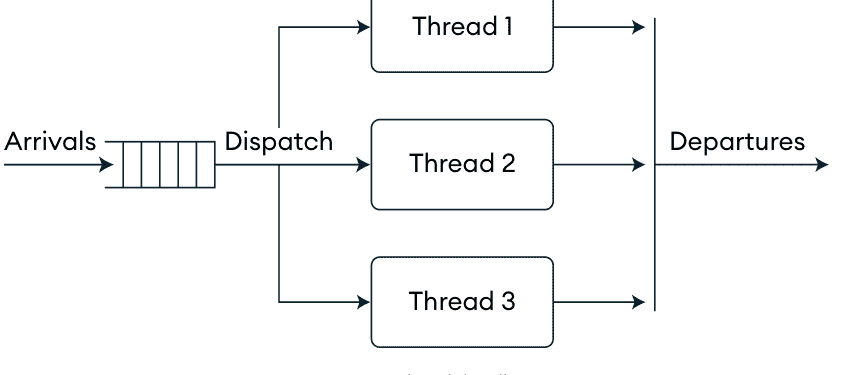

*图 1.11：服务线程处理请求*

在此示例中，应用服务器没有发送足够多的请求，这些请求可以分派到数据服务层内的多个线程中运行。具有这种模型的系统的总体性能如下：

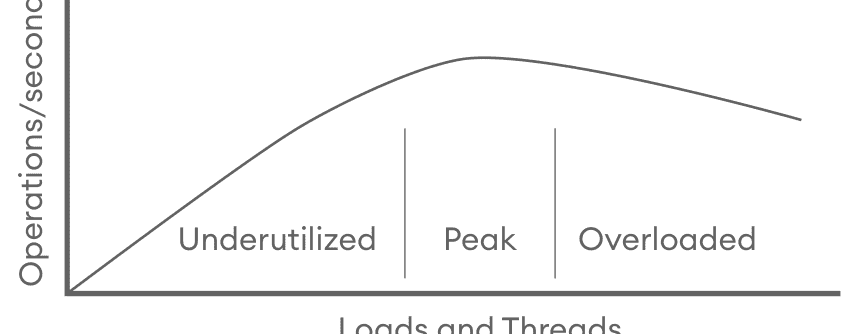

## 负载与线程

*图 1.12：随着负载和线程数量增长，性能提升直至系统过载*

随着负载和活跃线程数量的增加，IOPS 性能也随之提升，直到系统达到线程开始争夺共享资源的临界点。超过此点后，进一步增加负载和线程数量可能导致性能下降。大多数系统都具有这种特性。峰值性能通常取决于以下因素：

- 每个请求所执行的任务量
- 线程与 CPU 核心的比例
- 对共享资源的竞争

了解应用或工作负载的此负载/性能图最好的方法是，在将产品投入生产前运行压力/负载实验。

为了解决此问题，我们添加了第二台应用服务器；总体性能有所提升，但未达到我们的性能目标。

我们重新分析组件的负载，现在发现运行 mongod 进程的服务器的 CPU 已完全利用。性能从图表中的未充分利用部分转变为过载部分。我们现在发现 MongoDB 服务器是瓶颈。

在从应用服务器加倍负载后，我们可以通过减少服务器中运行的并发操作或线程数量以更精细的方式降低负载。你可以从应用服务器管理此项，但另一种方法是降低数据库驱动程序或框架/对象关系映射器（ORM）中的 maxPoolSize 限制。这将减少对数据库的最大连接数，从而减少应用服务器在同一时间可激活的最大线程数。它将 mongod 性能带回图 1.12 中的峰值部分。通过这两次更改，我们现在已达到性能目标。

这是另一个看似违反直觉的更改的例子。减少某些东西可以提高性能。

## 优化的增量过程

通常，你可以遵循一个包含五步循环的七步流程。当我们看到人们在性能调优和扩展方面遇到困难时，往往是因为他们从中间开始、跳过步骤或不知道自己在流程中的位置：

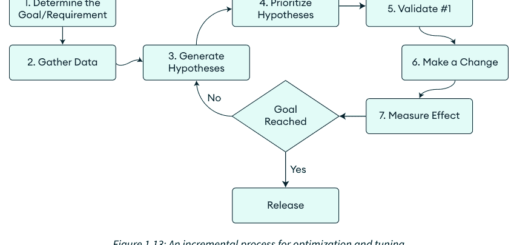

图 1.13：优化和调优的增量过程

让我们详细回顾这些步骤：

- 1. **确定目标/需求：** 复杂系统中总有改进的空间。如果在流程开始时没有达成一致的目标，性能调优可能会成为永无止境的任务。随着市场或需求的变化，目标可能会成为一个移动目标。在项目开始前，请与项目发起人和利益相关者达成一致，确定性能需求将是什么。性能需求应为 **SMART**，即代表 **具体、可衡量、可实现、相关且有时限**。 “尽可能快” 并不是很具体、可实现或有时限。 在 1GHz 4 核 CPU 上实现每秒 100 万次查询，IOPS 为 3k 是不可实现的。需求还应与终端用户相关。

这也是思考系统可扩展性极限的好时机。假设数据不能无限制地永远增长，数据将如何随时间过期或归档？数据归档时的性能目标是什么？
- 2. **收集数据：** 首先收集数据。工作集是频繁使用的数据和索引的大小。工作集是否能放入内存？我们将在本书后面看到此计算的示例。总的来说，要注意特定操作的成本。例如，如果你的应用程序有一个管理员功能，偶尔会对大型数据集运行查询，那么数据可能不会在任何缓存中。最坏的情况下，数据库必须从不同的磁盘位置检索每个文档，从而导致 I/O 操作。你的系统对 I/O 带宽有一定的限制，而这在同一时间运行的所有查询之间共享。
- 3. **生成假设：** 接下来，生成假设，或对当前瓶颈的可能解释。通常会有多个可能的假设。最好召集一群人一起头脑风暴。每个人在系统的不同部分都有不同的经验水平。然而，每个人都会基于自己的经验有自己的偏好理论。有时讨论可能会在某个领域陷入僵局。起初，专注于数量；尝试让人们在没有评判或分析的情况下提出可能的假设。
- 4. **优先排序假设：** 然后，逐一审查每个假设并尝试对其进行优先级排序。注意任何可能支持假设的证据或数据。同样重要的是要框定讨论时间，不要在任何一个假设上花费太多时间。
- 5. **验证 #1：** 现在我们有了 #1 假设或主要嫌疑人，我们需要确定一个可以证明或证伪该假设的测试。例如，如果我们认为系统的特定部分可能受 CPU 限制，请尝试增加其运行的服务器的大小。
- 6. **做出更改：** 接下来，做出应能改善情况并证明假设的更改。例如，你可以增加 IOPS 数量，或减少或增加应用程序中的线程数量。理想情况下，你应该一次只做一个更改。
- 7. **衡量效果：** 最后，衡量性能变化。希望它有所改善。如果总体性能需求得到满足，你可以发布并庆祝。如果没有，你需要撤销未奏效的更改，然后迭代并查看下一个假设和瓶颈。

优化不是一次性任务。它是一个结构化、迭代的过程。通过按顺序遵循步骤并避免跳步的诱惑，你可以防止常见的陷阱并在系统性能上实现可衡量的改进。

## 摘要

本章首先描述了系统的一般特征，以及在更改它们时系统如何以令人惊讶的方式表现。然后我们在深入研究数据服务和 MongoDB 的高层视图之前，先总体了解了软件系统和性能原则。我们列出了一些潜在的瓶颈或限制因素，然后查看了两个具体示例，并描述了在为性能调优系统时可使用的流程。

我们还探讨了 MongoDB 的架构，该架构旨在性能考虑。其文档模型弥合了僵化的关系数据库和简单的键值存储之间的差距，在不牺牲功能的同时提供灵活性。我们查看了存储引擎、查询优化器和复制机制等组件。

通过整合传统上需要多个专用系统的内容，MongoDB 帮助组织在满足多样化数据需求的同时降低运营复杂性。这种方法并不是为了以简单性牺牲功能；而是通过深思熟虑的设计使强大的功能更易于访问。

在下一章中，我们将通过探讨 MongoDB 如何处理模式设计以及如何为最佳性能设计，从而更深入地研究 MongoDB 的架构。

## 参考文献

- 1. Meadows, Donella H. *系统思考：入门读本*. Chelsea Green Publishing, 2008.


