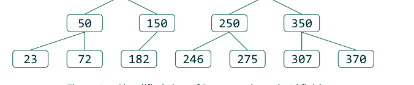
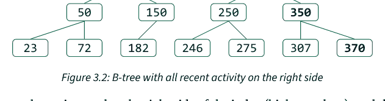
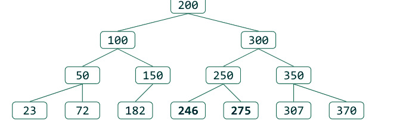

# 3 索引

## 索引

最常见的数据库操作是什么？它是查询，或读取单个文档或多个文档。我们只插入一次文档，有时更新它们，而读取很多次。因此，确保这些读取尽可能快非常重要。

在本章中，您将学习如何使用索引来提高查询性能。您将首先了解索引是什么以及 MongoDB 如何使用它们。然后，您将探索查询计划以及如何解释它们以识别缓慢或低效的操作。您还将练习创建和使用索引来加速查询，并了解 MongoDB 如何选择使用哪个索引。到本章结束时，您将能够就何时以及如何使用索引来优化性能做出明智的决策。

本章将涵盖以下主题：

- Indexes and the types of indexes MongoDB supports
- Cardinality, selectivity, and how they affect indexes
- Best practices for optimizing compound indexes
- Why partial indexes and covered index queries are important for performance

## 介绍索引

让我们从一个基本示例开始。假设您有一个订单集合，并且您想要找到 ID 值为 295 的订单：

```
db.orders.find({ orderId: 295 })
```

如果没有索引，MongoDB 必须检查集合中的每个文档，以查看它是否具有 orderId 字段，然后查看其值是否为 295。对于包含数百万文档的集合，这可能非常缓慢。它导致时间复杂度为 O(n)，意味着所需时间随文档数量线性增长。


这与搬家时把所有东西装进箱子类似。如果你没有花时间整理、分组并标记箱子，那么以后寻找特定物品就意味着要翻遍所有东西。这并不高效，但在打包时确实能节省时间。数据库索引的工作方式也一样。你必须决定是在打包（写入）时花时间整理和标记物品更重要，还是在搜索物品（读取）时可以多花点时间。大多数情况下，明智的做法是提前花一点时间，这样以后查找东西会更容易。

## 什么是索引？

在数据库世界中，索引是一种数据结构，它允许你在不扫描整个集合的情况下快速找到记录。MongoDB 对大多数索引使用一种称为 **B-tree** 的数据结构。

B-tree 是一种自平衡树数据结构，它以排序顺序维护数据并允许以对数时间进行各种操作，即 *O(log n)*。这意味着随着数据的增长，查找文档所需的时间相比于集合扫描会增长得慢得多，而集合扫描随数据大小线性扩展，即 *O(n)* 时间。

让我们深入了解一下。如果我们在 orderId 字段上创建索引，简化的 B-tree 可能看起来像图 3.1 所示：



*图 3.1：orderId 字段上 B-tree 的简化视图*

查找订单 ID 295 时，MongoDB 会按以下步骤进行：

- 1. 从根节点 [200] 开始。
- 2. 将 295 与 200 比较。由于 295 > 200，向右走。
- 3. 到达节点 [300]。
- 4. 将 295 与 300 比较。由于 295 < 300，向左走。
- 5. 到达节点 [250]。
- 6. 将 295 与 250 比较。由于 295 > 250，向右走。
- 7. 继续向右，直到找到 295 或确定它不存在。

此过程需要 O(log n) 时间，远快于集合扫描所需的 O(n) 时间。

叶节点存储索引值以及指向包含这些值的文档的指针（recordID）。因此，当我们到达包含值 295 的叶节点时，我们会找到关联的 recordID，它是指向实际文档位置的指针或引用。如果多个文档共享相同的值，叶节点将包含多个 record ID。B-tree 通常每个节点有超过两个分支，并且像典型的 B+-tree 一样，MongoDB 的 B-tree 只有叶节点中才有数据；内部节点仅用于导航。

有趣的是，使用的是哪种具体数据结构并不重要，重要的是索引值存储在一种 **sorted** 数据结构中，该结构可以高效地进行搜索和按顺序遍历。如果你把索引想成一个排序列表或二叉搜索树，也并不算远。重要的是你可以轻松访问数据并按排序顺序找到它，并且由于它是排序的，所以相对快速（O(log n) 时间）地跳转到特定值或值范围。

## 资源效率与权衡

索引不仅仅是为了加快查询；它们也是高效使用系统资源的关键。当你执行全集合扫描时，你会迫使 MongoDB 将整个集合加载到内存中（具体来说是 WiredTiger 缓存）。这不仅耗时更长，而且还会消耗有限的资源（缓存内存），并可能由于持续的频繁访问而导致大量磁盘 I/O。

相反，当你使用索引时，MongoDB 只需要加载索引的相关部分（通常比集合小），然后获取与查询条件匹配的特定文档（们）。这节省了宝贵的内存和 IOPS，可用于其他操作，使整个数据库更高效。

除了更快的查找外，索引还支持按特定顺序返回结果的要求。如果文档是按索引顺序读取的，你可以避免昂贵的内存排序操作。总而言之，索引加快查询、最小化磁盘 I/O、降低 RAM 需求并减少整体 CPU 负载。

但索引并非免费；存在权衡。每添加一个索引，就需要在索引值更改时、新文档写入时或现有文档删除时对其进行原子更新。这会减慢写操作。维护索引在内存中使用更多 RAM，同时写入索引和文档会增加磁盘使用。

根据 MongoDB 性能团队进行的测试，每个索引对写延迟的性能影响可能在 5–70% 之间，具体取决于字段数量、索引的整体大小和类型以及你的工作负载。没有公式，唯一可靠的了解写延迟受影响程度的方法是对实际数据和工作负载进行基准测试。这就是为什么你应该在创建索引时具有策略性，避免维护冗余索引，不要只是对所有内容建立索引。

## 资源使用

我们提到索引需要磁盘空间和 RAM，但它们使用多少 RAM 呢？你可以使用 $collStats 查看索引的大小，但索引的大小并不一定意味着它全部必须适合 RAM。就资源使用而言，并非所有索引都相同。有一个误区认为所有索引都必须适合 RAM 才能获得最佳性能，但这只有在你始终访问整个索引时才成立。在设计良好的应用程序中，这可能并非必要。

想象一下，你的应用程序处理具有顺序递增 ID 的订单。新的订单总是比现有订单的 ID 更大。在你的 B-tree 索引中，所有新写入都发生在树的右侧，如图 3.2 所示。



*图 3.2：B-tree 所有近期活动都在右侧*

新订单总是插入到索引的右侧（最高值），并且大多数更新发生在最近的订单上，更不用说旧订单很少被读取了。这就创建了我们所说的右平衡索引。包含旧订单的索引部分很少被访问，因此不会被加载到 RAM 中，可以保持在磁盘上“冷”存储。只有被访问的索引部分（包含最近数据的活动部分）需要在内存中。

可以创建右平衡索引的字段包括任何自然递增的内容，例如：

- 自增 ID，例如订单 ID
- 时间戳和/或日期
- MongoDB 自动生成的 object ID（因为它们包含作为前四个字节的时间戳组件）

相比之下，当你索引一个随机值时，访问模式会跨越整个 B-tree，最终需要将整个索引加载到内存中，使其效率大大降低。可能导致整个索引必须保留在 RAM 中的随机值类型包括以下：

- UUID
- 大多数字符串值（名称、用户名等）
- 任何哈希值

因此，虽然索引大小很重要，但如何访问该索引更为重要。深思熟虑地设计数据访问模式可以显著减少内存使用并提高性能。

## MongoDB 中关于索引的常见误解

关于 MongoDB（以及 NoSQL 总体）有几个常见误区。其中之一是 MongoDB 速度如此之快，以至于不需要索引。这可能仅在你的数据集非常小、所有内容都适合 RAM 且每个查询都很快速的情况下成立，即使它正在执行全集合扫描。对于真实的生产系统来说，这永远不会是这种情况。另一个误区是每个字段都会自动建立索引。在 MongoDB 中，只有主键（the _id field）会自动建立索引。为了在生产环境中获得可接受的性能，你需要分析查询模式并相应地创建正确的二级索引。

## MongoDB 中的索引类型

MongoDB 提供多种类型的索引来优化不同的查询模式。其中大多数使用 B-tree，但并非全部。本章将重点介绍那些使用 B-tree 作为底层结构的索引。


> 索引类型中的字段与属性
> 
> 索引类型可以指你正在索引的字段或分配给索引的属性。前者指定将存储在 B-tree 中的字段；后者更多地关乎索引整体的属性。

让我们来看看一些更常见的索引类型。


## 单字段索引

MongoDB 中的单字段索引是在集合的单个字段上创建的索引。以下是如何在单个字段上创建基本索引的方法：

```
db.collection.createIndex({ fieldName: 1 })
```

在“什么是索引？”部分，我们已经看到过使用 {orderId:1} 的示例，它可以加速针对特定订单 ID 的查询，以及按订单 ID 进行的排序或范围查询。

每个常规集合中都存在一个单字段索引，即 _id 索引，它强制唯一性，尽管在运行命令列出索引时不会明确显示唯一属性：

// Command to show all indexes on collection
db.collection.getIndexes()
// output showing _id index only
[ { "v" : 2, "key" : { "_id" : 1 }, "name" : "_id_" } ]
```

这就是查看特定集合中存在哪些索引的方法。现实生活中你创建的大多数索引都不是单字段索引；然而，每个常规集合默认至少有一个索引：_id 字段上的唯一索引，它是主键。

## 复合索引

复合索引是在多个字段上创建的。以下是创建三个字段索引的示例：

```
db.collection.createIndex({ status: 1, country: 1, zipString: 1 })
```

复合索引存储每个文档的多个字段值，因此每个条目都有多个值连接在一起。B 树按组合值对数据进行排序。让我们看一个按 status、country 和 zip 索引的示例：

| 集合中 status、country 和 zip 的值 | 这些值在索引中存储的顺序 |
|---|---|
| "processing", "US", "10007" | "done", "FR", "" |
| "done", "US", "95401" | "done", "US", "14850" |
| "done", "FR", "" | "done", "US", "90210" |
| "done", "US", "90210" | "done", "US", "95401" |
| "done", "US", "14850" | "processing", "US", "10007" |

表 3.1：索引排序如何影响文档检索

首先，按 status 排序记录，然后按 country，最后按 zip。你可能已经看出，在创建复合索引时字段的顺序非常重要。它允许你仅对第一个字段或其任何前缀字段进行查询时使用复合索引。稍后会详细介绍。

## 多键索引

多键索引在技术上并不是你显式创建的单独索引类型；你仍然是在一个或多个字段上创建索引。但如果这些字段中的任何一个包含数组，MongoDB 会为数组中的每个元素创建索引条目，并将索引标记为多键索引。以下是一个简单示例：

// If documents have: { tags: ["electronics", "sale", "new"] }
db.collection.createIndex({ tags: 1 })
// Creates index entries for "electronics", "sale", and "new"
// all of which point to the same recordID
```

如果任何被索引的字段包含数组，单字段、复合和其他索引都可以被标记为多键。我们将在本章剩余部分以及第 12 章《高级查询和索引概念》中再次探讨其影响。

## 稀疏索引

如果你指定索引应为稀疏索引，则只有包含被索引字段的文档才会被插入到 B 树中。这与常规（非稀疏）索引形成对比，后者会为集合中的每个文档建立索引，即使文档不包含被索引的字段。

以下是如何在 MongoDB 中创建稀疏索引的方法：

// sparse is an attribute of index being created
db.collection.createIndex({a:1}, {sparse:true})
```

上述语句在 a 字段上创建索引，仅包含存在 a 字段的文档。

由于 MongoDB 查询语言（MQL）的空值语义，字段缺失的非稀疏索引文档与字段存在且值为 null 的文档被索引的方式相同。在稀疏索引中，null 条目表示字段存在且被设置为 null。我们将在第 12 章《高级查询和索引概念》中进一步探讨这一点。

## 通配符索引

通配符索引允许你在事先不知道字段名称的情况下指定索引。在动态模式中这种情况并不少见：

// Index fields inside attr subdocument
db.collection.createIndex({ "attr.$**": 1 })
// Sample document
// { ...,
//   attr: {
//     genre: "Mystery",
//     author: "John Smith",
//     pages: NumberInt(298),
//     ...
//   }
// }
// query using the index
db.collection.find({"attr.pages":{$gt:500}})
```

这允许你使用 attr 下存储的任何属性的索引进行查询，而无需为每个属性创建单独的索引。通配符索引默认情况下为稀疏索引。

## 部分索引

有时，你可能只想对文档的子集进行索引和查询。部分索引仅对匹配指定过滤器的文档建立索引。此命令在两个字段上创建索引，但仅对 status 等于 "processing" 的文档建立索引：

```
db.orders.createIndex(
  { country: 1, dateOrdered: 1 },
  { partialFilterExpression: { status: "processing" } }
)
```

包含 {status:"processing"} 以及其他查询谓词的查询将能够使用此部分索引。

使用部分索引可以显著减小索引大小并节省资源。当你的查询仅针对集合中的一小部分时，这尤其有用。例如，如果你经常只查询活跃文档，而活跃文档只占数据的一小部分，那么具有部分过滤器 {active:true} 的索引将既紧凑又高效。当文档更新为 {active:false} 时，它会自动从索引中移除。

这不是所有索引类型和属性的详尽列表；你可以在 https://www.mongodb.com/docs/manual/indexes/ 的 MongoDB 服务器文档中阅读更多相关信息。

## 设计高效索引

索引是 MongoDB 性能优化策略的基石，能够在大型数据集上实现快速高效的查询和排序。然而，设计有效的索引不仅仅需要理解其基本功能；它要求仔细考虑查询模式、字段基数和操作需求。关于低基数字段和不等式查询的常见误解常常误导开发者，但正确的索引策略可以大幅提升性能。复合索引、索引压缩、覆盖查询和部分索引为优化数据库操作提供了强大的工具，而 **Equality, Sort, Range**（ESR）准则简化了围绕字段排序的复杂决策。

在本节中，我们将探讨索引设计的基石原则，涵盖基数与选择性、复合索引设计、前缀压缩、部分索引以及索引如何支持聚合管道等关键主题，为你提供设计可最大化应用程序性能的索引的工具。

## 基数与选择性

存在一种常见的误解，即低基数字段（具有少量唯一值的字段）不应包含在索引中。这完全不正确。

**基数**在数据库中指的是某个字段可以拥有的不同值的数量。布尔字段的基数为二：true 或 false。唯一 ID 字段的基数等于集合中的文档数量。姓氏的基数高于名字。基数对于查询有效性的重要性不如选择性，即查询中特定值在集合中匹配的文档数量。

例如，假设一个 orders 集合具有 status 字段，其值可以是 "processing" 或 "done"。在任何给定时间，status 为 "processing" 的订单少于 0.01%，因为大多数订单都是 "done"。在 status 上建立索引对于查询处理中的订单非常优秀，因为它具有高度选择性，即使该字段基数较低。另一方面，使用该索引查找所有已完成的订单帮助有限，因为它匹配集合中 99.99% 的所有文档。


这让我们想到一个相关的误解，即不等式查询（如 $ne）无法有效使用索引。这是错误的！如果你在同一个 orders 集合中查询 {status: {$ne: "done"}}, 其选择性与查询 {status: "processing"} 一样。MongoDB 查询引擎对其处理略有不同（它被处理为范围查询），但由于其选择性很高，仍然非常高效，尽管它会使用不同的查询计划：

// For {status: {$ne: "done"}}, the index scan uses:
"indexBounds": {
  "status": [
    "[MinKey, \"done\")",
    "(\"done\", MaxKey]"
  ]
}
// For { status: "processing" }, the index scan uses:
"indexBounds": {
  "status": [
    "[\"processing\",\"processing\"]"
  ]
}

这些是 explain 方法输出的示例，我们将在第 12 章《高级查询和索引概念》中更详细地讨论，在那里我们开始尝试调试查询并验证我们的索引对性能的帮助程度。了解操作是相等查询还是范围查询对于我们下一个主题——复合索引中字段的排序非常重要。

## 构造复合索引

最优的复合索引需要理解不同的查询如何使用它们。复合索引按定义的顺序索引多个字段，而该顺序显著影响 MongoDB 使用索引的方式。

MongoDB 中的复合索引包含多个字段，并首先按第一个索引字段的值对文档进行排序，然后按第二个字段，以此类推。内部它像一个排序的树结构组织，当查询匹配索引键模式的开头时，能够实现高效的遍历。例如，对 {a:1, b:1, c:1} 的复合索引允许 MongoDB 高效地定位匹配以下过滤查询的文档：

```
{ a: <value> }
{ a: <value>, b: <value> }
{ a: <value>, b: <value>, c: <value> }
```

这被称为 **前缀匹配**。查询必须匹配索引字段的前缀才有资格使用该索引。跳过第一个字段的查询，例如 {b:<value>} 或 {c:<value>}，无法使用此索引。在这些情况下，MongoDB 会执行全集合扫描。

让我们看一个更实际的例子。假设你创建了一个这样的复合索引：{category:1,price:1,stock:1}。

此索引适用于诸如 {category:"books"} 或 {category:"books",price: {$lt:20}} 的查询。使用排序列表可以帮助我们可视化索引的利用方式：

```
"books",10,399
"books",13,205
"books",15,11
"books",22,0
"pens",2,175
"pens",5,42
"pens",12,109
"pens",15,98
```

当列表按 category 然后按 price 排序时，很容易快速找到所有 books 或所有 pens，一旦找到一个类别，就很容易找到“价格小于 $20”的范围并按价格顺序返回这些记录。

然而，你可以看到，如果我只是询问所有价格小于 $20 的商品而不指定类别，我们就必须遍历每个类别值，这会使索引的实用性大打折扣。这是因为查询跳过了 category 字段。由于索引首先按 category 排序，MongoDB 没有有效的方法仅通过价格来隔离相关文档的范围。而且索引完全无法用于回答诸如“哪些商品的库存为 0”之类的查询。对于该查询，我们不妨执行集合扫描。

理解前缀匹配的工作原理对于设计与应用程序最常见查询模式相符的复合索引非常重要。

## 相等查询

一种常见的查询模式涉及在多个字段上使用相等。例如，假设你存储的地址大多在美国，其中适用以下情况：

- country 通常为 "US"（低基数）
- state 有约 50 种可能性（中等基数）
- zipString 有超过 42,000 个唯一值（高基数）

假设我们始终对这三个字段使用相等进行查询：

```
db.collection.find({country: "US", state: "NY", zipString: "10001"})
```

哪个复合索引的性能会更好？

- 选项 1：{ country: 1, state: 1, zipString: 1 }
- 选项 2：{ zipString: 1, state: 1, country: 1 }

常规的智慧，或你的直觉，可能会说选项 2 因为最具选择性的字段排在最前面。但事实证明，这并不会使查询运行得更快。对于在所有字段上都有相等条件的查询，两个索引的性能将同样好。这是一个重要的概念需要理解：当选择所有字段时，选项 1 和选项 2 的 B-tree 大小相同，因为它们必须索引相同数量的文档；因此，它们的深度相同，找到特定值对两者来说都是相同的 O(log n)。

话虽如此，如果其他条件相同，你仍应优先选择选项 1。当低基数字段（如 country，可能只有 "US" 或 "CA"）排在前面时，MongoDB 可以更有效地压缩重复值的大段。因为前缀压缩，将低基数字段放在前面会显著减少磁盘和 RAM 上的索引大小：

```
"country_1_state_1_zipString_1": 620 KB
"zipString_1_state_1_country_1": 804 KB
```

这几乎是 30% 的大小差异！更小的索引意味着更少的磁盘使用、更快的加载速度和更高效的内存使用。

仍然可能有合理的理由以某种方式排序字段。例如，选项 2 索引可以为仅 zipString 或 zipString 和 state 的查询提供服务。因此，选择选项 2 而非选项 1 可能有很好的用例，但期望在三个字段上都有相等条件时“查询更快”并不是其中之一。

当我们开始加入范围查询和排序操作时，事情变得更有趣（也更复杂）。

## 排序和范围查询

索引允许我们高效地回答范围查询，因为我们可以快速找到范围一端的数值，然后沿着索引继续，直到达到高于上限的第一个值，如下所示：



图 3.3：使用索引进行高效的范围查询和排序

对于 {field: {$gt: 205, $lt:290}} 的查询，我们找到下限 205，然后沿着叶节点遍历，直到遇到大于上限 290 的值。请注意，我们是从索引中按顺序获取这些值的，因此如果查询有 sort:{field:1}，我们将“免费”获得按排序顺序的值。如果排序表达式为 {field:-1}，我们只需先查找 290，即范围的上限值，然后从右到左扫描索引（即向后而非向前），直到超过 205，即下边界，这将使我们以降序获得值。

如果我们在一个字段上有相等查询，另一个字段上有范围查询会怎样？让我们看一下 {category:1,price:1} 索引和 {category:"books",price:{$lt:20}} 查询。我们已经看到，我们可以轻松找到 category 相等且 price 范围（或排序）的文档：

```
"books",10
"books",13
"books",15
"books",22
"pens",2
"pens",5
"pens",12
"pens",15
```

由于相等字段排在前面，我们可以直接导航到与该值匹配的排序树的部分，并且第二个字段保持有序，因此应用范围过滤同样简单直接。但如果索引是 {price:1,category:1}，这意味着范围过滤在第一个字段上，而相等在第二个字段上会怎样？

索引现在看起来像这样：

```
2,"pens"
5,"pens"
10,"books"
12,"pens"
13,"books"
15,"books"
15,"pens"
22,"books"
```

在此索引中，当我们导航到价格小于 20 的索引范围时，会发现 category 全部混杂。这意味着我们必须扫描更多价格小于 20 的索引条目，并丢弃不匹配相等谓词的条目，这比使用不同的索引结构要多。而且如果我们在第一个字段上应用范围后需要在第二个字段上进行排序呢？同样，因为值不是有序的，我们需要在内存中做更多的工作。

如果我们有相等和排序，相同的概念也适用。如果相等在复合索引的第一个字段上，那么我们在导航到的索引部分中，第二个字段的值仍然“有序”。但如果排序在索引的第一个字段上，那么虽然我们在扫描整个索引时可以按顺序获取这些值，但我们必须不断检查并丢弃第二个字段不等于我们谓词的条目。

如果我们同时有三者：相等、范围谓词以及对另一个字段的排序呢？让我们回到 {category:1,price:1,stock:1} 索引中三个字段的示例以及这些值：

```
"books",10,399
"books",13,205
"books",15,11
"books",22,0
"pens",2,175
"pens",5,42
"pens",12,109
"pens",15,98
```

我们可以看到，如果我们查询 "books" 类别，价格是有序的，但库存不是。如果索引将价格和库存的顺序交换为 {category:1,stock:1,price:1}，我们将得到以下结果：

```
"books",0,22
"books",11,15
"books",205,13
"books",399,10
"pens",42,5
"pens",98,15
"pens",109,12
"pens",175,2
```

现在，我们可以快速找到特定类别中库存为零的商品，或按库存对特定类别进行排序，但我们不再拥有按顺序排列的价格值。因此，如果我们有范围查询和排序或两个范围查询，虽然我们能够从索引中判断文档是否匹配，但我们将无法将检查的索引条目数量限制为仅匹配的那些。

所有这些都引出了我们可以应用的一些通用原则。

## ESR 准则

您可能听说过复合索引的 ESR 准则：

- E: Equality fields first
- S: Sort fields next
- R: Range fields last

虽然这不是硬性规则，但它是一个有用的指导原则，其中一部分是绝对的：先放置相等字段。对复合索引的前导字段应用相等条件，仍可利用其余字段值保持排序的顺序。然而，排序字段和范围字段哪个应放在后面，取决于您的具体需求：

- If avoiding in-memory sorts is critical, then put sort fields before range fields (ESR)
- If your range predicate in the query is very selective, place it before sort fields (ERS) to reduce the number of documents to sort and allow for efficient in-memory sorting

因此，相等条件必须先行，因为多字段排序索引的结构允许我们在仍保留其余字段排序顺序的同时应用相等过滤。

## 使用部分索引最大化资源

有时，我们不需要为每个文档建立索引，特别是如果查询仅针对集合中一个小而明确的子集。在某些情况下，您的多重相等查询可能始终指定一个特定字段且仅有一个值。例如，在正在处理的订单集合中，状态为 "processing" 的订单数量可能远少于标记为 "done" 的订单。另一方面，这些订单更可能是您经常查询的对象。在这种情况下，创建支持对 "processing" 订单查询的索引（并忽略 "done" 订单）比对每个文档建立常规索引要高效得多。

为了支持查询正在处理的订单并获取 zip、state 和 country，我们可以创建以下索引：

```
{status:1, zipString:1,state:1,country:1}
```

该索引已可受益于前缀压缩，但它不会受益于右平衡，即使我们仅查询状态为 processing 的文档，因为当状态更新为 "done" 时，我们现在必须更新索引中通常不读取的部分的页面。我们可以通过仅为状态为 "processing" 的文档建立索引来节省更多空间和资源，如下所示：

```
db.coll.createIndex(
  {zipString:1,state:1,country:1},
  {partialFilterExpression:{status:"processing"}})
```

现在，只有整个集合中的一小部分存储在索引中，当订单更新为状态设为 "done" 时，它将自动被取消索引或从索引中移除，保持其大小较小。

## 覆盖查询：性能的圣杯

覆盖查询是指满足查询所需的所有字段都在索引中的查询，因此 MongoDB 完全不需要查看实际文档。这些查询通常需要的资源最少。以下是实现覆盖查询所需的示例：

```
// We create this index:
db.orders.createIndex({ orderId: 1, status: 1 })

// This query is covered, the index already contains status field:
db.orders.find({ orderId: 295 }, { _id: 0, status: 1 })
```

```
// This query is not covered, we need to fetch documents to get the total field
db.orders.find({ orderId: 295 }, { _id:0, total: 1 })
```

不过有一些限制。覆盖查询通常不能与多键索引一起使用，当需要返回的字段可能是一个数组时。这是因为 MongoDB 需要查看文档以确定要返回的值是标量还是数组。某些 null 查询无法被覆盖，因为索引无法区分包含 null 的字段和不存在的字段。

由于同样的 null 语义，$exists 子句的任何形式都无法从常规索引中确定，因此如果您希望获得高效的索引查询，请遵循规则避免使用 $exists 子句，除非您使用的是稀疏索引。我们将在第 12 章《高级查询和索引概念》中更详细地讨论这个主题。

## 升序与降序索引顺序

如果您注意到了，所有示例都使用了 {field:1} 而不是 {field:-1}。这是因为我们通常不需要将索引以降序存储。查询引擎可以根据需要结果为升序还是降序，从左到右或从右到左扫描 B 树。对此只有一个例外，那就是当您对多个字段进行相反方向的排序时。假设我们有以下查询：

```
db.coll.find({category:"books"}).sort({genre:1, price:-1})
```

要完全支持此查询，我们必须将索引创建为以下其中之一：

```
{category:1, genre:1, price:-1} OR {category:1, genre:-1, price:1}
```

这是因为查询中指定的排序顺序使用了两个相反方向的排序字段（一个升序，一个降序）；因此，这两个字段的索引也应相反顺序以支持排序。由于索引可以向前或向后扫描，我们可以反转这两个排序字段中的任一个的顺序。

## 索引与聚合管道

索引可用于所有需要在集合中查找文档子集的 MongoDB 命令：find、update、delete，甚至 aggregate。但最后一个通常会引起一些困惑：它何时可以使用索引来过滤数据，何时不能？

想想索引的作用：它们通过记录 ID 帮助定位文档。一旦聚合管道将文档转换为新形状，这些索引就不再适用，因为我们处理的是新的内存中文档，它们与我们索引的集合结构不对应。但当聚合需要从实际存在的集合中获取文档时，索引与任何 find 操作一样至关重要。

索引在聚合的 $match 和 $sort 阶段中使用，前提是它们适用于正在聚合的集合中的文档。索引也由访问另一个集合的任何阶段使用，例如 $unionWith（执行新的管道）或 $lookup（基于当前管道中的值在另一个集合上执行查询）。我们将在第 4 章《聚合》和第 12 章《高级查询和索引概念》中更详细地讨论如何确定使用哪些索引。

## 摘要

索引是功能强大的工具，当正确使用时可以显著加快 MongoDB 查询速度。虽然它们提高了读取性能，但会带来轻微的权衡：写入变慢。在大多数情况下，这种权衡对于性能提升来说是值得的。了解不同类型索引的行为非常重要。例如，基于 ObjectID 或其他顺序值的右平衡索引在内存使用上更高效。

在选择要索引的字段时，应关注选择性（字段缩小结果的能力），而不仅仅是基数。在复合索引中，将低基数字段放在前面可以改善前缀压缩，但同时也必须考虑前缀匹配以最大限度地减少创建的索引数量。部分索引可以通过在仅需要为文档子集建立索引时大幅减少索引大小，从而改变游戏规则。此外，覆盖查询（所需所有字段都在索引中）通常是最有效的，因此在设计索引时请牢记这一点。

通过应用这些最佳实践，您将能够很好地构建一个高性能的 MongoDB 数据库，以满足应用程序的需求。在下一章中，我们将探索 MongoDB 强大的聚合框架，并深入探讨更高级的主题，例如查询优化器如何选择索引。


