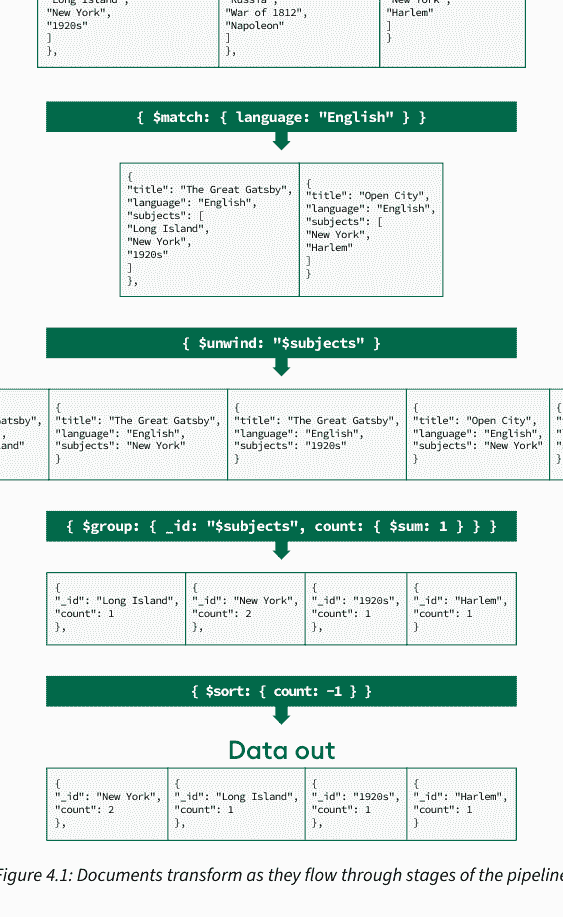
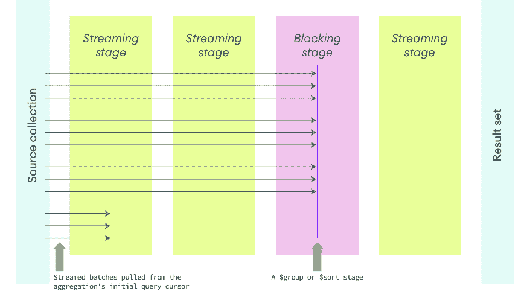

# 4 聚合

## 聚合

如果你曾尝试将数据整理成有意义的洞察，你会知道仅靠原始文档是不够的。你需要切片、切块、转换和汇总。这正是 MongoDB 聚合框架大放异彩的地方。可以把它想象成一条数据装配线：文档从一端进入，在经过各个阶段时经历一系列转换，然后在另一端以转换后的形式出现。它功能强大且灵活，但如果不小心，它可能会成为性能瓶颈。

在本章中，我们将探讨如何构建既强大又高效的聚合管道。我们将研究管道优化策略、内存管理技术、特定阶段的注意事项以及处理大型数据集的方法，始终以性能为北极星。

本章将涵盖以下主题：

- MongoDB 聚合框架的基础
- 聚合管道性能的优化技术
- 处理大型数据集的最佳实践
- 分布式环境和分片集合中的聚合
- 聚合性能的监控、分析与故障排除

### MongoDB 的聚合框架

MongoDB 的聚合框架是数据库世界中数据转换和分析的瑞士军刀。但在深入优化技术之前，让我们先了解这款工具为何如此特别。

在早期，MongoDB 的聚合选项可以说是非常简陋的。开发人员依赖 mapReduce 命令或在客户端代码中处理聚合来执行数据汇总。虽然功能上可行，但这些方法通常笨拙、缓慢且不太易于使用。

聚合管道登场了，这是在 MongoDB 2.2 中引入的变革者。突然间，开发人员可以串联一系列阶段，每个阶段以某种方式转换数据，就像工厂中的装配线或 Unix 命令行管道一样。随着后续版本的发布，聚合框架变得更加强大，增加了新的阶段、操作符、表达式和性能优化，以满足日益复杂的数据处理需求。

如果你来自 SQL 背景，你可能习惯于编写带有多个 JOIN 操作和子查询的 SELECT … GROUP BY … HAVING … 查询。聚合管道提供类似的功能，但有所不同：不是单一的庞大查询，而是构建由阶段组成的管道，每个阶段执行特定的任务或转换。文档从集合流入第一个阶段，然后流入后续阶段，最终作为结果返回给客户端。

这种模块化方法使复杂的数据处理任务更易于阅读和维护，尤其是在处理 MongoDB 中常见的复杂文档结构时。此外，你可以在 MongoDB 聚合中做一些事情，包括处理复杂文档数组，这可能会让传统的 SQL 查询因其复杂性而面红耳赤。

### 聚合管道的核心概念

把你的数据想象成一条河流，每个管道阶段就像改变流向的坝、过滤器或涡轮。文档进入管道，由每个阶段转换，最后以你想要的结果集形式出现。这与使用 Unix 命令行管道对大型文本文件进行多次转换非常相似：

```
grep xxx file.log | cut .. | sed | sort | head -20
cat file.log | awk '{print $2, $NF}' | ... >> newfile.log
```

阶段的顺序非常重要！尽早过滤会极大地减少下游的工作量。每个阶段仅在其从前一阶段接收到的文档上工作，其输出成为序列中下一阶段的输入。

### 数据输入

```
{ $match: { language: "English" } }
```

```
{ $unwind: "$subjects" }
```

```
{ $group: { _id: "$subjects", count: { $sum: 1 } } }
```

```
{ $sort: { count: -1 } }
```

### 数据输出



图 4.1：文档在流经管道阶段时发生转换

管道中的所有内容都使用特定的语法来实现其魔力：

- **阶段**定义发生何种类型的转换，例如用于过滤文档的 `$match` 阶段、用于分组或聚合的 `$group`、用于添加新字段或更改现有字段值的 `$set`，以及用于更改文档流中顺序的 `$sort`。MongoDB 提供了许多此类阶段，每个阶段都有特定用途。你可以在 https://www.mongodb.com/docs/manual/reference/operator/aggregation-pipeline/ 探索完整列表。
- **聚合表达式**例如 `$eq`、`$gt`、`$in` 和 `$convert` 用于评估、计算和分配新值。
- **路径表达式**让你能够使用当前字段中的现有值。
- **累加器表达式**例如 `$sum`、`$avg`、`$push`、`$min` 和 `$max` 在分组阶段中使用，对分组数据执行聚合。

聚合框架中的表达式使用类似 JSON 的语法。你会看到很多美元符号（$）；它们表示操作符、表达式或字段路径。表达式可以嵌套，从而实现强大而灵活的计算。例如，你可能会使用 `$add` 对两个字段求和，使用 `$cond` 或 `$switch` 实现条件逻辑，或使用一系列内置操作符进行算术、字符串操作、日期处理和逻辑操作。

你可以使用字段路径表示法引用文档中的字段（简单字段使用 "$fieldName"，嵌套字段使用 "$object.nestedField"）。框架还支持多种类型的变量，包括系统变量，例如 `$$ROOT` 用于引用整个文档或 `$$NOW` 用于获取当前时间，并允许你设置自己的变量以提高可读性。

### 性能考虑

虽然聚合框架功能强大，但它并非魔法。大量性能取决于你如何构建管道。设计良好的管道可以非常快速，而设计不良的管道可能会让你的数据库瘫痪。关键在于思考数据如何在管道中流动以及每个阶段会对性能产生什么影响。

例如，使用 $match 尽早过滤文档可以大幅减少后续阶段需要处理的数据量。有效使用索引也至关重要。就像常规查询一样，能够使用索引快速找到所需文档的管道，其性能远高于必须扫描整个集合的管道。

正如我们将在下一节看到的，MongoDB 的查询优化器会自动做很多工作来改善性能，但了解这些优化背后的原理将帮助你编写更好的管道。

### 聚合管道流程

在解析管道后，MongoDB 的查询优化器会分析它并尝试使其尽可能高效。它可能会重新排序阶段以提高性能（确保不会改变结果），合并兼容的操作，将过滤器推近数据以有效利用可用索引，并根据管道结构创建最佳执行计划。它还会分析管道使用原始文档中的哪些字段，以限制从集合引入管道的数据量。

在内部，MongoDB 以流式方式将文档批次发送通过管道。每个阶段从前一阶段接收一批文档，应用其转换，并将结果传递给下一阶段。这种设计最大限度地减少了内存使用，并允许高效处理大型数据集。

然而，并非每个阶段都能将每个批次传递给下一阶段，因为某些阶段需要在将任何内容传递下去之前看到所有输入。想想 $sort，它在看到最后一个文档之前不知道最高或最低值是多少，或者 $group，它在看到每个文档之前无法知道每个分组是否完成。你会听到那些阶段被称为阻塞阶段，与流式阶段相对。流式阶段可以在完成自己的工作后继续流式传输每个文档批次，但阻塞阶段必须在任何文档传递给下一阶段之前接收所有文档。




图 4.2：具有流式和阻塞阶段的聚合管道

在分片集群中，当管道涉及来自多个分片的文档时，MongoDB 会在合并结果之前尽可能在各个分片上执行管道，以分散工作负载。例如，过滤和转换阶段在分片上执行，减少了跨网络传输的数据量，而诸如分组或排序之类的操作仅在分片上进行初步工作，然后可能需要合并中间结果并在 mongos 路由器上完成工作。

MongoDB 正在做很多工作来加速你的管道。这留给你的优化空间是什么？

## 优化聚合管道

聚合管道中阶段的顺序会显著影响性能。虽然 MongoDB 的查询优化器非常智能，可以自动重新排序阶段，但了解这些优化可以帮助你设计更好的管道。

MongoDB 的查询引擎执行的管道与传递给查询优化器的管道略有不同。你可以使用 explain() 方法比较实际将要执行的管道与你编写的管道，该方法揭示了 MongoDB 为提高效率如何转换你的管道。使用 explain("executionStats") 或 explain("queryPlanner") 运行聚合以检查 MongoDB 执行的转换后管道。使用 "executionStats" 还会显示从一个阶段流向下一个阶段的文档数量，以及到目前为止所花费的总时间。这使你可以看到哪些阶段耗时且应检查以便可能重构，以及哪些阶段对整体延迟的贡献极小，以至于在运行完整管道时尝试微调它们不会明显：

```
db.collection.explain("executionStats").aggregate([{$match:{a:1 }}, {$match:{b:{$gte:2}}}, {$set:{x:"$y"}}, {$set:{a:"$b"}},{$project:{a:1, c:{$add:["$d","$e"]}, _id:0}}])
{
  stages: [
    { '$cursor': { queryPlanner: {
        parsedQuery: {'$and':[ {a:{'$eq':1}}, {b:{'$gte':2}} ]}
        winningPlan: {
          stage: 'PROJECTION_SIMPLE',
          transformBy: { b: 1, d: 1, e: 1, y: 1, _id: 0 },
          inputStage: {
            stage: 'IXSCAN',
            keyPattern: { a: 1, b: 1 },
            // ...
        },
      },
      executionStats: {
        executionSuccess: true,
        nReturned: 45,
        executionTimeMillis: 2,
        totalKeysExamined: 45,
        totalDocsExamined: 45,
        executionStages: {
          stage: 'PROJECTION_SIMPLE',
          nReturned: 45,
          executionTimeMillisEstimate: 0,
          transformBy: { b: 1, d: 1, e: 1, y: 1, _id: 0 },
          // ...
        }
      },
    },
]
nReturned: Long('45'),
    executionTimeMillisEstimate: Long('2')
}, {
    '$set': { x: '$y' },
    nReturned: Long('45'),
    executionTimeMillisEstimate: Long('2')
}, {
    '$set': { a: '$b' },
    nReturned: Long('45'),
    executionTimeMillisEstimate: Long('2')
}, {
    '$project': { a: true, c: { '$add': [ '$d', '$e' ] }, _id: false },
    nReturned: Long('45'),
    executionTimeMillisEstimate: Long('2')
} /* ... */ ]}
```

这里，你可以看到执行的阶段。第一个阶段称为 $cursor，尽管看起来它正在执行 $match 阶段。它在 transformBy 字段中显示了它返回的字段，你可以看到 $set 和 $project 阶段几乎没有花费任何时间，因为每个阶段显示的是到该阶段为止累积花费的时间，这意味着每个非 $cursor 阶段的执行时间为 0 毫秒。

## 优化技术

让我们看看各种优化技术以及它们如何帮助你的管道运行更快。

## 尽早过滤数据

虽然 MongoDB 会自动重新排序阶段，但了解这些重新排序背后的原理可以帮助你编写性能更好的管道。总体思路是尽可能早地减少数据量：

- 尽可能早地放置 $match，并确保它可以由索引支持，这将确保只有必要的文档一开始就会被带入管道，减少需要从缓存（或更糟，从磁盘）读取并处理的文档数量
- 尽可能早地在管道中放置 $sort，并确保它可以由索引支持


## 避免过早使用 $project 阶段以保留管道优化

手动删除不使用的字段是不必要的。管道优化阶段已经会自动为你完成这项工作，通过检查管道使用哪些字段并避免获取未使用的字段。这种自动管道优化可能会因添加不必要的早期显式包含 $project 阶段而被无意中破坏，因此不要在管道末尾之前使用 $project 来重命名或以其他方式将结果 reshape 为客户端期望的形式。

MongoDB 可以将某些阶段合并为单个更高效的阶段。这种合并减少了开销并加快了执行速度。作为最佳实践，你可以自行分组相似的操作并避免不必要的阶段以帮助优化器完成工作，但不要花费太多时间，因为其中一些阶段可能已经非常快。另一方面，通过做正确的事情，一些阶段可以显著加速：

- 当 $sort 阶段紧接着 $limit 阶段时，MongoDB 通过将它们合并并仅跟踪前 N 个排序文档来优化此操作，显著减少了排序的内存使用。这被称为 top-N 排序，其性能远高于对整个数据集进行排序然后仅保留前 N 个值。
- 多个相邻的 $match 阶段通常会合并为单个 $match 阶段，将其过滤条件与隐式 AND 组合，因此你不需要自己合并它们。但请确保你有复合索引来支持合并过滤器中的条件。

总的来说，当 MongoDB 查询系统可以优化的阶段被放置在管道早期时，它们会被下推到查询子系统，只有查询返回的文档才会在管道中处理。查看 explain 输出时，这通常表现为第一个阶段为 $cursor，并且会吸收所有早期阶段，如 $match、$sort 和 $limit。在没有进一步聚合阶段且完整的聚合管道可以用 find 命令表达的情况下，它实际上会与等效的 find 命令相同执行，并且 explain 不会显示任何额外的聚合阶段。

在本节中，你看到了当某些阶段被放置在管道早期时如何被下推到查询子系统。它们应与等效查询以相同的方式进行优化。现在让我们看看一些其他可能具有挑战性的阶段和场景。

## 避免不必要的 $unwind 和 $group

$unwind 阶段用于展平数组，常被误解为性能罪魁祸首，但实际上它本身并不慢或有问题。挑战在于对其结果的处理。当展开或展平数组是为了对结果文档应用某些阶段，但随后结果又使用 $group 重新分组（以 "$_id" 作为分组键，将它们重建回原始文档）时，使用 $unwind + $group 总是错误的。相反，应该在不解构文档的情况下使用一个或多个数组处理表达式。

$map 表达式允许你操作数组中的每个元素并返回结果数组，从而允许就地转换数组元素。其他数组表达式包括 $filter，它仅返回满足给定条件的数组元素，$sortArray 用于对数组元素进行排序，以及 $reduce 用于在不展开的情况下在文档内聚合数组元素。

当然，有时在 $group 之前展开是唯一正确的选择，特别是当你需要在多个文档中按单个数组元素分组时。在这种情况下，如果你不打算保留所有元素，可以在 $unwind 之前使用 $match 和 $elemMatch 对数组元素进行匹配。这允许你使用数组字段上的索引来提高性能。

## 设计高效的 $group 操作

$group 阶段可能非常消耗内存，特别是在分组键基数很高或每个分组文档都很大时。$group 必须为遇到的每个唯一组维护当前状态。如果按其分组的字段（$group 内部的 _id 字段）具有许多唯一值，此阶段可能需要在内存中存储比允许的更多数据（默认情况下，任何单个阶段的内存限制为 100 MB，我们稍后会讨论）。

为了控制分组大小，仅在分组中保留必要字段和值，并且除非绝对必要，否则避免使用 $push 整个传入文档。

不同的累加器也可能具有不同的性能特征。诸如 $sum、$avg、$min、$max、$first 和 $last 之类的累加器通常是高效的，因为它们每个组只需要维护一个运行值。相比之下，当 $push 和 $addToSet 将许多项累积到数组中时，尤其是这些项很大时，会更消耗内存。


If the input to $group is already sorted by the group key and another value, the engine can optimize some groups without storing all distinct group keys in memory simultaneously. For instance, using a descending $sort followed by $group with $first to find the highest value per group is significantly more performant than having a $group stage use $max to compute the same highest value. Of course, this optimization relies on having the index on $group + $first values to use:

```
db.coll.explain("executionStats").aggregate([
    {$sort:{state:1, groupId:1}},
    {$group:{_id:"$state", firstGroup:{$first:"$groupId"}}} ])
{
    "stages" : [
        {
            "$cursor" : {
                "queryPlanner" : {
                    "namespace" : "test.coll",
                    "optimizationTimeMillis" : 0,
                    "winningPlan" : {
                        "isCached" : false,
                        "stage" : "PROJECTION_COVERED",
                        "transformBy" : {
                            "groupId" : 1,
                            "state" : 1,
                            "_id" : 0
                        },
                    "inputStage" : {
                        "stage" : "DISTINCT_SCAN",
                        "keyPattern" : {
                            "state" : 1,
                            "groupId" : 1
                        },
                        "indexName" : "state_1_groupId",
                    }
                }
            }
        }
    ]
}
// ...
```

The explain output shows the DISTINCT_SCAN plan being used to find the first value of each group.

## Avoid common $lookup performance issues

The $lookup stage enables *joins* between collections, but it can be a performance bottleneck if not used with care. Understanding two *types* of $lookup is crucial:

**Local/foreign field lookups** (the *standard* form using `localField` and `foreignField`) compare fields between collections using regular `find` semantics. MongoDB executes these the same way as if you had a `$match` stage as the first *inner* pipeline stage, which uses the value of `localField` in `find` with the `{foreignField: {$eq: <localField-value>}}` condition when `localField` is a scalar, or `{foreignField: {$in: <localField-array>}}` when the `localField` value is an array. This allows all indexes on the `from` or foreign collection to be used the same way they are used in normal `find` commands with the `$eq` or `$in` operators.

> **Using the pipeline option for enhanced joins**
> 
> The pipeline option can be used with *local/foreign* syntax to add more stages to implement additional join conditions, reduce the size of returned documents (that go into an as array), and do any other processing that the join requires.

**Expressive lookups** (not using `localField` and `foreignField` and only using the pipeline option) usually specify the join conditions in an explicit `$match` stage that should be first in the pipeline, and can reference fields from the input documents (assigned to variables in the `let` option) in the sub-pipeline. When there is no condition depending on field(s) from the input documents, this results in an *uncorrelated* subquery, which is only executed once and then its results cached, rather than executing it once for each incoming document in the pipeline. This syntax should only be used when there is *no* equality join condition.

> **Standard versus expressive $lookup**
> 
> The only difference between standard and expressive lookups is that one of them includes `localField` and `foreignField` while the other one does not. They can both specify `pipeline` to add stages to the $lookup execution.

For the localField and foreignField forms, the most critical optimization is to have an index on the foreignField in the foreign (from) collection. This allows MongoDB to efficiently find matching documents. If the foreign documents are large but you will only need a few fields, use $project as the last stage within the aggregation defined in the pipeline field to only keep the necessary fields. If you expect only one value to be returned in the as field and you don’t want to keep it as an array of one, it’s totally free from a performance point of view to immediately follow $lookup with the $unwind stage on the as field as the optimizer will absorb the $unwind stage into the $lookup execution. There are additional optimizations that are available if you plan to use $unwind on the as array; for example, a $match stage on "as.field" that follows the $lookup, $unwind combination will also be pushed down into $lookup as an additional filter:

```
db.a.explain().aggregate([
  { $lookup:{
    from: "b",
    localField: "a._id",
    foreignField: "_id",
    as: "details"
  }},
  { $unwind: "$details" },
  { $match: { "details.date": { $gt: ISODate("2025-05-20T00:00:00.000Z") } } }
])
{  "stages" : [
    { "$cursor" : {
        "queryPlanner" : {
          // ...
        },
        // ...
      }},
    { "$lookup" : {
        "from" : "b",
        "as" : "details",
        "localField" : "a._id",
        "foreignField" : "_id",
        "let" : { },
        "pipeline" : [
          { "$match" : {
            "date" : { "$gt": ISODate("2025-05-20T00:00:00Z") }
          }}
        ]
      }
    }
  ]
}
```

```
],
    "unwinding" : {
        "preserveNullAndEmptyArrays" : false
    }
}}
]}
```

The explain output shows that the $unwind and $match stages are both absorbed into the $lookup stage.

Only use the expressive pipeline option with $lookup, when there is no equality condition on the join at all. In this case, make sure the first stage in the sub-pipeline will be a $match stage that uses indexed fields on the foreign collection. The $match stage will likely use the $expr syntax to bring in variables from each input document that you set via $let, so make sure the referenced field or fields in the foreign collection is/are in an index.

## Efficient use of $project and $addFields

$project and $addFields serve different purposes and have different performance implications. Use $project for inclusion when you need to reshape documents by explicitly controlling which fields to include and what to name them, usually only as the last stage of the pipeline. Use $project for exclusion when you want to unset several fields. You can use its alias $unset in this case for clarity.

Use $addFields (or its alias $set) when you want to add new fields or update/compute existing fields while keeping all other existing fields unchanged. $addFields can also be used to remove fields at the same time, by assigning the unneeded field the value $$REMOVE.

For very complex calculations, it may be clearer to break the work into several stages, each performing a part of the calculation. This can also improve readability and maintainability. It’s not strictly necessary to do that, since using the $let expression and creating temporary variables in your $addFields stage can make writing very complex expressions easier, but multiple sequential $set stages won’t significantly increase execution time on your pipeline, and likely won’t increase it in a measurable way.

Keeping all these techniques in mind will be extra-helpful when your dataset size grows significantly.

## Working with large datasets

MongoDB’s aggregation framework is designed to handle everything from bite-sized collections to datasets that would make a data scientist sweat. But as your data grows, so do the challenges. Let’s explore strategies for working with large datasets and keeping your pipelines running smoothly.

## Aggregation pipeline limits

MongoDB imposes several limits to keep your aggregations from running amok:

- **Result size restrictions:** Each document in the result must adhere to the 16 MB limit. The document maximum size limit also applies to documents that flow between stages. The $facet stage can only return a single document, which cannot be larger than 16 MB.
- **Number of stages limit:** Pipelines can have up to 1,000 stages. If you hit this, it’s probably time to rethink your approach!
- **Memory limit:** Individual aggregation stages are limited by default to 100 MB of RAM. If a stage exceeds this, the aggregation operation will leverage temporary files on disk automatically since allowDiskUse has been enabled by default since MongoDB version 6.0. This option can be disabled if needed for performance reasons, but then pipelines with stages that exceed this threshold will fail and return an error.

These limits are designed to protect your system from runaway workloads, not to restrict thoughtful development. By understanding and working within them, you can design aggregation pipelines that are both efficient and reliable, even at scale.

## Managing memory constraints with allowDiskUse

Blocking stages such as $group or unindexed $sort can be memory hogs, and because of that, there is a 100 MB memory limit on them by default. When you hit that limit, data being kept in memory automatically spills to disk using temporary files. This behavior is controlled by the allowDiskUse option, which by default is set to true. You have two options to avoid using disk for sorts:

- **Optimize your pipeline** to reduce memory usage (the better approach for performance)
- **Explicitly disable disk usage** with allowDiskUse:false, if you prefer operations to fail with an error rather than slow down by having to read and write to disk


虽然默认启用 allowDiskUse 为内存密集型操作提供了安全网，但需要注意磁盘 I/O 明显比内存操作慢得多。在低延迟至关重要的场景中，你可能希望通过设置 allowDiskUse:false 来显式禁用它，这样操作宁愿快速失败，也不愿因磁盘使用而变慢。

仅有某些聚合阶段受此限制；它们都是阻塞阶段：

-   **未索引的大数据集上的 $sort 操作：** 对大量文档进行排序 *没有索引的帮助* 且其后没有立即跟随 $limit，需要将所有待排序文档保存在内存中
-   **具有高基数键和/或每个键产生大结果文档的 $group：** 如果 $group 阶段的 _id 中使用的字段有许多唯一值和/或每个分组需要维护大量数据，则该阶段需要在内存中为每个不同的组维护大量数据
-   **$bucket、$bucketAuto 和 $setWindowFields：** 这些阶段是 $group 的变体，在与 $group 相同的情形下可能消耗大量内存


## 阻塞阶段和内存使用注意事项

并非所有阻塞阶段都可能或可能超过此阶段限制。例如，$count 是一个阻塞阶段，需要计算所有传入文档，但由于它仅输出一个文档作为结果，其内存使用量微不足道。$sortByCount 阶段是一个阻塞阶段，它将所有输入分组为仅包含两个字段的小文档，但随后需要在内存中对它们进行排序。如果你没有在 $sortByCount 之后指定 $limit 阶段，并且你有超过 100 万个不同的分组键值，则结果可能超过 100 MB，但这种情况不太可能。你更可能使用 $limit 而不是向客户端返回数百万个结果。

## 分布式环境中的聚合

分片，我们在第 6 章《分片》中介绍，是 MongoDB 水平扩展的秘诀，但它为聚合管道增加了复杂性。当数据分布在多个分片上时，了解聚合在此分布式环境中的工作方式对于保持性能和避免瓶颈至关重要。

## 为分片集合优化聚合

在分片集群中，聚合管道可以在各分片间并行执行。MongoDB 尝试将尽可能多的工作推送到保存聚合所需数据的每个分片，以最大限度地减少需要在网络上传输的数据量。

如果聚合查询可以通过驻留在单个分片（或一组分片）上的数据得到满足，mongos 将只把查询路由到相关的分片（们）。这是最有效的情况，因为它最大限度地减少了跨分片通信和协调开销。这通常发生在查询包含对分片键的过滤器时，或被聚合的集合仅存在于一个或少数几个分片上时。

如果聚合无法定向（例如，没有对分片键的过滤器且数据存在于多个分片上），mongos 会执行散布-收集操作。它将管道的第一部分发送到保存目标集合数据的所有分片。mongos 然后收集结果并通过自行运行剩余管道来合并它们。也有一些场景下，合并阶段必须在选定的分片上发生，而不是在 mongos 上。

分片键的选择可能决定聚合性能的成败。选择良好的分片键可以使许多聚合查询定向到单个分片，从而显著提高性能。相反，选择不当的分片键可能导致大多数聚合变成散布-收集操作，增加集群的延迟和负载。

## 理解分片本地与合并操作

并非所有管道阶段都相同。有些可以在单个分片上执行，而其他一些必须在 mongos 上合并。使用 explain() 命令确定每个阶段运行的位置。输出将显示管道如何拆分，以及哪些部分在分片上执行，哪些在 mongos 上执行。

所有流式阶段都可以在分片上运行，以及阻塞阶段的第一部分。在某些特殊情况下，即使是 $group 也可以完全在分片上运行，如果你按分片键分组。第一个无法完全在分片上运行的阻塞阶段的最后一部分，以及所有后续阶段，都必须在合并位置运行，通常是 mongos。

尽可能多地在分片上进行处理，以减少网络流量并加快管道速度。如果聚合可以在单个分片上完全运行，则可避免网络延迟和 mongos 上的合并开销。

如果有 $group 阶段，且分组键是（或包含）分片键，每个分片都可以本地执行完整的分组操作，管道继续在本地进行，mongos 只需将结果返回给客户端而无需额外处理。如果分组键不同，或存在另一个阻塞阶段，则分片执行该阶段的初始部分，而 mongos 执行最终合并和所有后续阶段，这会给 mongos 增加更多工作。

合并经常不可避免，但你可以最大限度地减少其影响。管道中的早期阶段（$match）应积极过滤掉文档。每个分片发送到 mongos 用于合并的数据越少，合并操作就越快。

## 监控和剖析聚合性能

即使是最精心设计的聚合管道也可能遇到性能问题。这就是为什么监控和剖析是任何 MongoDB 实践者必备技能的原因。

你已经简要了解了 explain() 方法如何成为窥探聚合管道内部运作的窗口。它揭示了执行计划，显示每个阶段如何处理，使用了哪些索引，以及繁重的工作发生在何处。我们将在第 12 章《高级查询和索引概念》中详细介绍 explain。

要获取聚合的 explain 输出，请在 aggregate() 命令之前将 .explain() 附加到集合名称，使用 aggregate 内部的 {explain:true} 选项，或在 mongosh 中将 .explain() 附加到 aggregate 方法的末尾。常见的详细模式包括以下内容：

-   **explain("queryPlanner")**: 显示查询优化器选择的计划，包括阶段将如何执行以及索引如何被利用
-   **explain("executionStats")**: 执行查询并返回有关执行的详细统计信息，例如返回的文档数（nReturned）、检查的总文档数（totalDocsExamined）、每个阶段后的总执行时间（execTimeMillis）以及索引使用情况
-   **explain("allPlansExecution")**: 与 executionStats 相同，但包含有关 $cursor 阶段中被拒绝查询计划的附加信息和统计信息

使用 explain() 的主要目标是找到改进机会。查找 $match 或 $sort 操作的 inputStage 中的 COLLSCAN（集合扫描），而你期望的是 IXSCAN（索引扫描）。COLLSCAN 表示 MongoDB 必须读取集合中的所有文档才能找到相关文档，这通常效率低下。

诸如 $group 或 $sort 之类的阶段，如果与前一阶段相比 execTimeMillis 增幅很高且处理了大量文档，则可能是内存密集型的。对于 $match 阶段，totalDocsExamined 值相对于 nReturned 较高，表明过滤器选择性不强或未有效使用索引。

你可以查看 $lookup 阶段是否使用了索引，如果使用了，其效率如何。你还可以确保使用的索引是你期望被选中的索引，如果不是，你可以查看是否有冗余的索引可以删除。你还可以查看阻塞阶段是否溢出到磁盘以及使用了多少磁盘空间。如果操作完全在内存中，你可以看到使用了多少内存，以及是否可能接近 100 MB 限制，此时速度会大幅变慢。

经验和剖析通常会揭示导致性能问题的常见模式。

## 利用物化视图

有时复杂聚合的速度可能慢于返回结果所需的 SLA，在这种情况下，你可以定期运行聚合，将其结果缓存到另一个集合中，客户端可以直接查询该集合。

使用 $out 或 $merge 存储中间结果，因为这些阶段会将聚合管道的结果写入指定的集合，然后该集合可以被查询、建立索引或用作进一步聚合的输入。

## 总结

让我们将本章中学到的内容提炼为关键原则，帮助你构建既强大又高效的聚合管道。首先，尽早过滤。你能做的最有影响力的优化往往是最简单的。每个能尽早排除的文档意味着后续每个阶段的工作量减少。这不仅仅是关于在开头添加 $match 阶段，尽管这是你能做的最有影响力的优化。它还包括在你知道不会使用所有文档时添加 $limit 以最小化数据流、不创建不会使用的字段，以及使用 explain 检查管道，确保仅传递必要的数据从一个阶段到下一个阶段。

接下来，策略性地利用索引。索引不仅仅用于 find() 操作；它们对聚合性能至关重要。例如，初始 $match 阶段可以使用索引，就像常规查询一样；早期的 $sort 操作在可能时会使用索引；$lookup 会在 from 集合上使用索引；某些 $group 操作也可以利用索引。关键是确保你的管道结构允许 MongoDB 使用这些索引。例如，当你同时需要过滤和排序时，请确保你有一个支持这两种操作的复合索引。


Also, design with sharding in mind. In a sharded environment, understanding how aggregation stages distribute across shards can make or break performance. For best results, filter on the shard key early to target only specific shards, minimize the number of shards involved, and be aware of which stages force a merge (that is, stop parallel execution). Finally, monitor and measure performance. Keep experimenting, keep measuring, and keep refining your approach. The most elegant pipeline isn’t necessarily the one with the fewest stages; it’s the one that balances readability, maintainability, and performance to deliver insights accurately and efficiently.

With your data processing optimized, it’s time to turn our attention to the pathways that carry your data.

The next chapter explores replication, read preference, and write concern, which are essential for maintaining data availability, consistency, and performance across distributed systems.
