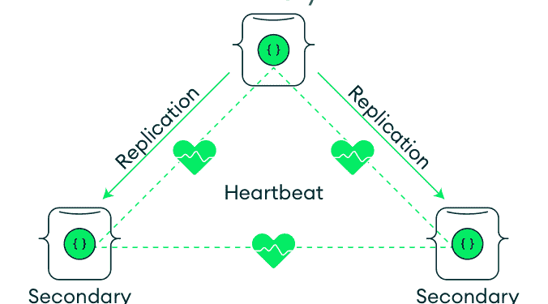
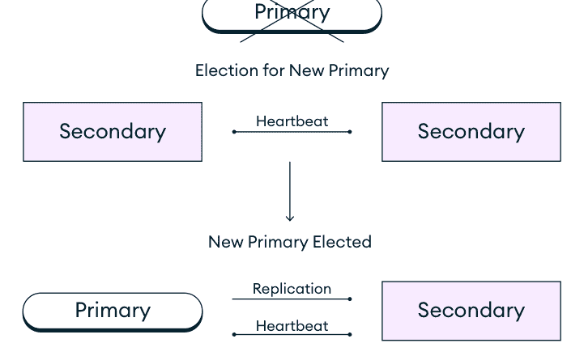
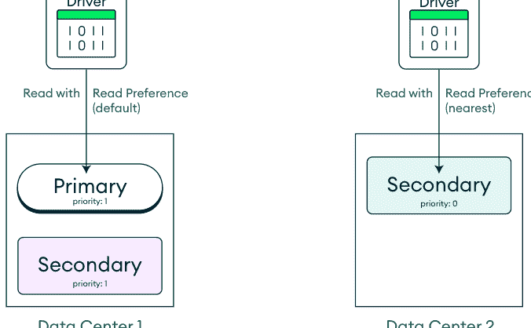
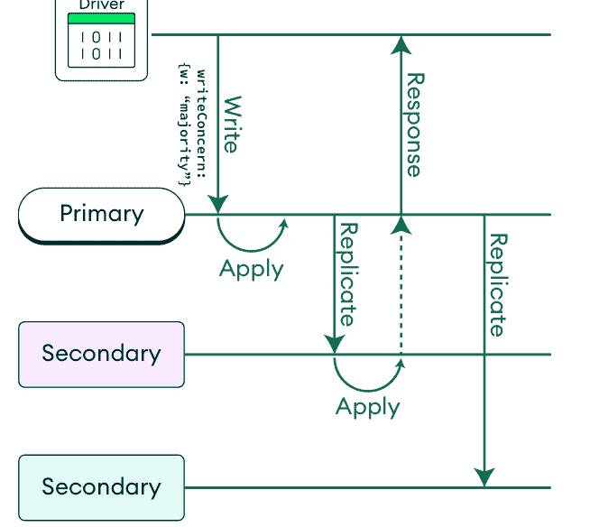

# 5 Replication

## Replication

In this chapter, you'll learn how MongoDB uses replication for continuous operation and automatic failover. Replica sets orchestrate data synchronization across multiple nodes, ensuring your application stays online when hardware or network issues arise. You'll see why the right combination of nodes is crucial for reliability, and how features such as read preference and write concern let you tune your system for performance, consistency, and durability.

You will learn about processes such as elections and failover, and dive into advanced replica set configurations that provide workload isolation, reduce network strain, and keep analytics from interfering with operational queries. By the end of this chapter, you'll have the tools to design, configure, and monitor replica sets for robust MongoDB deployments.

This chapter will cover the following topics:

- How replica sets ensure high availability and automatic failover
- The roles of primary, secondary, and arbiter nodes
- Strategies for balancing performance, consistency, and durability with read/write settings
- Monitoring replication health, diagnosing lag, and handling failover
- Advanced features such as chained replication, analytics nodes, and optimal oplog sizing

### Understanding MongoDB replica sets

MongoDB replication ensures data availability and system resilience by maintaining copies of data across multiple servers, organized into a replica set. Within this set, a single primary server handles write operations, while secondary servers maintain copies of the data, enabling read requests and providing failover capabilities. Read preference controls which servers are utilized for read operations, giving you greater control over which nodes are sent read operations.

Write concern determines the level of confirmation the database provides after a write operation, allowing you to fine-tune the trade-off between write speed and data durability.

These elements combined create a system that can tolerate server failures and manage heavy read loads. Put simply, **replication** makes data copies, **read preference** chooses where to read from, and **write concern** dictates the confirmation level needed after writing data, resulting in a robust database system.

### Components of a replica set

A typical MongoDB replica set includes an odd number of nodes to provide fault tolerance and high availability, and consists of one primary node and one or more secondary nodes:

- **Primary:** The primary node is responsible for handling all write operations. It maintains the latest state of the data and propagates changes to the secondary nodes.
- **Secondaries:** Secondary nodes continuously replicate the primary’s data to maintain updated copies. They can also serve read operations if the application is configured to allow secondary reads.
- **Arbiters (optional):** An arbiter node participates in elections but does not store data. Arbiters are not recommended for use in production configurations; however, if system limitations prevent storing data, they can be used to break ties in voting scenarios when you have an even number of data-bearing nodes.



*Figure 5.1: MongoDB replica set architecture*

Replica sets use an election process to ensure high availability. If the primary node becomes unavailable, an election is triggered to select a new primary. The election process follows these steps:

- 1. A node calls for an election if it believes it can become the primary (for example, if a secondary cannot see a primary).
- 2. Nodes cast votes based on factors such as priority settings, replication state, and availability.
- 3. The node that receives the majority of votes is elected as the new primary.

When designing a MongoDB replica set for optimal performance, you need to carefully consider the number of nodes, their placement, and how to configure election and read preferences. A well-designed replica set configuration can help you balance throughput, fault tolerance, and latency requirements while ensuring high availability for your application.

Having an odd number of voting members in a MongoDB replica set is essential to ensuring that the election process can be completed successfully. When only an even number of voting members are available, it’s more likely that a quorum cannot be reached and the successful election of a new primary may be delayed.

In some deployments, additional secondary nodes may be added to distribute read workloads or support analytics without impacting the primary’s performance. This configuration ensures the high availability of data while also enabling workload isolation through read targeting.

> **Secondaries are for redundancy, not scalability**
> 
> Though read preference enables you to target secondaries for reads, this is not meant to be a mechanism for scaling reads across the cluster. Secondaries provide the cluster with high availability and resilience.

### Replication and high availability

As long as a cluster has a minimum of three nodes (the default in MongoDB Atlas), it will be fault-tolerant and resilient out of the box. In the case of a primary member outage, a replica set election process automatically detects the failure, elects a secondary member as a replacement, and promotes that secondary member to become the new primary.

The entire election and failover process happens within seconds, without manual intervention.



*Figure 5.2: MongoDB replica set failover process*

Failover time is dependent on several factors, including network latency. The MongoDB election process is designed to avoid unnecessary failover and provide flexibility for different deployment needs.

To minimize downtime during failovers, proper election configuration, including appropriate priorities and timeouts, is crucial for ensuring a swift and seamless transition of leadership among replica set members:

- **Node priority**: Assign higher priority values to nodes to influence election outcomes.
- **Election timeouts**: Configure electionTimeoutMillis to balance between quick failover and avoiding unnecessary elections due to temporary network issues. The default of 10,000 (10 seconds) should be suitable for most configurations.

Replica set members exchange heartbeat messages every 2 seconds to monitor each other’s status. If the connection fails due to a network error, depending on the member being monitored, a primary that doesn’t receive a heartbeat from a majority of voting members will step down, whereas a secondary that doesn’t receive a heartbeat from the primary can call for an election. If there isn’t a network failure, and a response isn’t received within the electionTimeoutMillis threshold, the same action will also be taken.

### Understanding the MongoDB election process

As just mentioned, a MongoDB replica set uses a fully automated election process to determine which set member will become the new primary member. Replica sets can trigger an election in response to a variety of events, such as the following:

- Losing connectivity to a primary member for more than the configured time-out (for MongoDB Atlas, the default is 5 seconds, or 10 seconds otherwise)
- Adding a new node to the replica set
- Performing replica set maintenance

During any of these events, sophisticated algorithms control the member election process. The election algorithm processes a range of parameters, including a historical analysis to identify those replica set members that have applied the most recent updates from the primary, heartbeat (ping or connectivity) status, and user-defined priorities assigned to replica set members. This process ensures that the most suitable secondary member is promoted to primary. Once the new primary replica set member has been elected, the remaining secondary members automatically start replicating from the configured sync source, as explained in the upcoming *Chained replication* section. If the original primary comes back online, it will recognize that it is no longer the primary and reconfigure itself to become a secondary member of the replica set and begin catching up.

### Replica set configuration

In this section, we delve into specialized replica set configurations that extend beyond basic primary-secondary setups. These advanced techniques can help you optimize performance, reduce operational overhead, or cater to specific workload requirements. While each feature introduces additional complexities, they can prove invaluable for teams looking to fine-tune their MongoDB deployments.

> **Note**
> Replica set reconfiguration is not available in MongoDB Atlas.


## 链式复制

默认情况下，secondaries 可以从 primary 或另一个 secondary 拉取数据更改（oplog entries）。链式复制使 secondary 能够从另一个 secondary 获取 oplog 数据。这种方法有助于在大型或分布式部署中减轻 primary 的网络负载。链式复制的工作方式如下：

- 1. MongoDB 确定最近或最佳的 secondary 作为同步源。
- 2. 同步的 secondary 持续从该 secondary 源而不是 primary 获取 oplog 条目。
- 3. 更改通过副本集传播，同时 primary 节点的带宽使用量减少。

尽管链式复制有许多优点，但也存在一些缺点：

| 优势 | 劣势 |
|---|---|
| 助力全球分布式部署：远程区域的 secondary 节点可以从地理位置更近的源拉取，减少延迟 | 链中延迟增加：如果下游 secondary 落后，链中依赖它的节点也会落后 |
| 优化网络流量：特别有利于多区域部署，其中区域间的网络带宽可能有限或昂贵 | 故障排除复杂性：更长的复制路径可能会使诊断复制问题变得复杂 |
| — | 级联延迟：影响中间节点的网络问题可能会影响多个下游 secondaries |

*表 5.1：MongoDB 副本集中的链式复制的优势和劣势*

您可以从连接到集群的 MongoDB Shell 调整副本集配置，以允许（或禁止）链式复制：

```
cfg = rs.conf();
cfg.settings = cfg.settings || {};
// true allows secondaries to replicate from other secondaries
// false restricts them to replicate only from the primary
cfg.settings.chainingAllowed = true;
rs.reconfig(cfg);
```

> **Note**
> 
> 链式复制默认启用；然而，在 MongoDB Atlas 中，它对单区域副本集是禁用的。

使用链式复制时，监控变得更加关键。以下脚本也可以从连接到集群的 MongoDB Shell 运行，将打印每个副本集成员的同步源和状态信息：

```
// Check the sync source for each member
rs.status().members.forEach(function(member) {
  print("Member: " + member.name +
    ", Sync Source: " + (member.syncSourceHost || "none") +
    ", State: " + member.stateStr);
});
```

如果启用了链式复制，请更密切地监控复制延迟和多数写入关注点延迟，尤其是在高延迟环境中。

## 副本集标签和分析节点

MongoDB Atlas 提供分析节点，这些是专门的只读节点，用于隔离您不希望影响操作工作负载的查询。它们对于处理分析数据很有用，例如 BI 工具执行的报告查询。在副本集的上下文中，分析节点类似于其他 secondary 成员，但优先级为 0 且不能被选举为主节点。然而，通过副本集标签配置，它们可以从典型的操作工作负载中排除，并使用适当的读偏好专门针对其他工作负载。

例如，要为分析配置成员，可以应用以下副本集重新配置：

```
conf = rs.conf();
conf.members[0].tags = { "usage": "production" };
conf.members[1].tags = { "usage": "reporting" };
conf.members[2].tags = { "usage": "production" };
rs.reconfig(conf);
```

我们已将标签标识为 usage: reporting 的分析节点，可以通过使用适当的读偏好配置来针对特定工作负载，如以下示例所示：

```
db.collection.find({}).readPref("secondary", [{ "usage": "reporting" }]);
```

副本集标签无法直接在 MongoDB Atlas 中配置；然而，Atlas 提供了一组预定义的副本集标签，可用于工作负载隔离，其中一些如下：

| 预定义标签名称 | 描述 | 示例 |
|---|---|---|
| nodeType | 节点类型。可能的值如下：
- ELECTABLE
- READ_ONLY
- ANALYTICS | {"nodeType" : "ANALYTICS"} |
| provider | 节点所配置的云提供商。可能的值如下：
- AWS
- GCP
- AZURE | {"provider" : "AWS"} |
| region | 节点所在的云区域。 | {"region" : "US_EAST_2"} |

表 5.2：MongoDB 副本集成员的常见预定义标签名称

有关 MongoDB Atlas 中可用的预定义副本集标签和可能区域值的完整列表，请参阅 https://www.mongodb.com/docs/atlas/reference/replica-set-tags。

如果应用程序执行复杂或长时间运行的操作，例如 **提取**、**转换** 和 **加载 (ETL)** 或报告，您可能希望通过将这些查询专门定向到分析节点来将应用程序的查询与其余操作工作负载隔离开来。这可以基于前述的预定义标签为连接到 MongoDB Atlas 集群的应用程序进行配置，如下所示：

```
mongodb+srv://<db_username>:<db_password>@abc123.mongodb.net/test?readPreference=secondary&readPreferenceTags=nodeType:ANALYTICS
```

使用前述连接字符串配置应用程序将确保所有读取仅针对应用了 nodeType:ANALYTICS 标签的 secondary 成员。

> **Note**
> 
> MongoDB Atlas 中的分析节点配置的优先级为 0，这会阻止它们被选举为主节点。

## 复制内部机制和性能

MongoDB 中的复制涉及在管理延迟和资源使用的同时保持节点间数据同步的机制。oplog、写入速率的控制以及节点间的延迟等因素都会影响整体性能。平衡这些元素对于维护数据一致性和可用性很重要。在本节中，我们将查看 MongoDB 复制内部和性能考虑的关键方面。

### 流量控制

流量控制是 MongoDB 中的一项功能，当 secondaries 落后太远时，限制 primary 应用新操作的速率。这有助于防止过度的复制延迟，以换取与写入确认相关的略微更高的延迟。

MongoDB 提供内部参数来微调流量控制行为。例如，flowControlTargetLagSeconds 参数定义在触发流量控制之前可接受的延迟阈值，如下所示：

// Check current flow control settings
db.adminCommand({ getParameter: 1, flowControlTargetLagSeconds: 1 });

// Configure flow control settings
db.adminCommand({
  setParameter: 1,
  flowControlTargetLagSeconds: 10
});
```

大多数用例的默认设置 10 秒应该是最佳的，不建议调整它。

**Note**
`setParameter` 管理命令在 MongoDB Atlas 中不可用。

### 复制和 oplog

**操作日志 (oplog)** 是 MongoDB 复制的核心组件。它是一个特殊的 capped 集合，其中节点记录所有写操作。Secondary 节点使用 oplog 来复制更改并与 primary 保持同步。

以下是 oplog 的一些关键特性：

- **固定集合：** oplog 默认具有固定大小，按先进先出（FIFO）方式运行。当 oplog 达到其大小限制时，较旧的条目会自动删除。
- **复制过程：** Secondary 节点持续从 primary 应用 oplog 条目以复制更改。
- **性能考虑：** oplog 的适当大小至关重要。如果 oplog 太小，secondary 节点可能会落后并需要完全重新同步。相反，过度大小的 oplog 可能会消耗不必要的存储。

假设您的工作负载每小时产生 2 GB 的更新。为了确保平滑复制，oplog 应按大小设置以存储数小时的操作，通常超过 24 到 48 小时。这降低了 secondary 节点暂时离线时长时间重新同步的风险。

例如，如果您将 oplog 大小配置为 10 GB，这将提供大约 5 小时的操作历史记录。此缓冲区允许 secondary 节点在短暂的网络中断或维护期间赶上，而无需完全数据重新同步，但如果节点故障导致恢复时间超过 5 小时，则可能太短。

更大的 oplog 为 secondaries 提供了更长的窗口，如果它们因网络问题、资源限制或维护而落后，可以赶上。这在高吞吐量环境中或在 secondary 节点计划停机期间尤其重要。

要确定部署的适当 oplog 大小，请考虑以下因素：

-   您的应用程序的平均写入量和峰值写入量
-   潜在中断的预期最大持续时间
-   数据中心之间的网络可靠性（适用于地理分布式部署）
-   从节点数量（更多的从节点可能需要更大的窗口）

MongoDB 提供了工具来监控 oplog 使用情况并估算当前窗口：

// Check oplog size and replication window
db.printReplicationInfo();

// Sample output:
// configured oplog size: 5120MB
// Log length start to end: 86400secs (24hrs)
// oplog first event time: Wed Apr 02 2025 10:03:25 GMT+0000
// oplog last event time: Thu Apr 03 2025 10:03:25 GMT+0000
// now: Thu Apr 03 2025 10:05:01 GMT+0000
```

oplog 边界可以通过以下两种方式之一设置，大小和时间：

-   size：oplog 的最大大小（以兆字节为单位），可以配置为 990 MB 到 1 PB 之间的任意值
-   minRetentionHours：保留 oplog 条目的最少小时数

由于 oplog 是一个固定集合，当达到这些配置的边界时，oplog 中最旧的条目将被删除。

将 oplog 的配置大小从当前值更改为 16 GB 可以按如下方式进行：

```
db.adminCommand({ "replSetResizeOplog": 1, size: Double(16384)})
```

类似地，如果您希望确保始终有恰好 48 小时的 oplog 内容可用，而不是固定大小，则命令如下：

```
db.adminCommand({ "replSetResizeOplog": 1, minRetentionHours: 48})
```


## 使用 minRetentionHours 时磁盘空间耗尽的风险

当配置了 minRetentionHours 时，oplog 可以无限制地增长以保留配置小时数的 oplog 条目。这可能由于高写入量和大保留期相结合导致系统磁盘空间减少或耗尽。

使用 replSetResizeOplog 更改给定副本集成员的 oplog 大小或最小 oplog 保留期不会更改副本集中任何其他成员的 oplog 大小。您必须在集群中的每个副本集成员上运行 replSetResizeOplog，以更改所有成员的 oplog 大小或最小保留期。

## 管理复制延迟

复制延迟发生在从节点无法跟上主节点处理的事务速率时。如果滞后的节点需要成为主节点，这可能导致读取数据陈旧以及故障转移时间延长。为了最小化复制延迟，请考虑实施以下策略：

| 策略 | 操作 | 考虑因素 |
|---|---|---|
| 优化网络 | 将从节点放置在更靠近主节点的位置或升级网络链路。 | 考虑副本集成员之间的专用网络链路。实施复制流量的带宽优先级。 |
| 扩展资源 | 增加 CPU、内存或磁盘 I/O 容量。 | 升级现有节点的硬件。 |
| 改进读取工作负载定位 | 将密集查询卸载到专为分析而定制的专用从节点，保持其余副本集平衡。 | 配置读取偏好以将特定工作负载定向到适当的节点。 |

*表 5.3：减少 MongoDB 副本集中复制延迟的策略*

通过这些策略主动解决复制延迟，您可以确保更快的故障转移、更一致的读取性能以及 MongoDB 副本集整体更高的稳定性。基于工作负载模式的定期监控和微调将有助于在部署扩展时保持最佳的复制健康状态。

## 读取和写入策略

MongoDB 提供了跨副本集优化读取和写入的灵活策略。读取偏好设置决定哪些节点处理读取查询，在一致性、可用性或延迟之间取得平衡。写入关注点定义了必须确认写入的节点数量，影响数据持久性与写入延迟。

仔细调整这些策略有助于管理延迟并保持弹性。在本节中，我们将介绍 MongoDB 中读取和写入操作的关键方法和注意事项。

## 读取偏好

副本集将包含一个以上可以处理操作的服务器，并且 MongoDB 的客户端库可以根据配置的读取偏好执行服务器选择，以确保操作被路由到期望的服务器。

默认情况下，应用程序将其读取操作定向到副本集中的主成员（即读取偏好模式为 "primary"）；但是，客户端可以指定读取偏好以将读取操作发送到从节点。



*图 5.3：跨数据中心的 MongoDB 读取偏好行为*

读取偏好由读取偏好模式以及可选的标签集列表和 maxStalenessSeconds 选项组成。由于副本集成员可能落后于主节点（由于网络拥塞、磁盘吞吐量低、长时间运行的操作等因素），读取偏好 maxStalenessSeconds 选项允许您为从节点读取指定最大复制延迟或陈旧度。

当从节点的估计陈旧度超过 maxStalenessSeconds 时，客户端将停止将其用于读取操作。默认情况下，没有最大陈旧度，客户端在选择将读取操作定向到何处时不会考虑从节点的延迟；但是，在配置此选项时，您必须指定 90 秒或更长的值。

有许多读取偏好模式可用，它们在最大化可用性和一致性或最小化延迟方面提供不同程度的灵活性。

| 读取偏好模式 | 描述 |
|---|---|
| primary | 默认读取偏好，所有操作都从当前副本集主节点读取。<br><br>为了最大化一致性并避免陈旧读取，应使用此读取偏好模式。 |
| primaryPreferred | 在大多数情况下，操作从主节点读取，但如果主节点不可用，则操作从从节点成员读取。<br><br>此读取偏好模式允许最大可用性，只要主节点可用，一致的读取操作就会被提供。如果主节点不可用，您仍然可以查询从节点。 |
| secondary | 所有操作都从副本集的从节点成员读取。 |
| secondaryPreferred | 操作通常从副本集的从节点成员读取数据。如果副本集只有一个主成员且没有其他成员，则操作从主成员读取数据。 |
| nearest | 为了最小化延迟，操作基于指定的延迟阈值从随机合格的副本集成员读取，而不考虑该成员是主节点还是从节点。操作在计算延迟时考虑以下因素：<br>- localThresholdMS 连接字符串选项<br>- maxStalenessSeconds 读取偏好选项<br>- 任何指定的标签集列表 |

*表 5.4：MongoDB 读取偏好模式*

对于地理分布的应用程序，nearest 读取偏好可以进一步提高读取性能，因为操作将被路由到具有最小延迟窗口的任何成员，如 localThresholdMS（默认 15 毫秒）所定义。

如果副本集成员或成员与标签相关联，您可以在读取偏好中指定标签集列表（标签集数组）以定位这些成员。

例如，考虑以下包含三个标签集的标签集列表：

```
[ { "region": "South", "datacenter": "A" }, { "rack": "rack-1" }, { } ]
```

首先，MongoDB 尝试查找同时标记为 "region": "South" 和 "datacenter": "A" 的成员。如果找到成员，则不再考虑剩余的标签集。相反，MongoDB 使用此标签集查找所有合格成员。

如果未找到成员，则接下来尝试 { "rack": "rack-1" }，然后是最终标签 { }，它将匹配任何合格成员。


**注意**

标签和 maxStalenessSeconds 与 primary 读取偏好模式不兼容。

读取偏好配置允许应用程序根据特定需求定位主或从副本集成员。这可以通过在多个节点之间分配读取负载来增强性能和可用性，减少延迟，并在主节点不可用时确保持续访问数据。

## 写入关注点与持久性

在 MongoDB 副本集中，写入关注点是一个重要的配置选项，它决定了客户端在执行写入操作时从数据库要求的确认级别。此机制直接影响数据持久性与系统性能之间的微妙平衡。

从 MongoDB 5.0 开始，隐式默认写入关注点是 w:"majority"。使用此写入关注点，写入请求确认计算出的多数数据承载投票成员已将更改持久写入其本地 oplog。计算出的多数是通过取以下两者的较小值来确定的：

-   所有投票成员（包括仲裁者）的大多数
-   所有数据承载投票成员的数量。


副本集的写入关注度描述了在操作返回成功之前必须确认写操作的承载数据的成员数量（即主节点和从节点，但不包括仲裁节点）。



*图 5.4：MongoDB 中具有多数确认的写入关注度*

发出写操作的应用程序会等待主节点收到指定写入关注度所需数量的成员确认。对于 w 大于 1 或 w: "majority" 的写入关注度，主节点会等待所需数量的从节点确认写入后，才返回写入关注度确认。对于 w:1 的写入关注度，主节点可以在本地应用写入后立即返回写入关注度确认，因为它有资格计入请求的写入关注度。

确认写入的成员越多，如果主节点失败，已写入的数据回滚的可能性就越小。然而，指定较高的写入关注度会增加延迟，因为客户端必须等待收到请求的写入关注度确认级别。

写入关注度使用两个主要参数指定：w 和 wtimeout。第一个参数（w）决定必须确认写入的节点数量，并可接受以下值配置：

- 数值（1、2、3）：副本集成员的具体数量
- "majority"：（默认）多数投票成员必须确认
- 副本集标签：自定义的副本集成员子集

第二个参数（wtimeout）指定写操作在主节点成功后向足够多的成员传播以达到写入关注度的时限，单位为毫秒。如果超过 wtimeout 值并向客户端返回写入关注度错误，写操作很可能仍然会成功；然而，客户端不会在此期间之后继续等待确认。默认情况下，wtimeout 为“infinity”，因此如果您希望应用程序返回错误而不是等待复制到集群计算出的多数节点成功，您应提供自己的适当 wtimeout 值。

以下示例演示了在插入操作上设置自定义写入关注度，确保写入已由计算出的多数节点确认，并且如果在 5 秒内未得到确认则返回写入关注度错误：

```
db.collection.insertOne(
  { item: "example" },
  {
    writeConcern: {
      w: "majority",
      wtimeout: 5000
    }
  }
);
```

所有 MongoDB 驱动程序都提供在连接级别和每个操作基础上指定写入关注度的能力，从而实现精细控制。

您可以通过发出 setDefaultRWConcern 命令来修改全局默认写入关注度。从 MongoDB Shell 中，假设您拥有适当的权限，可以按如下方式修改此值：

```
db.adminCommand({
  "setDefaultRWConcern" : 1,
  "defaultWriteConcern" : {
    "w" : 2
  }
})
```

前面的示例将全局写入关注度设置为 w:2。如果您发出具有特定写入关注度的写操作，写操作将使用其自身的写入关注度而不是默认值。

我们建议将 w 保留在其默认的 "majority" 值，即使看起来不等待复制延迟会更好。请记住，如果从节点开始落后，流控制将启动并开始限制您的写入。

## Summary

MongoDB 的复制系统为构建高可用且容错的数据库部署提供了坚实的基础。副本集架构结合选举自动故障转移，确保数据库在节点故障时仍能保持数据完整性。oplog 是复制过程的支柱，使从节点能够与主节点保持同步。

在设计副本集时，请考虑诸如数据的地理分布以及适合您工作负载特征的 oplog 大小等因素。这些决策将显著影响数据库的弹性、性能以及满足应用程序特定需求的能力。

请记住，适当的配置不是一次性任务，而是一个持续的过程，应随着应用程序的增长和需求变化而演进。通过持续观察和迭代改进，即使 MongoDB 部署扩展，您也可以保持最佳的复制行为。

在下一章中，我们将探讨 MongoDB 的分片如何与复制协同工作，为具有大型数据集和高吞吐量需求的部署提供水平扩展能力。
