# 6 Sharding

## Sharding

随着现代应用程序生成和存储越来越庞大的数据，确保高性能和可扩展性成为任何数据库系统的关键关注点。MongoDB 的分片架构是一种解决方案，旨在为具有海量数据集和苛刻吞吐量需求的应用程序提供水平扩展。与通常导致昂贵且受限于大小的硬件升级的传统垂直扩展相比，分片通过在多个服务器之间分发数据，提供了一种更高效、更具成本效益的扩展方式。了解分片架构将帮助您处理用户活动激增、全球扩展和不断增长的数据复杂性。

本章深入探讨 MongoDB 分片架构的基础原理，使您能够了解分片如何与复制交互以实现高可扩展性和可靠性。我们将首先检查分片集群的核心组件及其在路由和数据分发中的作用。从那里，我们将探讨诸如选择最佳分片键等关键方面。最后，我们将解决诸如分片键优化、战略数据放置以及处理大规模导入和重新分片操作等实践考虑。通过本章结束时，您将对 MongoDB 的分片生态系统有深入的了解，能够设计支持应用程序不断变化的数据需求的可扩展架构。

本章将涵盖以下主题：

- 分片如何通过在副本集之间分发数据来实现水平扩展
- 分片集群中 shards、mongos 进程和 config servers 的角色和功能
- 选择高效分片键以优化数据分布和查询定位的策略
- 比较针对不同工作负载的基于范围、哈希和基于区域的分片方法
- 使用重新分片在不中断服务的情况下重新分发数据并解决性能瓶颈
- 将相关数据 colocate 以提高事务和聚合查询性能的技术
- 配置和监控均衡器以有效管理块迁移
- 优化分片键以解决诸如巨块或粒度差等问题的方法

## Understanding core sharding architecture

MongoDB 的分片与复制协同工作，为具有大型数据集和高吞吐量需求的部署提供 **水平扩展**。传统上，当工作负载超出数据库服务器的能力时，必须升级到更大的服务器。这被称为 **垂直扩展**，它在任何特定服务器的最大尺寸和价格性能比方面都有限；超级计算机往往非常昂贵！相反，如果您可以将工作负载分发到多个较小的服务器，您可以理论上几乎无限地水平扩展工作负载，理想情况下成本随服务器数量线性增长。当您的工作负载超出单个副本集的能力时，MongoDB 分片允许您这样做。

如果您的工作负载有多个相对彼此隔离的不同数据库，为每个数据库部署单独的副本集是完全可以的。例如，您可能为用户、账户和用户活动分别部署副本集。然而，随着时间的推移，即使是单个集群也可能无法处理您整体应用程序工作负载的特定子集。那时就需要将工作负载分片或分区到多个分片中，每个分片本身都是一个副本集。

因此，当您的数据增长超出单个副本集的处理能力时，分片会将其分发到多个副本集，每个副本集包含您数据的一个子集。这种水平扩展使 MongoDB 能够处理海量数据集和高吞吐量需求。本节回顾分片集群的架构及其重要的性能要素。

## Architectural components of a sharded cluster

分片集群由多个组件组成：**shards**（每个都是负责集群中数据子集的副本集）、**mongos processes**（主要负责将操作路由到不同分片并将结果返回给客户端）和 **config servers**（一个特殊的副本集，维护有关分片配置和集群中数据位置的元数据）。从 MongoDB 8.0 版本开始，config servers 不需要是单独的服务器，可以与其中一个分片嵌入。


mongos 是这里最有趣的组件，因为从驱动程序或客户端应用程序的角度来看，它就像数据库一样，接受 CRUD 操作请求并将结果返回给驱动程序。另一方面，当它与分片通信时，它充当驱动程序的代理，将 CRUD 操作发送给它们，然后将结果转发回驱动程序。通常，在生产环境的分片集群中会有多个 mongos 进程。图 6.1 显示了分片集群的所有组件以及应用程序如何连接到它。

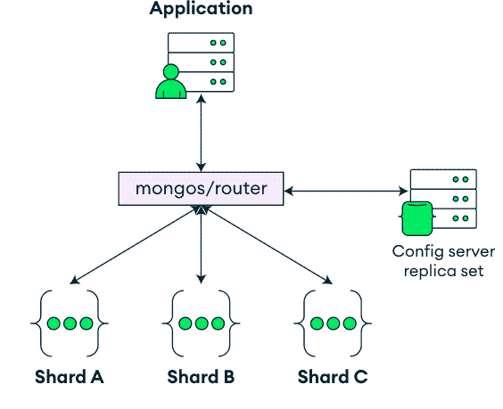

具有专用配置服务器的集群

*图 6.1：分片集群架构*

但是 mongos 如何知道要将操作转发到哪些分片？基于保存在配置服务器中的信息，mongos 维护一个当前的路由表，这意味着对于每个集合，它都知道其数据存储在哪里，如果集合是分片的，它会跟踪集合每个部分的位置。然后它会根据需要将收到的操作转发到一个或多个分片，如果是多个分片，则还必须合并或组合来自各个分片的结果，以便向客户端返回单个结果。

## 对集合进行分片并选择分片键

当你首次部署分片集群时，你必须决定如何将数据分布到各个分片。这对于实现水平扩展至关重要，因为可扩展的分片集群会以操作均匀分布在所有分片的方式来分布数据。这意味着你希望所有的读和写操作大致均匀地分布在所有分片上。

虽然你可以选择将不同的集合隔离到不同的分片，但最常见的情况是，当你有一个足够大的集合无法由单个分片处理时，才会使用分片。此时，你必须对集合进行分片或分区，并且可以通过选择分片键来决定其分区方式。

分片键值用于将集合逻辑上拆分为范围，称为块。这些块随后以旨在在所有分片之间均匀平衡数据的方式分布在分片上。在旧版本的 MongoDB 中，这通常意味着每个分片大约具有相同数量的块，但在新版本中，块仅在必要时才会被拆分。因此，虽然数据仍然均匀分布，但这并不一定意味着每个分片上的块数量相同。

考虑一个简单的例子：如果你的分片键是 username 且 username 的值范围从 aaaa 到 zzzz，那么你的块可能被划分为 a-b、c-d、e-f 等范围。均衡器是一个在分片集群上运行的后台进程，它会自动将对应这些块范围的数据分布到所有分片，确保数据大致均匀分布。

> **评估分片键活动时的均衡器限制**
> 
> 均衡器仅基于数据大小进行操作，无法确定哪些分片键值范围可能更 *活跃*。

现在，mongos 将把包含以特定字母开头的 username 的操作路由到 *拥有* 包含该 username 的块范围的分片。

你一定在想，如果请求中不包含 username 会怎样？在这种情况下，mongos 必须将请求发送到所有分片。这种类型的请求称为 **广播** 或 **散发-收集** 操作，其水平扩展效果远不如针对单个分片的操作。

## 为什么散发-收集不好

一个常见的误解是，散发-收集查询之所以高效仅仅是因为每个分片只需要处理一小部分数据。虽然这在直觉上似乎是正确的，并且确实反映了原始 map-reduce 数据处理的工作方式（通过将大量工作拆分到多台服务器上），但这种方法在大多数情况下并不能很好地水平扩展。让我们来探讨原因。

当查询请求发送到单个分片时，该分片执行操作并将结果返回给 mongos，后者再将其转发给客户端。但当查询请求针对所有分片（散发-收集操作）时，每个分片都必须在其自己的数据部分上执行操作并将结果返回给 mongos 以合并并转发给客户端。注意这两个场景有什么不同？在针对性查询中，只有一個分片需要执行操作。在散发-收集查询中，每个分片都必须执行操作。

因此，在一个有 20 个分片的集群中，一个散发-收集操作会被转换为 20 个操作。即使它看起来像是更便宜的操作，只处理总数据的 1/20，每个分片的操作执行开销仍然相同，而且 mongos 还必须做额外的工作来合并结果。在某些情况下，mongos 必须等到收到所有接收查询的分片的回复后，才能开始向客户端返回数据。

假设你的集群正在处理数万甚至数十万个查询。以下是单个请求发送到一个分片与散发-收集查询在 20 个分片集群中扩展的情况：

| 客户端查询 | 仅针对性查询 | 仅散发-收集查询 |
|---|---|---|
| 100 | 100 | 2,000 |
| 1,000 | 1,000 | 20,000 |
| 10,000 | 10,000 | 200,000 |
| 100,000 | 100,000 | 2,000,000 |

*表 6.1：显示在所有 20 个分片上执行的总查询数的表*

现在，想象一下如果你将表 6.1 中的分片数量加倍。针对性查询列将保持不变，但散发-收集查询列会翻倍！因此，你得不到线性扩展的好处，因为增加集群中的分片数量也会增加总查询数量。作为额外的弊端，需要等待所有分片响应的散发-收集查询会随着分片数量的增加而变得越来越慢。这是因为某个分片出现延迟波动（例如网络配置错误、选举或崩溃）的几率也会增加。这会导致每个广播查询的延迟增加，而针对性查询只会影响发送到受影响分片的查询子集。

## 战略性分片键选择

分片键选择是一个关键决策，直接影响分片集群的性能和可扩展性。一个好的分片键可以针对特定分片进行操作，提供适当的粒度以均匀分布数据，并最大限度地降低创建热点分片的风险。让我们来看一下好的分片键的一些重要要素。

### 用于定位操作的分片键

为了了解数据分区如何影响操作的分布，让我们再看一个例子，说明集合如何根据定义的分片键在分片之间进行分区。

假设你有一个 orders 集合。你可能会按 order_id 对其进行分区，order_id 是唯一的，并且可以创建许多块范围，从而实现数据在分片之间的精细分布。然而，如果 order_id 是单调递增的，那么最后一个块（从较高的 order_id 到 maxInt 范围的块）将始终接收所有新插入。

这可能有问题也可能没有问题。如果新订单创建是系统中的瓶颈，这可能有问题，但如果新订单相对不频繁地创建，而大部分负载来自订单的更新、读取或聚合，则可能不是大问题。

现在，让我们考虑一个读取特定客户所有最近订单的操作。由于你不知道客户的订单在哪个范围内，你必须将查询广播到具有 orders 集合块的所有分片，如图 6.2 所示，这对水平扩展是有问题的。

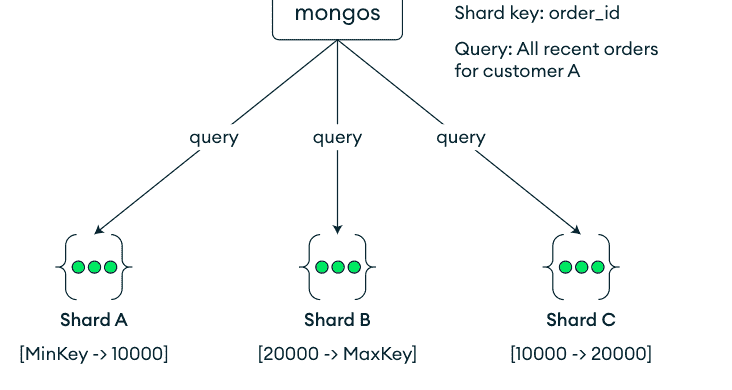

*图 6.2：广播查询*

如果你知道应用程序在处理订单时始终会有 customer_id 值（这是一个合理的假设），那么最好使用复合分片键，例如 {customer_id:1,order_id:1}。这将使每个客户的订单保留在单个分片上（因为它们往往会落在单个块内），并且关于特定客户订单的查询将针对单个分片，而不是散布到所有分片。


在图 6.3 中，客户 A 的所有订单都位于从最低 customer_id（包含）到 customer I（不包含）的 chunk 内，该 chunk 位于分片 A 上。因此，查询客户 A 的所有最近订单只会发送到分片 A。作为额外好处，新的订单将不再在同一分片上创建。然而，在这种情况下，您对订单的所有操作都必须在查询中同时包含 customer_id 和 order_id 值，以确保它们被定向到单个分片。

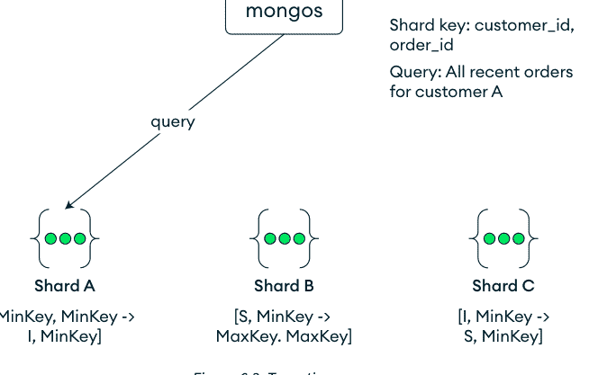

图 6.3：定向查询

扩展分片集群的关键在于将操作定向到尽可能少的分片。一个优秀的分片键将允许大多数操作被定向到单个分片。

## 分片键的粒度良好

你可能听说过，选择一个具有良好粒度的分片键很重要，主要原因在于它能让 chunk 有效地拆分。我们在上一节中看到的示例很好地说明了这一点。由于 order_id 是唯一的，任何包含它作为组成部分的分片键都可以轻松拆分为更小的 chunk。那么粒度为什么如此重要，如果分片键的粒度不够会发生什么呢？

想象一个多租户系统，其中分片键是 tenant_id。初看之下，这似乎是个好主意，因为每个租户的操作始终包含 tenant_id 值，这非常有利于将特定租户的操作定向到一个分片，而且新租户的创建速度不足以让你担心所有插入都进入同一个 chunk 范围。然而，如果单个租户成为重度用户，在集合中生成的数据量大到无法容纳在一个分片上会怎样？

定位数据在两个分片上的方式是通过决定分片键的哪些值存放在哪里。然而，在我们的案例中，租户的所有数据都具有相同的分片键值，使得数据无法拆分，并且包含数据的 chunk 现在被标记为 jumbo chunk。在图 6.4 中，tenant_I 拥有大量数据，从 tenant_I（包含）到 tenant_J（不包含）的 chunk 被标记为 jumbo。分片 B 的数据比分片 A 多，然而由于 chunk 无法拆分，均衡器无法将数据从分片 B 移动到分片 A 以平衡数据。这时通过在 tenant_id 之后添加另一个字段作为分片键的组成部分来细化或扩展分片键就可以提供帮助。

## 分片键：tenant_id

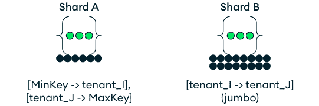

图 6.4：分片键为 tenant_id

幸运的是，有一个命令可以在不中断服务的情况下细化分片键，并且允许你在粒度不足时扩展分片键。这是一个廉价的操作，因为它允许你在无需移动任何数据的情况下添加一个或多个字段。一旦分片键通过另一个字段扩展（例如 _id 或你在数据模型中有意义的另一个字段），MongoDB 就可以在 _id 值上拆分大租户的 chunk，并且其部分数据可以被均衡或移动到另一个分片。在图 6.5 中，细化分片键后，先前的 jumbo chunk 现在可以拆分，并且部分数据可以移动到另一个分片。

## 分片键：tenant_id, _id

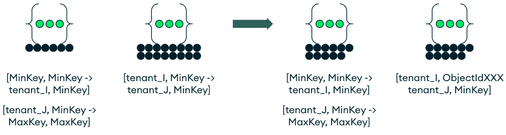

图 6.5：细化分片键并等待数据均衡

最佳的分片键应具有足够的粒度以允许拆分数据范围，从而在分片之间实现更好的分布。

## 避免递增或递减的分片键值

你可能读到过，单调递增的分片键是个坏主意。事实上，正如前面的示例所强调的那样，如果很可能出现新文档插入的瓶颈，你应该对此感到担忧。让我们看一个很可能出现这种情况的示例以及为什么这会成为问题。

回顾一下第 2 章《Schema Design for Performance》中的 Socialite 应用示例。考虑 content 集合，它接收用户帖子。该集合经历了大量的写入，主要来自用户向集合中插入新帖子。现在想象按每个帖子的 _id 值对 content 集合进行分片，使用默认的 ObjectId 类型。由于 ObjectId 的前四个字节代表当前时间戳，你可能会认为将其用作创建时间代理是有用的，并且出于定向目的将所有最近的帖子放在同一个分片上并不是坏主意。毕竟，用户通常只想阅读最近的帖子，对吧？然而，这导致的结果是每次插入都进入最高 chunk 范围。

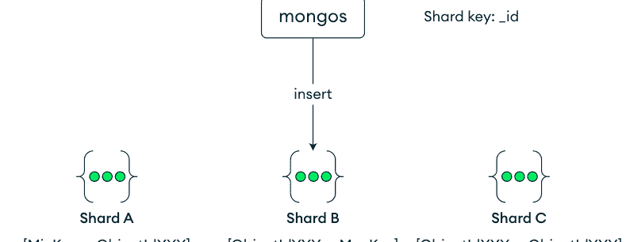

*图 6.6：单调递增分片键导致的热分片*

正如你在图 6.6 中看到的，新插入会使拥有顶层 chunk 的分片变成热分片，而其他分片将不会接收任何写入（因为帖子通常既不更新也不删除）。即使你的模式设计包含使用点赞计数等更新帖子，活动也会集中在最近的帖子上（因为用户多久会回去几个月给以前的帖子点赞呢？）。因此，唯一不会进入顶层 chunk 的写入将是删除（当用户决定清理或归档旧内容时），对吧？但即使是这些也会通过进入最低范围值而创建热 chunk！

你也不会从定向读取中获得任何好处，因为当你查询要向某人展示的帖子时，它们通常是朋友的帖子或你自己的帖子。查询看起来会像这样：

```
// Query to get latest 20 posts for a subset of users
// This query may result in a scatter-gather operation

db.posts.find({userId:{$in:["..."]}}).sort({_id:-1}).limit(20)
```

这种获取要为用户子集展示的最新 20 条帖子的查询很可能导致 scatter-gather 查询。不仅如此，这种查询需要等待所有分片排序其结果，在 mongos 上合并它们，然后才开始向客户端返回任何结果。由于在具有信息流的社交媒体应用中最重要的是尽快开始显示结果，因此这是不可接受的。

解决方案很可能是使用更好的分片键。最明显的一个是按 {userId:1, _id:1} 分片，这很可能会将每个用户的内容放在同一个 chunk 中，这意味着随着数百或数千个用户创建新帖子，它们很可能会被分布到拥有这些用户 chunk 的所有分片上。如果你的 userId 是随机的（如任何用户选择的名称），你的分布也会是随机的。但即使你使用某种系统生成的、唯一的、单调递增的值，并且即使你的新用户起初往往更活跃，这也会被所有已存在的用户创建内容并在分片之间大致均匀地分布写入所抵消。

这与我们在订单的早期示例中看到的方法类似，其中将 customer_id 前缀到 order_id 比仅使用 order_id 单独作为分片键更好。在多用户或多租户系统中，始终考虑将分片键的领先字段设为你的用户或租户 ID，以最大化对每个用户或租户的查询定向。

请注意，通过哈希使单调递增的分片键值随机化并不一定是个好主意。我们将在下一节中查看在决定是否对分片键进行哈希之前需要考虑的一些权衡。

如果你在分片或重新分片集合之前仍对分片键选择没有信心，你始终可以使用 configureQueryAnalyzer 命令收集集合上的查询样本，然后运行 analyzeShardKey 命令来评估该集合的分片键。

## 分片类型

从根本上说，MongoDB 支持一种将数据分布到分片的核心机制：**基于范围的分片**。然而，它还提供了两种适用于不同用例的特殊变体：**哈希分片** 和 **区域分片**。让我们探讨它们的工作方式、相互关系以及何时选择各自合适。

## 基于范围的分片

范围分片是默认且最直观的方法。这就是本章迄今为止所描述的内容。范围分片按分片键值的自然顺序拆分数据，然后将数据范围分发到不同的分片。这是对大多数用例的正确方法；只需为你的读写模式选择一个好的分片键即可。我们迄今为止讨论的所有示例都使用常规范围分片。所有其他分片方法都以范围分片为基础，但它们在之上提供了额外的能力，以更改用于范围的值或影响范围在集群中的平衡方式。

## 哈希分片

哈希分片采用你的分片键，通过哈希函数运行它，然后对这些哈希值应用范围。其结果类似于在将页面放入卷之前先对所有页面进行洗牌，这非常适合随机分散事物。所有操作都会自动执行此哈希，因此你的应用程序无需更改查询数据的方式。

想象在巨大的集合中存储日志或事件，其中每个事件的 _id 值始终递增。使用范围分片，所有这些记录都必须插入到同一个分片。但如果你使用 { _id: "hashed" }，系统会随机分发它们，避免插入热点。

对分片键值进行哈希存在多个陷阱和额外成本。对哈希分片键的范围查询效率低下，并且每次插入都需要维护一个额外的随机访问索引。最重要的是，你需要记住，通过哈希分片键值并不会获得额外的 *粒度*。如果你的分布因分片键粒度差（不同值不足）而变差，那么对它们进行哈希也不会改变这一点。你仍然会有糟糕的分布，同时还增加了哈希键的开销。

在哈希分片键仍然是你的用例最佳选择的情况下，MongoDB 7.0 版本引入了在你拥有另一个索引来支持分片键并且集合已平衡的情况下删除哈希索引的能力。一旦删除哈希分片键索引，就不再进行平衡，但你节省了在每次插入时维护哈希索引的开销。


## 基于区域的分区

区域分片是一种根据你创建的策略控制哪些数据范围驻留在哪些分片集上的方法。它是一种将地理因素纳入考虑的方式，或只是将分片集合限制为分片子集的方式。使用区域分片需要遵循两个步骤。你为一个分片或一组分片分配区域标签或标记，然后指定要与这些特定区域关联的分片键范围，从而控制数据的物理存储位置。

考虑一家全球 SaaS 公司希望出于合规原因将欧洲用户的数据存储在欧盟境内。通过将“EU”区域的分片范围分区到法兰克福的分片，以及将“NA”区域分区到北美分片，它可保持数据本地化、访问快速且符合策略。

以下是这些步骤在数据库命令中的表现，这些命令对集合进行分片、为分片分配适当的区域，并向区域添加分片键范围：

```
// Shard a collection and assign zones for geo-based data placement
sh.shardCollection("db.coll", {country:1, userid:1})
sh.addShardToZone("shard0", "NA")
sh.addShardToZone("shard1", "EU")
sh.addTagRange("db.coll", 
{country:"DE",userid:MinKey},{country:"DE",userid:MaxKey},"EU")
sh.addTagRange("db.coll", 
{country:"US",userid:MinKey},{country:"US",userid:MaxKey},"NA")
```

可在 MongoDB 文档中找到更多示例：

- *按位置分段数据:* https://www.mongodb.com/docs/manual/tutorial/sharding-segmenting-data-by-location/
- *按应用程序或客户分段数据:* https://www.mongodb.com/docs/manual/tutorial/sharding-segmenting-shards/
- *仅插入工作负载的分布式本地写入:* https://www.mongodb.com/docs/manual/tutorial/sharding-high-availability-writes/
- *使用区域分发集合:* https://www.mongodb.com/docs/manual/tutorial/sharding-distribute-collections-with-zones/

随着集群中分片数量的增长，你将希望对每个分片和未分片集合的位置进行更严格的控制。例如，你可能在 10 个分片上有两个巨大的分片集合，但与其让每个集合都位于 10 个分片上，你可能更希望每个集合仅位于其自己的 5 个分片上。这可以在多方面提供帮助：

如果每个集合产生的负载不同，你可以通过不对称的分片扩展分配不同的资源，并且发送到集合所在每个分片的任何散列-聚集操作都将仅发送到一半的分片数量。由于减少集群中的总操作数有助于可扩展性，这是一种简单实现的方法。顺便说一下，如果你的某个分片出现意外问题，只有两个集合中的一个会受到影响，而不是两者。

要将两个集合分发到分片子集，数据库命令可能如下所示：

```
// Example of distributing collections to subsets of shards using zones
sh.addShardToZone("shard0", "C1")
sh.addShardToZone("shard1", "C1")
sh.addShardToZone("shard2", "C2")
sh.addShardToZone("shard3", "C2")
sh.addTagRange("db.coll1",{"<shKey>":MinKey},{"<shKey>":MaxKey},"C1")
sh.addTagRange("db.coll2",{"<shKey>":MinKey},{"<shKey>":MaxKey},"C2")
```

这些命令首先为每个分片标记为 C1 或 C2，然后将 coll1 集合分配给标记为 C1 的分片，将 coll2 集合分配给标记为 C2 的分片。你将为 <shKey> 使用实际的分片键字段名。这种控制增加了复杂性。你需要管理区域和范围边界以及它们如何映射到区域，监控分片间的平衡，并计划不均匀增长。

虽然将每个分片集合隔离到其自己的分片子集有优势，但在两种情况下应避免这样做，而应将集合共同定位在相同的分片上，并使用分片键范围使相关数据保持在一起。一种情况是支持跨两个集合的多文档事务保持在单个分片上；另一种情况是防止两个集合之间的 $lookup 操作需要在网络上工作。我们将在本章后面“将分片集合块共同定位在一起”部分进一步讨论这个问题。

## 高级分片管理

在处理分片集群时，有一些操作注意事项，虽然不是核心分片机制的一部分，但如果你希望随着时间的推移保持部署高效和响应迅速，了解它们很重要。这些包括在事情出错时重新分片、为新集合中的大型数据负载预拆分、管理平衡器、移动未分片集合，以及了解如何最好地分发数据以获得最佳性能。

### 重新分片：是否、何时以及如何

第一次选择合适的分片键是理想的，但让我们面对现实，有时我们第一次做出了错误决定，而其他时候，实际使用模式会演变。起初良好的键可能会成为瓶颈。也许你在一个已经随机的字段上选择了哈希分片键，却没有意识到它造成的额外开销，现在你想将其更改为常规的范围分片键。或者也许你对 orders 集合使用了 order_id，现在你意识到对于特定客户的订单的大多数查询都是散列-聚集的而不是有针对性的，你想将分片键更改为 {customer_id, order_id}，因为它允许更好地定位查询。

MongoDB 的重新分片功能给你第二次机会。在不中断服务的情况下，你可以将分片键更改为更合适的键，让数据在分片间重写而不会中断服务。重新分片是一个后台操作；它在幕后读取并重写所有数据，但完成后，你将拥有一个分布更好的集合和一个可以再次呼吸的系统。

重新分片不仅仅用于更改分片键；它还可以用现有分片键来重新分发或重写集合到现有分片，比平衡器移动块和清理孤儿块所需的时间更快。从 MongoDB 8.0 版本开始，你可以通过将 forceRedistribution 选项设置为 true，在集合上使用相同的分片键运行 reshardCollection 命令。考虑在一次添加或删除多个分片时，或在对现有未分片集合进行分片后使用它。在图 6.7 中，该集群中有三个分片，并且分片 A 上有一个未分片集合。现在，该集合中的数据已增长，你想对其进行分片。由于一个分片一次只能参与一次块迁移，平衡器一次只能将数据从分片 A 移动到分片 B 或分片 C。平衡速度可能很慢。此外，在块迁移后，分片 A 需要删除该块中数据的原始副本，并且磁盘空间不会自动回收。如果你立即在分片后重新分片该集合，重新分片机制将创建一个临时集合，并且三个分片都可以并行从分片 A 读取数据并将其重写到临时集合中。重新分片完成后，它将重命名临时集合并删除原始集合。分片 A 上的磁盘空间将自动回收。

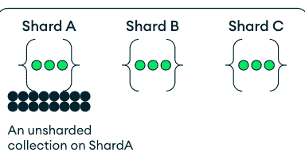

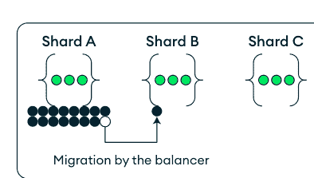

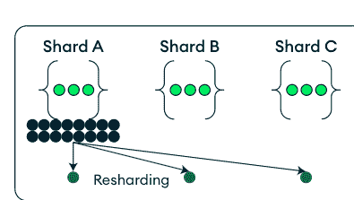

图 6.7：块迁移与重新分片

请参阅文档以获取更多详细信息、限制和示例：https://www.mongodb.com/docs/manual/core/sharding-reshard-a-collection/.

我们在“具有良好粒度的分片键”部分提到的用于细化或扩展你的分片键的命令与重新分片命令不同，因为使用额外字段扩展分片键不需要从其当前分片移动任何数据。请在文档中阅读有关细化分片键的更多信息：https://www.mongodb.com/docs/manual/core/sharding-refine-a-shard-key/#std-label-shard-key-refine.

### 平衡器注意事项

在 MongoDB 分片集群幕后，平衡器的工作是确保数据在分片之间均匀分布。它的工作是监控数据分布，并在事物变得不平衡时移动块，保持系统平衡。但虽然它默认开启且很容易被遗忘，平衡器并非免费，了解其行为对于避免意外的副作用至关重要。

首先，有开销。平衡器触发的每个块迁移都涉及从一个分片复制数据到另一个分片，更新配置服务器中的元数据，并删除数据的原始副本。虽然这些操作高效且安全，但它们仍会消耗 I/O、CPU 和网络带宽。在负载较轻的集群上，你可能永远不会注意到它在运行。在繁忙的生产系统上，尤其是在高峰需求时段，这些后台移动可能会与应用程序操作竞争资源并减慢速度。


这就是 MongoDB 允许你设置均衡器窗口的原因，均衡器窗口是允许块迁移的特定时间段。例如，你可以将均衡限制在夜间时段或流量最低的非高峰期。这样可以在白天保持最佳性能，同时仍允许系统在更安全且不会产生明显影响时重新分布数据。

但即使设置了均衡窗口，你也需要保持关注。均衡器可以根据数据大小而不是访问频率进行操作。这意味着它可能无法捕捉到服务流量更多但文档更少的热点分片。定期审查不仅是数据的分布而且是负载的分布对于避免静默性能下降至关重要。balancerStatus、currentOp 和 sh.status() 命令在这里是你的好帮手，以及显示每个分片上操作数量的监控图表。最后需要记住的是，均衡器擅长在略有不平衡的分片集合中移动小块数据以恢复平衡。当你需要整个分片被数据填充时，重新分片可能更快。

## 预分片：是否、何时以及如何

大多数情况下，MongoDB 的均衡器在应对不断增长的数据并保持其分布方面做得很好。但在某些场景下，例如大规模初始导入，你不希望将所有内容插入到一个分片中然后等待均衡器追赶上来。这就是预分片发挥作用的地方。

预分片取决于你的分片键值范围。你需要创建一个脚本，使用 moveRange 命令将分片键值的完整范围拆分为多个块，并将其均匀分布到将接收新数据的分片中。如果你的分片键值是字符串，如果你想在三个分片上开始使用块，可以使用 MinKey-k、k-s 和 s-MaxKey 这样的范围。如果你的值是其他类型，请确定数据集中值的近似范围，然后相应地拆分它们。请记住，你不必非常精确，因为一旦加载足够的数据，均衡器就能轻松处理较小的失衡。你想要避免的是开始时所有数据都进入单个分片。

通常，你希望在向全新空集合进行批量导入之前，或在设置新集群的早期阶段使用预分片。预分片在你事先了解数据的分布方式，并希望有一个良好的开端时最简单。

预分片是主动的。它将你的思维从被动的负载管理转变为有意的数据规划，在正确的使用下，它是确保集群启动并保持健康的最有效方法之一。

## 移动未分片集合

数据库中的并非每个集合都会被分片。事实上，所有较小的集合都将保持未分片，只有太大而无法容纳在一个分片上的集合才应分片。就像并非每个分片集合都需要存在于每个分片上，未分片集合也不需要在一个主分片上共同存在。事实上，通常最好将它们均匀分布在你的分片中，因为即使是未分片的数据，如果导致集群分布不均，也会引起问题。想象一下用于事件的小型每日集合，其中每天你将数据转储到一个单独的未分片集合中（最终会删除旧的集合）。如果所有天的数据都在同一个分片上，该分片最终会不堪重负，并非因为分片，而是因为未分片集合的不平衡。

在这些情况下，moveCollection 命令（从 MongoDB 8.0 版本开始支持）应该是你的首选工具。它允许你手动将整个未分片集合从一个分片移动到另一个分片。它不是自动的，如果你在活动集合上运行它，移动期间会短暂阻塞写入（通常只有几秒钟），但它可以在不经过将不需要分片的集合分片的复杂性的情况下重新平衡工作负载，从而成为救星。作为奖励，如果你预见到这一点并在首次创建集合时立即执行 moveCollection，移动空集合将非常快速且成本低。

在图 6.8 中，最初 testdb 数据库中未分片的 A-H 集合全部位于 shard0。我们可以运行以下命令将其中一些移动到 shard1，以在此集群中分布数据：

// Move unsharded collections to specific shards
// Useful for balancing unsharded data across the cluster
db.adminCommand({moveCollection:"testdb.E", toShard:"shard1"})
db.adminCommand({moveCollection:"testdb.F", toShard:"shard1"})
db.adminCommand({moveCollection:"testdb.G", toShard:"shard1"})
db.adminCommand({moveCollection:"testdb.H", toShard:"shard1"})

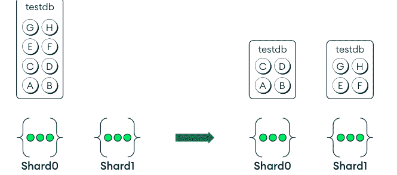

*图 6.8：移动未分片集合*

## 将分片集合块共同定位

正如在基于区域的分片部分所述，有两种情况，为了性能考虑，禁用均衡器并手动（通过脚本）将两个或多个集合在相同的分片上共置，使用保持相关数据在一起的分片键范围可能是有益的。第一个能显著帮助的情况是多文档事务，其中单分片事务的性能明显优于多分片事务，另一个情况是两个集合之间使用 $lookup 操作的聚合，其中将相关范围保留在同一分片上允许管道本地执行，而无需将数据通过网络发送到另一个分片。

一个例子是 TPC-C 基准测试商务数据的情况，其中包含仓库、地区、客户和订单的集合。我们可以在这些集合中的每一个上使用范围分片，它们共享前缀以将相同的值定位在相同的分片上：

| 集合 | 分片键 |
|---|---|
| WAREHOUSE | w_id |
| DISTRICT | w_id, d_id |
| CUSTOMER | w_id, d_id, c_id |
| ORDERS | w_id, d_id, c_id, o_id |

*表 6.2：TPC-C 基准测试的集合及其分片键*

为了实现共置，我们将为这些集合禁用均衡器，然后在相同的前缀（w_id）值上拆分它们，并将具有相同值的块范围移动到相同的分片。或者，我们可以使用以下命令将相同前缀（w_id）值上的区域范围与同一区域关联，并让均衡器相应地拆分和移动块范围：

// Colocating sharded collection chunks together for TPC-C benchmark
sh.shardCollection("db.WAREHOUSE", {w_id:1})
sh.shardCollection("db.DISTRICT", {w_id:1, d_id:1})
sh.shardCollection("db.CUSTOMER", {w_id:1, d_id:1, c_id:1})
sh.shardCollection("db.ORDERS", {w_id:1, d_id:1, c_id:1, o_id:1})

// Associate each shard to a unique zone
sh.addShardToZone("shardA", "ZoneA")
sh.addShardToZone("shardB", "ZoneB")
sh.addShardToZone("shardC", "ZoneC")

// For each collection, associate the range with the same prefix to the same zone
sh.addTagRange("db.WAREHOUSE",{w_id:MinKey},{w_id:33},"ZoneA")
sh.addTagRange("db.DISTRICT", {w_id:MinKey,d_id:MinKey},
{w_id:33, d_id:MinKey},"ZoneA")
sh.addTagRange("db.CUSTOMER", {w_id:MinKey,d_id:MinKey,c_id:MinKey},
{w_id:33,d_id:MinKey,c_id:MinKey},"ZoneA")
sh.addTagRange("db.ORDERS", {w_id:MinKey,d_id:MinKey,c_id:MinKey,
o_id:MinKey}, {w_id:33, d_id:MinKey,c_id:MinKey,o_id:MinKey},"ZoneA")

sh.addTagRange("db.WAREHOUSE", {w_id:33},{w_id:66},"ZoneB")
sh.addTagRange("db.DISTRICT", {w_id:33,d_id:MinKey},
{w_id:66,d_id:MinKey},"ZoneB")
sh.addTagRange("db.CUSTOMER", {w_id:33,d_id:MinKey,c_id:MinKey},
{w_id:66,d_id:MinKey, c_id:MinKey},"ZoneB")
sh.addTagRange("db.ORDERS", {w_id:33,d_id:MinKey,c_id:MinKey,o_id:MinKey},
{w_id:66,d_id:MinKey,c_id:MinKey,o_id:MinKey},"ZoneB")

sh.addTagRange("db.WAREHOUSE", {w_id:66}, {w_id:MaxKey},"ZoneC")
sh.addTagRange("db.DISTRICT", {w_id:66,d_id:MinKey},
{w_id:MaxKey, d_id:MaxKey},"ZoneC")
sh.addTagRange("db.CUSTOMER", {w_id:66,d_id:MinKey,c_id:MinKey},
{w_id:MaxKey, d_id:MaxKey, c_id:MaxKey},"ZoneC")
sh.addTagRange("db.ORDERS", {w_id:66,d_id:MinKey,c_id:MinKey,o_id:MinKey},
{w_id:MaxKey,d_id:MaxKey,c_id:MaxKey,o_id:MaxKey},"ZoneC")


图 6.9 显示，在定义区域范围后，均衡器会拆分并将块移动到与区域关联的相应分片。

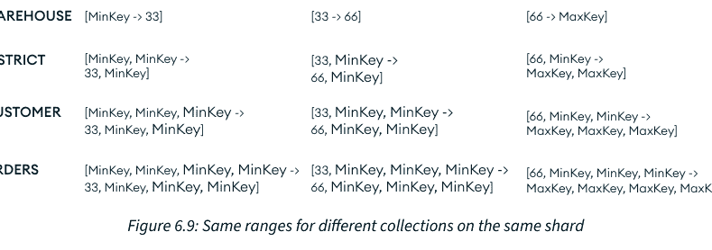

图 6.9：同一分片上不同集合的相同范围

虽然这看起来在操作上很复杂，但实际上这会被脚本化，并且在 staging 环境中测试后，生产环境中的流程只需运行脚本即可自动初始化数据分布。

通过将相同的仓库 ID 值分区到相同的分片，我们最大化了涉及相同客户、订单、地区和仓库的交易发生在单个分片上的可能性。这与我们最小化聚合查询中跨分片 $lookup 的方式相同，这些查询需要查找相关实体的详细信息。

就像关于你的 MongoDB 模式和索引的每个决策都取决于你的需求和你能够做出的权衡一样，为性能和可扩展性对集群进行分片的决策也是如此。考虑到你的 SLA 选择分片键至关重要，以确保你为最重要的方面进行优化。通常没有完美的答案，只有权衡。关键在于理解应用程序的主要访问模式。你是按实体读取数据还是批量写入？你是否期望某些实体主导工作负载？平衡是可能的，但它始于有意的建模，并通过监控、迭代，有时……是的，重分片来持续进行。

## 摘要

MongoDB 的分片架构是实现具有海量数据集和 demanding 吞吐量要求的部署中水平可扩展性的强大且灵活的工具。通过了解分片集群的核心组件、分片键选择的重要性以及可用的各种分片方法，你可以设计一个高效分布和定位操作的系统。此外，讨论的高级技术，例如改进分片键、使用分区进行战略数据放置、批量导入期间预拆分以及在分片之间平衡工作负载，都有助于在数据和工作负载扩展时保持集群的高效和响应。有效的分片不仅仅是分布数据，还包括预见和管理查询模式、操作开销和不断变化需求的细微差别。凭借这些知识，你可以很好地创建可扩展且健壮的架构，以支持应用程序日益增长的需求。

在下一章关于存储引擎中，我们将把重点从数据分布转移到数据存储，深入探讨 WiredTiger 存储引擎，即 MongoDB 的默认且最常用的存储引擎。
