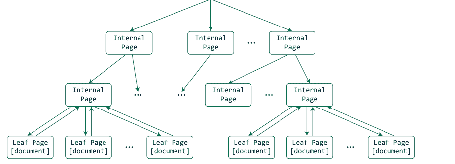
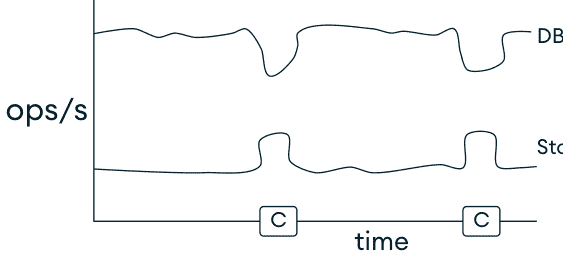
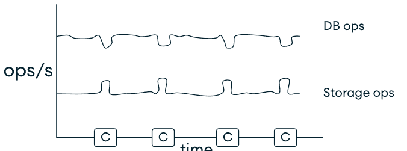
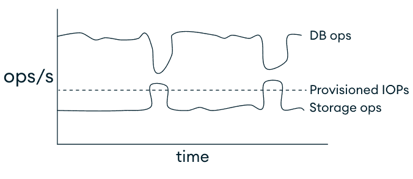
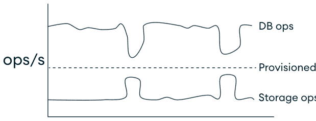

# 7 存储引擎

## 存储引擎

正如我们在第 1 章《系统和 MongoDB 架构》中看到的那样，WiredTiger 是 MongoDB 服务器中的一个组件，也是 MongoDB 最常见的存储引擎。存储引擎充当数据逻辑结构（用户、应用程序和数据库更高层所见）与该数据的物理存储之间的接口。因此，它们是在诊断和解决性能问题时的重要因素。本章旨在为你提供对 WiredTiger 存储引擎的高级理解，使你能够就其配置做出明智的决策。到本章结束时，你将对 WiredTiger 的性能相关内部工作原理有扎实的掌握，并具备将其调优以提高效率的知识。

本章涵盖的主题包括以下内容：

- 存储引擎概述及其在 MongoDB 中的作用
- WiredTiger 的架构，包括其存储格式、并发控制和缓存策略
- WiredTiger 如何管理其缓存、确保数据持久性并处理意外故障的恢复
- WiredTiger 支持的压缩算法，以及压缩效率与资源使用之间的权衡
- WiredTiger 的关键配置选项以及如何为你的特定工作负载和硬件设置进行调优

### 探索存储引擎

不同的存储引擎采用各种数据结构、算法和技术来优化数据库系统的性能、可扩展性、可靠性和其他特性。

一些常见的存储引擎类型包括以下内容：

- **行存储引擎**：这些引擎以行为单位存储数据，其中每一行代表一条记录并包含多个列或字段。
- **列存储引擎**：这些引擎以列为单位存储数据，其中每一列代表一个字段并包含来自多行的值。
- **键值存储引擎**：这些引擎将数据存储为键值对的集合，其中每个唯一键都与单个对应值关联。应用程序可以使用其键访问值。例如，键可以是字符串或用户 ID，而值可以是复杂嵌套的数据结构。

WiredTiger 是一种可配置为以行或列存储数据的键值存储引擎。其他流行的数据库存储引擎示例有 InnoDB、MyISAM 和 RocksDB。存储引擎的选择会显著影响数据库系统的性能、可扩展性和功能。不同的存储引擎针对不同的工作负载和用例进行了优化，并且可能在各种因素之间提供权衡，例如读写性能、数据压缩、事务支持和数据一致性。

例如，InnoDB 目前是 MySQL 的默认存储引擎。它提供诸如事务、行级锁定和外键支持等功能。MyISAM 是一种较旧的存储引擎，以其简单性和对读密集型操作的快速性而闻名，但它不支持事务或行级锁定。

理论上，WiredTiger 可用作其他数据库的存储引擎，而 MongoDB 也可使用其他存储引擎。MongoDB 已定义了存储引擎 API，使开发人员能够为其他存储引擎实现适配器。例如，MongoRocks 是 MongoDB 的 RocksDB 存储引擎模块。

特定数据库可能只使用存储引擎功能的一个子集，并允许用户配置其配置参数的一个子集。例如，在撰写本文时，MongoDB 不使用诸如 WiredTiger 的列存储或诸如日志结构合并树等数据结构等功能。这是因为 MongoDB 目前尚未实现使用这些功能的功能，但将来可能会实现。MongoDB 服务器配置选项支持 WiredTiger 配置选项的一个子集。

### WiredTiger 概述

WiredTiger 是 MongoDB 的默认且最常用的存储引擎。它自 MongoDB 3.0 版本起就可用。在此之前，MongoDB 的默认存储引擎是 MMAPv1，它使用内存映射文件来管理数据。虽然 MMAPv1 是可用的，但它有一些局限性。

WiredTiger 的基本数据结构是 B-tree，它维护有序数据并允许以对数时间进行搜索、顺序访问、插入和删除。B-tree 中的每个节点可以包含多个键（数据条目），节点可以容纳的键的数量由树的度或阶决定。在 B-tree 中搜索键涉及从根导航到叶，沿着表示键范围的指针进行。这很高效，因为树的高度相对于键的数量是对数级的。与二叉搜索树相比，B-tree 更浅，因为它们允许每个节点有超过两个子节点。这减少了遍历树时所需的磁盘访问次数，这对于 I/O 操作昂贵的数据库至关重要。



*图 7.1：WiredTiger B-tree*

B-tree 的每个节点包含键和值。叶节点存储实际数据，而内部节点指导树中的搜索过程。WiredTiger 的基本构建块是键值对。多个键值对可以组合成页面，每条数据都与唯一的键关联，从而实现高效的检索和更新。内部键称为记录 ID。


## Linux 内核中的页面与 WiredTiger 存储引擎

页面概念同时存在于 Linux 内核和 WiredTiger 存储引擎中。虽然 *page* 术语在两者中都使用，但它代表不同的概念。Linux 内核中的页面是内存管理的基本单元。

例如，在尝试检索具有特定索引字段的文档时，例如 _id，首先使用 _id 键搜索索引 B-tree 以获取记录 ID 值。然后，该记录 ID 被用作键来搜索集合并返回对应的值，即 MongoDB 文档。

WiredTiger 采用 **多版本并发控制 (MVCC)** 来管理对 B-tree 和页面中数据的并发访问。这允许多个读取器和写入器同时操作，比更简单的方案提供更高的并发性。

数据持久存储在包含 B-tree 结构和元数据的文件中。这些文件可以根据需要动态增长。在磁盘上，您会为每个索引和 MongoDB 集合找到一个单独的文件。

另一组 WiredTiger 文件用于存储 **日志**，在其他数据库系统中它通常被称为 **预写日志 (WAL)**。每个修改数据库的操作首先写入日志，以确保在服务器崩溃或断电时写入的持久性。

当集合或索引首次被访问时，根节点和内部节点的第一个层级会被加载到缓存中。随着读写操作的进行，内存缓存会按需填充页面。默认情况下，WiredTiger 缓存使用可用内存的 50% 减去 1 GB。例如，在总共 8 GB RAM 的系统上，WiredTiger 缓存将使用 3.5 GB RAM（0.5 * (8 GB - 1 GB) = 3.5 GB）。

当前实现不允许显式地将文档或集合固定在缓存中。缓存在 MongoDB 服务器中的所有数据库和集合之间共享。WiredTiger 定期创建一致的检查点，捕获数据库在特定时间点的持久快照。

WiredTiger 支持完整的 ACID 事务，即使在出现故障的情况下也能确保数据一致性和完整性。以下各节将通过描述查找、更新和插入操作把所有这些概念联系起来。

## 查找操作

当应用程序在数据库上运行查询时，它会被翻译成一个或多个存储引擎查找操作，每个操作都执行以下步骤：

- 1. 假设我们正在读取由索引字段标识的文档，WiredTiger 从根遍历索引 B-tree 到包含该键的叶节点。
- 2. 如果有任何页面不在缓存中，它们会从存储加载到操作系统文件系统缓存和 WiredTiger 缓存中。最终，WiredTiger 找到与索引字段对应的记录 ID。
- 3. 上一步的记录 ID 用于遍历集合的 B-tree。
- 4. 如果有任何页面不在缓存中，它们会从存储加载到操作系统文件系统缓存和 WiredTiger 缓存中，在那里它们会被解密和解压缩。
- 5. 当 WiredTiger 找到记录 ID 时，它会从页面返回文档。

此操作确保如果页面在缓存中则从内存中使用，并避免不必要的存储 I/O。

## 更新操作

当应用程序更新文档时，数据库将其翻译为存储引擎上的更新操作。通常会发生以下情况：

- 1. 文档按上一节所述被读入缓存。
- 2. 页面被标记为脏，并且文档的新值存储在内存中的更新列表中。
- 3. 如果写入是事务的一部分，它会等待事务提交。
- 4. 写入 WiredTiger 日志条目，其中包含在发生崩溃时重做操作所需的信息。该日志写入会被刷新到存储设备。
- 5. 稍后，当检查点运行时或页面需要从缓存中驱逐时，WiredTiger 会遍历页面的更新列表并将内存中的页面写入存储。文档的旧版本会被写入单独的历史存储文件。

此机制提供持久性、崩溃恢复和版本跟踪，所有这些对于可靠的数据库操作都是必不可少的。

## 插入操作

对于插入操作，WiredTiger 执行以下操作：

- 1. 它遍历 B-tree 以找到合适的叶节点来插入记录/文档的键。
- 2. 在将节点写入存储时，如果节点已满，则会进行拆分。如果父节点已满，拆分操作可能会沿树向上级联。

与读取和更新一样，插入操作依赖于高效的 B-tree 遍历和动态节点管理以保持数据的性能和结构完整性。数据上的所有操作都涉及遍历索引和集合数据的 B-tree 数据结构。

## 驱逐、检查点和恢复

缓存大小有限，因此 WiredTiger 在需要为新数据腾出空间时需要从缓存中驱逐页面。WiredTiger 使用后台线程来管理驱逐过程。这些线程会持续评估缓存状态并执行驱逐任务，同时与其他数据库操作一起运行。

页面是根据最近最少使用算法的变体选择驱逐的，其中最近最少访问的页面是驱逐候选。这意味着频繁访问的页面应更长时间地保留在内存/缓存中。

WiredTiger 跟踪三种类型的缓存数据：总数据、脏数据和更新。对于每一种，它都有两个阈值来管理缓存驱逐：

- **Target:** 当缓存达到此级别时，WiredTiger 开始驱逐活动，以逐渐将缓存使用量降回。
- **Trigger:** 如果超过此级别，WiredTiger 会动员数据库操作线程快速释放空间，防止缓存填满。这减少了可以同时运行数据库操作的线程数量。

这些阈值在自行管理的 MongoDB 中可配置。我们将在本章《Configuration for improving performance》部分后面看到示例。使用 Atlas 时，MongoDB 会根据您运行的实例大小选择这些阈值。

检查点会获取所有内存中的数据结构并将任何修改写入存储。您可以配置检查点的频率。我们将在本章后面查看此示例的示例。数据库服务器的其余部分在检查点过程中继续读取和写入页面。

检查点过程涉及以下步骤：

- 1. WiredTiger 通过从缓存写入所有脏页面，确保到该点已提交的所有事务都以持久方式存储在数据库的磁盘映像中。
- 2. 所有挂起的文件写入都会被刷新。
- 3. 包含事务日志的日志文件会被轮换。
- 4. WiredTiger 在其日志和元数据中标记检查点结束。这允许从此点起安全恢复。

从性能角度来看，如果在两次检查点之间写入了大量数据，则在第二次检查点期间会进行许多存储和文件操作。在受 IOPS 或带宽限制的系统上，这可能导致周期性性能下降。

如果运行 MongoDB 服务器的计算机在没有正常关闭的情况下崩溃或断电，则需要恢复。当服务器重新启动时，它首先从最近完成的检查点加载数据库状态，然后开始恢复过程。如果之前的关闭不干净，则存储在 WiredTiger 日志（日志）中的额外更改会重放于上一个检查点之上。因此，检查点之间的间隔越长，恢复时间就越长。

## 压缩和加密

虽然压缩有助于节省存储空间，但会以更高的 CPU 使用率为代价。如果您在运行 MongoDB 的服务器上工作负载已受 CPU 使用率限制，您可以在以下任一情况下选择禁用压缩：

- 您不关心存储设备上文件的大小
- 您存储的数据压缩性不强

或者，您可以切换到不同的压缩算法以降低 CPU 使用率，尽管这通常会导致文件变大，因为压缩效果较差。MongoDB 目前支持三种压缩选项：

| 压缩算法 | CPU 使用率 | 压缩效率 | 备注 |
|---|---|---|---|
| Snappy | 最低 | 最低 | CPU 成本最低的最快选项；压缩效果较差 |
| zstd | 中等 | 比 Snappy 好 | 在速度和压缩比之间取得平衡的选择 |
| zlib | 最高 | 最佳 | 最慢，但提供最高的压缩率 |

表 7.1：压缩算法及其性能特征


The main compression option is used to compress both the journal and the collection data. Indexes use a form of *前缀压缩*. This is effective for data with indexed fields that have common initial sequences.

As mentioned earlier, every workload and dataset is unique, so it’s important to run your own experiments to determine the best configuration. For example, if you’re using zlib with a highly compressible, large dataset, each storage read may expand into more pages inside the WiredTiger cache. This can lead to increased evictions and potentially more cache misses when re-reading or updating documents.

MongoDB Enterprise uses industry-standard algorithms such as **高级加密标准** (AES) for data-at-rest encryption, specifically AES-256 in **密码块链接** (CBC) mode configured with PKCS#7 padding. MongoDB Atlas uses encryption at rest by default for all data stored within its clusters. This means someone with physical access to the storage devices can’t read the data. Modern processors have hardware acceleration for these algorithms, which means security adds little overhead.

If you are self-managing your MongoDB deployment and you suspect AES hardware acceleration is not being used, you can confirm it by profiling MongoDB and analyzing flame graphs.

## 提高性能的配置

This section outlines several configuration options for the WiredTiger storage engine that can help improve performance. In general, Atlas does not allow direct manipulation of many WiredTiger settings. It automatically manages and optimizes these settings based on the instance tiers. Thanks to Atlas’s simplicity and efficiency, you can rely on its advanced automation to optimize performance in response to demand. If your particular needs aren’t addressed, you can consult MongoDB support for guidance tailored to your specific application.

However, if you’re running a self-managed MongoDB cluster, you can configure and experiment with WiredTiger settings. When you start the MongoDB server, default values will be selected. As you can imagine, it is impossible for MongoDB to pick defaults that are optimal for all datasets and workloads. If you know WiredTiger is the current limiting factor for your workload, then here are some experiments you can run to diagnose and improve performance.

### 更改 WiredTiger 缓存大小

If you know your workload is I/O bound, you can increase the size of the WiredTiger cache to reduce the amount of I/O needed. For example, if you are running MongoDB on a cloud instance, you can use the cloud provider’s metrics dashboards to see how much IOPS your workload is using. With 4,200 IOPS provisioned, a dataset larger than cache, and a workload consisting of 95% read and 5% updates, you might observe steady state metrics such as the following:

- 每秒 3,500 次存储读取请求
- 每秒 700 次存储写入（包括日志/日志和数据文件）
- 每秒 15,000 次数据库读取查询
- 每秒 800 次数据库更新操作

Increasing the size of the WiredTiger cache can reduce the number of I/O operations needed per database operation, so while the workload is still limited to 4,200 storage operations per second, more database operations can run because they access data in cache rather than reload it from storage.

To adjust the cache size to 20 GB, you can use the following command:

```
db.adminCommand({setParameter: 1,
  wiredTigerEngineRuntimeConfig: 'cache_size=20G'})
```

This command can be used on a running MongoDB instance from the shell.

However, there are also situations where reducing the size of the cache can improve performance. For example, if you have a read-intensive workload that accesses random, compressible documents in a dataset larger than the cache, reducing the size of the WiredTiger cache allows more space for the filesystem cache, where the data remains compressed. Each random read is more likely to miss the WiredTiger cache but hit the filesystem cache, reducing the number of I/O operations and increasing the number of database operations per second.

For example, in some cases, reducing the size of the WiredTiger cache by a factor of three can improve database performance, in operations per second, by as much as 60%. However, this change also has its downsides, such as reducing the performance of an insert workload by nearly 20%.

### 更改 syncdelay

Reducing syncdelay increases the frequency of checkpointing and is beneficial when you need consistent, smaller, and frequent disk write operations to avoid performance spikes. It also reduces the recovery time if a server crashes and restarts.

If you have a write-intensive workload and you notice periodic performance drops that coincide with spikes in storage operations, it could indicate that reducing syncdelay might help.

In Figure 7.2, we see an illustration of this situation. Periodically, during checkpoints (marked with C in the diagram), storage I/O operations increase, and the number of database operations drops.



*图 7.2：检查点期间性能的周期性下降*

You can reduce syncdelay (seconds) by changing the value in the configuration file. It defaults to 60 seconds. If it is already running, you’ll need to restart the MongoDB server after changing the configuration file:

```yaml
storage:
  syncdelay: 30
```

Alternatively, you can set syncdelay with a command-line option:

```bash
mongod --syncdelay 30
```

This should change the performance graphs to something similar to Figure 7.3. The performance drops and I/O spikes are not as pronounced during checkpoints.



*图 7.3：更频繁检查点时的性能下降更小*

On the other hand, increasing syncdelay can be beneficial for write-intensive workloads when you want to reduce the total number of disk I/O operations, particularly during bulk data processing. For example, in nightly batch workloads that update many documents multiple times, fewer I/O operations may be needed if a document is updated more than once between checkpoints. This reduces the impact of checkpoints on the main workload and may also lower overhead from less frequent transaction management and storage flush operations.

### 更改 minSnapshotHistoryWindowInSeconds

The minSnapshotHistoryWindowInSeconds parameter in MongoDB specifies the minimum time window (in seconds) for which the storage engine retains snapshot history. A larger window allows you to query the value of a document at a specific point in time using the snapshot read concern over a longer period.

However, maintaining a longer snapshot history, especially for frequently updated documents, requires more storage and may impact write performance, as the system must track more historical versions of the data.

This parameter can be set both at runtime using the setParameter command and at startup using the setParameter setting. For example, to set the parameter to 5 seconds at runtime, you can use the following:

```
db.adminCommand({setParameter: 1, minSnapshotHistoryWindowInSeconds: 5})
```

**避免在配置服务器节点上修改快照历史窗口**

In sharded clusters, avoid changing the default value on config server nodes, as this can cause internal operations to fail.

### 更改驱逐的工作方式

While Atlas does not allow direct manipulation of internal WiredTiger eviction settings, such as eviction_dirty_target or eviction_trigger, these settings control how eviction begins gradually (target) and then uses database operation threads (trigger) to bring cache usage back down. Atlas automatically manages and optimizes these settings based on the instance tier.

When self-managing MongoDB, you might observe periodic drops in performance, as illustrated in Figure 7.4. During a checkpoint, a large number of write IOPS may occur on the storage device, sometimes exceeding the provisioned capacity, resulting in a dip in database operations per second.



图 7.4：检查点期间性能的周期性下降

Reducing syncdelay, as discussed earlier, can help shorten the interval between checkpoints, but it may not be sufficient to reduce storage spikes. Instead, a more effective approach is to adjust two eviction settings to clean and evict data from the cache faster. This involves lowering eviction_dirty_target from its default of 5% of cache to 2% and increasing the number of eviction worker threads:

```json
"storage": {
  "wiredTiger": {
    "engineConfig": {
      "configString": "eviction_dirty_target=2, eviction=(threads_max=6)"
    }
  }
}
```

Now, when you monitor performance, you’ll see a higher number of storage operations per second, but smaller spikes during checkpoints, and the impact on database operations per second is less pronounced. This is because more worker threads are running and evicting dirty pages at a lower threshold before the checkpoint, so less data needs to be written during the checkpoint.




*图 7.5：更改驱逐设置时下降和峰值不那么明显*

与许多性能调优建议一样，重要的是对你的工作负载和数据集进行实验。例如，我们看到过插入操作数量很大的工作负载，其中增加 eviction_dirty_target 并减少驱逐工作线程数（低至 1）可以显著提高性能。

## 切换到内存存储引擎

内存存储引擎允许你避免磁盘 I/O，从而为数据库操作提供更高的性能和更低、更可预测的延迟。除了一些元数据和诊断信息外，内存存储引擎不会将任何数据写入磁盘。实际上，你可以将其用作缓存，从另一个数据库加载和存储数据。

> **注意**
> 
> 内存存储引擎仅在自托管部署中可用，不在 MongoDB Atlas 上受支持。

默认情况下，内存存储引擎使用物理 RAM 的 50% 减去 1 GB。然而，由于你的数据不会写入磁盘（并且你不需要太多文件系统缓存），你可以增加分配的大小以使用更多内存。这可以在配置文件中配置（见下文）或通过命令行设置：

```
storage:
  engine: inMemory
  dbPath: <path>
  inMemory:
    engineConfig:
      inMemorySizeGB: <newSize>
```

会导致数据超过指定内存大小的写操作将返回错误。如果你在运行自托管部署，可以配置分片或副本集以包含内存和 WiredTiger 存储引擎的混合。

副本集内的混合存储引擎设置应仔细设计，因为它会在数据持久性、故障转移行为和性能特征方面引入细微差别。此配置通常适用于内存成员的快速访问带来的好处远远超过混合持久性模型增加的复杂性的场景。

## 更改最大叶子页大小

正如我们在第 1 章《系统和 MongoDB 架构》中看到的，存储设备具有吞吐量和带宽限制。如果你的限制是带宽而非吞吐量，你可以通过减小 WiredTiger 的最大叶子页大小来提高性能。

当前默认的页大小为集合 32 KB，索引 16 KB。这意味着，如果你运行的是在比缓存大得多的数据集上执行随机读取的应用程序，每个未命中缓存的操作只读取一个文档。如果你的文档大小仅为 1 KB 且每页只使用一个，你实际上每执行一次访问存储的数据库操作就会浪费 31 KB 的磁盘带宽（和缓存空间）。

例如，在自托管的云部署中，你可以使用性能监控工具或 iostat 来检查存储带宽是否经常达到限制。

你可以通过配置文件或命令行更改 leaf_page_max 设置（针对新集合）：

```
storage:
  engine: wiredTiger
  wiredTiger:
    collectionConfig:
      configString: "leaf_page_max=8192"  # 8kB
```

你也可以在创建集合时指定它：

```
db.createCollection("myCollection", {
  storageEngine: {
    wiredTiger: {
      configString: "leaf_page_max=8192"  # 8kB
    }
  }
})
```

此类更改的好处会因实例大小、数据集大小、平均文档大小以及数据的可压缩性等因素而异。例如，在大型实例上的实验中，我们看到对于相对较小的文档（1 KB）且数据集大小为可用内存两倍的读密集型工作负载，性能最多可提高 2 倍。然而，当数据集增长到内存大小的 10 倍时，改善下降到约 1.4 倍。在较小的实例上，增益可能只有 1.1 倍。

与任何更改一样，存在潜在的缺点。例如，如果你的应用程序对插入性能很重要，较小的叶子页可能导致更多的 I/O 操作，因为在插入文档时页面会更快填满。此外，较小的页面意味着以下几点：

- 压缩可能性更少，因此磁盘上的数据集可能更大
- 对于扫描大量数据的负载，你需要发出更多 I/O 操作来扫描相同数量的文档

在许多云存储设备上，最佳块大小为 256 KB，因此从整个系统角度来看，较小的页面可能效率较低。


> **更改 leaf_page_max 需要数据重写**
> 
> 你不能更改现有数据的 leaf_page_max 值，因此要更改集合的 leaf_page_max，你需要读取数据并重写它。

## 摘要

总之，WiredTiger 是一种复杂的存储引擎，它融合了高效的数据结构、先进的并发控制和强大的数据管理，为现代应用程序提供高性能、可扩展且灵活的存储解决方案。

MongoDB 选择了当前的 WiredTiger 默认值，以在广泛的工作负载和数据集之间取得良好平衡。然而，你的工作负载和数据集是独特的，在将应用程序投入生产之前运行实验可以帮助你识别更高效的配置，从而释放更好的性能。

在下一章中，我们将通过探索使用 change streams 在生产环境中的高级模式、最佳实践和现实考虑，更深入地探讨 MongoDB 的响应式能力。你将深入了解如何扩展事件驱动架构、处理高吞吐量场景，以及将 change streams 与外部系统集成，以构建能够动态响应数据更改的强大应用程序。
