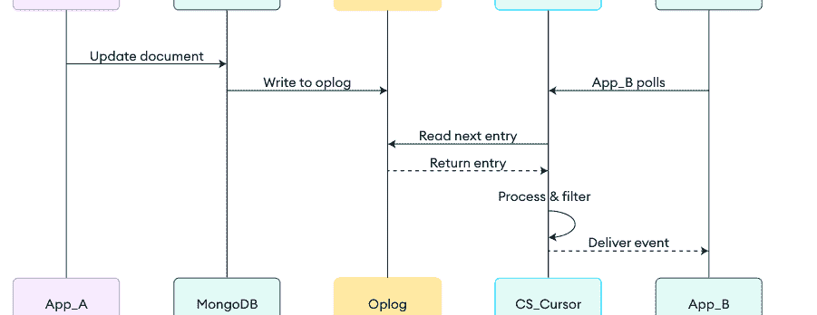

# 8 变更流

## 变更流

Change streams 是构建响应式、事件驱动应用程序的 MongoDB 最强大的功能之一。可以将其视为实时数据流，不断发送更新通知，因为它们在你的集合、数据库以及整个 MongoDB 部署中发生。此章节探讨 change streams 的架构、实现策略和性能考虑，提供实用指导，帮助你在高性能 MongoDB 部署中有效地利用此功能。

我们将首先通过从手动操作日志（oplog）尾部读取的演变来检查 change streams 背后的架构。你将了解 MongoDB 如何将写操作转换为更改事件，这些事件是什么样的，以及它们如何通过其生命周期。我们随后将介绍如何有效地实现 change streams，通过选择合适的观察范围、使用聚合管道进行服务器端过滤，以及使用在性能和完整性之间取得平衡的文档查找策略。最后，一个动手示例将演示如何使用 change streams 构建实时价格监控服务。

本章的后半部分侧重于性能和持久性：资源优化策略、设计有弹性的消费者以及处理高容量流。我们还解决了分片集群、文档大小限制和集合生命周期的特殊考虑。本章以关于监控和副本集细微差别的指导以及调优技术的回顾结束，以确保你的 change stream 实现已准备好投入生产。

本章涵盖以下主题：

- 了解 change streams 的架构及其工作原理
- 高效使用 change streams
- 管理性能和持久性
- 高级模式和生产就绪

## 了解 change streams 架构

从核心来看，change stream 是一个保持打开状态并将数据库更改事件传递给应用程序的游标。为了充分利用 change streams，了解其在表层下如何运作至关重要。在 MongoDB 3.6 中引入 change streams 之前，需要更改事件的开发人员要么依赖轮询，要么构建应用程序侧通知系统，要么手动尾部读取 MongoDB 的 oplog 集合。

这些方法有几个缺点。如果轮询间隔比更改更频繁，应用程序轮询可能会给数据库服务器带来不必要的负载。另一方面，如果轮询间隔较不频繁，应用程序可能会错过一些更改或引入延迟，需要额外的复杂性来处理此类场景。解析原始 oplog 条目还需要对 MongoDB 内部的了解，增加进一步的复杂性。此外，实现很脆弱，因为 oplog 格式是可能在 MongoDB 版本之间更改的内部细节。最后，手动尾部读取 oplog 提供的保证有限：如果网络连接丢失，则没有内置的可恢复性，也没有一致的排序保证。这些限制使得 oplog 尾部读取成为一种脆弱的解决方案，需要大量的专业知识才能正确实现，并使应用程序容易受到 MongoDB 版本之间内部破坏性更改的影响。

Change streams 通过提供一个官方的、受支持的接口来解决这些问题，该接口抽象了底层复杂性。有了它，你可以利用以下等功能：

- **可靠性：** 没有重复或遗漏的事件通知
- **结构化事件文档：** 格式良好定义的格式，包含有关每个更改的详细信息
- **可恢复性：** 内置的恢复令牌可在断开连接后实现可靠恢复
- **排序保证：** 确保事件的一致全局排序，即使在分片集群中也是如此
- **过滤功能：** 使用聚合管道进行服务器端过滤
- **更安全：** 虽然 oplog 公开服务器上的所有更改，但 change streams 仅传递用户或代码有权访问的更新
- **更简单：** 事件仅针对多数已提交的写入发送，因此你的应用程序无需处理回滚
- **可选镜像：** 你可以获取更改前和/或更改后的文档副本


Together, these features offer a robust and reliable foundation for building real-time applications that respond to data changes, while maintaining consistency and resilience, even in the face of disconnections or server failures.

## Change streams 如何工作：从写操作到事件

Change streams 建立在 MongoDB 的复制基础设施之上。理解这种关联有助于解释其能力和局限性。在高层次上，客户端应用程序通过以下步骤获知变更：

- 1. 应用程序对 MongoDB 集合执行写操作。
- 2. 该操作被记录在主节点的 oplog 中。
- 3. Change stream 功能监控 oplog 中的多数已提交条目。
- 4. 原始 oplog 条目被转换为更易于开发人员使用的格式。
- 5. 事件通过打开的游标传递给客户端应用程序。



图 8.1：通过 change streams 通知文档变更的序列

图 8.1 显示了使用 change streams 将变更通知从 MongoDB 传递给客户端应用程序所涉及步骤的高层次视图。App_A 和 App_B 可能代表同一个应用程序。oplog 是 MongoDB 的一部分，而 change stream 游标（CS_Cursor）同时存在于 MongoDB 服务器内部以及 App_B 的客户端侧。

此过程确保所有数据库变更都被可靠捕获，并以一致的顺序传递给需要实时响应的应用程序。在分片集群中，该过程变得更加复杂，因为路由器必须在多个分片之间进行协调，同时保持事件的全局顺序。

## 事件结构和生命周期

每个 change stream 事件都包含有关发生了什么变化的信息，并提供维护连续性的工具。例如，这里是一个 products 集合中文档的 price 字段变更的 change stream 事件：

```
{
  "_id": {
    "_data": "825F65A78B00000012B022C0100296E5A1004..."  // Resume token
  },
  "operationType": "update",
  "ns": {
    "db": "inventory",
    "coll": "products"
  },
  "documentKey": {
    "_id": ObjectId("5f65a78b0000000000000001")
  },
  "updateDescription": {
    "updatedFields": {
      "price": 29.99,
      "lastModified": ISODate("2023-09-15T14:22:01.123Z")
    },
    "removedFields": ["promotion"]
  },
  "fullDocument": { // Only present with fullDocument option
    // Complete current state of the document
  }
}
```

如你所见，如果在 change stream 设置期间请求，change stream 事件可以包含完整文档。然而，这可能会显著影响性能，因此应谨慎使用。change stream 游标在其生命周期中经历以下状态：

- 1. **打开中：** 在 oplog 中建立其位置
- 2. **等待中：** 在变更发生前保持空闲
- 3. **传递中：** 向客户端发送事件
- 4. **恢复中：** 在断开连接后重新建立流
- 5. **失效：** 在某些操作后终止

理解此生命周期是构建弹性应用程序的关键。

## 有效实现 change streams

现在你已经熟悉了 change streams 的架构，让我们看看如何有效地实现一个使用它们的应用程序，以在不同场景下获得最佳性能。

## 选择合适的范围和过滤策略

MongoDB 在观察范围和过滤能力方面都提供了灵活性。这两个因素的组合对性能有显著影响。观察范围可以限制在集合、跨越数据库或扩展到整个部署。一般来说，范围越广，性能影响越大，因为消耗的资源更多，且必须处理的变更事件量更高。

表 8.1 概述了每个范围、其资源使用情况、预期的事件量以及在应用程序中可能选择它的典型用例：

| 范围 | 资源使用 | 事件量 | 用例 |
|---|---|---|---|
| 集合 | 较低 | 聚焦 | 特定业务事件、定向同步 |
| 数据库 | 中等 | 中等 | 跨集合工作流、数据库范围审计 |
| 部署 | 较高 | 最高 | 全局审计日志、多租户事件广播 |

*表 8.1：Change stream 范围和特征*

如表 8.1 所示，选择合适的观察范围是在可见性和性能之间取得平衡。集合级范围提供最有效的资源使用，适用于定向用例。扩展到数据库或部署范围会增加可观察性，但也会对数据库和应用程序提出更高要求。

## 最佳实践

选择满足你需求的最窄范围。这将通过减少数据库服务器上的资源消耗来最大化性能，并最大限度地减少应用程序需要处理的事件数量。

然而，你需要将其与 change streams 的数量取得平衡，因为每个 change stream 实际上都在解析和过滤 oplog。例如，如果一个数据库有 20 个集合，并且你想处理其中 16 个的变更，那么在数据库上有一个 change stream 比在每个集合上建立 16 个 change stream 更好。


## 使用聚合管道进行服务器端过滤

Change streams 最有效的性能技术之一是使用聚合管道进行服务器端过滤。这种方法显著减少了网络带宽消耗和应用程序客户端处理开销。

例如，如果你只对产品文档的价格变更感兴趣，可以设置一个 change stream，使用聚合管道仅匹配 price 字段的变更：

```
// MongoDB Node.js driver code snippet
// Opening a change stream with a filter pipeline
const pipeline = [
  // Only capture update operations on the products collection
  { $match: { 'ns.coll': 'products', operationType: 'update' } },

  // Further filter to only include price updates
  { $match: { 'updateDescription.updatedFields.price': { $exists: true } } }
];

const filteredStream = collection.watch(pipeline);
```

此过滤后的 change stream 仅为 products 集合中 price 字段的更新发出事件，显著减少了通过网络发送并由客户端应用程序处理的数据量。

## 文档查找策略和性能

Change streams 提供了多种访问文档数据的选项，每个选项的性能影响各不相同：

- **仅增量**：默认行为；仅包含变更信息。
- **当前状态查找**：fullDocument: 'updateLookup' 获取当前文档。
- **变更前和变更后镜像（MongoDB 6.0+）**：提供变更前后的文档状态。此可选功能可能会影响性能，因为数据库必须捕获并存储变更前或变更后的文档。

最佳方法取决于你的具体用例。问自己以下问题来指导你的决策：

- updateDescription 中的值增量是否足以满足你的应用程序用例？
- 你能承受多少额外的网络带宽？
- 额外的文档查找延迟是否可以接受？

选择合适的选项取决于你的应用程序对准确性、性能和资源效率的需求。例如，'updateLookup' 选项将在更新发生后某个时间获取 fullDocument。如果文档很大，这可能会产生明显的性能影响。然而，它也可能需要在你的应用程序中进行仔细处理。例如，如果文档频繁变更并且有待处理的变更队列，你最终可能会读取比当前晚三个变更的版本。如果重放 change stream 也会发生这种情况；使用 'updateLookup' 时你的应用程序接收到的 fullDocument 是文档的当前版本，而不是变更时的版本。

## 构建价格监控服务

为了在实践中说明这些概念，让我们实现一个服务来监控产品价格变更并通知感兴趣的各方。以下代码设置了一个聚合管道来监视 price 字段的更新，并在变更超过定义阈值时通知应用程序的其他部分：

```
// Code snippets for MongoDB Node.js driver
// Configure the collection to using preImages (before the changes happen)
db.runCommand({ collMod: "yourCollectionName",
    changeStreamPreAndPostImages: { enabled: true }
});
```

// Setup the change stream with lookups and filtering
const priceMonitor = async (minimumPriceChange) => {
  try {
    const pipeline = [
      { $match: { operationType: 'update' } },
      { $match: { 'updateDescription.updatedFields.price': { $exists: true } } },
      { $project: { documentKey: 1, 'updateDescription.updatedFields.price': 1 } }
    ];
    options = { fullDocumentBeforeChange: 'required' };
    const stream = collection.watch(pipeline, options);

    // Process each change as it occurs
    for await (const change of stream) {
      const newPrice = change.updateDescription.updatedFields.price;
      const oldPrice = change.fullDocumentBeforeChange.price;
      const priceDiff = Math.abs(newPrice - oldPrice);

      // Only process significant price changes
      if (priceDiff >= minimumPriceChange) {
        await notifyPriceSubscribers(change.documentKey._id, oldPrice, newPrice);
      }
    }
  } catch (error) {
    console.error("Change stream error:", error);
    // Implement reconnection logic here
  }
};

此示例演示了若干关键性能实践。通过聚合管道实现服务器端过滤，应用程序可减少 MongoDB 与客户端之间的网络流量。此外，应用程序还在客户端应用业务特定过滤器（minimumPriceChange 阈值）。然而，请注意，在更新前捕获文档状态（preImage）会带来一定的开销。

这可能会产生细微的性能影响。实际上，启用 changeStreamPreAndPostImages 会导致写入放大，因为需要存储副本。然而，当应用程序访问时，它们很可能仍在缓存中。如果使用 'updateLookup'，则不需要 changeStreamPreAndPostImages，因此不会发生这些额外的写入。稍后进行读取时，命中缓存的可能性相对较低。从性能角度来看，理想情况下您应该在 updatedFields 中的字段上使用 $match。如果不可行，请同时尝试 changeStreamPreAndPostImages 和 'updateLookup'。

## 管理性能与持久性

构建使用变更流的高性能应用程序需要仔细考虑资源使用和数据持久性。让我们探讨优化两者的策略。

### 资源优化策略

变更流会消耗整个技术栈的资源。在某些情况下，在服务器上执行额外的处理可以减轻应用程序的工作负载。在其他情况下，客户端的额外处理可以提高整体系统性能。表 8.2 总结了这些权衡：

| 资源区域 | 影响因素 | 优化方法 |
|---|---|---|
| 服务器端 | - 用于 oplog 处理的 CPU 使用率
- 用于游标状态的内存使用量
- 网络带宽消耗 | - 积极过滤。
- 使用最小的适当范围。
- 将多个变更流复用为一个，并让应用程序进行过滤，以减少消耗 oplog 的游标数量。
- 调整 oplog 大小，避免流落后于更新太多。最终，如果应用程序的变更流处理落后，oplog 就是缓冲区。 |
| 应用程序端 | - 连接池使用
- 事件处理能力
- 用于缓冲的内存
- 网络带宽使用 | - 专用连接
- 使用批量处理 |

*表 8.2：服务器与应用程序处理的权衡*

与大多数性能决策一样，并没有一刀切的解决方案。优化变更流处理需要仔细考虑在您的架构中资源使用最关键的位置。通过了解服务器端和应用程序端处理的权衡，您可以调整方法以在效率、可扩展性和响应性之间取得平衡。

> **最佳实践**
> 
> 在高容量部署中，请考虑设置专用服务来处理变更流。这种方法将多个消费者合并到单个流连接中，提高效率并减少资源使用。

### 处理高容量事件流

在写入速率极高的应用程序中，变更流会产生大量事件。为了帮助此类应用程序有效扩展，请考虑以下策略：

- 实现积极的服务器端过滤
- 部署用于变更流处理的专用应用程序基础设施
- 使用在吞吐量和延迟之间取得适当平衡的批处理策略

如果 oplog 太小，oplog 会滚动并覆盖旧条目，而您的应用程序尚未有机会处理其变更流事件。这将导致变更流错误。对于变更流处理可能长时间离线的应用程序而言，此风险尤其高。

为诊断此问题，请监控 oplog.rs 集合的大小和当前 oplog 窗口。您可以使用 MongoDB Shell 中的 db.getReplicationInfo() 命令检查此项。如果您的 oplog 窗口很短（例如只有几个小时），则掉出 oplog 并出现错误的可能性更高。为解决此问题，请增加 oplog 大小。在副本集中，这通常涉及在配置中调整 oplogSizeMB 参数或使用更大的 oplog 重新初始化副本集。经验法则为，目标是 oplog 能够保留数天，甚至一周的操作，具体取决于您的恢复点目标（RPO）。

如果您怀疑变更流应用程序落后于实际数据库更改，这可能导致处理延迟或下游系统中的数据陈旧。为防止这种情况，请考虑以下方法：

- 监控 MongoDB 主节点和您的变更流服务上的网络 I/O。查找与数据库活动高峰期相对应的网络利用率峰值。
- 考虑应用程序与数据库的物理邻近性。确保 MongoDB 集群与变更流应用程序之间具有最佳的网络连接。这可能涉及将它们部署在同一数据中心或云区域。
- 如果可能，为数据库服务器和消费者应用程序提供更多网络带宽。
- 考虑批量处理事件，而不是单独处理。

您的应用程序还需要足够的计算资源来有效处理事件。如果资源受限且无法跟上更改的量，它将越来越落后，最终掉出 oplog 并收到错误。同样，MongoDB 服务器必须拥有足够的资源来生成和发送变更事件。监控运行应用程序的系统上的 CPU、内存和磁盘 I/O。查找高 CPU 使用率、内存压力或 I/O 瓶颈。尝试在变更流处理循环内尽量减少昂贵的操作。在数据库端，高 CPU 或 I/O 使用可能表明写入瓶颈。例如，繁重的索引会减慢写入速度，进而影响 oplog 的写入速度，从而影响变更流性能。

如果您的变更流应用程序频繁接收 invalidate 事件，迫使其关闭并重新打开，这可能会造成干扰，如果处理不当会导致延迟增加或事件丢失。invalidate 事件表示变更流正在监视的集合或数据库不再存在，或已发生结构性更改（例如删除或重命名），从而阻止流继续。

为进行故障排除，请统计变更流接收的事件类型。如果看到 invalidate 事件，请确定触发它们的特定操作。如果可能，避免删除或重命名正在被变更流主动监视的集合或数据库，尤其是在生产环境中，持续处理至关重要。如果这些操作是必要的，请确保您的变更流应用程序设计为通过重新建立流来优雅地处理 invalidate 事件。


## 分片部署的特殊考虑

在分片集群中，变更流需要在多个分片之间进行协调，同时保持事件的一致全局排序。这引入了若干独特的性能考虑因素：

- **全局排序开销：** 在所有分片之间保持一致的排序需要协调。这由 mongos 处理，并给该基础设施带来负载。
- **冷分片影响：** 没有写入活动的分片仍参与变更流协调。
- **地理延迟：** 分布式分片会在事件传递中引入网络延迟。
- **块迁移处理：** 块迁移期间的更改需要特殊处理。
- **系统级性能：** 如果分片集合具有高水平的写入活动，则 mongos 或处理流的应用程序服务器可能无法跟上所有分片的更改。

为了在分片环境中调优性能，以下代码配置了两个此类参数，maxAwaitTimeMS 和 batchSize：

```
// MongoDB Node.js driver code snippet
// Configuring change streams for optimal performance in sharded clusters
const shardedStreamOptions = {
  fullDocument: 'updateLookup',
  maxAwaitTimeMS: 1000,  // Adjust based on latency requirements
  batchSize: 100          // Balance between throughput and processing time
};

// Use collection-level streams where possible to reduce coordination overhead
const productStream = db.collection('products').watch([],
shardedStreamOptions);
```

`batchSize` 参数设置变更流中每个批次可返回的最大文档数（上限为 16 MB）。它与游标上的 `batchSize` 参数类似。这通常需要实验，因为如果批次大小过大，游标可能会分配比所需更多的资源；如果过小，则可能导致网络往返次数增加。

`maxAwaitTimeMS` 参数设置服务器在返回空批次给变更流游标之前等待新数据更改的最长时间（以毫秒为单位）。它类似于游标上的 `maxAwaitTimeMS` 参数。

以下是一些推荐的分片集群优化技术：

- **适当配置 periodicNoopIntervalSecs**（默认值：10 秒）以 **降低延迟** 来自冷分片或低写入分片。这些无操作确保即使在主节点上没有真实写入时，oplog 条目也会定期创建，使分片的成员能够更新其逻辑时钟和复制位置，从而减少对较冷分片的协调流量。
- **将变更流定位到特定集合**，尽可能这样做。这显著减少了跨分片通信开销，尤其是在高写入集合中。
- **对高活跃度集合应用使用 $match 管道的服务器端过滤。**
- **将变更流消费者地理位置上靠近** 您的主分片以最小化网络延迟。
- **独立监控每个分片的 oplog 窗口** 以检测可能影响基于变更流服务的潜在问题。
- **限制文档特定变更流的数量。** 例如，与其创建数百个变更流来监视单个文档，不如创建一个变更流并在应用程序中过滤相关事件。

总之，在分片集群中高效运行变更流需要仔细关注配置和部署策略。通过调整诸如 `batchSize` 和 `maxAwaitTimeMS` 之类的参数，将流定位到特定集合，并减少分片之间的不必要协调，您可以显著提高性能和可靠性。如同大多数分布式系统一样，持续监控和迭代调优是保持规模化最佳行为的关键。

## 高级模式与生产就绪

将变更流投入生产需要理解高级选项和监控需求。本节将基于官方 MongoDB 文档，探讨生产部署的关键考虑因素。

### 事务可见性与事件批处理

在 MongoDB 中使用事务时，变更流遵循特定的可见性规则，影响事件传递。事务中进行的所有更改只有在事务提交后才对变更流可见。此时，该事务的所有更改会一次性作为流中的单独事件出现，同时保持事务内部的逻辑顺序。

这种行为确保了数据一致性，但要求您的消费者应用程序在提交大事务时能够高效处理这些事件突发。考虑在处理逻辑中实现批处理和限流机制，以优雅地处理这些激增。

### 文档大小限制与集合生命周期

变更流响应文档必须遵守 MongoDB 的 16 MB BSON 文档限制。如果您使用诸如 fullDocument: 'updateLookup'（执行查找以在更新操作后获取文档的整个当前状态）的选项或处理大型文档，您可能会达到此限制，导致事件失败。对于更大的文档，在 MongoDB 6.0.9+ 中，考虑使用 $changeStreamSplitLargeEvent 聚合阶段将大型变更事件拆分为多个较小的片段，以便单独处理而不超过大小限制。

当集合或数据库在变更流监视它们时被删除或重命名，变更流游标将在 oplog 中到达该点时关闭。在这些失效事件之后，如果您想重新启动流，必须使用有效的 resume token 使用 startAfter（而不是 resumeAfter）。

### 监控与健康检查

生产部署应包括对多个关键指标的全面监控。对于变更流，您可以从通过 db.serverStatus().metrics.changeStream.currentOpen 命令跟踪活动游标计数开始。变更事件可能在数据库中发生更改后很长时间才到达。此外，监控事件处理延迟和吞吐量以确保最佳性能。Resume token 持久性指标提供了恢复能力的洞察，而 oplog 窗口大小（可通过 rs.printReplicationInfo() 测量）指示历史操作可追溯的时间范围。

### 副本集注意事项

使用自托管 MongoDB 时，以及对于具有仲裁成员的副本集，请注意如果没有足够的数据承载成员来实现多数提交，变更流可能会保持空闲。例如，在一个包含两个数据承载节点和一个仲裁者的三成员副本集中，如果 secondary 宕机，写入无法多数提交，变更流保持打开但不会发送事件。

如果您预计使用变更流的服务会出现重大停机，例如维护或灾难恢复，请增加 oplog 大小以保留操作时间超过预计的停机期。这确保您的应用程序在连接恢复后能够赶上所有更改。

### 性能调优回顾

在为生产环境优化变更流时，应实施若干关键策略。使用聚合管道进行服务器端过滤可显著减少事件量，最小化网络流量和处理开销。根据特定应用程序需求选择合适的文档查找策略，仔细在各种 `fullDocument` 选项之间进行选择，以在完整性和性能之间取得平衡。

根据预期的最大停机场景适当调整 oplog 大小，确保它能保留足够长的操作以跨越维护窗口或恢复期。始终配置连接池大小超过打开的变更流数量，防止资源耗尽。

限制特定定位的变更流数量，因为这些流无法利用索引优化，可能增加服务器负载。对于事件量特别高的应用程序，考虑专用基础设施以将变更流处理与主数据库工作负载隔离，防止对关键操作造成性能影响。

## 总结

变更流将 MongoDB 从传统数据库转变为响应式数据平台，使其能够对数据更改做出实时响应。当在考虑性能因素的情况下深思熟虑地实施时，它们为构建响应迅速的事件驱动应用程序提供了强大的基础。

下一章将重点转向事务，这是构建可靠且一致应用程序的重要部分。我们将深入探讨多文档 ACID 事务的机制，并讨论在各种 MongoDB 架构中优化其性能的关键考虑因素。


