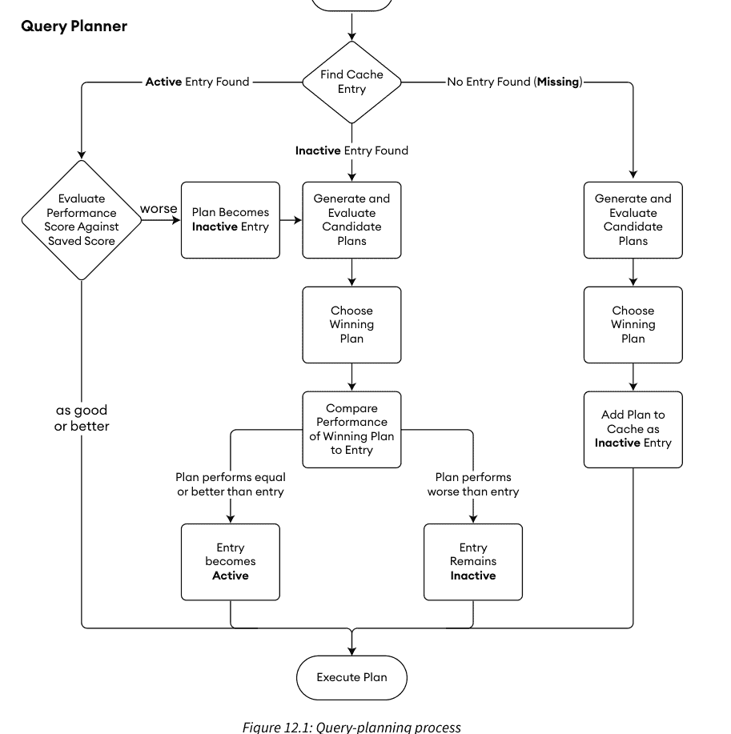

# 12 高级查询和索引概念

## 高级查询和索引概念

查询变慢的原因有很多，*slow* 是一个主观术语，通常意味着 *比您预期或需要的慢*。导致这种情况的许多因素包括缺乏索引、索引不佳、硬件资源不足、不必要地使用低效操作，或为同一资源竞争太多其他操作。

在本章中，我们将介绍查询执行的某些高级概念，涵盖查询如何使用索引、查询优化器如何选择索引、使用 explain 命令深入挖掘的方法，以及如果有改进空间则提高性能的技术。我们还将介绍一些特殊索引类型和集合，当常规索引策略似乎不够充分时，这些可能适合您的用例。我们还将描述系统效率低下可能出现的其他地方，并提供最佳性能的其他提示。

本章涵盖的主题如下：

- 查询执行生命周期
- 评估和分析 explain 输出的过程
- 使用日志消息检测、分析和诊断慢查询的根本原因
- 理解 MongoDB 查询语言语义和索引使用
- 额外的特殊集合、索引类型和功能，可以增强性能


## 理解查询执行

了解应用程序向数据库发送操作时发生了什么非常重要。性能可以在许多地方得到改进，并且全面了解所有阶段，才能正确判断哪些地方未达到最优以及如何修复。

当查询发送到数据库引擎时，无论是作为 find、update、delete 或 aggregate $match 过滤器的一部分，都会发生几件事。首先，查询会被解析为标准化形式。然后，查询规划器需要确定是否有可用的索引，如果有多个，则需要确定哪一个最好。结果的第一批会被返回给客户端。然后，如果客户端请求更多结果，getMore 命令将返回额外的批次。

由于选择正确索引会产生一定的开销，MongoDB 使用一种机制，确保一旦为特定查询形状选择了计划，就将其存储在计划缓存中以供将来使用。查询形状是指忽略值的查询，因此 {x:5} 和 {x:25} 被视为相同的查询形状。还有一种机制可确保如果某个索引最终不是最佳选择，则会重新评估，以防有更好的索引可用。

图 12.1 显示了完整的查询规划过程流程：

### 查询规划器



图 12.1：查询规划过程

但你可以这样稍微简化地理解：首先，我们问：“是否已缓存了计划？”如果有，则使用它；如果没有，则生成并评估候选计划，选择获胜计划，并将其添加到缓存中以供将来使用。这是一个稍微简化的流程描述，因为它没有考虑到获胜计划首先以非活动状态保存，然后只有在确认性能良好后才会被激活。但作为一种简化，这是一个很好的近似。

任何特定查询可能的候选计划有哪些？我们已经知道，如果没有合格的索引，则计划将是全集合扫描（COLLSCAN）。如果有索引或多个索引可用，则根据确切的查询要求，它们可以用不同的方式使用。我们将在下一节中查看使用索引的不同方式。


### 单个合格索引时的计划缓存使用

如果只有一个计划可用，例如只有一个合格的索引，则它不会存储在计划缓存中。计划缓存严格用于多个索引可以满足查询的场景。

根据索引的效率，以及它是否对查询提供覆盖和/或支持排序和查询过滤器，将分配一个分数。计划评分的确切细节超出了本书的范围。然而，作为一般原则，最高分代表试运行期间最有效的计划，并成为暂定获胜者。然后该计划连同其分数一起被缓存，至少直到使用该计划对同一查询形状进行低效执行导致分数明显低于保存的分数，在这种情况下，缓存的计划将被从计划缓存中驱逐。当这种情况发生时，查询将被重新规划，这意味着它将再次经过计划评估阶段，以尝试找到更好的索引。

规划与向客户端返回结果并不是独立的。在规划查询执行时找到的文档会作为第一批结果返回给客户端。

### 计划阶段，或“索引如何被使用”

尽管我们刚刚一直在说“查询使用索引”，但事实证明索引有多种使用方式。在标准情况下，查找 B 树中与单个值匹配的文档字段时，我们会遍历 B 树并找到匹配叶节点的 recordId。然而，在查询不是查找文档而是文档计数的情况下，索引还有其他使用方式。当我们在整个 B 树或其子部分中查找第一个不同值时，索引遍历方式还有其他优化。所有这些都有不同的内部名称，你可能会在日志中的查询计划摘要或 explain 输出中看到它们。

以下是不同的 **indexed** 查询计划及其含义：

- **IXSCAN**：索引扫描意味着我们正在按某种顺序遍历 B 树（通常是子集）
- **IDHACK 或 EXPRESS_IXSCAN**：针对 _id 索引或其他唯一索引的特殊优化索引扫描
- **DISTINCT_SCAN**：特殊索引扫描，用于支持在 B 树中找到所有不同值
- **COUNT_SCAN**：特殊索引扫描，用于仅从 B 树的子集获取计数

如果操作没有合格的索引，则查询计划将为 COLLSCAN，表示全集合扫描。

> **索引优先于 COLLSCAN**
> 
> 如果查询至少有一个合格的索引，则除非用户强制指定，否则不会选择 COLLSCAN。

尽管查询计划的效率大致按照此列表的顺序递增，但这并不是绝对的说法，因为它取决于扫描检查的 B 树子集的大小（对整个索引进行 COUNT_SCAN 很可能比对索引的极小部分进行 IXSCAN 更慢）。

在查询规划器输出中，你还会看到其他 *stages* 或步骤。它们的意思如下：

- **FETCH**：必须读取完整文档，并且可选地应用过滤器以确保其匹配
- **SHARD_FILTER**：通常最后应用，以确保仅返回该分片拥有的文档
- **SORT**：表示对结果进行内存排序
- **SORT_MERGE**：用于合并多个已排序的文档流

还有一些其他更晦涩的阶段，但我们现在不担心它们。

> **索引支持的排序省略 SORT 阶段**
> 
> 由索引支持的排序在计划中 *不* 包含任何 SORT 阶段，因为返回排序结果不需要额外步骤。

查询规划和执行产生的指标和诊断会出现在多个地方：

- `explain output`
- 在 `mongod` 和 `mongos` 日志中记录的慢查询日志消息
- 启用分析时 `system.profile` 集合
- Atlas 中的仪表板，例如 Query Insights
- `currentOp` 命令输出

这些指标包括所选计划、查看了多少索引条目和文档、是否进行了内存排序，以及我们在本章后面的示例中将探讨的多个其他指标。

调试查询规划器性能最详细、最有用的工具将是 explain 命令。

### 使用 explain 命令

我们已经简要介绍了如何使用 explain 命令检查查询和聚合执行。现在，让我们详细了解它是如何运行的以及显示什么内容。每当我们运行任何带有传递查询过滤器的命令时，我们都可以在 mongosh 中在集合名称和命令辅助方法之间插入 explain 来调用它，如以下示例所示：

```
db.collection.explain(<option>).find({<query>})
```

用于 explain 的 <option> 决定输出的详细程度，可以是以下之一：

- "queryPlanner"：默认值。仅运行查询优化器并返回将选择的查询计划。
- "executionStats"：运行查询优化器，执行选定的获胜计划，并返回描述执行的统计信息。
- "allPlansExecution"：与 "executionStats" 相同，但除了返回执行获胜计划的统计信息外，还返回在计划选择和评估期间捕获的被拒绝计划的统计信息。

explain 命令的输出包含多个部分。queryPlanner 部分始终存在。如果使用 executionStats 或 allPlansExecution 选项，你将看到非常有信息的 executionStats 部分。


## queryPlanner 部分

queryPlanner 部分是查看查询基本信息的位置，其中包括查询如何被解析为规范形式或标准化形式、queryHash（用于以不同值识别相同查询形状的快捷方式）、如果查询计划在缓存中则会出现的 plan 的 planCacheKey、查询计划选择是否受到任何特殊设置影响的指示、winningPlan，以及在存在其他计划选项时被拒绝的计划。

## executionStats 部分

实际运行查询的 explain 命令将包含 executionStats 部分，其中捕获了运行期间观察到的所有实际指标。对于查询过滤部分，它包括诸如 totalKeysExamined（查看的索引键数量）、totalDocsExamined（查看的文档数量）、nReturned（如果未指定 explain 将返回给客户端的文档数量）等字段，以及对每个观察到的执行阶段的相同详细信息。

对于内存排序，explain 命令包含一个 SORT 部分，其中包含使用了多少内存的信息。当没有合适的索引来支持按排序顺序获取数据时，此部分会出现。它还指示数据是否必须溢出到磁盘，如果是，则用于辅助排序的磁盘空间大小。

在聚合的情况下，explain 还列出初始 $cursor 阶段之后的所有阶段（该阶段负责从集合中获取文档以流式传输到管道的其余部分）。它包括每个阶段返回的文档数量，以及到此为止所有阶段累计花费的时间。

以下是聚合 execution stats 部分列出阶段的示例输出的一部分：

```
stages: [
  {
    '$cursor': { queryPlanner: { executionStats: { ... } } }
    nReturned: Long('10805'),
    executionTimeMillisEstimate: Long('21')
  },
  {
    '$set': { ... },
    nReturned: Long('10805'),
    executionTimeMillisEstimate: Long('21')
  },
]
```

```
{
  '$unwind': { ... },
  nReturned: Long('14804'),
  executionTimeMillisEstimate: Long('22')
},
{
  '$group': { ... },
  maxAccumulatorMemoryUsageBytes: { count: Long('1768') },
  totalOutputDataSizeBytes: Long('3534'),
  usedDisk: false,
  nReturned: Long('13'),
  executionTimeMillisEstimate: Long('23')
},
{
  '$sort': { sortKey: { count: -1 } },
  totalDataSizeSortedBytesEstimate: Long('3638'),
  usedDisk: false,
  spills: Long('0'),
  nReturned: Long('13'),
  executionTimeMillisEstimate: Long('23')
}
```

第一个阶段称为 $cursor，它表示管道文档的来源是一个集合。早期 $match 阶段以及以与 find 命令相同方式执行的其他阶段可以在 $cursor 阶段内部观察到。该阶段返回了一定数量的文档，然后这些文档在管道中流动。执行时间估计是累计的，因此我们看到查询部分花费了 21 毫秒，而大多数其他阶段花费不到 1 毫秒，除了 $unwind 和 $group，每个花费了 1 毫秒。

在分片集合中，mongos 路由器会将带有 explain 选项的查询转发到每个分片，合并其结果，并在 explain 输出中包含其自身的工作，该输出对分片的工作和 mongos 工作有单独的部分。

以下是分片集群中聚合查询的 explain 输出字段的示例：

```
"mergeType" : "mongos",
"splitPipeline" : {
"shardsPart" : [ ... ],
"mergerPart" : [ ... ]
```
```

这表明来自每个分片的输出的合并在 mongos 上进行。它还显示了整体管道如何被拆分为两个部分。第一部分发送到相关分片，而合并部分在 mongos 上执行。

以下是需要在分片上过滤孤立文档的 explain 示例：

```
winningPlan: {
  stage: 'SHARD_MERGE',
  shards: [
    {
      shardName: 'shard01',
      winningPlan: {
        stage: 'FETCH',
        inputStage: {
          stage: 'SHARDING_FILTER',
          inputStage: {
            stage: 'IXSCAN',
            keyPattern: { id: 1 },
            ...
          }
        }
      }
    }
  ]
}
```

此示例显示了对特定字段的查询，该查询有效地使用索引进行查询。然而，由于分片键不在索引中，因此需要额外步骤来获取文档以检查其分片键值是否属于该特定分片。可以通过在索引中添加包含分片键字段（通常作为尾随字段）的复合索引来使此查询更高效。

### SHARD_MERGE 与 SINGLE_SHARD 阶段

SHARD_MERGE 表示查询由多个分片处理。如果查询可以定位到单个分片，则该阶段的名称将为 SINGLE_SHARD。

## 分析日志消息

explain 输出虽然很有用，但从每次命令实际执行日志中可获得的信息远不止于此，以下是为可读性格式化并删减了非查询过滤执行特定字段的示例：

```
"type" : "command",
"ns" : "test.coll",
"collectionType" : "normal",
```
```json
"command" : {
    "aggregate" : "coll",
    "pipeline" : [
        {"$match" : {"$or" : [
            {"x" : {"$gt" : 5,"$lt" : 10}},
            {"a" : {"$gt" : 5,"$lt" : 10}}
        ]}},
        {"$sortByCount" : "$b"}
    ],
    "$clusterTime" : { ... },
    "$db" : "test"
},
"planSummary" : "IXSCAN { x: 1 }, IXSCAN { a: 1 }",
"planningTimeMicros" : 2572,
"keysExamined" : 567,
"docsExamined" : 567,
"hasSortStage" : true,
"nreturned" : 40,
"planCacheKey" : "DAC1B215",
"queryFramework" : "sbe",
"locks" : {"Global" : {"acquireCount" : {"r" : 4}}},
"storage" : { },
"workingMillis" : 12,
"durationMillis" : 12
}
```

你可以看到使用了哪个查询计划（两个索引，每个 $or 子句一个），并且存在 SORT 阶段（hasSortStage: true），这表明结果进行了内存排序。你还可以根据检查的键数与文档数来了解索引的选择性，并可以看到操作花费了多长时间，以及时间花费在何处的细分。如果运行了多计划评估过程，则日志消息中还会看到 "fromMultiPlanner": true。

日志中的消息采用 json 格式，因此如果要以编程方式分析它们，可以将它们加载到自己的 MongoDB 集合中，或者可以使用 grep 等命令行工具查找有问题的模式。

## 识别有问题的模式

就像并非所有快速查询都最优高效一样，有时编写良好且有索引支持的查询仍然可能很慢。了解它们为何变慢很重要，以避免浪费时间调整并非性能问题根本原因的东西。

有问题的查询总是会变慢吗？不一定。我们已经知道慢是相对的，默认情况下，慢于 100 毫秒的查询会被记录在 mongod 日志中。此阈值可以配置为更高、更低，或基于除绝对时间阈值之外的其他内容；有关更多详细信息，请参阅第 14 章《Monitoring and Observability》。然而，如果低效查询刚好低于阈值，它们仍可能逃过检测，即使使用最佳索引后它们仍可能显著更快。我们可以通过调整日志阈值并查看查询定位比率、磁盘使用或其他资源争用情况来查找这些慢查询。

## 查询定位比率

衡量查询效率最重要的指标之一称为查询定位比率。现在我们已经看到了 explain 和日志消息中可用的详细信息，让我们看看这个比率包含什么。当你查询满足特定条件的文档时，系统需要查看的文档越少，就能越快完成查询。

查询定位比率是指读取的索引键数与返回的文档数之比，或读取的文档数与返回的文档数之比。这两者中的理想数字都是 1，因为我们希望只查看需要返回给客户端的索引条目或文档。如果查询存在最佳索引，并且每个扫描的索引条目最终都在结果集中，则比率将为 1:1。覆盖索引查询是一种特殊情况，我们甚至不需要查看任何文档，并将通过 "docsExamined": 0 来表示，但为了理解以下示例，让我们先将其放在一边。

最简单的例子是查询 {a: 5} 且 a 上有索引。我们查看的每个索引条目都将是我们想要匹配的值，并且我们只会访问需要返回给客户端的文档。这是一个理想的比率。如果 a 上没有索引，则必须执行集合扫描，这意味着我们查看集合中的每个文档。如果有 50 个文档匹配我们的条件并需要返回，而集合中有 5000 万个文档，那么我们的定位比率将为 100 万比一，这不是很好，因为理想比率应为一比一。


这里有一些日志消息片段，来自于使用了索引来满足多个查询谓词子句的查询，但随后仍需检查文档中的额外字段以确定是否应将其返回给客户端：

```
"keysExamined":977,"docsExamined":977,"nreturned":4
"keysExamined":69070,"docsExamined":147,"nreturned": 0
```

虽然 keysExamined 与 docsExamined 的比率可以告诉你索引在缩小查询需要检查的文档数量方面的效率如何，但 nreturned 显著更低仍然表明必须直接对文档应用额外的过滤器。这仅适用于查询，而不适用于聚合，因为聚合可以通过将其聚合为更少的总组来返回更少的文档。

## Waiting for disk or other resources

日志中可能最有用的指标之一是 storage，在快速查询的情况下它会为空。然而，如果任何索引或数据页不在存储引擎缓存中，与之相关的指标将出现在 storage 字段中。即使有效使用索引的查询也很慢，通常也是因为数据尚未在 WiredTiger 缓存中，而该字段将指示是否如此。

以下是三个查询的部分日志消息可能的样子：

```
storage:{data:{bytesRead:8674010,timeReadingMicros:6297}},durationMillis:105
storage:{data:{bytesRead:15353,timeReadingMicros:918415}},durationMillis:919
storage:{data:{bytesRead:31033716,timeReadingMicros:82948}},
durationMillis:145
```

从数据库的角度来看，这表明数据并非来自其缓存。这些数据仍可能已从文件系统缓存中读取。

在不同情况下，根本原因可能是磁盘异常缓慢（第二个示例行）、大量数据未存在于缓存中，或内存排序必须将数据溢出到磁盘。你可以通过在日志消息中查找 "usedDisk":true 来跟踪此问题，或通过检查 explain 输出中的更详细信息。

同样，日志消息可以表明慢查询使用了最佳执行计划，但仍因其他不可用的资源而变慢，例如等待其他缓慢操作。尝试优化该查询毫无意义，因为需要解决的是整个系统或其他缓慢操作。

## How to influence query execution

有时，无论你多么努力为查询创建完美的索引，查询规划器仍会选择不同的索引。你可以通过两种方式影响执行，以强制选择你偏好的索引，或完全阻止不期望的查询执行。

## Using hint

你可以将 hint 指令与索引的名称或定义一起传递给任何查询。这指示查询引擎完全绕过查询缓存和规划过程，而改用指定的索引进行查询。使用 hint 时需注意以下几点。指定不存在的索引将返回错误。指定稀疏、部分或不兼容的索引可能会返回不完整的结果，如果索引不包含满足查询谓词的所有文档。

在应用程序代码中使用 hint 时，务必谨慎操作：定期检查它是否仍有必要。通常最好删除导致查询引擎做出次优选择的额外索引，但在无法做到时，使用 hint 可以提供快速解决方案。

以下是强制 find 通过 hint 按名称使用索引的代码示例：

```
db.coll.find({<filter>}).hint("indexName")
```

谨慎使用 hints。随着数据和索引的演变，始终验证其持续的相关性。

## Using query settings

MongoDB 8.0 版本引入了一个名为 persistent query settings 的新功能。此功能允许你通过在服务器上自动添加 hints 来控制查询执行，而无需对应用程序进行代码更改、定义拒绝过滤器并配置其他字段。Rather than relying on a hint being explicitly added to a particular query shape in the application code（如果查询在系统的多个部分被调用，则存在遗漏某些位置的风险），你可以配置服务器在观察到特定查询形状时自动应用 hint。

此命令为特定数据库、集合和查询形状设置索引 hint：

```
db.adminCommand({
  setQuerySettings: {
    find: "collName",
    filter: {<filter>},
    $db: "dbName"
  },
  settings: {
    indexHints: {
      ns: {db: "dbName", coll: "collName"},
      allowedIndexes: ["indexName"]
    }
  }
})
```

当你想完全阻止有问题的查询运行时，修改 settings 字段以包含 reject:true 指令。有关 setQuerySettings 命令的更多信息，请访问 https://www.mongodb.com/docs/manual/reference/command/setquerysettings/。

## Other options

另一个值得注意的设置是启动 mongod 时的 --no tablescan 选项，它像一把大锤子一样存在，尽管通常不推荐在生产环境中使用。此设置可以阻止任何具有查询过滤器但没有可用索引的查询。这可能在测试或暂存系统中启用以确定是否有任何查询意外运行集合扫描是安全的，但在生产中使用这种不加区分的工具可能不是好主意。你可以在生产中监控此类查询，然后决定使用查询设置将其从系统中阻止，或添加索引来支持它们。

## MQL semantics and indexes

如第 3 章《Indexes》所述，索引旨在支持 MongoDB 查询语言（MQL）的 find 语义，但这意味着什么？MQL 有多个组件，其中一些特定于聚合，一些特定于更新，一些特定于 find 命令过滤器，被称为 match expressions。这是在为 find、update 和 delete 命令指定查询谓词时使用的语法，也是 $match 聚合阶段期望的语法。索引支持 match expressions 的一些特殊性，这会影响索引被特定查询使用的效率。理解这一点可以帮助你发现、调试和重写难以优化的查询，并从一开始就编写更高效的查询。

## Challenges with arrays and multikey indexes

存储数组的字段为查询规划和索引使用带来了独特的挑战。包含可能为数组的字段的文档需要特别考虑，以避免成为非预期性能问题的来源。

## Equality is not just equality

在 MQL 查询中指定相等（$eq）于某个值——显式或隐式——意味着 *相等* 或 *数组中某个元素等于该值*。

例如，`db.coll.findOne({a:5})` 匹配 `{a:5}` 以及 `{a:[1, 5, 10]}`。

这意味着对字段 a 的索引包含条目 5 必须指向 a 为 5 的文档，以及 a 为包含 5 的数组的文档。条目看起来完全相同，但一旦任何数组元素被索引，索引就会获得 multikey 属性，这告诉查询引擎 a 可能是数组。因此，在返回 a 的值时，不能仅从索引返回；必须获取文档以返回字段的实际值。

请注意，在聚合中，$eq 表达式没有这种细微差别。在 `{$eq:[v1, v2]}` 中，如果两个值相等，结果为 true，否则为 false。聚合表达式不会深入数组以匹配单个值。

## $elemMatch

我们如何索引数组不仅仅影响返回潜在数组字段；它还影响我们如何使用索引来检查 $elemMatch 条件。$elemMatch 操作符检查 *是否至少有一个数组元素满足查询条件*。

例如，查询 `{a:{$elemMatch:{$eq:5}}}` 将匹配 `{a: [1, 4, 5]}` 但不会匹配 `{a: 5}`，因为这里的 5 不是数组元素。

同样，`{a:{$gt:5, $lt:10}}` 将匹配 `{a: [1, 4, 11]}`，因为两个条件都为真；a 有一个小于 10 的元素，它也有一个大于 5 的元素。

为了查找同时满足两个条件的单个元素，我们必须写成 `{a:{$elemMatch:{$gt:5, $lt:10}}}`。现在，含义变为：*a 必须有一个同时大于 5 且小于 10 的单个元素*。

鉴于我们在 B-tree 中索引数组值，在某些情况下索引可能无法像你期望的那样高效地回答查询。一个简单的 `{a:{$elemMatch:{$eq:5}}}` 查询可以使用索引找到 a 为标量 5 或包含 5 的数组的所有文档。


但如果不查看文档，就无法判断 a 是否为数组元素，因为灵活的模式允许你在集合的同一字段中包含标量和数组。

另一个可能让你对查询使用索引感到意外的情形是当你没有对多个条件使用 $elemMatch 时，具体来说，当你不希望单个元素满足多个条件，而是希望找到一个数组，其中不同的元素可以分别满足这些条件时。

一个例子是前面提到的 {a: {$gt: 5, $lt:10}} 查询，它可以使用 a 上的索引，但如果该索引是多键的（也就是说，如果已知 a 在某些文档中可以是数组），那么它就不能像常规的非数组索引那样使用。

考虑我们一直在查看的示例，以及它如何使用非多键与多键索引：

```
db.coll.explain().find({a:{$gt:5, $lt:10}})
```

表 12.1：查询使用不同的索引边界，具体取决于索引是否为多键

| // a 上的非多键索引 | // a 上的多键索引 |
|---|---|
| "winningPlan" : { "stage" : "FETCH", "inputStage": { "stage" : "IXSCAN", "keyPattern":{"a":1}, "isMultiKey" : false, "indexBounds": {"a":["(5.0,10.0)"]}}} | "winningPlan" : { "stage" : "FETCH", "filter" : {"a" : {"$lt" : 10}}, "inputStage" : { "stage" : "IXSCAN", "keyPattern" : {"a" : 1}, "isMultiKey" : true, "indexBounds" : {"a":["(5.0,inf.0)"]}}, "rejectedPlans" : [...] } |

*表 12.1：查询使用不同的索引边界，具体取决于索引是否为多键*

左侧，非多键索引使用紧凑的边界来查找字段 a 在 5 到 10 之间的所有文档。右侧，计划使用索引查找 a 在 5 到无穷大之间的所有文档，然后获取文档以检查是否还有 a 小于 10。为什么多键索引不能使用与非多键索引相同的索引边界，而必须在索引中只使用一个边界，并在 FETCH 阶段手动检查另一个边界？这是因为数组语义规定，“*一个元素可以匹配一个条件，而另一个不同的元素可以匹配另一个条件*”，如果我们使用紧凑的边界，就会遗漏诸如 {a: [1, 11]} 这样的匹配文档，其中没有任何元素落在 5 到 10 之间！

## Deduplication

由于 B 树中每个数组元素都是单独索引的，因此当多键索引查询看起来像 {a: {$in: [1, 5, 10]}} 时，需要额外的工作来对匹配的文档进行去重。在这种情况下，我们在 B 树中执行三次查找，每次对应一个值，但这三个查找都可能指向同一个 recordId。查询必须始终对多键索引的多键字段执行额外的工作，以确保不会返回重复的记录（或多次计数）。

让我们查看查询 {a: {$in: [500, 501, 502]}} 的 explain 输出的 executionStats 部分，其中多个文档的数组包含其中几个值：

```
executionStats: {
  inputStage: {
    stage: 'IXSCAN',
    nReturned: 1,
    works: 4,
    advanced: 1,
    isEOF: 1,
    keyPattern: { a: 1 },
    isMultiKey: true,
    multiKeyPaths: { a: [ 'a' ] },
    indexBounds: { a: [ '[500, 500]', '[501, 501]', '[502, 502]' ] },
    keysExamined: 3,
    seeks: 1,
    dupsTested: 3,
    dupsDropped: 2
  }
}
```

返回的单个文档在数组 "a" 中包含搜索列表中的全部三个值，这就是为什么我们看到在三个测试结果中，有两个被丢弃为重复项。这显示了执行的额外工作，你可以从 nReturned 为 1 而 keysExamined 为 3 中看出。额外的工作并不是因为索引没有高效地存储我们想要返回的所有值；而是因为为了消除重复结果而进行的额外工作。虽然数组是表示文档中复杂结构的有力方式，但要注意的是，处理已索引的数组字段时某些查询可能会产生额外成本。

## Challenges with null and $exists

在 MQL 中，查询 {a: null} 匹配所有 a 缺失或 a 存在且等于 null 的文档。这包括 a 是包含 null 的数组的情况以及一些更复杂的场景。

但在所有这些情况下，由于该查询会返回缺失和 null，B 树索引会存储值 null 来表示该值要么是显式 null，要么是缺失的；也就是说，它根本不存在。因此，索引可以轻松用于检查字段是否不等于 null，但不能用于回答 $exists:true 或 $exists:false 查询。这是因为仍需要检查文档以查看字段是否存在且值为 null，还是根本不存在。唯一的例外是稀疏索引，它只索引存在的值（包括 null），因此可以直接从索引中回答 $exists:true 谓词，而无需在文档本身中检查其他细节。

当使用 a 上的索引检查 db.coll.find({a: {$ne: null}}) 时，以下是几个 explain 字段：

```
stage: 'IXSCAN',
keyPattern: { a: 1 },
indexBounds: { a: [ '[MinKey, null)', '(null, MaxKey]' ] }
```

索引边界显示查询被处理为范围查询，匹配小于 null 和大于 null 的值。

所有这些对于编写正确的查询至关重要，但了解索引何时可以以及何时不能像你期望的那样有效地使用也很重要。总之，如果你的应用程序有必须检查字段存在的查询，可以使用稀疏索引。

## Additional best practices

以下是关于如何最好地编写应用程序以及需要注意什么、作为一般规则应避免什么的几个额外提示，如果你想要一个性能良好且可扩展的系统。一些应避免的功能已被 MongoDB 计划弃用和移除，而其他功能则适用于非常特定的用例，在这些用例之外使用它们可能会给系统带来不必要的开销。

## Updates

在组合更新修改时，始终优先使用单个字段修改而不是替换整个文档。从应用程序开发者的角度来看，使用 updateOne 通常比使用 replaceOne 更好，因为当只有少数字段发生变化时替换整个文档会降低复制子系统的效率。

在某些情况下，当文档的新版本从应用程序外部接收到，且确定确切更改成本过高或不切实际时，你可以使用一个技巧。不要使用以下语法：

```
db.coll.replaceOne({_id:X}, {entire-new-document})
```

而是使用以下更新的语法来实现相同的效果：

```
db.coll.updateOne({_id:X}, [ {$replaceWith:{$literal:entire-new-document}} ])
```

乍一看，这似乎使用了聚合语法来指示系统执行相同的“用此新文档替换现有文档”过程，但实际上内部发生的是 MongoDB 比较现有文档和新文档并生成增量以记录在复制 oplog 中，从而产生更小的 oplog 条目。在计算发现这些增量记录起来比整个新文档更冗长的情况下，我们将把整个新文档写入 oplog。

为了正确性，在多线程系统中，请确保使用更新修饰符组合你的更新，这允许多个线程同时更改同一文档而不覆盖彼此的工作。这意味着使用 $inc 来递增计数器，而不是读取文档、在代码中修改它，然后写回。如果出于应用程序特定原因无法避免读-改-写模式，请使用版本控制以确保在读取和写入之间文档没有被其他更改，或在写入的过滤器中使用你要修改的字段的先前值，以便只有在自读取以来该值未被更改时写入才成功。


## findAndModify

findAndModify 命令在驱动方法中称为 findOneAndUpdate，其用途经常被误解。它本质上与 updateOne 命令完全相同，但不同之处在于，它不会返回告知客户端更新具体做了什么的结果文档（例如，是否进行了更新，是否匹配到任何文档等），而是 findOneAndUpdate 执行相同的更新操作，但返回被更新的文档（如果有），要么是更新前的版本，要么是更新后的版本。

为什么这种功能甚至需要存在？这是因为有时你需要知道更新产生了什么效果，或者哪个文档被更新了，并且你的更新过滤器结构是这样的，你无法以其他方式知道和确定这些信息。考虑一个示例，其中有一个单一的文档集合，只是跟踪一个计数器，每次使用一个值时该计数器都会递增 1：

```
{_id:1, count: 35}
```

如果客户端想要使用下一个可用的计数值的同时递增计数器，使其处于下一个线程的正确状态，它无法通过两个单独的更新和查找命令来完成，因为无法保证另一个线程不会在两次操作之间插入。这就是 findOneAndUpdate 有用的地方：它允许客户端发送一个带有 {$inc:{count:1}} 的更新来递增计数器，同时检索文档在更新前或更新后立即具有的正确值。

另一个示例是客户端正在查找代表队列的集合中的下一个工作项。除了检索下一个要处理的文档的 _id 值外，它还需要写入文档以表明它现在正在被处理，防止另一个线程尝试处理同一项。在这里，在原子地设置一个字段以逻辑上将其从正在寻找自己下一个工作部分的其它线程锁定，同时返回文档，可以很容易地通过 findOneAndUpdate（又名 findAndModify）命令实现。它应用过滤器和排序来查找准备工作的文档（通常具有最低或最高的时间戳值）并且尚未被另一个线程锁定，设置字段以指示“我将处理此文档”，并返回文档，以便客户端知道它正在处理的内容。使用单独的 updateOne 操作后跟 findOne 操作不仅会引入不必要的额外往返，而且也不会提供可靠的方法来知道如何在单独的调用中找到刚刚修改的文档。

因此，为什么 `findAndModify` 比更新更昂贵，因为两个命令都更新一个文档并返回一个文档（要么是结果文档，要么是修改后的文档）？事实证明，主要原因是一个在 *Chapter 10, Client Libraries* 中描述的功能，称为 *retryable writes*，其中 MongoDB 驱动程序会在副本集中主节点故障转移期间自动重试可能已成功或未成功的写入操作。MongoDB 内部跟踪每个写入操作是否成功，并且如果操作在已成功后被重试，可以轻松返回 *result* 的重复副本。然而，要在 `findAndModify` 操作被重试时返回文档的正确版本，系统必须做额外的工作，将修改前文档的副本写入一个特殊的侧边集合。这会引入开销，如果你经常不必要地使用 `findOneAndUpdate` 而不是 `updateOne`，可能会使你的系统变慢，而且如果你的文档相当大，影响会更大且更成问题。

因此，在有必要正确实现应用程序逻辑时使用 `findAndModify` 是完美的，但在简单的 `updateOne` 可以完成工作时最好避免使用它。

## Aggregation and query

某些聚合阶段和表达式在谨慎使用且仅在它们设计用于的特定情况下使用时是可以的，但在更简单、更高效的替代方案足够时不应过度使用。本节将列出一些应避免或谨慎使用的阶段、运算符和命令，以及它们可能更高效的替代方案。

### $sample

`$sample` 阶段旨在从管道中出现的位置返回某个数量、*N*、的随机选择的文档。然而，它仅在一种非常特定的场景下高效执行：当它是在包含 *more than 100 documents* 的集合的管道的 *first stage* 时，并且请求的文档数量 *less than 5%* 的集合中总文档数。在那种情况下，它使用伪随机游标来选择那些 *N* 个文档。在所有其他场景中，`$sample` 会对所有文档进行昂贵的随机排序，只是为了返回前 *N* 个。如果你确实需要真正随机的文档子集，那么当然使用 `$sample`，但在大多数情况下，当你只是想限制返回的文档数量时，使用 `$limit` 会快得多。

### $facet

$facet 在同一组输入文档上的单个阶段内处理多个聚合管道。存在一种误解，即 $facet 阶段会进行一些聚合魔术将管道并行处理为多个分支。实际情况根本不是这样。思考 $facet 的最简单方法是：管道中到该点为止流经的每个文档都会发送到 $facet 的每个分支。这意味着如果一个分支只需要前 10 个文档，但另一个需要 1 百万个，那么所有 1 百万个文档将被发送到每个 $facet 分支。

$facet 是一个极佳的候选者，当你希望在每个分支中进行极其相似的处理时，例如计算所有传入文档按类别的计数和按价格范围的计数。它完全不是一个好的候选者，当你希望在分支中进行的处理非常不同时。一个例子是想要返回前 10 个文档以及文档的总计数。在这种情况下，使用 $unionWith 会好得多，它在保留可以对每个管道执行的优化的同时运行两个（或更多）管道。

### $where, $function, $accumulator, and mapReduce

在服务器上运行，JavaScript 总是比使用原生 MQL 语法表达相同逻辑慢。此外，JavaScript 本质上是 MongoDB 服务器的安全风险，已被弃用，目的是最终完全移除它以消除该风险。

为了更快执行和更好的安全性，避免在 MongoDB 查询或聚合中使用任何 JavaScript。

> **JavaScript execution: Server versus mongosh shell**
> 
> This doesn’t apply to the mongosh shell, which expands and interprets all the JavaScript before sending it to the server. This warning is specifically for any and all JavaScript that is meant to be executed on the database server itself.

### $text

如果你在 MongoDB Atlas 全文搜索功能引入之前想要进行全文搜索，你的选择要么是使用依赖于旧版 MongoDB 文本索引的 $text 运算符，要么是将数据发送到另一个系统。自 Atlas Search 发布以来，原生旧版文本索引的开发已停止，并且完全预期该功能最终将被弃用，取而代之的是基于 Lucene 的搜索。这种更新的搜索功能将在 MongoDB Community 版本以及 MongoDB Atlas 中可用。

### $regex and indexes

由于索引以排序顺序存储值，当你使用 $regex 运算符匹配字符串的一部分时，索引只能在 $regex 等同于以...开头模式时才有效使用，我们称之为左根或锚定的正则表达式。此外，如果正则表达式未指定不区分大小写的选项，索引也只能有效使用。例如，如果你的查询是诸如 { s: { $regex: /^Abc/ } }，它表示“所有以 Abc 精确开头的字符串”，那么 s 上的索引将被用作高效的范围查询。对于不区分大小写的字符串匹配，请考虑使用具有适当排序规则的索引。

### Aggregation versus match expressions

有一些表达式在 find 和 aggregate 中共享相同的名称，但行为略有不同。务必谨慎，确保你表达的是应用程序所需的确切语义，并检查索引是否按你希望的方式使用。例如，$eq 在聚合中字面意思是相等；它不会查看数组内部。另一方面，$in 在聚合中表示“是否有任何数组元素等于此值？”，而在 find 中，$in 是检查指定的任何值是否等于我们搜索的字段（find 中的等于表示“等于该值或包含在数组中”）。

### $expr and indexes

因为在 find 或 $match 中使用 $expr 表示“我即将使用聚合表达式”，它意味着聚合语义，而索引的使用（它们设计用于支持 find 语义）变得棘手。这就是为什么许多使用 $expr 的查询在你可能期望它们使用索引时不使用索引，或者它们使用索引但有额外的步骤来确保对查询应用正确的语义的原因。如果有可能在不使用 $expr 的情况下表达查询，那么确保就是这样编写的，并且只有在它是实现所需确切查询语义的唯一方法时才使用 $expr。

### $or clause and indexes

通常，单个查询只能使用一个索引。在此上下文中，查询指的是传递给 find 命令或 $match 阶段的单个查询过滤器；具有多个阶段或子管道的管道可以为不同组件使用不同的索引。例如，$unionWith 阶段中的每个子管道都是独立于管道其余部分进行规划的，并且 $lookup 管道会使用适当的索引进行自己的规划，而不管顶级管道如何。


在当前 MongoDB 版本中唯一的例外是当查询包含顶层的 $or 时。在这种情况下，$or 的每个分支可以使用不同的索引，因为结果是所有分支结果的并集。在某些情况下，$or 甚至可能位于 $and 子句内部，并且可以重写为顶层，以便使用多个索引。有时查询优化器会自动重写此操作，但为了简化，尽可能将 $or 子句放在顶层。你学到的关于查询规划的知识仍然适用，因为 $or 语句的每个子句都是单独规划的，但每个子句的计划会在 explain 输出中作为特殊的 SUBPLAN 阶段显示。

## 特殊集合、索引类型和功能

有一些用例使用基本文档和常规 B-tree 索引来实现具有挑战性。对于非常特定的模式，例如时间序列、地理空间坐标或向量嵌入，MongoDB 提供了专门的集合和索引。MongoDB 的特殊集合类型和高级索引功能可以显著提升应用程序在特定用例中的性能。

### 时间序列集合

想象一下，你正在构建一个物联网平台，每秒从数千个传感器收集温度读数，或追踪毫秒级变化的股票价格。你将拥有一个不断的数据点流，每个数据点都有时间戳。更新很少，查询通常针对时间切片。

在 MongoDB 中，任何每份文档都包含时间戳且所有文档共享某些元数据字段的文档集都可以存储在特殊的时间序列集合中。更多详情请参阅 https://www.mongodb.com/docs/manual/core/timeseries-collections/。

而不是单独处理每个带时间戳的文档，MongoDB 时间序列集合在内部将它们分组到桶中，以便来自同一来源的数据与来自相似时间点的数据点一起存储。这减少了存储需求和写入放大，同时使典型的时间切片范围查询变得更快。

性能提升来自多个因素。MongoDB 会自动将时间序列数据压缩并组织成内部列式格式，这对于传感器或金融数据中典型的重复测量非常高效。这带来了巨大的存储节省，通常在 70% 到 90% 之间。时间字段会自动创建聚集索引，使时间范围查询在无需额外设置的情况下也非常高效。这意味着查询速度通常比在标准集合上执行相同查询快 3-5 倍。减少的存储占用也意味着更少的内存使用、更小的备份和更低的基础设施成本。

例如，一家金融科技初创公司在迁移到时间序列集合后，其查询时间从 5 秒降至仅 200 毫秒，而一家制造客户则将其数据存储成本削减了超过 80%。

### 地理空间索引

MongoDB 支持对地理空间数据的查询操作。通过将数据存储为 GeoJSON 对象或坐标对，然后在其上构建地理空间索引，你可以访问多个地理空间查询操作符，以查找位于特定几何形状内、相交形状以及最接近特定位置的点。你可以在 https://www.mongodb.com/docs/manual/geospatial-queries/ 找到地理空间查询和功能的完整概述。

在处理地理空间数据时，配置良好的 2dsphere 索引可以将查询性能提高数个数量级，尤其是在大型数据集上，没有索引的查询会非常缓慢。然而，请记住地理空间索引比标准 B-tree 索引更大，因此明智的做法是监控其内存使用情况，特别是如果你正在索引大型多边形。数据的密度也很重要；如果查询区域包含大量点，MongoDB 需要做更多工作。在这种情况下，最好使用额外的过滤器来缩小结果范围。对于经常将位置与其他条件结合的查询，例如查找 5 公里半径内当前营业的餐厅，对地理空间字段和其他过滤字段同时建立复合索引是实现最佳性能的最佳方法。

### Atlas Search

虽然 MongoDB 的常规查询功能功能强大，但有时你需要更高级的全文本搜索功能。Atlas Search 将 Apache Lucene 直接集成到你的 MongoDB 集群中。你可以在 https://www.mongodb.com/docs/atlas/atlas-search/ 了解更多信息。

Atlas Search 提供高度优化的文本搜索，相比常规索引所能实现的功能有了显著提升。它在自然语言搜索、模糊匹配和自动完成功能方面表现出色，结果按相关性排序，帮助用户更快找到所需内容。这不仅改善了用户体验，还提高了基础设施效率。如果没有 Atlas Search，你可能需要在 MongoDB 旁边维护一个单独的搜索引擎，这会增加运营复杂性和数据同步的麻烦。由于 Atlas Search 基于 Lucene 构建，即使数据集增长也能保持一致的性能。

### Atlas Vector Search

Atlas Vector Search 能够使用向量嵌入进行高效的相似性搜索，这项任务使用标准查询方法会计算成本高且缓慢。通过将向量数据与其它 MongoDB 数据一起存储，你可以将其用作向量数据库。这使你能够基于数据的语义含义进行查询并为你的 AI 应用提供支持。了解更多信息，请访问 https://www.mongodb.com/docs/atlas/atlas-vector-search/vector-search-overview/。

在实施 Vector Search 时，查询速度和准确性之间存在权衡，而你选择的相似性算法（如 cosine、euclidean 或 dotProduct）会影响两者。余弦相似度通常在两者之间提供良好的平衡。对于非常大的集合，使用近似最近邻（ANN）搜索比精确搜索快得多，而准确性的折损仅为最小。

### 排序规则

不同语言对字符串排序和比较有不同的规则。排序规则让你可以为字符串比较指定特定语言的规则。与将字符串规范化为简单二进制比较而进行复杂处理不同，你可以按原样存储数据并使用适当的排序规则来影响应用程序中排序和比较的行为，而不会牺牲性能。排序规则是常规 B-tree 索引的一个选项。它不仅仅用于支持法语或德语等语言中的不同字符；它还允许你使用不区分大小写的字符串比较等其他选项。你可以在 https://www.mongodb.com/docs/manual/reference/collation/ 了解其工作原理。

为了获得最佳性能，至关重要的是你的查询使用与索引相同的排序规则设置。不匹配将阻止 MongoDB 使用索引，而是强制执行更慢的集合扫描。虽然带有排序规则的索引可能比标准索引使用稍多内存，但这种权衡通常是值得的。在内存中对大型结果集进行排序，无论是否使用复杂的排序规则，都非常消耗 CPU，因此在可能的情况下依赖索引排序始终是更好的选择。

使用专门工具针对特定用例的主要好处是，与使用基础 MongoDB 功能作为构建块自行支持这些功能相比，可以为你节省大量时间。MongoDB 的特殊集合和索引在存储引擎级别进行了优化，其性能优于可在应用程序中实现的功能。不要等到你预计达到企业规模时才开始考虑这些功能。现成实现的易用性意味着你可以将其用于小型时间序列集合、有限的地理或全文本搜索，以及 PB 级的工作负载。


## 摘要

优化数据库性能首先需要透彻理解 MongoDB 查询引擎如何处理查询并利用索引。了解查询执行的生命周期，即查询如何被解析、规划、执行和返回，为开发者设计高效操作提供了基础。诊断工具如 explain 命令和日志消息对于检查查询结果以及识别由次优查询计划、资源限制或其他问题导致低效情况非常宝贵。这些见解使开发者能够确定性能问题源于查询本身还是外部因素，例如磁盘 I/O 或内存争用。对查询定位比率和执行统计等指标的适当评估进一步使开发者能够设计更智能的查询，以最小化不必要的开销并降低延迟。

在执行生命周期之外，避免低效操作并利用 MongoDB 的专用功能可以显著提高系统性能，同时减少开发工作量。使用时序集合处理物联网或金融数据、地理空间索引处理基于位置的查询，以及使用 Atlas Search 或 Atlas Vector Search 等工具进行全文和语义相似性搜索，为独特用例提供量身定制的解决方案。这些功能在存储引擎级别进行了优化，提供效率和可扩展性，而无需自定义实现。此外，实施诸如查询提示、持久查询设置和调优良好的索引等策略可确保对执行计划进行精细控制，并使系统保持最佳运行状态。通过结合深思熟虑的查询设计和强大的诊断实践，并为合适的负载选择合适的工具，开发者可以创建高性能、可扩展的应用程序，以更少的努力和资源满足多样化的需求。

在下一章中，我们将描述操作系统和系统资源如何影响生产系统的性能和成本。
