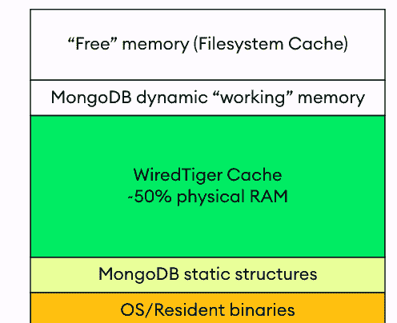
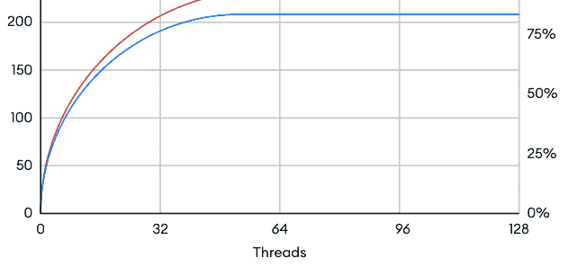

# 13 操作系统和系统资源

## 操作系统和系统资源

在运行自托管 MongoDB 部署时，您可以根据特定需求灵活配置内核和操作系统设置。然而，这种灵活性也引入了额外的变量和潜在的性能瓶颈，在调优期间必须仔细考虑。

本章主要与自托管环境相关，因为 MongoDB Atlas 不允许直接访问底层操作系统。在 Atlas 中，配置是基于实例层级处理的，并且操作系统升级由系统自动管理，以防止因内核或系统更改导致意外的性能问题。此外，Atlas 可以根据工作负载变化自动扩展计算和存储，这是一项我们将在本章后面探讨的功能。

在本章中，您将学习如何执行以下操作：
- 通过了解基础设施选择的影响来优化系统性能
- 微调操作系统和存储配置以提高可靠性和吞吐量
- 在自托管和托管（Atlas）环境中识别和解决性能瓶颈

### 技术要求

本章主要关注 Linux 和高级操作系统概念。有关特定操作系统和 MongoDB 版本的详细信息，请参阅自托管部署的文档操作清单 https://www.mongodb.com/docs/manual/administration/production-checklist-operations/ 和生产说明 https://www.mongodb.com/docs/manual/administration/production-notes/。

为了监控各种系统资源的利用率，您可以使用操作系统命令、MongoDB Atlas 监控以及专门用于监控多台服务器的其他 GUI 工具。更多细节将在 *第 14 章，监控与可观测性* 中提供。

对于系统资源，Linux 命令如 top、vmstat、iostat 和 netstat 可分别用于在单台服务器上某一时刻监控 CPU、内存、存储和网络。诸如 dstat 和 sar 之类的工具可用于组合来自更简单工具的数据并在一段时间内查看。

MongoDB Atlas 监控提供历史和实时系统资源数据，并与数据库特定指标集成。

对于自托管部署，您可以使用 Netdata、Prometheus + Grafana、Zabbix、Munin 或 Observium 等图形工具。最后，您可以使用商业 **应用性能监控 (APM)** 工具，如 AppDynamics、Datadog、Dynatrace、LogicMonitor、New Relic、SolarWinds 和 Splunk Observability。

要尝试本章中提到的配置更改或命令，您需要使用 Linux 服务器并在本地安装 MongoDB。您可以从 mongodb.com 下载 MongoDB Community Edition。您还需要下载您选择的语言（Ruby 或 Python）的官方驱动程序：https://www.mongodb.com/docs/drivers/。

### 管理资源以获得最佳性能

到目前为止，在整本书中，我们探讨了性能受资源使用达到满负荷限制的情况。例如，这些资源可以包括 CPU 周期、内存、存储或网络带宽。为了提高性能，我们需要增加限制资源的可用性或减少其使用量。本节概述了每种资源类型并描述了它如何影响 MongoDB 性能。

### CPU 利用率

如果主 MongoDB 服务器上的 CPU 是您应用程序当前的瓶颈，您可能需要扩展到更快、核心更多的实例。如果您以副本集方式运行 MongoDB，并且已经将实例或系统扩展到最大程度，可能就需要分片了。这在第 6 章，分片 中有详细说明。

另外，您可以优化应用程序的查询和数据库操作以最小化其 CPU 占用。这包括使用适当的索引、设计高效的数据模型，以及避免会消耗过多 CPU 周期的低效聚合管道或排序操作。这些技术在第 2、3、4 和 12 章中有更详细的讨论。

默认情况下，MongoDB 服务器配置为使用其运行系统上所有可用的 CPU 核心。这是经过深思熟虑的选择，旨在最大化数据库处理多个并发查询、处理并发连接以及高效管理内部操作的能力。例如，WiredTiger 存储引擎从多核并行中显著受益。

如果您自行管理 MongoDB，建议将 MongoDB 服务器部署在专用机器上。在同一系统上运行其他 CPU 密集型软件是强烈不建议的。当多个应用程序竞争相同资源时，诊断性能问题会变得复杂得多。

在 MongoDB，我们通过调优代码并采用能够更好地利用 CPU 周期的现代编译器、链接器和优化器，不断提高数据库服务器的效率。此过程涉及仔细的代码调优以减少开销、消除瓶颈并简化关键操作。MongoDB 还评估新的硬件架构、指令集和工具以生成更优化的机器代码，从而降低资源消耗。这种双管齐下的方式（软件级和技术级优化）是 MongoDB 致力于提供高性能、资源高效数据库的核心。

本章后面，在 配置系统以获得 MongoDB 性能 部分，我们将探讨确保 CPU 得到有效利用的实际示例，以及如何识别其他应用程序是否影响 MongoDB 服务器的 CPU 可用性。

### 内存管理

图 13.1 显示了运行 MongoDB 服务器的系统内存布局的高级图。在进行性能调优时记住这一点很有用，因为某些功能会使用更多数据，从而减少文件系统（页）缓存可用的内存量，导致更多 I/O 请求被定向到存储设备。




*图 13.1：运行 MongoDB 服务器的系统的内存布局*

在根本层面上，服务器的内存使用可以大致分为几个关键组件，每个组件在其整体功能中都发挥着重要作用。

从图表底部开始，我们有以下内容：

- **操作系统/常驻二进制文件：** 这是操作系统和 MongoDB 服务器二进制文件在内存中的代码。
- **MongoDB 静态结构：** 服务器在首次启动时使用并分配的元数据。
- **WiredTiger 缓存：** 默认情况下，这是 50% 的内存（减去 1 GB）。WiredTiger 缓存将频繁访问的数据和索引保存在 RAM 中，以最大限度地减少磁盘 I/O。我们在 *第 7 章，存储引擎* 中详细介绍了此缓存。某些 Atlas 实例可能使用 WiredTiger 缓存的不同相对大小。
- **MongoDB 动态“工作”内存：** MongoDB 使用内存缓冲区在操作期间构建、解析和操作 BSON 文档。当查询执行时，MongoDB 会为各种操作分配内存，包括排序、聚合管道阶段和投影操作。复杂查询或涉及大量排序或聚合的查询可能会暂时消耗大量内存。非常大的排序操作可能会溢出到磁盘。每个连接到 MongoDB 服务器的活动客户端连接都会消耗一定量的内存，大量并发连接累积起来会使用大量 RAM。
- **“空闲”内存（页缓存）**：这是指剩余的内存，通常由内核用于在 RAM 中缓存文件系统数据，以避免重复的磁盘 I/O。它提供了超出 WiredTiger 缓存的第二层缓存，在 WiredTiger 缓存使用量很大的情况下尤其有益。

了解这种内存分布有助于您更好地诊断性能问题并就系统资源优化做出明智决策。

## 存储

不同类型的存储设备通常各自有一套性能限制。物理存储设备通常分为两大类：机械 HDD 和 SSD。云环境中的网络磁盘和虚拟驱动器有其他限制。

物理存储设备的性能受以下因素限制：

- **总线接口速度**：设备的连接带宽，例如 SATA、PCIe 或 NVMe，会限制最大可用吞吐量。
- **内存和缓存大小**：大多数现代存储设备包含内部内存和缓存。缓存不足会导致处理大量数据时出现瓶颈。
- **碎片化**：数据散布在扇区或块中会增加寻道时间并降低 HDD 和 SSD 的性能。
- **读与写操作**：与读操作相比，写操作通常需要更多处理，尤其是在 SSD 上，因为需要先擦除后写入。


> **先擦除后写入**
> 
> SSD 使用 NAND 闪存，需要在新数据写入同一位置之前先擦除数据。这会减慢连续写操作的速度，尤其是在需要擦除许多块时。为缓解此问题，SSD 固件和操作系统的 TRIM 功能可以预先清理未使用的单元，以确保可用空间，避免未来写入时的擦除延迟。

- **顺序与随机 I/O**：与随机 I/O 相比，顺序读写通常具有更高的吞吐量，这是由于机械移动减少（对于 HDD）或开销减少（对于 SSD）。
- **并发访问：** 高水平的并发 I/O 请求可能会压倒存储设备的处理能力，尤其是在缺乏高效队列管理或并行访问优化的情况下。
- **介质退化：** HDD 和 SSD 都会随着时间的推移出现性能下降——HDD 由于机械磨损，SSD 由于 NAND 闪存单元磨损。
- **存储过度填充：** 存储设备在接近满容量时通常性能更差。这对于 SSD 尤其如此，因为需要过度配置空间以维持一致的写入性能。

HDD 在高性能系统中现在使用得较少。截至撰写时，HDD 的每 GB 成本仍低于 SSD，但差距正在缩小。对于 HDD，性能限制因素包括以下内容：

- **磁盘速度：** 盘片的旋转速度（以 **每分钟转数（RPM）** 为单位）会影响延迟和持续吞吐量
- **读写头移动：** 读写头的移动和定位会引入机械延迟（寻道时间）

与 HDD 相比，SSD 在性能、耐用性和功耗效率方面具有各种优势。对于 SSD 和闪存存储阵列，限制因素包括以下内容：

- **NAND 限制：** NAND 单元编程时间和 NAND 阵列中的同时操作数量会限制性能
- **磨损均衡：** 如果磨损均衡算法效率低下或无法在 NAND 单元之间有效管理写入，则性能可能会下降
- **固件优化：** SSD 控制器使用内部算法（例如垃圾回收、磨损均衡和过度配置），这些算法会影响性能，尤其是在高负载下
- **过热：**  excessive heat can throttle the performance of modern SSDs, as internal thermal management mechanisms reduce performance to prevent damage -> 过热会限制现代 SSD 的性能，因为内部热管理机制会降低性能以防止损坏

对于云环境中的网络磁盘和虚拟驱动器，以下因素会限制或约束性能：

- **带宽：** 数据在网络上传输的速度会限制 **网络附加存储（NAS）** 或 **存储区域网络（SANs）** 中的存储性能
- **延迟：** 网络延迟会引入延迟，这对于需要低延迟 I/O 的应用程序至关重要
- **并发网络 I/O：** 访问存储的大量同时网络流量会导致争用和瓶颈问题

文件系统连接操作系统和块存储设备，提供跨物理磁盘、网络磁盘和云环境中虚拟驱动器的统一抽象接口。选择合适的文件系统至关重要，因为它会对性能产生重大影响。使用自管理的 MongoDB 部署时，您可以选择为日志和数据文件使用单独的存储设备。通过将日志文件和数据文件分离到不同的存储设备上，您可以最大限度地减少日志写入与数据读写之间的 I/O 争用。这可以提高高写入工作负载的性能。


> **提示**
> 
> 将日志文件放在快速 SSD 或 NVMe 驱动器上。这使 MongoDB 能够以更快的速度处理频繁的顺序写入，而不会与主数据文件争夺 I/O 带宽。

数据文件通常较大，需要大容量存储，可以放在更高容量、成本效益更高的存储解决方案上（例如较慢的 HDD）。然而，需要考虑一些缺点。管理日志和数据文件的单独存储设备会增加复杂性并提高故障概率：

- 您有两个设备需要配置、监控并调查潜在瓶颈。
- 使用两个设备会增加故障概率。例如，企业 SSD 的典型 **年化故障率（AFR）** 目前为每年 0.3%–0.8%。如果我们使用该范围的中点（0.55%），并且服务器独立使用两个 SSD 分别用于日志和数据，则存储的 AFR 将为 1.1%。作为安全网，MongoDB 复制机制可防止此类故障的风险。
- 在云环境中，将日志和数据文件分离到不同的虚拟磁盘上仍可能导致隐藏的争用。
- 它可能使同时对日志和数据文件执行一致快照变得困难。快照通常用于对数据库进行即时备份，一致的快照取决于日志和数据文件之间的原子性。

数据服务平台，例如数据库，依赖于底层存储技术。这意味着从性能和生命周期角度来看，了解您使用的技术的特性非常重要。


## 网络

网络在 MongoDB 部署的性能中发挥着至关重要的作用。以下是在 MongoDB 部署中可能限制性能的关键网络因素：

- **高网络延迟：** 这会导致应用程序与 MongoDB 数据库之间，或分片或复制设置中集群节点之间的通信延迟。
- **网络带宽不足：** 这会限制 MongoDB 组件之间的数据流，尤其是在高吞吐环境中，影响读写操作。
- **数据包丢失：** 这发生在数据包由于网络拥塞、硬件故障或配置错误而未能到达目的地时。这可能导致以下情况：
  - 失败操作的重试次数增加，从而降低整体数据库性能
  - 副本集从节点上的潜在复制滞后
  - 分布式集群中分片之间的通信中断
- **缓慢或不可靠的 DNS 解析：** 这会导致连接到 MongoDB 服务器的延迟，尤其是在初始连接或故障转移事件期间。
- **高网络流量：** 共享资源竞争会降低 MongoDB 高效传输或接收数据的能力。
- **配置错误的防火墙：** 过于严格的安全策略可能会阻止或延迟合法流量，影响 MongoDB 性能。
- **不一致的网络拓扑：** 设计不良的网络基础设施可能导致非对称路由、不一致的延迟或低效的数据流。
- **地理延迟：** 在地理位置遥远的区域部署 MongoDB 节点会引入显著的通信延迟。

缓慢或不可靠的网络连接会严重影响数据库吞吐量、延迟和可扩展性。

总之，性能瓶颈通常源于资源被用到其满负荷。最常见的例子是 CPU 周期、内存、存储和网络。值得注意的是，使用 MongoDB Atlas 时，其中许多资源都由您管理。

## 为 MongoDB 性能配置系统

本节中，我们将查看您可以采取的操作，以诊断和修复 CPU 周期、内存、存储和网络的示例问题。

### 了解每个 CPU 核心的理想并发操作比率

MongoDB 服务器并发运行多个操作，并将它们分发到在多个 CPU 核心上运行的线程中。如我们在第 1 章《系统和 MongoDB 架构》中所见，如果应用程序服务器没有并行发送足够的操作以充分利用 MongoDB 服务器，则应用程序服务器可能成为瓶颈。

例如，如果您使用应用程序的关键性能工作负载运行一系列实验并在电子表格中绘制结果，您可能会看到类似于图 13.2 的图表，该图表显示了随着线程数或并行操作数增加时 CPU 利用率和性能趋势。

### 数据库操作/秒 与 CPU 利用率



*图 13.2：随着您增加并行度，CPU 利用率和性能趋势的影响*

在此示例中，数据库服务器运行在 16 核 CPU 上。性能在 64 个线程时达到峰值，并且在添加更多线程后可能会略有下降。这是许多应用程序的典型模式。在这种情况下，64 个线程在 16 个核心上达到最佳性能，表明每个核心有 4 个活动线程或连接的比率。重要的是使用生产工作负载和数据集进行测试，以确定关键性能工作负载的理想线程与核心比率。例如，您不希望在 16 核机器上仅并行运行 8 个操作，导致一半核心处于空闲状态，因为这可能导致不必要的资源成本。

## 在性能下降期间搜索其他 CPU 密集型进程

周期性性能下降可能是由其他 CPU 密集型进程竞争系统资源引起的。为了诊断这些问题，您可以使用各种工具和命令来识别消耗大量资源的进程。您可以使用 Linux 工具如 top、htop、ps、pidstat、iotop 和 perf 来查看性能下降期间系统上正在运行的内容。

例如，运行 top 命令显示按资源使用情况排列的顶级进程：

```
top - 18:09:15 up 10 min,  1 user,  load average: 1.01, 0.02, 0.00

%Cpu(s):  87.0 us, 13.0 sy,  0.0 ni,  0.0 id,  0.0 wa,  0.0 hi,  0.0 si,  0.0 st
MiB Mem :  31373.4 total,  30190.5 free,   428.5 used,   754.3 buff/cache
MiB Swap:      0.0 total,      0.0 free,      0.0 used.  30616.0 avail Mem

  PID USER      PR  NI    VIRT    RES    SHR S  %CPU  %MEM     TIME+ COMMAND
 1927 ubuntu    5 -15  531488 139020  70108 R  47.3  0.4  1:08.63 mongod
 1910 ubuntu    5   0  500288  99191   6436 R  16.1  0.1  0:25.98 python
    1 root     20   0  167004  11108   7464 S   6.0  0.0  0:01.06 systemd
    4 root      0 -20       0      0      0 I   0.0  0.0  0:00.00 rcu_par_gp
  589 root     20   0   82100   3204   2796 S   0.3  0.0  0:00.03 irqbalance
 1968 ubuntu    5 -15    7148   3296   2448 R   0.3  0.0  0:00.04 top
    2 root     20   0       0      0      0 S   0.0  0.0  0:00.00 kthreadd
```

在此输出中，您可以看到没有空闲 CPU 周期（0.0 id），并且一个 Python 进程使用了 16.1% 的 CPU，而 MongoDB（mongod）本可以利用这部分时间。

如果 MongoDB 运行在虚拟机上，周期性下降也可能源于虚拟机外部的进程，例如其他虚拟机或 hypervisor 任务。在这种情况下，请使用 hypervisor 工具如 vmstat、virt-top 或您云提供商的监控工具检查主机级别的资源使用情况。

## 为您的应用程序选择合适的文件系统

本节重点介绍 Linux 文件系统。我们将更详细地介绍两种最相关的选项，即扩展文件系统 (XFS) 和第四扩展文件系统 (ext4)，并在后面的部分介绍其他文件系统。

### 扩展文件系统 (XFS)

MongoDB 生产说明建议在生产部署中使用 XFS。XFS 通常为具有高吞吐量和并发读写操作的负载提供更好的性能。它比 ext4 更有效地处理大文件和碎片化数据，并且倾向于更好地管理大量刷新操作，在检查点期间表现出更少的 I/O 停顿。XFS 还支持更大的文件和文件系统大小。

XFS 最初由 Silicon Graphics, Inc. (SGI) 于 1994 年开发，于 2001 年移植到 Linux，并在 2004 年（版本 2.6）集成到主线内核中。Red Hat 于 2014 年将 XFS 采用为 RHEL 7 的默认文件系统，理由是其可扩展性和企业工作负载的性能。

### 第四扩展文件系统 (ext4)

如果您使用的 Linux 发行版支持 XFS，请使用它。如果不支持，ext4 仍然是一个可靠的选择。ext4 是一个成熟、广泛使用的文件系统，长期以来一直是许多 Linux 发行版的默认设置。虽然 ext4 过去比 XFS 更广泛可用，但近年来差距已经缩小。随着操作系统、内核和 MongoDB 本身的演进，ext4 与 XFS 之间的性能差距也随着时间的推移而缩小。

### 其他文件系统

虽然 MongoDB 可以在其他文件系统上运行，但它们的功能有时与 MongoDB 和 WiredTiger 已提供的功能重叠，导致效率低下：

- **网络文件系统 (NFS)**：不推荐用于 MongoDB。有关更多信息，请参阅 MongoDB 生产说明。
- **B树文件系统 (Btrfs)**：在写入密集型工作负载下可能表现不佳。其 **写时复制** (CoW) 设计可能导致写入放大，其中数据库级别的 100B 文档可能导致写入存储设备的数据量多出数倍。Btrfs 还实现了 WiredTiger 中已存在的机制。
- **泽字节文件系统 (ZFS)**：更适合备份或媒体等大型顺序数据。对于 MongoDB 的小型随机读写，ZFS 可能比 XFS 或 ext4 更慢。
- **Ceph 文件系统 (CephFS)**：专为分布式存储集群和云原生应用设计。MongoDB 已通过分片和复制支持这些用例。

总之，XFS 或 ext4 是 MongoDB 部署最可靠的选择，提供性能、稳定性和兼容性的最佳平衡。


## 文件系统设置

默认情况下，在 2.6.30 之前的内核中，Linux 在每次读取文件时都会更新文件的 **访问时间 (atime)** 元数据。这意味着读写密集型工作负载在每次访问磁盘上的文件时也会触发一次写操作。自 2.6.30 起，**相对访问时间 (relatime)** 成为默认行为。这降低了 atime 更新的频率，避免了不必要的磁盘写入，在保留大多数用例所需的足够 atime 信息的同时显著提高了文件 I/O 性能。

你可以通过在文件系统挂载设置中添加 noatime 选项来禁用所有 atime 更新行为。`/etc/fstab` 文件是 Linux 配置文件，定义了在启动期间应如何挂载文件系统、分区和存储设备。

要禁用 atime 写入，请在 `/etc/fstab` 中添加 noatime 选项，如此示例所示：

```
/dev/sdx /path/to/mongodb_data xfs defaults,noatime 0 0
```

其他文件系统选项也可以提高性能，但其中许多会降低写入的持久性。总的来说，除非你清楚了解风险和权衡，否则 MongoDB 不建议使用此类选项。

## 避免使用带奇偶校验的 RAID

**冗余独立磁盘阵列（或廉价磁盘阵列）（RAID）** 存储设备是指使用多个物理 HDD 或 SSD 组合起来以提高性能、数据冗余或两者兼有的系统。RAID 通常用于服务器、工作站和存储系统，以提供比单个磁盘更好的可靠性和性能。然而，随着行业转向更现代的分布式和软件定义存储解决方案，后者提供更好的可扩展性、冗余和容错能力，RAID 的使用频率正在降低。

MongoDB 不需要 RAID 来实现容错。如果你的组织强制要求使用 RAID，建议使用 RAID 0 或 RAID 10。RAID 0 将数据拆分（条带化）在多个驱动器上。它同时向阵列中的所有驱动器写入数据，通过并行化提高读写性能。

然而，RAID 0 不存储镜像或奇偶校验数据，这意味着它不提供数据保护。如果其中一个驱动器发生故障，所有数据都会丢失。RAID 10（也称为 RAID 1+0）结合了镜像和条带化。它创建驱动器镜像对（RAID 1）以实现冗余，然后在镜像对之间条带化数据（RAID 0）以获得更好的性能。

MongoDB 生产说明建议避免对写入密集型数据库使用 RAID 5 或 RAID 6，因为它们的奇偶校验计算会减慢写操作。

## 调整预读设置

Linux 预读功能是一种内核级优化，旨在提高顺序磁盘读取的效率。它通过读取超出请求的数据块并将其缓存到内存中来预测未来的数据访问。对于磁盘访问和数据布局为顺序的工作负载，数据库发出 I/O 请求时下一个块可能已经在缓存中。这可以通过减少磁盘 I/O 延迟来提高性能。

对于 MongoDB，预读调优的影响取决于工作负载的性质、磁盘上的数据布局和内核版本。MongoDB 查询通常以随机模式访问数据。然而，如果你的工作负载按写入顺序访问文档，更高的预读值会有所帮助。

默认情况下，MongoDB 的 WiredTiger 引擎大部分时间读取 ~28 KB 数据块（默认 leaf_page_max=32KB 设置）。在 Linux 中，预读值以块为单位指定，每个块为 512 字节。例如，预读值为 32 表示内核将预取 32 个块，相当于 16 KB。

在 Linux 5.x 和 6.x 内核中，对值为 0 的预读处理进行了改进，以避免在 4.x 内核中看到的性能损失。内核 6.x 还包括更好的缩放启发式，可根据工作负载行为和设备特性更有效地确定预读大小。它还通过删除冗余代码路径简化了预读逻辑。更改内核版本会显著影响性能，因此在内核更改或升级后重新运行预读调优实验很有用。

建议从预读值 32 开始，然后测试 16 和 64。如果任一值提高性能，请继续朝该方向调优。0 或高于 256 的值通常不建议使用。

## 修改文件系统缓存设置

调整 vm.dirty_background_ratio 等系统设置可以通过控制 Linux 内核如何处理内存中脏的（已修改但尚未写入磁盘）页面来提高 MongoDB 的性能和可靠性。

vm.dirty_background_ratio 设置定义了在内核开始在后台将它们刷新到磁盘之前，脏页可以填满总系统内存的百分比。脏页代表尚未持久化到存储的文件系统更改（例如来自 MongoDB 的写入）。

MongoDB 经常写入磁盘并依赖操作系统进行写入缓冲。如果 vm.dirty_background_ratio 设置过高，内核可能会延迟刷新，允许大量脏页累积。这会触发突然的、密集的 I/O 峰值，增加延迟。降低此值会导致更小、更频繁的刷新，使磁盘写入更加平滑。

另一个相关设置 vm.dirty_ratio 定义了可以填满脏页的内存最大百分比。一旦超过此阈值，生成新写入的进程将被阻塞，直到脏页刷新到磁盘。

## 预写日志与数据文件写入

> 这些设置会影响对数据文件的写入。预写日志操作由 MongoDB 立即刷新以确保持久性（而不是依赖内核级机制）。

你可能在以下情况下考虑调整 vm.dirty_background_ratio：

- **I/O 峰值或高延迟：** 如果你在大量脏页同时刷新时看到磁盘 I/O 的不规则突发，请降低脏背景比率以触发更小、更频繁的刷新。使用 iostat 命令查找 await 的高值。await 测量是应用程序发出 I/O 请求时看到的总响应时间（以毫秒为单位）。它包括在 I/O 调度程序队列中等待的时间和实际访问磁盘所花费的时间。在更改前后测量 await，以查看是否有所不同。
- **脏页内存使用过高：** 如果脏内存持续占用大量内存，大于 RAM 的 10–20%，请降低 vm.dirty_background_ratio 以触发更早的后台刷新。你可以使用以下命令在 Linux 上监控脏内存：

```
$ cat /proc/meminfo | grep -E "Dirty|Mem"
```

以下是示例输出：

```
MemTotal:      32126312 kB
MemFree:        3067873 kB
MemAvailable:   3134261 kB
Dirty:          6425262 kB
```

命令中的 grep 部分在输出中查找 Dirty 和 Mem 子字符串。在此示例中，系统有 ~10% 的空闲内存和近 20% 的脏页。
- **检查点缓慢或写入延迟高：** 长时间的 MongoDB 检查点持续时间或写入操作期间的延迟可能表明 MongoDB 与内核刷新行为之间的同步不良。
- **因脏页比例超出导致写入停滞：** 如果 MongoDB 写入在脏内存超过 vm.dirty_ratio 定义的阈值时被阻塞，则需要调整 vm.dirty_ratio 和 vm.dirty_background_ratio。你可以在 Linux 上使用以下命令查看写入操作和被阻塞的进程：
- **高写入活动期间系统性能下降：** 写入峰值期间的高 CPU 使用率或磁盘性能下降表明脏页刷新效率低下。

```
dstat -c --top-io
```

这些场景突出了调优 vm.dirty_background_ratio 变得必要的情况，但理解调整只是第一步；与互补设置和监控一起深思熟虑地应用它，是提高整体写入性能的关键。

为此，首先适度降低 vm.dirty_background_ratio 以控制脏页的累积并触发更早的刷新。默认值通常为 10%。建议从较低的值开始，范围在 5–7% 之间：

```
sudo sysctl -w vm.dirty_background_ratio=7
```

降低 vm.dirty_ratio 以减少阻塞风险。默认值通常为 20–30%。建议将此值降低到 15–18%：

```
sudo sysctl -w vm.dirty_ratio=18
```

前两个命令对正在运行的系统进行更改。如果希望更改在服务器重新启动后仍然存在，则需要编辑 /etc/sysctl.conf。在尝试这些配置设置时，我们建议：

- 在每次调整后监控性能
- 使用 iostat 或 sar 确保 I/O 平稳可预测且无突发
- 使用 mongostat 测量 MongoDB 写入延迟
- 搜索数据库日志中的检查点完成时间以确保持续时间可预测

如果你的工作负载表现出写入延迟峰值、脏页的大内存使用或被阻塞的写入，降低 vm.dirty_background_ratio 可以帮助平滑磁盘刷新操作并减少性能瓶颈。将此与监控以及对其他设置（如 vm.dirty_ratio、MongoDB 检查点频率和 WiredTiger 缓存大小）的调整相结合，以实现最大优化。


## 检查 SSD 健康状况

SSD 使用复杂的固件技术，例如磨损均衡、垃圾回收、超额配置和 TRIM，以降低擦写前擦除对性能的影响。在操作系统层面，请确保 TRIM 和垃圾回收已启用。这些功能使现代 SSD 在各种使用场景下都快速可靠。然而，监控其健康状况很重要，以便检测到磨损开始影响性能或驱动器接近使用寿命末期时。

在 Linux 上，大多数 SSD 支持 SMART 数据报告，可提供详细的健康和诊断指标，例如磨损均衡状态、剩余寿命和坏块计数。许多 SSD 厂商提供专有工具来监控其驱动器。这些工具通常会公开与磨损相关的数据，并允许您为健康问题或性能下降设置警报。如果您在服务器或数据中心中使用企业级 SSD，可能还有额外的监控工具可用，例如 Nagios、Datadog、Dynatrace、Zabbix 或带 Node Exporter 的 Prometheus。

SSD 还会在健康状况或性能开始下降时记录系统级警告或错误。在 Linux 上，检查 /var/log/syslog，使用 journalctl 或运行 dmesg 以查找与 SSD 相关的 I/O 错误。

## 避免双重加密和压缩

一些存储技术包括压缩或加密支持，有些两者都支持。例如，企业存储阵列和 SSD 通常都包含两者。云存储服务通常不支持压缩，但支持加密以保护静态数据、传输中数据以及快照中的数据。

已压缩或加密的数据更难压缩。如果数据库压缩和/或加密数据，存储设备的压缩逻辑可能找不到更少的冗余模式，导致几乎没有进一步压缩。在某些情况下，对已压缩数据尝试压缩可能会导致存储开销，增加所需的计算资源。

同时由数据库和存储设备处理的数据可能会被压缩和加密两次。这通常效率低下，可能会影响性能，而没有显著好处。为防止这种情况，您应确定在数据库层还是存储层最有效地应用压缩和加密。

在某些行业中，双重加密可提供额外的防御层，通过确保在多个层独立强制执行加密（例如，数据库加密用于逻辑安全，存储设备加密用于物理安全）。

## 确保常驻内存使用率保持在 80% 以下

作为一般规则，您应尝试将常驻内存使用率保持在 80% 以下，因为内存不足会对性能产生很大影响。例如，代码可能会被换出（从物理 RAM 中驱逐），因为它可以从原始源重新加载。然而，如果它需要再次运行，则需要重新调入并等待 I/O。如果配置了交换空间，系统会将使用频率较低的内存页移动到磁盘，以为活动进程释放 RAM。当内存再次被访问时，这会导致一次写入和随后的从存储读取。如果内存严重不足，**out-of-memory (OOM)** “杀手”可能会终止服务器进程。

如果您自行管理 MongoDB 系统且无法添加内存，您应定期监控集群的内存使用情况，以了解是否需要调整。您可以尝试减小 WiredTiger 缓存的大小，如我们在 *第 7 章，存储引擎* 中讨论的那样。

在 Atlas 中，您可以设置精细的警报，以便在常驻内存接近关键阈值时通知您。您可以通过扩展到更高层级或启用自动扩缩容来解决此问题，*使用自动扩缩容实现 Atlas 性能* 部分将在本章后面更详细地介绍。

在 Atlas 和自托管部署中，如果大量内存被运行分析工作负载的复杂聚合使用，您可以使用 MongoDB 的工作负载隔离功能。

工作负载隔离最大限度地减少了内存争用，并确保每个工作负载高效运行。创建 Atlas 集群时，您可以选择创建分析节点或搜索节点以实现工作负载隔离。

使用分析节点来隔离您不希望与操作工作负载竞争的查询。例如，分析节点可以处理数据分析操作，例如来自 Atlas BI Connector 的报表查询。您的分析节点的集群层级可以与操作节点不同。如果您选择显著较低层级的分析节点，您需要监控复制延迟，以确保其资源充足。

同样，您可以使用专用的搜索节点将搜索工作负载与操作工作负载隔离。最后，如果您尚未使用分片，这可能是一个很好的开始理由。有关何时以及如何添加分片的更多详细信息，请参阅 *第 6 章，分片*。

## 网络最佳实践

对于所有分布式系统而言，遵循网络最佳实践对于稳定且高性能的 MongoDB 部署至关重要。如果您已确定网络是当前限制因素，以下清单可能有所帮助：

- 将 MongoDB 集群部署在靠近应用程序服务器的位置（例如，使用云基础设施时在同一区域）。
- 使用低延迟网络连接和高速度互连。
- 使用网络压缩并监控/优化查询模式以减少数据传输。这是 MongoDB 驱动程序支持但默认未启用的功能。
- 为 MongoDB 服务器分配足够的带宽，尤其是在高流量生产环境中。
- 使用针对更高吞吐量优化的网络接口（例如千兆或多千兆以太网）。
- 依赖稳定、维护良好的网络基础设施以最大限度地减少数据包丢失。
- 使用服务质量 (QoS) 设置优先处理 MongoDB 流量。
- 为 DNS 条目设置简短且一致的生存时间 (TTL) 值，以防止陈旧缓存问题。
- 使用固定 IP 或快速解析的 DNS 名称部署 MongoDB 集群；使用本地 DNS 服务器以实现更快解析。
- 使用 VLAN 或 QoS 将 MongoDB 流量与非关键工作负载隔离。
- 根据需要扩展网络基础设施或将 MongoDB 迁移到拥塞较少的环境。
- 在可能的情况下避免对 MongoDB 流量进行深度数据包检测。
- 使用虚拟私有云 (VPC)、受信任网络和 VPN 来保护流量，而不会使数据包过滤系统过载。
- 在所有节点上实施一致的路由策略。
- 定期测试网络拓扑以确保均衡高效的流量分配。
- 在可能的情况下将 MongoDB 集群部署在同一地理区域内。
- 利用 MongoDB Atlas 的全球集群处理分布式工作负载，同时最大限度地降低延迟。
- 选择具有优化区域互连的云提供商。

此外，请考虑调整以下操作系统级网络参数：

- **somaxconn**：在 Linux 中，此参数定义可在套接字上排队的待处理连接请求的最大数量。增加 somaxconn 值允许 MongoDB 排队更多传入连接，在网络流量繁忙期间降低连接错误发生的可能性。
- **tcp_max_syn_backlog**：控制在初始 TCP 握手期间排队的待处理 SYN 请求数量。
- **tcp_syncookies**：在 SYN 后备队列满时防止 SYN 洪水攻击。
- **tcp_fin_timeout**：此参数控制套接字在连接关闭后保持在 TIME_WAIT 状态的时间（以秒为单位）。TIME_WAIT 状态是一种安全机制，确保与已关闭连接相关的所有数据包在套接字被释放以供重用之前已正确传输并得到确认。虽然这对于防止数据包重传错误至关重要，但不必要的高的 tcp_fin_timeout 值可能会导致繁忙环境中的资源耗尽，因为系统会在较长时间内保留大量已关闭连接状态。

尽管网络瓶颈通常比 CPU、内存或存储相关的瓶颈更少见，但积极监控网络健康状况并使用正确的工具和配置主动解决问题仍然是明智之举。

## 使用自动扩缩容实现 Atlas 性能

MongoDB Atlas 提供自动扩缩容，这是一项强大的功能，旨在简化资源管理并确保集群工作负载的最佳性能。

通过动态调整集群层级和存储容量，自动扩缩容有助于您在最大限度减少人工干预的同时保持高可用性和性能。它可以向上或向下扩展计算；存储仅自动向上扩展。用户受益于 Atlas 的简洁性和效率。如果您的特定需求未得到满足，请咨询 MongoDB 支持以获取针对您特定应用程序的指导。

当工作负载变化且数据增长时，手动扩展资源可能具有挑战性和低效性。自动扩缩容通过利用自动化来解决这些挑战，确保您的集群资源实时与应用程序需求保持一致。这消除了过度配置或利用不足，从而实现成本效益和一致的性能。


Key performance benefits of auto-scaling include the following:

- **Seamless workload management:** Automatically adjusts resources to accommodate sudden spikes or drops in workload without requiring downtime
- **Enhanced reliability:** Ensures that sufficient resources (CPU, RAM, and storage) are available to avoid bottlenecks during peak usage
- **Cost optimization:** Prevents unnecessary provisioning when workload demands are low, reducing operational expenses
- **Proactive scaling:** Prepares your application for rapid usage spikes or large data ingestion events to deliver uninterrupted service

With auto-scaling, MongoDB Atlas automatically monitors your cluster’s performance and utilization metrics, such as CPU usage and disk space.

Here are the two main components of auto-scaling in MongoDB Atlas:

- **Cluster-tier auto scaling:** Adjusts the cluster tier (e.g., M10, M20, or M40) to ensure sufficient resources for CPU and memory utilization
- **Storage auto-scaling:** Scales disk capacity to accommodate data growth, preventing errors related to insufficient storage

Automatic scaling is enabled by default when you provision a new cluster, which can be disabled if needed. To stay informed about scaling events, set up alerts in the Atlas Monitoring suite. Alerts will notify you of resource changes, allowing you to track activity and ensure that adjustments align with your expectations. Automatic scaling is not a substitute for other performance best practices, such as optimizing queries. It is a temporary safety net, but in the long term, you should periodically review your cluster’s performance and scaling history to identify patterns and apply other optimizations.

## Summary

This chapter has provided an in-depth guide to optimizing MongoDB performance by configuring the operating system and other system resources, with a primary focus on self-managed deployments. While MongoDB Atlas automates many of these tasks, understanding the underlying principles remains valuable.

We covered key resource categories (CPU, memory, storage, and networking) and offered practical guidance on topics such as core-to-operation ratios, choosing the right filesystem (with a recommendation for XFS), and tuning filesystem cache settings. We also cautioned against using double encryption/compression and exceeding 80% resident memory usage.

Additionally, we outlined a checklist for network optimization, including ensuring cluster proximity, maintaining low-latency connections, and planning for bandwidth allocation. Finally, we explained how MongoDB Atlas’s auto-scaling dynamically adjusts cluster tiers and storage capacity to meet demand.

The next chapter examines monitoring and observability in MongoDB, showing how to track critical metrics, leverage both built-in and external tools, and establish practices that ensure reliability and performance at scale.
