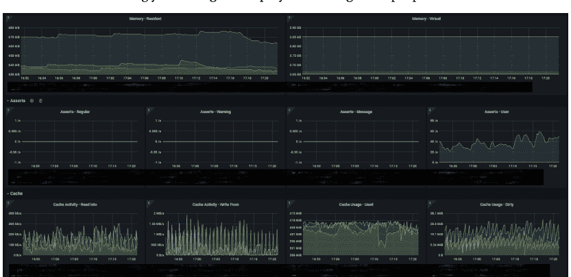
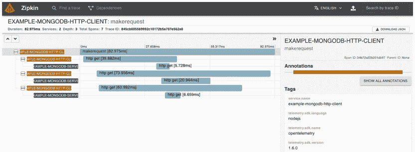

# 14 Monitoring and Observability

## Monitoring and Observability

In high-performance database environments, understanding what’s happening under the hood isn’t just beneficial, it’s essential. Monitoring and observability form the foundation of maintaining and optimizing MongoDB deployments, especially as systems scale and workloads become more complex.

This chapter provides a practical guide to monitoring and observability in MongoDB, equipping you with the knowledge to maintain high performance and reliability as your systems grow. You’ll learn how to interpret key metrics, leverage built-in and external tools, and respond proactively to early signs of trouble before they impact your applications. Whether you’re running MongoDB in the cloud with Atlas or managing your own infrastructure, this chapter will help you build a robust observability strategy tailored to your needs.

Key topics covered in this chapter include the following:

- The difference between monitoring and observability
- Why monitoring and observability both matter for database performance
- The core MongoDB metrics and signals to track for optimal health and troubleshooting
- How to use MongoDB Atlas and self-managed tools for real-time monitoring and alerting
- Best practices for integrating MongoDB metrics into broader observability platforms

### Key differences between monitoring and observability

While often used interchangeably, monitoring and observability represent distinct but complementary practices. Monitoring answers Is something wrong? by collecting and alerting on predefined metrics, opcounters, cache pressure, page faults, and connection counts against known thresholds. It’s focused on tracking the known failure modes of a system.

**Observability** answers *Why is it happening?* by enriching those metrics with contextual data such as logs, traces, and explain plans, so you can drill down from an alert to the root cause. It enables the exploration of unknown issues by providing a comprehensive view of the system's internal state.

In high-throughput environments, whether running a single replica set or a global sharded cluster, subtle performance degradations can cascade into major outages. Without comprehensive visibility into resource utilization, query performance, and system health, identifying bottlenecks becomes a frustrating guessing game.

Observability transforms this guesswork into data-driven insights. By continuously tracking key signals, you can optimize performance and detect early signs of trouble before they impact your applications. Here are some examples:

- **Correlate logged operations** with index usage (or lack thereof) and execution plans to pinpoint missing or inefficient indexes
- **Overlay disk queue depths** with commit times to uncover storage contention under peak workloads
- **Chart replication lag** against write throughput to detect network bottlenecks during failover events
- **Monitor memory pressure** to identify optimal cache sizes and prevent page faults
- **Track connection patterns** to properly size connection pools and prevent queuing

These practices are important because they turn raw monitoring data into actionable insights. By correlating slow queries with index usage, overlaying disk queue depths with commit times, and tracking replication lag, memory pressure, and connection patterns, you can move beyond simply detecting that something is wrong; you can pinpoint the root cause of performance issues. This enables you to proactively optimize your MongoDB deployment, prevent outages, and ensure that your database continues to deliver reliable, high performance as workloads grow and change. In short, these techniques help you shift from reactive troubleshooting to continuous, data-driven improvement.

To truly optimize performance, you need more than just a snapshot of system health; you need clear, timely signals that reveal when and where degradation is occurring. A robust monitoring and observability strategy provides these essential signals, making it possible to identify emerging issues such as slow queries, resource constraints, replication lag, storage bottlenecks, or connection problems. With this visibility, you gain the context and confidence to diagnose, prioritize, and resolve issues before they escalate, turning what would otherwise be reactive firefighting into a process of ongoing improvement and resilience.

## Core MongoDB metrics and signals

Understanding the internal state of your MongoDB deployment is crucial for maintaining optimal performance and diagnosing issues. MongoDB exposes a comprehensive set of metrics that provide insights into its health, resource utilization, and operational characteristics. By monitoring and correlating these core signals, you can proactively identify potential bottlenecks, make informed decisions about capacity planning, and ensure that your database effectively supports your application workloads.

These metrics generally fall into two categories: operational metrics, which give a real-time view of the database’s current activity, and performance-specific metrics, which delve deeper into workload behavior and potential areas of contention.

### Operational metrics

Operational metrics answer the question How is my database operating right now?. These are exposed by the serverStatus command and can be collected via the shell, drivers, or external monitoring solutions such as Prometheus, as discussed later in the Integration with external monitoring systems section.

The following example demonstrates how to extract a few of the most important operational metrics using the MongoDB Shell. This code retrieves the current server status and prints a selection of key metrics that are essential for monitoring real-time health and workload:

```
// Run from the MongoDB shell
// Example: Extract key operational metrics in the MongoDB shell
const status = db.serverStatus();
printjson({
    opcounters:    status.opcounters,    // reads, writes, commands
    memUsageMB:    status.mem.resident,  // resident memory in MB
    cacheStats:    status.wiredTiger.cache,  // WiredTiger cache utilization
    connections:   status.connections    // active vs available
});
```

The preceding code reveals several of the most actionable metrics for day-to-day monitoring, but it’s important to note that serverStatus exposes a much broader set of metrics covering nearly every aspect of MongoDB’s operation. In the following list, we highlight only some of the most relevant fields for practical, ongoing observability. Here’s what each field represents, and where to find related metrics not shown in the code:


-   **opcounters (from status.opcounters in the code)**: 这些跟踪自服务器启动以来数据库操作（读取、写入、命令）的数量。监控这些有助于了解工作负载模式并发现可能指示查询风暴或应用程序问题的突然峰值。读取与写入之间的不平衡可能表明扩展或优化的机会。
-   **memUsageMB (from status.mem.resident in the code)**: 这显示 MongoDB 进程当前使用的物理 RAM（以兆字节为单位）的数量。关注此指标有助于确保您的工作集适合内存，从而最大限度地减少磁盘访问并保持性能。如需更深入的视图，serverStatus 中的 mem 部分还包括虚拟内存、映射内存和页面错误。
-   **cacheStats (from status.wiredTiger.cache in the code)**: 这提供了有关 WiredTiger 存储引擎内部缓存使用情况的详细信息，包括缓存了多少数据以及脏页（已修改）与干净页的比例。高缓存压力或频繁的驱逐可能表明需要更多内存或缓存调优。完整的 wiredTiger.cache 部分包含其他指标，例如驱逐率和最大缓存大小。
-   **connections (from status.connections in the code)**: 这报告活动客户端连接数和可用的连接槽数。监控此指标有助于防止连接饱和，从而导致应用程序错误或响应能力下降。connections 部分还显示自启动以来创建的可用连接数和总数。
-   **Replication metrics (not shown in the code)**: 对于使用副本集的部署，诸如复制延迟、oplog 窗口、心跳时间以及选举指标等指标可在 serverStatus 的 repl1 和 oplog 部分中使用，或通过副本集特定命令（如 rs.status() 和 rs.printReplicationInfo()）获取。这些对于确保数据持久性和故障转移就绪性至关重要。
-   **Disk I/O metrics (not shown in the code)**: 存储性能指标，例如队列深度、延迟、吞吐量和 IOPS，可在 serverStatus 的 wiredTiger 和 metrics 部分中找到，或通过外部监控工具获取。这些对于识别存储瓶颈并确保磁盘子系统能够处理工作负载至关重要。

通过定期收集和审查这些指标，您可以获得数据库运行状况的全面、实时视图，从而能够在问题升级之前检测到新出现的问题并优化性能。

## Performance-specific metrics

虽然操作指标提供了数据库活动的总体概述，但性能特定指标更深入地探究减速和低效的来源。这些指标有助于精确定位瓶颈并回答关键问题：*性能问题究竟发生在何处？*。性能特定指标包括慢查询统计信息、查询执行统计信息和索引使用指标。

要捕获和审查慢操作，请使用 MongoDB 数据库分析器（通过 db.setProfilingLevel() 和 system.profile 集合），或 Atlas 中的 Query Insights。锁定和争用指标可通过 serverStatus 命令访问，并通过 Prometheus 和 Grafana 等外部工具可视化。

对于查询执行统计信息，例如检查的文档与返回的文档以及执行时间分解，请在 shell 或驱动程序中使用 explain() 方法、数据库分析器以及 Atlas Query Insights。对于编程监控，请从分析器输出或 system.profile 中提取相关字段。要了解索引使用情况和有效性，请利用 explain() 方法、collStats 命令、Atlas Performance Advisor 和 Query Insights 来识别使用模式和优化机会。

现在，请熟悉使这种可观测性成为可能的内置工具（MongoDB 数据库分析器、explain 计划、serverStatus 和 Atlas UI）以及外部集成（Prometheus、Grafana 和 Datadog）。

## Monitoring with MongoDB Atlas

MongoDB Atlas 提供完全托管的基于云的数据库服务，实时展示关键数据库信号并引导您进行数据驱动的优化。在高性能数据库环境中，有效的监控不仅仅是收集指标；它是将这些指标转化为可操作的见解，帮助您保持集群的峰值性能。

## Atlas UI features

Atlas UI 提供了用于监控和性能分析的强大功能套件。实时性能面板提供集群健康状况的实时可视化，包括资源消耗、操作速率和查询执行时间，非常适合即时监督。性能顾问会持续分析工作负载，建议索引以增强性能，而 Query Insights 通过对相似查询进行分组、监控延迟百分位数并识别 **hot** 集合来提供更高级别的视图。最后，Query Insights 中的分析器集成通过为 MongoDB 数据库分析器提供用户友好的界面，简化了性能瓶颈的诊断。

## Real-Time Performance Panel (RTPP)

MongoDB Atlas 提供集群健康状况和操作吞吐量的实时高层次可视化，每隔几秒更新一次。适用于 M10+ 集群，RTPP 特别适用于监控实时环境、负载测试和部署后性能验证。它使您能够在各种关键指标中直观识别峰值、瓶颈和趋势，帮助您实时将性能变化与资源利用率或操作负载相关联。

RTPP 提供两个主要视图，**Graph** 和 **Table**，每个视图都展示了一套全面的指标，包括以下内容：

-   **Resource Consumption**: CPU 使用率、系统内存和磁盘 **I/O operations per second** (**IOPS**)，以及网络流量（字节进/出）。这些指标可帮助您发现资源饱和或突然峰值，这些通常与性能下降相关。
-   **Operation Rates**: 每秒处理的读取、写入、命令和聚合操作的数量，提供工作负载强度和模式的洞察。
-   **Query Execution Times**: 当前读取、写入和命令操作的延迟统计信息，可让您快速识别减速。
-   **Query Targeting**: 采样期间所有操作中扫描的文档与返回的文档之比，有助于评估索引效率和查询优化需求。
-   **Replication Lag**: 对于副本集，主节点与从节点之间的延迟，对数据一致性和故障转移就绪性至关重要。
-   **Reads & Writes**: 活动和排队的读写操作数量，如果队列增长，则表明可能存在瓶颈或资源争用。
-   **Connections**: 当前客户端连接和网络吞吐量，有助于检测连接饱和。
-   **Hottest Collections**: 操作最多的集合，突出显示进一步调查的潜在热点（利用类似 mongotop 的统计信息）。
-   **Slowest Operations**: 当前运行最慢的操作，可以深入查看详细信息或终止有问题的查询。

您可以暂停 Graph 视图以检查特定时间点的精确指标值，包括最慢操作和最热集合。RTPP 默认启用，但具有项目所有者访问权限的用户可在项目设置中切换。RTPP 在负载测试、生产事故或部署后特别有价值，可快速将性能变化与资源利用率或操作负载相关联。

## Performance Advisor

Atlas Performance Advisor 会持续分析集群的工作负载，特别查找低效的查询模式。它通过以下方式提供可操作的见解：

-   **Index suggestions**: 推荐可改善已识别慢查询性能的特定索引，通常提供估计的影响百分比。
-   **Index management**: 允许您直接通过 Atlas UI 查看、创建或删除建议的索引。它还突出显示可能未使用的索引，可以将其删除。

将 Performance Advisor 检查集成到开发工作流或 CI/CD 管道中，有助于您在查询性能问题进入生产环境之前主动识别和解决潜在问题。

## Query Insights

Query Insights 通过命名空间级和操作级延迟统计信息提供改进的可观测性和细粒度遥测。

### Namespace Insights

使用 **Namespace Insights** 监控集合级查询延迟。Namespace Insights 页面显示两个图表和一个表格，其中包含每个顶部或固定命名空间的信息。信息包括某些主机和操作类型的指标和统计信息。您可以管理固定命名空间并选择最多五个命名空间以在相应的查询延迟图表中显示。这允许您使用百分位延迟（P50、P95 和 P99）监控多个命名空间之间的性能差异，不仅揭示平均性能，还揭示用户经历的尾部延迟。高 P95 或 P99 延迟表明某些用户可能正在经历缓慢的响应。

审查这些信息可以帮助您识别热门集合，这些集合可以与其他工具结合使用，以提供工作负载分布的高层次视图。


## Query Shapes and Query Profiler

在 Query Insights 中，Atlas 提供了用户友好的界面，用于展示已记录操作的洞察。操作会在超过 slowms 阈值（默认为 100 毫秒）时记录到 mongos/mongod 日志中。

Query Shapes 选项卡按形状对这些操作进行分组，并允许您查看其性能指标。Query Profiler 可帮助您查看更多细节，以更精确地诊断和解决性能瓶颈，具体如下：

- **Slow query identification:** 检测持续超过 slowms 阈值的查询。这可能发生在集合扫描（在不使用索引的情况下读取整个集合）或未得到最优索引的操作上。如果您看到 planSummary 为 COLLSCAN 的慢查询，请考虑创建合适的索引。
- **Recent slow operations:** 列出超过您配置阈值的操作，以及执行时间、命名空间（数据库和集合）、扫描文档数与返回文档数等关键详情。如果执行时间较高且检查的文档数与返回的文档数之比升高，请优化查询或添加索引以减少不必要的扫描。
- **Execution statistics:** 深入查看单个慢操作以检查其执行计划、索引使用情况、读写延迟和响应大小。根据需要添加或调整索引。较大的响应大小可能表明需要使用投影来限制返回字段。
- **Filter and drill down:** 通过时间范围、操作类型或命名空间缩小分析器输出，以隔离特定问题。利用此功能将变慢情况与应用程序更改、部署事件或特定工作负载关联起来。

在实践中，请将 Query Insights 与 Performance Advisor 结合使用，以确认新索引或查询更改带来了预期的延迟改善。

## Alerts

Atlas 会为数据库和服务器条件发出警报，这些条件已在您的警报设置中配置。当某个条件触发警报时，Atlas 会在集群上显示警告符号并发送警报通知。您的警报设置决定了通知方式。Atlas 会在条件解决或您删除/禁用警报之前按固定间隔继续发送通知。

Atlas 在组织和项目级别均提供多个预定义警报；不过您也可以创建自定义警报。让我们来看一些常见的警报类别以及如何解决其底层问题。

### Atlas Search issues

当 Atlas Search 进程使用的 CPU 和内存达到指定阈值时，会触发 Atlas Search 警报。如果搜索进程 mongot 内存耗尽，索引和查询将失败。

Atlas Search 警报通常在您尝试构建大型或复杂的搜索索引时发生。这些索引在您解决内存问题之前会一直停留在 Initial Sync 阶段。

如果搜索进程耗尽内存或磁盘空间，您可以升级集群以解决即时问题。您可以选择具有更多内存、存储和 IOPS 的集群层级，或考虑专用搜索节点以获得更高的可用性、性能和工作负载平衡。

### Connection issues

连接警报通常在对 MongoDB 进程的允许最大连接数被超过时发生。一旦超过限制，在打开连接数降至限制以下之前将无法打开新连接。

连接警报通常是更大问题的症状。如果这些警报经常触发，适当的解决方案可能涉及以下内容：

- 检查数据库应用程序中的有缺陷的连接代码。连接被打开但从未关闭的情况会导致旧连接堆积，最终超过连接限制。此外，您可能需要实现某种形式的连接池。
- 如果用户基数超出当前集群层级的能力，请升级到更大的 Atlas 集群层级，该层级允许更多连接。

通过识别根本原因并加以解决，无论是在应用程序代码中还是集群配置中，您可以防止连接问题反复出现，确保数据库性能更加顺畅可靠。

### Query issues

查询定位警报通常在没有索引支持查询或现有索引仅部分支持查询时发生。这些警报的示例如下：

- **Query Targeting: Scanned Objects / Returned:** 当采样期间所有操作在服务器范围内的平均扫描文档数相对于平均返回文档数超过定义阈值时触发警报。默认警报使用 1000:1 阈值。理想情况下，扫描文档数与返回文档数之比应接近 1。高比率会负面影响查询性能。
- **Query Targeting: Scanned / Returned:** 如果为履行查询而检查的索引键数相对于实际返回文档数达到或超过用户定义阈值，则会发生此警报。此警报默认未启用。

此问题的最常见来源是缺少索引，而 Performance Advisor 提供了最简单、最快速的调查方式。Performance Advisor 监控 MongoDB 认为缓慢的查询并推荐索引以改善性能。利用这些警报识别问题，结合 *Chapter 12, Advanced Query and Indexing Concepts* 中介绍的概念，可以更有效地排查和解决性能不佳的查询。

### Oplog issues

在 *Chapter 5, Replication* 中，我们了解了 **operations log (oplog)** 及其在确保写操作传播到所有副本集成员方面的作用。我们还了解到 oplog 是一个固定大小的 capped 集合（按磁盘大小或时间窗口大小）。

如果在副本集的主节点上执行大量写操作，而从节点没有足够时间重放 oplog 中包含的所有操作，这通常会导致“掉落 oplog”，需要进行初始同步以恢复并确保所有节点的数据一致。

Atlas 以以下形式提供与此场景相关的事件的监控和警报：

- **Replication Oplog Window is (X):** 如果主复制 oplog 中可用的近似时间达到或低于指定阈值，则会发生此情况。这指的是在当前 oplog 数据生成速率下，主节点可以继续记录的时间。
- **Oplog Data Per Hour is (X):** 如果写入主节点复制 oplog 的数据量每小时达到或超过指定阈值，则会发生此情况。

这些警报最常见的触发因素是在短时间内进行密集的写和更新操作。当这种情况发生时，一些常见的缓解措施如下：

- 通过编辑集群配置增加 oplog 大小，确保其高于集群指标视图中 Oplog GB/Hour 图表的峰值。
- 确保所有写操作都指定 write concern 为 majority，以确保在进行下一步写操作之前，写操作已复制到至少一个节点。这通过防止主节点比从节点处理得更快地接受写操作来控制来自应用程序的流量速率。

为了从警报系统中获得最大价值，请定期审查和调整警报阈值以匹配您的工作负载和业务需求，这有助于避免警报疲劳和遗漏事件。将警报通知与团队首选的通信和事件管理工具集成，以确保快速响应。将警报视为可操作的信号：一旦触发，请立即调查根本原因，采取纠正措施（例如扩展资源、优化查询或调整阈值），并记录解决方案以供将来参考。

定期审计已配置的警报，以确保其随着应用程序和基础设施的演进仍然相关。最后，利用警报历史和趋势来指导容量规划，识别反复出现的问题，并推动监控策略的持续改进。

有关可用警报条件的完整列表，请参阅 MongoDB Atlas 文档 https://www.mongodb.com/docs/atlas/reference/alert-conditions/。

## Self-managed monitoring tools

在 Atlas 管理环境之外运行 MongoDB 时，您需要自行组建可观测性管道。幸运的是，MongoDB 提供了多套内置命令行实用程序和数据库命令，旨在深入了解服务器的实时活动和历史性能。掌握这些工具对于诊断问题、了解工作负载特征以及确保自托管部署的健康状况至关重要。

### mongostat: real-time activity snapshot

可以将 mongostat 视为一个 MongoDB 专用的监控实用程序，它提供正在运行的 mongod 或 mongos 实例状态的动态实时视图。通过定期采样服务器状态（默认每秒一次），它以简洁的表格格式呈现关键指标，让您能够快速评估当前运营负载和资源利用情况。


运行 mongostat 时，可以像这样连接到 MongoDB 实例：

// Run from the System Command Line
mongostat --host localhost:27017 --rowcount 2
```

你将看到类似以下、每秒更新的输出：

```
insert query update delete getmore command dirty used flushes vsize res
    0     8      0      0       0      3|0   3.4% 7.4%      0 1.2G   512M
    1    12      0      0       0      5|0   3.7% 2.5%      0 1.2G   210M
```

关键字段包括以下内容：

- **操作计数器：** 显示每秒的操作数量，指示工作负载的形状和强度（insert、query、update 和 delete）。
- **内存：** 显示内存使用详情，包括映射内存、虚拟大小和常驻内存。显著变化或较高的常驻内存可能表明内存压力（mapped、vsize 和 res）。
- **命令：** 显示每秒执行的命令数（command）。

对于副本集，你可以使用 --discover 选项自动跟踪所有成员及其状态：

```
mongostat --discover
```

使用 mongostat 进行快速健康检查，以观察应用程序更改的即时影响，或在性能事件期间获得数据库活动的概览。

## mongotop：集合级读写时序

虽然 mongostat 提供服务器范围的概览，但 mongotop 专门针对每个集合的读写操作所花费的时间。这对于识别活动最繁重的集合或可能导致 I/O 瓶颈的集合非常宝贵。

与 mongostat 类似，你将 mongotop 连接到正在运行的实例：

// Run from the System Command Line
mongotop --host localhost:27017 --rowcount 2
```

输出如下所示：

```
ns              total   read    write   2025-04-30T16:30:27-04:00
mydb.users      0.1ms   0.1ms   0.0ms
mydb.orders     5.2ms   2.8ms   2.4ms
```

各列显示如下内容：

- `ns`：正在监控的命名空间（`<database>.<collection>`）
- `total`：在该间隔期间服务器对该集合执行操作所花费的总时间
- `read`：用于读操作的时间
- `write`：用于写操作的时间

使用 mongotop 精确定位热点集合，这些集合可能通过模式优化、索引改进或在活动持续较高并影响整体性能时进行分片而受益。例如，在前面的输出中，你可以看到 `mydb.orders` 集合的读写活动明显高于 `mydb.users`，这可能需要进一步调查。

## serverStatus：通过 Shell 获取全面指标

对于 MongoDB 服务器状态最详细的快照，`serverStatus` 命令是权威来源。它返回一个包含数百个指标的大型 JSON 文档，涵盖服务器操作的几乎每个方面：

// Run from the MongoDB shell
db.adminCommand({ serverStatus: 1 })

// Or using the shell helper
db.serverStatus()
```

虽然输出过于庞大无法在此完全详述，但重要部分包括以下内容：

- `opcounters`：服务器启动以来所有数据库操作的详细计数
- `connections`：有关当前、可用和排队的客户端连接的信息
- `locks`：有关锁竞争的信息（数据库、集合或全局）
- `wiredTiger`：WiredTiger 存储引擎特定的深度指标，包括以下内容：
  - 缓存使用情况（读入缓存的页面、从缓存写入的页面、脏字节）
  - 事务检查点
  - 块管理器统计信息
- `mem`：常驻和虚拟内存统计信息
- `metrics`：各种运营指标，例如文档插入/更新/删除速率、查询执行程序统计信息和复制详情

由于数据量庞大，serverStatus 不太适合实时监控，但对于深入分析、建立性能基线以及程序化监控至关重要，在程序化监控中，外部系统会提取特定指标并随时间跟踪。

## 数据库分析器：深入分析慢操作

当你需要了解单个查询的性能特征时，数据库分析器是首选工具。它捕获特定数据库的数据库操作详细信息，可帮助你识别可能影响应用程序性能的慢速或低效查询。

开始使用时，你可以使用 MongoDB Shell 中的 setProfilingLevel() 方法为特定 mongod 实例启用分析器。该方法提供三种分析级别，各自适用于不同的需求：

- **级别 0（关闭）**：分析器默认处于禁用状态，不收集任何数据
- **级别 1（慢操作）**：仅捕获超过指定阈值（slowms，默认 100 ms）的操作数据
- **级别 2（所有操作）**：捕获所有操作的数据（由于性能开销，在生产环境中使用时请谨慎）

此外，你可以配置 slowms，即慢操作阈值。任何完成时间快于此阈值的用户操作都不会记录到 mongod 日志中。还可以设置 sampleRate，以控制应记录的慢操作比例。

以下命令在 MongoDB Shell 中运行，将为当前数据库启用数据库分析器，慢操作阈值为 20 毫秒，采样率为 42%：

```
db.setProfilingLevel(1, { slowms: 20, sampleRate: 0.42 })
```

启用后，你可以查询分析器数据以分析最近的操作。例如，此命令查找并显示最近的五个分析操作：

// Run from the MongoDB shell
// Find the 5 most recent profiled operations
db.system.profile.find().sort({ ts: -1 }).limit(5).forEach(printjson)
```

已分析的操作存储在为其启用了分析的每个数据库中的 system.profile capped 集合中。该集合中的每个文档都包含以下等详细信息：

- millis：操作持续时间（毫秒）
- ns：目标命名空间（database.collection）
- command：与操作关联的完整命令文档
- execStats：查询操作的详细执行统计信息（类似于 explain 操作的输出）

以下是慢查询的分析器条目示例。由于我们在连接到集群时应用程序的连接字符串中指定了 appName 值，因此操作旁边会显示应用程序名称：

```
{
  "op": "query",
  "ns": "mydb.orders",
  "command": {
    "find": "orders",
    "filter": { "status": "shipped", "orderDate": { "$gt": ISODate("2025-01-01") } },
    "sort": { "customerName": 1 },
    "limit": 100
  },
  "keysExamined": 0,
  "docsExamined": 1000000,
  "nreturned": 53,
  "responseLength": 24601,
  "millis": 2543,
  "planSummary": "COLLSCAN",
  "execStats": {
    // Detailed execution statistics
  },
  "client": "192.168.1.50",
  "user": "appuser",
  "appName" : "my-custom-microservice-01"
}
```

在此名为 my-custom-microservice-01 的应用程序示例中，我们可以立即识别出几个问题。操作耗时 2.5 秒（"millis": 2543），它执行了集合扫描（"planSummary": "COLLSCAN"），并且检查了 1000000 个文档（docsExamined）才返回 53 个文档（nreturned）。

这些分析器详情显示查询是在扫描整个集合而不是使用索引，这非常低效，尤其是在对 "status" 和 "orderDate" 进行过滤的情况下。该模式清楚地表明这些字段上没有合适的索引。为了提高性能，你应该按该顺序在 "status"、"customerName" 和 "orderDate" 上创建复合索引，从而使 MongoDB 能够在不扫描整个集合的情况下高效定位匹配文档。

## 生产环境中 MongoDB 分析器的最佳实践

在生产环境中以级别 2（分析所有操作）启用 MongoDB 数据库分析器可能会引入显著的性能开销。在大多数生产场景中，最佳做法是使用级别 1 分析、设置 sampleRate，或仅在故障排除期间的短暂、有针对性的时间内启用完整分析。调整实时环境中的分析器设置时，始终监控系统影响。


使用分析器数据精确定位低效查询、检测缺失索引并指导模式改进。通过分析慢操作的模式，你可以进行有针对性的优化，显著提高应用程序性能。

## 与外部监控系统的集成

虽然 MongoDB 提供了强大的内置工具，如 mongostat、mongotop 和 serverStatus 命令，并且 MongoDB Atlas 提供全面的托管监控套件，但现代应用程序环境很少孤立运行。为了实现真正的端到端可观测性，将 MongoDB 的性能信号集成到更广泛的外部监控和可观测性平台中至关重要。

此集成使你能够执行以下操作：

- 将数据库行为与应用程序性能和基础设施健康状况相关联
- 创建涵盖整个技术栈的统一仪表板
- 在所有组件中实施一致的告警
- 获得性能分析的历史背景
- 支持跨系统边界的根本原因分析

本质上，通过将 MongoDB 的性能数据输入到组织更广泛的可观测性工具中，你可以获得更全面的视图，更轻松地将数据库性能与整体应用程序健康状况联系起来，集中管理告警，并在整个技术栈中进行全面的根本原因分析。


## Prometheus + Grafana

Prometheus 和 Grafana 共同构成了一个流行的开源监控解决方案。Prometheus 收集并存储指标，而 Grafana 通过可定制的仪表板对其进行可视化。MongoDB Atlas 提供了与该技术栈的原生集成，使您能够将 MongoDB 部署与其他基础设施组件一起监控。


> **注意**
> 
> Prometheus 集成仅在 M10 及以上集群上可用。

## Atlas integration for Prometheus

MongoDB Atlas 提供了与 Prometheus 的直接集成，无需第三方导出器。以下是设置方法：

- **配置身份验证：** 在 Atlas UI 中，导航至 **Integrations** 选项卡并设置专门用于指标收集的 Prometheus 凭据。
- **选择发现方法：** 根据您的基础设施和偏好，选择 **HTTP Service Discovery**（推荐）或 **File Service Discovery**。
- **更新 Prometheus 配置：** 在您的 Prometheus 服务器中添加适当的抓取配置。

综上所述，将 MongoDB Atlas 与 Prometheus 集成涉及三个关键步骤：

- 1. 在 Atlas UI 中配置身份验证凭据。
- 2. 选择服务发现方法（HTTP 或基于文件）。
- 3. 更新 Prometheus 服务器的配置以包含必要的抓取设置。

以下是 prometheus.yml 文件中抓取配置可能的样子示例：

```yaml
scrape_configs:
  - job_name: "<insert-job-name>"
    scrape_interval: 10s
    metrics_path: /metrics
    scheme: https
    basic_auth:
      username: <prometheus-username>
      password: <prometheus-password>
    http_sd_configs:
      - url: <url-of-the-service-discovery-configuration>
        refresh_interval: 60s
        basic_auth:
          username: <prometheus-username>
          password: <prometheus-password>
```

配置完成后，Prometheus 将自动发现并抓取所有 Atlas 集群的各种指标。这些指标包括操作速率（如查询、插入、更新和删除）、资源利用率（如 CPU、内存和连接数）、复制指标（包括延迟和 oplog 窗口）以及存储指标（如磁盘使用量和 IOPS）。

## Visualizing with Grafana

为了完善您的监控解决方案并深入了解部署的性能，您可以将预构建的 MongoDB 仪表板导入 Grafana：

- 1. 在 Grafana 中，导航至导入屏幕（点击 + 图标，然后选择导入）。
- 2. 上传示例仪表板 JSON 文件（例如 `mongo-metrics.json` 或 `hardware-metrics.json`）。这些通常可以在 Atlas UI 或官方文档中找到。
- 3. 确保导入的仪表板配置为使用您的 Prometheus 数据源。
- 4. 使用这些专用可视化开始监控您的 MongoDB 部署。



图 14.1：Grafana 中的示例 MongoDB 指标仪表板

有关详细的分步说明以及访问示例仪表板 JSON 文件，请参阅 https://www.mongodb.com/docs/atlas/tutorial/prometheus-integration/#import-a-sample-grafana-dashboard 处的官方 MongoDB Atlas 文档。

此集成适用于 MongoDB Atlas 以及 Cloud Manager 和 Ops Manager 部署，无论您的 MongoDB 基础设施是完全托管还是自托管，都能提供一致的监控能力。

## Datadog

Datadog 是一个全面的商业 SaaS 可观测性平台，提供基础设施监控、SAPM、日志管理等功能。MongoDB Atlas 提供了与 Datadog 的一流集成，可实现对数据库部署的无缝监控。

MongoDB Atlas 与 Datadog 的集成允许您直接在 Datadog 仪表板中监控 Atlas 集群，提供数据库性能与其他应用程序和基础设施指标的统一视图。

此集成的关键功能包括以下内容：

- **原生集成：** 只需在 Atlas UI 中点击几下即可配置 Atlas 与 Datadog 之间的连接
- **自动指标收集：** 连接后，Atlas 会自动将性能指标发送到您的 Datadog 账户
- **预构建仪表板：** 集成包含显示关键 MongoDB 性能指标的预配置仪表板
- **统一告警：** 在 Datadog 中基于 Atlas 指标创建告警，并与您现有的通知工作流集成
- **跨平台关联：** 轻松将数据库性能问题与应用程序和基础设施指标关联起来

> **注意**
> 
> Datadog 集成仅在 M10 及以上集群上可用。您需要一个 Datadog 账户和 API 密钥。

要设置集成，请按照以下步骤操作：

- 1. 确保您在 Atlas 中拥有 *Project Owner* 访问权限。
- 2. 在 Atlas 中，导航至您的项目，然后点击 **Integrations**。
- 3. 点击 **Datadog** 块。
- 4. 输入您的 Datadog API 密钥。您可以在 Datadog 账户的 **Integrations > APIs** 下找到或创建它。
- 5. 配置您希望 Datadog 监控的集群和特定指标。
- 6. 可选地，要跟踪高基数指标，请启用 `sendDatabaseMetrics` 和 `sendCollectionLatencyMetrics`。这可以通过 Atlas UI 或 Atlas Administration API 完成。
- 7. 配置完成后，您可以在 Datadog 中访问您的 MongoDB Atlas 仪表板和指标。

有关更详细的步骤和信息，请参阅 https://www.mongodb.com/docs/atlas/tutorial/datadog-integration/#procedure 处的官方 MongoDB Atlas Datadog 集成文档。


> **Atlas 项目指标自动发送到 Datadog**
> 
> 如果您配置 Atlas 项目将警报和事件发送到 Datadog，则无需单独执行此流程。Atlas 通过用于警报和事件的同一集成将项目指标发送到 Datadog。

集成完成后，您可以开始探索 Datadog 中的预构建仪表板，以了解 Atlas 集群的性能概况。考虑为关键指标（如 CPU 利用率、磁盘空间和复制延迟）设置警报，以便在出现潜在问题时收到通知。您还可以开始将 MongoDB 指标与应用程序和基础设施数据关联，以获得系统的整体视图。我们将在后续章节中更深入地探讨性能监控策略和告警最佳实践。

## Application performance monitoring platforms

**New Relic**、**AppDynamics** 和 **Dynatrace** 等平台专注于 **application performance monitoring (APM)**。它们的主要优势在于端到端跟踪应用程序请求，提供应用程序代码如何与数据库交互的深入可见性。

APM 代理通常通过特定语言的库集成到您的应用程序代码中。当您的应用程序进行数据库调用时，APM 代理会执行以下操作：

- 1. 拦截调用
- 2. 测量其持续时间
- 3. 捕获相关上下文（如查询本身，通常为规范化）
- 4. 将其与更广泛的请求上下文关联

此集成使 APM 平台能够执行以下操作：

- 从用户的浏览器或 API 客户端跟踪单个请求，经过多个服务直至特定的数据库查询
- 在完整用户事务的上下文中识别缓慢的数据库调用
- 将应用程序错误或延迟峰值与特定的数据库操作关联
- 提供聚合视图，显示数据库性能如何影响整体应用程序性能

总之，APM 平台提供了一个强大的视角来理解数据库交互如何融入应用程序行为的更大图景，使更易于确定影响最终用户体验的与数据库相关的瓶颈。

## OpenTelemetry

OpenTelemetry 是一个开源可观测性框架，提供厂商中立的 API、库和 instrumentation 来捕获分布式追踪、指标和日志。它代表了可观测性 instrumentation 的未来，并在行业中得到日益广泛的采用。

OpenTelemetry 为流行的编程语言和 MongoDB 驱动程序提供 instrumentation 库。通过将这些库纳入您的应用程序，MongoDB 驱动程序调用会自动作为分布式追踪中的“span”被捕获。每个 span 记录以下内容：

- 数据库操作的持续时间
- 操作类型（查询、更新、插入等）
- 目标集合或数据库
- 发生的任何错误

这些 spans 提供了每次数据库交互的详细记录，捕获执行了什么操作、花费了多长时间、在何处执行以及是否成功。这些细粒度数据对于理解数据库性能和诊断问题至关重要。


对于 Node.js 应用，实现 MongoDB 的 OpenTelemetry 插桩可能如下所示：

```js
// tracing.js
const opentelemetry = require('@opentelemetry/api');
const { NodeTracerProvider } = require('@opentelemetry/sdk-trace-node');
const { MongoDBInstrumentation } = require('@opentelemetry/instrumentation-mongodb');
const { registerInstrumentations } = require('@opentelemetry/instrumentation');

// Configure the tracer provider
const provider = new NodeTracerProvider();
provider.register();

// Register MongoDB instrumentation
registerInstrumentations({
  instrumentations: [new MongoDBInstrumentation()],
});

// Export traces using your preferred exporter
// (OTLP, Jaeger, Zipkin, etc.)
```

在此插桩就位后，MongoDB 操作会被自动捕获，并可发送到任何 OpenTelemetry 兼容的后端。



Figure 14.2: OpenTelemetry 捕获的 MongoDB 操作 span 可视化

上述截图来自可在 https://github.com/open-telemetry/opentelemetry-js-contrib/tree/main/examples/mongodb 获取的 OpenTelemetry MongoDB 插桩示例。

此插桩为每个 MongoDB 操作创建详细的 span，捕获操作类型、数据库和集合名称以及执行时间等关键信息，从而实现整个应用栈的精确性能监控和故障排查。

## 外部工具的注意事项

将 MongoDB 与外部监控系统集成时，应考虑多个重要因素以确保监控有效且安全。对 MongoDB 实例的访问以及流向监控系统的数据进行保护至关重要。这涉及实施强大的身份验证机制、传输中数据加密，并遵循监控用户的最小权限原则。仔细关注这些安全方面有助于保护您的数据并维护监控设置的完整性。

关键安全实践包括以下内容：

- **专用监控用户**：为监控工具专门创建 MongoDB 用户，并授予最低所需权限（通常为 clusterMonitor 角色）
- **强身份验证**：使用强密码，并在支持的情况下考虑基于证书的身份验证
- **TLS/SSL**：加密监控工具与 MongoDB 之间的通信
- **网络安全**：通过适当的防火墙规则限制监控工具对 MongoDB 的访问

除安全之外，集成外部监控工具的另一个关键方面是管理其资源消耗。监控系统本质上会与您的 MongoDB 部署交互以收集数据。如果配置不当，这种交互会给数据库服务器带来额外负载，可能影响其性能。因此，必须注意这些工具的资源消耗方式，以确保监控行为不会降低您试图观察的系统性能。

管理资源消耗的关键考虑因素包括以下内容：

- **抓取/轮询频率**：配置适当的指标收集间隔（通常为 10–60 秒），以在及时获取数据和最小化开销之间取得平衡
- **资源开销**：监控监控代理本身的资源消耗，以确保它们不会影响 MongoDB 性能
- **负载大小：** 注意收集的数据量，尤其是来自返回大型文档的命令（如 serverStatus）
- **在预发布环境中基准测试：** 在部署到生产环境之前，先在非生产环境中测试监控配置

总之，将外部监控工具与 MongoDB 集成需要平衡的方法，同时优先考虑安全性和性能。通过保护访问并仔细管理资源使用，您可以确保可靠的监控，而不会损害部署的稳定性和完整性。

## 常见性能模式及需要监控的内容

了解 MongoDB 中常见的性能瓶颈以及哪些指标会发出信号，对于主动性能管理至关重要。通过监控关键指标，您可以在问题对应用程序响应能力和可靠性造成重大影响之前检测和诊断问题。本节探讨了反复出现的性能挑战和需要跟踪的基本信号。

### 磁盘 I/O 瓶颈

存储子系统经常是数据库性能的限制因素，尤其是在重读或写负载下。当磁盘无法跟上 MongoDB 的需求时，操作会变慢，因为它们等待数据从磁盘读取或写入磁盘。

为了识别和诊断磁盘 I/O 瓶颈，监控几个关键指标至关重要：

- **磁盘延迟：** 测量磁盘级别读写操作完成所需的时间。持续较高的延迟（通常高于几毫秒，具体取决于存储介质）是 I/O 瓶颈的主要指标。这通常通过操作系统级工具或云提供商指标进行监控，Atlas 在其指标视图中展示磁盘延迟。
- **I/O 队列深度：** 跟踪等待磁盘处理的挂起 I/O 操作数量。持续较高的队列深度表示存储系统已饱和。
- **磁盘吞吐量（字节/秒）和 IOPS：** 监控实际数据传输速率和每秒 I/O 操作数。将这些指标与存储硬件的预配限制进行比较。达到这些限制可确认 I/O 瓶颈。

解决磁盘 I/O 瓶颈可能涉及优化查询以减少磁盘访问、改进索引、增加预配的 IOPS/吞吐量、升级存储硬件，或确保工作集适合内存以最大限度减少磁盘读取。

### 缓存压力（WiredTiger 缓存利用率）

MongoDB 的 WiredTiger 存储引擎使用内部缓存将频繁访问的数据和索引保留在内存中，以最大限度减少对较慢磁盘访问的需求。当活动工作集（当前工作负载所需的数据和索引）超过配置的 WiredTiger 缓存大小时，就会发生缓存压力。这会导致缓存驱逐活动增加和页面错误，从而降低性能。

若干关键指标可以帮助您检测和诊断 MongoDB 中 WiredTiger 缓存压力。监控这些指标可提供由内存限制引起的性能瓶颈的早期预警信号：

- **缓存利用率：** 跟踪当前使用的 WiredTiger 缓存量（serverStatus().wiredTiger.cache["bytes currently in the cache"]）。虽然高利用率通常是好的，但持续达到最大限制表明存在压力。
- **缓存驱逐率：** 监控页面从缓存中被驱逐以腾出空间供新数据的速率（serverStatus().wiredTiger.cache["unmodified pages evicted"]）。高或快速增加的驱逐率表明缓存频繁抖动。Atlas 通常可视化缓存活动，突出显示驱逐情况。
- **读入缓存的页面：** 跟踪数据从磁盘读入缓存的速率（serverStatus().wiredTiger.cache["pages read into cache"]）。高速率通常与高驱逐率相关，表明所需数据经常不在内存中找到。
- **页面错误：** 虽然并非完全与 WiredTiger 缓存相关（也可能发生操作系统页面错误），但频繁的页面错误（serverStatus().extra_info.page_faults 或操作系统指标）通常伴随缓存压力，表明 MongoDB 进程请求的数据当前不在物理 RAM 中。

监控这些指标可清晰了解缓存健康状况。高利用率本身并不坏，但当与高驱逐率、从磁盘读取页面增加以及页面错误相结合时，则表明缓存难以跟上工作负载，迫使频繁从较慢的磁盘存储中读取。


The following db.serverStatus() command can be used in the MongoDB Shell to retrieve some of these key cache metrics:

```
// Run from the MongoDB shell
// Check WiredTiger cache usage and eviction metrics
const wtCache = db.serverStatus().wiredTiger.cache;
const bytesInCache = wtCache["bytes currently in the cache"];
const maxBytes = wtCache["maximum bytes configured"];
const evictedPages = wtCache["unmodified pages evicted"];

print(`Cache utilization: ${(bytesInCache/maxBytes*100).toFixed(2)}%`);
print(`Evicted pages: ${evictedPages}`);
```

Resolving cache saturation typically involves increasing the available RAM and the configured WiredTiger cache size, optimizing queries and indexes to reduce the working set size, or scaling the cluster horizontally.

## Replication lag and oplog window drift

Replication lag is a common metric you may want to monitor, as excessive lag can impact read consistency (if reading from secondaries), increase failover time, and put data durability at risk.

Replica set health can be tracked by monitoring the following key metrics:

- **Replication lag**: Monitor the lag in seconds for each secondary node. This is an important metric available in the rs.status() output and prominently displayed in the Atlas UI. Alerts should be configured for lag exceeding acceptable thresholds.
- **Oplog window**: Track the estimated time window covered by the oplog (rs.printReplicationInfo() or Atlas metrics). A shrinking oplog window increases the risk of secondaries needing to resync if they fall behind.
- **Oplog rate (GB/hour)**: Monitor the rate at which the oplog is being generated on the primary. High rates can contribute to replication lag if secondaries cannot apply writes fast enough or if the network bandwidth is insufficient. Atlas provides metrics for oplog throughput.

Collectively, these metrics provide a comprehensive view of replication health. Monitoring lag ensures data consistency and readiness for failover, tracking the oplog window helps prevent costly full resynchronizations of secondaries, and observing the oplog generation rate can highlight whether the primary’s write load is outpacing the replication capacity.

You can use the following commands in the MongoDB Shell to retrieve the current replication status and oplog information:

```
// Run from the MongoDB shell
// Check replication lag on all secondary nodes
const rsStatus = rs.status();
const primary = rsStatus.members.find(m => m.state === 1);
rsStatus.members.forEach(member => {
    if (member.state === 2) { // secondary
        const lagSeconds = Math.abs((primary.optimeDate.getTime() - member.optimeDate.getTime()) / 1000);
        print(`Secondary ${member.name} lag: ${lagSeconds.toFixed(2)}s`);
    }
});

// Check oplog window size
const oplogInfo = db.getReplicationInfo();
print(`Oplog window: ${oplogInfo.timeDiff / 3600}h`);
```

This script utilizes several key commands and concepts. rs.status() fetches a detailed document for each replica set member, including state and optimeDate (the timestamp of the last applied operation). The script then compares the optimeDate value of the primary with that of each secondary to calculate replication lag in seconds. db.getReplicationInfo() is used to retrieve information about oplog, specifically timeDiff, which indicates the oplog window duration. Finally, the script prints the calculated lag for each secondary and the oplog window in hours, providing a clear snapshot of replication health.

Executing this script might produce output similar to the following:

```
Secondary mongo-secondary-0.example.com:27017 lag: 2.35s
Secondary mongo-secondary-1.example.com:27017 lag: 1.80s
Oplog window: 48.25h
```

This output allows administrators to quickly assess whether secondaries are keeping up with the primary and whether the oplog window is sufficient for the operational needs.

Causes of replication lag include high write volume on the primary, insufficient resources (CPU, RAM, or I/O) on secondaries, network latency between nodes, or long-running operations on secondaries blocking replication.

## Summary

Effective MongoDB monitoring and observability transform raw data into actionable insights that keep your deployments healthy, performant, and reliable. Throughout this chapter, we’ve explored the critical distinction between monitoring (tracking known metrics to see whether something is wrong) and observability (leveraging metrics, logs, and traces to understand why something is happening).

We’ve examined an array of tools available from the comprehensive suite offered by MongoDB Atlas, which includes the Real-Time Performance Panel, metrics explorers, and the Performance Advisor for automatic optimization recommendations, to self-managed tools such as mongostat, mongotop, and the database profiler for deep insights into self-hosted deployments. Furthermore, external systems such as Prometheus+Grafana, Datadog, and APM platforms extend these capabilities, allowing for unified observability across your entire technology stack.

By implementing a robust observability pipeline and combining real-time dashboards, tiered alerts, detailed logs, query execution plans, and distributed traces, you can detect emerging issues before they impact users, diagnose root causes efficiently, and make data-driven decisions for performance optimization.

Remember that the most successful teams don’t just collect data; they establish a culture where observability drives ongoing optimization. With the principles and practices outlined in this chapter, you’ll be well positioned to maintain optimal MongoDB performance, even as your applications scale and evolve.

Having established a strong foundation in monitoring and observing your MongoDB environment, the upcoming chapter will shift focus to another critical aspect of database performance: how to proactively optimize and fine-tune your MongoDB deployment to prevent issues before they arise.
