# 15 Debugging Performance Issues

## Debugging Performance Issues

Performance issues in databases can challenge even the most experienced developers and database administrators. These issues often surface unexpectedly, causing application slowdowns, user complaints, and sometimes even outages. The late MongoDB expert William Zola identified three fundamental reasons for slow MongoDB performance: **inherently slow operations** that consume significant resources by nature; **blocked operations**, where processes are waiting for other slow operations to complete; and **insufficient or poorly tuned hardware resources** that lack the capacity to handle the workload.

Although MongoDB has evolved significantly since Zola first articulated these principles, they remain remarkably relevant. Most performance problems can still be traced back to one of these three root causes, with poor schema design often lurking as an underlying factor.

This chapter provides a structured approach to identifying, understanding, and resolving MongoDB performance issues. We’ll explore real-world examples that illustrate common problems and their solutions, building on techniques covered in earlier chapters. By the end of this chapter, you’ll be equipped with a systematic methodology for approaching performance issues in your own MongoDB deployments.

Through practical case studies, in this chapter, you’ll learn how to do the following:

- Identify the symptoms of different types of performance problems
- Diagnose the root causes using MongoDB’s monitoring tools
- Implement targeted solutions to resolve the issues
- Prevent similar problems from occurring in the future

## Identifying inherently slow operations

Inherently slow operations are those that require MongoDB to do significant work, often involving reading large amounts of data or performing complex calculations. These operations become particularly problematic as data volumes grow.

The most common inherently slow operations include the following:

- Collection scans (queries without indexes)
- Queries that examine many more documents than they return
- Complex aggregation pipelines
- Queries that return large result sets
- Operations that cause index builds on large collections

When these operations occur frequently, they can consume substantial system resources and slow down overall database performance.

## Case study: Troubleshooting cluster performance with Atlas

MongoDB Atlas, our platform for database management, relies on internal clusters to monitor and manage customer deployments. Among these, one key cluster is responsible for gathering server and configuration data from all Atlas deployments. This data is vital for understanding the health, performance, and operational status of customer databases, helping us proactively identify and fix issues.

However, as Atlas scaled rapidly, this central data collection cluster began to show signs of strain. From monitoring, we noticed the following:

- Normalized system CPU on shard 0 rose from a steady 45–55% to around 70%
- Query targeting ratios began to increase
- Latency also climbed
- Query operation counts increased from approximately 21,000 database operations per second to over 30,000 within a five-month period


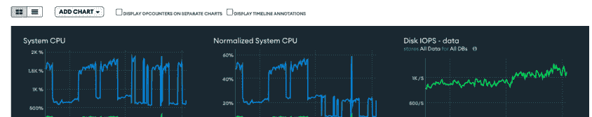

*图 15.1：集群硬件仪表板显示系统 CPU、归一化系统 CPU 和磁盘 IOPS*

为了保持系统正常运行，我们将集群扩展到更高层级。同时，我们启动了一个项目，以研究如何在保持在之前层级的同时调整性能以处理增加的工作负载。

这种逐渐的性能下降体现在多个关键指标上，这些指标提供了底层问题的明确迹象。虽然随着应用程序的增长，CPU 使用率的增加是预期的，但在这种情况下，其增长速度明显高于工作负载的预期。查询定位指标的升高尤其令人担忧，因为它们指向可能存在次优索引，查询处理了大量文档仅返回少量结果。这种低效率在过度配置的系统中常常被忽视，掩盖了底层设计问题。然而，随着这些次优查询操作的累积，它们最终产生了可衡量的延迟增加，暴露了根本问题。解决这些扩展问题成为首要任务，以确保 Atlas 上客户部署的持续可靠性、性能和全面监控。

## 诊断原因

MongoDB 团队开始使用 Atlas 监控工具进行调查，如第 14 章《监控和可观测性》所述。如图 15.2 所示，在服务器为主节点期间，OpCounters 出现峰值，切换为从节点时则下降。3 月底查询定位的激增尤其值得注意。

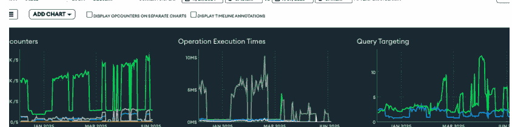

图 15.2：集群状态仪表板显示 Opcounters、操作执行时间和查询定位

为缓解对集群资源的持续压力，团队暂时升级了集群层级。这为我们提供了所需的即时 CPU 提升，并且如预期，归一化系统 CPU 指标明显下降。虽然这在当时解决了性能问题，但这只是临时措施。团队的主要目标仍然是找出根本原因并实施更具成本效益的长期解决方案来解决高 CPU 使用率，确保系统稳定性和财务效率。

## 根本原因识别

在临时解决方案到位后，工程团队开始对系统性能问题进行根本原因分析。

他们首先使用了 Atlas Performance Advisor，其推荐了 19 个潜在索引，这明显表明许多查询使用了次优索引。同时，日志分析显示出慢查询，其时间戳与高 CPU 使用率时段直接相关。这种组合提供了强有力的证据，表明特定的查询模式导致了性能下降，特别是那些执行全集合扫描或在没有适当索引支持的情况下进行复杂聚合的查询。

在确认某些查询可能导致性能下降后，Atlas Query Insights 和 Query Profiler 成为了解发生了什么的自然下一步。Query Insights 和 Query Profiler 显示，某些聚合和平均查询执行时间极长，其中一些查询长达 8 秒，如图 15.3 所示。

按命名空间提供的这些详细信息使团队能够准确了解瓶颈发生的位置，从而能够制定有针对性的优化策略，例如创建新索引或重写低效查询。这种综合方法提供了系统性能挑战的清晰图景，并导致数据库更高效。

**Query Insights** 页面列出了每个命名空间的操作数量及其总执行时间的详细信息。

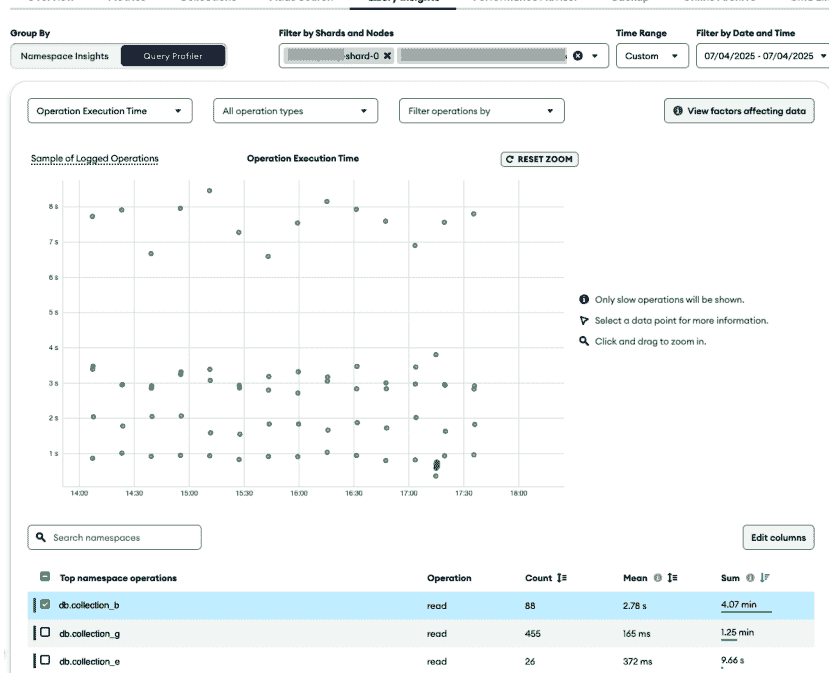

图 15.3：集群 Query Insights 仪表板显示慢查询

通过相关性分析，使用与上述相同技术，团队发现数据库每秒处理约 20,000 次操作期间，日志显示每天约有 13,000 个慢查询。

通过同时利用日志和 Query Profiler，我们能够将慢查询与高 CPU 使用率时段相关联。这种相关性帮助我们识别出最可能导致性能问题的查询形状。例如，最频繁记录的慢查询形状，每天出现约 9,000 次，显示如下：

```
{
  "find": "db.collection_g",
  "filter": {
    "attribute1_Id": {
      "$oid": "621094e7bdbed43d3f408384"
    },
    "attribute1_Name": "aws-use1-1-v2-1",
    "attribute2_Id": {
      "$oid": "65bd5e7ccff98a5722037dc6"
    }
  },
  "limit": 1
}

"planSummary": "COLLSCAN",
"planningTimeMicros": 259,
"keysExamined": 0,
"docsExamined": 34436,
"nreturned": 1,
"durationMillis": 103,
"cpuNanos": 10987385
```

此查询模式尤其成问题。它扫描了超过 34,000 个文档并返回一个匹配文档，在此过程中消耗了大量 CPU 资源。团队发现，该集合和查询是在 3 月底作为新功能添加的，但没有相应的索引。这与他们观察到的查询定位激增相吻合。

## 实施解决方案

在更清楚地了解性能瓶颈后，团队专注于有针对性的低风险优化。他们的目标是在不给系统资源带来进一步压力的情况下提高效率。

团队实施了几种有针对性的解决方案：

- **创建推荐索引**：他们为最频繁的慢查询创建了索引，这立即改善了性能并降低了查询定位指标。为了避免在此关键时期进一步给已受压力的 CPU 资源带来负担，团队在创建索引时进行了仔细规划，通过在非高峰时段安排并持续监控系统资源，以防止额外的性能下降。
- **设置预防性监控**：他们从项目警报页面创建了查询定位警报，以监控扫描对象与返回文档的高比率。这将在工作负载、应用程序或数据集发生变化导致查询效率随时间下降时提醒他们。

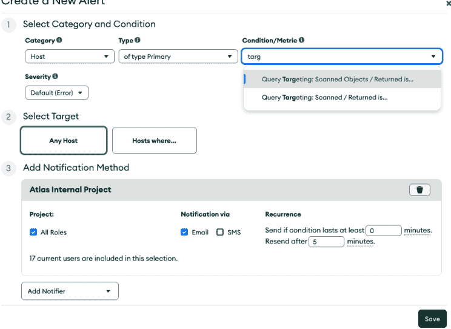

图 15.4：创建新的警报以定位慢查询

- **删除冗余索引：** 在审查 Performance Advisor 建议时，团队发现了 9 个在另一个复合索引前缀字段上的索引，可能可以删除。然而，删除索引是一项需要仔细考虑和规划的操作。团队首先在测试环境中验证每个建议，评估潜在的查询影响，并逐步实施更改并密切监控。只有在彻底评估后，他们才继续删除这些冗余索引，先隐藏索引，然后确认系统没有不良影响，再删除。这最终改善了写入性能，而不会影响读取性能。

这些措施共同降低了 CPU 使用率，提高了查询效率，并稳定了系统性能。更重要的是，它们为今后的持续优化和主动监控奠定了基础。

## 结果与经验教训

本案例说明了诊断固有慢操作时的几个重要原则：

- 性能问题通常与应用程序更改或新功能同时出现
- 使用 Performance Advisor、Query Profiler 和日志等多种诊断工具可提供全面的视图
- 创建适当的索引通常是集合扫描最有效的解决方案
- 删除冗余索引可以改善写入性能
- 为关键指标设置警报可实现对未来问题的积极识别

最终，这种风险首先是通过随时间监控关键指标而识别的。这帮助我们识别逐渐的性能下降，并在对客户造成影响之前采取行动。此次性能调优练习使我们能够降低集群层级并降低成本。

## 案例研究：导致集合扫描的意外管理员查询

慢查询通常是 MongoDB 部署中性能问题的第一个指标。一个主要问题影响了客户的自托管 MongoDB 部署。他们的应用程序监控显示数据库操作的延迟突然增加，影响了整个系统的用户。问题的突然性意味着我们需要立即调查并修复，以避免进一步中断并使服务恢复正常。


## 诊断原因

一名客户工程师联系了 MongoDB 支持。支持工程师意识到情况危急，首先寻找一种即时但安全的补救措施以降低影响的严重程度。支持人员要求客户运行一个 shell 命令来显示运行了 10 秒或更长时间的操作：

```
db.currentOp({"secs_running": { $gte: 10}}).inprog
[
  {
    type: 'op',
    opid: 201,
    host: 'somewhere.net:27017',
    connectionId: 1063017,
    client: '555.111.222.333:47140',
    currentOpTime: '2024-12-31T00:29:08.230+00:00',
    threaded: true,
    secs_running: Long('5410'),
    microsecs_running: Long('5410001296'),
    op: 'command',
    ns: 'admin.$cmd',
    command: {
      /* Redacted */
    },
    "planSummary": "COLLSCAN",
    numYields: 0,
    locks: {},
  }
]
```

这揭示了一个根据 secs_running 字段已运行超过 90 分钟的操作。进一步调查显示，一名数据库管理员已登录并运行了一个复杂的查询。日志中的 host 字段显示此查询是从另一个办公室执行的，而 ns admin 字段确认该用户具有管理权限。该查询启动了集合扫描，导致缓存的集合被从内存中驱逐。

## 实施解决方案

客户面临一个非关键但消耗资源过度并威胁系统稳定性的操作，果断采取行动。为了重新获得控制并防止进一步恶化，他们启动了对问题进程的终止序列。为此，使用了以下命令：

```
db.killOp(201)
```

在这种情况下，团队终止了有问题的临时操作，问题得以解决。在后续分析中，MongoDB 支持团队发现管理员发出的复杂查询导致了大规模缓存驱逐。这是因为扫描将大量很少使用的文档加载到内存中，挤出了有限缓存空间中的频繁访问数据。这解释了为什么在终止查询后性能仍然受影响；缓存的损害已经造成。大约 2-3 分钟后，一旦频繁访问的数据（工作集）从磁盘存储重新加载到 MongoDB 的缓存中，数据库性能指标就恢复到基线水平。虽然这一恢复期可能看起来像是干预后额外的性能下降，但需要注意的是，系统早已被有问题的查询阻塞，因此这一短暂的恢复阶段是解决根本问题不可避免的后果。

## 结果与经验教训

本案例凸显了几个重要原则。首先，长时间运行的集合扫描会严重影响所有用户的性能。此外，缓存数据驱逐是大型集合扫描的常见副作用。

生产数据库上的管理员临时查询代表着重大风险，需要谨慎管理和治理。虽然这些即兴调查可以提供有价值的见解，但如果在未充分考虑其资源需求的情况下执行，也会严重影响系统性能和可用性。为避免这种情况，组织必须实施严格的政策，规定谁可以在生产系统上运行临时查询、何时可以执行，以及对其范围和复杂性应施加哪些限制。理想情况下，此类探索性工作应在从节点或维护窗口期间进行，并配置查询超时和资源限制以防止失控进程。如果没有这些保障措施，即使是出于好意的数据库管理员也可能无意中触发级联性能问题，影响数千名应用程序用户。

## 管理阻塞操作

阻塞操作可能发生在进程必须等待另一个操作完成或资源变得可用时，从而产生连锁效应，严重影响应用程序的响应能力。了解导致操作阻塞的原因对于保持最佳数据库性能至关重要。及早识别这些模式可以让你在它们影响用户体验之前实施预防措施。

MongoDB 中阻塞操作的典型原因包括以下内容：

- 具有排他锁的长时间运行操作，例如索引构建或集合删除
- 资源竞争，即多个操作尝试访问相同的集合或文档，尤其是在高峰使用期间
- 连接池耗尽，即所有可用连接都在使用中，新操作必须等待，从而造成人为排队

> **非阻塞问题的阻塞式症状**
> 
> 一些情况，例如游标泄漏或高网络延迟，会产生类似阻塞的症状。例如，高延迟或慢查询，但它们不涉及实际的锁竞争。

## 案例研究：游标泄漏调查

一名客户遇到操作变慢和高数量查询超时的问题。该问题直接影响用户，部分用户遇到应用程序超时。Atlas 监控显示打开游标数量显著激增，具体来说，从客户本地时区凌晨 4:00 开始超过 600,000。

> **通过 serverStatus 跟踪打开游标**
> 
> 对于自托管的 MongoDB 实例，此信息也可以在 serverStatus 命令的 cursor.open.total 计数器中找到。

## 诊断原因

MongoDB 支持团队最初专注于优化慢操作，并建议根据 Performance Advisor 的建议创建索引以加快查询速度。然而，这并未改善情况。即使在索引优化后，打开游标数量仍然很高，这表明存在更复杂的潜在问题。这可能是由于应用程序逻辑效率低下、游标未正确关闭或连接池问题所致。


## MongoDB 中的自动游标生命周期管理

MongoDB 在大多数正常操作中会自动管理游标生命周期。游标在完全迭代后超时（通常为 10 分钟后）或客户端会话结束时关闭。在使用标准 MongoDB 驱动程序和模式的应用程序中，游标泄漏相对较少见。

客户的部署持续恶化，更多用户遇到响应时间缓慢和错误。CPU、内存和 I/O 等关键系统指标都显示出严重的瓶颈。即使经过我们支持团队的彻底调查，确切原因仍不明确，但我们需要快速稳定系统以避免中断。支持团队建议客户重启主节点。这将触发计划的故障转移，使其中一个从节点成为新的主节点，确保服务继续运行。在从节点成功提升后，系统性能立即改善，证实此操作暂时解决了紧急运营问题。

支持团队继续在夜间监控系统。打开游标计数正在上升，但用户活动较低，操作延迟尚未达到关键水平。当客户工程师第二天早上开始工作时，打开游标计数已上升至 260,000 并且仍在攀升。

支持团队与客户共同实时诊断问题，并确定了几个关键指标：

- **Profiler Analysis**：客户启用数据库分析器 40 分钟，以捕获耗时超过 20 ms 的查询。
- **Log Analysis**：分析日志时，支持工程师观察到打开游标激增至 600,000，然后回落接近零。从服务器状态来看，他们观察到以下情况：
  - 大量 `cursor.lifespan.greaterThanOrEqual10Minutes`
  - 每秒超过 500 个 `cursor.totalOpened`，但 `cursor.moreThanOneBatch` 少于 250
  - 超过 300,000 条日志消息包含 `{"ctx":"LogicalSessionCacheRefresh","msg":"Killing cursor as part of killing session(s)"}`


### 查询模式分析
使用 grep 命令，他们分析了日志文件模式：

```
grep 'aCollection' mongodb.log* | grep -v 'getMore' | wc -l
122784

grep 'aCollection' mongodb.log* | grep '"cursorExhausted":true' | wc -l
46954
```

第一个命令统计 'aCollection' 上的所有操作，同时排除 'getMore' 操作，显示出 122,784 次初始游标创建。第二个命令仅统计已正确耗尽的游标（完全遍历或显式关闭），显示只有 46,954 例。此显著差异（仅约 38% 的游标被正确关闭）证实了我们对游标泄漏的怀疑，因为应用程序创建的大多数游标都被丢弃而未进行适当清理，导致它们在超时期限到来之前不断累积。

## 根本原因识别

问题源于客户应用程序中的一个特定错误，该错误一直隐藏到最近。当查询由于数据增长开始在单个批次中返回超过默认的 101 个文档时，问题最终变得明显。该应用程序设计用于处理小型结果集，在这些情况下会正确处理游标。

此问题仅在客户端保持活动会话打开而未完全耗尽游标时才会显现（要么未遍历所有结果，要么未显式调用游标上的 close()）。在正常情况下，如果游标处理实现得当或结果集较小，则不会出现此问题。大多数 MongoDB 驱动程序实现和标准查询模式会自动处理游标生命周期管理，使得这种泄漏在设计良好的应用程序中相对不常见。

有关游标行为的更多信息，请访问 MongoDB 文档中关于游标的部分 https://www.mongodb.com/docs/manual/core/cursors/#behavior。

## 实施解决方案

在客户开发团队着手永久修复的同时，MongoDB 支持团队提供了一个关键的临时措施：在受影响的命名空间上终止空闲游标的 shell 命令。这有助于防止非活动游标的累积，从而可能恶化性能并导致系统不稳定。该命令提供了即时的缓解，并为开发团队修复核心问题提供了宝贵的时间。

客户为该错误开发了完整且适当的修复方案。该修复方案与 MongoDB 支持团队在活跃通话中协作部署，确保实时指导和即时故障排除。

部署产生了即时且显著的影响。在修复之前，打开的游标会定期飙升至超过 600,000，然后暂时下降。对于此特定应用程序，正常操作在任何给定时间只需要大约 100 个并发游标。部署后，系统趋于稳定。打开游标的最大数量始终保持在更低且可管理的 100 左右水平。这种减少极大地提高了系统效率和资源利用率。

进一步证实了已部署修复的成功，服务器状态报告显示问题已解决。具体来说，`cursor.lifespan.greaterThanOrEqual10Minutes` 指标始终报告为 0。该指标有助于识别长寿命的潜在有问题游标。值为 0 显示没有游标保持打开超过 10 分钟。

## 结果与经验

客户的情况代表了一个不寻常的边缘案例，其应用程序代码反复创建新游标而未正确关闭它们。

此示例应用了若干故障排除原则：
- 游标泄漏可能导致性能逐渐下降
- 诊断根本原因通常需要多种方法
- 在开发永久解决方案的同时，可能需要临时缓解措施
- 监控指标可实现早期检测

最后，此情况生动地说明了开发阶段的应用程序代码问题如何在生产环境中表现为数据库性能问题。

## 用例：糟糕优化查询的突发

一位客户注意到突然出现的一批超时操作。Atlas 监控显示归一化 CPU 利用率飙升至 100%，并且有超过 3.7 GB/s 的数据被读入存储引擎缓存，如图 15.5 所示：

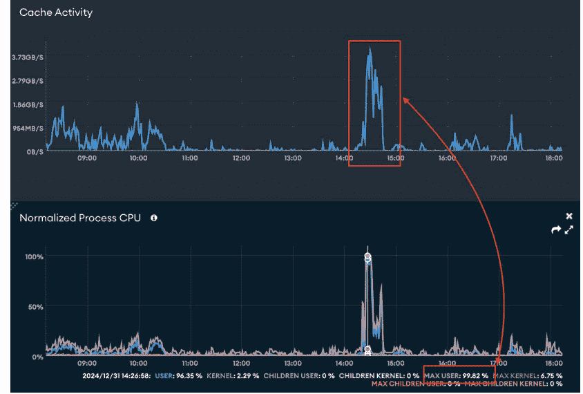

*图 15.5：缓存活动和用户 CPU 利用率*

应用程序查询受到严重影响。用户遇到超时、响应缓慢，在某些情况下甚至完全请求失败。系统实际上被阻塞，因为在这些资源密集型进程垄断可用 CPU 和 I/O 容量时，正常操作无法进行。但是什么导致了这种突然的致命负载？由于数据库主要为客户查询服务，这些性能指标强烈表明一个或多个有问题的查询可能是导致峰值的根源。为了识别这种异常活动背后的具体罪魁祸首，我们需要更深入地研究查询模式。这促使我们检查 Atlas Query Insights，以更详细地了解查询级别正在发生的情况。

## 诊断原因

Query Insights/Query Profiler 揭示了集合上大量查询，每个查询检查超过 100 万个文档，如图 15.6 所示，表示为图表顶部绿点。在屏幕截图底部，我们还可以看到，总共 233 个查询在此 16 分钟期间扫描了大约 144 百万个文档。我们查看了之前的 20 分钟，发现总共仅扫描了 800 万个文档。

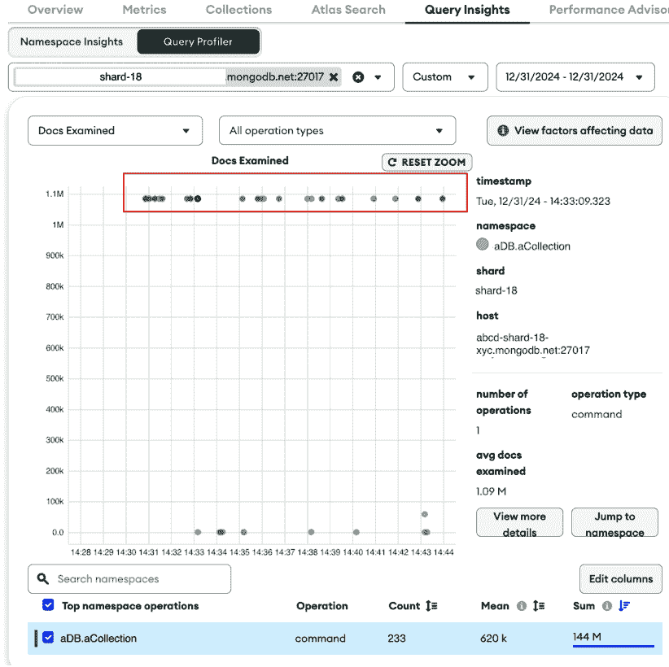

图 15.6：查询分析器显示大量被检查的文档

点击 Query Profiler 中显示的绿点之一，如图 15.6 所示，揭示了每个单独查询的更深入见解。点击其中一个查询时，分析器显示了以下内容：

```
"replanReason": "cached plan was less efficient than expected: expected trial execution to take 2 works but it took at least 20 works"
```

这表明查询规划器在寻找高效执行计划时遇到困难。在查看集合后，他们发现有 25 个可用的索引，但没有一个与这些查询匹配良好，表明可能需要新索引。

此外，进一步的日志分析还显示，该集合中的一些慢查询试图匹配跨越六个月范围的文档。

## 实施解决方案

为了解决由于缺乏最优索引导致效率低下的问题，团队查看了 Performance Advisor，该顾问如预期般提供了针对解决该问题的全新复合索引建议，如图 15.7 所示。采纳这一建议后，团队迅速创建了复合索引，显著改善了查询性能。

### aDB.aCollection

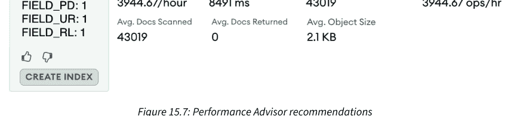

图 15.7：性能顾问建议

此外，团队通过修改其查询逻辑以匹配更短时间跨度内的文档来增强应用程序。此调整进一步优化了查询执行，减少了返回的数据量和查询延迟，从而实现更快的性能和更高效的系统资源使用。

## 结果与经验

此案例强调了查询优化的几个关键原则。突然的性能问题通常与应用程序行为的变化相关，因此密切监控应用程序模式至关重要。低效查询的一个关键指标是数据库检查的文档数量与实际返回结果相比不成比例地大。这可能表明查询设计或索引存在潜在问题。此外，查询规划器在处理广泛的数据范围时可能会遇到困难，这凸显了在可能的情况下缩小查询范围的重要性。

解决性能挑战通常需要结合多种策略，包括数据库更改，例如创建优化索引，以及应用程序级调整，例如减少查询数据的时段。诸如 Performance Advisor 之类的工具在识别缺失索引方面非常宝贵，即使对于不频繁的查询模式也是如此。它提供可操作的建议以提高效率并解决瓶颈。

## 处理硬件资源限制

硬件资源限制是保持 MongoDB 最优性能的关键挑战。即使查询经过良好优化且架构设计合理，底层硬件最终决定了数据库处理工作负载的效率。资源限制发生在部署的计算、内存、网络或存储容量不足以支持其承受的需求时，导致级联性能问题。想象一条生产线，机器以最大容量运行。任何需求增加或效率低下都会使系统超出极限，导致瓶颈和延迟。同样，MongoDB 中的资源限制会显著损害应用程序的响应能力和可扩展性。

这些限制通常在四个主要领域显现：CPU、内存、磁盘 I/O 和网络。高 CPU 利用率可能会限制用于查询、聚合和后台任务的处理能力，迫使操作排队并延迟结果。内存限制发生在可用 RAM 不足以存储工作集时，导致更依赖于较慢的磁盘读取并降低性能。磁盘 I/O 限制，例如缓慢或过载的存储子系统，会严重阻碍需要频繁或大量数据读写的操作。网络限制会显著影响分布式数据库操作，导致诸如复制延迟增加、初始同步变慢、备份时间延长以及副本集选举延迟等问题，所有这些都可能损害部署中数据可用性和一致性。


资源限制的影响通常是逐渐显现的，随着数据量的增长、工作负载的增加或使用模式的变化而出现。然而，当资源在集群中分布不均时，问题也可能突然出现，造成热点或不平衡，从而加剧性能瓶颈。识别并解决这些硬件限制对于确保 MongoDB 在规模化时保持响应性和可靠性至关重要。了解 CPU、内存和存储如何与 MongoDB 工作负载交互，使团队能够主动缓解限制并优化部署中的资源分配。

## Case study: Atlas cluster resource optimization

案例研究：Atlas 集群资源优化

承接之前的 Atlas 监控集群示例，团队注意到即使通过索引改进解决了固有的慢操作，shard-0 上的资源利用率仍然高于其他分片。这种不平衡带来了重大问题，因为它在分布式系统中造成了性能瓶颈。当一个分片的利用率持续高于其他分片时，它实际上就成为整个集群性能的限制因素。这不仅会使超载的分片面临资源耗尽的风险，可能导致操作失败，而且也代表了对整个集群容量的低效使用。此外，这种不平衡削弱了分片设计提供的容错和可扩展性优势，因为系统变得不成比例地受单个分片性能的制约。

查看每个分片主节点的未归一化进程 CPU 时，他们观察到 shard-0 的利用率和数据大小均高于所有其他分片，如图 15.8 所示。

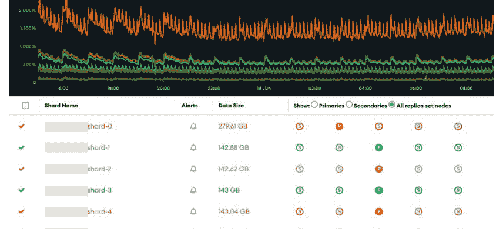

Figure 15.8: Graph showing the unnormalized process CPU on the primaries of each shard

图 15.8：显示每个分片主节点上未归一化进程 CPU 的图表

此外，图 15.9 说明了一个重要观察：过去一年中，shard-0 的写入 IOPS 增长速度比集群中其他分片更快。

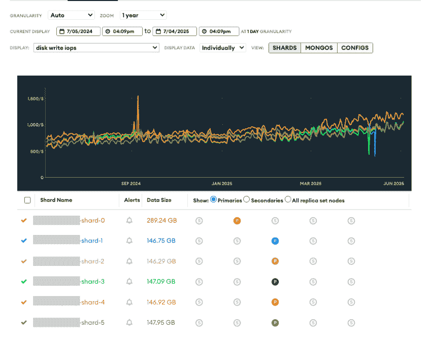

*Figure 15.9: Graph showing the last year of write IOPS on shard-0*

*图 15.9：显示 shard-0 过去一年写入 IOPS 的图表*

## Diagnosing the cause

诊断原因

不平衡的根本原因源于集群的初始配置。集群包含一个具有众多集合的单个数据库，并且在数据库首次创建时，shard-0 被指定为主分片。因此，所有未分片的集合默认都放置在 shard-0 上。随着时间的推移，未分片集合的数量及其各自的数据量增长，shard-0 因不成比例的工作负载而变得超载。

这种不均匀分布导致 shard-0 上的操作和数据集中度更高，使其 CPU、内存和磁盘使用率持续高于其他分片。shard-0 的高利用率还增加了查询延迟并限制了集群的整体吞吐量，因为未分片集合上的操作受制于主分片的资源限制。

如第 1 章《系统与 MongoDB 架构》所述，性能优化很少是一步到位的。数据库系统中的瓶颈是动态的。当你解决一个问题时，系统中的下一个约束往往会变得明显。这一原则在我们的案例中得到了清晰的体现。虽然索引改进成功解决了最初识别的慢操作，但它们只是揭示了另一个潜在的瓶颈，该瓶颈此前部分被更严重的索引问题所掩盖。

## Implementing the solution

实施解决方案

团队必须确定以下哪种方法最适合平衡工作负载：

- Scale up the primary shard (Atlas supports individual scaling of each shard)
- 扩容主分片（Atlas 支持对每个分片进行单独扩容）
- Move unsharded collections from shard-0 to other shards
- 将未分片集合从 shard-0 移动到其他分片
- Shard more collections
- 对更多集合进行分片

团队决定将未分片集合从 shard-0 移动到其他分片，因为与替代方案相比，这种方法最简单易于实施和管理。此方法无需更改应用程序代码或数据模式，并且可以在不造成显著停机的情况下执行。此外，它使团队能够直接控制哪些集合移动到何处，从而可以根据集合大小和访问模式进行仔细平衡。

但首先，他们再次核实哪些集合是未分片的，哪些是已分片的。

1. To do this, they ran the following commands in mongosh:

1. 为此，他们在 mongosh 中运行了以下命令：

// List unsharded collections
db.getCollectionNames().forEach(collectionName => {
    if (!db[collectionName].stats().sharded) {
        print(collectionName);
    }
});

// List sharded collections
db.getCollectionNames().forEach(collectionName => {
    if (db[collectionName].stats().sharded) {
        print(collectionName);
    }
});

他们发现一个数据库中有 163 个集合。其中 20 个已分片，143 个未分片。

2. Next, the team analyzed the real-time panel for shard-0 to get a quick view of its workload:

2. 接下来，团队分析了 shard-0 的实时面板，以快速了解其工作负载：

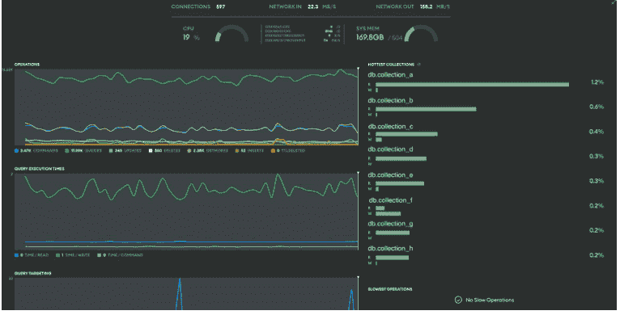

Figure 15.10: Panel displaying how hot a collection is in real time

图 15.10：实时显示集合热度的面板

图 15.10 显示了按每秒操作数计算的最热集合的实时视图。该视图显示了 CPU 和内存利用率以及连接数、每秒操作数，以及底层写入磁盘的读写 IOPS。这种详细的分解对于确定应将哪些集合移动到不同分片非常有价值。

通过识别操作计数最高、内存占用最大、CPU 消耗最大的未分片集合，团队可以优先移动资源最密集的集合。这种有针对性的方法确保了再平衡工作对减轻 shard-0 负担的影响最大，同时最大限度地减少需要迁移的集合数量。活动水平较低的集合可以保留在 shard-0 上，或在必要时在后续阶段移动。

团队还分析了 Query Insights 视图，以了解最活跃集合的长期情况，如图 15.11 所示。

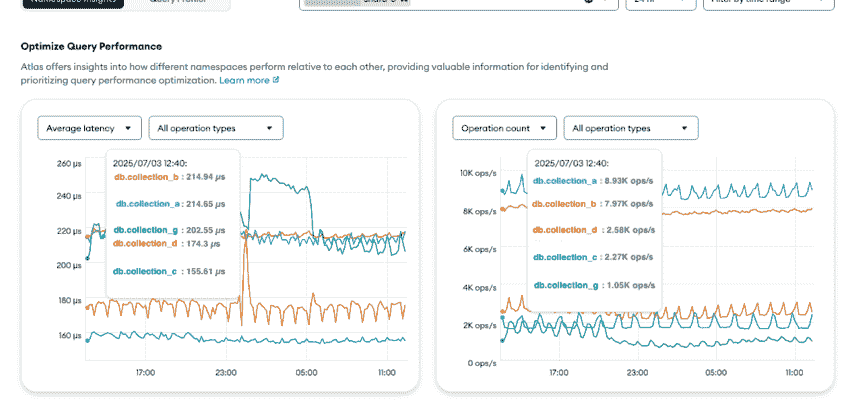

*Figure 15.11: Graph showing both the count of operations per second and the average latency over the last 24 hours*

*图 15.11：显示过去 24 小时内每秒操作数和平均延迟的图表*

该图表显示了过去 24 小时内每秒操作数和平均延迟。利用有关 shard-0 工作负载的这些信息，团队随后确定了 CPU 消耗最高的 10 个未分片集合，这些集合的数据集大小可控，以确保快速迁移。

他们计划将这些集合从 shard-0 分发到其他分片：

- The busiest unsharded collection to shard-1
- 最繁忙的未分片集合到 shard-1
- The second busiest collection to shard-2
- 第二繁忙的集合到 shard-2
- Busy collections 3 and 4 to shard-3
- 繁忙集合 3 和 4 到 shard-3
- Busy collections 5, 6, and 7 to shard-4
- 繁忙集合 5、6 和 7 到 shard-4
- Busy collections 8, 9, and 10 to shard-5
- 繁忙集合 8、9 和 10 到 shard-5

该计划在生产环境中运行之前首先在 QA 环境中进行了测试。这种预防措施很重要，因为在分片之间移动集合涉及繁重操作，可能显著影响集群性能。

他们首先移动了两个最小的集合并检查指标以验证更改是否生效。对于每次集合移动，他们遵循以下流程：

1. Monitor shard-0 and the destination shard's hardware metrics and operation execution times.
1. 监控 shard-0 和目标分片的硬件指标和操作执行时间。
2. Verify the destination shard has free disk space, IOPs, network resources, and CPU headroom.
2. 验证目标分片具有足够的磁盘空间、IOPS、网络资源和 CPU 空闲。
3. Connect to mongos and move a collection:
3. 连接到 mongos 并移动集合：
4. If something goes wrong during the move, use the abortMoveCollection admin command.
4. 如果移动过程中出现问题，使用 abortMoveCollection 管理命令。
5. Monitor shard-0 and the destination shard's hardware metrics and operation execution times.
5. 监控 shard-0 和目标分片的硬件指标和操作执行时间。

```
db.adminCommand({ moveCollection: "db.collection_b", toShard: "shard-1" })
```

## MoveCollection causes short write block

MoveCollection 导致短暂写入阻塞

The moveCollection command blocks writes to the collection for up to 2 seconds during its critical section. You can find more details in the documentation at https://mongodb.com/docs/manual/tutorial/move-a-collection/.

moveCollection 命令在其关键部分会阻塞对集合的写入，最长可达 2 秒。你可以在文档 https://mongodb.com/docs/manual/tutorial/move-a-collection/ 中找到更多详细信息。

## Results and learnings

结果与经验

团队预计，迁移大多数资源密集型未分片集合，加上之前的模式和索引优化，将减轻集群的资源需求，使其能够缩减基础设施、显著降低成本并维持性能水平。

该示例表明，解决硬件资源限制不仅仅是简单地扩容；它需要一种战略性方法，将监控、诊断、工作负载分析和运营规划整合在一起。Atlas 监控和 Query Insights 等工具对于精确定位资源瓶颈并分析短期指标和长期工作负载趋势至关重要。凭借对这些指标的清晰可见性，组织可以实施针对集群独特需求的数据驱动解决方案，确保纠正措施精确且有效。


## 用例：自托管 MongoDB 中 IOPS 不足的诊断

在自托管系统中，在客户部署中常见到类似的模式：工作负载会随着时间自然增长，往往超过底层基础设施的能力。使用 MongoDB Atlas，这很容易通过内置监控工具及早发现，这些工具可实时查看关键指标，例如空闲 CPU、磁盘 IOPS 余量以及正在执行的运算数量。然而，在独立管理 MongoDB 集群时，团队必须依赖脚本或外部监控工具来跟踪这些指标。

在本示例中，我们回顾了一个客户案例，该客户在云基础设施上自行管理 MongoDB。随着性能问题开始显现，MongoDB 支持团队转向了服务器的诊断数据。

## 诊断原因

MongoDB 服务器每秒在 **全天候诊断数据采集 (FTDC)** 中捕获系统信息和内部计数器。此数据不包含任何敏感信息，例如查询、查询谓词、结果或凭据。

分析每秒存储读取请求（在 Linux 上来自 iostat 命令），他们发现数据库服务器正在发出 16,600 IOPs。来自 vmstat 的 FTDC 数据显示 39% iowait，表明系统花费大量时间等待 I/O 操作。

客户为底层存储预配了 15,000 IOPs。云服务提供商通常允许在限制之前在一段时间内超出预配限制进行突发。这种突发随后被限制，被客户的应用程序体验为停顿。

查看 IOPS 分配后，我们意识到使用的 IOPS 超过了预配量。由于提供了更高的突发 IOPS，性能在一段时间内是可以接受的。然而，在突发配额耗尽后，随之而来的是急剧的性能下降。系统不再拥有足够的 IOPS，操作变慢，等待 I/O。

## 实施解决方案

客户将预配的 IOPS 从 15,000 增加到 18,000，这立即解决了性能停顿问题。

## 结果与经验教训

此案例强调了 Atlas 和自托管 MongoDB 部署中硬件资源约束的几个重要原则。I/O 限制经常表现为较高的 iowait 百分比，表明存储中存在潜在瓶颈。在云环境中，值得注意的是，暂时超出预配限制的突发可能是可能的，但这对于不断增长的工作负载来说并不总是可持续的。对应用程序工作负载与资源预配之间关系有深入的理解对于保持最佳性能至关重要。即使没有 Atlas 提供的先进监控功能，FTDC 等诊断工具也可以提供有价值的见解来识别和解决潜在问题。最后，值得记住的是，有时解决性能问题的最简单、最有效的方法就是简单地增加可用资源以满足工作负载的需求。此案例提醒我们主动规划和监控以避免资源瓶颈的重要性。

## 性能故障排除的系统化方法

基于我们探讨的示例，以下是诊断和解决 MongoDB 性能问题的结构化方法：

- 1. **识别症状并收集初始数据：** 故障排除的第一步是确定性能症状并收集相关数据以了解问题。确定问题开始的时间，识别受影响的数据库操作或集合，并收集 CPU 使用率、IOPS 和查询性能等基线指标以供比较。这些初始信息有助于构建清晰的现状图景，并指导下一步的诊断。
- 2. **使用多种诊断工具：** 利用各种诊断工具深入了解问题。对于 Atlas 用户，监控仪表板提供关键性能指标的视觉概览，而自托管集群的用户可以使用系统监控工具实现类似结果。数据库分析器对于检测慢查询非常宝贵，日志文件有助于发现与性能下降相关的错误或模式，而 currentOp() 命令可识别正在运行的操作。此外，性能顾问提供索引优化建议，这通常可以解决查询效率问题。请记住，可观测性和监控生态系统不断发展，及时了解新兴技术非常重要。
- 3. **对问题进行分类：** 收集数据后，对问题的性质进行分类以缩小可能的解决方案范围。它是由固有的慢操作引起的吗，例如全集合扫描或糟糕的索引策略？它可能源于被阻塞的操作，例如锁或与游标相关的问题？还是 CPU、内存或磁盘 I/O 限制等资源约束的结果？了解根本原因对于选择正确的补救方法至关重要。
- 4. **确定范围：** 接下来，评估问题的范围以确保解决方案有效针对。问题是否影响特定的查询或集合，还是更广泛的系统范围？此外，验证问题是否仅在特定时间发生，例如在高峰工作负载或计划作业期间，以确定时间和模式是否起作用。定义影响和范围可确保工作集中在最有效的地方。
- 5. **实施有针对性的解决方案：** 一旦了解问题，就实施针对特定问题的修复措施。对于固有的慢操作，请考虑添加索引或优化查询以提高效率。被阻塞的操作可能需要终止长时间运行或卡住的进程并解决与游标相关的问题。如果识别出资源约束，则扩展 CPU、内存或磁盘 IOPS，或在分片或集群之间重新分配工作负载，可以缓解性能瓶颈。
- 6. **验证解决方案：** 实施更改后，监控关键指标以确保问题已成功解决。验证问题不会再次出现，并确认性能已提高到预期水平。设置警报或主动监控，以便在未来及早发现类似问题，最小化停机时间和用户影响。
- 7. **记录发现和预防措施：** 最后，记录问题的根本原因以及为解决它而采取的步骤。利用这个机会实施预防措施，例如更新的监控工作流程或基础设施更改，以避免今后出现类似问题。与其他团队成员分享这些发现和最佳实践，以确保一致性并强化主动性能管理的文化。

通过遵循结构化方法，团队可以系统地识别、解决和防止 MongoDB 部署中的性能问题。持续监控和及时干预是保持响应迅速、可扩展系统的关键。

## 摘要

在本章中，我们探讨了与 William Zola 的三个基本原因相符的 MongoDB 性能问题的真实示例：固有的慢操作、被阻塞的操作和硬件资源不足。通过案例研究，我们了解了如何使用 MongoDB 的内置工具识别性能问题。我们通过检查查询模式、游标行为和资源利用率来诊断根本原因。然后，我们通过索引、查询优化和资源管理实施了有针对性的解决方案。最后，我们设置了预防措施，以便在问题变得严重之前捕获它们。

近年来，MongoDB 性能的调试工具有了显著改进。Atlas 提供全面的监控和警报功能，而自托管部署可以利用数据库分析器、日志分析和 FTDC 数据等工具。

请记住，性能优化是一个持续的过程，而不是一次性任务。随着数据增长和应用程序模式演变，请持续监控性能指标、审查索引使用情况并调整配置以保持最佳性能。

通过使用本章概述的原则和技术系统地处理性能问题，您将更好地配备以维护高性能的 MongoDB 部署，无论规模或复杂性如何。


## 后记

好吧，我们已经走完了 MongoDB 性能之旅！但如果说在多年的数据库优化中有一条突出教训，那就是性能调优永远不会真正结束。就在一切似乎都已稳固之时，应用程序会增长，用户模式会发生变化，或者 MongoDB 发布了一个很酷的新功能供尝试。

还记得我们关于模式设计的讨论吗？来自 *第 2 章，面向性能的模式设计*，或关于索引的讨论来自 *第 3 章，索引*？这可不是为了好玩！许多用户都遇到过性能问题，最终追溯到设计不良的模式或次优的（或缺失的）索引。你无法在流沙上建造摩天大楼——无论你在其他地方如何优化，那个不稳的基础仍会不断反噬。

我们已经涵盖了很多内容，从发现慢查询到掌握索引。在此过程中，我们探讨了如何利用聚合框架、变更流和事务等功能。我们回顾了如何使用复制来实现高可用性以及使用分片进行扩展。但性能调优是一场马拉松，而不是短跑。它是一个持续的学习和适应过程，随着应用程序的演进而不断进行。

## 关键要点

所以，哪些是最重要的经验可以带走？以下是一些原则的快速回顾，这些原则将使你的 MongoDB 部署保持快速、稳定，并为下一步做好准备：

- **模式设计至关重要：** 说真的，绝大多数性能问题都源于模式与应用程序使用数据的方式不匹配。在设计文档时要考虑读写操作。并且不要害怕随着时间的推移而演进模式。良好的模式是出色性能的基础。
- **索引是你的超能力：** 良好的索引是高效查询的关键。明智的索引策略意味着 MongoDB 不必如此努力工作。养成定期审查索引的习惯。
- **如果你不测量，你就是盲飞：** 你看不到的问题就无法修复。设置一致的监控，使用有意义的指标和警报。它有助于及早发现问题并指导调优工作。对部署的可见性有助于你在用户之前发现问题。
- **别忘了那些枯燥的事情：** 除了模式和索引之外，扎实的日常运维保持一切正常运行。这意味着管理配置、拥有可靠的备份计划，并知道何时需要更多容量。自动化维护可以节省很多未来的麻烦。

性能调优可能感觉像是在追逐一个移动目标，但只要有正确的习惯和坚实的基础，你将始终为即将到来的挑战做好准备。

## 性能思维

像性能侦探一样思考。保持好奇。不要等到事情坏掉才行动。深入查询计划，监控基准性能，并质疑假设。让性能成为团队运动，让开发人员、运维和架构师共同承担责任。

我们见过一个案例，其中对索引的一个看似微小的更改将页面加载时间减少了 40%。这类胜利只有在你主动寻找时才会出现。通过保持好奇并围绕改进建立习惯，优化就会成为文化的一部分，而非被动任务。

## 实用下一步

知道很好，但行动更好。以下是一些你可以立即采取的实践步骤，将性能理论转化为成果：

- **审计你的模式：** 仔细审视你的模式。它真的适用于你最常见的查询吗？检查访问模式并考虑文档结构（嵌入式与引用式）是否仍然发挥其作用。
- **熟悉诊断工具：** 熟悉 db.collection.explain() 和 Atlas 中的 Query Insight 选项卡。使用它们来观察真实的查询行为。寻找慢查询和无效索引——这甚至可能很有趣。
- **设置真实监控：** 使用 MongoDB Cloud Monitoring 或类似的替代工具。构建仪表板，突出显示关键指标，如操作持续时间、缓存命中率和复制延迟。让数据指出工作需要的地方。
- **在压力下测试：** 将负载测试纳入开发流程。确保系统能够处理预期和意外的流量。这就是你在瓶颈影响生产之前保持领先的方式。
- **与人交流：** 通过本地用户组、活动或在线讨论与其他人联系。MongoDB 社区庞大，充满了正在解决类似挑战并分享经验的人，这些经验可以带来宝贵的见解。你可以从访问 MongoDB 社区论坛开始，网址为 https://www.mongodb.com/community/forums/。

你应用所学、保持观察和保持联系越多，你的系统就越具韧性和响应性。

## 未来考虑

MongoDB 仍在不断发展。跟上 https://www.mongodb.com/docs/manual/release-notes/ 的发行说明，在安全环境中测试新功能，并采用合理的做法。

保持好奇。实验。测量。并且始终确认更改确实带来了改进。

## 最后的想法

性能调优融合了艺术与科学。凭借本书中分享的见解，可以对应用程序性能产生重大影响。将每个瓶颈视为一个谜题，每次修复都视为学习机会。调优良好的数据库会改善开发人员、运维人员和用户 alike 的体验。这是一段旅程——但现在，有一张地图可以指引方向。

现在去构建一些很棒的东西，并让它快速运行！

## 索引

### 符号

### A

$elemMatch 261-263
$expr 269
$or clause 269

访问时间 (atime) 286
活动消息集合 58
高级加密标准 (AES) 150
高级分片管理 133
  平衡器考虑 135, 136
  预拆分 136
  重新分片 134, 135
  分片集合块，
    共置 138-140
  移动未分片集合 137
聚合，在分布式环境中 98
  利用物化视图 101
  为分片集合优化 99
  性能监控 100
  性能分析 101
  片内，与合并操作对比 99
聚合阶段
  $accumulator 268
  $facet 268
  $function 268
  $regex 269

$sample 267
$text 268
$where 268
mapReduce 268
反模式 41
应用程序框架 211
  最佳实践 215
  利用 ODM 和 ORM 212, 213
  流行的兼容框架 213, 214
  价值 211, 212
应用程序性能监控 (APM) 316, 317
  外部工具的考虑 319
  OpenTelemetry 317, 318
  工具 25
近似最近邻 (ANN) 272
架构组件，分片集群
  配置服务器 122
  mongos 进程 122
  分片 122
归档消息集合 58
归档模式 57, 58
异步编程模式 216
Atlas 警报 304
  Atlas Search 问题 305
  连接问题 305
  oplog 问题 306, 307
  查询问题 306

Atlas 集群资源优化案例研究 343, 344
  原因诊断 344
  结果与经验 348
  解决方案实施 345-348
Atlas Search 271
Atlas UI 功能 301
  Namespace Insights 303
  性能顾问 303
  查询分析器 304
  实时性能面板 (RTPP) 302, 303
Atlas Vector Search 272
自动扩展
  关键性能优势 293
  用于 Atlas 性能的使用 293, 294

### B

二进制 JSON (BSON) 文档 14
被阻塞的操作 335
  超时操作突发案例研究 339
  游标泄漏调查案例研究 335
  管理 335
广播 124
B树文件系统 (Btrfs) 285
分桶模式 50-53
超时操作突发案例研究 339
  原因诊断 340, 341
  结果与经验 342
  解决方案实施 341

### C

回调 API 184
  优势 184
基数 73
变更流 160
  集合生命周期 172
  文档查找策略 165
  文档大小限制 172
  事件批处理 171
  事件结构 162
  功能 160
  处理高容量事件流 168, 169
  实现 163
  生命周期 163
  监控和健康检查 172
  性能影响 165
  性能调优 173
  构建价格监控服务 165-167
  副本集，考虑 172
  资源优化策略 167, 168
  范围 163
  使用聚合管道进行服务器端过滤 164
  共享部署，考虑 170, 171
  事务可见性 171
  工作原理 161
密码块链接 (CBC) 模式 150
客户端操作超时 (CSOT) 218
集群性能，使用 Atlas 故障排除 326, 327
  原因诊断 327
  结果与经验 332
  根本原因识别 328-330
  解决方案实施 331, 332
排序规则 272
集合
  分片 123, 124
在数据平台中的复杂性管理 23
  内置冗余和弹性 23
  具有严格能力的灵活数据模型 23
  具有智能分布的水平扩展 24
复合索引 70, 71


计算模式 53-55
连接抖动 228
连接基础 226, 227
  连接抖动 228
  延迟 227
  网络饱和 228
连接生命周期 229
  建立 229, 230
  终止 231, 232
  利用与池化 230, 231
连接管理 219, 220
  操作系统配置 241, 242
  优化 239
  池优化 239
  服务器端优化 240, 241
  超时配置 240
连接监控和池化 (CMAP) 236
便捷 API 184
写时复制 (CoW) 设计 285
核心 API 182, 183
覆盖查询 80
CRUD 操作 198
游标泄漏调查案例研究 335
  原因，诊断 335-337
  结果与经验教训 338
  根本原因识别 337
  解决方案，实现 337

## D
数据库分析器 310, 311
Datadog 315, 316
数据服务系统 18, 19
  组件 18, 19
  库 21, 22
  查询引擎 20
  存储引擎 21
  系统组件 22
Django 214
文档级原子性
  与多文档 ACID 事务对比 178-180
文档版本控制模式 48-50
驱动程序 198
  特性 200, 201
  工作原理 198, 199

## E
设计有效索引 73
  升序与降序索引顺序对比 81
  基数与选择性 73, 74
  构建复合索引 74, 75
  覆盖查询 80, 81
  等值查询 75, 76
  ESR 准则 79
  索引与聚合管道 81
  通过部分索引最大化资源 80
  排序与范围查询 76-79
嵌入模式 43, 44
Entity Framework 214
等值、排序、范围 (ESR) 准则 73
executionStats 部分 253
扩展引用模式 44
外部监控系统集成 312
  Datadog 315, 316
  Prometheus + Atlas 313, 314
  Prometheus + Grafana 313
  使用 Grafana 可视化 314, 315
提取、转换和加载 (ETL) 110

## F
故障条件
  处理 217, 218
FastAPI 214

### 文件系统
B树文件系统 (Btrfs) 285
Ceph 文件系统 (CephFS) 285
扩展文件系统 (XFS) 285
第四扩展文件系统 (ext4) 285
网络文件系统 (NFS) 285
Zettabyte 文件系统 (ZFS) 285

### 文件系统设置 286
更改缓存设置 287, 288
避免双重加密和压缩 290
避免 RAID 286
调整预读设置 287
保持常驻内存使用率低于 80% 291
检查 SSD 健康状况 290

### findAndModify 命令 266
### 先进先出 (FIFO) 112
### Flask 214
### 全时诊断数据捕获 (FTDC) 349

## G
### 地理空间索引 271
### Grafana
使用 Grafana 可视化 314, 315

## H
### 硬件资源限制
解决 342
Atlas 集群资源优化案例研究 343
自托管系统案例研究 349
### 哈希分片 131
### 高可用性 106
### hint 指令 259
### 水平扩展 122

## I
### 索引 65-67
误解 69
资源效率与权衡 67
资源使用 68
### 索引 35
### 索引类型 69
复合索引 70, 71
多键索引 71
部分索引 72
单字段索引 70
稀疏索引 71
通配符索引 72
### 固有慢操作 326
案例研究 326-334
识别 326
### 每秒输入/输出操作数 (IOPS) 19, 35

## J
### JavaScript 对象表示法 (JSON) 14

## L
### Laravel 214
### 大型数据集
聚合管道限制 97
使用 allowDiskUse 管理内存限制 97, 98
使用 97
### 延迟 227
### 库 21, 22
### 日志消息分析，查询执行
执行 255
识别有问题的模式 257
查询定位比率 257, 258
存储 258

## M
最大磁盘 IOPS 指标 26
指标 299
  运营指标 299, 300
  性能特定指标 301
MongoDB
  架构组件 16, 17
  架构 14
  文档模型 14, 15
MongoDB 聚合框架 84
  性能考虑 86
  管道 84-86
  管道流 87
  优化管道 88-90
MongoDB Atlas
  警报 304
  监控 301
  UI 功能 301
MongoDB 连接，架构 232
  驱动程序，池化 234, 235
  MongoDB Wire 协议 232-234
  监控与故障排除 236-238
  监控，最佳实践 238
  服务器连接处理 235
  TCP/IP 套接字 232-234
MongoDB 选举过程 107
MongoDB 查询语言 (MQL) 71
MongoDB 副本集故障转移过程 106
MongoDB 模式设计 37
  缓存 38
  动态属性 38
  关键优势 37
  一对多关系 37
  针对常见用例的优化 39
  模式演进 39
  快照 38
  弱实体，嵌入 38
MongoDB 事务
  性能考虑 186-190
  管理运行时限制和错误 188, 189
MongoDB Wire 协议 232-234
mongostat 307, 308
mongotop 308
监控 297
MQL 语义 260
  聚合与查询 267, 268
  聚合与匹配表达式对比 269
  最佳实践 265-267
  使用数组和多键索引的挑战 261
  使用 null 和 $exists 的挑战 264
  去重 263, 264
  场景 261-263
多文档 ACID 事务 176
  历史与演进，在 MongoDB 中 176
  属性，在 MongoDB 中 177
  使用，考虑因素 180-182
  与文档级原子性对比 178-180
多键索引 71
多版本并发控制 (MVCC) 146

## N
命名空间洞察 303
网络压缩 222, 223
  优势与权衡 242, 243
  压缩算法选项 243
  实现 244
  利用性能优化 242
  无服务器环境的策略 244, 245
网络文件系统 (NFS) 285
网络性能 222, 223
网络饱和 228
非阻塞模式 216

## O
对象文档映射器 (ODMs) 197, 202
  优势 210
  数据验证 204, 205
  特性 203
  对开发人员生产力的影响 209
  直观的查询 API 205, 206
  生命周期钩子 207
  中间件 207
  关系管理 206, 207
  场景 210
  模式强制 204, 205
  类型安全与 IDE 集成 208, 209
对象关系映射器 (ORMs) 202, 203
可观测性 298
  示例 298
一对多关系 37
OpenTelemetry 317, 318
运营指标 299
  cacheStats 300
  connections 300
  disk I/O metrics 300
  memUsageMB 300
  opcounters 300
  replication metrics 300
优化技术 90
  $group 操作，设计 92, 93
  避免 $lookup 性能问题 94-96
  $project 和 $addFields 的高效使用 96
  数据过滤 90, 91
  避免不必要的 $unwind 和 $group 92
内存不足 (OOM) 291

## P
部分索引 72, 73
用于查询和分析优化的模式 53
  计算模式 53-55
  多态模式 56, 57
  模式版本控制模式 55, 56
用于读取性能优化的模式 43
  嵌入模式 43, 44
  扩展引用模式 44, 45
  子集模式 45-47
用于存储优化的模式 57
  归档模式 57, 58
用于写入性能优化的模式 48
  分桶模式 50, 51
  文档版本控制模式 48-50
  键前缀模式 52, 53
性能顾问 303
性能挑战
  缓存压力 321
  磁盘 I/O 瓶颈 320
  oplog 窗口漂移 322
  复制延迟 322
性能特定指标 301
性能工具 24
  查找瓶颈 25-28
  优化的增量过程 29, 30
性能故障排除
  系统化方法 350, 351
多态模式 56, 57
前缀压缩 76
前缀匹配 75

## Q
服务质量 (QoS) 设置 292
Quarkus 214
查询引擎 20, 21
查询执行 248-250
  executionStats 部分 253, 254
  使用 explain 命令 252
  影响 259
  影响选项 260
  使用 hint 指令影响 259
  使用查询设置影响 259
  分析日志消息 255
  规划 250, 251
  queryPlanner 部分 253
查询分析器 304
查询形状 248
查询定位比率 257, 258

## R
基于范围的分片 131
读写策略 114
  读取偏好 115-117
  写入关注 117-119
读取关注 221
读取偏好 104, 221
实时性能面板 (RTPP) 24, 302, 303
恢复点目标 (RPO) 168
相对访问时间 (relatime) 286
副本集配置 107
  分析节点 109, 110
  链式复制 108, 109
  标签 109, 110
副本集 16, 103
  仲裁节点 104
  组件 104, 105
  主节点 104
  从节点 104
复制 104, 105
  流量控制 111
  内部与性能考虑 111
  操作日志 (oplog) 112, 113
  管理复制延迟 114
资源管理，用于最佳性能
  CPU 利用率 277
  内存管理 277-279
  网络 282
  存储 279-281
Ruby on Rails 214

## S
散点-聚集操作 124
  限制 124, 125
模式设计 34
  常见误区 36
  核心原则 34
  数据共置 34, 35
  读写权衡 35
  小文档与大文档对比 36
模式设计模式 42
  用于查询和分析优化 53
  用于读取性能优化 43
  用于存储优化 57
  用于写入性能优化 48
模式验证 39
  常见模式设计错误 40, 42
  实际优势 39
  按优势划分的模式设计模式 42
模式版本控制模式 55, 56
自托管 MongoDB 案例研究
  原因，诊断 349
  结果与经验教训 350
  解决方案，实现 349


- **自管理监控工具 307**
  - 数据库分析器 310-312
  - mongostat 307, 308
  - mongotop 308
  - serverStatus 309
- **分片集群**
  - 架构组件 122, 123
- **分片 131**
  - 哈希分片 131
  - 基于范围的分片 131
  - 基于区域的分片 132
- **分片架构 122**
- **分片键选择 123-125**
  - 用于定位操作 126
  - 避免分片键值递增或递减 129, 130
  - 分片键，具有良好粒度 127, 128
- **单字段索引 70**
- **SMART 29**
- **snappy 243**
- **Socialite 应用 42, 59**
  - 聊天系统 60-63
  - 用户资料和活动 feed 59, 60
- **软件系统 10, 11**
  - 算法效率 11
  - 阿姆达尔定律 12
  - API 网关 10
  - 缓存 13
  - 利特尔定律 13
  - 局部性 12
  - 性能瓶颈 10, 11
  - 避免过早优化 12
- **稀疏索引 71**
- **Spring Data MongoDB 213**
- **存储引擎 21, 144**
  - 列式存储引擎 144
  - 键值存储引擎 144
  - 行式存储引擎 144
  - WiredTiger 145
- **严格的服务等级协议 (SLAs) 35**
- **子集模式 45-47**
- **Symfony 214**
- **系统配置，用于 MongoDB 性能**
  - CPU 密集型进程 284
  - 文件系统，选择 284
  - 文件系统设置 286
  - 网络最佳实践 292, 293
  - 每个 CPU 核心的并发操作数 283
- **系统 2**
  - 特征 3-9
- **T**
- **TCP/IP 套接字 232-234**
  - 特征 232, 233
- **时序集合 270**
- **生存时间 (TTL) 292**
- **事务**
  - 反模式及其性能成本 190-195
- **事务方法**
  - Callback API 184
  - Core API 182, 183
  - 读写关注控制 185
- **U**
- **导致集合扫描的意外管理员查询 332**
  - 原因诊断 333
  - 结果与收获 334
  - 解决方案实施 334
- **V**
- **垂直扩展 122**
- **虚拟中央处理器 (vCPUs) 19**
- **虚拟机 (VMs) 22**
- **虚拟私有云 (VPCs) 292**

## W

通配符索引 72

**WiredTiger 21, 144**
- 缓存考虑 187
- 检查点 149
- 压缩 149
- 配置选项 150
- 加密 149
- 驱逐 148
- 插入操作 148
- 查找操作 147
- 概述 145
- 恢复 149
- 更新操作 147

**WiredTiger 配置选项**
- 缓存大小，修改 151
- 驱逐，工作方式 154
- 切换到 inMemory 存储引擎 155, 156
- 最大叶页大小，修改 156, 157
- minSnapshotHistoryWindowInSeconds，修改 153
- syncdelay，修改 152

**预写日志 (WAL) 21, 146**

**写入关注 104, 117, 221**

持久性 117-119

## Z

Zettabyte 文件系统 (ZFS) 285

zlib 243

基于区域的分片 132

zstd 243


packtpub.com

订阅我们的在线数字图书馆，即可完全访问超过 7,000 本图书和视频，以及行业领先的工具，帮助您规划个人发展并推进职业生涯。更多信息，请访问我们的网站。

## 为什么订阅？

- 使用来自 4,000 多名行业专业人士的实用电子书和视频，减少学习时间，增加编码时间
- 使用专为你打造的技能计划提升学习效果
- 每月免费获得一本电子书或视频
- 全文可搜索，便于快速获取重要信息
- 复制粘贴、打印和书签保存内容

在 www.packtpub.com，您还可以阅读一系列免费技术文章，订阅各类免费新闻通讯，并获得 Packt 图书和电子书的独家折扣和优惠。

## 其他图书
您可能会喜欢

如果您喜欢这本书，您可能也会对 Packt 出版的以下其他图书感兴趣：


## 面向智能 AI 就绪企业的架构

Boris Bialek, Sebastian Rojas Arbulu, Taylor Hedgecock

ISBN: 978-1-80611-715-4

- 设计可在生产环境中扩展的 AI 就绪数据架构
- 定义行动系统并解释其对企业的重要性
- 现代化遗留系统以实现 AI 就绪的统一架构
- 实施 AI 的治理、隐私和合规框架
- 探索六个以上行业的真实 AI 实施案例
- 使用 MongoDB 部署生产级 RAG 和智能体系统
- 在受监管行业应用语义数据保护
- 构建领域特定的 AI 智能体和智能副驾驶
- 为面向未来的架构应用 MCP、因果 AI 和多智能体系统

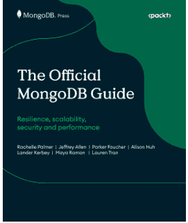

## 官方 MongoDB 指南

Rachelle Palmer, Jeffrey Allen, Parker Faucher, Alison Huh, Lander Kerbey, Maya Raman, Lauren Tran

ISBN: 978-1-83702-197-0

- 构建安全、可扩展和高性能的应用
- 为实际工作负载设计高效的数据模型和索引
- 编写强大的查询以排序、过滤和投影数据
- 通过身份验证和加密保护应用
- 使用 AI 驱动和基于 IDE 的工具加速编码
- 自信地启动、扩展和管理 MongoDB Atlas
- 解锁 Atlas Search 和 Atlas Vector Search 等高级功能
- 应用来自 MongoDB 自身工程领导者的经过验证的技术


## MongoDB 基础

ISBN: 978-1-80670-609-9

- 理解 MongoDB 的文档模型和架构
- 快速设置 MongoDB 本地部署
- 设计针对应用访问模式的模式
- 高效执行 CRUD 和聚合操作
- 使用工具优化查询性能和可扩展性
- 探索 AI 驱动的功能，如 Atlas Search 和 Atlas Vector Search

## Packt 正在寻找像您这样的作者

如果您有兴趣成为 Packt 的作者，请访问 authors.packt.com 并立即申请。我们已与数千名开发者和技术专业人士合作，就像您一样，帮助他们与全球技术社区分享见解。您可以提交通用申请、申请我们正在招募作者的特定热门主题，或提交您自己的想法。

## 分享您的想法

现在您已完成 *High Performance with MongoDB*，我们很想听听您的想法！如果您在 Amazon 购买了本书，请点击此处直接前往该书在 Amazon 的评论页面分享您的反馈，或在您购买的网站上留下评论。

您的评论对我们和技术社区都很重要，将帮助我们确保提供优质内容。

## 下载本书的免费 PDF 副本

感谢您购买本书！

您喜欢在旅途中阅读，但无法随身携带印刷书籍吗？

您的电子书购买与您选择的设备不兼容吗？

不用担心，现在每本 Packt 书籍都免费提供无 DRM 的 PDF 版本。

在任何地方、任何地点、使用任何设备阅读。直接从您喜爱的 technical 书籍中搜索、复制和粘贴代码到您的应用中。

福利不止于此，您可以每天通过收件箱独家获取折扣、新闻通讯和优质免费内容。

按照以下简单步骤获取福利：

1. 扫描二维码或访问以下链接：
2. 提交购买证明。
3. 就这样！我们会直接将您的免费 PDF 和其他福利发送到您的电子邮件。


https://packt.link/free-ebook/9781837022632


<!-- no content -->
