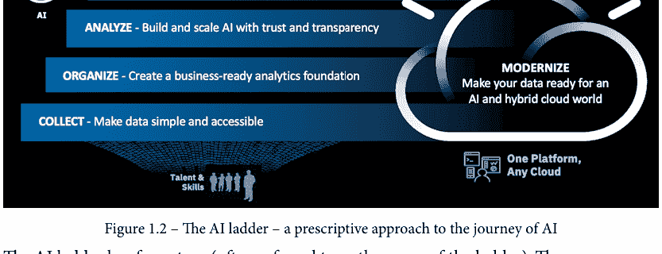
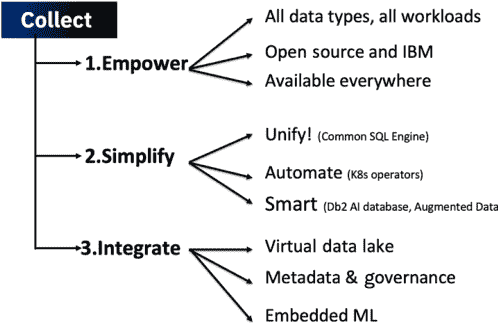
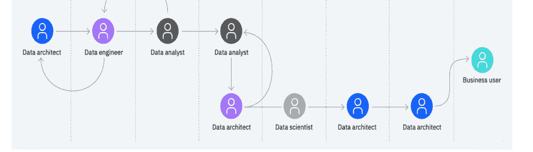
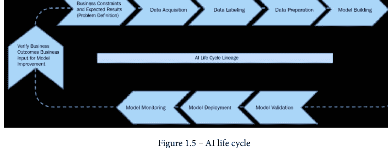
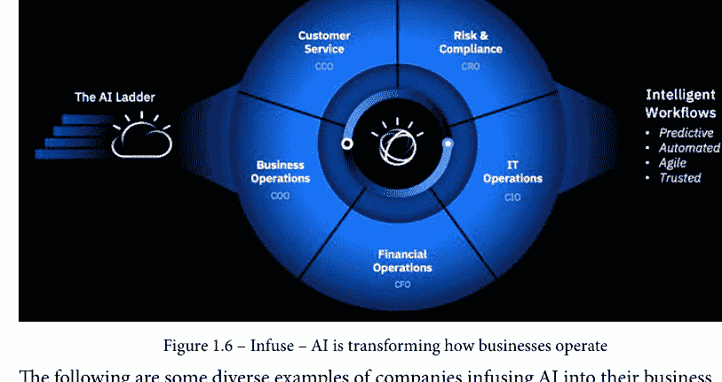
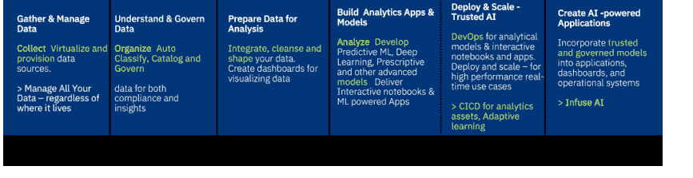
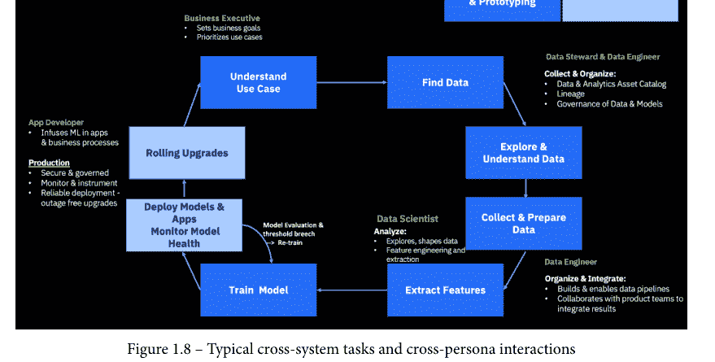

# 第 1 部分：基础知识

在本部分中，我们将了解市场趋势、数据和 AI、IBM 的产品组合、其采用 AI 的规范性方法，以及 Cloud Pak for Data 的概述。

本部分包含以下章节：

- *第 1 章，AI 阶梯：IBM 的规范性方法*
- *第 2 章，Cloud Pak for Data——简要介绍*

IBM 拥有强大的数据和 AI 产品组合，在过去 40 年中开发并收购了 100 多种产品，其中包括一些标志性产品，如 Db2、Informix、DataStage、Cognos Analytics、SPSS Modeler、Planning Analytics 等。IBM 产品组合的深度和广度使其在市场中脱颖而出。借助 Cloud Pak for Data，IBM 正在进一步强化这一差异化优势，在客户展望混合多云未来的同时，进一步简化并现代化其产品组合。

## AI 阶梯简介

我们都知道数据是企业推动更明智决策的基础。数据是推动数字化转型的动力。但正是 AI 释放了数据的价值，这就是为什么 AI 有望改变企业，到 2030 年为全球经济增加近 16 万亿美元的潜力。您可以在此处找到相关来源：https://www.pwc.com/gx/en/issues/data-and-analytics/publications/artificial-intelligence-study.html。

然而，AI 的采用速度比预期的要慢。这是因为许多企业没有有意识地努力奠定必要的数据基础，也没有投资于培养对成功至关重要的专业人才和业务流程。例如，绝大多数 AI 失败是由于数据准备和组织造成的，而不是 AI 模型本身。AI 模型能否成功，取决于您在收集和组织数据方面是否成功。业务领导者不仅需要了解 AI 的力量，还需要了解如何充分释放其潜力，并在混合多云世界中运营。

本部分旨在揭开 AI 的神秘面纱，介绍常见的 AI 挑战和失败，并提供一种统一的、规范性的方法（我们称之为“AI 阶梯”），以帮助组织释放其数据的价值并加速其 AI 之旅。

随着企业寻求利用 AI 的潜力并确定利用数据获得业务洞察的最佳方式，他们需要确保从明确定义的业务问题开始。此外，您需要使用来自不同来源的数据，支持一流的工具和框架，并在各种环境中运行模型。

根据麻省理工学院斯隆管理评论的一项研究，81% 的业务领导者（http://marketing.mitsmr.com/offers/AI2017/59181-MITSMR-BCG-Report-2017.pdf）不了解 AI 所需的数据和基础设施，“再多的 AI 算法复杂性也无法克服数据[架构]的缺乏——糟糕的数据只会让人寸步难行。”

简而言之：没有 IA（信息架构），就没有 AI。

IBM 理解客户正面临这一挑战。为此，IBM 构建了一种规范性方法（即**AI 阶梯**），帮助客户应对上述挑战并加速其 AI 之旅，无论他们目前处于哪个阶段。通过统一数据的收集、组织与分析（无论数据位于何处），该方法能够简化和自动化企业将数据转化为洞察的过程。借助 AI 阶梯，企业可以构建一种受治理、高效、敏捷且面向未来的 AI 方法。此外，它也是支撑 IBM 数据与 AI 产品组合的组织架构。

重要的是要记住，AI 并非魔法，需要深思熟虑且架构良好的方法。阶梯上的每一步对于成功应用 AI 都至关重要。

### AI 阶梯的各级阶梯

下图展示了 IBM 的规范性方法，即 **AI 阶梯**：

图 1.2 – AI 阶梯——AI 之旅的规范性方法

AI 阶梯包含四个步骤（通常称为阶梯的*梯级*），具体如下：

- **1. 收集：让数据简单且可访问。** 收集所有类型的数据，无论其位于何处，以便在不断变化的数据源面前保持灵活性。
- **2. 组织：创建业务就绪的分析基础。** 将所有客户数据组织成一个可信、业务就绪的基础，并具备内置的治理、质量、保护与合规能力。
- **3. 分析：以信任和可解释性构建并扩展 AI。** 以更智能的方式分析客户数据，并借助 AI 模型使客户团队获得新洞察，做出更好、更明智的决策。
- **4. 注入：将 AI 在整个业务中落地运营。** 这应在多个部门和各种流程中开展，利用预测、自动化和优化实现。制定有效的 AI 战略以实现您的 AI 业务目标。应用 AI 来自动化和优化业务中的现有工作流，让员工专注于更高价值的任务。

贯穿 AI 阶梯四个步骤的是 IBM **现代化**（Modernize）理念，它允许客户简化和自动化将数据转化为洞察的方式。该理念在名为 Cloud Pak for Data 的多云数据平台中统一了数据的收集、组织和分析。

IBM 的方法始于一个简单的理念：随处运行。这是因为该平台可以部署在客户选择的基础设施上。IBM 支持在各大主流云平台上部署 Cloud Pak for Data，包括 Google、Azure、AWS 和 IBM Cloud。您也可以将 Cloud Pak for Data 平台部署在本地数据中心，这对于关注混合云战略的客户尤其重要。

IBM 之所以能在所有这些基础设施上支持 Cloud Pak for Data，是因为其核心采用了 **Red Hat OpenShift**。这是 IBM 于 2019 年收购 Red Hat 的关键原因之一。其意图是借助全球领先的开源守护者 Red Hat，为客户提供跨任何基础设施进行扩展的灵活性。OpenShift 是一个基于 Kubernetes 的平台，使 IBM 能够通过现代化的容器模型部署所有产品。本质上，所有能力都被重新架构为微服务，从而可以根据企业需求按需配置。

既然我们已经介绍了 AI 阶梯和 IBM Cloud Pak for Data 平台的概念，现在让我们花些时间关注 AI 阶梯的各个梯级，以及 IBM 使其脱颖而出的能力。

### 收集——让数据简单且可访问

收集层是将数据放入适当的持久化存储中，以便高效地收集和访问所有数据资产。一个架构良好的“收集”梯级能让组织根据用例和用户角色选择合适的数据存储；无论是用于数据科学家探索数据的 Hadoop、用于通过商业智能或其他企业可视化工具交付运营报告的 OLAP、用于快速应用开发的 MongoDB 等 NoSQL 数据库，还是它们的某种组合，您都可以借助通用 SQL 引擎以统一、集成的方式灵活实现。

图 1.3 – 收集——让数据简单且可访问

我们全部支持“收集”梯级的能力组合，可分为市场上的四大工作负载领域：

- 1. 首先是**运营数据库**。这是您的记录系统、销售点系统和事务数据库。
- 2. 随着数据量的爆炸式增长，**分析数据库**需求旺盛。每个人都在寻找新的方法，以快速、大规模地分析数据——从传统报告到为 AI 模型的训练和评分准备数据。
- 3. **大数据**。使用 Hadoop 构建 PB 级数据湖的历史正逐步转向存储与计算分离，Cloud Object Storage 和 Spark 在其中扮演关键角色。市场对数据湖的需求显然在上升。
- 4. 最后，**IoT** 正在迅速改变多个行业，快速数据领域正成为一个备受关注的领域。这是未来的市场，IBM 正通过实时数据分析来满足这一领域的需求。

接下来，我们将探讨组织数据的重要性及其内涵。

### 组织——创建可信的分析基础

鉴于数据处于 AI 的核心位置，组织需要关注数据的质量和治理，确保数据准确、一致且可信。然而，许多组织在开发数据管道和数据流时，难以简化其运营模式。

#### 赋能数据公民的人员

现代企业由许多不同的“数据公民”组成——从首席数据官；到数据科学家、分析师、架构师和工程师；再到需要从数据中获取洞察的各个业务线用户。“组织”梯级旨在创建并维持一种数据驱动文化，促进跨组织协作，以推动敏捷性和规模化。

每个组织都有独特的需求，IT、数据科学和业务线的利益相关者需要创造价值以推动业务成功。此外，由于治理是支持 DataOps 的驱动力之一，组织可以利用现有的数据治理委员会和资深数据治理项目的经验，帮助建立这种文化和承诺。

DataOps 的好处意味着，一旦企业实施正确的技术并开发自助式数据能力，将高质量、可信的数据尽快提供给合适的人员和流程，业务就能更高效地运转。下图展示了一个 DataOps 工作流的可能形态：架构师、工程师和分析师协作处理基础设施和原始数据剖析；分析师、工程师和科学家协作构建分析模型（无论这些模型是否使用 AI）；架构师与业务用户协作，将这些模型投入运营、治理数据，并将洞察传送到需要的地方。

每个角色中的个人都被指定为特定数据子集的**数据管家**。DataOps 方法论中数据公民的意义在于，每个不同角色都可以依赖准确、全面、安全且受治理的数据：

图 1.4 – 按角色划分的 DataOps 工作流

另外，值得指出的是，构建 AI 模型是容易的部分。真正的挑战在于将这些 AI 模型部署到生产环境，监控其准确性和漂移检测，并确保这成为常态。

IBM 在 Cloud Pak for Data 上的 AI 工具和运行时提供了一套差异化且极其强大的能力。在 Red Hat OpenShift 和 Cloud Pak for Data 战略的支持下，IBM 有能力设定并引领 AI 工具市场。市场上来自利基供应商的单一 AI 解决方案很多，这一点在众多分析师报告中可见；然而，没有一家能够以令人满意的方式解决将 AI 投入生产的问题。IBM 带给市场的差异化优势是完整的端到端 AI 生命周期：

图 1.5 – AI 生命周期

客户寻求集成平台有几个原因。在提及这些原因之前，以下团队关注集成平台：

- 1. 数据科学团队正在寻找集成系统，以管理整个 AI 生命周期和跨项目团队成员的各种资产。
- 2. 首席数据官希望治理 AI 模型及其相关数据。首席风险官（CRO）希望通过与业务流程集成来控制这些模型带来的风险。
- 3. 扩展的 AI 应用团队需要集成，以便无缝构建、部署和运行。在某些情况下，首席信息官（CIO）/业务技术团队负责交付平台，他们希望降低 AI 应用投入生产的风险并削减成本。

### 客户用例

一家美国财富500强银行正在寻找一种解决方案，以便快速将机器学习项目部署到生产环境。这项工作的第一步是建立一种机制，使项目团队能够在不必经历完整的风险管理流程（来自企业风险/MRM团队）的情况下交付试点项目。他们称之为“软启动”，该机制将使用部分生产数据。项目从概念化到试点完成的时间线为6至9个月。这一需求由业务技术团队（负责AI运营门户）牵头推动（并需要在全银行范围内交付）。其理念是，这将减轻MRM人员的工作负担，因为他们已经应接不暇，但仍能清晰了解风险是如何被评估的以及评估了哪些风险。业务部门将每周使用该解决方案重新训练模型。然而在此之前，他们会上传CSV文件，检查任何实时响应，并推送数据以验证模型是否达到战略目标。所有这些过程都必须自动记录。

IBM AI生命周期的关键差异化优势之一是AutoAI，它允许数据科学家创建多个AI模型并对其准确性进行评分。其中一些测试不应该是非黑即白的。

一些客户已经开始自动化AI开发。因此，出现了以下问题：为什么要自动化模型开发？因为如果你能自动化AI生命周期，就能提高成功率。

自动化AI生命周期可以让你实现以下目标：

- **扩大人才库**：这降低了对构建和运营AI模型所需技能的要求。
- **加快交付时间**：通过减少繁琐任务来实现。
- **提高AI驱动应用的就绪度**：通过优化模型准确性和KPI来实现。
- **提供实时治理**：通过确保模型管理、治理、可解释性和版本控制来提升信任度和透明度。

接下来，我们将探讨AI如何在企业中实现运营化，以解决特定用例并推动业务价值。

### 融入——在整个业务中实现AI运营化

构建洞察和AI模型是很好的第一步，但除非你将它们融入业务流程并优化结果，否则AI只是另一种花哨的技术。那些基于数据驱动洞察实现业务流程自动化的公司，已经颠覆了那些尚未这样做的公司——零售领域的亚马逊就是典型例子，它通过利用数据、分析和AI来简化运营并获得竞争优势，颠覆了许多传统零售商。关键之处在于将技术与文化相结合，并确保员工拥抱AI并将其融入日常决策：

图1.6——融入——AI正在改变企业的运营方式

以下是一些公司将AI融入其业务流程的多样化示例。这些示例按五大关键主题进行组织：

- 客户服务（业务负责人：CCO）：客户关怀自动化、客户360、客户数据平台。
- 风险与合规（业务负责人：CRO）：治理风险与合规。
- IT运营（业务负责人：CIO）：自动化并优化IT运营。
- 财务运营（业务负责人：CFO）：多维度的预算编制与优化。
- 业务运营（业务负责人：COO）：供应链、人力资源管理。

#### 客户服务

随着聊天机器人驱动的自动化和客户360度视图变得越来越重要，客户服务每天都在发生变化。虽然IBM在多个方面都有持续的投资，但最为突出的是IBM的*Watson Anywhere*计划，该计划允许客户以折扣价购买Cloud Pak for Data的Watson服务（Assistant、Discovery和API Kit），并完成部署。

> **客户用例**
> 
> 一家提供移动、电信和CRM解决方案的科技公司正面临着对智能呼叫中心的巨大需求，并投资于IBM Cloud Pak for Data上的AI语音助手。其目标是自动处理客户的查询，减少对人工客服的需求。只有在需要详细咨询时才会发生人工交互。这将呼叫中心员工解放出来，使他们能够专注于更复杂的查询，而不是处理重复性任务，从而提高了整体运营效率和客户服务质量，更不用说降低了间接成本。这使得构建智能呼叫中心变得更简单、更快速，且运营成本更低。在其他技术中，该解决方案使用了Watson Speech to Text，它将语音转换为文本，帮助理解问题的上下文。这使得AI语音助手能够在客户咨询的上下文中快速提供最佳答案。

#### 风险与合规

风险与合规是一个宽泛的话题，各公司都在努力确保其流程的合规性。除了治理风险与合规之外，你还需要关注大型银行面临的财务风险。IBM提供了一系列开箱即用的解决方案，如OpenPages、Watson Financial Crimes Insight等，这些解决方案与AI治理相结合，不仅能应对监管挑战，还能加速AI采用，从而带来显著价值。

#### IT运营

随着IT基础设施持续呈指数级增长，没有理由相信它会在短期内减少。相反，IT基础设施运营的复杂性并非一项简单任务，需要使用AI来自动化运营并主动识别潜在风险。挖掘数据以预测和优化运营是AI的关键用例之一。IBM在Cloud Pak for Data平台上有一个名为**Watson AIOps**的解决方案，该方案专门针对这一特定用例而构建。

#### 财务运营

预算编制和预测通常涉及多个利益相关者跨企业协作，以得出一个稳定的答案。然而，这不仅仅是空谈。IBM在Cloud Pak for Data上的Planning Analytics解决方案是一个规划、预算、预测和分析解决方案，可帮助企业自动化基于手动电子表格的流程，并将财务计划与运营策略联系起来。

IBM Planning使用户能够直接从数据中自动发现洞察，并借助IBM Watson的预测能力推动决策。它还集成了计分卡和仪表板来监控KPI，并通过各种可视化方式传达业务结果。

#### 业务运营

业务运营涉及多个领域，包括供应链管理、库存优化、人力资源管理、资产管理等。使用Cloud Pak for Data平台开发的洞察和AI模型可以轻松应用于各自的领域。有几个客户使用IBM解决方案的示例。

> **客户用例**
> 
> *一家知名的北美医疗保健公司试图解决一个独特的挑战。他们使用AI来主动识别并优先处理高风险脓毒症患者。这需要一个集成平台，能够跨不同数据孤岛管理数据，以大规模构建、部署和管理AI模型，同时确保信任和治理。借助Cloud Pak for Data，该公司在6周内构建了一个解决方案，而这通常需要花费12个月的时间。这带来了预计每位患者约4.8万美元的成本节省，这是一个显著的价值。*

数字转型正在颠覆我们的全球经济，并将给我们的生活、学习、工作和娱乐方式带来巨大变化；在许多情况下，这将加速我们在各行业看到的趋势。这也适用于未来的数据、分析和AI工作负载管理方式。那些主动抓住机遇，精简、整合并改造其架构的企业，将在应对短期干扰和面向不断演变且敏捷的未来进行现代化改造方面走在前列。IBM对AI阶梯的规范化方法植根于一个简单而有力的信念：强大的信息架构是成功采用AI的关键。它为企业提供了规模化采用AI的组织结构。

### 数据与 AI 平台的案例

在上一节中，我们介绍了 IBM 将 AI 运营化到企业的规范化方法，从简化数据访问开始，并将数据组织成用于高级分析和 AI 的可信基础。现在，让我们看看如何将其变为现实。

从实施角度来看，行业中存在许多现成且成熟的产品，有些来自 IBM 或其合作伙伴，有些来自竞争对手。然而，让所有这些现有产品无缝协同工作存在显著的额外开销。当涉及到混合云情况时，情况也会变得困难。并非每个企业都拥有将不同的系统集成以使终端用户能够协作并快速交付价值所需的 IT 专业知识。可靠地、安全地运营此类不同的系统也会拉伸 IT 预算，并引入如此多的复杂性，以至于分散了企业及时且以成本效益的方式实现其业务目标的注意力。

因此，需要一个数据与 AI 平台，提供标准化的技术栈并确保运营的简易性。下面的图表显示了企业通常需要什么来使能 AI 并从其数据中获得全部价值。它还显示了典型企业中的不同角色，具有不同的角色、职责和技能水平，所有这些都需要紧密协作以实现可信 AI 的承诺：

图 1.7 – 孤岛阻碍了企业中 AI 的运营化

大多数企业的数据会分散在多个数据源中，部分在本地，部分在公有云中，通常格式各不相同。企业将如何以安全的方式使其所有有价值的数据可供其数据科学家和分析师使用？如果数据科学工具和框架无法就地、规模化地使用数据，它们甚至可能需要构建额外的昂贵数据集成和转换管道，以及将数据存储在新的数据仓库或数据湖中。如果管理员无法轻松地在所有使用中的数据上定义数据访问策略，确保敏感数据被屏蔽或混淆，从安全和合规的角度来看，将数据用于高级分析和 AI 将变得不安全（甚至非法）。

下面的图表进一步扩展了不同系统需要集成的需求，以及用户需要密切协作。它从领导者设定使用 AI 技术解决的业务问题的期望开始。请注意，这些系统和任务涵盖了企业的开发和运营生产方面：

图 1.8 – 典型的跨系统任务和跨角色交互

该流程也是循环的，因为系统需要考虑反馈并有明确的方式衡量实施是否达到了所述目标。如果数据消费者无法了解数据的质量或无法确保数据不是过时的，任何基于此类数据构建的 AI 始终会受到怀疑，因此会带来更大的风险。从根本上说，缺乏将所有这些系统联系在一起的基础设施会使实施 AI 阶梯实践变得复杂，或者在某些情况下变得不可能。所需的是一个可靠、可扩展且现代的 **数据与 AI 平台**，它可以打破这些孤岛、轻松集成系统，并使不同用户角色之间能够协作，甚至通过单一的集成体验。

### 总结

在本章中，你了解了市场动态和 IBM 的数据与 AI 产品组合，了解了 IBM 的 AI 规范化方法，即 *AI 阶梯* 的概述，并了解了 IBM 方案如何映射到阶梯的不同层级。在下一章中，我们将全面介绍 Cloud Pak for Data，IBM 的数据与 AI 平台，使企业能够以模块化方式在任何地方实施 *AI 阶梯*，同时利用现代云原生框架。

### 数据与 AI 平台的案例 – 回顾

在上一章中，我们介绍了 IBM 将数据与 AI 运营化到企业的规范化方法，随后向你介绍了 Cloud Pak for Data 的广泛功能。在本节中，我们将概述 Cloud Pak for Data 如何推动 AI 阶梯实践在你企业中的实施。

Cloud Pak for Data 作为一个开放平台，打破了不同产品之间的孤岛，使其能够作为云原生服务在同一 OpenShift Kubernetes 平台之上实现。Cloud Pak for Data 使此类服务能够通过通用控制平面轻松集成，并且重要的是，为终端用户提供个性化、集成的用户体验，以便他们自然协作，而甚至意识不到产品或服务边界。

在这一平台上，诸如数据虚拟化等功能有助于为混合云现代化数据访问，并且数据可以轻松地在云之间就地访问。数据目录和治理服务可以依托数据虚拟化和其他数据源，提供更广泛的受管数据访问平面解决方案，这反过来又促进了向数据科学、分析报告和机器学习服务提供的数据的信任。在同一平台上，运营团队可以大规模部署 ML 模型，实现带偏见检测的模型监控，以支持持续的模型演进。

开发、实验和生产部署可以在同一平台上得到支持，促进具有不同角色和职责的用户团队之间的协作。身份验证和授权在控制平面中定制以符合企业法规，使跨所有服务的无缝访问成为可能。一致的 API 和用户组、API 密钥和令牌等概念使以标准方式开发自定义应用程序和解决方案成为可能。

管理和运营通过由 Red Hat OpenShift Kubernetes 驱动的操作符得到简化。部署在本地和公有云基础设施之间的可移植性得到保证，使其在需要时能够爆发到云中。云原生实践使企业应用程序和解决方案的持续交付和集成成为可能。安全控制和运营审计内置于平台中，以确保企业遵守合规要求。在同一组共享计算资源上部署和管理多个租户，也使 Cloud Pak for Data 对企业来说更具成本效益。
