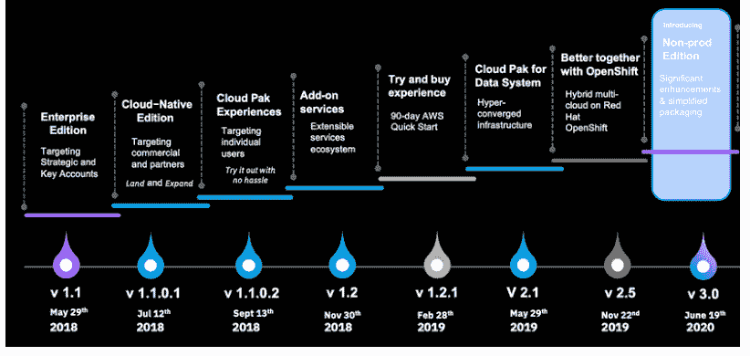

## Cloud Pak for Data 概述

在第 1 章《AI 阶梯：IBM 的规范化方法》中，你被介绍到 IBM 的 AI 采用规范化方法论，即 AI 阶梯，以及企业如何通过 IBM 的现代多云数据与 AI 平台 Cloud Pak for Data 采用这一框架。管理数据、分析和 AI 服务的集成平台的概念并不新鲜——一直以来都存在对跨 AI 阶梯不同层级的端到端方案的需求。企业通过定制集成来满足这一需求，通常会利用全球咨询组织提供资源和专业知识。

随着公有云和面向服务的架构的出现，采购预集成软件平台现在已变得司空见惯。这些平台在仍提供满足特定业务需求的灵活性的同时，最大限度地减少了集成工作。

Cloud Pak for Data 于 2018 年 5 月 29 日推出，利用 Kubernetes 技术，这使得平台能够部署在任何公有云和/或企业数据中心的私有云上。这使客户能够利用云原生优势，例如轻松配置、扩展、简化管理和无缝升级，同时坚持其选择的<|message|> 基础设施：私有云或任何公有云，如 AWS、Azure 或 IBM Cloud。还值得强调的是，支撑该平台的数据与 AI 服务已在过去几十年中被数千家企业客户检验和测试。因此，虽然集成平台是新颖且现代的，但其背后的能力和功能已在规模上得到验证。这对于企业客户至关重要，因为他们在寻求现代化其数据与 AI 工作负载时，无法承担冒险投资的风险。下面的图表说明了自推出以来 Cloud Pak for Data 的各个版本：

图 2.1 – IBM Cloud Pak for Data 之旅：自推出以来 8 个版本

现在，让我们探讨 Cloud Pak for Data 的关键差异化优势，以及企业使用它的典型用例模式。

### 探索独特的差异化优势、关键用例与客户采纳情况

Cloud Pak for Data 为客户提供了一个单一平台，拥有丰富的模块化数据与 AI 服务生态，带来简洁性、对变化的快速适应能力，并减少对专业化和稀缺技能的依赖。与我们看到的大多数客户/企业所使用的数据库、数据运维、数据科学、数据分析和可视化等众多孤立工具的组合不同，Cloud Pak for Data 是所有数据与 AI 服务的一个统一运营架构。其结果是令人愉悦的统一体验、通过自动化手动繁琐任务而实现的成本降低，以及强化的数据治理和安全性。

Cloud Pak for Data 是一种以混合云数据与 AI 平台解决复杂业务问题的新方式，可在任何地方运行。

以下是该平台的独特差异化优势：

- **统一体验：** 端到端集成平台提升了生产力，同时支持不同角色和职能部门之间的协作。

- **自动化：** 利用 AI 自动化许多任务，例如构建模型（AutoAI）、发现和编目数据集（数据发现）等。

- **治理与安全性：** 这一点贯穿整个平台，是一个重要的差异化优势。数据治理确保客户满足合规要求并实现自助式分析，而 AI 治理则注入信任，推动企业内部 AI 项目的采用，同时满足监管合规的需求。

- **随处部署：** Cloud Pak for Data 可运行在任何公有云或私有云上，并连接各处数据。这为企业提供了灵活性和基础设施选择，避免供应商锁定（*如果将来需要，可独立地将工作负载迁移到其他云提供商*）。

现在，让我们探讨 Cloud Pak for Data 的几个关键用例。

#### 关键用例

以下是 Cloud Pak for Data 的一些关键用例：

- **AI 生命周期：** 数据科学团队正在寻找集成系统来管理 AI 生命周期中的资产，而企业**首席数据官（CDOs）**希望确保 AI 模型及其相关数据集的治理。Cloud Pak for Data 支持端到端的 AI 生命周期，从数据准备到构建和部署模型，再到大规模管理模型，同时始终确保数据和 AI 模型的治理。企业可以获得集成体验、自动化，以及 AI 治理的好处，包括偏差检测、可解释性、模型公平性和漂移检测：

| | |
|---|---|
| “AI Ladder”主题 | *组织* *分析* |
| “Cloud Pak for Data” 服务 | *Watson Knowledge Catalog* *Watson Studio* *Watson Machine Learning* *Watson OpenScale* |

图 2.2 – AI 生命周期

- **数据现代化：** 企业正面临数据激增的问题，数据分布在多个孤岛、数据库和云中。Cloud Pak for Data 通过受治理的数据虚拟化解决了这一问题，支持实时自助访问数据。它还包括一套全面的能力，用于跨所有企业数据源大规模发现、准备、转换、治理、编目和访问数据。

| | |
|---|---|
| “AI Ladder”主题 | *收集* *组织* |
| “Cloud Pak for Data” 服务 | *Watson Knowledge Catalog* *Data Virtualization* *Big SQL（可选）* *数据存储 – Db2、MongoDB、PostgreSQL（可选）* |

图 2.3 – 数据现代化

- **客户服务 AI：** 自动化客户服务是 AI 在企业中的关键用例之一。Watson 除了其他功能外，还帮助缩短解决时间和呼叫量，并提高客户满意度。**Watson Assistant（WA）** 可通过 Web/移动或语音渠道为客户或员工提供 AI 驱动的自动化协助，并使人工客服能够更好地处理客户咨询。**Watson Discovery（WD）** 补充了 Watson Assistant，可帮助从复杂业务内容（手册、合同和扫描的 PDF）中解锁洞察：

| | |
|---|---|
| “AI Ladder”主题 | *注入* |
| “Cloud Pak for Data” 服务 | *Watson Assistant* *Watson Discovery（可选）* |

图 2.7 – 客户服务 AI

#### 客户用例：AI 申领处理

一个欧洲政府机构拥有数千名直接参与福利申领处理的员工。该员工队伍正在老龄化和退休，导致客户缺乏能够处理福利申领的熟练员工。

因此，该机构决定创建一个福利平台，并尝试使用基于 IBM Cloud Pak for Data 和其他产品的 AI 解决方案进行申领处理。鉴于这是一个政府机构，解决方案需要在本地部署，这限制了可用选项。

Cloud Pak for Data 中的 AI 生命周期服务（Watson Studio 和 Watson Machine Learning）被用于为福利申领流程创建机器学习模型。该项目的收益包括福利申领流程中的成本节约、速度和质量的提升。

#### 客户用例：数据与 AI 平台

一家《财富》500 强金融服务公司在成为数据驱动型企业的道路上遇到了三个主要问题。他们的数据遍布整个企业——有些在 Hadoop 中，有些在 SQL 中，有些在 Excel 电子表格中——而且很难轻松访问。他们没有企业数据治理策略，因此**没有统一的定义集**，也没有人知道数据的健康状况或其来源。

Cloud Pak for Data 是一个开放平台，融合了专有、第三方和开源内容的良好组合，我们将在下面探讨。

#### 开放的生态系统

Cloud Pak for Data 是一个开放且模块化的平台，允许客户部署他们所需的服务。该平台的亮点之一是其充满活力的生态系统，包括 IBM 服务（进一步分为基础版和高级版）、第三方服务、行业加速器和开源内容。

以下服务构成了 Cloud Pak for Data 基础平台：

- **Db2 Warehouse：** 一个为高性能和数据库内分析而设计的数据仓库。可在单节点上运行以提高成本效率，或在多节点上运行以提高性能。

- **Data Virtualization：** 利用 IBM 的专利技术构建，Data Virtualization 能够实时访问来自不同数据源的分布式数据，而无需物理移动数据。此外，查询被优化为在数据所在位置运行，从而缩短响应时间。

- **Db2 EventStore：** 一种为事件驱动应用快速摄取和分析流式数据而设计的数据存储。

- **Streams：** 通过将流式数据和存储数据与分析相结合，构建推动实时业务决策的解决方案。

- **Watson Knowledge Catalog：** 快速找到正确的数据。使用智能推荐和用户评价发现相关、经过整理的数据资产。

- **IBM Regulatory Accelerator：** 简化遵守法规的流程。

- **Watson Studio：** 包含三个关键组件，如下所示：
  - **构建：** 构建自定义模型，将 AI 和机器学习注入你的业务。该组件涵盖 Watson Studio 中的模型开发能力（AutoAI 是关键差异化优势之一）。
  - **部署：** *Watson Studio 中的模型部署能力*（前身为 Watson Machine Learning）。大规模地将机器学习模型部署到生产环境中。
  - **信任：** Watson Studio 中的可信 AI 能力，包括可解释性、偏差和漂移检测（前身为 Watson OpenScale）。为你的 AI 注入信任和透明度，了解你的 AI 模型如何做出决策，以检测并缓解偏差。

- **SPSS Modeler**：创建流程以准备和混合数据、构建和管理模型，并可视化结果。
- **Decision Optimization**：评估所有可能的场景并识别任何给定问题的最优解决方案。
- **Data Refinery**：简化准备大量原始数据以进行分析的过程。
- **Cognos Dashboard Embedded**：通过复杂的视觉效果识别数据中的模式——无需编码。
- **Analytics Engine for Apache Spark**：自动启动轻量级、专用的 Apache Spark 集群以运行各种工作负载。
- **Open Source Management**：让开发人员和数据科学家轻松找到并访问已批准的开源软件包。
- **Netezza Performance Server**：仅在定义的部署选项上可用的 Netezza 数据仓库（Cloud Pak for Data 系统、AWS）。
- **Match 360 with Watson**：主数据的只读副本，使客户能够通过 RESTful API、平面文件或在线方式在企业范围内扩展。AI 驱动的匹配引擎有助于将来自多个来源的数据合并为单一事实来源。
- **Db2 Data Gate**：提取、加载和同步任务关键的 Db2 for z/OS 数据，用于高容量事务或分析应用程序。

### Premium IBM cartridges and third-party services

下表显示了在 Cloud Pak for Data 平台上运行的优质 IBM 服务（也称为 cartridges），其定价和打包方式是单独的。它们主要分为两类：

- 具有重要安装基础的服务：
  - a. **Db2 AESE**：一种关系数据库，为事务性工作负载提供高级数据管理和分析功能。
  - b. **DataStage**：通过集成、转换以及以批处理和实时方式交付数据，将数据在正确的时间交付到正确的位置。
  - c. **Cognos Analytics**：自助式分析，融入 AI 和机器学习，使您能够创建令人惊叹的可视化效果，并通过仪表板和报告分享您的发现。
  - d. **Information Server**：获取此高度可扩展且灵活的数据集成解决方案，可处理大规模数据量。
  - e. **Planning Analytics**：使用来自您业务各处的数据轻松创建更准确的计划、预算和预测。
  - f. **Master Data Management**：授权业务和 IT 用户协作并利用可信的主数据进行创新。建立数据的单一视图并使用户能够提供更好的业务洞察。
  - g. **Open Pages**：借助集成治理风险和合规解决方案，利用 Watson AI 和高级分析提高运营效率并降低成本。

- 诞生于云且没有先前本地部署的服务：
  - a. **Watson Assistant**：为任何应用程序、设备或渠道构建对话界面。
  - b. **Watson Discovery**：在复杂的业务内容中查找答案并发现见解。
  - c. **Watson API Kit**：包括 Watson Text to Speech、Speech to Text、Watson Knowledge Studio、Watson Language Translator 等。
  - d. **Watson Financial Crimes Insights**：借助 AI 和监管专业知识简化检测和缓解金融犯罪的过程。
  - e. **Open Data for Industries**：提供数据平台的参考实现，支持收集和治理石油和天然气数据的行业标准方法，并将该数据提供给各种应用程序和服务。它有助于集成数据孤岛并简化利益相关者的数据访问。

Cloud Pak for Data 还附带了许多免费的加速器和数据集，客户可以用作起点。我们将在下一节详细介绍。

### Industry accelerators

IBM 提供的行业加速器是一组工件，可帮助您解决常见的业务问题。每个行业加速器旨在帮助您解决特定的业务问题，无论是在银行业防止信用卡欺诈还是优化联系中心的效率。

所有加速器都包括一个业务术语表，其中包含数据治理的术语和类别。术语和类别为加速器提供意义，并充当加速器的信息架构。

一些加速器还包括示例项目，其中包含分析数据、构建模型和显示结果所需的一切。示例项目包括**详细说明、数据集、Jupyter notebooks、模型和 R Shiny 应用程序**。示例项目可作为数据科学需求的模板，用于学习特定技术或展示 Cloud Pak for Data 中 AI 和分析服务的 capabilities。

以下是随 Cloud Pak for Data 提供的一些行业加速器：

- **Cross-Industry：**
  - **Contact Center Optimization：**通过描述和表征您的联系中心数据，提高客户联系中心的生产率。
  - **Customer 360 Degree View：**通过表征客户细分、信用风险、忠诚度、社交媒体情绪等特征，全面了解您的客户。
  - **Emergency Response Management：**优化扫雪车的路线和部署。

- **Banking and Financial：**
  - **Credit Card Fraud：**快速检测信用卡欺诈以减少财务损失并保护您和您的客户。
  - **Customer Attrition Prediction：**了解您的客户为何离开。
  - **Customer Life Event Prediction：**通过在正确的时间提供正确的优惠，为客户的财务健康提前规划。
  - **Customer Offer Affinity：**为新老客户识别合适的金融产品和投资机会。
  - **Customer Segmentation：**通过识别行为模式轻松区分客户细分。
  - **Loan Default Analysis：**识别贷款组合中的潜在信用风险。

- **Energy and Utilities：**
  - **Demand Planning**：管理热系统以根据预期需求和能源发电量生产准确的能源量。
  - **Utilities Customer Attrition Prediction**：了解您的客户为何离开。
  - **Utilities Customers Micro-Segmentation**：根据生活方式和参与行为将公司的客户划分为小群体。
  - **Utilities Demand Response Program Propensity**：确定应针对哪些客户进行需求响应计划的注册。
  - **Utilities Payment Risk Prediction**：识别本计费周期最有可能错过付款的客户。

- **Healthcare：**
  - **Healthcare Location Services Optimization**：确定患者为获得优质医疗保健愿意旅行的距离。

- **Insurance：**
  - **Insurance Claims**：更高效地处理保险索赔以节省时间和金钱。

- **Telco：**
  - **Intelligence Maintenance Prediction**：通过在恰当的时间安排维护来降低成本。
  - **Telco Churn**：预测给定客户取消会员或订阅的倾向，并推荐可能有助于留住客户的促销和优惠。

- **Manufacturing：**
  - **Manufacturing Analytics with Weather**：使用机器学习模型和 The Weather Company 数据集帮助您了解天气对故障率的影响，并识别可节省时间和金钱的措施。

- **Retail：**
  - **Retail Predictive Analytics with Weather**：使用机器学习模型和 The Weather Company 数据帮助您了解零售库存经理、营销人员和零售销售规划者如何快速确定商店、产品和天气条件的最佳组合，以最大化收入提升、了解应保留什么库存、将营销优惠发送到何处，或提供未来的财务展望。

**使用 The Weather Company 数据进行销售预测：** 使用机器学习模型和 The Weather Company 数据，帮助您预测天气状况如何影响业务绩效，例如预期销售额。下表更详细地描述了所有这些内容：

| 类别 | 描述 |
|---|---|
| 跨行业 | 联络中心优化：通过描述和刻画联络中心数据，提高客户联络中心的生产力。 |
| 银行与金融 | 信用卡欺诈：快速检测信用卡欺诈，减少财务损失，保护您和您的客户。 |
| 跨行业 | 360度客户视图：通过刻画以下方面获得客户的完整视图： 客户细分 信用风险 忠诚度 社交媒体情绪 |
| 银行与金融 | 客户流失预测：发现客户流失的原因。 |
| 银行与金融 | 客户人生事件预测：通过在正确的时间提供正确的报价，提前规划客户的财务健康。 |
| 银行与金融 | 客户产品偏好识别：为新老客户识别合适的金融产品和投资机会。 |
| 银行与金融 | 客户细分：通过识别行为模式轻松区分不同客户群体。 |
| 能源与公用事业 | 需求规划：管理热力系统，根据预期需求和能源发电量产生准确的能源量。 |
| 跨行业 | 应急响应管理：优化除雪车的路线和部署。 |
| 医疗保健 | 医疗保健位置服务优化：确定患者为获得优质医疗保健而愿意旅行的距离。 |
| 保险 | 保险理赔：更高效地处理保险理赔，以节省时间和金钱。 |
| 电信 | 智能维护预测：通过在恰当的时间安排维护来降低成本。 |
| 银行与金融 | 贷款违约分析：识别贷款组合中的潜在信用风险。 |
| 制造业 | 结合天气的制造业分析：使用机器学习模型和 The Weather Company 数据，帮助您了解天气对故障率的影响，并确定可以采取哪些行动来节省时间和金钱。 |
| 零售 | 结合天气的零售预测分析：使用机器学习模型和 The Weather Company 数据，帮助您了解零售库存经理、营销人员和零售销售规划人员如何快速确定门店、产品和天气条件的最佳组合，以最大限度地提升收入，知道库存中应保留什么、在哪里发送营销优惠，或提供未来的财务展望。 |
| 零售 | 使用 The Weather Company 数据进行销售预测：使用机器学习模型和 The Weather Company 数据，帮助您预测天气状况如何影响企业绩效，例如预期销售额。 |
| 电信 | 电信客户流失：预测特定客户取消会员资格或订阅的倾向，并推荐可能有助于留住客户的促销和优惠。 |
| 能源与公用事业 | 公用事业客户流失预测：发现客户流失的原因。 |
| 能源与公用事业 | 公用事业客户微观细分：根据生活方式和参与行为将公司客户划分为小的群体。 |
| 能源与公用事业 | 公用事业需求响应计划倾向：识别哪些客户应作为需求响应计划的招募目标。 |
| 能源与公用事业 | 公用事业付款风险预测：识别哪些客户最有可能在本计费周期内错过付款。 |

图 2.9 – 使用 The Weather Company 数据进行销售预测

现在，让我们来了解一下 Cloud Pak for Data 的打包和部署选项。

### 打包和部署选项

Cloud Pak for Data 可通过以下三种部署选项获得：

- 可在任何公有云上部署和管理，或作为本地私有云部署和管理的 Cloud Pak for Data 软件
- Cloud Pak for Data System，一种超融合系统（在单个集群中包含计算、虚拟化、存储和网络），具有优化的硬件和软件
- 由 IBM 在 IBM Cloud 上管理的 Cloud Pak for Data“即服务”，提供真正的 SaaS 体验

Cloud Pak for Data 软件有三个版本：

- 企业版
- 标准版
- 非生产版

虽然这三个版本之间没有功能差异，但标准版具有可扩展性限制，而非生产版只能用于开发和 QA 部署。

### Red Hat OpenShift

**OpenShift** 是一个允许企业运行容器化应用程序和工作负载的平台，底层由 Kubernetes 驱动。OpenShift 的核心是由大量开发者和提交者社区贡献的开源软件支撑的。因此，市场上有不同版本的 OpenShift。真正驱动 OpenShift 的开源项目称为 **Origin Kubernetes Distribution（OKD）**，您可以免费使用它。另一方面，OpenShift Container Platform 是 Red Hat 的商业版本，附带 Red Hat 支持，使您的应用程序和工作负载能够部署到任何公有云或私有云上。

#### 什么是 Kubernetes？

如今的应用程序越来越多地构建为离散的功能组件，每个组件都可以作为容器交付。这实现了抽象、敏捷开发和可扩展部署。然而，这也意味着每个应用程序都有更多需要管理的部分。为了大规模处理这种复杂性，我们需要一个策略驱动的编排平台，来规定容器运行的方式和位置。Kubernetes（也称为 K8s 或 Kube）正是为应对这些挑战而设计的。它是领先的容器编排框架，可自动执行部署、管理和扩展容器化应用程序所涉及的许多手动流程。

Kubernetes 为开发人员、IT 运维人员和业务所有者带来了显著的好处，并实现了可扩展性、工作负载可移植性和敏捷开发。它最初由 Google 的工程师开发和设计，是 Google Cloud 服务背后的秘密武器。Red Hat 是最早与 Google 合作开展 Kubernetes 项目的公司之一，并且一直是领先的贡献者。Kubernetes 项目目前归属于 **云原生计算基金会（CNCF）**，这得益于 Google 于 2015 年的捐赠。
