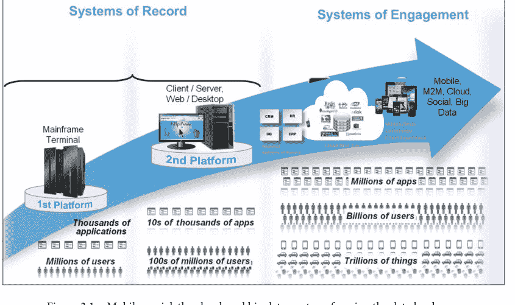
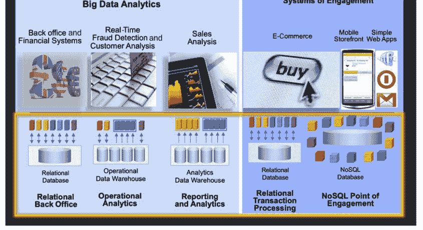
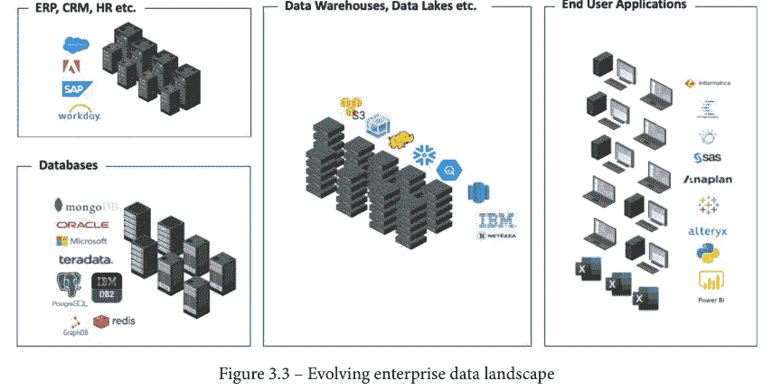
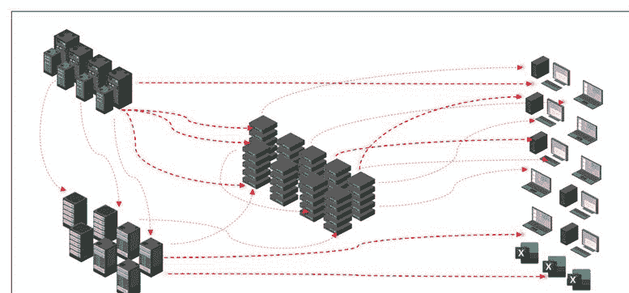
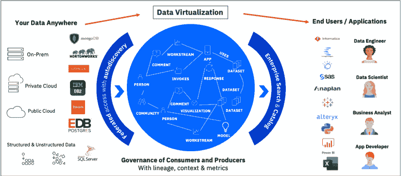

## 3 收集 – 让数据简单且可访问

企业正艰难应对数据在数量和种类上的激增。数据现代化正是应对这一关键挑战的方法，它通过让数据变得简单且可访问来建立强大的数据基础，无论数据位于何处。由于 AI 中使用的数据通常非常动态和流动，且来源不断扩展，因此对客户而言，对数据收集方式进行虚拟化至关重要。Cloud Pak for Data 通过专有、开源和第三方服务的组合，提供了一种灵活的方法来应对这些现代挑战。

在本章中，我们将涵盖以下主要内容：

- 数据——世界上最有价值的资产
- 以数据为中心交付所面临的挑战
- 企业数据架构
- 数据虚拟化——随时随地访问数据
- 使用 Cloud Pak for Data 实现数据资产现代化

### 数据——世界上最有价值的资产

事实是，*世界上每家公司都是数据公司。*正如《经济学人》杂志在2017年正确指出的那样，数据（而非石油）是世界上最宝贵的资源，除非你将数据作为战略差异化优势加以利用，否则你很可能会错失机会。

纵观历史上成功的公司，它们都拥有可持续的竞争优势——要么是规模经济（苹果、英特尔、AWS），要么是网络效应（Facebook、Twitter、Uber 等）。**数据**是获得可持续竞争优势的新基础。世界上超过90%的数据无法通过谷歌搜索到，这意味着世界上大部分有价值的数据都归其所属组织私有。那么，你能做些什么来释放专有数据所固有的潜力呢？

正如我们在*第1章《数据是推动 AI 主导数字化转型的燃料》*中所讨论的，CEO 和商业领袖深知，他们需要利用数字化转型来推动增长、加快上市速度并促进创新。为了加速这一转型，他们需要通过将企业数据作为战略差异化优势，整合跨组织边界的流程。务必记住，你的数据只有你自己才能访问。

### 以数据为中心的企业

让我们看几个将数据作为战略差异化优势的企业示例：

1. 百思买通过拥抱数字营销，以及基于客户数据的个性化协助与推荐，成功实现了业务转型。这次数字化转型历时多年，但最终帮助公司在竞争中生存并繁荣发展，而其竞争对手 Circuit City 则申请破产并清算关闭了所有门店。

集中收集、治理、存储、处理和分析这些数据的复杂性、成本、时间及出错风险也在呈指数级增长。同样，作为所有这些数据来源的数据库和数据存储库也变得更加强大，自身拥有充足的处理能力和数据存储能力。

从历史上看，企业通过记录系统（大型机和客户端/服务器应用程序）来管理数据。应用程序的数量有限，生成的数据大部分是结构化的——利用关系数据库来持久化数据。然而，这种模式已不再适用。随着过去十年移动电话和社交网络的爆炸式增长，应用程序的数量和生成的数据量呈指数级增加。更重要的是，数据不再是结构化的——关系数据库虽然仍与遗留应用程序相关，但并非为处理实时生成的非结构化数据而构建。这催生了一批新的数据存储，如 MongoDB、Postgres、CouchDB、GraphDB 等，统称为 NoSQL 数据库。这些应用程序被归类为交互系统：

图 3.1 – 移动、社交、云和大数据正在改变数据格局

虽然交互系统的发展导致数据的体量、速度和多样性呈指数级增长，但也同样使企业难以利用其数据，因为数据现在分散在组织内部种类繁多、数量众多的数据存储中：

图 3.2 – 不同的工作负载需要不同的数据存储

与此同时，如今业务用户在创建和处理自己的数据集方面更加娴熟，他们会利用 Excel 和其他桌面工具来满足业务需求。数据仓库和数据湖无法应对数据格局的广度和深度，企业开始寻求更复杂的解决方案。更增加挑战的是，市场上智能设备开始大量涌现，这必将进一步颠覆制造业、分销、医疗保健、公用事业、石油、天然气等行业的数据架构。企业必须进行现代化改造并持续创新，以应对这些不断变化的业务状况。

在探索潜在解决方案以及 Cloud Pak for Data 如何应对这些挑战之前，让我们先审视典型的企业数据架构以及尚未解决的固有差距。

### 企业数据架构

如今，典型的企业拥有多个数据存储、记录系统、数据仓库、数据湖和最终用户应用程序，如下图所示：

图 3.3 – 不断演化的企业数据格局

此外，这些数据存储通常分布在不同的基础设施上——包括本地部署和多个公有云的组合。虽然大部分数据是结构化的，但我们越来越多地看到非结构化和半结构化数据集被持久化到 NoSQL 数据库、Hadoop 或对象存储中。不断演化的复杂性和各种集成接触点开始让企业不堪重负，通常使业务用户难以找到满足其业务需求的合适数据集。这在以下典型企业 IT 架构图中得以体现，其中数据及其相关基础设施是分布式的、不断增长的且相互连接的：

图 3.4 – 以数据为中心意味着复杂性不断增加

以下是企业采用的所有流行数据存储的详细列表，以及它们所满足的具体需求：

**关系数据库**

| 编号 | 数据库 | 描述 |
|---|---|---|
| 1 | Db2 | 可处理事务（OLTP）和分析型工作负载。 |
| 2 | Oracle Database | 因易于使用、文档丰富、功能齐全而广受开发者欢迎。 |
| 3 | Microsoft SQL Server | 当今全球排名第一的 RDBMS。广泛用作应用程序的基本数据存储，同时也是企业级数据库。 |
| 4 | IBM Informix | 以轻量占用和时序数据而闻名，非常适合物联网数据集。 |
| 5 | MySQL（MariaDB） | 最初由 Sun Microsystems 开发，现为 Oracle 的一部分，包括免费的社区版和受支持商业版。MariaDB 是基于开源 MySQL 构建的商业数据库。 |
| 6 | Microsoft Access | 一种将关系型 Microsoft Jet 数据库引擎与图形用户界面相结合的 DBMS。 |
| 7 | SQLite | SQLite 是一个包含在 C 库中的关系型数据库管理系统。 |
| 8 | Amazon RDS | 一种经济高效的云关系数据库，兼容包括 PostgreSQL 和 Amazon Aurora 在内的六种数据库引擎。 |
| 9 | PostgreSQL（Enterprise DB） | EnterpriseDB 帮助客户在基于开源 PostgreSQL 构建的安全丰富、企业级数据库上开发和运行应用程序。 |

图 3.5 – 关系数据库

以下是 NoSQL 数据存储的详细列表。

**NoSQL 数据存储**

| 编号 | 数据库 | 描述 |
|---|---|---|
| 8 | MongoDB | 一种非常流行的文档型 NoSQL 数据库。 |
| 9 | Redis | 流行的键值型 NoSQL 数据库。 |
| 10 | CouchDB | 基于文档的 NoSQL 数据库。 |
| 11 | Cassandra | 流行的宽列型 NoSQL 数据库。 |
| 12 | MarkLogic | 这种与模式无关的数据库允许你摄取任何形式或类型的数据，包括地理空间数据、JSON、RDF 以及视频等大规模二进制数据。它内置了不断为查询优化的搜索引擎。 |
| 13 | Elasticsearch | Elasticsearch 是一个高度可扩展的开源全文搜索和分析引擎，用于近实时地存储、搜索和分析大量数据。 |
| 14 | Neo4j | 著名的图型 NoSQL 数据库。 |
| 15 | Memcached | 键值型 NoSQL 数据库。 |
| 16 | Riak DB | 键值型 NoSQL 数据库。 |
| 17 | Raven DB | 基于文档的 NoSQL 数据库。 |
| 18 | Apache HBase | 宽列型 NoSQL 数据库。 |

图 3.6 – NoSQL 数据存储

以下是数据仓库和数据湖的详细列表：

**数据仓库和数据湖**

| 编号 | 数据仓库/数据湖 | 描述 |
|---|---|---|
| 19 | IBM Netezza | 这是一种非常流行的数据仓库设备，以易用性、可扩展性和高性能著称。 |
| 20 | Cloudera Platform（CDP） | CDP 是将 Cloudera（CDH）和 Hortonworks（HDP）的增值型 Hadoop 发行版整合为一个统一的、面向云的数据和分析平台的重要一步。 |
| 21 | Teradata | 一个用于收集和分析海量企业数据的数据仓库平台，同时采用智能内存处理来优化数据库性能。 |
| 22 | Oracle Exadata | Exadata 是预先配置的硬件和软件组合，为运行 Oracle 数据库提供专门的基础设施。 |
| 23 | Snowflake | Snowflake 的多租户共享架构将存储与处理能力分离，允许客户根据使用情况和性能要求扩展资源。 |
| 24 | Amazon Redshift | Amazon Redshift 是 Amazon Web Services（AWS）的一部分，是一个数据仓库产品。其名称意为“远离 Oracle 的热迁移”，其中 red 暗示 Oracle。 |
| 25 | Google BigQuery | BigQuery 是 Google 的数据仓库产品，内置了 ML 和 TensorFlow 集成，让你能够快速创建强大的 AI 模型。它可以扩展到 PB 级数据以进行实时分析，并支持地理空间分析。它还支持计算与存储分离，让你能够分别扩展处理和内存资源。 |
| 26 | Amazon S3 | 主要大规模满足云存储需求，用于大数据分析——它是一种面向对象的服务，将数据存储在“桶”中，每个桶最多可容纳 5 TB 数据。 |
| 27 | IBM Db2 Warehouse | Db2 Warehouse 适用于分析和 AI 工作负载，提供内置机器学习工具，支持 SQL 和 Python 语言，并具有直观的 UI 和 REST API。其 MPP 能力支持对大型数据集进行快速并发查询。 |

图 3.7 – 数据仓库和数据湖

现在我们已经介绍了企业数据架构，接下来让我们讨论 NoSQL 数据存储。

### NoSQL 数据存储——主要类别

NoSQL 数据存储根据其架构和用途大致可分为四类。它们如下：

-   **文档数据库**将每个键映射到一个复杂的数据结构，称为文档。文档可以是键-数组对、键-值对，甚至是嵌套文档。文档数据库中最受欢迎的一些选择包括 MongoDB、CouchDB、Raven DB、IBM Domino 和 MarkLogic。
-   **键值存储**是 NoSQL 数据库*最简单*的形式。每一行都存储为一个键值对。常见的例子包括 Redis、Memcached 和 Riak。
-   **宽列存储**，也称为列式数据存储，针对大型数据集上的查询进行了优化，并且将数据按列而非按行存储。例子包括 Cassandra 和 HBase。
-   **图存储**存储关于图的信息；网络，例如社交连接；道路地图；以及交通链接。Neo4j 是最流行的图存储。

接下来，我们将回顾 Cloud Pak for Data 的一些功能，这些功能使其能够应对一些挑战，其中之一是数据虚拟化。

### 数据虚拟化——随时随地访问数据

从历史上看，企业将来自多个来源的数据整合到中央数据存储中，例如*数据集市*、*数据仓库*和*数据湖*，以便进行分析。虽然这对于某些用例仍然非常相关，但每次业务用户或数据科学家需要新数据时，所需的时间、金钱和资源使其难以扩展。提取、转换和整合数据是资源密集、昂贵且耗时的，而数据虚拟化可以避免这些。

**数据虚拟化**使用户能够直接访问源数据，消除了数据治理和安全的复杂性及手动流程，以及增量存储需求。这也有助于简化应用程序开发并注入敏捷性。另一方面，**提取、转换、加载（ETL）**对于复杂的转换过程很有帮助，并且很好地补充了数据虚拟化，后者允许用户绕过许多早期的数据移动和转换环节，从而以近乎实时的方式提供集成的、对业务友好的视图。

下图展示了数据虚拟化如何连接数据源和数据消费者，从而通过单一视图访问整个企业的分布式数据集：

图 3.8 – 数据虚拟化——管理你的所有数据，无论其位于何处

提供数据虚拟化的供应商很少。根据 Tech Target 的说法，市场上数据虚拟化的前五名供应商如下：

-   Actifio Sky
-   Denodo
-   IBM Cloud Pak for Data
-   Informatica PowerCenter
-   Tibco Data Virtualization

其中，IBM 以其集成方法和规模脱颖而出。它专注于将数据管理、数据治理和数据分析整合到一个统一平台中的统一体验，这与当今企业的需求产生共鸣，而其独特的 IP 使 IBM 的数据虚拟化能够在水平和垂直两个方向上扩展。此外，IBM 还利用下推优化来利用数据源的资源，使其能够无约束地扩展。

分布式数据系统中的一个常见场景是许多数据库以通用模式存储数据。例如，你可能拥有多个存储销售数据或事务数据的数据库，每个数据库对应一组租户或一个区域。Cloud Pak for Data 中的数据虚拟化可以自动检测系统中的通用模式，并使其在数据虚拟化中显示为单一模式——这一过程称为**模式折叠**。例如，存在于 20 个数据库中的 SALES 表现在可以显示为单个 SALES 表，并可以通过**结构化查询语言（SQL）**作为一个虚拟表进行查询。

### 数据虚拟化与 ETL——何时使用什么？

从历史上看，数据仓库和数据湖是通过使用 ETL 批量移动数据来构建的。市场上领先的 ETL 产品之一恰好来自 IBM，名为 IBM DataStage。因此，这就引出了一个问题：何时应该使用数据虚拟化，何时应该使用 ETL 产品。答案取决于具体用例。如果意图是实时探索和分析小数据集，并且数据可能每隔几分钟或几小时发生变化，则建议使用数据虚拟化。请注意，此处提到的小数据集是指实际传输的数据，而不是执行查询所针对的数据集。另一方面，如果用例需要跨多个来源处理大型数据集，并且数据随时间大致保持静态（历史数据集），则强烈建议使用基于 ETL 的解决方案。

### 平台连接——简化数据连接

Cloud Pak for Data 还包含**平台连接**的概念，它使企业能够通用地定义数据源连接。这些连接可以被平台中的所有不同服务共享。这不仅简化了管理，还使不同服务的用户能够轻松找到并连接到数据源。Cloud Pak for Data 还提供了在服务级别定义连接以覆盖平台连接的灵活性。最后，管理员可以选择为给定连接设置用户凭据，或者强制单独用户输入各自的凭据。以下是 **Cloud Pak for Data v4.0** 的平台连接功能截图，该版本于 2021 年 6 月 23 日发布：

虽然在不移动数据的情况下访问数据是一个很好的起点，但 Cloud Pak for Data 还使客户能够在其平台上持久化数据。你可以在 Cloud Pak for Data 上轻松部署、配置和扩展各种数据存储。Cloud Pak for Data 支持的数据库如下：

-   Db2（包括 OLTP 和分析工作负载）
-   Db2 Event Store
-   MongoDB
-   Enterprise DB PostgreSQL
-   Cockroach DB
-   Crunchy DB PostgreSQL
-   支持对象存储——计算与存储分离

Cloud Pak for Data 拥有一个充满活力且开放生态系统，未来 1-2 年内计划引入更多数据源。这为客户提供了自由选择其数据存储的灵活性，同时继续利用其现有数据环境。最后，值得一提的是，平台上所有可用的数据存储都是容器化的，并且设计为云原生，使客户能够轻松配置、升级、扩展和管理其数据存储。此外，客户可以在任何私有云或公有云上部署这些数据存储，从而实现可移植性。这在数据引力以及数据与分析共置至关重要的场景中非常关键。

### 总结

数据是世界上最有价值的资源，为了成功，企业需要以数据为中心，并将其数据作为关键差异化因素。然而，不断增长的数据量、不断演化的数据存储和分布式数据集使得企业和业务用户难以轻松找到和访问所需的数据。当今的企业数据架构相当复杂，有大量针对特定工作负载优化的数据存储。数据虚拟化提供了解决这一独特挑战的灵丹妙药，而 IBM 的 Cloud Pak for Data 是当今市场上的关键供应商之一。它凭借其扩展能力和集成方法脱颖而出，该方法满足了数据管理、数据组织和数据分析的需求。

最后，IBM 的 Cloud Pak for Data 通过多个容器化数据存储补充其数据虚拟化服务，使客户能够在平台上持久化数据，同时也能在不移动数据的情况下访问其现有数据。

在下一章中，你将学习如何创建可信的分析基础，并组织你在数据存储中收集的数据。

在本章中，我们将涵盖以下主要主题：

- 介绍 **Data Operations (DataOps)**
- 组织企业信息资产
- 建立元数据和管控
- 通过分析了解数据
- 对数据进行分类以确保完整性
- 通过数据质量建立信任
- 数据隐私和活动监控
- 大规模数据集成
- IBM 主数据管理
- 将主数据管理扩展为数字孪生
