## 4 介绍 Data Operations (DataOps)

数据是创新的燃料，也是保持竞争优势的关键。它是推动分析和理解业务趋势与机遇的关键要素。以新的方式释放其价值，可以加速组织迈向 AI 的进程。

**DataOps** 专注于在整个组织中实现协作，以推动敏捷性、速度以及大规模的新数据计划。通过利用自动化的力量，DataOps 旨在解决访问、准备、集成以及使数据可用方面的效率低下所带来的挑战。

DataOps 的核心是组织的信息架构，它解决了以下问题：

- 你了解你的数据吗？你信任你的数据吗？
- 你能否快速检测错误？
- 你能否在不“破坏”整个数据管道的情况下进行增量更改？

上一个屏幕截图展示了以业务术语形式收集的业务元数据的示例，并指定了数据管控员。他们将负责验证业务术语并通过类别和次要类别（如适用）将该业务概念组织到企业分类体系中。

**数据管控员** 在更广泛的数据治理计划中发挥着关键作用。让我们使用一个简单的图表来说明不同实体所扮演的角色，包括其各自的职责：

- **数据治理领导层** 职责包括以下内容：
  - 制定和审查治理计划和政策
  - 了解数据治理领域的主要趋势
  - 为各种数据治理计划提供指导原则
  - 为数据管控委员会提供战略方向
- **数据治理办公室** 职责包括以下内容：
  - 识别和优先考虑数据治理计划
  - 建立和监控数据的绩效指标
  - 提供企业视角和方法的保证
  - 识别并聘用数据管控员和协调员
- **业务流程负责人** 职责包括以下内容：
  - 在战术层面解决升级的问题
  - 识别并聘用运营数据管控员
  - 优先考虑并批准数据质量问题修复请求
  - 向数据管控员和保管员传达期望和要求
- **数据管控员** 职责包括以下内容：
  - 使用数据执行其工作和流程。
  - 检查数据使用的完整性。
  - 作为数据访问、来源、变更控制以及在其数据域和职能领域内识别的任何数据质量问题的第一联系人。

识别数据治理活动的触发因素：

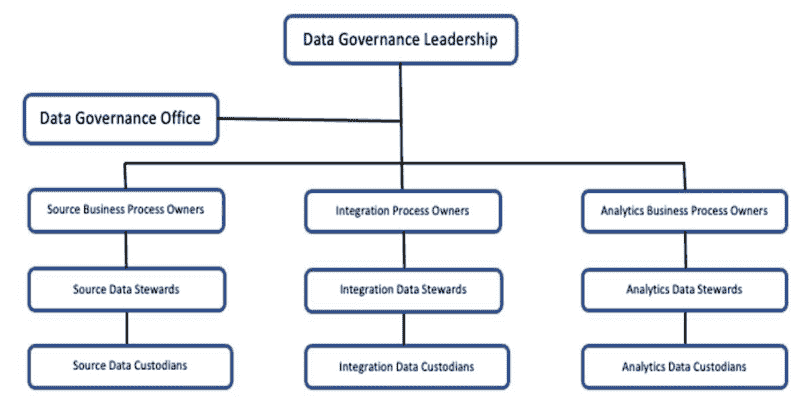

图 4.3 – 数据治理组织

现在我们了解了治理团队的组织方式，我们将列出最常用的业务和技术元数据组件。

### 业务元数据组件

以下是最常用的业务和技术元数据组件：

- 类别层次结构
- 类别
- 业务术语
- 业务术语类型层次结构
- 业务术语类型
- 信息治理政策层次结构
- 信息治理政策
- 信息治理规则

现在，我们将继续介绍技术元数据组件。

### 技术元数据组件

技术元数据可以是开箱即用的资产类型，也可以是自定义资产类型。包括以下内容：

- 数据库
- 数据文件
- 非结构化数据源
- 数据科学资产（模型、笔记本等）
- 逻辑数据模型
- 物理数据模型
- XML 模式定义
- 主数据管理
- 应用程序
- 文件
- 存储过程定义
- 商业智能制品
- 数据质量资产（数据规则定义、数据规则集、指标等）
- 提取、转换、加载资产（作业、阶段、参数等）
- 自定义技术资产

现在我们知道了需要捕获哪些元数据，在下一节中，我们将讨论通过分析企业数据资产来更好地了解我们所拥有的数据的过程。

### 通过分析了解数据

随着企业经历数字化转型，数据和多个系统的激增往往导致存在冗余数据集，且数据质量参差不齐。面对庞大的数据量，了解数据集的特征至关重要，包括有哪些属性/列、各个列的数据类型、其唯一值以及数据值的分布情况。此分析信息有助于我们从大量可能重叠的数据集中分离出感兴趣的数据集。

借助 Cloud Pak for Data，我们拥有一个集中式治理目录，可作为所有数据资产的索引，并帮助我们为许多数据科学项目组织资源：数据资产、分析资产以及需要使用这些资产的用户。该目录还具有内置的分析功能，允许使用者选择给定数据集并启动快速数据分析活动。重点关注分析的以下两个方面：

- 数据结构发现；即数据集中有哪些属性可用？
- 数据内容发现；即数据值是什么、其分布、质量等？

第一步是定义与数据源的连接并将数据资产引入目录。Cloud Pak for Data 支持各种数据源连接器，并且随着平台每个新版本的发布，支持的连接器列表也在不断增长。

一旦数据资产被引入，我们就可以使用目录执行以下操作：

- 为资产添加一个或多个标签。
- 快速预览数据。
- 对资产添加评审和评论。
- 为资产定义访问策略。
- 跟踪资产的事件血缘。
- 创建数据分析：

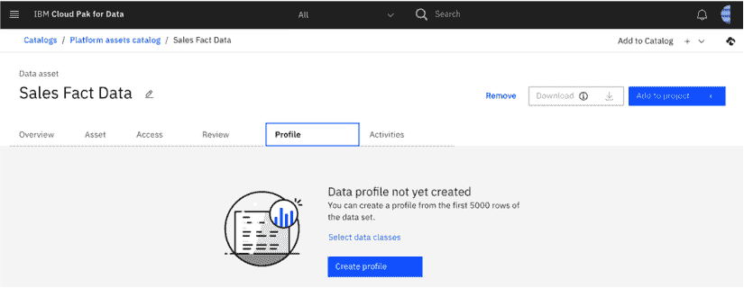

图 4.4 – 目录资产的初始分析

可选地，你可以选择所有可用的数据类或作为分析活动的一部分选择数据类的子集。运行分析所需的时间将取决于我们选择的数据类数量以及数据资产的大小和宽度：

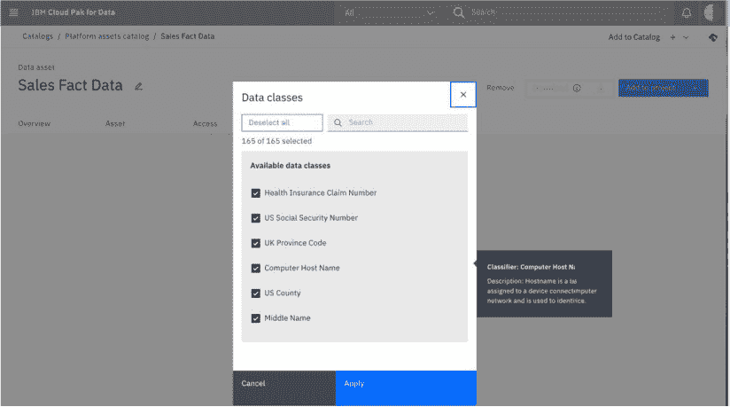

*图 4.5 – 识别作为初始数据分析一部分可利用的数据类*

数据分析过程需要一些时间，你可以看到以下内容：

- 已分配给各个列/属性的数据类（视情况而定）
- 各列/属性的汇总统计信息，无论数据类型如何
- 各列/属性中值的频率分布

这有助于快速识别数据中潜在的数据质量问题。

在以下屏幕截图中，我们有所选数据集的数据分析。这有助于我们快速了解数据：

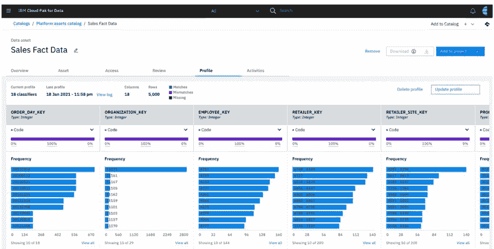

图 4.6 – 初始分析结果，显示数据分布和汇总统计

作为自动发现和数据质量分析功能的一部分，我们还拥有更全面的数据剖析能力，这将在本章后面讨论。这将进一步帮助我们发现跨数据域的关系，并进行更全面的数据质量分析。

### 对数据进行完整性分类

分类是用于根据企业保密级别对资产进行分类的特殊标签。通过对某些资产打上比其他资产更敏感的标签来实现。你可以将它们视为帮助消费者识别哪些资产可以共享的标签，同时保护那些不得在业务部门或组织之外分发的其他资产。Cloud Pak for Data 中的集中式目录服务提供了以下开箱即用的分类，并可根据组织的需要灵活添加更多分类：

- 个人身份信息（PII），即能够识别个人身份的数据（例如，社会安全号码）。
- 敏感个人信息（SPI），即一旦暴露，可能对个人造成重大伤害、尴尬和/或不公平的数据（例如，种族、性取向、宗教信仰等）。
- **机密**，即一旦泄露，可能对个人和/或组织造成长期伤害的数据：

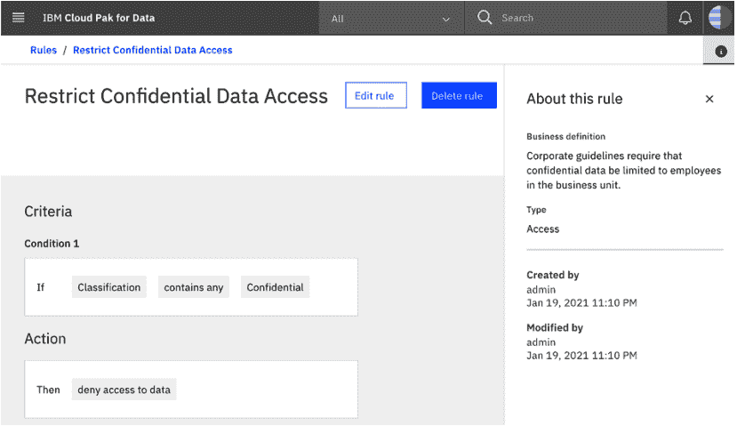

*图 4.7 – 用于定义数据保护规则的分类*

我们不仅可以将这些分类用作资产标签，还可以利用平台的自动化功能触发数据保护规则，根据不同的分类限制不同用户对某些资产的访问。

接下来，我们将讨论如何利用 Cloud Pak for Data 的自动数据发现功能及其融入**机器学习（ML）**的业务术语分配流程。

### 自动化数据发现和业务术语分配

到目前为止，我们已经讨论了不同类型的元数据（业务和技术）以及元数据在组织中的价值。一项关键任务是将业务元数据映射到技术元数据。这是必需的，因为 Cloud Pak for Data 是一个面向不同角色（包括业务和技术受众）的平台，其目标是促进业务和技术受众之间的沟通，同时将技术资产与相应的业务功能对齐。

Cloud Pak for Data 拥有一项基于 ML 的专利自动分类功能，可在自动发现过程中推荐将业务术语映射到技术资产。该 ML 分类模型使用特定行业的元数据进行训练，并基于领域专家手动进行的业务术语分配提供认知学习。

自动术语分配作为发现过程中列分析的一部分被调用。我们有两种类型的发现流程：

- 快速扫描（QuickScan）
- 自动发现（Auto-discovery）

**术语**根据 ML 模型评分的置信度自动分配。这些业务术语与技术资产的关联最初表示为候选关系，领域专家和管理员可以对其进行审查并手动分配。当置信度达到或超过 50% 时，系统会建议分配术语。当置信度超过 80% 时，候选关系将自动分配。

ML 模型使用以下信息生成术语分配：

- 语言名称匹配，基于业务术语名称和数据资产名称的相似性。
- 基于数据类的分配。在这种情况下，如果业务术语与数据类相关联，并且数据资产分析将数据类分配给某个资产，则该术语会被推荐为该资产的匹配项。
- 监督学习模型，该模型最初使用默认目录中存储的术语进行训练，随后通过用户术语分配作为模型反馈进行学习。

我们将展示快速扫描发现流程，以展示这种自动术语分配。我们将在平台已定义的数据源连接上调用快速扫描发现作业。作为此作业的一部分，我们可以指定以下子任务：

- 1. 执行列分析（分析列）。
- 2. 执行数据质量分析（分析数据质量）。
- 3. 执行自动术语分配（分配术语）。
- 4. 使用数据采样：

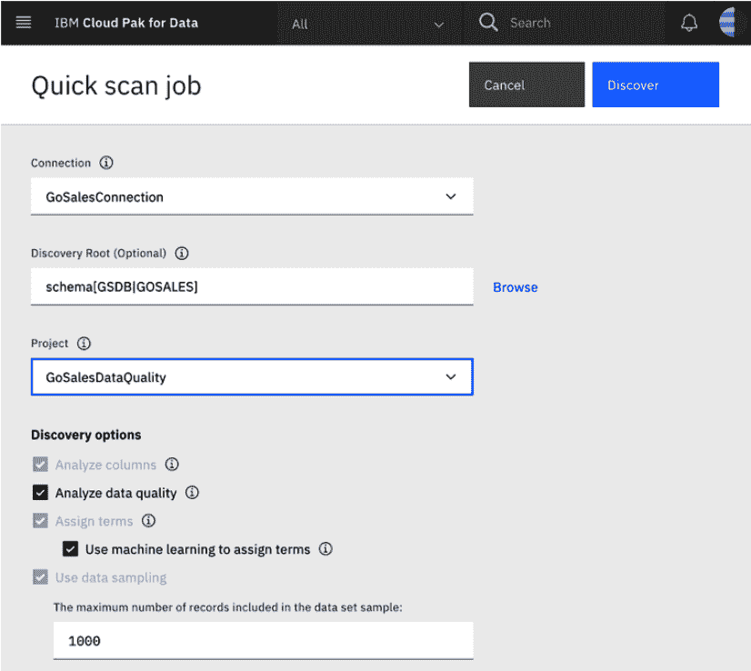

图 4.8 – 调用快速扫描发现作业

**快速扫描作业**的执行时长可能有所不同，具体取决于数据源表的数量和我们使用的数据样本数量。在我们的案例中，发现 30 张表大约花费了 50 秒，这非常快。在下面的截图中，你可以看到自动业务术语分配所完成工作的摘要，以及各个列/属性的数据类分配：

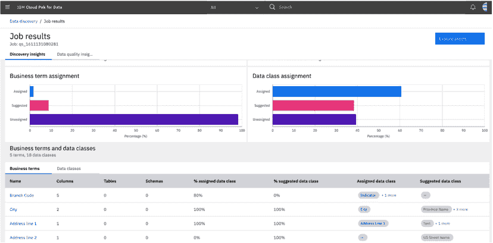

图 4.9 – 快速扫描摘要，显示多列的自动术语分配

在详细信息屏幕上，我们可以查看各个数据资产列、派生的数据质量、数据类分配和建议的业务术语，以及基于 ML 模型评分结果置信度的已分配业务术语。领域专家还可以通过某种方式手动修改术语分配建议。管理员在此处所做的任何更改都将导致术语分配模型重新训练。因此，下次我们运行发现作业时，它将推荐不同的术语分配：

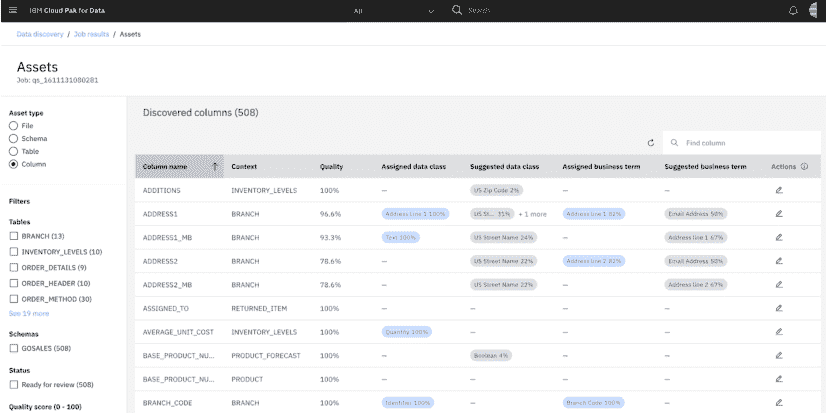

图 4.10 – 自动术语分配的快速扫描详细报告

我们现在已经了解了如何利用数据发现自动化，以及如何将业务术语分配给技术资产。接下来，我们将讨论平台的数据质量能力。

### 用数据质量建立信任

数据质量是企业运营的基石，它受到数据输入、存储和管理方式的影响。对信息缺乏信心的原因是信息在整个组织中无处不在。我们面对的是多年来积累的碎片化数据孤岛，这些数据没有经过数据质量衡量，也没有以对业务有意义的方式组织。

高质量的数据对于使用数据执行的任何分析获得高质量结果至关重要。数据质量涉及以下方面：

- **完整性：** 充分了解所有相关数据资产。
- **准确性：** 必须消除常见的数据问题，如缺失值、不正确的参考数据等，以确保我们拥有一致的数据。
- **可用性：** 数据必须按需可用。
- **及时性：** 数据的最新程度对于做出正确决策至关重要。

Cloud Pak for Data 的数据质量分析区域执行以下任务：

- 运行列分析
- 评估质量维度以识别数据质量问题
- 为数据资产和列计算数据质量得分
- 运行质量规则和自动化规则
- 可选地捕获存在数据质量问题的样本数据

完成数据质量分析后，你可以将结果发布到治理目录，以便平台的其他使用者受益于该分析。

### 评估数据质量的步骤

让我们使用平台的自动发现功能来了解数据质量评估能力。我们将针对其中一种可能场景执行的高级步骤如下：

- 1. 定义到数据源的连接。
- 2. 通过选择以下一个或多个选项启动自动发现过程：
  - 分析列。
  - 分析数据质量。
  - 分配术语。
  - 将结果发布到目录。
- 3. 一旦发现数据资产，我们必须审查以下内容：
  - 分析结果
  - 数据质量分析
  - 数据分类
  - 术语分配
- 4. 然后，我们将查看数据质量项目，并查看数据质量分析过程的详细信息：

自动发现作业完成所需的时间取决于表的数量、数据的量以及是否使用了数据采样：

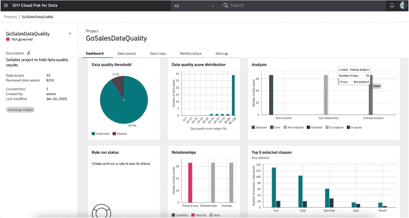

图 4.14 – 数据质量仪表板

实现期望的数据质量是一个不断演进的过程。在这里，我们随着时间的推移不断学习，并建立一套数据质量规则来处理数据状况、监控数据质量指标，并修复我们的应用程序和/或源系统，直到我们实现期望的数据质量结果：

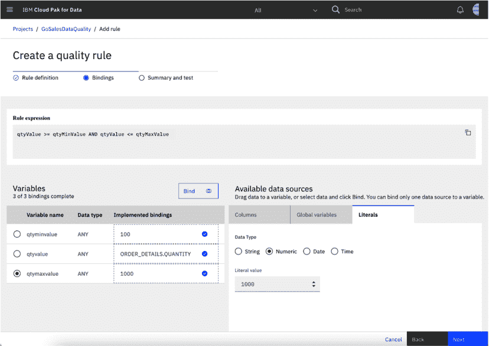

图 4.15 – 质量规则，用于识别任何订单数量 <100 或 >1,000

4. 最后，我们必须达到业务就绪状态，使数据能够被终端用户用于分析进行消费：

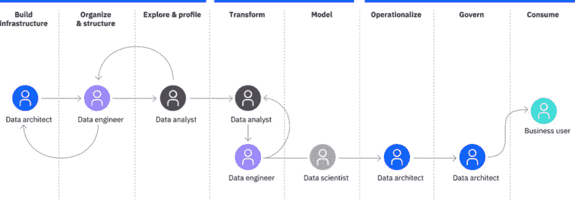

图 4.17 – 按角色划分的示例 DataOps 工作流

我们现在了解了数据整体流经的过程以及不同角色之间发生的交互。现在，让我们探讨如何将一些自动化引入数据质量评估。

### 数据质量周围的自动化规则

数据质量评估将数据与一组标准进行评估。这组标准取决于数据的业务背景，包括数据代表什么信息、信息的关键性以及信息的用途。数据质量维度和自定义数据质量规则应一起使用以执行数据质量评估。数据分析提供了数据特征和分布的初始视图。自动化规则利用此信息，从数据分析到质量评估，例如检查空值或有效日期格式等。

Cloud Pak for Data 允许我们构建和部署自动化规则。这些自动化规则有助于自动化任务以确保我们拥有最高质量的数据，包括以下内容：

- 基于数据质量维度应用规则定义
- 为资产分配术语或管理员

### 大规模数据集成

根据 *IDC 报告* 的估计，数据科学家花费 80% 的时间来准备和管理数据以构建 AI 模型。结合 IBM 调查中 91% 的组织未有效使用其数据，这意味着企业在从数据孤岛中获取价值方面遇到困难。数据集成是技术和业务流程的结合，用于将来自不同来源的数据组合成有意义且有价值的信息。这是组织整体信息架构战略的关键方面：

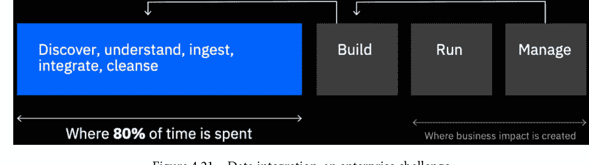

图 4.21 – 数据集成，企业挑战

IBM 的 DataStage 服务在 IBM Cloud Pak for Data 上提供了一种现代化的数据集成解决方案，用于在任何规模和复杂性下清理和交付可信数据，无论是在多云和混合云环境中还是跨多云和混合云环境。随着 AI 的兴起，数据集成工具的部署和使用方式发生了重大转变，原因有很多。数据量和种类增加是一个原因，但组织正在看到采用以流程为导向的方法来管理数据生命周期、提高业务绩效和增强竞争力的需求。

### 选择数据集成工具的考虑因素

选择数据集成工具/服务时，我们应考虑以下一些关键因素：

- 能够适应多云环境
- 大规模性能
- 与治理目录集成
- 拥有广泛的连接器，支持传统 RDBMS 源和其他非传统数据源
- 能够跟踪血缘关系
- 集成数据质量

### 利用云原生平台进行 ETL 的优势

从架构角度来看，IBM Cloud Pak for Data 通过将单体堆栈分解为微服务，将数据集成引入云原生平台。采用这种现代化方法带来的一些优势包括以下内容：

- 能够在几分钟内部署，实现标准部署和管理，同时保留根据需要修改环境/作业参数的灵活性。
- 由于 Kubernetes/OpenShift 中固有的高可用性，可靠性提高。
- 由于自动更新，管理负担减轻。
- 您可以按“应用程序组”自动化管理，因此管理员可以使用命名空间来管理访问控制和配置选项。
- 您可以使用平台级和服务级功能在应用程序级别进行监控和管理。
- 您可以独立扩展微服务以响应不断变化的需求：

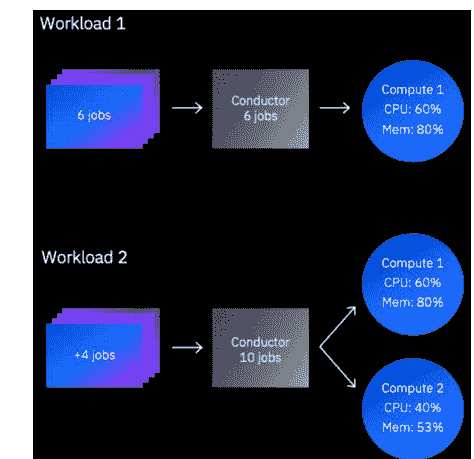

图 4.23 – 自动工作负载平衡

将您的数据集成技术容器化使您能够在本地和云平台之间在混合云环境中运行。

### 主数据管理

组织拥有大量关于产品、服务、客户和交易的数据，从所有这些数据中获取洞察对于保持竞争优势非常重要。主数据管理是一个全面的流程，定义并管理组织的关键客户和产品数据。它在整个企业范围内提供数据的单一可信视图，具有敏捷的自助访问、基于分析图的探索、治理以及用户友好的仪表板，以加速产品信息管理和主数据计划。

### 将 MDM 扩展到数字孪生

数字孪生是一个通用概念，最初源于物联网 IoT 领域，其中我们拥有物理事物的数字表示。在 MDM 的上下文中，这转化为能够捕获用户交互和派生属性的能力，这些属性可以帮助更有效地服务客户，利用我们对其的了解。这使我们超越了标准属性，例如姓名、地址、联系方式、产品详细信息等，我们会从 MDM 中获取这些信息：

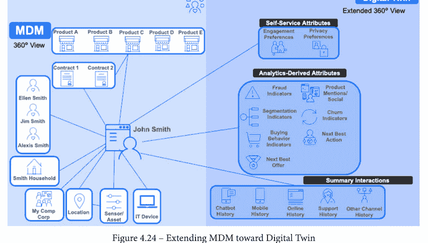

图 4.24 – 将 MDM 扩展到数字孪生

一旦模型被定义，将源属性映射到模型中的属性可以通过手动映射或使用 ML 驱动的自动分类属性的过程来完成。作为此步骤的一部分，还可以消除冗余属性和/或不会映射回 MDM 属性的属性：

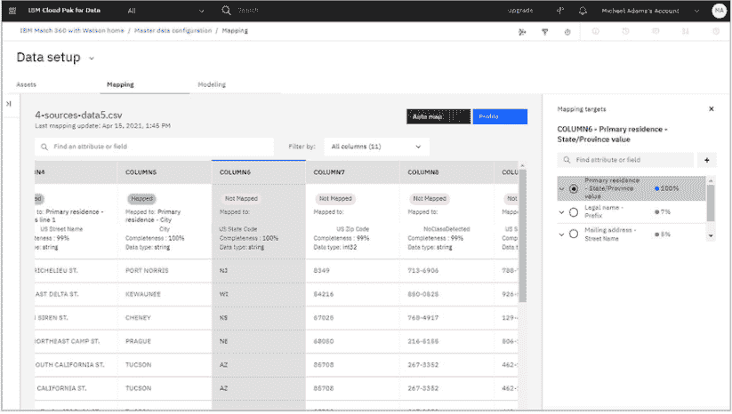

图 4.26 – 属性、手动和自动匹配

一旦匹配过程完成，最终用户可以搜索 Person 和/或其他自定义记录类型，并按实体或单个记录类型找到结果。让我们用一个简单的例子来理解实体信息价值。每个组织都有客户资料数据，并且他们还跟踪未来业务机会的潜在客户。业务用户可以通过获得以下问题的答案从实体数据中受益：

- 潜在客户列表是否有重复？
- 潜在客户列表中有多少现有客户？
- 客户和潜在客户之间是否存在任何不明显的关联？
- 我能否从新的信息来源获得更好的数据点？

## 5 BI 与报表