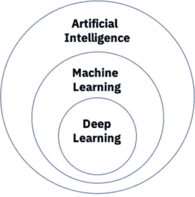
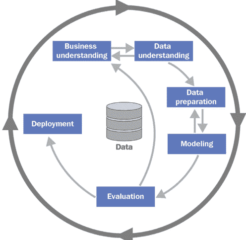
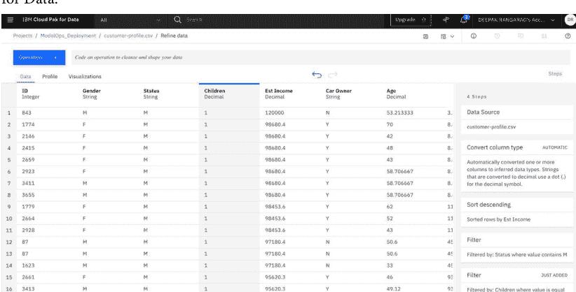
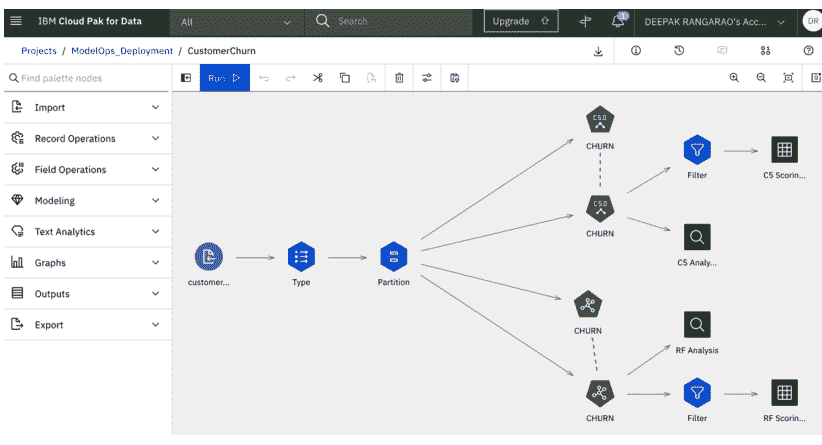
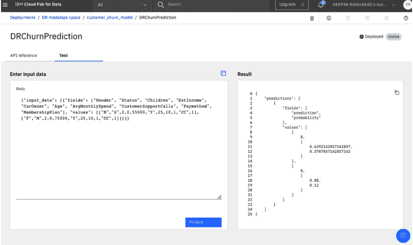
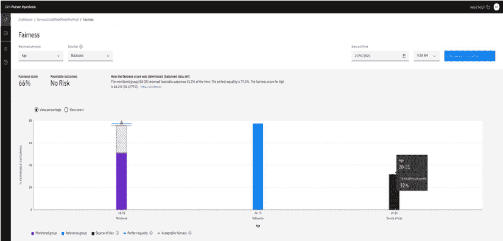
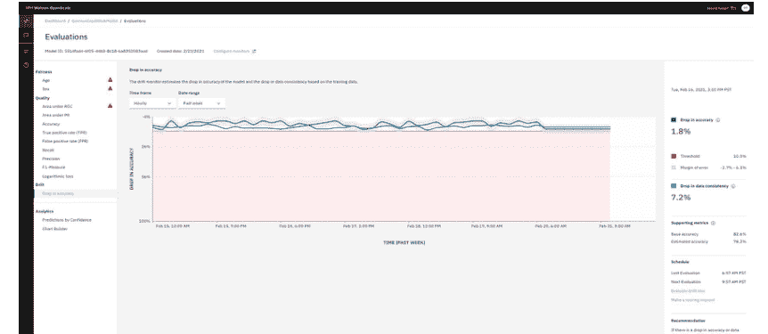
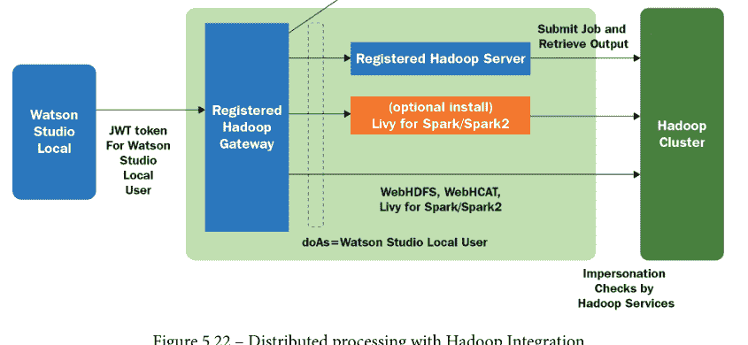

分析：以信任和透明度构建、部署和扩展模型

企业中收集了大量数据，这提供了一个独特的机会来挖掘可用于提高效率和更好地服务客户的洞察。**IBM Cloud Pak for Data** 拥有来自 **International Business Machines Corporation (IBM)** 的大量服务，以及有助于分析数据的各个方面的第三方服务。

该平台面向不同的角色，包括业务分析师、数据工程师、数据科学家、数据管理员等，使跨角色协作成为可能。所有这些角色都对数据的不同方面感兴趣，并且在分析数据方面的技能各不相同，从执行定期罐装报告这样简单的需求到临时报告和仪表板，以及更高级的分析，例如统计分析、**机器学习 (ML)** 或 **人工智能 (AI)**。

**Cloud Pak for Data** 凭借其集中式治理目录和仪表板服务，支持自助式分析，并能够从受治理的数据资产中放心地获取数据。

## 

BI 是一种能力，它接收业务数据并以用户友好的视图呈现，例如报表、仪表板、图表和图形。BI 工具使业务用户能够访问不同类型的数据，包括历史数据和当前数据、第三方数据和内部数据，以及半结构化数据和非结构化数据（如社交媒体）。用户可以分析这些信息，以深入了解业务的表现。虽然 BI 不会告诉业务用户该做什么，或者如果他们采取某种行动会发生什么，但 BI 也不仅仅是生成报表。相反，BI 为人们提供了一种检查数据以理解趋势并获得见解的方式。

### 预测性分析与规范性分析

预测性分析是一种使用高级算法和 ML 处理历史数据的实践，在了解已发生情况的同时，发现未见过的数据模式、交互和关系。预测模型提供可操作的见解，但不说明基于这些见解需要采取什么行动才能获得最佳结果。

另一方面，规范性分析通过使用优化模型（即业务问题的数学表示）为复杂问题实现准确决策。这些优化模型使用带有复杂算法的求解器。

通常，我们可能质疑应该使用预测性分析还是规范性分析。答案是两者都需要，为了说明这一点，让我们用一个简单的例子。在整个 COVID-19 大流行期间，ML 模型已被用于预测防护口罩的需求，但用规范性分析补充这一信息将有助于制定补货计划，以决定哪个配送中心应向不同地点供货，从而充分满足需求。

让我们首先揭开这三个概念的神秘面纱，如下所示：

- **AI** — AI 系统可以被视为不受情感影响的专家系统，能够连接不同数据点，并基于模拟人类行为的复杂规则做出决策。AI 用于预测、自动化和优化历来由人类完成的任务，例如语音识别、人脸识别、翻译等。
- **ML** — AI 应用的一个子集，它自行学习，使用新的数据点来预测结果，并不断提高准确性。
- **DL** — ML 的一个子集，其中神经网络从大量数据中学习。DL 算法重复执行任务，并通过支持渐进式学习的深层逐步改进结果。

下图展示了 AI、ML 和 DL 之间的关系：

图 5.2 – AI 的类型

在对 AI、ML 和 DL 有了更好的理解之后，我们现在来看看 ML 项目现有方法论以及新时代 AI 应用将见解转化为行动的其他注意事项。

## AI 生命周期——将见解转化为行动

正在进行数字化转型的企业将 AI 融入其应用程序；需要一套明确且稳健的方法论来管理 AI 流水线。传统上，**跨行业数据挖掘标准流程（CRISP-DM）**方法论被用于 ML 项目，在我们探讨实施 AI 驱动应用程序所面临的挑战以及更全面的 AI 生命周期如何有助于这一过程之前，理解这一方法论非常重要。

CRISP-DM 是一个开放标准流程模型，描述了执行数据挖掘项目所涉及的方法和步骤。它可分为六个主要阶段，如下所示：

- **业务理解**
- **数据理解**
- **数据准备**
- **模型构建**
- **模型评估**
- **模型部署**

这些阶段的顺序并不严格，通常是一个迭代过程。下图中箭头表示不同阶段之间最重要、最常见的依赖关系，而外圈则象征着数据挖掘的循环性质：

图 5.3 – 分析生命周期

这在过去效果很好，但随着收集的数据量不断增加，我们现在必须考虑数据的体量、多样性和速度，以及它们如何影响 AI 生命周期。这意味着我们需要更加重视数据收集、数据治理和持续模型评估阶段。模型评估不再仅仅是评估模型的质量，还有其他考虑因素，包括所部署模型的公平性和可解释性。

以下是启用此 AI 生命周期时的一些关键注意事项：

- 降低构建和运营 AI 的技能要求
- 通过减少日常琐碎任务来加快交付时间
- 通过优化模型准确性提高 AI 融合应用程序的就绪度
- 提供 AI 模型的实时治理，提高信任和透明度

在对 AI 应用程序的其他注意事项有了充分了解之后，我们接下来将深入探讨 AI 治理的必要性，将其作为新时代 AI 应用中信任和透明度的基础。

### AI 治理：信任与透明度

AI 在各个行业中无处不在——从推荐引擎到跟踪 COVID-19 病毒的传播。AI 的这种应用使组织能够创新并提高效率，但也带来了围绕如何使用 AI 制定业务决策的风险。

一般来说，治理通常涉及谁对数据负责、数据如何处理、企业中谁有权查看特定数据集，以及他们如何使用数据。这种建立治理框架以保护数据和消费者的相同概念也适用于 AI 模型，AI 模型可能会对某些个人或群体表现出不公平或有偏见（或两者兼有）的行为。

数据治理已经发展了一段时间，并且有成熟的方法论和最佳实践，但我们现在需要为 AI 模型做类似的事情。传统数据治理面临的挑战是数据量的不断增长，以及需要识别数据/技术资产并将其与组织成主题和逻辑区域的业务资产保持一致，并制定规定数据资产使用的政策和规则。然而，对于 AI 模型，有几个考虑因素，包括以下这些：

- 模型的多个版本
- 用于训练模型的不同输入数据集
- 关于模型输入属性的任何/所有转换的流水线信息
- 用于训练模型的算法/技术
- 超参数优化
- 用于构建和测试模型的训练/测试数据集

可解释 AI 不仅在于能够解读模型输出，还在于能够解释模型是如何构建的、使用了哪些输入数据选择流程和过滤器、所选数据集是否符合组织政策和规则，以及所选数据集中是否存在故意或无意的偏见。

### 使用 Cloud Pak for Data 自动化 AI 生命周期

当组织能够收集其数据并使用可信的治理目录进行组织后，现在可以利用这些数据来构建和扩展整个业务范围内的 AI 模型。要从头构建 AI 模型并将其扩展到整个业务，组织需要涵盖完整 AI 生命周期的能力，包括以下内容：

- **构建** — 这是公司构建其 AI 模型的地方。
- **运行** — 模型构建完成后，需要将其部署到应用程序或业务流程中投入生产。
- **管理** — 模型构建并运行后，问题就变成了：*如何以信任和透明的方式扩展它？* 为了解决复杂的构建和运行环境，企业需要一种工具，既能管理环境，又能解释其模型是如何得出预测的。

让我们使用 Cloud Pak for Data 实践 **模型运维**（**ModelOps**），以了解该平台如何用于自动化 AI 生命周期。ModelOps 是一种构建数据科学资产的方法论和流程，能够快速从开发阶段进入生产阶段。

下表展示了可用于构建文本数据分类模型的工具：

| 工具 | 代码编辑器 | 图形画布 | 自动化工具 |
|---|---|---|---|
| Jupyter Notebook | ✓ |  |  |
| JupyterLab | ✓ |  |  |
| RStudio | ✓ |  |  |
| SPSS Modeler |  | ✓ |  |
| 实验构建器 |  | ✓ |  |

图 5.9 – 可用于文本数据分类的工具

下表展示了用于图像数据的工具：

| 工具 | 代码编辑器 | 图形画布 | 自动化工具 |
|---|---|---|---|
| Jupyter Notebook | ✓ |  |  |
| JupyterLab | ✓ |  |  |
| RStudio | ✓ |  |  |
| 实验构建器 |  | ✓ |  |

图 5.10 – 可用于图像数据分析和处理的工具

我们已经了解了处理不同类型数据的工具/技术。现在，让我们探讨建立协作开发环境的过程。

### 建立协作环境

在AI生命周期的构建AI模型阶段，数据科学家需要与数据工程师和其他数据科学家协作来构建AI模型，这可能涉及共享数据资产和/或现有数据管道。对于给定的用例，数据科学家在选出最佳模型之前会训练数十或数百个AI模型。为了支持并最大化数据科学团队的生产力，Cloud Pak for Data 支持多种协作模式，包括以下方式：

- 不使用 Git 的本地项目协作
- 通过 Git 协作

本地协作模式使所有协作者可以在项目中的同一份资产副本上工作。任何由某个用户（例如笔记本）正在更新的资产都会被锁定，直到该用户或管理员解锁为止。这样可以使更改立即对所有协作者可用。

对于有编程/脚本语言经验的数据科学家，他们可以选择使用 Jupyter 笔记本界面，结合不同的运行时，以编程方式进行数据转换。

以下截图展示了 Cloud Pak for Data 中类似 Excel 的数据整理界面：

图 5.13 – 面向非抽取、转换、加载（ETL）开发人员的数据整理

一旦数据按照所需格式完成结构化，下一步就是使用这些数据训练模型，以帮助预测目标变量。

### 模型构建

一旦数据完成转换并具有所需的形式，下一步就是决定使用哪种算法并以此构建模型。您可以选择使用编程接口或拖放式用户界面（UI）。Cloud Pak for Data 支持 Jupyter Notebook、JupyterLab 笔记本和 RStudio 界面，以利用现有的库/模块/综合 R 档案网络（CRAN）包来构建机器学习模型。

Cloud Pak for Data 还包含 SPSS Modeler 流程服务，这是一个拖放式界面，可用于获取数据、应用转换、训练和评分机器学习模型。其中提供丰富的调色板节点，范围从导入操作到字段/记录操作、建模和可视化。

以下截图展示了用于数据准备、统计分析、模型构建、推理和可视化的拖放式界面：

图 5.14 – 用于可视化模型构建的 SPSS Modeler 流程

现在我们已经介绍了使用数据并训练模型以帮助预测目标变量的步骤，接下来将带您了解 Jupyter Notebook 界面的加速器。

### Jupyter Notebook 界面的加速器

虽然 Jupyter Notebook 是开源软件，但 Cloud Pak for Data 通过添加企业级功能（如 Git 集成）以及加速器（如目录中资产的代码生成）增强了使用 Jupyter Notebook 界面的体验。

在配置部署时，我们不仅可以将部署定义为在线或批量模型部署，还可以灵活地指定实际部署的硬件规格。模型部署后，开发人员可以使用多种语言的软件开发工具包（SDK）对模型进行评分并使其投入运营。UI 还允许通过传递输入负载来测试部署模型。

以下截图说明了使用 Cloud Pak for Data 中的 Watson Machine Learning 服务测试部署模型：

图 5.17 – 使用 Watson Machine Learning 进行模型测试

现在我们已经介绍了模型部署，接下来让我们探讨 ModelOps 监控阶段。

### ModelOps – 监控阶段

构建和部署模型只是 AI 生命周期中的一小部分。管理已部署的模型并确保其准确且符合监管要求（如**系统需求（SR）11-7**）则完全是另一回事。IBM Cloud Pak for Data 提供了一系列内置功能，以确保信任和透明度。这包括对训练数据和 AI 模型进行治理以确保合规性，例如模型可解释性、用于捕获模型元数据和审计谱系的事实表、模型监控以及跨 IBM 和非 IBM 部署自动训练模型。随着越来越多的企业将 AI 投入运营，将治理融入其中并以信任和透明度大规模管理模型已成为重中之重，而 IBM 是交付这一能力的最佳之选。

随着企业经历数字化转型并通过融入 AI 来现代化应用，需要更深入地了解 AI 模型提出的建议。在金融和医疗保健等某些行业，存在诸如**通用数据保护条例（GDPR）**等法规，这些法规对 AI 的广泛采用构成了重大障碍。应用程序必须能够解释其结果，才能用于生产系统。因纳入 AI 而做出的每个决策都需要可追溯，使企业能够审计模型及其相关训练数据的谱系，以及每个基于 AI 的建议的**输入和输出（I/O）**。

IBM Cloud Pak for Data 中的 OpenScale 服务使企业能够大规模运营和自动化 AI，无论 AI 系统是如何构建的以及在哪里运行，都弥合了运营 AI 系统的团队与管理业务应用程序的团队之间的差距。由于 AI 决策现在是可以解释的，企业现在对其充满信心。

Cloud Pak for Data OpenScale 服务支持以下功能：

- 部署在任何运行时环境中的 AI（例如**Amazon Machine Learning（Amazon ML）**、**Azure Machine Learning（Azure ML）**以及企业防火墙后面的自定义运行时环境）
- 使用任何开源模型构建和训练**集成开发环境（IDE）**开发的应用程序以及 ML 和 DL 模型，包括 TensorFlow、scikit-learn、Keras、SparkML 和 PMML

在运行时监控偏差并主动通知以便我们采取行动非常重要。OpenScale 监控发送到模型的数据以及模型预测。然后，它会识别偏差问题并通知用户。在理解如何处理偏差之前，让我们先回顾一些核心概念，如下所示：

- **公平性属性：** 偏差通常是在某个属性的背景下衡量的，例如性别、年龄等。也可以是非人口统计属性，例如账户信息、一个人成为客户的时间长度等。
- **受监控/参考组：** 这是我们要测量偏差的数据集子集。公平性属性的其余值可以称为参考组。如果我们想衡量对男性的性别偏见，则女性将被视为参考组。
- **差异性影响：** 这是一种偏差度量，可以计算为受监控组有利结果百分比与参考组有利结果百分比的比率。如果差异性影响值低于某个预定义阈值，则认为存在偏差。
- **偏差阈值：** 如果偏差阈值为 1，则意味着我们期望受监控组和参考组获得相同的预测结果。

以下截图说明了使用 Watson OpenScale 检测偏差：

图 5.19 – 使用 Watson OpenScale 进行偏差检测

在我们已经探讨了检测 AI 偏见对业务运营带来的价值之后，让我们接下来看看数据扰动是如何工作的，以及 OpenScale 服务如何利用这一技术作为与其他偏见检测方案相比的差异化优势。

### 数据扰动

OpenScale 服务使用数据扰动技术作为与其他偏见检测方案相比的差异化优势。让我们用一个 100 起保险索赔的示例场景来说明。在这些索赔中，60 起由 18-24 岁年龄段的人提出，40 起由 24 岁以上的人提出。18-24 岁年龄段的所有人都具有非常高的索赔频率，并且已知过去曾进行过欺诈性索赔，因此模型拒绝了该年龄段的所有 60 起索赔。另一方面，24 岁以上的 40 起索赔全部被模型批准。对于这种情况，不一致影响为 0/1=0，导致模型被标记为有偏见。然而，模型本身并无偏见，它是基于提供给它的数据。OpenScale 利用数据扰动来避免这种情况。

数据扰动的工作原理是通过用来自参考组的随机值翻转受监控组中的记录，然后将扰动后的值发送给模型。记录的其他所有特征保持不变。现在，经过扰动后，如果模型预测前述示例中的索赔被批准，那么就意味着模型仅基于客户年龄做出决策，从而表现出有偏见的行为。因此，在计算偏见时，我们会进行数据扰动，并使用负载和扰动后的数据计算不一致影响。这将确保我们仅在模型在原始数据和扰动数据中表现出有偏见行为的足够数据点上才报告偏见。因此，我们能够检测模型中是否存在真正的偏见，而不会受到模型接收到的数据类型的影响。

### 比较模型质量、公平性和漂移

Cloud Pak for Data 中的 OpenScale 服务使您能够跨不同提供商和算法监控多个模型，使客户能够在一段时间内以及跨不同版本（生产/预生产）比较性能。

LIME 将所有模型视为黑盒，并生成易于理解的解释。然而，这也要求 LIME 理解数据点附近的模型行为。这可能导致成本增加，因为需要更多的评分请求。OpenScale 服务采用了一种创新的基于缓存的技术，从而显著减少了生成局部解释所需的评分请求数量。除了降低成本外，生成解释的速度也有显著提升。OpenScale 服务还增加了容错功能，以应对评分请求中的间歇性失败。

第二个可解释性算法提供对比解释。该算法专为处理接受结构化数据的模型而设计，并且能够以远少于开源替代方案的评分请求生成对比解释。

### 模型漂移

模型漂移是指由于底层数据及其与 I/O 变量之间关系的变化而导致的模型性能下降。模型漂移会随着时间推移产生负面影响，有时也可能突然发生漂移，导致模型行为不理想。为了有效检测和缓解漂移，组织需要作为其数据和 AI 平台的一部分定期监控和管理模型性能。这种集成方法具有以下优势：

- 能够持续跟踪指标，并在准确性和数据一致性漂移时发出警报。
- 能够定义目标并在开发、验证和部署过程中跟踪这些目标。
- 简化识别受模型漂移影响的业务指标的步骤。
- 自动化漂移监控可最大程度地减少模型性能下降的影响。

OpenScale 服务检测准确性和数据的漂移。准确性漂移的估计是在模型运行时进行的。如果未被模型训练数据集覆盖的交易增加，模型准确性通常会下降。这种类型的漂移仅针对结构化二元和多类分类模型计算。

以下屏幕截图说明了持续监控模型并随时间评估模型质量的能力：

图 5.21 – 随时间推移的模型评估

现在我们已经探讨了预测分析方面的功能，让我们接下来看看如何处理流数据并使用 Cloud Pak for Data 中的服务进行分析。

### 流数据/分析

数据以快速的速度增长，数据的种类和复杂性也在不断增加。每天，我们会产生 2.5 千万亿字节的数据，传统分析解决方案无法充分释放这些数据的潜在价值。Cloud Pak for Data 拥有 IBM Streams 服务来满足流数据需求。这包括 API、应用程序的 IDE 以及可在单个或分布式资源集上运行应用程序的运行时系统。Streams 服务旨在满足以下数据处理平台目标：

- 并行和高性能流处理
- 连接到各种关系数据库、非关系数据源以及多个流数据源，包括 IBM Event Streams、超文本传输协议（HTTP）和物联网（IoT）
- 对实时数据流应用从简单到高级的分析方法，包括 ML
- 流处理应用程序的自动部署
- 增量部署，无需重启即可扩展流处理应用程序
- 安全且可审计的运行时环境

开发分析流数据的应用程序有多种方式，如下所述：

- 来自 Cloud Pak for Data 项目内的 Streams 流
- 来自 Cloud Pak for Data 项目中 Jupyter notebook 的 Streams Python API
- Streams Python API 和任何文本编辑器或 Python IDE

现在，让我们继续讨论分布式处理。

### 分布式处理

Cloud Pak for Data 服务利用 Red Hat OpenShift 平台在集群中的计算节点上调度来自不同服务的负载。在某些情况下，我们可能没有集群容量，或者希望在远程位置运行负载，无论是由于数据位置还是监管要求规定了工作负载在地理上的执行位置。Cloud Pak for Data 提供了以下两种分布式处理选项：

- Apache Hadoop 服务的执行引擎
- Edge Analytics 服务

Apache Hadoop 服务的执行引擎使您能够从 Watson Studio 分析项目中创建 Hadoop 环境定义和 **Jupyter Enterprise Gateway (JEG)** 会话，以便在 Hadoop 集群上远程运行作业。可以使用此服务完成以下任务：

- 在 Hadoop 集群上训练模型
- 在 Hadoop 集群上管理模型
- 预览和优化 Hadoop 数据（**Hadoop 分布式文件系统（HDFS）**、Hive 和 Impala）
- 在 Hadoop 集群上运行 Data Refinery 流
- 安排 Python 或 R 脚本作为作业在 Hadoop 集群上远程运行

下图说明了使用 Hadoop Integration 服务将处理推近数据所在位置的 Cloud Pak for Data 分布式处理：

图 5.22 – 使用 Hadoop Integration 的分布式处理

Cloud Pak for Data 中的 Edge Analytics 服务支持以下用例：

- **更快洞察和行动**：当需要实时检测情况并采取行动时，集中式分析方法可能不是最有效的，因为它会增加太多网络延迟，无法立即采取时间关键的行动。
- **持续运行**：将分析移至边缘，靠近设备，也可支持即使与 **广域网（WAN）**/数据中心/云断开连接也必须继续提供关键功能的设备。
- **更好的数据和成本控制**：随着在传统数据中心之外边缘产生的数据量大规模增长，需要以成本有效的方式收集和分析这些数据。Edge Analytics 允许在源头过滤数据，在不需要更精细细节的地方在源头聚合数据，并在边缘处理敏感数据。

