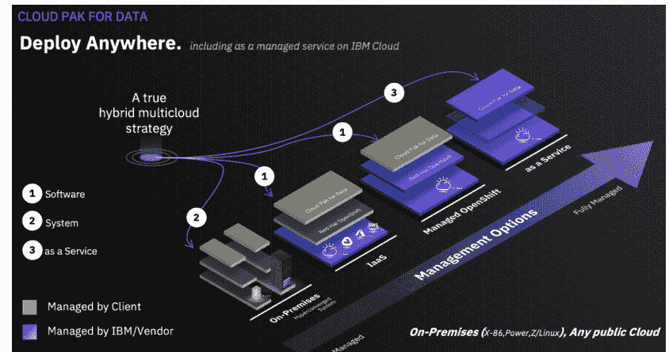
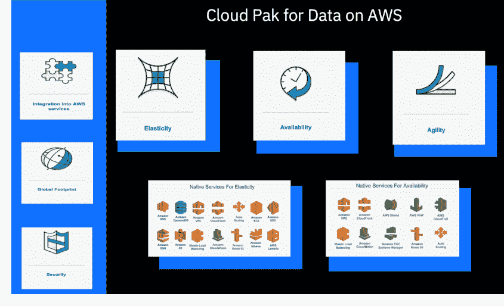
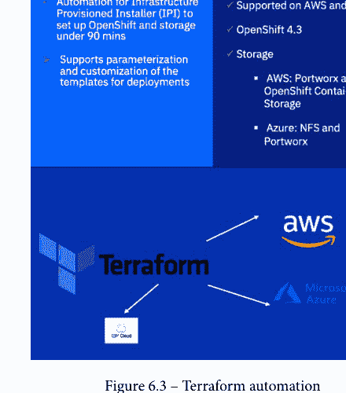
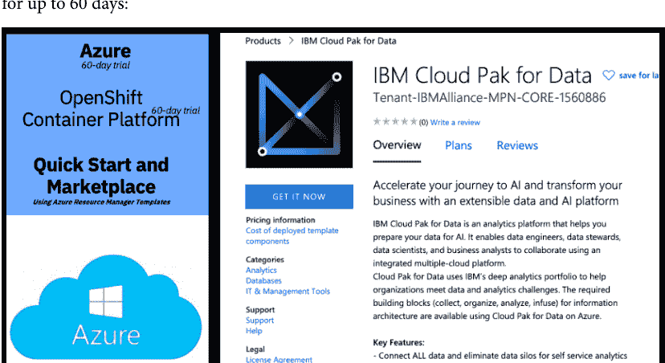
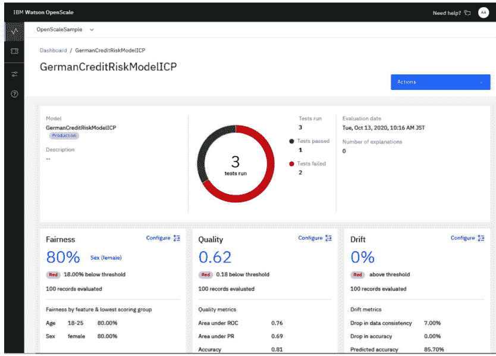
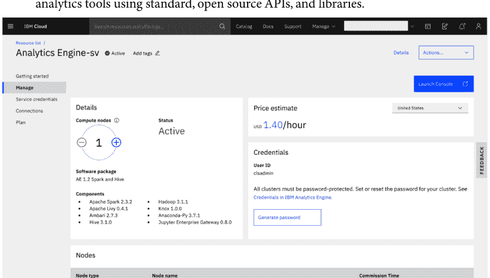
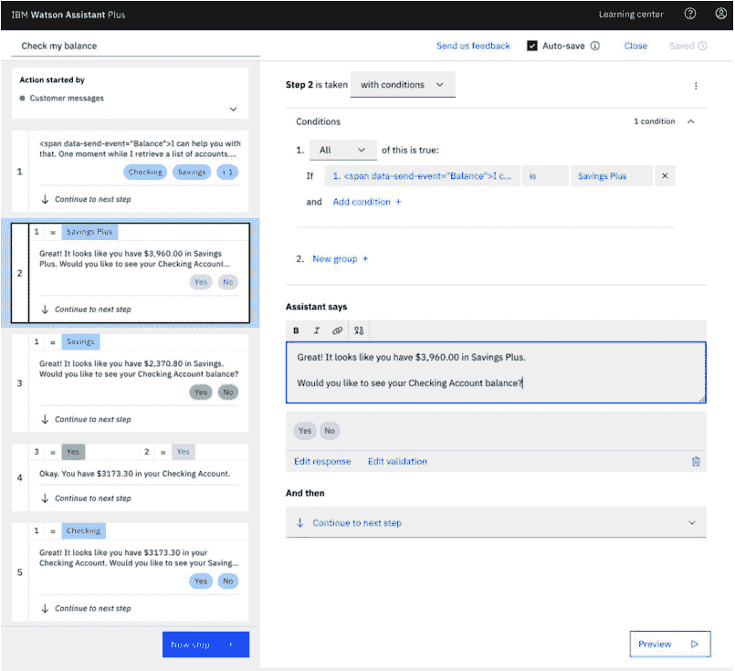
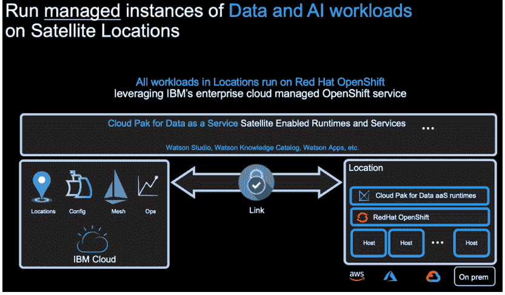
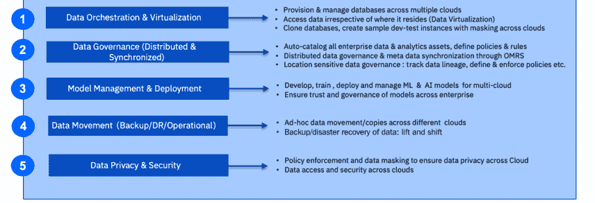

## 多云战略与 Cloud Satellite

混合多云支持是 Cloud Pak for Data 的基础支柱，而能够在任意位置（私有云或任何公有云）部署和运行的功能一直是 Cloud Pak for Data 的关键差异化优势之一。在本章中，我们将进一步了解所支持的公有云和私有云、Cloud Pak for Data 即服务的演进，以及 IBM 在第三方云上支持托管服务的战略。我们将探讨 IBM 多云支持背后的业务和技术概念，并简要介绍 IBM Cloud Satellite。这将帮助客户利用 IBM 技术制定有效的多云战略。

我们将讨论以下主要主题：

- IBM 的多云战略
- 支持的部署选项
- Cloud Pak for Data 即服务
- IBM Cloud Satellite
- 面向多云未来的数据编织

### IBM 的多云战略

IBM 是少数从第一天起就拥抱混合多云战略的技术供应商之一，这一点从 IBM 支持的部署选项中可见一斑。能够部署到任何位置是 Cloud Pak for Data 的一个关键差异化优势。虽然软件和系统部署选项最受客户欢迎，但从长远来看，Cloud Pak for Data 即服务才是 IBM 的战略方向。Cloud Pak for Data 的即服务托管版本于 2020 年在 IBM Cloud 上推出，现在通过 Cloud Satellite 支持在第三方云上运行，我们将在本章后面详细讨论。

即服务的价值主张在于，它让客户无需安装、管理或更新，即可实现数据收集、组织、分析及 AI 注入方式的现代化。本质上，你可以获得一体化数据与 AI 平台（即 Cloud Pak for Data）的所有优势，而无需承担管理基础设施或软件的额外负担。

图 6.1 – IBM 的混合多云战略

随着对软件即服务（SaaS）的需求不断增长，Cloud Pak for Data 即服务已成为 IBM 的战略重点。此外，IBM 推出了 Cloud Satellite，以便在本地和第三方云上交付 SaaS。其目标是让客户拥有灵活的自主选择权，使他们能够在所选的基础设施上使用软件和 SaaS，例如本地私有云（x86、Power、Z）或 IBM Cloud、AWS、Azure 等公有云。接下来，我们将介绍支持的部署选项。

### 支持的部署选项

Cloud Pak for Data 提供三种部署选项：软件、系统和即服务，让客户在选择部署和运行软件的位置以及 Cloud Pak for Data 的管理方式方面拥有很大的自主权：

- Cloud Pak for Data **软件**可运行于任何私有云或公有云，包括 AWS、Azure 和 GCP。同时支持托管式 **IBM Cloud 上的 OpenShift（ROKS）**、托管式 **AWS 上的 OpenShift（ROSA）** 和托管式 **Azure 上的 OpenShift（ARO）**。
- Cloud Pak for Data **系统**是一个真正的即插即用、一体化企业数据与 AI 平台，包含所有必需的硬件和软件组件。
- Cloud Pak for Data *即服务*通过 **IBM Cloud Satellite** 在 IBM Cloud 和 AWS 等第三方云上运行。

对于尚不能接受公有云或更倾向于非 IBM 云的企业客户，可用选项如下：

- **私有云**：Cloud Pak for Data 软件随附嵌入式 Red Hat OpenShift，使客户能够在自己的数据中心部署和运行云原生数据与 AI 平台。另外，客户也可以选择 Cloud Pak for Data 系统，这是一款预装硬件和软件的一体化设备，针对端到端数据与 AI 工作负载进行了优化。
- **第三方云**：Cloud Pak for Data 软件支持在所有主流公有云上运行，包括 AWS、Azure 和 GCP，既可以直接运行在它们的云基础设施上，也可以运行在它们的托管式 OpenShift 服务上，例如 **AWS 上的 Red Hat OpenShift（ROSA）** 或 **Azure Red Hat OpenShift（ARO）**。

### 托管式 OpenShift

Red Hat 已在所有主流云供应商（包括 IBM Cloud、AWS、Azure 和 GCP）上推出托管式 OpenShift 服务。客户可以运行自己的工作负载（包括 Cloud Pak for Data 工作负载），而无需担心 OpenShift 的维护、管理和升级，这对非技术人员来说并非易事。

IBM Cloud Pak for Data 目前可在三种主要的托管式 OpenShift 服务上使用并获得支持，分别是 IBM Red Hat ROKS、Amazon ROSA 和 Microsoft ARO。托管式 OpenShift 的主要价值主张包括四个关键点：

- **节省时间**：Red Hat 负责管理 OpenShift，让客户可以专注于数据和 AI 工作负载。此外，交付管道已预先集成用户友好的管理工具，简化了管理和运维 Cloud Pak for Data 所需的工作。
- **一致性**：基于 Red Hat OpenShift 的多云可随处运行，包括公有云和本地环境，混合支持使部署方式更灵活。此外，它让客户能够专注于一种跨越所有部署选项的 Kubernetes 发行版（即 OpenShift），并在该领域积累技能。
- **可移植性**：Red Hat OpenShift 工作负载可在任何主流云供应商上以一致的方式运行，为客户提供所期望的选择和灵活性。更重要的是，这使客户能够在需要时将工作负载从一个云供应商迁移到另一个云供应商。
- **可扩展的 Red Hat OpenShift**：无论部署在哪里，都可以通过同一个 Red Hat 账户控制版本和许可。

以下是提供商作为托管式 OpenShift 服务一部分所管理的所有项目：

- 自动预置和配置基础设施（计算、网络和存储）。
- 自动*安装和配置 OpenShift*，包括高可用性跨可用区配置。
- 自动升级所有组件（操作系统、OpenShift 组件和集群内服务）。
- 对操作系统和 OpenShift 进行安全补丁管理。
- 自动执行 OpenShift 组件和工作节点的故障恢复。
- OpenShift 配置的自动扩展。
- 自动备份 OpenShift 核心 ETCD 数据。
- 与云平台的内置集成——监控、日志记录、Key Protect、IAM、Activity Tracker、Storage、COS、Security Advisor、Service Catalog、Container Registry 和 Vulnerability Advisor。
- 内置负载均衡器、VPN、代理、网络边缘节点、私有集群和 VPC 功能。
- 内置安全性，包括镜像签名、镜像部署强制和硬件信任。
- 24/7 全天候全球**站点可靠性工程（SRE）**，用于维护环境健康并提供 OpenShift 支持。
- 全球 SRE 团队在 IBM Cloud 基础设施、Kubernetes 和 OpenShift 方面拥有丰富的经验和技能，因此可以*更快地解决问题*。
- 为你的 OpenShift 环境提供自动合规性（HIPAA、PCI、SOC2 和 ISO）。
- 一键扩容。
- 在**多可用区区域（MZR）**中自动进行多可用区部署，并与**云互联网服务（CIS）**集成以实现跨可用区流量路由。
- 自动执行操作系统性能调优和安全加固。

### AWS 快速入门

在 AWS 上，Quick Start 指的是可自动部署工作负载的模板（脚本）——此处即 Cloud Pak for Data。Quick Start 会在 3 小时或更短时间内启动、配置并运行在 AWS 上部署 Cloud Pak for Data 所需的计算、网络、存储以及所有其他相关 AWS 基础设施。对于有兴趣在 AWS 上运行 Cloud Pak for Data 的客户来说，这是一个重要的价值主张。它通过自动化节省了时间（消除了手动安装配置所需的许多步骤），并帮助客户在设计上遵循 AWS 最佳实践。

图 6.2 – AWS 上的 Cloud Pak for Data – 价值主张

AWS Quick Start 的其他优势包括 Cloud Pak for Data 最长 60 天的免费试用以及详细的部署指南。但是，它需要一个 AWS 账户——客户需承担基础设施成本。在存储方面，客户有两种选择：OpenShift Container Storage（OCS），最近更名为 OpenShift Data Foundations（ODF），或者 Portworx。

图 6.3 – Terraform 自动化

Terraform 自动化也可在 AWS、Azure 和 IBM Cloud 上使用，其优势包括：

-   轻松实现全栈部署，确保一致性和可重复性
-   通过基础设施即代码提高生产力，编写并执行代码，在几分钟内定义、部署和更新你的基础设施
-   幂等性，无论运行多少次，代码都能正确工作
-   通过自动化实现整个部署过程的自助服务，可按需调度和启动部署

### Azure Marketplace 和 QuickStart 模板

Azure Marketplace 是一个在线应用和服务市场，非常适合对 Cloud Pak for Data 软件及其服务感兴趣的 IT 专业人员和云开发人员。它让客户只需点击几下即可发现、试用、购买和部署解决方案。与 AWS 一样，Microsoft 要求拥有 Azure 账户，并从两种受支持的存储选项中选择一种，即 OCS 或 Portworx。此外，客户可以免费试用最长 60 天：

图 6.4 – Azure Marketplace 上的 Cloud Pak for Data

接下来，让我们介绍 Cloud Pak for Data as a Service。

### Cloud Pak for Data as a Service

IBM 的大多数数据和 AI 产品目前都以服务的形式提供，并打包在单一的 Cloud Pak for Data 订阅中，该订阅基于消费量，允许客户只为实际使用的部分付费。此外，为了加速现有工作负载的现代化并帮助客户迁移到云/托管服务，IBM 推出了一项名为 Hybrid Subscription Advantage（HSA）的计划，为现有软件客户提供使用 SaaS 而非软件的折扣。在本节中，我们将详细介绍 Cloud Pak for Data as a Service，包括可用的功能、定价和打包方式，以及 IBM 如何通过 HSA 帮助客户实现现代化。

如前所述，Cloud Pak for Data as a Service 允许客户现代化其收集、组织、分析和注入 AI 的方式，无需安装、管理或更新。换句话说，它帮助提供集成数据和 AI 平台的所有优势，而无需管理基础设施或软件的开销。构成 Cloud Pak for Data as a Service 的各项服务与 Cloud Pak for Data 软件相同，现有差距已在路线图中解决。以下是可用服务的简短列表及其描述和价值主张：

- 1. **IBM Watson Studio**：Watson Studio 使机器学习和深度学习大众化，加速 AI 注入你的业务以推动创新。Watson Studio 提供一套工具和一个协作环境，供数据科学家、开发人员和领域专家使用。它包括使用 IBM Watson Machine Learning 部署模型并大规模管理它们的能力，通过 Watson OpenScale 确保准确性和治理。最后但同样重要的是，它带有 Auto AI，使普通用户只需点击几下即可构建复杂模型。
  - a) **IBM Watson Machine Learning**：IBM Watson Machine Learning 是一项全服务的 IBM Cloud 产品，使开发人员和数据科学家能够轻松协作，将预测能力集成到他们的应用程序中。Machine Learning 服务是一组 REST API，你可以从任何编程语言调用这些 API 来开发应用程序，从而做出更明智的决策、解决棘手的问题并改善用户成果。
  - b) **IBM Watson OpenScale:** IBM Watson OpenScale 在其整个生命周期中跟踪和衡量 AI 的结果，并在不断变化的业务环境中调整和治理 AI。它还有助于处理漂移可解释性和偏差检测。

图 6.5 – Watson OpenScale

- 2. **IBM Watson Knowledge Catalog:** 使用 IBM Watson Knowledge Catalog 简化和组织你的企业数据，轻松实现大规模数据的查找、共享和治理。客户可以创建其数据的 360 度视图，无论数据存储在哪里（或采用何种格式），自动从众多受支持的数据源中发现数据，与其他用户协作，并通过定义策略和监控执行来控制数据访问。

- 3. **Data Virtualization** 使您能够跨多个系统查询数据，而无需复制和复制数据，从而节省时间并降低成本。Data Virtualization 从其源查询数据，通过提供最新和最准确的数据简化您的分析。Data Virtualization 服务会自动将您的数据节点组织到协作网络中，以提高计算效率。您可以使用大型或小型数据源定义星座。数据永远不会缓存在云或其他设备上。此外，您私有数据库的凭据会加密并存储在您的本地设备上。

- 4. **IBM Db2**：一个完全托管、高性能的关系型数据存储，运行企业级 Db2 数据库引擎，IBM Db2 旨在应对地球上最艰巨的关键任务工作负载，具有自适应工作负载管理、时间旅行查询、查询联合、数据库内 AI、行/列访问控制、审计以及支持 JSON、XML 和地理空间数据集等高级功能。客户可以独立扩展和管理其部署的计算和存储需求。通过自助式托管备份到对象存储并支持时间点恢复，可以将数据恢复到任何指定时间，同时所有客户数据在传输和静态时均加密。
  - a) **IBM Db2 Warehouse**：一个完全托管的弹性云数据仓库，可独立扩展存储和计算。它提供高度优化的列式数据存储、可操作的压缩和内存处理，以增强您的分析和机器学习工作负载。

- 5. **IBM DataStage** 提供业界领先的批量和实时数据集成，可在本地和混合云环境中构建可信的数据管道，允许任何集成风格（ETL 或 ELT）为 AI 准备数据。请注意，ETL 代表 **Extract, Transform, Load**（提取、转换、加载），而 ELT 是先提取和加载，然后进行处理。与您的同事一起使用 DataStage Flows，并控制对项目的管理员、编辑者或查看者访问权限。在友好的用户界面中，轻松在无代码/低代码环境中进行数据集成工作。在安全的云环境中根据需要水平或垂直扩展。利用共享平台连接以及与 Cloud Pak for Data 中其他产品的集成。

- 7. **IBM Analytics Engine** 帮助使用开源 Apache Spark 和 Apache Hadoop 开发和部署分析应用程序。使用您自己的分析库和开源包自定义集群。与 IBM Watson Studio 或第三方应用程序集成，向集群提交作业。达拉斯区域为标准小时计费和标准月度计划提供 HIPAA 就绪选项。通过选择合适的软件包、版本和集群大小，根据应用程序的要求定义集群。在需要时使用集群，并在所有作业运行完毕后再次删除它。使用第三方分析库和包自定义集群，并从 IBM Watson（如 IBM Watson Studio 和 Machine Learning）部署工作负载。基于符合 ODPi 的 Apache Spark 和 Apache Hadoop 技术栈构建，以扩展开源投资。使用标准的开源 API 和库集成分析工具。

图 6.8 – IBM Analytics Engine

- 8. **IBM Match 360 with Watson** 帮助使用主数据快速构建用于分析和其他数据科学用例的数据管道。从您的 IBM MDM Advanced 或 Standard Edition 实体开始，或从知识目录中包含参与方信息的任何数据资产开始，快速将新属性映射并建模到您的数据模型中，以获得更完整的客户视图。AI 驱动的匹配引擎利用客户信赖的统计方法加速配置，以产生准确的结果。结果可通过 RESTful API 访问，导出为平面文件，或通过实体资源管理器在线查看。使用受治理的数据资产扩展 MDM Advanced 或 Standard Edition 中的现有主数据实体。

启用对主数据实体的文本搜索和查询。使用 RESTful API 或 IBM App Connect 构建服务集成，以便在业务应用程序或数据仓库中使用。自动对字段进行分类并映射到您的数据模型，并使用以数据为先、AI 建议的匹配属性来优化算法。内置机器学习和多年的经验可加快配置和调整实体匹配算法的速度。

- 9. **Watson Assistant：** 将对话界面构建到任何应用程序、设备或渠道中。为您的应用程序添加自然语言界面，以自动化与终端用户的交互。常见应用包括虚拟代理和聊天机器人，可在任何渠道或设备上集成和通信。通过易于使用的 Web 应用程序训练 Watson Conversation 服务，该应用程序旨在让您能够快速构建应用程序与用户之间的自然对话流程，并部署可扩展、经济高效的解决方案。

  

  Figure 6.9 – IBM Watson Assistant

  - a) **Speech to Text** 服务将人类语音输入转换为文本。该服务使用深度学习 AI 应用语法、语言结构以及音频和语音信号的组成知识，以准确转录人类语音。它可用于语音自动聊天机器人、客户服务呼叫中心的分析工具以及多媒体转录等多种应用。
  - b) **Text to Speech** 服务将书面文本转换为自然听感的语音。该服务以最小延迟流式传输合成的音频。音频使用其语言和方言的适当节奏和语调，提供流畅自然的声音。该服务可用于语音自动聊天机器人，以及各种语音驱动和无屏幕应用，例如残疾人或视障人士工具、视频旁白和配音，以及教育和家庭自动化解决方案。
  - c) **Natural Language Understanding** 有助于分析文本并从内容中提取元数据，例如概念、实体、关键词、类别、情感、情绪、关系和语义角色。使用 Watson Knowledge Studio 开发的自定义注释模型，可在非结构化文本中识别行业/领域特定的实体和关系。

- 10. **Watson Discovery** 为应用程序添加认知搜索和内容分析引擎，以识别模式、趋势和可操作的洞察，从而推动更好的决策制定。它安全地统一结构化和非结构化数据，并使用预丰富内容和简化的查询语言，消除手动筛选结果的需求。完全托管的云服务中的自动化摄取和集成自然语言处理消除了处理自然语言内容的复杂性。通过使用高级开箱即用的 AI 功能，例如自然语言查询、段落检索、相关性训练、关系图和异常检测，来发现数据中的深层联系。

- 11. **开源数据库：**

  - a) **Cloudant** 是一种完全托管的 JSON 文档数据库，提供预配吞吐量容量和存储的独立无服务器扩展。Cloudant 与 Apache CouchDB 兼容，并可通过简单易用的 HTTPS API 访问，适用于 Web、移动和物联网应用。
  - b) **Elasticsearch** 将全文搜索引擎的强大功能与 JSON 文档数据库的索引优势相结合，创建了用于大量数据丰富分析的强大工具。IBM Cloud Databases for Elasticsearch 通过为您管理一切，使 Elasticsearch 变得更好。
  - c) **EDB** 是基于 PostgreSQL 的数据库引擎，针对性能、开发人员生产力和与 Oracle 的兼容性进行了优化。IBM Cloud Databases for EDB 是一种完全托管的服务，提供 24/7 运营和支持。
  - d) **MongoDB** 是一种 JSON 文档存储，具有丰富的查询和聚合框架。IBM Cloud Databases for MongoDB 通过为您管理一切，使 MongoDB 变得更好。
  - e) **PostgreSQL** 是一种功能强大、开源的对象关系数据库，具有高度可定制性。它是一款功能丰富的企业数据库，支持 JSON，让您兼得 SQL 和 NoSQL 世界的优势。IBM Cloud Databases for PostgreSQL 通过为您管理一切，使 PostgreSQL 变得更好。

### Packaging and pricing

Cloud Pak for Data as a Service 以订阅方式提供，客户按需付费，不多付费。此外，订阅积分可用于构成 Cloud Pak for Data 的任何数据和 AI 服务。这为客户提供了很大的灵活性，因为他们可以配置和使用所有范围内的服务。这些单独的服务均以具有竞争力的价格定价，以反映其提供的价值，并包含计算、内存、存储和网络等基础设施成本。

此外，IBM 还有一个名为 HSA 的有吸引力的计划，以激励现有本地客户将业务现代化到 Cloud Pak for Data as a Service。该计划的价值在于，现有软件客户将获得 Cloud Pak for Data as a Service 的大幅折扣，以抵消他们已支付的软件价值。当然，这假设客户将停止使用其他软件，转而使用 Cloud Pak for Data as a Service。

### IBM Cloud Satellite

IBM Cloud Satellite 是 IBM Cloud 的扩展，可在客户数据中心、边缘服务器或任何云基础设施上运行。IBM 已将所有云服务移植到 Kubernetes，使不同服务能够一致运行。IBM Cloud Satellite 扩展并利用了相同的底层概念，以 Red Hat OpenShift 作为其 Kubernetes 管理环境运行。

更准确地说，每个 Cloud Satellite 位置都是在本地硬件或任何第三方公有云（如 AWS 或 Azure）上运行的 IBM Cloud 实例。此外，每个 Cloud Satellite 位置都连接到 IBM Cloud 控制平面。该连接回 IBM Cloud 控制平面提供审计、数据包捕获和对安全团队的可见性，以及跨所有卫星位置的应用程序和服务的全局视图。IBM Cloud Satellite Link 将 IBM Cloud 连接到其卫星位置，并提供进出所有流量的可见性。

IBM 的战略是利用 Cloud Satellite 将 Cloud Pak for Data 托管服务带到第三方云和专用本地基础设施。截至 2021 年，一部分 Cloud Pak for Data 托管服务，包括 Jupyter Notebook 和 DataStage，已在 Cloud Satellite 上提供，可部署在第三方云上。这些服务的打包和定价与 IBM Cloud 上的方式没有区别，并且将包含运行服务的第三方云基础设施。最终目标是在您选择的<|message|> 基础设施上交付托管服务。

Figure 6.10 – IBM Cloud Satellite

那么，这一切是如何运作的？一旦建立了 Satellite 位置，这些 Satellite 位置中的所有工作负载都在 Red Hat OpenShift 上运行——具体来说是 IBM Cloud 的托管 OpenShift 服务。集成到 Cloud Pak for Data as a Service 中的服务——例如 DataStage——可以将运行时部署到这些 Satellite 位置，以便这些运行时更接近服务需要集成的[content]

启用对主数据实体的文本搜索和查询。使用 RESTful API 或 IBM App Connect 构建服务集成，以便在业务应用程序或数据仓库中使用。自动对字段进行分类并映射到您的数据模型，并使用以数据为先、AI 建议的匹配属性来优化算法。内置机器学习和多年的经验可加快配置和调整实体匹配算法的速度。

- 9. **Watson Assistant：** 将对话界面构建到任何应用程序、设备或渠道中。为您的应用程序添加自然语言界面，以自动化与终端用户的交互。常见应用包括虚拟代理和聊天机器人，可在任何渠道或设备上集成和通信。通过易于使用的 Web 应用程序训练 Watson Conversation 服务，该应用程序旨在让您能够快速构建应用程序与用户之间的自然对话流程，并部署可扩展、经济高效的解决方案。

  

  Figure 6.9 – IBM Watson Assistant

  - a) **Speech to Text** 服务将人类语音输入转换为文本。该服务使用深度学习 AI 应用语法、语言结构以及音频和语音信号的组成知识，以准确转录人类语音。它可用于语音自动聊天机器人、客户服务呼叫中心的分析工具以及多媒体转录等多种应用。
  - b) **Text to Speech** 服务将书面文本转换为自然听感的语音。该服务以最小延迟流式传输合成的音频。音频使用其语言和方言的适当节奏和语调，提供流畅自然的声音。该服务可用于语音自动聊天机器人，以及各种语音驱动和无屏幕应用，例如残疾人或视障人士工具、视频旁白和配音，以及教育和家庭自动化解决方案。
  - c) **Natural Language Understanding** 有助于分析文本并从内容中提取元数据，例如概念、实体、关键词、类别、情感、情绪、关系和语义角色。使用 Watson Knowledge Studio 开发的自定义注释模型，可在非结构化文本中识别行业/领域特定的实体和关系。

- 10. **Watson Discovery** 为应用程序添加认知搜索和内容分析引擎，以识别模式、趋势和可操作的洞察，从而推动更好的决策制定。它安全地统一结构化和非结构化数据，并使用预丰富内容和简化的查询语言，消除手动筛选结果的需求。完全托管的云服务中的自动化摄取和集成自然语言处理消除了处理自然语言内容的复杂性。通过使用高级开箱即用的 AI 功能，例如自然语言查询、段落检索、相关性训练、关系图和异常检测，来发现数据中的深层联系。

- 11. **开源数据库：**

  - a) **Cloudant** 是一种完全托管的 JSON 文档数据库，提供预配吞吐量容量和存储的独立无服务器扩展。Cloudant 与 Apache CouchDB 兼容，并可通过简单易用的 HTTPS API 访问，适用于 Web、移动和物联网应用。
  - b) **Elasticsearch** 将全文搜索引擎的强大功能与 JSON 文档数据库的索引优势相结合，创建了用于大量数据丰富分析的强大工具。IBM Cloud Databases for Elasticsearch 通过为您管理一切，使 Elasticsearch 变得更好。
  - c) **EDB** 是基于 PostgreSQL 的数据库引擎，针对性能、开发人员生产力和与 Oracle 的兼容性进行了优化。IBM Cloud Databases for EDB 是一种完全托管的服务，提供 24/7 运营和支持。
  - d) **MongoDB** 是一种 JSON 文档存储，具有丰富的查询和聚合框架。IBM Cloud Databases for MongoDB 通过为您管理一切，使 MongoDB 变得更好。
  - e) **PostgreSQL** 是一种功能强大、开源的对象关系数据库，具有高度可定制性。它是一款功能丰富的企业数据库，支持 JSON，让您兼得 SQL 和 NoSQL 世界的优势。IBM Cloud Databases for PostgreSQL 通过为您管理一切，使 PostgreSQL 变得更好。

## 

Cloud Pak for Data as a Service 以订阅方式提供，客户按需付费，不多付费。此外，订阅积分可用于构成 Cloud Pak for Data 的任何数据和 AI 服务。这为客户提供了很大的灵活性，因为他们可以配置和使用所有范围内的服务。这些单独的服务均以具有竞争力的价格定价，以反映其提供的价值，并包含计算、内存、存储和网络等基础设施成本。

此外，IBM 还有一个名为 HSA 的有吸引力的计划，以激励现有本地客户将业务现代化到 Cloud Pak for Data as a Service。该计划的价值在于，现有软件客户将获得 Cloud Pak for Data as a Service 的大幅折扣，以抵消他们已支付的软件价值。当然，这假设客户将停止使用其他软件，转而使用 Cloud Pak for Data as a Service。

## 

IBM Cloud Satellite 是 IBM Cloud 的扩展，可在客户数据中心、边缘服务器或任何云基础设施上运行。IBM 已将所有云服务移植到 Kubernetes，使不同服务能够一致运行。IBM Cloud Satellite 扩展并利用了相同的底层概念，以 Red Hat OpenShift 作为其 Kubernetes 管理环境运行。

更准确地说，每个 Cloud Satellite 位置都是在本地硬件或任何第三方公有云（如 AWS 或 Azure）上运行的 IBM Cloud 实例。此外，每个 Cloud Satellite 位置都连接到 IBM Cloud 控制平面。该连接回 IBM Cloud 控制平面提供审计、数据包捕获和对安全团队的可见性，以及跨所有卫星位置的应用程序和服务的全局视图。IBM Cloud Satellite Link 将 IBM Cloud 连接到其卫星位置，并提供进出所有流量的可见性。

IBM 的战略是利用 Cloud Satellite 将 Cloud Pak for Data 托管服务带到第三方云和专用本地基础设施。截至 2021 年，一部分 Cloud Pak for Data 托管服务，包括 Jupyter Notebook 和 DataStage，已在 Cloud Satellite 上提供，可部署在第三方云上。这些服务的打包和定价与 IBM Cloud 上的方式没有区别，并且将包含运行服务的第三方云基础设施。最终目标是在您选择的 infrastrukture 上交付托管服务。

Figure 6.10 – IBM Cloud Satellite

那么，这一切是如何运作的？一旦建立了 Satellite 位置，这些 Satellite 位置中的所有工作负载都在 Red Hat OpenShift 上运行——具体来说是 IBM Cloud 的托管 OpenShift 服务。集成到 Cloud Pak for Data as a Service 中的服务——例如 DataStage——可以将运行时部署到这些 Satellite 位置，以便这些运行时更接近服务需要集成的 data 或应用。名为 Satellite Link 的安全连接在 Cloud Pak for Data as a Service 与其远程运行时之间提供通信。

IBM Cloud Satellite 对数据和 AI 工作负载的价值主张有三点：

- 1. **Data gravity**：最小化数据移动和冗余，这也有助于避免出口成本。在数据所在位置附近训练 AI 模型，可消除延迟并提高性能。
- 2. 现代化传统工作负载，并在本地或您选择的第三方云上实现云原生优势：
  - 易于配置并按需扩展。
  - 无缝升级，停机时间可忽略不计。
  - 实现托管服务的优势。
- 3. 解决监管和合规挑战：
  - 在不移动数据的情况下共享洞察：处理数据主权挑战。
  - 符合 GDPR、CCPA 等。

现在我们已经了解了 IBM Cloud Satellite 的基础知识和 IBM 的多云方法，让我们来看一下 **data fabric**。

### A data fabric for a multi-cloud future

云正在改变每个企业，多云是未来。为了取得成功，企业将必须在私有云和公有云之间访问、治理、保护、转换和管理数据。这就是 IBM 使用数据 fabric 所解决的问题，这是一项重大努力，可能需要数年时间。数据 fabric 的坚实基础始于集中式元数据管理、数据治理和数据隐私，当通过自动化增强时，确实有助于放大其优势。

下图展示了面向多云未来的数据编织：

图 6.11 – 多云未来的数据编织

此行与上一段最后一行重复——请删除其中一处。

### 摘要

如今，托管服务/SaaS 绝对必不可少，Cloud Pak for Data 提供了一套全面且不断发展的功能，可满足端到端的客户需求。通过简化打包、定价以及现代化升级激励，IBM 让现有客户和新客户都能轻松采用 Cloud Pak for Data 即服务。在本章中，您了解了 Cloud Pak for Data 的不同部署选项、受支持的第三方云，以及其托管服务（Cloud Pak for Data SaaS 产品）的概览。您还了解了 IBM 的愿景，即在您选择的任何基础设施（包括第三方云提供商）上提供 Cloud Pak for Data 托管服务。这可以通过 Cloud Satellite 实现，它是 IBM 对 AWS Outposts 和 Azure Stack/Arc 的回应。

最后，IBM 正在大力投资其数据编织，以跨云访问、治理、管理和保护数据和 AI 工作负载，从而满足多云未来不断变化的需求。

在下一章中，我们将了解 Cloud Pak for Data 生态系统，它补充并扩展了基础 Cloud Pak for Data 所包含的功能。
