## 7 IBM 与合作伙伴扩展服务

## 

生态系统是任何成功平台的关键组成部分，**Cloud Pak for Data** 也不例外。如*第 2 章“Cloud Pak for Data：简介”*所述，它采用两级打包结构，包括“一个附带一组模块化服务的基础平台，但作为一个整体进行定价和打包，让客户可以按需使用”和“可选且单独定价/打包的高级扩展服务”。

本章重点介绍来自 **IBM** 的扩展服务，也称为来自我们生态系统合作伙伴的插件和功能。IBM 扩展服务与 Cloud Pak for Data 紧密集成，并包含使其能够独立运行或作为集成平台一部分运行的平台服务。另一方面，第三方扩展需要 Cloud Pak for Data 和 **Red Hat OpenShift**。

在本章中，我们将涵盖以下主要主题：

- IBM 与第三方扩展服务
- 收集类插件：**Db2 Advanced** 和 **Informix**
- 组织类插件：Data Stage、Information Server、主数据管理和 IBM Virtual Data Pipeline
- 注入类插件：Cognos Analytics、Planning Analytics、Watson Assistant、Discovery、Watson AI for Operations、Watson Financial Crimes Insight 等
- Cloud Pak for Data 插件的现代化升级

### IBM 与第三方扩展服务

扩展服务概念最好用 iPhone 的简单类比来解释。当某人购买 iPhone 时，除了硬件和 Apple iOS 操作系统外，您还会收到 Apple 预装且预集成的多款应用，例如相机、地图、电话、iMessage、音乐等。这些预装且紧密集成的应用让客户从第一天起就能上手使用，满足其大部分日常需求。这些开箱即用的应用已包含在初始购买中。此外，您还可以从 App Store 下载第三方高级应用，这些应用单独定价和打包。这些是可选的应用程序，用于满足特定需求并提升 iPhone 的整体价值。

Cloud Pak for Data 的两级打包结构（如下所示）与 iPhone 有些类似。购买 Cloud Pak for Data 时，您有权使用一系列数据和 AI 功能，这些功能用于收集、组织、分析数据，以及将 AI 注入业务流程。当然，这些是模块化服务集，使客户只需使用所需功能，同时保留未来扩展或伸缩的能力。与 App Store 类似，Cloud Pak for Data 也包含一个由 IBM 和第三方供应商提供的高级服务生态系统，使客户可以选择性地使用更广泛的功能。这些被称为扩展服务。IBM 扩展服务紧密集成。它们包含 Red Hat OpenShift 的使用权，以及使其能够独立运行或作为更广泛平台一部分运行的通用平台服务。因此，它们也被称为插件。另一方面，第三方服务以 Cloud Pak for Data 和 Red Hat OpenShift 为先决条件，并支持与平台进行有限的集成。尽管如此，它们非常有价值，有助于补充基础平台的功能：

### 类比：iPhone 应用

Apple 应用、通过市场销售的第三方应用以及自定义应用

### 多云

图 7.1 – Cloud Pak for Data：两级打包结构

上图说明了 iPhone 类比，以及如何通过 IBM、第三方合作伙伴和自定义应用提供的高级扩展服务来扩展和定制 Cloud Pak for Data。

### 收集类扩展服务

数据是企业做出更明智决策的基础，也是推动数字化转型的关键。AI 阶梯中的“收集”层旨在让数据变得简单易用，Cloud Pak for Data 包含多项基础功能，可满足大多数客户需求，例如数据虚拟化、Db2 Warehouse、Big SQL 等。此外，客户还可以使用以下小节中详细描述的扩展服务。

#### Db2 Advanced

IBM Db2 为事务性工作负载提供高级数据管理和分析功能。Db2 是世界上第一个关系数据库，没有处理器、内存或数据库大小限制，因此非常适合任何规模的工作负载。Db2 服务使您能够在 Cloud Pak for Data 集群中创建这些数据库，以便您可以治理数据并将其用于更深入的分析：

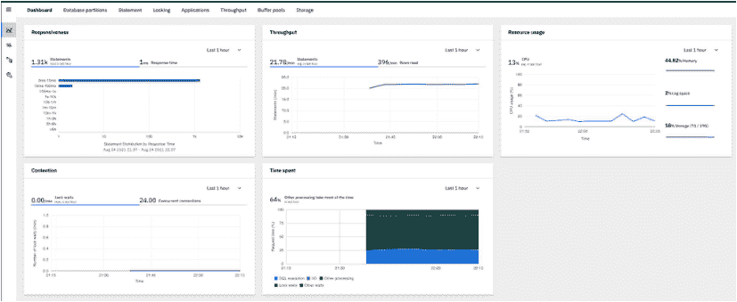

图 7.2 – Db2 插件

Cloud Pak for Data 平台上的 Db2 数据库可以满足多种用例要求，包括以下方面：

- 为金融机构、零售店、网站等持久化和管理事务性数据
- 复制事务性数据以运行分析，而不影响常规业务运营
- 通过**符合 ACID 的数据库**确保数据完整性
- 确保对业务运营的低延迟和实时洞察

#### Informix

**Informix** 服务在 IBM Cloud Pak for Data 上提供 Informix 数据库。高性能 Informix 引擎提供丰富的功能，包括**时间序列、空间、NoSQL、**和 SQL 数据，可通过 **MQTT、REST** 和 **MongoDB** API 访问。

将 Informix 数据库集成到 Cloud Pak for Data 可带来以下好处：

- 为快速变化的数据模型提供运营数据库
- 提供集成到运营数据库中的轻量级低延迟分析
- 存储来自**物联网（IoT）**设备或传感器的大量数据
- 存储和提供多种不同类型的内容：

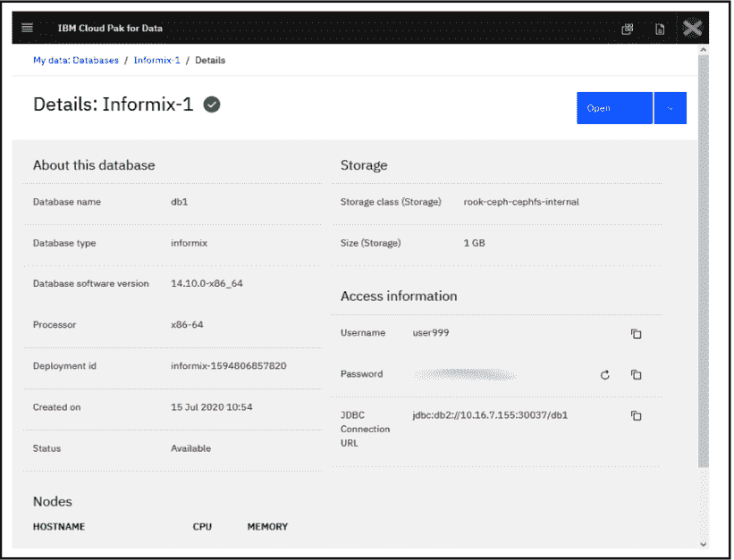

图 7.3 – Informix 插件

#### 虚拟数据管道

**虚拟数据管道（VDP）**支持为数据科学、分析和测试目的访问类生产数据。传统上，企业会采用耗时的复制生产数据的方法来实现此目的，这会导致敏感数据的暴露风险更高。借助 Cloud Pak for Data 中的 VDP 服务，我们现在可以创建单个存储高效、可选掩码的物理数据源黄金副本。这可以进一步与其他数据源结合，并使用 **CP4D** 数据虚拟化功能进行虚拟化：

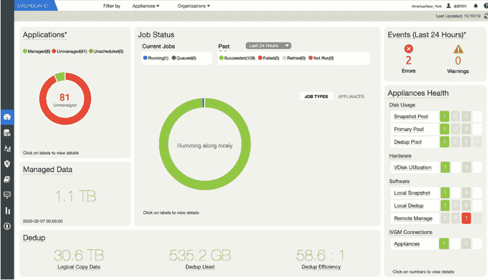

图 7.4 – 虚拟数据管道

VDP 可用于以下用例：

- 缩短应用程序测试和开发时间
- 降低存储成本
- 为测试、开发和分析提供安全的自助式数据供应解决方案

#### EDB Postgres Advanced Server

**EnterpriseDB Postgres Advanced Server** 是一个集成的、企业级版本的开源 **PostgreSQL** 数据库，具备先进的企业安全、性能诊断、Oracle 兼容性以及其他生产力特性：

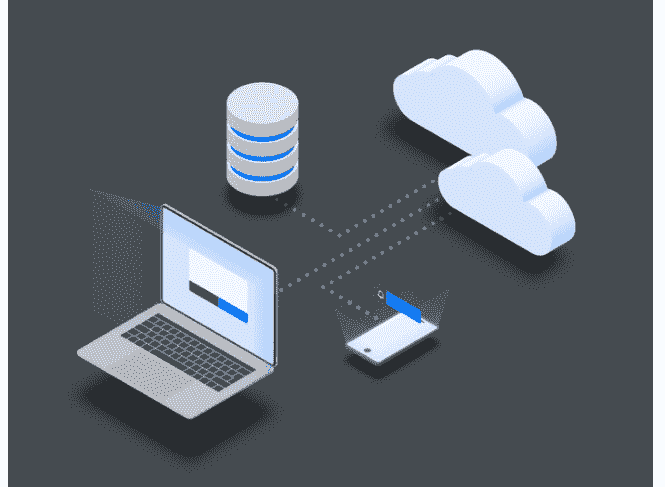

图 7.5 – EDB Postgres Advanced Server

EDB Postgres Advanced Server 的用例包括以下方面：

- 适用于新应用的 DevOps、无模式、多编程语言支持的快速开发
- 需要多模式灵活性和与主流数据源集成的应用现代化
- 遗留迁移需要 Oracle 兼容性
- 支持向云迁移的灵活部署选项

#### MongoDB Enterprise Advanced

**MongoDB Enterprise Advanced** 是一个高度可扩展、面向文档的 NoSQL 数据库，支持动态模式，使其更容易在特定类型的应用程序中集成数据。Cloud Pak for Data 中的 MongoDB 服务是一个具有自动扩展功能的高可用数据库。

MongoDB Enterprise Advanced 还为您提供全面的运维工具、高级分析和数据可视化、平台集成以及认证：

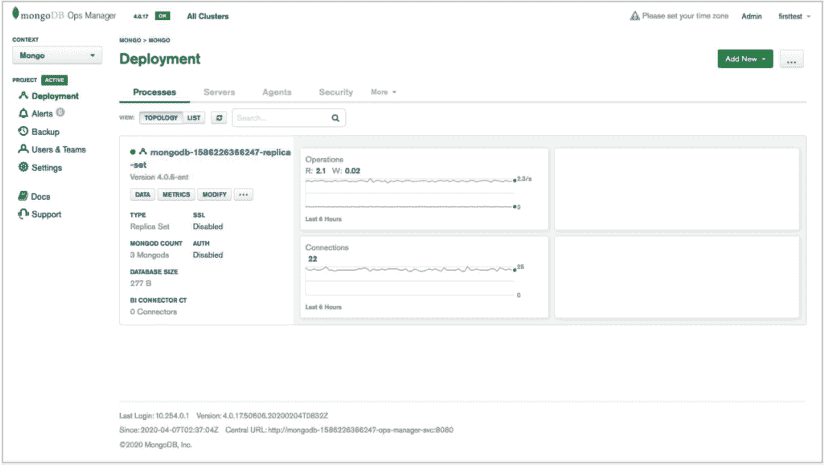

图 7.6 – MongoDB Enterprise Advanced

MongoDB 的用例包括以下方面：

- 遗留应用现代化，需要不断演进的模式
- 将企业数据作为服务提供，需要组合来自不同来源的数据
- 实施云数据战略，需要可扩展性和可移植性

在下一节中，我们将讨论如何组织扩展服务。

### 组织扩展服务

AI 阶梯的“收集（Collect）”层级是将数据放入适当的持久化存储并实现轻松访问，而“组织（Organize）”扩展服务则致力于构建可信的分析基础。这涵盖数据准备、数据转换、数据治理、数据隐私、主数据管理以及企业范围内数据的生命周期管理。虽然 Cloud Pak for Data 的基础产品包含一组丰富的数据准备、数据治理和数据隐私功能，但 Organize 层级的其余部分可通过以下四个扩展服务（也称为扩展包）获得：

#### DataStage

数据集成是任何企业的关键方面，随着企业数据资产的规模不断增加和分布式特性（通常分布在多个云和数据中心），它变得更加重要。IBM DataStage 是企业领先的提取、转换、加载（ETL）产品，拥有数千家客户，以其可扩展性和运营效率而闻名。您可以使用 Cloud Pak for Data 上的 DataStage 服务来设计和运行移动及转换数据的数据流，这使您能够快速、准确地组合和运营数据流。通过直观的图形设计界面，您可以连接到各种数据源，集成和转换数据，并以批处理或实时方式将其交付到目标系统。

这两种服务都为您的数据流提供了数百个开箱即用的内置业务操作。支撑 DataStage 的高性能并行运行时引擎使企业能够扩展以满足其集成需求，即使数据量和数据复杂性不断增加。

Cloud Pak for Data 上的 DataStage 有以下两种版本：

- DataStage Enterprise
- DataStage Enterprise Plus

DataStage Enterprise 帮助设计数据集成作业，并允许数据工程师为多个源和目标转换及移动数据。您可以创建可重用的作业模板，或在直观的图形界面中设计数据集成流。数据工程师还可以使用各种转换器和阶段来设计从简单到复杂的作业，而高性能运行时引擎则支持可扩展性并高效集成大量数据。

DataStage Enterprise Plus 包含 DataStage Enterprise 的所有功能，并额外提供了用于数据质量的有用功能。这些功能包括：

- 通过识别潜在异常和元数据差异来清洗数据
- 通过数据匹配和两个数据集之间数据实体的概率匹配来识别重复项

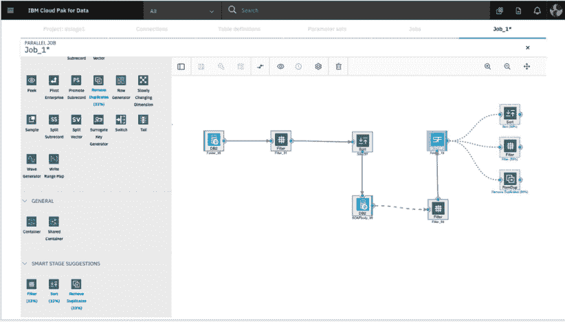

图 7.7 – DataStage 扩展包

#### Information Server

Cloud Pak for Data 上的 IBM **Information Server** 扩展包为 IT 和**业务线（LOB）**用户提供了一套全面的功能，用于组织所有企业数据。它是一套服务，包括处理数据集成、数据质量和数据治理的功能。此扩展包是 DataStage 的超集，并为以下方面提供无缝集成和一致的用户体验：

- 自动化数据发现
- 策略驱动的治理
- 自助式数据准备
- 对传输中和静态数据进行数据质量评估和清洗
- 高级动态或批处理导向的数据转换和移动

#### 主数据管理

主数据是每笔业务交易、应用程序和决策的核心。用于 IBM Cloud Pak for Data 的 IBM **Master Data Connect** 服务提供 RESTful API，使地理分布的用户能够从 IBM **InfoSphere Master Data Management**（**InfoSphere MDM**）快速、可扩展且并发地访问您组织中最受信任的主数据。

InfoSphere MDM 充当中央存储库，用于跨组织管理、存储和维护主数据。InfoSphere MDM 提供以下功能：

- 组织关键业务事实的整合、集中视图
- 在主数据的整个生命周期内管理主数据的能力：

  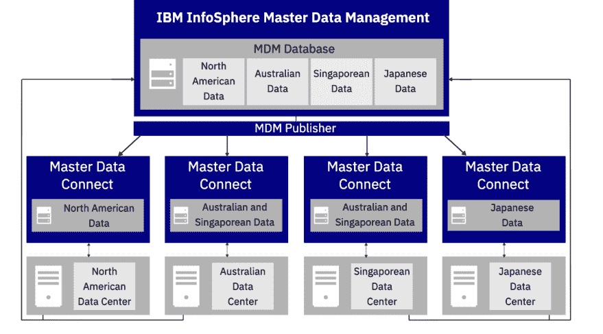

  图 7.8 – 主数据管理扩展包

InfoSphere MDM 11.6.0.11 或更高版本支持使用 IBM **MDM Publisher** 功能发布到 Master Data Connect。使用 MDM Publisher，您可以一次性批量加载主数据到 Master Data Connect，或设置持续的数据同步。当您在用户界面中配置 Master Data Connect 数据订阅时，MDM Publisher 会创建、运行并管理由此产生的数据加载作业。

加载组织的主数据后，Cloud Pak for Data 用户或应用程序可以使用强大的 API 直接访问可信数据。这使它们能够：

- 查看主数据记录。
- 对主数据执行全文或属性查询搜索。
- 对主数据运行图数据库查询。
- 查看主数据记录之间的关系。
- 查看数据的逻辑模型。

### 分析类扩展包 – IBM Palantir

Cloud Pak for Data 的核心用例之一是数据科学，基础平台包含一组丰富的功能，用于构建、部署、管理和治理由 IBM **Watson Studio** 支持的 AI 模型。此外，Cloud Pak for Data 还包含两个高级服务（也称为扩展包）来补充核心功能。

#### IBM Palantir

用于 Cloud Pak for Data 的新的 IBM **Palantir** 扩展包将简化和加速组织如何将预测性、数据驱动的洞察注入各个行业领域的现实决策和业务运营中。IBM Palantir 服务有助于以下方面：

- 在易于部署和管理的“无代码、低代码”环境中提供面向业务的 AI 功能
- 简化数据和 AI 模型与业务决策的连接方式，同时具有可信性和可解释性
- 通过自动将数据映射到业务含义和行业上下文，为更明智的决策提供信息
- 自动化在混合云和数据环境中收集、组织和分析数据的方式

- 使用来自广泛数据和 AI 能力生态系统的服务，包括 IBM Watson：

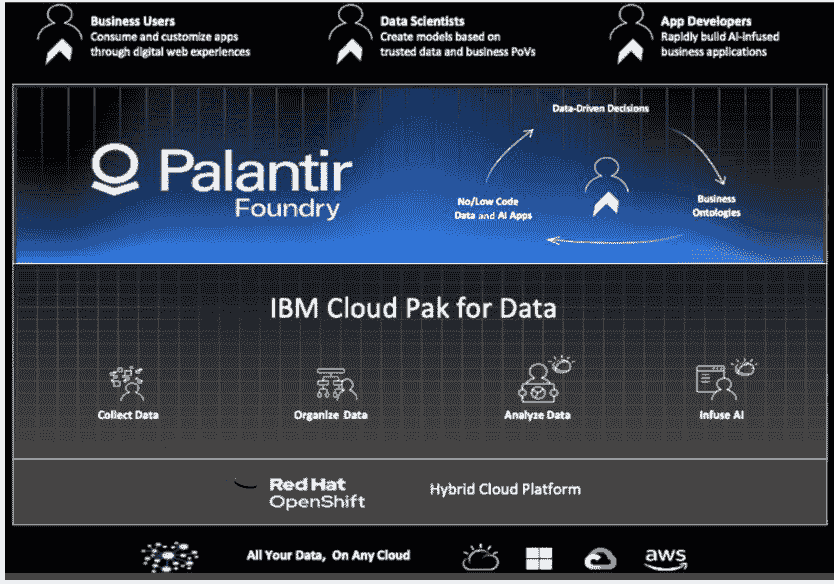

图 7.9 – 用于 Cloud Pak for Data 的 IBM Palantir

在下一节中，我们将回顾构成 AI 阶梯融入层的组件。

### 融入层组件

AI 阶梯的融入层关注业务成果，并能够将 AI 和数据驱动的洞察大规模应用于决策。它需要利用 AI 实时自动化和优化广泛的业务用例，以帮助推进业务目标。融入层由七个组件组成，这些组件有助于解决各种业务用例。这些组件将在以下小节中讨论。

#### Cognos Analytics

融入 AI 和机器学习的自助式分析使您能够创建令人惊叹的可视化，并通过仪表板和报告分享您的发现。

Cognos Analytics 服务使您能够更轻松地从数据中提取含义，具备以下功能：

- 自动数据准备
- 自动建模
- 自动创建可视化和仪表板
- 数据探索

该服务还使您能够通过令人惊叹的可视化、仪表板、报告和交互式故事轻松地与他人分享您的发现：

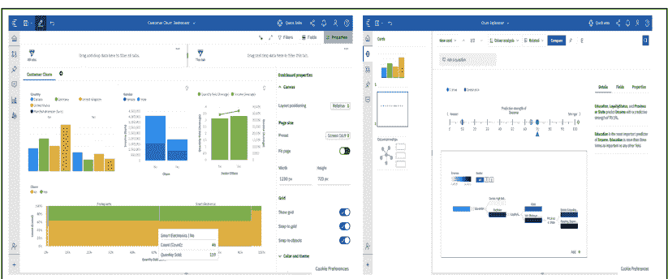

图 7.10 – Cognos Analytics 组件

#### Planning Analytics

使用整个业务中的数据，轻松创建更准确的计划、预算和预测。好的计划始于好的数据。借助由 TM1® 驱动的 IBM Planning Analytics，确保您的计划基于整个业务的数据。Planning Analytics 是一个融入 AI 的解决方案，它从多个来源提取数据，并自动创建计划、预算和预测。Planning Analytics 与 Microsoft Excel 集成，因此您可以继续使用熟悉的界面，同时突破电子表格的传统限制。

为您的电子表格注入更多分析能力，以构建复杂的多维模型，帮助您创建更可靠的计划和预测。Planning Analytics 服务包括以下内容：

- 易于使用的可视化工具
- 内置数据分析和报告功能
- 假设情景建模，帮助您了解决策的影响：

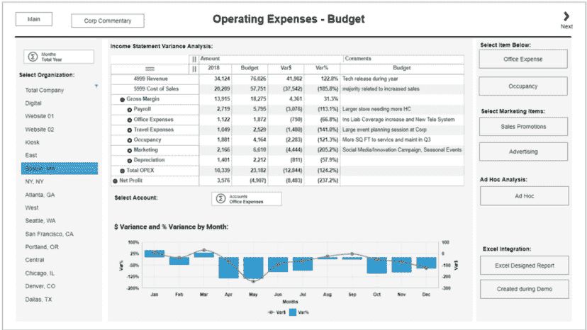

图 7.11 – IBM Planning Analytics 组件

#### Watson Assistant

AI 助手访问并“学习”数百个客户接触点，同时以集成方式与其他系统共享这些数据，从而让客户获得一致的体验，并让他们感觉公司了解他们。执行良好的 AI 驱动聊天机器人通过快速解决问题、全天候可访问性，以及通过用户最舒适的渠道（无论是网页聊天、短信、社交媒体网站，还是拨打客户服务电话）来提高净推荐值（NPS）。Watson Assistant 服务使您能够超越聊天机器人，将对话界面构建到您的应用、设备和渠道中。大多数聊天机器人模仿人类互动，但一旦出现误解，用户就会感到沮丧。Watson Assistant 为您的用户做得更多。它知道何时在知识库中搜索答案、何时请求澄清，以及何时将用户引导到真人。Watson Assistant 可以运行在任何云上，因此无论您的数据和应用位于何处，您都可以将 AI 带到它们所在之处：

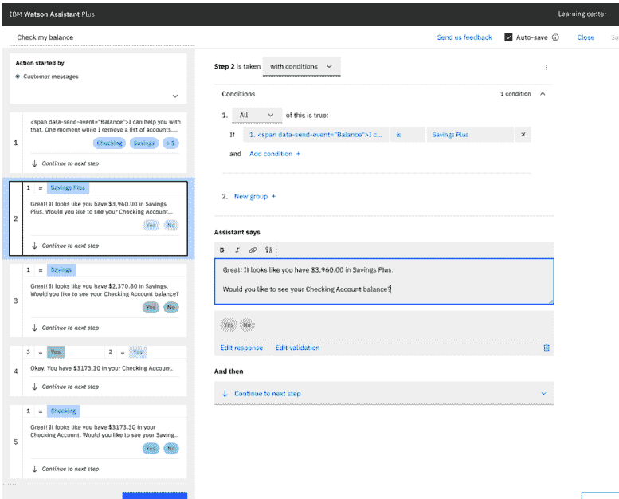

图 7.12 – IBM Watson Assistant 组件

Watson Assistant 利用并包含 Watson Discovery 来实现其部分功能。

#### Watson API Kit

Cloud Pak for Data 上的 **Watson API Kit** 组件包含以下小节中显示的服务。

#### Watson Knowledge Studio

**Watson Knowledge Studio** 服务使用 AI 来识别您所在行业独有的实体、关系和其他语言元素。本质上，它帮助教会 Watson 您所在领域的语言：

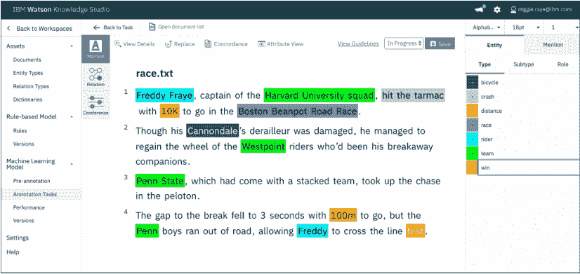

图 7.14 – IBM Watson Knowledge Studio

#### Watson Language Translator

**Watson Language Translator** 服务使您能够将文本翻译成超过 45 种语言。此外，借助 Watson Language Translator API，您可以执行以下操作：

- 识别文档中使用的语言。
- 将文档（如 Word 文档和 PDF 文件）翻译成其他语言，并保持与原文档相同的格式和布局（此功能目前处于测试阶段）。

**Watson Text to Speech** 服务提供一个 API，可将书面文本转换为多种语言和声音的自然语音。例如，您可以使用该服务执行以下操作：

- 通过以多种语言和语调与用户互动，改善客户体验和参与度。
- 为不同能力的用户提高内容可访问性。
- 提供音频选项以避免分心驾驶。
- 自动化客户服务交互以提高效率。

#### IBM OpenPages

Cloud Pak for Data 上的 IBM **OpenPages** 组件是一个集成的**治理、风险与合规（GRC）**套件，使管理人员能够识别、管理、监控和报告贯穿整个企业的风险和合规计划。

OpenPages 服务提供了一个强大、可扩展且动态的工具集，使您能够处理以下用例：

- 业务连续性管理
- 财务控制管理
- 内部审计管理
- IT 治理
- 模型风险治理
- 运营风险管理
- 政策管理
- 监管合规管理
- 第三方风险管理

然后，根据您的用例安装以下一个或多个可选软件包：

- **Financial Crimes Insight for Alert Triage**：使分析师能够利用 Watson 的分析和认知能力快速评估警报，以确定哪些警报需要进一步调查。
- **Financial Crimes Insight for Claims Fraud**：在欺诈性理赔支付之前，在保险理赔流程早期发现可疑行为。
- **Financial Crimes Insight for Conduct Surveillance**：使用全面监控、行为分析和认知洞察来识别、描述并优先处理员工不当行为：

让我们看看带有 Watson 的 IBM Financial Crimes Insight：

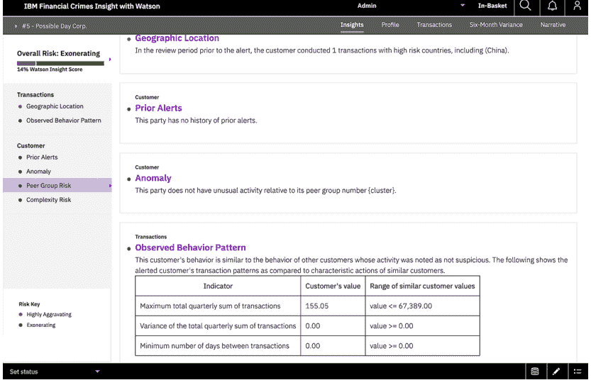

图 7.17 – 带有 Watson 的 IBM Financial Crimes Insight

接下来，我们有 IBM Surveillance Insight：

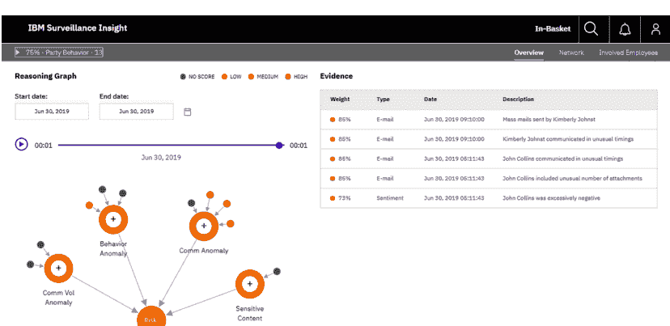

图 7.18 – IBM Surveillance Insight

现在我们已经介绍了融入层及其七个组件，这些组件有助于解决各种业务用例，接下来我们将介绍 Cloud Pak for Data 组件的现代化升级。

### Cloud Pak for Data 组件的现代化升级

IBM 拥有成千上万的客户，他们正在运行其业界领先的数据和 AI 产品，例如 Db2、DataStage、主数据管理、SPSS Modeler、决策优化、Cognos Analytics 和 Planning Analytics。从历史上看，这些产品在裸机服务器或虚拟机上运行，拥有各自独立的架构和生态系统。随着 Cloud Pak for Data 的出现，所有这些产品都已容器化，并作为服务在 Cloud Pak for Data 上提供。将独立产品现代化为 Cloud Pak for Data 上的组件，为客户带来了许多好处，例如：

- 云原生优势：Cloud Pak for Data 的现代云原生架构意味着更容易配置和扩展服务、实现无缝升级和管理。这为企业带来了巨大的成本节约。

- **部署灵活性**：除了上述云原生优势外，客户还可以灵活地在任意公有云或私有云上部署，这意味着企业不会被锁定在特定供应商上。随着越来越多的企业采用多云和混合方式来应对数据和 AI 工作负载，这种部署灵活性将进一步增强。
- **无缝集成**：服务的端到端集成以及紧密编排的数据编织确保了自助服务、易用性和自动化，这些都能为企业带来显著的回报。

IBM 最近推出了一项计划，通过支付象征性升级费用，将现有产品现代化为 Cloud Pak for Data 扩展包。客户还将获得一些额外的 Cloud Pak for Database 许可证权益。这为客户提供了一条直接的升级路径，同时将成本保持在最低水平。通过将现有的独立产品现代化为 Cloud Pak for Data 服务，客户获得的新增价值还包括可以选择以预先商定的转换价格将独立许可证转换为 Cloud Pak for Data 扩展包许可证。

### 扩展服务

除了 Cloud Pak for Data 的基础能力和扩展包之外，我们还拥有一个蓬勃发展的合作伙伴生态系统，IBM 与这些合作伙伴存在联合销售和转售关系。联合销售合作伙伴属于战术性合作，针对具体交易逐项参与；而转售合作伙伴更具战略性，拥有可由 IBM 销售人员销售的 IBM 部件编号。鉴于庞大的生态系统，我们将在接下来的小节中仅详细介绍转售合作伙伴。

#### Cambridge Semantics

**AnzoGraph DB** 是一种原生的大规模并行处理**图 OLAP (GOLAP)** 数据库，旨在加速图数据上的数据集成和可扩展分析，其性能水平可与业界领先的传统数据仓库分析产品相媲美。

#### CockroachDB

**CockroachDB** 为云应用提供云原生的分布式 SQL。

#### Hazelcast

**Hazelcast** 是一个内存计算平台，由 Hazelcast 内存数据网格和 Hazelcast 内存流处理引擎组成。这提供了一个可扩展、高吞吐量、超低延迟的解决方案，专门用于处理最关键的任务、下一代数据和 AI/ML 工作负载。

#### SingleStore

**SingleStore** 是一个高性能的分布式、关系型、融合数据库，支持事务型和分析型工作负载。该数据库每天可摄取数百万个事件，支持 ACID 事务，同时以关系型 SQL、JSON、地理空间和全文搜索格式分析数十亿行数据。

#### Datameer

**Datameer** 是一个数据准备、丰富和探索平台，可简化和加速将复杂的多源数据转换为有价值的、可业务化信息的过程。它提供简单的点击式工具，可满足任何需要准备和探索数据或为分析、AI 和 ML 创建数据集的人员的技能需求。

#### Senzing

**Senzing** 是首款即插即用的实时 AI 实体解析软件，也是目前最先进的实体解析软件。您可以使用 Senzing 来增强和转变您的大数据分析、欺诈运营、内部威胁、营销情报、风险缓解及其他运营。许多组织都在应对海量大数据的挑战，迫切需要解析实体以获得新的洞察并更快地做出更好的决策。Senzing 通过其下一代实体解析技术使这一切成为可能。

#### WAND 分类法

**WAND** 在 Cloud Pak for Data 之上提供业务词汇表，使用户在启动数据目录和分析计划时，能够获得经过验证的行业和业务职能特定术语来源。

#### Appen

**Appen**（原 Figure Eight）提供了一个数据标注平台，利用机器学习和人工标注，帮助文本、音频、图像和视频等非结构化数据成为数据科学、机器学习和产品团队可用的数据。

#### Findability Sciences

**FP-Predict+** 是 CPD 的附加组件，为最终用户提供预测和预报功能，几乎无需人工干预，无需编程，也无需手动建模。结合 Cloud Pak for Data 组件，该解决方案可跨行业和用例工作。

#### Lightbend

**Lightbend** 提供基于开源的大规模流处理系统的云原生开发。

#### Personetics

**Personetics** 为金融服务提供数据驱动的个性化和客户赋能。

#### Portworx

**Portworx** 是市场领先的 Kubernetes 存储平台，为在 Cloud Pak for Data 上运行的任何数据服务提供可扩展、高性能的容器存储、备份和灾难恢复、多云操作、数据安全、容量管理以及合规和治理。这确保了客户在运行从 IBM 购买的软件时拥有完美的操作体验。

#### Trilio

**TrilioVault** 为整个云套件提供原生备份/恢复功能。随着 OpenShift 在生产环境中部署，IT 管理员需要 Trilio 的备份/恢复功能，而开发人员需要 Trilio 的测试/开发功能以加速应用程序敏捷性。

#### 拥有联合销售协议的生态系统合作伙伴

以下列表提供了拥有联合销售协议的生态系统合作伙伴的名称：

- **BCC Group**：实时流式市场数据统一平台
- **Crunchy PostgreSQL**：面向企业的开源 PostgreSQL 发行版
- **Equifax**：包含消费者财务能力、人口统计和信用信息的数据集
- **People Data Labs**：包含 B2B 和 B2C 个人资料数据的数据集
- **Precisely**：美国和加拿大所有已知地址的综合列表
- **ZoomInfo**：增强决策的 ML 增强型 B2B 企业数据
- **ContractPodAI**：基于 SaaS 的**合同生命周期管理 (CLM)**
- **Duality Secureplus Query**：安全查询第三方控制的数据集
- **DXC Open Health Connect**：面向医疗服务提供者、支付方和生命科学行业的数字健康平台
- **Equinix**：支持在数据摄取点运行 AI 模型，以降低数据传输的成本和风险
- **Listec**：分析和可视化 SAP 运营数据的解决方案
- **Prolifics**：预测性客户发现解决方案
- **Tavant**：媒体收视率分析加速器
- **Dulles Research**：自动将 SAS 代码转换为开源代码的插件
- **NetApp**：混合多云数据服务，简化跨云和本地环境的应用程序和数据管理

### 总结

Cloud Pak for Data 拥有一个充满活力的 IBM、开源和第三方服务生态系统。在本章中，我们深入介绍了 IBM 高级服务（也称为扩展包）的功能，这些功能按照 AI 阶梯的四个层级组织，即收集（Collect）、组织（Organize）、分析（Analyze）和注入（Infuse）。

在下一章中，您将了解合作伙伴生态系统的重要性、业务合作伙伴的不同层级，以及客户如何从 Cloud Pak for Data 上的开放生态系统中受益。

在本章中，我们将介绍以下主题：

- 提高健康倡导计划的效率
- 语音聊天机器人
- 风险与控制自动化
- 增强边境安全
- 统一数据编织
- 财务规划与分析

### 提高健康倡导计划的效率

让我们通过解决客户在提高健康倡导计划效率方面面临的挑战来浏览这个用例。

**客户挑战**：一家非营利性医疗服务提供者网络和健康计划公司希望提高其健康倡导计划的效率。目标是识别有风险的会员，并降低会员发生不良事件的可能性。他们希望预测未来 9 个月内**急诊室 (ER)** 就诊的可能性。他们的挑战是要满足不同的数据科学团队对不同工具/技术的需求，以及维护这些工具/技术的支持人员。此外，他们还希望将 ML 模型投入生产，并在接下来的几年中将其扩展到所有群体。

借助 Cloud Pak for Data，他们能够使用集中式治理目录对信息资产（包括外部数据集）进行编目。他们能够建立一个治理框架，将各个资产分配给数据管家，并使用治理策略/规则定义访问策略。在获得可信数据的访问权限后，他们能够利用 Watson Studio Jupyter 笔记本训练 ML 模型，并将其部署为 Watson Machine Learning 部署。已部署的模型会持续进行偏见和模型漂移监控。

以下图表展示了 ModelOps 组件：

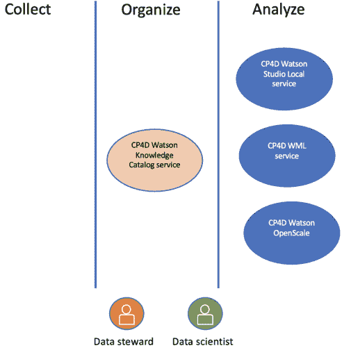

*Figure 8.1 – ModelOps component diagram*

所展示的 **Cloud Pak for Data** 服务包括 Watson Knowledge Catalog、Watson Studio 和 Watson Machine Learning：

- **Data steward(s)** 在目录中组织数据并创建治理策略和规则。此外，他们创建数据规则以模糊数据集的部分内容，确保只有授权人员才能访问数据。
- **Data scientist(s)** 利用可用的各种工具/技术（Jupyter notebooks、**SPSS modeler**、**RStudio** 等）来准备数据并训练 AI 模型。

结果是，基于会员风险等级（高、中或低风险），该客户能够优先考虑外联活动。Cloud Pak for Data 通过帮助根据其风险暴露情况主动优先考虑相关患者，从而挽救了生命。

接下来，我们将介绍另一个与语音启用聊天机器人相关的客户用例。

### Voice-enabled chatbots

客户挑战包括一家公共石油和天然气公司，该公司在查找信息技术（IT）和工程部门提供的服务的一致且完整的信息方面遇到困难。现有的系统是一个缺乏治理和采用的基于文本的交易式聊天机器人，其响应质量不佳。

借助 Cloud Pak for Data，他们能够将基于文本的交易式聊天机器人重构为语音启用、头像风格的界面，以改善用户体验，更重要的是改善对用户查询的响应。这与结构化分析相结合，有助于大幅提高客户满意度。他们使用 Watson Studio 服务中的 SPSS modeler 和 Jupyter notebooks 进行结构化分析，使用 Watson Discovery 进行文本搜索，使用 Watson API 服务进行语音转录，以及使用 Watson Assistant 实现头像风格的聊天机器人体验。

以下图表表示 AI 驱动的聊天机器人组件：

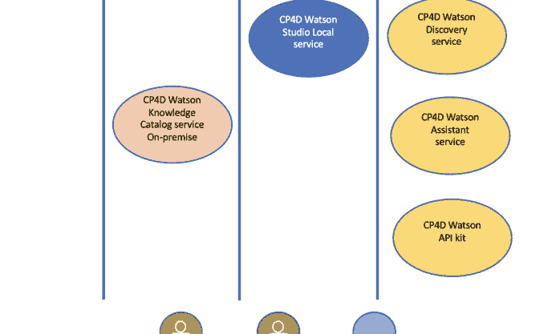

Figure 8.2 – AI-powered chatbot component diagram

所展示的 **Cloud Pak for Data** 服务包括 Watson Knowledge Catalog、Watson Discovery、Watson Assistant、Watson API 和 Watson Studio：

- **Data steward(s)** 在目录中组织数据并创建治理策略和规则。此外，他们创建数据规则以模糊数据集的部分内容，确保只有授权人员才能访问数据。
- **Business analyst(s)** 分析业务需求并定义应用程序需求，包括特定渠道的交互。
- **Data scientist(s)** 设计并训练 AI 模型，以从现有内容和助手所需的对话中推导出上下文。
- **Application developer(s)** 使用训练好的模型将这些 AI 模型集成到不同渠道的应用程序中。

该用例的结果是，通过此由 Cloud Pak for Data 驱动的解决方案，该客户现在拥有了改善的服务可访问时间。他们还帮助员工实时获取所需的信息。他们的未来计划包括在扩展整体治理策略的同时交付多个 AI 驱动的聊天机器人。

让我们继续下一个用例，该用例与风险和控制自动化相关。

### Risk and control automation

客户挑战是，一家大型金融机构要求其审计部门跟踪和评估有助于确定其风险暴露程度的控制措施。考虑到任何大型银行都有 250,000+ 个映射到风险的控制措施，这并不是一项轻松的任务。

一个良好的业务控制措施应明确说明控制措施的使用对象、内容、何时、如何以及在何处使用。银行通常因控制措施定义不明确而遭受损失。借助 Cloud Pak for Data，该客户能够训练一个 ML 模型来预测每个书面控制措施的 *Control* 质量等级。他们使用 Watson Studio 服务来训练模型，并使用 Watson Machine Learning 来部署和运营该模型。

### Enhanced border security

客户挑战是，一个复杂的海关部门负责管理货物进出该国的方式，希望利用 AI 模型来识别进入该国的风险货物，同时减少识别这些风险货物的误报数量。客户使用基于规则的引擎来识别风险货物。然而，绝大多数都是误报，这导致不必要的检查并减慢了整个海关流程。

借助 Cloud Pak for Data，该客户能够构建一个统一平台来处理其所有数据科学需求——从发现到部署。他们使用平台连接性来访问现有数据源，使用 Watson Studio 服务来训练 ML/AI 模型，使用 Watson Machine Learning 服务来部署和运营模型，并使用 Watson OpenScale 来监控这些模型并理解其背后的逻辑。

以下图表表示增强边境安全组件：

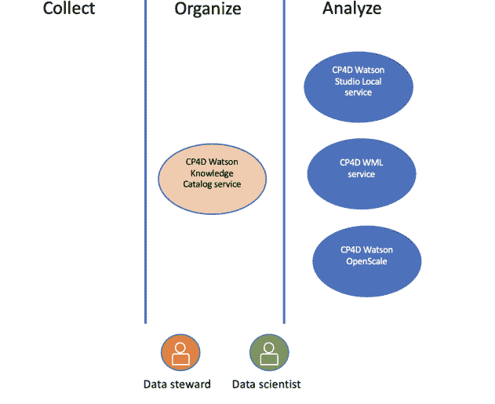

Figure 8.4 – Enhanced border security component diagram

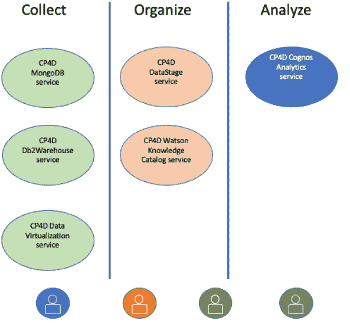

*Figure 8.5 – Data Fabric component diagram*

所展示的 **Cloud Pak for Data** 服务包括 Db2 Warehouse、MongoDB、数据虚拟化、Watson Knowledge Catalog、DataStage 和 Cognos Analytics：

- **Data engineer**(s)  provision 数据管理能力并填充数据——他们使用 MongoDB 实例用于运营数据，使用 Db2 Warehouse 实例用于存储分析数据，并使用数据虚拟化实例来虚拟化驻留在 CP4D 平台和企业其他数据源中的数据。
- **Data engineer**(s)  provision **Extract, Transform, and Load (ETL)** 能力，使用 DataStage。这允许从各种来源获取数据，使用多种运算符对其进行转换，然后加载到目标存储库。
- **Data steward(s)** 在目录中组织数据并创建治理策略和规则。此外，他们创建数据规则以模糊数据集的部分内容，确保只有授权人员才能访问数据。
- **Data analyst(s)** 和 **Business analyst(s)** 使用易于使用的拖放 Cognos Dashboard 界面创建报告和仪表板。对于更复杂的报告/记分卡/仪表板，他们必须与 **Business Intelligence (BI)** 团队合作并利用 Cognos Analytics BI 服务。

该用例的结果是，客户能够实现统一数据织物在 Cloud Pak for Data 上通过受管控的语义层改善数据访问便捷性的价值。他们轻松识别和选择队列并获得更深入见解的能力得到了极大改善，并且该平台允许更多自助式分析。

接下来，我们有一个关于财务规划和分析的客户用例。

### Financial planning and analytics

客户挑战是，一家在线分销公司希望扩展其规划运营并将跨组织协作引入规划流程。他们在扩展现有规划解决方案方面遇到挑战，该解决方案也缺乏有效的协作能力。

传统上，所有企业都进行 **Financial planning and analytics (FP&A)**。这涉及多个财务团队使用数百个相互连接的电子表格进行规划和报告。这是一个非常耗时、容易出错的过程，并限制了可用场景的数量和种类。在这个时代，组织希望超越财务，转向更具协作性和集成性的规划方法，即 FP&A。这涉及整个组织中的多个团队进行协作，目标是提高预测准确性并能够快速响应市场条件的变化。

CP4D 中的规划分析服务帮助我们摆脱这种手动的规划、预算和预测流程，转向自动化的 AI 驱动流程。您可以识别有意义的模式并构建假设情景来创建模型。这与集成的 Cognos Analytics 服务相结合，使自助式分析成为可能，并提供令人惊艳的可视化和报告。CP4D 凭借其数据管理能力和集中式治理目录，为分析提供受信任的数据访问。

