## 10 技术概述、管理与运维

Cloud Pak for Data 是一个数据和AI平台，使企业能够利用其数据并加速AI的采用，从而推动更好的业务成果。该平台帮助它们现代化数据访问机制、组织数据以进行可信分析、开发机器学习模型，并将AI融入日常业务流程。本章深入介绍了 Cloud Pak for Data 的基础层面、为其提供动力的技术栈，以及各服务如何集成以提供在企业中成功应用AI所需的关键能力。

该平台服务于多种用户角色，使他们能够轻松地相互协作，并帮助企业打破内部孤岛。它通过抽象化基础设施元素并促进服务集成来实现这一点，从而为所有最终用户提供无缝体验。企业并非一开始就使用平台上的所有服务，而是专注于特定的用例，然后根据需要逐步扩展到其他场景。您可以有不同用户组在 Cloud Pak for Data 上处理解决方案的不同部分，同时根据需要协作和共享资产。企业甚至可以让整个部门处理不同的用例，内置隔离机制，同时为每个此类*租户*提供适当的服务质量。因此，该平台还支持即插即用机制和多租户部署模型，通过额外的IBM和/或第三方服务来扩展相同的基础平台。

在本章中，我们将探讨以下不同方面：

- 架构概述
- 基础设施要求、存储和网络
- 基础服务与控制平面
- 多租户、资源管理和安全性
- Day 2 运维

#### 技术要求

为了更深入地理解本章描述的主题，读者应熟悉以下技术和概念：

- Linux 操作系统及其安全原语
- 开发软件服务的云原生方法
- 虚拟化、容器化和 Docker 技术
- Kubernetes（强烈推荐 Red Hat OpenShift Container Platform）
- 存储配置和文件系统
- Web 应用程序、Linux 主机和容器的安全加固
- Kubernetes 运算符模式（强烈推荐）
- **kubectl 和 oc** 命令行工具，以及处理 Kubernetes 对象所需的 YAML 和 JSON 格式
- 在 OpenShift Kubernetes 集群上现有安装的 Cloud Pak for Data，并具有管理权限

各节还将在上下文中提供关键外部参考资料的链接，以帮助您更详细地理解特定概念或获得有关该主题的一些基础背景。

#### 架构概述

在*第1章，AI阶梯：IBM的规范性方法*和*第2章，Cloud Pak for Data——简要介绍*中，您已经了解了我们为什么首先需要这样一个平台。在本节中，我们将首先探讨究竟什么是数据和AI平台。我们将概述此类平台的要求，然后进一步深入探讨为 Cloud Pak for Data 提供动力的技术栈。

#### 平台特性

企业需要一个基于强大云原生原则的可靠、现代化平台，以实现业务现代化。让我们从一般角度看看这样一个现代平台需要具备哪些特性：

- **弹性恢复能力：** 持续可用性是企业中关键的操作要求。用户需要能够依赖一个可以自我修复并无缝故障转移的系统，而无需系统管理员手动干预。
- **弹性伸缩：** 企业期望平台能够随着用例和客户的发展而增长。因此，可扩展的平台是另一个关键要求。我们还需要一个能够支持按需工作负载*突发*的平台，换句话说，当新工作负载进入时自动增长，并在完成时收缩。工作负载可能只是用户并发量的增加，也可能是后台任务，甚至是计划任务。
- **成本效益：** 支持在不同类型的工作负载和租户之间平衡可用计算能力也很重要。通常，这也意味着计算能力可以轻松地转移到当时需要的工作负载上；例如，能够在夜间为数据转换或ML模型重新训练任务分配更多计算资源，而在白天为交互式用户分配更多计算资源。*生产*工作负载可能比*开发*工作负载获得优先权。因此，这要求平台控制工作负载不要跨过资源阈值，确保没有嘈杂的邻居影响性能和可靠性。
- **可扩展性：** 平台应帮助客户从一个用例开始，并在需要时进行扩展。这也意味着平台不能是单体的，而应在架构上支持即插即用模型，即可以根据需要开启能力和服务。实现企业系统和第三方系统的集成，以及利用现有投资，也是快速从平台中获取价值的关键。
- **可移植性：** 企业需要一个在不同基础设施即服务提供商（包括本地环境）之间都能以相同方式工作的平台。它们需要能够轻松突发到公有云或跨多个云。
- **集成性：** 数据和AI平台需要能够服务于具有不同技能水平和职责的不同用户角色。这样的平台需要促进最终用户之间的协作，使他们具备自助服务能力，而无需持续的IT支持。这意味着无缝的用户体验和API，将实现的复杂性从其使用者那里抽象出来。
- **安全性：** 平台必须使企业能够安全地运营，使来自多个供应商的最终用户工作负载或服务能够在明确界定的边界内运行。数据和AI平台还需要确保企业满足合规要求。由于基础设施成本的经济性通常意味着使用共享计算和存储资源来支持多个租户，因此确保数据安全和租户工作负载隔离的技术成为企业的根本。

#### 技术基础

在前面的章节中，我们介绍了**Kubernetes** [1] 和**Red Hat OpenShift Container Platform** [2] 作为为所有 Cloud Paks 提供动力的核心基础设施。在本节中，我们将探讨使这项技术成为交付数据和AI平台的理想载体的能力。


Kubernetes 本质上是一个高度弹性且可扩展的平台，用于编排和运行容器化工作负载。它体现了微服务架构模式，使更小、独立的服务的持续开发和部署成为可能：

- **Resilient:** Kubernetes 使容器化工作负载能够在多个计算节点上集群化。Kubernetes 监控工作负载（“Pods”），并通过健康探测，在检测到故障时可自动重启它们。即使出现计算节点故障，它也可以自动将工作负载迁移到其他节点。这对于建立 *multi-zone* 可用性非常有效，在这种情况下，工作负载可以承受整个区域的停机。

- **Elasticity:** 计算的扩展通过向集群引入额外的计算节点优雅地处理。Kubernetes 将整个 CPU 核心和内存集合视为资源池，并可根据需要将其分配给 Pods。它还支持副本和 **load balancing** 的概念，其中工作负载可以通过多个副本（Pod 副本）进行扩展。Kubernetes 然后可以以轮询方式自动将请求路由到不同的副本，同时考虑那些在任何时刻可能不健康的副本。

- **Infrastructure abstraction:** 使用 Kubernetes，工作负载使用更高级别的构造进行部署，而无需了解托管它的 **compute infrastructure** ——无论是在本地还是在云中，或使用哪种 hypervisor。Pods 会根据所需的计算量（CPU 核心和内存）无缝调度到不同的 worker 节点上。Kubernetes 还包括使用供应商无关框架使用 **storage** 进行持久化的能力，这使企业能够使用更广泛的存储技术，包括利用企业中可能已有的现有存储解决方案。软件定义的 **networking**，以及 OpenShift 路由和入口的概念，以及服务发现模式，也确保工作负载免受网络复杂性的影响。

- **Portable and hybrid cloud-ready:** OpenShift Container Platform 在许多云 Infrastructure-as-a-Service 超大规模环境中提供标准化的 Kubernetes 运行环境，甚至作为服务提供，也可在虚拟机和裸机节点之上本地部署。Kubernetes 作为开源社区蓬勃发展，而这带来了不同版本和 API 兼容性的挑战。OpenShift 确保 Kubernetes 具有一致的发布周期，并在任何地方都提供完全验证和 *security-hardened* 的容器平台。这确保企业可以在任何需要的地方部署其应用程序或迁移到另一朵云，而不会被锁定在最初的 Infrastructure-as-a-Service 选择中。

- **A rich developer ecosystem:** Kubernetes 已迅速成为云原生应用程序的首选开发平台。OpenShift Container Platform 通过以开发人员为中心的<|message|>能力进一步扩展了这一点，包括丰富 **continuous delivery/continuous integration (CI/CD)** 的概念。专注于安全开发和运营，OpenShift Container Platform 使企业能够快速创新，以开发现代云原生应用程序和解决方案。

- **Enterprise and multi-tenancy ready:** Kubernetes，尤其是其命名空间、资源配额和网络策略的概念，可以优雅地支持租户之间的隔离。**OpenShift Container Platform** [2] 引入了额外的安全构造，包括 SELINUX 主机原语，大大提高了以经济高效的方式在多个租户之间安全共享 OpenShift 集群的能力。

因此以及更多原因，IBM Cloud Pak for Data 由 Red Hat OpenShift Container Platform 提供支持。这使 Cloud Pak for Data 能够在任何云中提供开放、可扩展、可靠和安全的 数据和 AI 平台。

### The operator pattern

Operator 模式 [3] 是一种架构概念和最佳实践，用于在 Kubernetes 中构建、交付和运营应用程序。Operators [4] 是部署在 Kubernetes 中的特殊 Controllers，旨在以自动化方式管理单个应用程序。从本质上讲，operators 将管理 Kubernetes 工作负载的人类经验编纂成代码。

Cloud Pak for Data v4 功能作为 operators [5] 交付。这些 operators 使用户能够安装和配置 *Day1* 活动。从 *Day2* 角度来看，operators 还会持续监控并自动纠正偏离常态的情况，以及在需要时支持扩展已部署的 Cloud Pak for Data 服务的需求。Operators 也被用于以自动化方式将服务升级到更新版本。

OpenShift Container Platform 包括 **Operator Lifecycle Manager (OLM)** [6] 功能，帮助 OpenShift 管理员以标准化方式为各种服务（IBM、Red Hat、开源或其他第三方供应商）策划 operators。

Cloud Pak for Data 包含一个 *Control Plane* 层，使所有服务能够无缝集成并从单个平台层进行管理。此控制平面使用名为 Cloud Pak for Data platform operator [5] 的 operator 部署。具有适当 Kubernetes 权限的用户在特定 Cloud Pak for Data 实例命名空间中创建 **Custom Resource (CR)** 对象，以指示应部署什么服务。在 Cloud Pak for Data 的情况下，*IbmcP* 类型的自定义资源会触发 Cloud Pak for Data platform operator 在该命名空间中安装控制平面。

下图提供了一个简化的 Kubernetes 集群 [10] 的高层次概述，以说明其功能，仅为说明 Cloud Pak for Data 如何利用它提供背景：

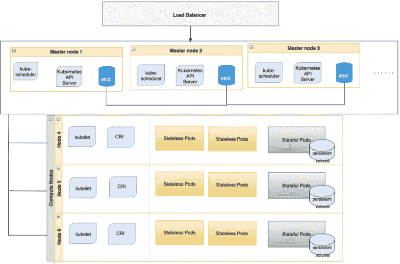

Figure 9.2 – Kubernetes architecture overview

本质上有两种主机节点类型——**Master** 和 **Compute**（worker）节点。在某些实现中，一个节点可能同时具有 master 和 compute 角色，但强烈建议保持 master 分离以确保更好的可靠性等级。每个节点都包括一些基本组件 [11]，例如 Kubelet 守护进程和与每个节点上的容器运行时交互的功能。master 节点包括某些特殊组件，例如 API server 和 scheduler。

Kubernetes 使用 etcd 数据库存储配置信息，该数据库对整体操作至关重要。etcd 是一个键值分布式存储，为高可用性，可以在不同主机上使用多个副本，建立法定人数。建议从三个 master 节点开始，并在有必要支持更大规模的应用程序集时扩展。

计算节点是 Kubernetes 调度应用程序工作负载运行的位置。所有 Cloud Pak for Data Pods 仅在计算（worker）节点上运行。Kubernetes 还包括将 Pods 调度到特定（专用）节点的能力，但通常，Pods 可以随机调度到任何计算节点上。如果计算节点宕机，Pods 可以重新调度到另一个节点上运行。Cloud Pak for Data 服务主要利用 Kubernetes 构造，例如 Deployments [12] 和 StatefulSets [13]，在 Kubernetes 中调度其微服务。这些“controllers”为该微服务设置正确的副本数量，识别要为 Pods 挂载的持久卷存储，并声明对计算资源的需求。

### Understanding how storage is used

Cloud Pak for Data 需要在 Kubernetes 中使用动态存储 provisioner [20] 来按需创建持久卷。provisioner 还在后台抽象了不同存储技术和解决方案的使用，并使 Cloud Pak for Data 具有可移植性。例如，`nfs-client` storage class 可能指向 IBM Spectrum Scale 或 Dell/EMC 驱动的 NFS 服务器，而 `ibmc-file-gold-gid` storage class 可能指向 IBM Cloud 中的存储。

因此，作为 Cloud Pak for Data 安装的一部分，用户将提供 storage classes 作为配置参数。

Cloud Pak for Data 控制平面引入了一个特殊的持久卷声明，称为 `user-home-pvc`。这是一个共享的 **Read-Write-Many**（accessMode: RWX）卷，由多个 Pod 副本挂载以访问相同内容。此卷存储一些配置信息、静态用户体验内容以及一些用户引入的自定义。

在典型的 Cloud Pak for Data 安装中，您可以按如下方式检查您的 PVC：

```
kubectl get pvc user-home-pvc

NAME              STATUS   VOLUME                     CAPACITY   ACCESS MODES   STORAGECLASS   AGE
user-home-pvc     Bound    pvc-44e5a492-9921-41e1-bc42-b96a9a4dd3dc   10Gi       RWX            nfs-client     33d
```


查看其中一个部署（例如 `zen-core`），你会注意到 Deployment 指示卷应挂载的位置：

```
kubectl get deployment zen-core -o yaml
...
volumes:
  - name: user-home-mount
    persistentVolumeClaim:
      claimName: user-home-pvc
...
volumeMounts:
  - mountPath: /user-home
    name: user-home-mount
```

在此示例中，你会注意到 `user-home-pvc` 在 `zen-core` Pod 中被挂载为 `/user-home`。

Cloud Pak for Data 还使用 StatefulSets，其中每个成员副本通常与其自己的专用（非共享）持久卷相关联。以下是一个示例：

```
kubectl get statefulsets
```

这会识别 Cloud Pak for Data 控制平面中存在的几个 StatefulSets：

| NAME | READY | AGE |
|---|---|---|
| dsx-influxdb | 1/1 | 33d |
| zen-metastoredb | 3/3 | 33d |

每个 StatefulSet 都会生成一个或多个成员 Pod：

```
kubectl get pods -l component=zen-metastoredb
```

前面的片段显示了与该 metastoredb StatefulSet 关联的 *成员*。在这种情况下，有三个，并且按序编号：

| NAME | READY | STATUS | RESTARTS | AGE |
|---|---|---|---|---|
| zen-metastoredb-0 | 1/1 | Running | 11 | 12d |
| zen-metastoredb-1 | 1/1 | Running | 11 | 12d |
| zen-metastoredb-2 | 1/1 | Running | 10 | 12d |

```
Selector: managed-by=0020-zen-base,app.kubernetes.io/name=0020-zen-base,app=0020-zen-base,component=zen-core-api,release=0020-core
```

服务还标识了暴露的端口和使用的协议，例如以下内容：

```
Port:                 zencoreapi-tls  4444/TCP
TargetPort:           4444/TCP
Endpoints:            10.254.16.52:4444,10.254.20.23:4444
```

Endpoints 指示请求被路由到的 Pod IP 和 4444 端口。

如果你查看 zen-core-api Pod 的列表，你会注意到 IP 已分配给这些特定 Pod：

```
kubectl get pods -l component=zen-core-api -o wide
NAME                         READY   STATUS    RESTARTS   AGE     IP             NODE                         NOMINATED NODE   READINESS GATES
zen-core-api-8cb44b776-zlv6q  1/1     Running   7          12d     10.254.20.23   worker1.zen-dev-01.cp.fyre.ibm.com   <none>           <none>
zen-core-api-8cb44b776-vxx1h  1/1     Running   10         12d     10.254.16.52   worker0.zen-dev-01.cp.fyre.ibm.com   <none>           <none>
```

因此，在向 kube-svc 主机名 `zen-core-api-svc` 端口 4444 发出请求的情况下，Kubernetes 会自动将请求路由到其中一个 Pod。同一集群内的所有其他组件都只会使用此 kube-svc 主机名来调用其端点，从而抽象出 zen-core-api Pod 的性质、它们运行的确切位置，甚至同时可能存在多少个这些 Pod 的副本。

Cloud Pak for Data 控制平面还运行一个名为 ibm-nginx-svc 的特殊服务，该服务路由到 ibm-nginx Pod。这些 Pod 通过名为 ibm-nginx 的 Deployment 提供。此组件由 nginx 提供支持，也被称为“前门”，因为它充当访问 Cloud Pak for Data 服务的总体主要访问点。除了任何初始身份验证检查之外，ibm-nginx Pod 还启用对其他微服务（由其 kube-svc 主机名标识）的反向代理，并提供用户体验。

OpenShift 支持多种 [16] 从集群外部访问服务的方式。Cloud Pak for Data 仅公开一个 OpenShift 路由 [17]，称为 cpd，用于从 Web 浏览器调用用户体验以及从其他客户端调用 API：

```
kubectl get route cpd
```

| NAME | HOST/PORT | PATH | SERVICES | PORT | TERMINATION | WILDCARD |
|---|---|---|---|---|---|---|
| cpd | cpd-cpd-122.apps.zen-dev-01.cp.fyre.ibm.com | | ibm-nginx-svc | ibm-nginx-https-port | passthrough/Redirect | None |

此路由代表对 Cloud Pak for Data 的外部访问，“host”是一个可通过 DNS 解析的主机名。在前面的示例中，zen-dev-01.cp.fyre.ibm.com 是 OpenShift 集群本身的主机名。当来自集群外部的客户端，例如 Web 浏览器，访问此主机名时，OpenShift 会将其路由到 ibm-nginx-svc Kubernetes 服务，该服务在当前可能正在运行的任意多个 ibm-nginx Pod 之间进行负载均衡。

OpenShift 路由也可以使用 TLS [18] 进行通用保护。Cloud Pak for Data 还提供了一种将自定义证书与其 Kubernetes 服务关联的方法 [19]。

### 基础服务和控制平面

IBM 拥有一个广泛的产品组合，这些产品现在作为 OpenShift Container Platform 上的 Cloud Paks 提供。对于每种此类产品，都存在在不同数据中心运行的需求，既在本地也可在云中，并且需要与现有企业系统集成。为此，开发了一套共享服务，称为 Cloud Pak 基础服务（CPFS）。

#### Cloud Pak 基础服务

CPFS 也被称为“Bedrock”。它提供在 OpenShift Container Platform 之上运行的关键服务，用于为所有 Cloud Paks 提供支持，包括 Cloud Pak for Data，并作为在所有 Paks 之间支持集成的层。

CPFS 服务所启用的功能包括以下内容：

- **证书管理服务**：此服务使 Cloud Paks 能够生成 TLS 证书，将其作为 Kubernetes secret 清单化，并在需要它们的 Pod 中挂载。这有助于保护微服务之间的通信，并促进证书的自动轮换变得更容易。
- **Zen – 平台体验：** Zen 是一个专门开发的框架，旨在实现对最终用户体验和后端服务 API 的即插即用范式的可扩展性和采用。它是一套基础功能和 UI 组件，被 Cloud Paks 中的更高层服务所利用。它确保关注单一窗格的 *角色驱动* 且可定制（甚至可重新品牌化）的用户体验。它通过即插即用模型促进角色之间以及产品边界之间的协作，随着服务的部署，功能会动态启用。
- **cloudctl 实用程序：** 此命令行界面（CLI）提供在 OpenShift Container Platform 上部署和管理 Cloud Paks 的功能。cloudctl 有助于将 Cloud Pak 镜像镜像到企业私有容器注册表中，甚至镜像到断网环境中。Cloud Paks 中的服务以 **企业容器应用软件（CASE）** 格式打包并提供，该规范在开源 [23] 中定义。实用程序为在 Pak 中安装和升级服务提供重要的自动化，包括创建 OLM 工件，例如 catalog sources 和 operator subscriptions。

在本节中，我们介绍了 Cloud Pak 基础服务提供的功能，形成了“Bedrock”，所有 IBM Cloud Paks 都利用它。在下一节中，我们将探索 Bedrock 的一个消费者——为 Cloud Pak for Data 服务提供动力的 *控制平面* 层。

#### Cloud Pak for Data 控制平面

控制平面是 Cloud Pak for Data 实例命名空间中 Zen 框架的实例化。它是一组由 Zen operator 管理的部署。此 Zen 控制平面由 Cloud Pak for Data 平台 operator [5] 引入并自定义。

以下屏幕截图提供了不同 Kubernetes 资源的结构概览。它描绘了构成控制平面的各种微服务、存储库、存储卷和其他组件。它还显示了服务到服务的交互，包括与 Cloud Pak for Data 基础服务和 operator 的交互，以及 Web 浏览器和命令行实用程序如何与该 Cloud Pak for Data 安装交互：

如前图所示粗略概述的那样，所有 Cloud Pak for Data 服务都部署在控制平面之上，并利用控制平面 API，同时通过相同的“前门”进行访问。这些更高阶的服务本身由各自的 operator 管理，包括各自的微服务、存储库，以及控制平面本身所托管之上的用户体验。这些服务体验以即插即用的方式动态扩展 Cloud Pak for Data 体验，以为最终用户呈现单一窗格。

控制平面为 Cloud Pak for Data 平台的消费者提供以下功能：

- **授权：** Cloud Pak for Data 提供访问控制功能（*usermgmt* 微服务），使授权用户（管理员）能够向其他用户授予访问权限。可以定义用户组，也可以映射到 LDAP 组，以支持协作。用户和组可以被授予基于角色的授权，以使用特定的服务或项目。安全章节更详细地描述了用户访问管理。
- **基于角色的体验：** Cloud Pak for Data 提供基于浏览器的集成最终用户体验，该体验根据用户的角色进行适当个性化。导航及其主页内容会自动限定为已授予的访问权限。用户也可以选择自定义其体验，例如主页内容。这主要由“zen-core”微服务提供。
- **服务目录：** 服务目录鼓励授权用户进行自助服务，以便在无需了解底层 Kubernetes 基础设施的复杂知识的情况下 *预配* Cloud Pak for Data 平台中的服务实例。例如，用户可以选择预配 Db2 数据库并授予他人访问该数据库实例的权限。Cloud Pak for Data 还包括机制供用户为服务实例生成 API 密钥，以便从客户端应用程序以编程方式进行交互。目录由 `zen-core-api` 微服务提供支持，体验由 `zen-core` 微服务托管。`zen-core-api` 还提供管理每个预配服务实例的访问的机制，同时支持按需升级这些实例的能力。


从这种用户体验中，如前面的截图所示，管理员随后可以查看每个 Pod，获取更多详细信息，或访问日志以进行故障排除。如果他们发现某个 Pod 运行异常，甚至可以选择重启该 Pod。

请注意，该界面旨在补充 OpenShift 控制台中提供的监控和管理功能，并且仅呈现非常符合 Cloud Pak for Data 使用场景的视图，且仅限于该 Cloud Pak for Data 安装实例。

### 告警

Kubernetes 提供了存活探针和其他原语，用于识别故障 Pod 并触发自动重启。然而，对于复杂的服务，识别跨多个 Deployment 或 StatefulSet 的故障可能并不那么简单，也无法识别任何应用层面的语义。为了补充 OpenShift 的能力，Cloud Pak for Data 引入了额外的监控和事件持久化机制，并在用户体验中呈现问题。

控制平面包含一个由 zen-watchdog 驱动的框架 [27]，用于监控事件、识别严重情况，并将这些问题作为警报提出。这些警报消息通常会作为 SNMP 陷阱发送到已配置的企业 SNMP 接收器。

下图从高层次展示了 zen-watchdog 服务如何实现监控、事件聚合和警报发出：

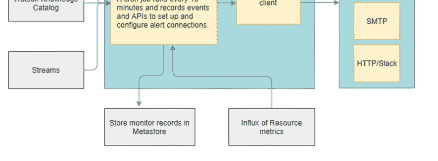

图 9.7 – 监控事件与警报转发

还可以配置不同的目标来发送警报，包括通过 SNMP 协议，或者简单地通过 SMTP 电子邮件以及 HTTP 发送。

Cloud Pak for Data 的控制平面本身包含一些通用的开箱即用监控器，例如：

- **check-pvc-status**：如果 PVC 未绑定，则记录一个关键事件
- **check-replica-status**：如果 StatefulSet 或 Deployment 有不可用的副本，则记录一个关键事件
- **check-resource-status**：如果服务达到阈值，则记录一个警告事件；如果超过配额，则记录一个关键事件

开发人员也可以引入扩展来支持自定义监控需求。文档 [28] 使用示例代码描述了引入自定义容器镜像以提供专门监控功能并识别值得发出警报的关键问题的过程。

### 配置和管理服务实例

Cloud Pak for Data 中的许多服务都支持“服务实例”的概念，这些实例从服务目录中配置。它们是服务的独立副本，可以独立进行横向扩展和配置，通常还用于为选定的一组用户提供访问权限。

服务实例具有以下特征：

- 它代表了按个体计量的 Kubernetes 工作负载 – 通常在与控制平面相同的命名空间中配置 – 但某些服务也可以在与控制平面命名空间 *绑定*（从管理角度来看）的“数据平面”sidecar 命名空间中配置。
- 它由具有 *创建服务实例* 权限的授权最终用户通过配置体验和 API 进行配置：

  最终用户在无需 Kubernetes 访问权限或深入了解 Kubernetes 原语的情况下配置实例。
- 它支持 RBAC，也就是说，用户可以获授细粒度的角色来访问该资源。
- 它支持安全的编程式客户端访问，具有实例级 API 密钥和服务令牌。

例如，授权用户可能希望启动一个数据库实例供其团队私下使用。其他用户甚至不会知道这些实例的存在。

以下截图展示了部署 Db2 仓库数据库实例的示例配置体验。

用户会得到关于设置实例的指导，包括适当地分配计算和存储资源：

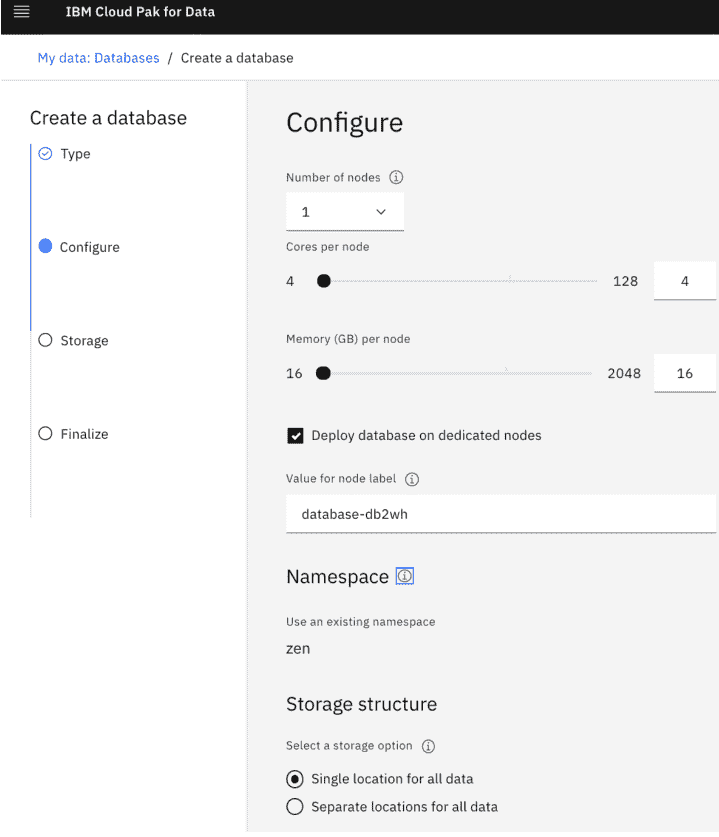

图 9.8 – 配置体验示例

在为该实例选择适当的配置属性后（例如，如前面截图所示），用户随即触发实例的创建。该实例的创建者随后被指定为该实例的第一位管理员。

随着此类实例的创建（或者通常只要对该实例执行任何特定操作），控制平面会自动生成审计记录。

Cloud Pak for Data 平台管理员除了可以管理实例的创建者之外，还可以管理和监控这些实例。但是，即使是平台管理员也可能一开始就被拒绝访问以使用该实例。例如，虽然 Cloud Pak for Data 平台管理员可以执行维护任务，甚至取消配置该数据库实例，但他们可能无法访问其中的数据。从法规遵从性的角度来看，实现这种职责分离至关重要。

以下截图展示了授权用户（该实例的管理员或 Cloud Pak for Data 平台管理员）如何管理访问权限的示例。他们可以给其他用户和组分配角色（包括管理员角色）：

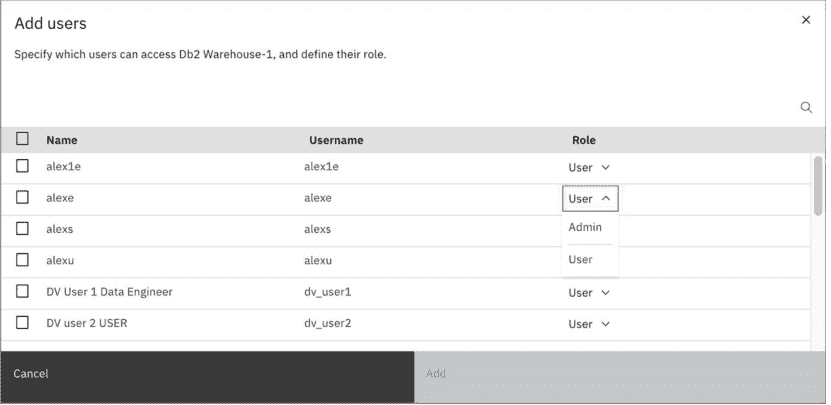

图 9.9 – 实例访问管理

以下截图说明了如何以类似方式向用户提供远程卷：

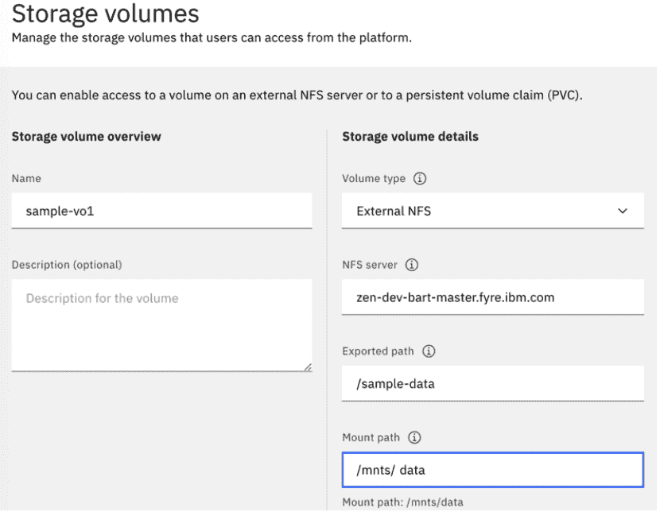

图 9.14 – 访问远程卷

这使企业能够使用 Cloud Pak for Data 中已有的数据卷，而无需将其物理传输到集群中。类似地，还支持通过 SMB 协议挂载远程 SMB（CIFS）卷，就像 Microsoft Windows 机器挂载此类共享卷一样。

### 多租户、资源管理与安全

在许多成熟企业中，OpenShift 集群被视为共享环境。他们期望在需要时扩展此类集群以容纳更多工作负载并重新平衡可用资源。共享同一个 OpenShift 集群并整合管理和运维，远比为每个租户分配一个单独集群更具成本效益。由于此类集群包含来自不同供应商的不同类型工作负载，以及需要复杂访问管理和安全实践的应用，因此从一开始就关注租户隔离非常重要。

租户这个概念本身非常主观。在某些情况下，同集群中的开发测试环境与生产安装可能被视为不同的租户。在其他情况下，不同的部门或不同的项目用例可能被视为独立的租户。当这个概念扩展到代表客户运营集群的 ISV 时，每个客户很可能是不同的公司，与所有用户来自同一公司的情况相比，对租户隔离的要求可能更严格。

多租户章节更详细地介绍了 Cloud Pak for Data 的租户方法和最佳实践建议。在本节中，我们将从高层概览租户要求，以及 Cloud Pak for Data 在此类共享 Kubernetes 集群中的部署和管理方式。

首先，让我们从影响租户方案的一些关键标准开始：

- **租户隔离：** 需要确保不同租户在此类共享系统上完全互不知晓。这可能包括需要使用完全不同的身份验证机制。不同的租户可能需要不同的 LDAP 组，甚至不同的 LDAP 服务器。

  通过访问授权和策略保护资源总体上是绝对必要的，但在存在多个租户用户的情况下，这些措施的作用更加突出。

  隔离还延伸到网络隔离，甚至达到为每个租户提供完全不同的用户体验、API 主机名 URL 和 DNS 域名的程度，即使他们在物理上共享同一个 Kubernetes 集群。

  以 Kubernetes 持久卷形式使用的存储系统也需要确保租户无法访问彼此的卷。


- **安全性：** 但请注意，出于成本考虑，一些企业最终可能会允许租户之间有更多的共享。因此，尽管隔离要求提供了租户之间一定程度的分离，但在部署拓扑中，特定的安全和合规性要求也发挥着根本作用。身份验证和授权访问管理在很大程度上有所帮助，但可能仍不够充分。

  例如，由于 OpenShift Kubernetes 本身是共享的，将访问权限授予任何租户以进入该操作环境是不明智的。这也意味着需要有一个专门负责管理 OpenShift 集群的运维团队或 IT 部门，包括主机节点本身的安全性，以及租户的接入管理。

  与传统非容器化应用一样，可能也存在网络安全需求。例如，两个租户之间可能需要设置防火墙隔离，或者制定严格策略以确保不会发生安全漏洞。

  安全要求甚至可能延伸到需要为不同租户的存储卷使用不同的加密密钥。

  从合规性角度来看，不同租户可能有不同要求。对于开发测试或临时租户，可能无需审计，但对于生产租户则可能需要更全面的审计。由于某些租户的工作涉及敏感数据，他们可能比其他租户需要更多的安全加固和审计实践。因此，租户方案需要支持这种多样化的配置需求。

- **资源管理：** 由于集群是共享的计算资源池，因此公平地共享集群也至关重要。IT 运维团队可能需要为各个租户提供特定的**服务水平协议（SLA）**。

  因此，租户机制必须支持能够监控资源利用率、防止或至少限制“吵闹邻居”的控制措施，并且重要的是，能够强制执行计算使用限制。在某些组织中，向租户收费也可能依赖于测量计算利用率和/或设置配额的能力。

- **支持自助服务管理：** 如果企业为每个租户用户配备专门的支持人员，运营成本会很高。理想的做法是让每个租户能够自行服务，包括自行配置服务、扩展服务，或自行执行备份和升级。

  租户管理员通常也需要能够自行决定访问管理（以及计算资源配额）相关事宜，而不需要 IT 支持。

  监控、诊断或其他维护任务最好也委托给租户管理员。

  因此，租户方案应能够在其范围内向指定的“租户管理员”授予一定程度的管理权限。

在本节中，我们介绍了多租户方案面临的一些常见要求。下一节将介绍 Cloud Pak for Data 技术栈如何帮助解决这些租户相关问题。

### 使用命名空间实现隔离

虽然为每个租户使用不同的 Kubernetes 集群甚至专用主机节点可能更简单，但成本效益不高。幸运的是，Kubernetes 包含命名空间 [34] 的概念，它代表一个虚拟集群，有助于隔离不同租户的工作负载。OpenShift Container Platform 通过项目 [35] 的概念扩展了命名空间。

最常见的方法是在不同的租户实例命名空间中安装不同的 Cloud Pak for Data 实例。然后，每个租户被分配这样一个安装实例，并在相对私密和相互隔离的环境中进行工作。每个租户命名空间中的 Cloud Pak for Data 安装都有自己的 OpenShift 路由器，这允许针对该租户自定义此访问点，包括外部主机名和 URL，以及为每个租户引入不同 TLS 证书的能力。

由于持久卷声明和网络策略也可以限定在命名空间范围内，因此存储和网络访问的隔离也能得到保证。如果租户用户需要访问 Kubernetes（例如，安装或升级其服务），也可以使用 Kubernetes RBAC 将其权限限定在其命名空间内。OpenShift 项目也可以映射到专用节点，这可以提供更强的物理隔离，但成本更高，用于将不同租户的 Pod 相互隔离。

关于多租户的章节描述了使用命名空间实现隔离的各种选项，以及两个租户甚至可能希望共享同一命名空间的选项。

### 资源管理和配额

Cloud Pak for Data 支持在单次安装中并发使用各种用例和不同类型的用户。一旦部署了服务，就会有一组固定的 Pod 提供 API、存储库和用户体验，以及该服务特有的一些支持性管理功能。这些被视为始终运行的*静态*工作负载。当最终用户与这些服务交互时，通常会出现*动态*工作负载。其中一些可能是长期运行的，例如用户配置的数据库实例，而另一些可能只是短期工作负载，例如数据科学交互环境、Spark 作业和机器学习训练作业。如果更多用户同时启动分析环境，或者同时发起昂贵的模型训练，他们最终可能会争夺资源，或使其他重要作业缺少资源。

Cloud Pak for Data 中的所有 Pod 都带有标签和注解，以标识它们所属的*产品* [25]。Pod 还指定了在 Kubernetes 环境中运行所需的资源请求和限制 [29]。请求的 CPU 和内存设置有助于 Kubernetes 选择合适的 Worker 节点来调度 Pod，为该 Pod 预留请求的计算资源，并使用限制设置来设定上限。因此，Pod 可以在短时间内“突发”到上限，以支持突增的工作负载。这样就无需为最坏情况做规划，也无需预留比通常需要更多的计算资源，同时允许紧急情况下的临时增长，但前提是那一刻该 Worker 节点上有额外资源可用。

在处理此类动态工作负载和并发用户活动时，资源管理是一个关键考虑因素。虽然架构优雅地支持弹性，并且可以在需要时添加更多计算资源，但在扩展之前最大程度地充分利用现有资源更为实用且更具成本效益。因此，管理员需要确保资源得到公平和均衡的使用，并能将资源转移给急需的工作负载。

Kubernetes 支持 **ResourceQuota** 规范的概念，集群管理员可以使用它来控制所有命名空间的计算分配。除此之外，控制平面还允许 Cloud Pak for Data 的*租户*管理员在不具备 Kubernetes 权限的情况下，为其安装中的每个服务（产品）定义计算资源阈值。虽然这仍受到 Kubernetes 集群管理员设置的命名空间总体 ResourceQuota 的约束，但它为 Cloud Pak for Data 管理员提供了一定灵活性，可以自行管理已获分配的资源。

以下截图展示了此类租户管理员如何在该 Cloud Pak for Data 实例命名空间中为 Watson Knowledge Catalog 服务设置 CPU 和内存边界：

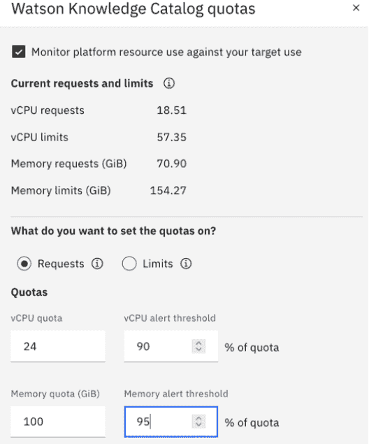

图 9.15 – 资源配额定义

任何违反阈值的行为都会在监控用户体验中突出显示，如果配置了警报，也会发出警报。

除了报告阈值违规之外，Cloud Pak for Data 还包含一个可选的调度服务 [26]，可用于*强制*执行分配的资源配额。调度服务根据管理员为每个服务所做的选择进行配置。

该调度服务扩展了默认的 Kubernetes 调度器，并监控所有 Pod 和作业的启动请求。它使用与 zen-watchdog 相同的标签来识别 Pod 以及 Pod 所属的服务/产品。然后，它汇总当前正在运行的该服务的所有 Pod 的资源请求和限制，并决定是否允许启动。违反定义资源配额阈值的 Pod 将无法启动。


在操作员订阅[36]中采用 *installPlanApproval: Automatic* 规范后，操作员部署通常会在其目录源刷新时自动升级。选择手动批准则意味着集群管理员需要手动决定何时可以升级。请注意，Cloud Pak for Data 操作员的新版本应仍然兼容当前已安装的操作对象（operand）部署版本，并同时支持新版本。因此，在同一个集群中，可以部署全新安装的新版本服务，而另一个命名空间继续保留旧版本，且两者均由同一个操作员管理。

操作对象也可以设置为自动升级。这意味着当操作员升级时，作为其协调循环的一部分，它也会自动将现有操作对象升级到该操作员支持的最新版本。

最简单的方法是配置全自动机制并采用持续交付模式。采用这种方法，集群管理员只需确保目录源得到更新（离线环境下手动更新）。由更新后的目录服务引入的操作员随后会自动升级到最新版本，而这些操作员又会自动升级它们所管理的操作对象。

对于需要特定版本的操作对象且升级需要手动处理的情况，可以采用一种称为“固定（pinning）”的流程。即使相关操作员已升级，将操作对象固定到某个版本仍然有效。实现方法是在实例命名空间中为该服务的自定义资源规范中显式提供版本。只有当版本被手动更改时，操作员才会触发操作对象部署升级到所请求的新版本。如果未指定版本，则操作员假定操作对象部署始终需要处于最新发布级别，并自动确保如此。

### 横向扩展

开箱即用，服务的操作对象部署配置了特定的计算资源和副本设置。大多数服务支持 T 恤尺码（T-shirt sizing）配置，以便对各种 Pod 微服务进行横向扩展和纵向扩展。在许多情况下，横向扩展还可通过为部署提供多个副本来提高高可用性，并通过增加负载均衡来提高性能。

27. **告警：** https://www.ibm.com/docs/en/cloud-paks/cp-data/4.0?topic=platform-monitoring-alerting

28. **自定义监控：** https://www.ibm.com/docs/en/cloud-paks/cp-data/4.0?topic=alerting-custom-monitors

29. **Kubernetes 中容器的计算资源：** https://kubernetes.io/docs/concepts/configuration/manage-resources-containers/

30. **服务操作员订阅：** https://www.ibm.com/docs/en/cloud-paks/cp-data/4.0?topic=tasks-creating-operator-subscriptions#preinstall-operator-subscriptions__svc-subscriptions

31. **Kubernetes 命名空间资源配额：** https://kubernetes.io/docs/tasks/administer-cluster/manage-resources/quota-memory-cpu-namespace/

32. **存储卷：** https://www.ibm.com/docs/en/cloud-paks/cp-data/4.0?topic=platform-managing-storage-volumes

33. **存储卷 API：** https://www.ibm.com/docs/en/cloud-paks/cp-data/4.0?topic=resources-volumes-api

34. **Kubernetes 命名空间：** https://kubernetes.io/docs/concepts/overview/working-with-objects/namespaces/

35. **OpenShift 项目：** https://docs.openshift.com/container-platform/4.7/applications/projects/working-with-projects.html

36. **操作员订阅 InstallPlan：** https://www.ibm.com/docs/en/cloud-paks/cp-data/4.0?topic=tasks-creating-operator-subscriptions#preinstall-operator-subscriptions__install-plan

37. **扩展服务：** https://www.ibm.com/docs/en/cloud-paks/cp-data/4.0?topic=cluster-scaling-services

38. **备份与恢复：** https://www.ibm.com/docs/en/cloud-paks/cp-data/4.0?topic=cluster-backing-up-restoring-your-project

39. **通过文件系统副本进行离线备份：** https://www.ibm.com/docs/en/cloud-paks/cp-data/4.0?topic=bu-backing-up-file-system-local-repository-object-store

40. **使用快照进行备份：** https://www.ibm.com/docs/en/cloud-paks/cp-data/4.0?topic=up-backing-file-system-portworx

### 开发实践

IBM 要求所有产品都采用严格的安全工程实践进行开发和评估，Cloud Pak for Data 提供的服务也不例外。由于此类产品也以服务化方式运营，面向公众开放，因此从软件设计之初，安全性就至关重要。

安全实践和报告在软件发布之前，由 IBM 混合云**业务信息安全办公室（BISO）**独立审查。

本节介绍 Cloud Pak for Data 中用于开发安全加固服务的一些重要实践。

### 漏洞检测

一项关键举措是检测可能的安全弱点或恶意操作者可能利用的潜在区域，以实施中间人攻击、访问敏感数据或注入恶意软件。鉴于与 Cloud Pak for Data 的交互相当多是通过 Web 浏览器或一般基于 HTTP 的客户端进行的，因此需要确保同时防范来自外部和集群内部的影响：

- **威胁建模：** 这是一个通过构建服务间和服务内的详细数据流图、理解潜在攻击向量，并评估现有保护措施是否足够来分析系统最易受攻击点的过程。威胁建模工作的输出用于推动附加安全结构的开发，或重构服务交互以减轻潜在威胁。

- **安全质量保证和代码审查：** 由一个专注于安全且独立于常规功能开发和 QA 小组的团队开发附加测试。这项工作还涉及跨服务/跨产品集成的验证，以及使用 **Chaos Monkey（混沌猴）** 风格测试方法（即，在系统中生成随机故障以验证弹性）对整体系统可靠性进行彻底评估。

这样可以更好地客观评估所提议的软件交付是否符合所需的安全准则。作为该举措的一部分，该团队还独立审查代码，并批准服务开发团队提出的任何缓解措施。

因此，预期所有 OpenShift 集群都能从其自有专用网络中的指定*企业级*容器注册表拉取镜像。预期拉取密钥（pull secrets）可用于 Cloud Pak for Data 使用的服务账户。

### 堡垒节点的作用

堡垒节点通常是部署在企业专用网络之外、对存储库和注册表具有受控访问权限的机器。此类主机有助于从 IBM 获取容器镜像、工具、脚本和其他内容，并将其提供给 OpenShift 集群进行配置。

一种方法是将所有镜像下载为 `tar.gz` 文件，并将这些文件传输到专用网络中，在那里可以将它们加载到适当的容器注册表中。然而，更方便的方法是从此类堡垒节点使用容器注册表直接将容器镜像从 ICR 复制到企业自己的注册表中。之所以可行，是因为堡垒节点在持续时间内可以访问互联网并访问企业自己的数据中心，或者至少可以访问目标注册表。堡垒节点的作用可能不仅限于初始安装，因为这种方法对于拉取或复制较新的容器镜像（包括修补严重漏洞的镜像）非常有用。

在本节中，我们介绍了 IBM Cloud Pak for Data 容器化软件如何从可信位置提供给客户以确保其来源，以及如何将这些镜像引入客户自己的注册表。在下一节中，我们将探讨安全地运营 Cloud Pak for Data 意味着什么。

### 共享环境中的安全运营

在传统系统中，许多应用程序共享同一个操作系统，无论是虚拟机还是裸机。然而，出于安全原因，这些应用程序通常永远不被授予操作系统的访问权限，也不以 *root（根用户）* 身份运行。由于来自不同产品或供应商的许多程序会在同一台机器上运行，因此还需要注意将这些操作系统进程彼此隔离。

虽然简单地为每个应用程序启动一个单独的虚拟机来完全隔离它们是很常见的，但这种做法运营成本高昂，并且可能导致计算资源浪费。从长远来看，容器已被证明成本低得多，但在工作负载隔离程度方面需要有所权衡。在本节中，我们将了解该技术栈如何从底层开始实现安全性，从集群中的主机操作系统开始，到 OpenShift 安全结构，以及 Cloud Pak for Data 如何利用 Kubernetes 访问控制原语对在该集群中运行的所有服务实施控制。


### 安全上下文约束（SCCs）

**安全上下文约束（SCCs）** [10] 的概念允许集群管理员决定与任何特定工作负载关联的特权级别。SCC 定义了 Kubernetes Pod 要在平台上被调度必须遵守的一组条件。所授予的权限，尤其是访问主机资源（如文件系统或网络）的权限，甚至 Pod 的进程可以以哪些用户 ID 或组 ID 运行，都受相关 SCC 的管辖。例如，*privileged* SCC 允许所有特权并访问主机目录，甚至以 root 身份运行，而 *restricted* SCC 则拒绝所有这些。

默认情况下，所有 Pod 均使用 *restricted* SCC，而任何高于 *restricted* 的 SCC 均被视为例外，集群管理员需要通过创建该 SCC 与服务账户的绑定来授权。

使用 *restricted* 时，以 root 身份运行进程被禁用，并且 Linux capabilities 被移除，例如 *KILL*、*MKNOD*、*SETUID*、*SETGID* 等。此 SCC 还阻止运行特权容器。主机路径、主机网络访问和**进程间通信（IPC）**均被拒绝。当 Pod 启动时，OpenShift 会强制实施此策略，Pod 内进程任何违反此策略的尝试都会导致 Pod 被关闭并出现相应错误。

Cloud Pak for Data v3 引入了额外的 SCC，为部分 Pod 授予比 *restricted* 更多的增量能力，而无需使用诸如 *privileged* 或 *anyuid* 等开放程度高得多的 SCC：

- **cpd-user-scc**：此自定义 SCC 添加了固定的 UID 范围（1000320900 至 1000361000），允许所有与此 SCC 关联的 Pod 使用这些用户 ID 运行。这使不同的 Pod 能够确定性地使用已知的用户 ID 运行，并有助于文件所有权的管理。注意：仍然禁止以 root 身份运行。此策略还消除了为每个 Pod 分配 FSGroup 策略的需要，因为该策略可能对共享卷的文件系统权限设置产生不利影响。

FSGroup 策略用于解决 Kubernetes 递归重置已挂载卷上的文件系统权限的问题。虽然这对大型卷会产生严重的性能影响，甚至在 Pod 启动时导致超时和失败，但更严重的问题在于文件权限会被重置，并且可能使比原本预期更多的 Pod 和用户获得访问权限。

Kubernetes 中的一个未来能力（*fsGroupChangePolicy*）有望帮助工作负载避免此问题。[12]

- **cpd-zensys-scc**：此自定义 SCC 与 `cpd-user-scc` 相同，只是它还允许 SETUID/SETGID 特权。它还将一个 UID（1000321000）指定为 *System* 用户。此 SCC 的主要目的是使系统 Job 和容器能够以正确的文件系统所有权和权限初始化持久卷，从而允许共享卷中的单个内容被其他 Pod 安全读取或修改。

> **注意**
> 在 Cloud Pak for Data v4 中，由于 **OpenShift Container Platform v3.11** 即将停止支持，且 OpenShift Container Platform v4.6 提供了 Cloud Pak for Data 所需的其他安全结构，因此不再创建这些自定义 SCC。但是，DB2 和 Watson Knowledge Catalog 等一些服务在 v4 中仍然需要额外的自定义 SCC。这些内容在服务文档中有详细描述 [37]。

### 命名空间范围和服务账户特权

Cloud Pak for Data 服务部署到特定的 OpenShift 项目命名空间中，其服务账户的范围仅限于在这些命名空间内运行。这些服务账户与在这些命名空间中运行的各种 Kubernetes Deployment 相关联。

OpenShift 为每个 OpenShift 项目分配一个唯一的 SELinux **多类别安全（MCS）** 标签。这可确保来自一个命名空间的 Pod 无法访问由另一个命名空间中的 Pod 或具有相同 UID 的主机进程创建的文件。[11]

### RBAC 与最小特权原则

Kubernetes 中角色的概念帮助 Cloud Pak for Data 采用最小特权原则，为每个 Pod 仅授予执行操作所需的授权，不多不少。为此，在部署 Cloud Pak for Data 的命名空间中引入了以下角色：

| 角色 | 描述 |
|---|---|
| cpd-admin-role | 允许创建/更新/删除 Kubernetes deployment、secret、configmap，以及运行 Job 等，但仅限于该特定命名空间内。 |
| cpd-viewer-role | 允许 Kubernetes API 调用（GET），但不能执行任何创建或删除操作。 |

图 10.1 – Cloud Pak for Data 服务账户使用的 Kubernetes 角色

特定服务账户被引入到命名空间中，然后*绑定*到这些角色。这定义了每个账户被授予的特权范围。

> **注意**
> 在 Cloud Pak for Data v4 中，由于不再需要自定义 SCC，因此引入了另一组以 zen- 为前缀的服务账户，以确保任何现有的 SCC 不再被选用，即使是意外情况下也不会。

Kubernetes Pod 以服务账户的权限运行。除了只允许在命名空间范围内工作之外，Cloud Pak for Data 服务账户被设计为仅分配执行特定操作所需的最小特权。下表列出了 Cloud Pak for Data v3.5 和 v4 中使用的关键命名空间范围服务账户，以及它们的用途和允许执行的操作。

| 账户 [v3 和 v3.5] | 描述 |
|---|---|
| cpd-admin-sa | 绑定到 cpd-admin-role，并与系统用户和 cpd-zensys-scc 关联。此账户用于准备持久卷挂载、设置文件权限等。 |
| cpd-editor-sa | 也绑定到 cpd-admin-role，但与 cpd-user-scc 关联，因此特权较少。 |
| cpd-viewer-sa | 绑定到 cpd-viewer-role 和 cpd-user-scc。此账户只能查看该命名空间内的 Kubernetes 工件。 |
| cpd-norbac-sa | 绑定到 cpd-noperm-scc，但未与任何 Kubernetes 角色关联，因此没有 API 访问权限。此账户类似于开箱即用的默认服务账户。它用于不应被授予任何 RBAC 特权的服务或组件。 |
| default | 在每个 OpenShift 项目中自动创建，绑定到 restricted SCC，且未被授予任何 RBAC 特权；也就是说，没有绑定任何角色。此默认服务账户将用于最终用户工作负载（如 notebook 和 Python Job），并且不允许在命名空间内执行任何类型的操作。 |

图 10.2 – Cloud Pak for Data 中使用的命名空间范围服务账户 – v3 和 v3.5

以下是 Cloud Pak for Data v4 中使用的命名空间范围服务账户：

| 账户 [v4] | 描述 |
|---|---|
| zen-admin-sa | 绑定到 cpd-admin-role，默认情况下与 OpenShift 的 “restricted” SCC 关联。 |
| zen-editor-sa | 绑定到 cpd-admin-role，并与 OpenShift 的 “restricted” SCC 关联。 |
| zen-viewer-sa | 绑定到 cpd-viewer-role，并且默认情况下与 OpenShift 的 “restricted” SCC 关联。此账户只能查看该命名空间内的 Kubernetes 工件。 |
| zen-norbac-sa | 默认情况下与 OpenShift 的 “restricted” SCC 关联，且未与任何 Kubernetes 角色关联，因此没有 API 访问权限。此账户类似于开箱即用的默认服务账户。它用于不应被授予任何 RBAC 特权的服务或组件。 |
| default | 在每个 OpenShift 项目中自动创建，绑定到 restricted SCC，且未被授予任何 RBAC 特权；也就是说，没有绑定任何角色。此默认服务账户将用于最终用户工作负载（如 notebook 和 Python Pod），并且不允许在命名空间内执行任何类型的操作。 |

图 10.3 – Cloud Pak for Data 中使用的命名空间范围服务账户 – v3.5 和 v4

因此，系统 Pod 和 Job 通常使用 **cpd-admin-sa** 来执行更高特权的操作，而常规用户 Pod 和 Job（如数据科学环境和 refinery 作业）会与 **default** 或 **cpd-norbac-sa** 关联，以表明它们不被授予任何特权。

如下面的代码片段所示，典型的 Cloud Pak for Data Pod 规范包含 `securityContext` 指令，这些指令指示要添加或删除哪些 Linux capabilities、以哪个用户 ID 运行，甚至明确指定 Pod 必须仅以非 root UID 运行。此外还指定了服务账户，该账户进而授予 Pod 在处理 Kubernetes 资源和 API 时特定的 RBAC 权限：

```
securityContext:
  capabilities:
    drop:
      - ALL
```


```yaml
requests:
  cpu: 100m
  memory: 256Mi
```

### 其他注意事项

在前面的章节中，我们研究了如何唯一标识 Cloud Pak for Data 工作负载，如何使用最小权限原则为每个微服务授予 RBAC，以及如何限制每个微服务消耗的资源。在本节中，我们将介绍适用于 *多个* 微服务甚至整个 Cloud Pak for Data 安装的安全方面。

我们将探讨以下内容的含义：

- 确保两个微服务之间传输数据的<|message|>
- 静态数据保护
- 了解传统防病毒软件的相关性

#### 传输中加密和保护入口点

Cloud Pak for Data 仅公开一个 HTTPS 端口作为浏览器用户体验和 API 访问的主要访问点。该端口以 OpenShift 路由的形式公开。命名空间内部和入站的所有通信均使用 SSL 进行加密，仅启用 **TLS 1.2** 高安全加密算法。

在 OpenShift 命名空间中安装 Cloud Pak for Data 会导致生成自签名 TLS 证书。默认情况下，所有 HTTPS 客户端都不信任此证书，应将其替换为企业自己的签名 TLS 证书 [13]。

Cloud Pak for Data 中的所有服务都必须支持基于 TLS 的加密，用于服务到服务通信以及与外部系统通信。例如，DB2 通过 ODBC 和 JDBC 为客户端应用程序公开 TLS，即使从集群外部连接也能确保安全连接并确保传输中的数据也得到加密。连接外部客户标识的数据库和数据湖，例如 Data Virtualization、Watson Studio 服务，也可以配置为通过 TLS 进行。

请注意，Cloud Pak for Data 服务中此类传输中的基于 TLS 的加密是在基础设施中可能配置的任何内容之上的。例如，Kubernetes 节点间通信网络也可能作为云基础设施或 VPN 技术的一部分进行加密。

最好 *不要* 将这些 Kubernetes 节点视为通用 Linux 系统，而应将其视为由 OpenShift 作为集群进行保护和管理的专用机器。OpenShift 为 *整个堆栈* 从操作系统到容器再到单个工作负载提供安全性和运维。传统防病毒软件无法覆盖整个堆栈，并且可能会干扰集群的运行或可靠性。

Red Hat 和 OpenShift 提供额外的安全加固，以减少对防病毒软件的需求 [19]。请注意，传统扫描程序通常用于在共享文件系统（例如由 Samba 提供服务并挂载在 Windows 客户端上的文件系统）中查找病毒。但是，通过在 OpenShift Container Platform 和 RHEL CoreOS 上以规定方式运行 Kubernetes，不应在这些 Kubernetes 节点上首先设置此类任意文件服务。

在本节中，我们探讨了在操作系统和 OpenShift 中可用的安全结构。我们还研究了 Cloud Pak for Data 如何通过审慎使用 Kubernetes RBAC 来确保每个服务帐户的最小权限，并使用标签和注释的约定来标记所有工作负载。它还限制计算资源的分配，以确保安全可靠的运行。在下一节中，我们将研究 Cloud Pak for Data 管理员可用于配置身份验证并确保每个用户获得适当授权级别的控制。

### 用户访问和授权

Cloud Pak for Data 本身就是一个平台，是一个多用户系统，因此也为用户提供访问控制。它还与企业 LDAP 或 Active Directory 以及其他身份提供者集成，以确保对其服务的安全访问。还支持审计以跟踪对 Cloud Pak for Data 平台的访问。

与任何多用户系统一样，Cloud Pak for Data 会识别授予特定用户或用户组的角色和权限。特权用户负责确保只有授权用户才能访问 Cloud Pak for Data 主机服务和内容。

#### 身份验证

虽然 Cloud Pak for Data 包含一个开箱即用的简单机制来识别用户并授予他们访问权限，但这仅用于初始运行，并不意味着用于安全生产用途，并且无法满足任何合规性法规要求。例如，密码策略或多因素身份验证无法使用此默认机制支持。相反，企业应设置与身份提供者的连接。

#### 授权

通过权限和角色，企业可以定义自己的角色并授予他们对不同 Cloud Pak for Data 服务的特定访问权限。

角色是用于定义授予特定用户角色的一组权限（特权）的实体。

Cloud Pak for Data 服务引入一个或多个开箱即用的角色以便开始使用，并提供一种帮助管理角色的体验。企业可以使用此类角色来遵守因合规原因而需要的 *职责分离* 政策。例如，管理员可能被拒绝访问数据（这是他们最初未配置的数据库实例的默认设置），并且还拒绝访问数据目录，通过撤销特定权限。

还可以授予细粒度的权限，例如，仅授予特定用户组管理用户访问权限和管理组访问权限的能力，但他们无需获得其他管理功能的访问权限。

管理员通常使用用户管理体验配置角色，如下图所示：

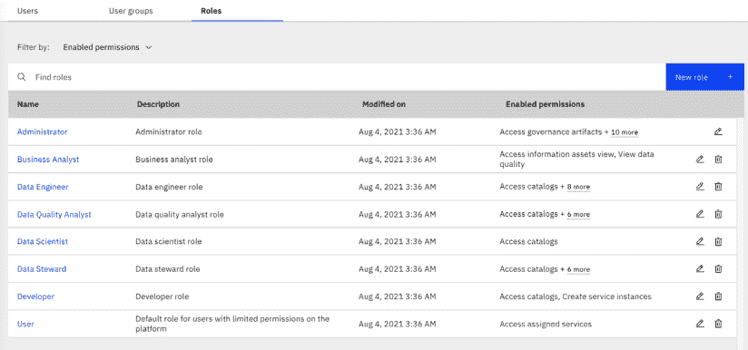

图 10.5 – 管理角色体验

下表显示了 Cloud Pak for Data 中分配给不同开箱即用角色 [38] 的权限示例，以及相关的服务提供：

- **管理员角色：** **管理员** 是 Cloud Pak for Data 中的预定义角色，包括以下表中列出的特定权限集。存在的权限集取决于已安装的服务。例如，如果未安装 Watson Knowledge Catalog，则 **访问治理工件** 权限将不可用。

  | 权限 | 类别 | 贡献该权限的服务 |
  |---|---|---|
  | 访问治理工件 | 治理工件 | Watson™ Knowledge Catalog |
  | 管理平台 | 平台管理 | Cloud Pak for Data 控制平面 |
  | 创建部署空间 | 部署 | - Watson Knowledge Catalog<br>- Watson Studio |
  | 创建项目 | 项目 | - Watson Knowledge Catalog<br>- Watson Studio |
  | 创建服务实例 | 服务实例 | Cloud Pak for Data 控制平面 |
  | 管理资产发现 | 数据管理 | Watson Knowledge Catalog |
  | 管理目录 | 目录 | - Watson Knowledge Catalog<br>- Watson Studio |
  | 管理数据保护规则 | 治理工件 | Watson Knowledge Catalog |
  | 管理数据质量 | 数据管理 | Watson Knowledge Catalog |
  | 管理数据转换 | 数据集成 | DataStage® |
  | 管理治理分类 | 治理工件 | Watson Knowledge Catalog |
  | 管理信息资产 | 目录 | Watson Knowledge Catalog |
  | 管理元数据 | 数据管理 | Watson Knowledge Catalog |
  | 管理工作流 | 工作流 | Watson Knowledge Catalog |

  图 10.6 – 授予管理员角色的权限

- **数据科学家** 角色：此角色指定通常参与高级分析和机器学习的<|message|>。他们从目录中引用数据，并在项目中与其他用户协作。对于此类用户，通常只需要一小部分权限，如下表所示。这也授予他们使用部署（例如机器学习模型）的权限。

  | 权限 | 类别 | 贡献该权限的服务 |
  |---|---|---|
  | 访问目录 | 目录 | - Watson Knowledge Catalog<br>- Watson Studio |
  | 创建部署空间 | 部署 | - Watson Knowledge Catalog<br>- Watson Studio |
  | 创建项目 | 项目 | - Watson Knowledge Catalog<br>- Watson Studio |

  图 10.7 – 授予数据科学家角色的权限

- **用户** 角色：**用户** 角色很特殊，因为它通常表示分配给某类访客用户的最少权限集。将 **用户** 角色分配给某人仅意味着他们将能够登录并查看不需要任何额外授权的任何内容。将 **用户** 角色分配也用于向平台引入新用户，从而使他们随后可以作为个人添加到用户组或分配对项目、目录甚至数据库的访问权限。

  然而，当安装某些服务（例如 Watson Knowledge Catalog 或 Watson Studio）时，默认情况下，它们会向此 **用户** 角色授予额外权限。这使这些用户至少能够在自己的项目或部署空间范围内私下工作。当然，就像任何预定义角色一样，管理员可以选择更改此角色并删除这些权限或引入其他权限，以符合他们对“最小”特权角色的定义。

  | 权限 | 类别 | 贡献该权限的服务 |
  |---|---|---|
  | 创建部署空间 | 部署 | - Watson Knowledge Catalog<br>- Watson Studio |
  | 创建项目 | 项目 | - Watson Knowledge Catalog<br>- Watson Studio |

  图 10.8 – 授予用户角色的权限


开箱即用时，默认用户（admin）会自动分配以下所有角色，但可根据需要更改：

- Administrator
- Business Analyst
- Data Engineer
- Data Quality Analyst
- Data Scientist
- Data Steward
- Developer

企业还可以通过定义自己的角色来自定义此设置[25]。如果默认权限集不符合业务需求，管理员可以编辑开箱即用的角色或创建新角色。

作为角色定义的一部分[26]，可以选择特定权限并将其与该角色关联。

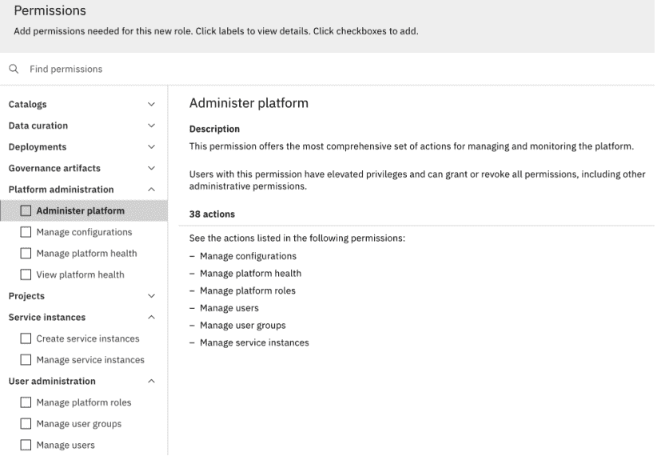

图 10.9 – 将权限关联到新角色的示例

在本节中，我们讨论了权限的语义，以及如何定义或更新角色，以满足企业在访问控制方面的需求并识别合适的角色类型。

角色与单个用户以及用户组都相关，也就是说，角色可以分配给 Cloud Pak for Data 用户组，这意味着该组的所有成员将自动继承此角色。在下一节中，我们将更详细地了解如何识别用户以及如何定义组。

### 用户管理和用户组

Cloud Pak for Data 提供了 API 和用户界面，供管理员管理每个用户的身份验证和基于角色的授权。下图给出了一个用户界面示例，帮助管理员授予和撤销用户的访问权限。

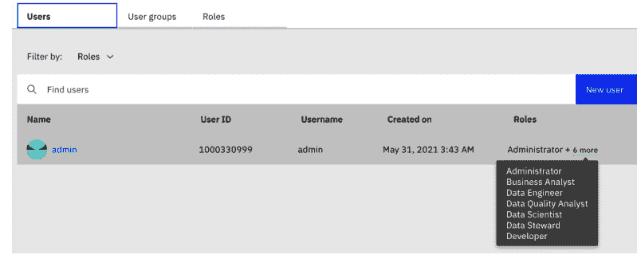

管理员（或具有“管理用户”权限的用户）可以授权其他用户访问 Cloud Pak for Data。

例如，通过该用户界面，可以添加新用户并分配适当的角色：

#### 添加用户

授权用户访问平台。

- 个人资料信息
- 平台访问
- 角色
- 摘要

#### 角色

为此用户分配角色，或创建新角色。

administrator

Administrator

#### Administrator

描述
Administrator 角色

修改于
2021年7月20日 上午4:34

24 个权限，110 个操作  全部展开

- 访问高级治理
- 访问高级映射
- 访问目录
- 访问数据质量
- 访问治理工件
- 管理平台

图 10.11 – 向新用户授予 Administrator 角色的示例

如上图所示，授予此类访问权限的管理员还可以查看完成此角色分配后将授予哪些权限。他们也可以选择将多个角色分配给同一个人，从而获得这些角色权限的并集。

除了逐个向单个用户授予权限之外，管理员还可以创建用户组，以简化管理具有相似访问需求的大量用户的过程。例如，如果一组用户需要相同的角色组合，则可以将这些用户添加到一个组中，并为该组分配相应的角色组合。如果该组的某位成员离开公司，该用户将从组中移除。

请注意，整个 LDAP 或 Active Directory 组也可以分配（映射）到此类 Cloud Pak for Data 用户组。这使企业能够继续利用其现有的组织分组，而无需逐个授权每个用户。

默认情况下，Cloud Pak for Data 包含 **All-users** 组。顾名思义，所有 Cloud Pak for Data 用户都会自动包含在该组中。该组用于向所有平台用户授予对资产（如 **Connections**）的访问权限。

下图所示的用户界面[27]支持创建此类用户组并向此类组分配角色：

#### 新建用户组

将用户分组以广泛管理权限。

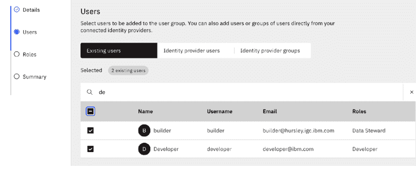

图 10.12 – 定义新用户组

要向此类用户组引入成员，管理员还可以选择浏览任何已配置的身份提供者（如 LDAP），以确定要添加的个人，并将现有的 LDAP 组映射进来。这提供了相当大的灵活性，因为管理员不受企业 LDAP 中固定组织结构（例如由 HR 决定的结构）的限制，并且还可以临时性地让来自不同 LDAP 组的用户集进行协作。

下图说明了该界面如何支持浏览现有 LDAP 组，以将其作为 Cloud Pak for Data 用户组的成员引入。

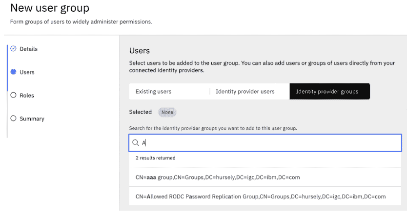

图 10.13 – 选择要分配给新用户组的现有 LDAP 组

如上图所示，该界面支持选择现有的完全限定 LDAP 组作为新 Cloud Pak for Data 用户组的成员。

在至少选择了一个单独用户或 LDAP 组后，管理员可以选择一个或多个角色分配给这个新用户组，如下图所示：

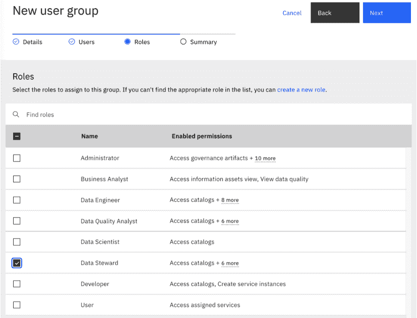

图 10.14 – 定义新用户组

在上图中，您会注意到 **Data Steward** 角色已被分配给 **Reviewers User Group**。这意味着该组的所有成员将自动被识别为数据管理员，并继承该角色附带的权限。管理员还可以随时更改此角色分配，或为此用户组引入其他角色。

请注意，当使用 LDAP 组时，用户组的成员身份以及由此扩展而来的分配给个人的角色都是*动态*的。这意味着，当用户从某个 LDAP 组中移除或分配到另一个组时，其后续登录将自动确保其权限反映其当前的成员身份。单个用户还可以被分配到多个用户组，这意味着他们的权限是他们从所有这些组的成员身份中继承的权限的并集。

在本节中，我们介绍了如何管理用户和用户组，以及 Cloud Pak for Data 如何与企业身份验证机制（如 LDAP）集成。只有在这样的用户通过身份验证后，他们才能访问 Cloud Pak for Data 中的服务或特权资源。此外，还有授权检查。例如，用户或用户组至少需要被授予项目或目录等资源的查看者角色，然后才能访问这些资源。类似地，这些用户或组可以被授予对 Data Virtualization Service（DVS）实例的访问权限（作为 DV Engineer），或者也许仅被授予对 DB2 数据库实例的访问权限（作为 Database user）。总之，用户管理服务支持广泛的安全要求，因为它在平台中同时启用了身份验证和灵活的 RBAC，也提供了针对单个资源或服务实例的授权机制。

### 保护凭据

Cloud Pak for Data 是一个提供多种功能与服务的平台。用户和应用程序可能需要从集群外部连接到 Cloud Pak for Data 实例中的特定 API 端点。开发人员作为日常工作的一部分，也可能需要连接到外部系统（如数据库和数据湖），例如从笔记本中以编程方式连接，或作为 Apache Spark 作业的一部分。此类代码通常与其他用户共享，甚至可能提交到源代码仓库，因此将密码和其他敏感内容放在其中是不明智的。

在本节中，我们将了解 Cloud Pak for Data 中可让此类开发人员避免以明文形式暴露凭据的功能。

#### API 密钥

从客户端程序调用 Cloud Pak for Data API 的开发人员可以使用 API 密钥，从而无需在客户端内持久保存其凭据。

Cloud Pak for Data v3.5 及更高版本支持使用 API 密钥进行身份验证和授权。这允许客户端程序向 Cloud Pak for Data 平台或特定服务实例进行身份验证。

每个用户都可以生成一个平台 API 密钥，其作用域更广，允许访问平台上的所有服务。

实例 API 密钥针对特定服务，因此仅可用于该特定范围。平台 API 密钥使客户端脚本和应用程序能够访问它们直接登录 Cloud Pak for Data Web 客户端时通常可以访问的所有内容。实例 API 密钥仅允许访问生成它的特定实例。


> **注意**
> 
> 在 Cloud Pak for Data v3.5 版本中，部分服务的实例 API 密钥不可用。

Cloud Pak for Data 提供了用户界面和 API [28] 来生成、重新生成或删除平台 API 密钥或实例 API 密钥。

### Secrets API 与 Vault 的使用

Cloud Pak for Data 中的 Secrets API [29] 提供了从配置的 Vault 中访问敏感凭据的能力。这有助于避免在开发者编写的内容（如笔记本或脚本）中使用明文凭据。通过使用 Vault，企业还可以控制策略以独立轮换密钥和凭据。

由于 Cloud Pak for Data 的 Secrets API 仅在需要时检索 Vault 的内容，因此它会获取最新的密码或密钥。这也避免了用户需要在多处更新密码的需求。

Cloud Pak for Data 将继续在其路线图中引入与不同 Vault 厂商和技术的集成。

### 满足合规要求

监管合规和企业政策要求对系统进行严格监控，以确保其未被破坏。通常需要遵守多个标准以及不同的审计技术。Red Hat 和 IBM Cloud Pak for Data 提供了工具和机制，供安全架构师根据其组织的政策设计和配置系统，以及审计使用情况。

在本节中，我们将简要了解有助于企业规划合规性的功能。

### 为合规配置运行环境

对于 Cloud Pak for Data，Red Hat 的用于主机的 Enterprise Linux 和 OpenShift Container Platform 代表了技术基础。因此，为了确保合规，基础需要正确配置。技术栈中帮助实现合规就绪的几个关键方面如下所述：

- RHEL 支持强大的安全和合规态势，例如设置 **联邦信息处理标准 (FIPS)** 出版物 140-2。存在多种先进技术来保护 RHEL 主机 [30]，包括工具、扫描器和最佳实践指导。
- OpenShift Container Platform v4 引入了合规性操作员 [31]，以帮助确保合规并检测与基于 RHEL CoreOS 的主机相关的差距。**国家标准与技术研究所 (NIST)** 组织在其他方面也提供了实用程序和指导，用于企业严格遵守的稳健合规实践。OpenShift 合规性操作员提供了适当级别的自动化，帮助企业利用 NIST OpenSCAP 实用程序，例如在这种复杂、动态环境中进行策略扫描和执行。

集群管理员通常负责确保集群设置适当以满足合规标准。也很重要的是要对集群中的特权操作进行充分监控，无论是在基础设施还是更高级别，例如 Cloud Pak for Data。下一节确定了为确保所有特权活动得到报告而需要进行的额外配置。

### 审计

审计为企业提供了证明合规性和监控异常的方法。

审计可以在栈的各个级别启用：

- 在操作系统级别 [32]，RHEL 提供了机制让企业监控任何安全策略的违规情况。审计系统记录对该主机上任何敏感或关键文件访问的访问监视。
- 在 OpenShift Container Platform 级别 [33]，管理员可以配置审计级别以记录所有用户或其他服务对 Kubernetes API 服务器的所有请求。
- 在 Cloud Pak for Data 级别，审计日志支持生成、收集和转发符合 **Cloud Auditing Data Federation (CADF)** [34] 的审计记录，用于核心平台可审计事件。

您可以配置 IBM Cloud Pak for Data 审计日志将审计记录转发到您的 **安全信息和事件管理 (SIEM)** 解决方案，例如 **Splunk**、**LogDNA** 或 **QRadar**。

审计日志实现使用 Fluentd 输出插件 [35] 来转发和导出审计记录。在您安装 IBM Cloud Pak for Data 后，审计日志服务默认未配置。外部 SIEM 配置 [36] 可以添加到 `zen-audit-config` Kubernetes configmap 中，以定义审计日志服务转发所有收集的审计记录的位置。

虽然审计日志通常仅涵盖特定的特权操作，但通常还有关于跟踪用户和应用程序访问数据的额外监管要求。在下一节中，我们将看到如何实现这一点。

### 与 IBM Security Guardium 的集成

Guardium 提供了监控数据访问并确保数据安全的能力。IBM Security Guardium 的 **数据库活动监控 (DAM)** 功能提供了一个先进的集中式审计存储库、报告机制以及支持取证和合规审计的工具。这些功能与前面章节中描述的系统级审计和特权操作审计记录互补，因为它们也可以扩展到数据保护。

Cloud Pak for Data 以两种方式支持与 Guardium 的集成：

- **审计敏感数据访问**：拥有管理目录权限的 Cloud Pak for Data 用户有权识别敏感数据，例如 **个人身份信息 (PII)**，并将其配置为由 Guardium 监控 [39]。由于 Cloud Pak for Data 的 Watson Knowledge Catalog 服务也可以扫描和标记敏感数据，因此它使授权用户更容易启用这些数据资产由 Guardium 监控。
- Cloud Pak for Data 还促进数据库的配置。对于监管合规而言，监控此类数据的访问至关重要。这通过名为 Guardium *E-STAP* [40] 的服务来实现，该服务在 Cloud Pak for Data 之上配置并拦截对 DB2 数据库的流量。之后对 DB2 数据库的所有访问都只能通过 E-STAP 接口进行。该服务配置为与 Guardium 设备配合使用，从而实现访问日志记录和报告，以及访问策略执行。

Guardium 是数据保护和合规领域中成熟且完善的解决方案。许多企业已经利用 Guardium 以集中方式自动化合规控制，而与 Guardium 的集成使 Cloud Pak for Data 客户能够加速其自身数据的合规就绪工作，补充了 Cloud Pak for Data 平台和运行环境提供的功能。

在本节中，我们探讨了企业为满足监管合规要求可用的技术。总的来说，Cloud Pak for Data 提供了优雅的 RBAC 机制，并使企业能够配置或更改开箱即用的角色以支持任何监管合规，例如职责分离。

合规要求因客户所在的行业以及地理要求而有很大差异。在前一节中，我们还确定了需要适当配置栈中所有元素的必要性，包括 OpenShift Container Platform 及其主机节点，以及 Cloud Pak for Data 本身用于特权操作审计，以及其他集成选项，例如 Guardium 以支持数据访问监控。

### 总结

在本章中，我们讨论了 Cloud Pak for Data 的开发方式以及所采用的 IBM 安全工程实践。我们还查看了容器镜像如何从受信任的位置交付，供客户拉取或下载。

一旦 Cloud Pak for Data 安装完成，必须注意确保其以安全的方式运行。我们查看了 RHEL 和 OpenShift 提供的构建，这些构建为工作负载提供了安全基础以及 Cloud Pak for Data 在 OpenShift Container Platform 上的安全态势。

我们还查看了管理员如何负责管理用户和组访问以确保授权得到执行，同时配置适当的身份管理器用于身份验证，以及定义适当的角色或修改开箱即用的用户角色。

安全对于任何软件安装都至关重要，Cloud Pak for Data 也不例外。本章除了描述技术外，还提供了指向实用机制的指针，以保护和监控栈的每个部分，确保 Cloud Pak for Data 在您企业中的安全可靠运行。

在下一章中，我们将查看存储，这是 Cloud Pak for Data 可靠运行的另一个基础且关键的构建。

# 参考文献

- 1. Cloud Pak for Data 安全白皮书：https://community.ibm.com/community/user/cloudpakfordata/viewdocument/security-white-paper-for-cloud-pak?CommunityKey=c0c16ff2-10ef-4b50-ae4c-57d769937235&tab=librarydocuments
- 2. Redbook: [Security in Development: The IBM Secure Engineering Framework](https://www.redbooks.ibm.com/redpapers/pdfs/redp4641.pdf)
- 3. IBM PSIRT: [IBM Security and Vulnerability management](https://www.ibm.com/trust/security-psirt)


- 4. **开放式 Web 应用安全项目 (OWASP)**：https://owasp.org/www-project-top-ten/
- 5. **Red Hat Enterprise Linux (RHEL)** 基础镜像：https://access.redhat.com/documentation/en-us/red_hat_enterprise_linux/8/html-single/building_running_and_managing_containers/index/#working-with-container-images_building-running-and-managing-containers
- 6. **IBM 容器软件库访问密钥**：https://myibm.ibm.com/products-services/containerlibrary
- 7. **Operator 生命周期管理器**：https://docs.openshift.com/container-platform/4.6/operators/understanding/olm/olm-understanding-olm.html
- 8. **主机和虚拟机安全**：https://docs.openshift.com/container-platform/4.6/security/container_security/security-hosts-vms.html
- 9. **安全增强型 Linux (SELinux)**：https://access.redhat.com/documentation/en-us/red_hat_enterprise_linux/8/html/using_selinux/getting-started-with-selinux_using-selinux#introduction-to-selinux_getting-started-with-selinux
- 10. **OpenShift 安全上下文约束**：https://docs.openshift.com/container-platform/4.6/authentication/managing-security-context-constraints.html
- 11. **OpenShift 与 UID 指南**：https://www.openshift.com/blog/a-guide-to-openshift-and-uids
- 12. Kubernetes 卷权限和所有权更改策略：https://kubernetes.io/docs/tasks/configure-pod-container/security-context/#configure-volume-permission-and-ownership-change-policy-for-pods
- 13. 为 **Cloud Pak for Data** 服务使用自定义 TLS 证书：https://www.ibm.com/support/producthub/icpdata/docs/content/SSQNUZ_latest/cpd/install/https-config-openshift.html
- 14. **加密 etcd**：https://docs.openshift.com/container-platform/4.6/security/encrypting-etcd.html
- 15. **Portworx 卷加密**：https://docs.portworx.com/portworx-install-with-kubernetes/storage-operations/create-pvcs/create-encrypted-pvcs/
- 16. 使用 OpenShift 容器存储进行加密：https://access.redhat.com/documentation/en-us/red_hat_openshift_container_storage/4.6/html-single/planning_your_deployment/index#data-encryption-options_rhocs
- 17. IBM Cloud 文件存储加密：https://cloud.ibm.com/docs/FileStorage?topic=FileStorage-mng-data
- 18. 实现 Linux 统一密钥设置磁盘格式 (LUKS)：https://access.redhat.com/solutions/100463
- 19. RHEL 的防病毒软件：https://access.redhat.com/solutions/9203
- 20. 为 Cloud Pak for Data 配置 SAML 单点登录：https://www.ibm.com/support/producthub/icpdata/docs/content/SSQNUZ_latest/cpd/install/saml-sso.html
- 21. IBM® Cloud Platform 通用服务身份和访问管理：https://www.ibm.com/support/knowledgecenter/en/SSHKN6/iam/3.x.x/admin.html
- 22. 将 Cloud Pak for Data 与 Cloud Platform 通用服务集成：https://www.ibm.com/support/producthub/icpdata/docs/content/SSQNUZ_latest/cpd/install/common-svcs.html
- 23. 禁用开箱即用的 Cloud Pak for Data 管理员用户：https://www.ibm.com/support/producthub/icpdata/docs/content/SSQNUZ_latest/cpd/admin/remove-admin.html
- 24. 配置 Cloud Pak for Data 空闲会话超时：https://www.ibm.com/support/producthub/icpdata/docs/content/SSQNUZ_latest/cpd/install/session-timeout.html
- 25. 管理 Cloud Pak for Data 中的角色：https://www.ibm.com/support/producthub/icpdata/docs/content/SSQNUZ_latest/cpd/admin/manage-roles.html
- 26. Cloud Pak for Data 中的预定义角色和权限：https://www.ibm.com/support/producthub/icpdata/docs/content/SSQNUZ_latest/cpd/admin/roles-permissions.html
- 27. 管理 Cloud Pak for Data 用户组：https://www.ibm.com/support/producthub/icpdata/docs/content/SSQNUZ_latest/cpd/admin/manage-groups.html
- 28. 生成 Cloud Pak for Data API 密钥：https://www.ibm.com/support/producthub/icpdata/docs/content/SSQNUZ_latest/cpd/get-started/api-keys.html
