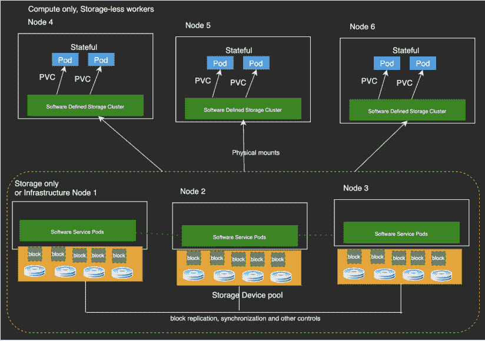
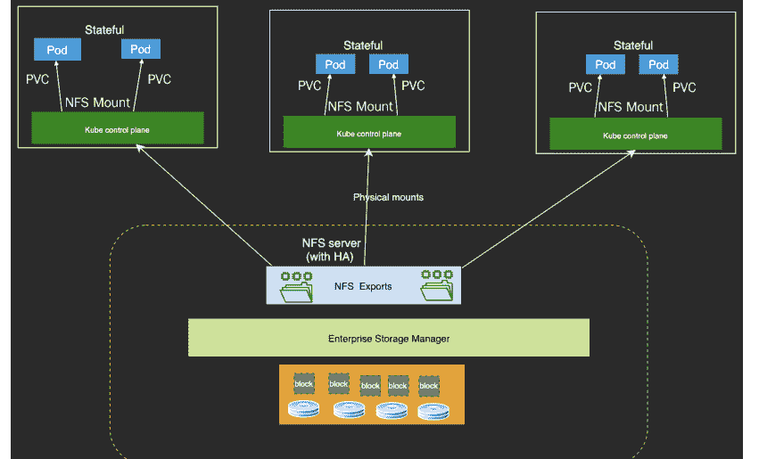
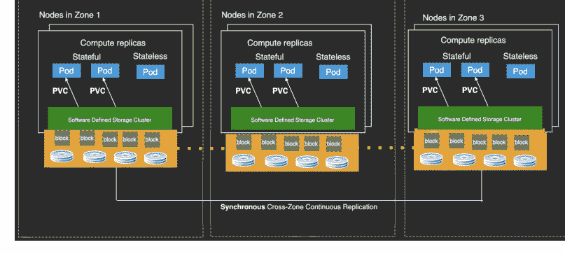

## 11 存储

**Cloud Pak for Data** 利用 Kubernetes 的 **持久卷** 概念，该概念在 OpenShift 中得到支持，以使其各种服务能够存储数据和元数据。Cloud Pak for Data 服务还可以连接到远程数据库、数据湖和对象存储，以及作为数据源的远程导出文件系统。我们将研究为集群内 PV 和集群外外部存储提供支持的概念和技术。到本章结束时，您将了解在各种公有云和私有云基础设施中有哪些可用选项，以及如何最好地为您的用例优化数据存储。您还将了解存储应如何进行运营化，特别是为了支持整个解决方案的持续可用性。

在本章中，我们将涵盖以下主要主题：

- 持久卷
- 连接到外部卷
- 运营考虑

### 理解持久卷的概念

我们将首先对 Kubernetes 中的基础存储概念进行快速介绍，以及 Cloud Pak for Data 如何利用存储。典型的容器是无状态的，这意味着它们创建的任何文件或所做的任何更改都是临时的；在重新启动容器后，这些更改不会被恢复。此外，容器内的文件将在主机上的临时位置创建，这可能导致与该位置的其他类似使用者发生冲突。在 **Kubernetes** 中，卷的概念 [1] 使有状态容器所需目录文件的持久化成为可能。此类卷安装在 Kubernetes Pod 中，并且根据与该卷关联的访问模式，相同的目录内容可以与在该 Kubernetes 命名空间内并发运行的其他 Pod 共享。

在本节中，您将了解什么是预配称为 **持久卷** 的实体，它们为 Cloud Pak for Data 工作负载提供存储，并且可以针对性能、可靠性和扩展性进行配置。

多种技术和供应商使 Kubernetes 中的存储成为可能；我们将探讨目前由 Cloud Pak for Data 认证的那些技术。

### Kubernetes 存储介绍

Kubernetes 提供了一种称为 **持久卷声明 (PVCs)**[2] 的构造，作为 Pod 挂载块和文件 **持久卷 (PVs)** [2] 的抽象，而无需使用特定于供应商的处理。存储供应商，通常作为操作符引入，提供必要的服务来定义 **存储类** [3] 和 **动态预配器** [4]，以创建、初始化并将这些卷文件系统挂载到不同的 Pod 中。虽然存储软件和配置是特定于供应商的，但 PVC 的概念使使用存储成为一种标准程序，不受提供该存储所用技术的限制。

请注意，Cloud Pak for Data 需要使用 **动态预配器**；即按需预配存储的能力。静态预配器预先定义存储卷，对于通过动态、*即插即用* 机制部署 Cloud Pak for Data 服务来说是不够的。扩展此类服务在许多情况下也可能自动要求我们创建新卷。

存储类由 `StorageClass` Kubernetes Kind 资源表示，用于引用每种类型的卷。当 Cloud Pak for Data 服务被预配时，它们包含 PVC 声明，然后由 Kubernetes 处理以预配并绑定 PV。

例如，用户主目录卷是通过定义类似于以下内容的 `PersistentVolumeClaim` 来请求的：

```yaml
apiVersion: v1
kind: PersistentVolumeClaim
metadata:
  name: "user-home-pvc"
spec:
  storageClassName: {{ <user-selected-storage-class> }}
  accessModes:
    - ReadWriteMany
  resources:
    requests:
      storage: {{ default "100Gi" or <user-selected-size> }}
```

您还会注意到 PVC 定义标识了参数，例如要使用的存储类和已请求的存储大小。这些是通过 Cloud Pak for Data 服务的安装选项引入的。

*声明* 中的声明，连同存储类和其他属性（例如 `size` 和 `accessModes`），代表向 Kubernetes 请求为 Cloud Pak for Data 服务预配卷的 *请求*。一旦存储卷被预配，Kubernetes 然后通过将预配的 PV *绑定* 到 PVC 来满足该声明。此绑定元数据然后使 Kubernetes 能够始终将相同的存储卷挂载到 Pod 中，以及使服务能够使用 PVC 的抽象始终引用该卷，而无需了解卷在物理上存在的位置或其背后的驱动程序/存储技术。

> **注意**
>
> 您无需显式定义 PVC。PVC 将在 Cloud Pak for Data 服务安装过程中声明。


StorageClass 定义还可以指定要使用的供应商特定 provisioner。当存储软件安装到 OpenShift 集群中时，会预定义一些存储类；其他供应商则提供定义新存储类的功能，并带有自定义参数，以便针对特定用例对卷进行微调。

例如，ocs-storagecluster-ceph-rbd（RWO）和 ocs-storagecluster-cephfs（RWX）存储类作为 OpenShift 容器存储安装的一部分提供，而 Portworx 则通过不同的可配置属性集显式定义存储类，以优化性能或质量。

用于 IBM 的 Portworx Essentials 安装包中包含 Cloud Pak for Data 服务使用的一系列存储类。以下是其中一个 RWX 类的片段，即 portworx-shared-gp3：

```
apiVersion: storage.k8s.io/v1
kind: StorageClass
metadata:
  name: portworx-shared-gp3
parameters:
  priority_io: high
  repl: "3"
  sharedv4: "true"
  io_profile: db_remote
  disable_io_profile_protection: "1"
allowVolumeExpansion: true
provisioner: kubernetes.io/portworx-volume
reclaimPolicy: Retain
volumeBindingMode: Immediate
```

以下是 portworx-metastoredb-sc RWO 类的片段：

```
apiVersion: storage.k8s.io/v1
kind: StorageClass
metadata:
  name: portworx-metastoredb-sc
parameters:
  priority_io: high
  io_profile: db_remote
  repl: "3"
  disable_io_profile_protection: "1"
allowVolumeExpansion: true
provisioner: kubernetes.io/portworx-volume
reclaimPolicy: Retain
volumeBindingMode: Immediate
```

在这里，您可以看到一些供应商特定的参数。有些用于性能优化，有些则用于冗余（复制）和控制，例如检查所制备的卷是否可以扩展。

同样，其他存储 provisioner（如 IBM Spectrum Scale）也有类似的配置参数作为其存储类的一部分。

一旦 Kubernetes 根据请求的 PVC 中指定的要求制备了这些 PV，Kubernetes 就会利用存储物理位置与 PV 构造之间的绑定，抽象出各个 Pod 如何访问存储。随后，在单个 Cloud Pak for Data Pod 启动时，Kubernetes 会使用存储供应商或底层技术提供的驱动程序来挂载这些已制备的 PV。

在安装 Cloud Pak for Data 服务时，用户会选择特定的存储类作为安装参数。Cloud Pak for Data 文档 [6] 中提供了有关哪些类型的存储类适合每个服务的指导 [7]。

现在，让我们更深入地了解存储拓扑本身，例如存储可能位于何处，以及不同的 Kubernetes 节点访问存储意味着什么。

大体上，我们可以将存储位置分类如下：

- **集群内存储：** 这是物理存储设备/磁盘和存储软件控制系统所在的位置。它们用于在这些设备中制备和管理卷，并且与 Cloud Pak for Data 本身位于同一个 Kubernetes 集群中。
- **集群外存储：** 这是物理存储设备和存储软件独立于 Cloud Pak for Data 预期运行的 Kubernetes 集群进行操作的位置。Kubernetes 集群上可能只存在存储驱动程序，以及从该远程存储系统制备和挂载卷。

从存储卷访问的角度来看，Kubernetes 生态系统中存在各种类型的软件驱动程序（软件定义存储）和插件代码来支持卷挂载 [12]。有些被称为“in-tree”卷 provisioner，指的是 Kubernetes 本身原生存在、用于处理这类存储的代码；另一些则被称为“out-of-tree” provisioner，指的是存在于 Kubernetes 之外、但可以插入以配合不同存储解决方案的代码。较新版本的 Kubernetes 还包含一个名为容器存储接口（CSI）[13] 的驱动程序标准。这些 provisioner 呈现一个或多个存储类，为 Kubernetes 中的应用程序提供所需的存储抽象。因此，Kubernetes 应用程序可以设计为基于 PVC 和存储类标准工作，并完全独立于实际的物理位置、组织或处理存储所需的驱动程序。

### 集群内存储

这种部署选项通常是指在 Cloud Pak for Data 服务所在的同一个 Kubernetes 集群中，将存储和计算部署在一起。存储设备连接到多个计算工作节点或基础架构节点，而软件定义的存储解决方案通过将卷挂载到需要的位置，协调存储的制备和使用方式。这些节点通常通过集群内部的低延迟、高吞吐量网络连接。此类存储仅供该 Kubernetes 集群内运行的应用程序和工作负载使用。

Kubernetes 原生支持通过使用计算主机的 hostPath [8] 直接挂载卷，也支持使用本地卷的节点亲和机制 [9]，以解决将 Pod 调度到与存储相同的工作节点上的调度难题。然而，这些选项不提供动态制备支持，而且当底层工作节点离线时，可靠性会受到影响。此外，OpenShift 的受限安全上下文 [11] 默认不允许从主机挂载大量此类卷。使用 hostPath 或本地卷还会导致 Kubernetes 应用程序在存储方面产生紧密耦合。应用程序的可移植性以及存储类和制备技术的清晰抽象都会丧失。因此，Cloud Pak for Data 不依赖 hostPath 或本地卷类型。



这种组织方式仍可被视为超融合，因为 Kubernetes 集群同时支持存储和计算。Kubernetes 集群中节点之间的私有低延迟网络仍能以高性能方式支持 Pod 访问存储。

这种变体无法利用存储块和计算的物理共置来实现“本地”挂载优化，但其优势在于简化了节点操作和维护。这种分离有助于确保存储服务不会受到其他 Kubernetes 工作负载突发流量（即“吵闹邻居”效应）的影响，反之亦然。

下图展示了集中式存储管理解决方案如何（通过标准 NFS 协议或其他自定义机制）暴露卷的示例：



图 11.4 – 使用 NFS 进行集中式存储管理

存储应由 provisioner 根据需要动态制备，以满足 Kubernetes 中定义的 PVC。驱动程序（或原生的 NFS）支持如何将这些卷物理挂载到调度在不同 Kubernetes 计算工作节点上的不同 Pod 中。

有关如何使用此 provisioner 以及定义存储类的详细指导，请参阅“延伸阅读”部分的 [14]。

请注意，从生产角度来看，所分配的 NFS 服务器不应成为单点故障，它必须具有高可用性并支持自动故障转移（也就是说，它不能像单个 Linux 系统上的 NFS 守护进程那样简单）。如果 NFS 服务器发生故障，所有 PVC 挂载都将变得不可用。因此，企业级弹性存储管理解决方案对于确保整体可靠性至关重要。

### 运维注意事项

在前面的章节中，我们讨论了为 Cloud Pak for Data 中的容器化服务提供或使用集群内或集群外存储意味着什么。然而，同样关键的是确保存储基础架构本身具有弹性，并存在可确保不丢失数据的运维实践。从灾难恢复（DR）的角度来看，还必须考虑存储故障转移。

在本节中，我们将快速了解一些典型的实践和工具，可用于确保 Cloud Pak for Data 服务具有弹性运行能力，并确保数据保护。

#### 集群内存储的持续可用性

Kubernetes 的一个核心原则是确保应用程序的持续可用性。这包括跨多个可用区的计算负载均衡和副本。这些可用区可以是公有云中的故障（或可用性）区，也可以是本地部署中独立供电的硬件机架 [17]。

对于集群内存储而言，这要求存储也必须持续复制——这在很大程度上取决于所使用的存储供应商或技术。以下是持续可用性的示例拓扑，有时也称为双活容灾：



图 11.5 – 双活容灾


该模型有时被称为 *stretched* 集群，因为假设只有一个集群，即使某些 Nodes 可能位于不同的物理“区域”。

关键在于确保存储块以接近实时的方式在区域之间进行复制。通过这种部署，stateful Pods 无论物理位于哪个区域，都始终可以访问其 PVs。一个存储节点/副本的故障不应导致整个应用程序失败。这是因为其他存储副本应该能够提供必要的数据块。Kubernetes 中支持这种持续可用性概念的存储驱动程序完全抽象（通过 PVCs）数据是从哪里物理获取的，并且可以在自动故障转移到使用不同副本的存储时自动进行。

从负载均衡的角度来看，我们通常认为所有计算 Pods 始终处于活动状态并可供使用，而与其位于哪个区域无关。即使整个区域变得不可用，只有计算和存储副本变得无法访问，这意味着其他副本可以填补空缺。

此类存储驱动程序通常也配置为感知集群拓扑 [18]，例如，通过使用 Kubernetes 节点标签来指定故障区域。这使它们能够将 PV 副本放置在不同的区域中，从而在某个区域丢失时提供弹性。这种复制模型的一个常见问题是“脑裂”效应，即由于不同 Nodes 无法通信和同步数据的故障情况，存储副本具有不一致的数据块。因此，此类存储驱动程序具有在这些条件下隔离存储的复杂性，以及识别副本已离线过久需要更新以“追赶”或在添加新存储副本时复制数据块的能力。这对于确保应用程序数据在所有副本中始终保持一致至关重要。

虽然在这些区域之间具有低延迟网络至关重要，但这种多区域复制技术也要求所使用的存储技术具有这种复杂性。例如，Red Hat OpenShift Container Storage（Ceph）和 Portworx Enterprise 支持此类要求，大多数公共云 IaaS 存储提供商也是如此。

使用离集群存储也可以在技术上实现持续存储可用性，尽管将存储区域与 Kubernetes 集群区域对齐需要多一点努力。外部存储管理器，例如 IBM Spectrum Scale、Dell EMC Isilon、NetApp onTap 和基于 NAS 的解决方案，传统上提供了跨区域同步复制的机制。

快照通常存储在同一设备中，这意味着它们的可靠性仅与设备本身一样可靠。因此，存储供应商 [20] 还提供了为云存储创建此类快照的机制，例如 S3 对象存储。

- **通过可用卷数据的副本：** 这种方法依赖于 rsync 或将来自 PVCs 的某些数据复制到另一个 PVC（通常是远程存储卷）或对象存储。`cpd-cli backup-and-restore` 实用程序有一个 Kubernetes 服务，允许我们将数据从 PVs 复制到备份卷。

然而，这种技术要求该 Kubernetes 命名空间中的所有服务都进入“维护模式”（或完全静默），以防止在复制卷数据时发生任何 I/O。优点是这适用于任何类型的存储，包括 NFS，用于 PVs，并且不需要存储系统提供任何特定功能。

#### Quiescing Cloud Pak for Data services

为了实现应用级一致性，在备份进行期间必须暂停写入。为了支持此类要求，`cpd-cli` 实用程序包含一个 `backup-restore quiesce` 命令，指示服务暂时进入维护模式。该实用程序还缩减了一些 Deployments 以防止任何 I/O 活动。一旦备份完成，则使用 `backup-restore unquiesce` 命令将服务从维护中扩展。注意，虽然这种 **quiesce** 意味着 Cloud Pak for Data 在该持续时间内不可用——即处于维护模式——但能够实现应用一致的备份也很重要。

**quiesce** 机制也可以用于外部存储备份或快照，例如当 NFS 用于 PVs 时。例如，当 IBM Spectrum Scale 提供 NFS 卷时，您可以使 Cloud Pak for Data 命名空间中的服务进入静默状态，然后触发 GPFS 快照并使服务恢复静默。

#### Db2 database backups and HADR

确保数据库以可靠和连续的方式运行对于企业来说通常至关重要。虽然支持写入暂停/quiesce，但 Db2 提供了额外的技术，允许 Db2 数据库在备份操作进行期间仍可在线 [22] 使用。这也独立于所选择的存储技术，并且可以支持增量备份。

Db2 高可用性灾难恢复（HADR）配置 [23] 将两个 Db2 数据库实例配对，这些实例可能存在于同一集群中（例如，不同的 Kubernetes 命名空间）甚至远程集群。在此配置中，数据从活动源数据库复制到备用目标。当发生全站故障或活动 Db2 数据库被认为无法访问时，会自动故障转移到备用数据库。Db2 HADR 自动客户端重定向（ACR）功能是一种机制，客户端连接到失败的 Db2 数据库时，可无缝切换到新的活动 Db2 数据库。

#### Kubernetes cluster backup and restore

前面描述的快照机制和 `cpd-cli backup-and-restore` 实用程序只能将数据从 PVCs 复制并恢复到新的 PVCs。在新集群中恢复此类备份时，期望目标集群以与原始集群相同的方式设置。这意味着必须在目标集群中安装必要的 Cloud Pak for Data 服务，并且在数据恢复过程进行之前，所有 Kubernetes 资源都必须存在。

Velero 项目 [24] 引入了一种备份所有 Kubernetes 资源工件的机制。这允许在数据恢复发生之前轻松重建目标集群。Red Hat 为 OpenShift 集群引入的 OpenShift API for Data Protection Operators [25]，结合 Ceph-CSI 驱动程序，提供了一种更好地运营化集群级备份和恢复的方法。它还支持其他用例，例如复制或迁移集群。

#### Summary

在本章中，我们介绍了 Kubernetes 中 PVs 的概念以及 Cloud Pak for Data 如何与不同的存储技术和供应商协同工作。我们还讨论了存储拓扑以及可能存在于不同企业中的供应商或技术。

本章还强调了数据保护以及备份和恢复的运营化，以及 DR 实践的重要性。确保您对存储有深入的理解，可确保 Cloud Pak for Data 服务以及在其之上构建的企业解决方案以弹性和所需的性能水平运行。
