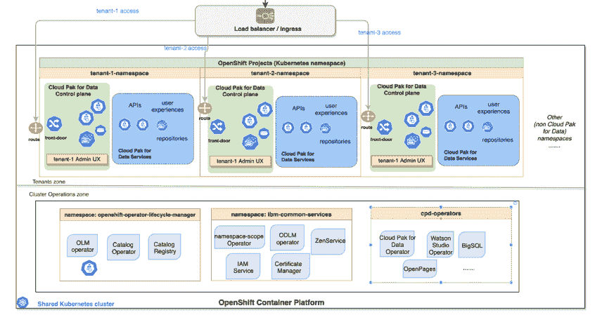
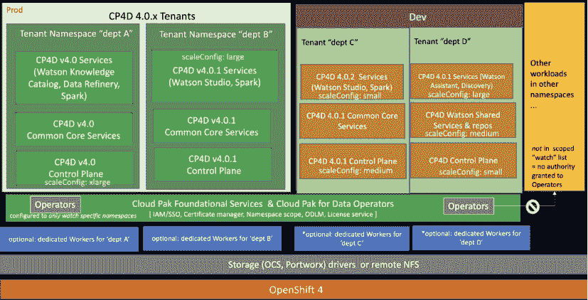
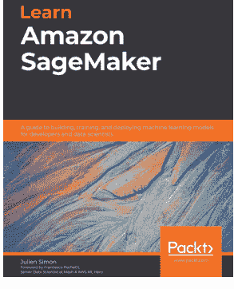
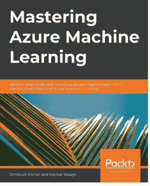

## 12 Multi-Tenancy

多租户是一种软件架构设计，其中多个用户或组织共享同一软件实例及其底层资源。这是 **Software-as-a-Service (SaaS)** 提供的标准做法，例如 IBM Cloud 中的 Cloud Pak for Data as a service，但对租户的解释以及租户如何在本地或私有云中实现可能存在很大差异。企业中的 **Security** 和 **compliance** 要求，以及 *quality of service assurances*，在决定可以共享多少方面发挥着重要作用。

如今，任何真正的云原生平台堆栈能够开箱即用地至少实现一定程度的多租户共享已成为基本期望。仅通过重用现有共享基础设施即可加速支持新项目或计划。简单地假设为每个租户分配独立的 **virtual machines (VMs)** 就足以实现多租户——毕竟，底层裸机资源确实是共享的。但为企业中的每个部门提供专用的 VM 集群在成本上是不可行的；仅管理多个集群或软件安装所需的操作成熟度本身就会变得 prohibitively expensive。

大多数企业，无论是在托管的公共云基础设施还是本地运行，都更喜欢租户之间在性能、安全性、**privacy** 方面有一致保证的共享程度。仅仅将 VM 分配给租户已不再被认为足够，并且随着容器化技术的出现，现在可以实现更细粒度的多租户，甚至多个租户共享同一台 VM。这也使安全问题变得更加复杂，因为即使操作系统也被共享，不同租户的进程并排运行。

IBM 在其云平台的 Cloud Pak for Data SaaS 方案中采用了复杂的 multi-tenancy 技术，并且 Cloud Pak for Data 软件栈的架构基础也能够使企业在同一个 OpenShift Kubernetes 集群上支持多个租户。第 9 章《Technical Overview, Management, and Administration》介绍了如何通过审慎使用 Kubernetes 命名空间来实现多租户，即单个 OpenShift 集群在多个租户之间共享。在安全可靠地实施多租户时，需要仔细权衡，同时要兼顾企业的需求、策略以及租户所期望的服务保证。

在本章中，我们将涵盖以下主题：

- Tenancy considerations
- Architecting for multi-tenancy
- A review of the tenancy requirements
- In-namespace sub-tenancy with looser isolation

### Tenancy considerations

我们将首先仔细审视多租户意味着什么、租户为何重要，以及总体而言，在规划此类共享部署时需要做出哪些架构选择、权衡和关于费用的妥协。

#### Designating tenants

每个企业在识别其租户时通常有非常不同的理解，但总体而言，租户被定义为被授予特定权限以访问共享软件安装的选定用户组。当租户代表完全不同的公司时，一个租户的用户通常不知道其他租户用户的存在。然而，即使这种隔离也可以在同一企业内部的用户之间放宽，公司内的员工可能是多个租户“账户”的成员。

在每个租户范围内，可以授予特定用户管理权限并将其范围限定在其实例中，以使租户具备一定的自助服务能力。这允许租户管理员执行部分 Cloud Pak for Data 管理功能，包括自行管理用户访问和故障排除，如第 9 章《Technical Overview, Management, and Administration》所述。

> **A note on the role of tenant users**
>
> 包括这个 Tenant Admin 角色在内，所有来自租户组的用户都应被视为终端用户；即专注于使用 Cloud Pak for Data 服务提供的功能的人群，而不是负责自行管理安装或集群基础设施的人员。
>
> Tenant Admins 也是终端用户，但在自助管理方面扮演着稍重要的角色——他们架起了运维团队与 Cloud Pak for Data 实例使用者之间的桥梁。

#### Onboarding tenants

在这种多租户部署中，需要有一个正式流程来识别租户、授予他们对分配资源适当的（有限）访问权限，并计量其使用情况。在 Cloud Pak for Data 中，规定做法是运维团队为部署 Cloud Pak for Data 服务创建唯一的 OpenShift 项目命名空间，并配备适当的 ResourceQuotas。

根据对 Kubernetes 访问的策略，OpenShift 集群管理员可以向租户管理员用户授予对该 OpenShift 项目命名空间的有限 RBAC 权限。这将允许此类租户根据需要部署 Cloud Pak for Data 服务（或升级它们）。

> **Note**
>
> 如第 9 章《Technical Overview, Management, and Administration》所述，操作员的使用旨在帮助运维团队（操作员毕竟是将运维知识编码到软件中）和租户本身。集群管理员根据其租户用例（以及相关的容器镜像）引入所需的任何操作员并保持其最新。当租户需要在其命名空间中部署服务时，他们只需使用适当的自定义资源规范“声明”其需求，而无需成为理解如何自动化安装（或升级）任何服务的专家。

### Architecting for multi-tenancy

在本节中，我们将探讨使用 Cloud Pak for Data 实现多租户意味着什么，从如何在 OpenShift 集群上规划拓扑以及如何在同一集群内分离租户开始。

#### Achieving tenancy with namespace scoping

正如我们之前所建立的，为每个唯一租户分配唯一的 OpenShift 项目（Kubernetes 命名空间）是 Cloud Pak for Data 多租户部署的推荐方法。

下图显示了多个租户如何被沙箱化到独立的 OpenShift 项目中，以及 Operations 区域（由集群管理员管理）与 Tenants 区域（租户用户可能被授予访问权限）之间的逻辑分离：

Figure 12.1 – Individual tenant namespaces in a shared Kubernetes cluster

**Cluster Operations zone** 包括 OpenShift 和 Kubernetes 提供的所有管理功能（为简洁起见，前述图中未显示全部）。**Operator Lifecycle Manager (OLM)** 提供操作员和服务，用于安装和管理 Cloud Pak for Data 本身。它对于实现多租户也非常重要，因为它提供了扩展集群的正确抽象，并使不同的功能（通过服务操作员）能够在集群中可用。为了满足职责分离要求，OLM 可以完全由集群管理员控制并集成到其 CI/CD 流程中，而租户，包括其管理员，被拒绝访问。

**Cloud Pak Foundational Services (CPFS)** 通常位于 *ibm-common-services* 命名空间中。这包括 *namespace-scope operator*，它对于确保 Cloud Pak for Data 操作员仅受限于管理特定租户命名空间而不是 *所有* 命名空间至关重要。这些操作员根本不需要监视 *非* Cloud Pak for Data 命名空间，而且出于安全原因（最小权限原则），最好甚至不授予这些操作员该权限。虽然 Cloud Pak for Data 服务操作员可以与 CPFS 一同位于 *ibm-common-services* 中，但它们也可以安装在不同的 *cpd-operators* 命名空间中，如前述图所示。例如，当同一集群中存在其他 Cloud Pak 时，您可能会选择使用 *cpd-operators*。虽然 CPFS 操作员需要管理所有 Cloud Pak 命名空间，但 Cloud Pak for Data 操作员并非如此，并且通过将它们隔离到 *cpd-operators*，您可以确保它们仅限于 Cloud Pak for Data 命名空间。

> **Note**
>
> 如前述图所示，每个租户命名空间都有自己独立的 Cloud Pak for Data 控制平面副本，并根据需要进行扩展，包括带有自己私有 ingress/route 的前端入口。OpenShift 能够通过唯一的租户 URL 暴露此前端入口供访问。这使得客户端应用能够从集群外部连接到适当的租户实例。

每个租户的身份验证和审计可以独立配置。用于生成 bearer token 的签名密钥对每个租户都是唯一的。因此，使用一个租户实例的身份验证令牌将无法访问另一个租户。授权形式为 *roles and permissions*，可以帮助租户管理员以精细的方式向该租户的用户授予授权。此租户的 Cloud Pak for Data 安装中的对象和功能仅对授权用户可用。

OpenShift 还会自动为每个项目生成唯一的 *UID* 范围。因此，一个 Cloud Pak for Data 租户命名空间内的 Linux 进程运行的 UID 与另一个命名空间的进程不同。这与 **RHEL's SELinux** 能力相结合，确保即使来自两个租户的 Pod 被调度到同一 Linux 主机上，这些进程也无法相互交互。因此，可能感染了某个租户 Pod 的恶意进程，或可能意外引入的用户错误，都不会影响另一个租户的 Pod 进程。请注意，某些 Cloud Pak for Data v4 服务依赖于通过使用自定义 SCC 的固定 UID（如 *Chapter 10, Security and Compliance* 中所述）。

通过网络策略，可以在命名空间内允许访问，微服务可以相互通信。然而，来自另一个租户的微服务的访问可以被有效阻止，除非是通过前端入口进入的请求，并且只有经过正确授权的请求。

#### Choosing dedicated versus shared compute nodes

在 OpenShift 中，SELinux 和 Linux 进程的唯一租户 UID 在不同租户的进程并排执行、共享同一操作系统内核运行时时提供了相当大的安全性。借助命名空间 ResourceQuotas 以及 Cloud Pak for Data 监控和执行使用配额的能力，还有额外的控制措施可确保嘈杂的租户工作负载不会对另一个租户产生不利影响，并且集群中的 SLA 可以得到保证。

然而，企业中的安全策略可能不允许将一个租户的进程与另一个租户共置，或 SLA 要求租户之间某种程度的物理隔离。显然，由于为单个租户分配独立的 Kubernetes 集群在运营上成本过高，OpenShift 容器平台提供了支持此类要求的选项。

集群管理员可以向 OpenShift 项目引入 NodeSelector 注解，以指定哪些计算工作节点（通过标签标识）用于调度该租户的 Pod。这确保了在原本共享的 OpenShift 集群中，该租户拥有专用节点。作为租户入职流程的一部分，集群管理员只需使用此注解，即可决定是使用共享计算主机还是分配专用主机。虽然对于某些服务（如数据库）可以使用 Kubernetes 的 Pod 级节点亲和性概念，但在必要时，通常更容易将租户的所有节点分配到专用节点。

### 审查租户要求

在第9章“技术概述、管理和行政管理”中，我们简要介绍了支持 Cloud Pak for Data 多租户所需解决的关键属性。

从某种意义上说，我们可以将这些要求与传统操作系统环境中应用程序的租户概念联系起来，尽管规模更大。Unix 或 Linux 系统会安装所有必需的软件，超级用户（“root”）负责管理该系统。root 用户将授权用户访问该系统，并将他们分配到不同的用户组（“租户”）。通过使用简单的文件系统权限（组 ID 和用户 ID），这些用户可以在其租户组内协同工作，并在一定程度上与其他租户隔离。用户可以执行和访问他们（或其组）已被授予访问权限的应用程序，而操作系统安全原语（如 SELinux 和 AppArmor）则确保严格控制跨进程访问。

> **注意**
> Kubernetes 集群仅仅是新的“操作环境”，并在更高层次上支持与操作系统相同的许多范式。集群管理员是“root”用户，他们可以向其他用户授予各种基于角色的访问权限。从多租户的角度来看，此类管理员现在可以利用额外的操作环境原语，例如 OpenShift 安全上下文约束、虚拟项目/Kubernetes 命名空间中的租户隔离，以及细粒度的 RBAC，如第10章“安全与合规性”所述。

在本节中，我们将评估以下关键租户要求：

- 隔离
- 安全与合规性
- 自助服务管理

我们将从在不同 Kubernetes 命名空间中部署 Cloud Pak for Data 实例的角度来审视这些要求。

### 隔离租户

一个基本要求是，一个租户账户的用户完全不知道另一个租户的存在。即使一个用户属于两个租户账户——例如，一个员工被授予访问两个部门实例的权限——也需要有一种显式机制来从一个租户上下文“切换”到另一个租户上下文——甚至可能需要不同的登录流程。当与不同租户实例关联的 Kubernetes 微服务在同一集群中运行、网络距离很近且数据可能可访问时，建立边界并强制严格分离就变得非常重要。

让我们看看 Cloud Pak for Data 和 OpenShift 在实现隔离方面提供了哪些功能。

#### 配置身份验证

Cloud Pak for Data 允许命名空间中的每个租户安装决定如何对该租户组中的用户进行身份验证。例如，一个租户实例可以配置为针对一个 LDAP 服务器进行身份验证，而另一个实例可以配置为使用另一个。或者，不同的 LDAP（子）组可用于不同的实例。

可能希望为所有（部门）租户实例配置针对同一企业 SSO 提供商的单点登录（SSO）。然而，即使在这种情况下，也可以控制对各个 Cloud Pak for Data 实例的访问，以便只有在该实例中具有特定角色的用户才能访问。

#### 授权用户访问

在第10章“安全与合规性”中，我们详细讨论了角色和权限，包括如何根据企业需求进行定制。在管理用户访问（甚至非常细粒度的级别）时，角色是基石。根据策略或实践，集群管理员甚至可以选择修改开箱即用的 Cloud Pak for Data“管理员”角色，也许是为了移除（重新）配置身份验证或管理运行状况的能力，只保留查看监控信息的能力。

除了平台（控制平面）之外，每项服务或功能都需要授权。例如，不同的用户组可以被指定为项目或目录中的编辑者，而其他用户，即使已成功通过身份验证，也可能被拒绝访问该资源。同样，但更细粒度地，个人用户或用户组可以被授予对特定虚拟表或视图的*选择性*访问权限，作为数据虚拟化服务的一部分，而其他用户可能被拒绝访问，这与传统关系数据库完全相同。

#### 确保计算资源的隔离

每个租户在自己的命名空间中拥有所需微服务的*唯一副本*，并且可以独立地*扩展*它们以适应预期的负载或并发需求。命名空间级别的 ResourceQuotas 确保可以为每个租户*预留*计算资源。企业还可以选择为租户分配专用主机，以进一步保证隔离和计算资源的可用性。

正如我们之前讨论的，OpenShift 项目 UID 和 SELinux 可以确保进程（即使是位于*同一*主机上的进程）得到隔离。

#### 外部化路由和入口点

每个租户都有独特的前门和路由。借助 OpenShift 和外部负载均衡器，甚至可以发布全新的 URL，其中包含适合该租户的主机和域名。每个前门路由还可以与特定于租户的 TLS 证书相关联，表明哪个特定租户“拥有”该 Cloud Pak for Data 实例。

这提供了一种简单而优雅的方式来隔离客户端到各个租户 Cloud Pak for Data 实例的流量。

#### 通过存储确保隐私

使用 Kubernetes 命名空间还保证了持久卷仅在该命名空间范围内可用。如*第11章“存储”*所述，**持久卷声明（PVC）**仅在一个命名空间内有效，用于将存储卷挂载到 Cloud Pak for Data 微服务 Pod 上。即使使用了集群范围的共享存储解决方案，使用 PVC 也能保证一个租户的卷不会被另一个租户的微服务访问。

### 保护网络访问安全

在前面的章节中，我们确定了前门和独特路由如何帮助保证从集群*外部*访问各个租户 Cloud Pak for Data 实例时的隔离。Kubernetes 包含网络策略的概念，这一概念与防火墙规则非常相似，可进一步加强租户实例免受集群*内部*入侵访问的安全性。

可以编写网络策略，允许同一命名空间内的微服务之间的访问，并默认拒绝来自其他命名空间的访问。作为*全部拒绝*规则的例外，定义了额外的*允许*策略，以允许 HTTPS 访问每个租户的前门，以及允许操作员命名空间与每个租户命名空间之间的访问。*拒绝*策略阻止租户之间的流量，但各自的前门除外。租户之间的交互（*如果确实*需要）需要通过各自前门中的授权检查来完成，就像外部客户端从集群外部访问一样。

因此，虽然仍然需要允许 Operator 和租户命名空间之间的某些访问，但通过精心设计网络策略，租户可以确保其免受来自 Kubernetes 集群外部或内部的入侵。

### 审计

在这种多租户架构中，软件服务的运营方式始终需要制衡。从监管合规的角度来看，审计是企业用来提供安全和受监控运营保证的有力工具。在*第10章“安全与合规性”*中，我们讨论了集群运营团队可以采用的许多机制，以确保安全性和合规性。

租户通常需要遵守合规性要求，或从安全角度监控其 Cloud Pak for Data 实例的使用情况。此类租户不应访问整个集群的审计或监控记录，而只能访问其实例范围内的记录。

Cloud Pak for Data 包含一个实例范围的审计服务，如*第10章“安全与合规性”*所述。如果获得适当授权，每个租户管理员或安全负责人可以仅配置其 Cloud Pak for Data 实例，将所有相关审计事件转发到**安全信息和事件管理（SIEM）**系统。即使所有租户和集群运营团队使用相同的 SIEM，也可以保持唯一标识每个租户的能力，并且可以发布特定于租户的审计报告。

### 自助服务与管理

对于集群运维团队来说，为每个租户用户在日常运营中提供全程指导并不具有成本效益。从合规角度来看，通常也不允许此类集群管理员深度嵌入租户业务中。此外，对于基于云的系统，人们普遍期望租户能够自行满足大多数需求，而无需 IT 支持。然而，整体集群安全仍是集群运维团队的责任，他们需要能够确保租户无法超出其实例范围。

因此，这需要在保持严格的安全约束和租户每天自行管理其实例所需的灵活性之间取得微妙平衡。在本节中，我们将探讨 OpenShift 和 Cloud Pak for Data 提供的功能，帮助企业平衡这一需求。

### 部署与升级 – 实现服务和版本的自主选择

不同的租户需要部署不同的 Cloud Pak for Data 服务集合。他们甚至可能出于稳定性考虑，将服务“固定”到特定版本——通常，生产环境会保持在经过充分测试的水平，而开发环境则具有更大的灵活性。

通过审慎使用 Operator 自定义资源，单个租户可以自行决定安装和升级每个服务。对于支持 *服务实例* 概念的服务，例如 Db2，经授权的租户用户甚至可以在无需 Kubernetes 访问的情况下自行启动数据库实例。

因此，集群管理员可以授予租户管理员在其命名空间中的权限，使其能够自行部署 Cloud Pak for Data 服务。反过来，租户管理员可以授权租户用户的一个子集在该 Cloud Pak for Data 实例的范围内自行部署服务实例。

### 监控

通过租户实例范围的监控和管理，集群管理员可以将日常监控委托给各个租户管理员。集群管理员仍然保留控制整个命名空间的权利，特别是通过建立资源配额，而租户管理员则在这些边界内运营，以决定如何在其租户范围内监控和限制使用。

Cloud Pak for Data 的监控和告警框架可以帮助租户管理员了解其实例内的利用情况，并决定需要为各个用例或服务分配多少计算资源。

### 运营与维护租户资源

集群管理员还可以授权租户管理员自行执行所需的二日维护工作。单个服务的补丁或版本升级（与前面描述的安装和部署一样）可以通过自定义资源由租户管理员自行触发，前提是已授予该权限。自定义资源也可以轻松用于扩展该特定 Cloud Pak for Data 实例中的服务（v4 中的 scaleConfig 字段的工作方式与 v3.5 中 cpd-cli scale 命令类似，只是它由 Operator 驱动），只需命名空间范围的权限即可。

监控和管理体验为租户管理员提供了一种简单的方式来管理自己的 Cloud Pak for Data 实例，包括识别和纠正失败的服务。他们可以访问各个日志并获取 IBM 支持所需的详细诊断，而无需集群管理员介入。

备份（以及在需要时恢复）也是租户的关键关注点。虽然集群管理员确保所有租户的存储和其他基础设施的可靠性，但租户特定数据和元数据的备份也可以委托给租户管理员。

如第 11 章《存储》中所述，cpd-cli backup-restore 实用程序需要范围化的 Kubernetes RBAC，并且该实用程序可以被租户管理员使用。需要注意的是，对于存储快照和其他将存储迁移到远程站点的高级技术，仍可能需要集群运维团队管理的初始设置。重要的是，每个租户的备份映像仍然可以唯一标识，与其他租户的备份隔离并得到保护。

### 评估总结

在前面的章节中，我们讨论了 Cloud Pak for Data 和 OpenShift 如何支持多租户的关键需求。

下表提供了每个需求如何得到满足以及可用于实现该需求的机制的快速总结：

| 租户方面 | 机制 |
|---|---|
| **隔离** | *每个 Cloud Pak for Data 实例的独立 Kube 命名空间配额/OpenShift 项目* |
| 1. 用户 – 身份验证、角色和授权 | ✓ 如有需要，可支持 *每个实例不同的 LDAP/AD 或 SAML 配置*（每个实例拥有其独特的身份管理服务） |
| 2. 计算资源 | ✓ 命名空间配额 – 由集群管理员设置。 |
| 3. 实例访问 | ✓ 每个实例的唯一基于 DNS 的路由。 |
| 4. 存储使用 | ✓ 完全分离的 PVC（在不同命名空间中）使用不同的 PV – 实例之间不共享。 |
| **安全** | *仅限该命名空间的 RBAC 权限和服务帐户* |
| 1. 限制 Kube 集群级权限 | ✓ 服务帐户和角色绑定 – 范围限定于项目命名空间。 |
| 2. 网络访问 | ✓ Kube 网络策略用于加固 *如同在 RHOS 项目命名空间周围的防火墙*。 |
| 3. 审计 | ✓ *支持按租户的 SIEM 转发。* |
| **管理** | *范围限定到命名空间的管理权限* |
| 1. 监控/计量 | ✓ 不同实例的不同租户管理员用户。租户独立管理。 |
| 2. 运维 – 备份/DR、扩展、补丁、升级 | ✓ 运维权限范围限定于该 OpenShift 项目的命名空间。 |
| 3. 可服务性 | ✓ 可服务性实用程序仅捕获该实例适当的诊断信息。 |
| 4. 服务安装 | ✓ 不同实例可以拥有不同集合的服务，在不同版本下独立扩展，不受其他租户影响。 |

图 12.4 – 支持多租户的机制和技术总结

通过这种多租户实现方法，企业和集群管理员可以决定如何在同一共享的 OpenShift 基础架构上最好地混合和匹配不同的租户。

下图显示了不同租户使用不同版本 Cloud Pak for Data 服务的拓扑结构：

如前图所示，集群运维团队可以选择对生产和开发租户使用同一个 OpenShift 集群。如果合适，可以为特殊租户分配专用的计算节点（成本增加）。每个租户可以部署并固定控制平面本身的特定版本以及不同的 Cloud Pak for Data 服务，并且可以以不同的规模大小进行配置。

> **关于租户操作数版本选择的说明**
> 
> 虽然操作数本身可以固定到不同版本，但强烈建议将 Cloud Pak for Data Operator 集合持续升级到最新发布级别，即使在 *离线* 数据中心也是如此，以确保应用最新的关键缺陷修复并解决任何安全漏洞。Cloud Pak for Data Operator 支持在 Operator 本身升级时将操作数固定到特定版本。
> 
> 在这里，这些 Operator 支持部署和维护操作数的 *多个版本*，并且可以支持租户选择 *自动* 将操作数升级到最新发布版本，或 *保留*（固定）操作数到指定版本，由管理员决定何时手动升级。

需要注意的是，并非所有企业都可能具有相同的需求或策略。有些可能需要更严格的隔离，例如为每个租户需要专用计算节点。生产租户可能需要位于完全不同的 OpenShift 集群中，甚至在不同的网络或数据中心。其他租户可能要求宽松——例如，被指定为 *开发* 环境的租户通常不启用审计。

在下一节中，我们将查看一个这样的示例，其中租户的粒度不同，允许共享更多，但以安全和隔离要求为代价。

### 具有更宽松隔离的命名空间内子租户

即使同一个 OpenShift 集群被共享，仍有为每个租户运行多个 Cloud Pak for Data 服务安装所带来的开销和费用。虽然基于命名空间的分离在满足安全、合规和性能 SLA 保证方面提供了更多保障，但它会带来额外的费用。例如，我们需要在每个租户命名空间中安装 Kubernetes 部署的单独副本，这意味着需要更多监督和维护人员（即使 Operator 模式使升级、扩展等变得更容易）。单独的副本还会占用额外的计算和存储资源，从而增加最初的采购成本，以及持续的运营费用。

在某些情况下，出于减少支出的考虑，一些企业可能会选择在租户之间共享更多资源，即使这意味着失去灵活性或隔离性降低。在本节中，我们将探讨在多个子租户之间共享同一个 Cloud Pak for Data 实例意味着什么。

### 方法

这借鉴了分租的想法，其中主要租户决定与子租户共享资源。在此示例中，主要租户按通常方式由集群运营团队分配一个 Cloud Pak for Data 实例。然后租户管理员决定定义自己的子租户以授予访问权限。

主要租户管理员通常执行以下操作：

- 为每个子租户创建一个 Cloud Pak for Data 用户组。用户和 LDAP 组可以映射以唯一标识每个子租户用户。
- 分配适当的平台角色——也许只授予创建项目和目录的权限。
- 部署数据库等服务实例并授予对各个子租户组的访问权限——甚至将所有权/管理权委托给各个租户用户。

Packt.com

订阅我们的在线数字图书馆，全面访问超过 7,000 本书籍和视频，以及帮助您规划个人发展和推进职业生涯的行业领先工具。欲了解更多信息，请访问我们的网站。

### 为什么订阅？

- 使用来自 4,000 多名行业专业人士的实用电子书和视频，花更少时间学习，花更多时间编码
- 使用专为您打造的技能计划改善学习
- 每月免费获得一本电子书或视频
- 完全可搜索，便于快速访问重要信息
- 复制、粘贴、打印和书签内容

您知道 Packt 提供每本出版书籍的电子书版本，文件格式为 PDF 和 ePub 吗？您可以在 packt.com 升级到电子书版本，作为印刷书籍客户，您有权享受电子书折扣。请通过 customercare@packtpub.com 与我们联系了解更多详情。

在 www.packt.com，您还可以阅读免费的技术文章，订阅多种免费新闻通讯，并获得 Packt 书籍和电子书的独家折扣和优惠。

### 您可能感兴趣的其他书籍

如果您喜欢这本书，您可能对 Packt 的这些其他书籍感兴趣：

### 学习 Amazon SageMaker

Julien Simon

ISBN: 9781800208919

- 在 Amazon Web Services (AWS) 上创建和自动化端到端机器学习工作流
- 熟悉数据标注和准备技术
- 使用 AutoML 功能通过 AutoPilot 构建和训练机器学习模型
- 使用内置算法和框架以及您自己的代码创建模型
- 使用真实示例训练计算机视觉和 NLP 模型
- 涵盖用于扩展、模型优化、模型调试和成本优化的训练技术
- 使用 SDK 和多种自动化工具在多种配置中自动化部署任务

### 精通 Azure 机器学习

Christoph Körner, Kaijisse Waaijer

ISBN: 9781789807554

- 为数据实验和可视化设置 Azure 机器学习工作区
- 使用 Azure 最佳实践执行 ETL、数据准备和特征提取
- 使用 NLP 和词嵌入实现高级特征提取
- 在 Azure 机器学习上训练梯度提升树集成、推荐引擎和深度神经网络
- 使用超参数调优和 Azure 自动化机器学习优化您的 ML 模型
- 使用 Horovod 在 Azure 机器学习上在 GPU 集群上使用分布式 ML
- 部署、运营和管理大规模的 ML 模型
- 将端到端 ML 流程自动化为 MLOps 的 CI/CD 管道

### Packt 正在寻找像您这样的作者

如果您有兴趣成为 Packt 的作者，请访问 authors.packtpub.com 并立即申请。我们已与数千名开发人员和技术专业人士合作，帮助他们与全球技术社区分享见解。您可以进行一般申请，申请我们正在招聘作者的特定热门主题，或提交您自己的想法。

### 分享您的想法

现在您已完成 *IBM Cloud Pak for Data*，我们很想听听您的想法！如果您从 Amazon 购买了本书，请点击此处直接前往本书在 Amazon 的评论页面并分享您的反馈，或在您购买的网站上留下评论。

您的评论对我们和技术社区非常重要，将帮助我们确保提供优质内容。
