# First Impressions

## (The Client Interface)

初印象总是很重要，启动 Lotus Notes 也不例外。您可能会发现，Lotus Notes 不仅仅是电子邮件！有许多功能丰富的工具可供使用——例如，有一个名为 Lotus Symphony 的免费办公套件应用程序，可以作为 Microsoft Office 的替代品，供那些只需要办公套件基础功能的用户使用。如果在安装 Lotus Notes 时选择了 Symphony，您将看到创建文档、电子表格和演示文稿的功能。如果需要，您还可以将这些文档中的每一个导出为 PDF、HTML 或 JPEG 格式。

Lotus Notes 还有一个 Notebook 应用程序。该应用程序允许您创建可以包含图片、附件、想法等内容的笔记。它是存储仅供您个人使用的信息的绝佳场所。它还内置了名为 Sametime 的聊天和状态功能，以及内置的 RSS 阅读器、小部件面板、日历和日程安排功能，以及您的组织开发或购买的任何应用程序。

在本章中，我们将专注于客户端，并探索以下内容：

- 启动和关闭 Lotus Notes
- 打开列表
- 缩略图
- 主页
- 快捷方式
- 窗口选项卡
- 工具栏
- 侧边栏
- Lotus Notes 浏览器
- 首选项

## Starting Lotus Notes—start your engines

启动 Lotus Notes 与在计算机上启动任何应用程序类似；只需进入 开始 | 程序 | Lotus Notes。您在任务栏或桌面上也可能有一个 Lotus Notes 的快捷方式。

## Password prompt

在 Lotus Notes 启动过程中，大多数情况下我们会被要求输入密码。Lotus Notes 是一个非常安全的程序；它要求我们验证我们是我们所说的那个人，就像使用 ATM 卡和 PIN 码一样。在某些组织中，Lotus Notes 内部的安全性可能会出现变化。Lotus Notes 可能会在没有密码提示的情况下启动，但请放心，安全性依然同样强大。

以下是密码提示对话框的示例。在 用户名 字段中，将列出我们的姓名。如果 PC 上有多人使用 Lotus Notes，也可能会列出其他姓名。在 位置 字段中，我们选择当前正在从中访问 Lotus Notes 的位置。例如，我们可能在办公室或远程工作。如果我们忘记了密码，可以展开 对话框中所示的 忘记密码 部分，以获取我们需要执行的操作说明。

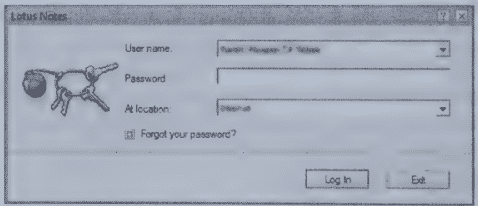

## Closing Lotus Notes

要关闭 Lotus Notes，请选择 文件 | 退出，或单击右上角的红色 X。请注意，关闭前无需关闭所有打开的窗口选项卡。例如，如果我们的邮件和日历选项卡是打开的，我们可以保持它们打开；这样，当我们再次启动 Lotus Notes 时，我们的邮件和日历选项卡将为我们打开并准备就绪。此选项由默认设置的首选项控制；如有需要，可以将其关闭。要关闭此首选项，请转到 文件 | 首选项 | 窗口和主题，并取消选中 重启时，重新打开关闭客户端时打开的任何选项卡 选项。

> 当我们关闭 Lotus Notes 且正在回复电子邮件或创建新的日历条目时，Lotus Notes 将提示我们确认是要发送还是保存；所以请放心，我们不会丢失任何工作！

## Exploring the interface—where, what, and how

当我们打开 Lotus Notes 时，我们不仅会看到邮件；还有主页，它将指向重要的应用程序，例如我们的邮件、日历，甚至 Notebook。
如果启用了侧边栏，它是与我们的日历、RSS 源和 Sametime 联系人交互的宝贵资源。有许多选项可供探索，让我们开始吧。

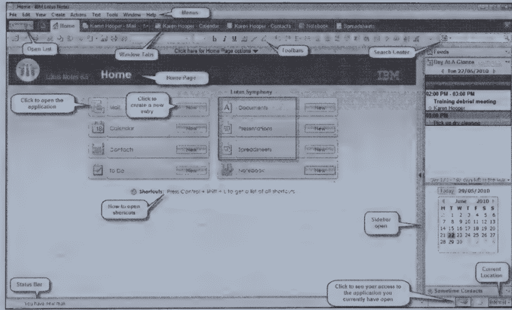

## Window tabs

当我们在 Windows 中打开一个应用程序时，我们会在计算机屏幕底部的任务栏中看到它（除非我们更改了该选项）。当我们在 Lotus Notes 中打开电子邮件或消息时，每个打开的项目的顶部（就在菜单选项下方）都会出现一个窗口选项卡。

我们可以选择在 Lotus Notes 中如何显示窗口选项卡；这些选项可以在 文件 | 首选项 | 窗口和主题 下选择。可用的选择如下：

- **在其自身窗口中打开每个文档**：此选项确保这些窗口出现在 Windows 任务栏中——与 Microsoft Outlook 的行为相同。

- **在其自身选项卡中打开每个文档**：这是 Lotus Notes 的默认设置。

- **在选项卡中分组每个应用程序的文档**：如果我们想保持选项卡更有条理，这是一个不错的选项。以下是此选项的示例。对于日历，有两个页面打开——**Mary Johnson - Calendar** 和 **Weekly Management Meeting** 日历条目。如果我们选择此选项，关闭窗口选项卡的新方法是窗口选项卡栏最右侧的红色 X 图标。

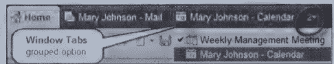

如果我们选择了分组选项卡，那么右键单击选项卡时，我们将有关闭组的选项。

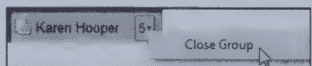

> 要关闭当前打开的所有窗口选项卡，请选择 **文件 | 关闭全部**。关闭打开的窗口选项卡的另一种方法是按键盘上的 **Esc** 键。

可以通过将窗口选项卡拖动到首选位置来重新排列它们。

我们可以按 **Alt+W** 切换到不同的窗口选项卡。这将为当前打开的每个窗口选项卡显示一个数字；输入我们要打开的窗口选项卡的数字。

## Open List—better known as the button that says "Open"

如前所述，Lotus Notes 不仅仅是电子邮件和日历。一家公司可以拥有多个 Lotus Notes 应用程序，用于跟踪或存储信息。我们可能创建了一些自己的应用程序。那么，我们如何访问包括邮件、日历等在内的这些应用程序？当然是单击打开按钮！

如果我们已打开 Lotus Notes，不妨试一下，单击打开列表？我们应该会看到每个图标都有标题的图标，例如 邮件、日历 或 联系人。

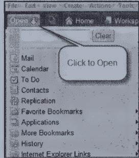

如果我们想打开邮件，可以选择 邮件。我们将看到 邮件 被突出显示，如下所示；然后可以单击鼠标左键打开。

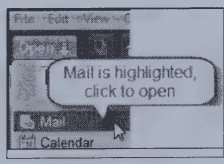

打开列表可以通过以下方式自定义：

- 右键单击以选择 **固定打开列表** 选项。这将移除打开列表，而是显示名为 书签栏 的栏，位于 Lotus Notes 的左侧，带有图标但没有标题；我们需要突出显示每个图标才能看到图标的标题。

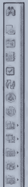

- 右键单击以选择 **使用大图标** 选项；这将更改图标的大小为大。

- 如果我们想将特定应用程序、消息甚至信纸添加到打开列表，只需打开应用程序或消息，然后将打开的应用程序或消息的窗口选项卡拖动到打开列表或书签栏即可。这类似于在 Internet Explorer 中将网站添加为收藏夹。例如，要将 Notebook 应用程序添加到打开列表，请打开 **Notebook** 应用程序，单击 **Notebook** 窗口选项卡，如下一个屏幕截图所示，然后按住鼠标左键，拖动到打开列表或书签栏。

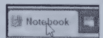

- 我们还可以搜索打开列表，只需在 **打开** 按钮下方的 **键入查找** 字段中输入我们要查找的内容即可。

## Thumbnails

缩略图在被点击时，会显示当前在 Lotus Notes 中打开的内容的图形化呈现。将打开一个屏幕，显示每个打开的窗口选项卡。缩略图位于“打开列表”旁边，如下一个屏幕截图所示；打开的快捷键是 Ctrl+Shift+T。

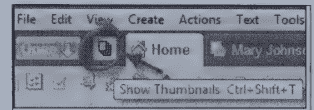

以下屏幕截图显示了打开缩略图时的外观：

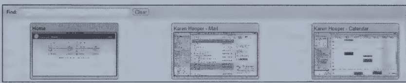

## Homepage

主页包含打开邮件、日历、联系人、待办事项和笔记本应用程序的链接。我们也可能看到创建新文档、演示文稿和电子表格的选项；这些选项在已安装 Symphony 时可用。

以下是主页的屏幕截图：

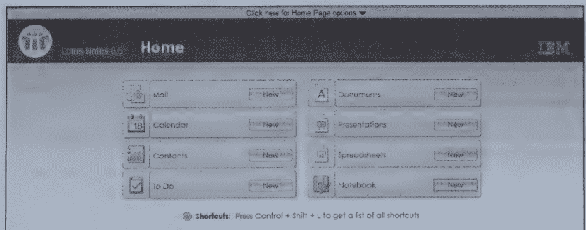

主页可以以多种方式自定义。选择位于主页面顶部的“单击此处获取主页选项”选项。

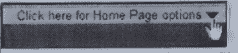

> 主页的一个酷炫功能是笔记本应用程序。这个名称准确地描述了它是什么——一个可以输入笔记的地方。没有其他人可以访问我们的笔记本，因此我们输入的信息是私密的。在主页上，单击“新建”以创建笔记本。创建笔记本后，“新建”按钮将创建一个文档，我们可以在其中在笔记本内输入笔记。

## Shortcuts

在主页上，您将看到一个打开快捷方式列表的快捷方式！

下一个屏幕截图显示了快捷方式列表：

| 后退 | Alt+Left |
|---|---|
| 粗体 | Ctrl+B |
| 中断 | Ctrl+Break |
| 居中插入点 | Ctrl+Y |
| 关闭 | Esc |
| 全部折叠 | - |
| 折叠所选级别 | - |
| 撰写邮件 | Ctrl+M |
| 上下文敏感帮助 | F1 |
| 复制 | Ctrl+C |
| 剪切 | Ctrl+X |

我最喜欢的快捷方式是 Ctrl+M，选定后，它可以从 Lotus Notes 中的任何位置创建一条消息。这非常方便且快速，因为我们不必总是打开邮件来创建消息。

要查看更详尽的快捷方式列表，请选择“帮助 | 帮助内容 | Lotus Notes | 键盘快捷键”。

## Toolbars

工具栏位于窗口选项卡下方，并提供菜单选项的快捷方式。Lotus Notes 中的工具栏可以重新定位、自定义和创建。以下是重新定位工具栏的示例：

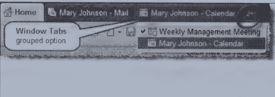

默认情况下，许多工具栏都与上下文相关，这意味着它们仅在需要时出现。例如，在文档中键入文本时，我们只能看到编辑工具栏。当我们在收件箱中时，编辑工具栏置灰且不可选择。要查看可用工具栏列表，请在工具栏区域右键单击。从此区域，我们可以选择要在工具栏区域显示的工具栏。

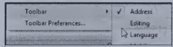

要自定义工具栏，请在工具栏区域右键单击并选择“工具栏首选项”；从此处我们可以自定义和创建自己的工具栏。或者，我们可以在“文件 | 首选项 | 工具栏 | 自定义”下访问工具栏首选项。

### Search toolbar

值得探索的一个工具栏是搜索工具栏。如果我们在邮件中，并且想在主题、邮件正文或地址字段中搜索一个词，则只需在搜索工具栏中输入该词，然后按 Enter 键或单击放大镜图标。搜索将在我们的邮件中所有文档上进行，包括收件箱、已发送文件夹、草稿和个人文件夹。

我们还可以搜索日历和联系人，甚至可以执行 Yahoo 或 Google 搜索。我们执行的每次搜索都保存在“最近搜索”下。

要在邮件中执行搜索，请在“搜索所有邮件”工具栏中输入要搜索的词。如果我们在日历中，则将在日历中执行搜索，以此类推。输入单词后，单击放大镜图标以开始搜索。

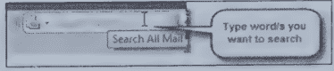

或者，我们可以单击搜索工具栏中的图标以显示下拉菜单。此选项允许我们选择不同的搜索位置。在以下屏幕截图中显示的示例中，搜索将在“所有邮件”中执行，因为这是所选选项：

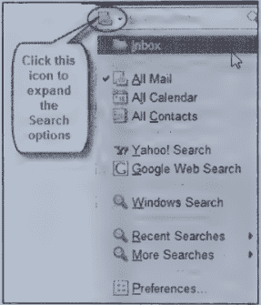

要执行搜索，请单击放大镜图标或按 Enter 键。将打开一个新的窗口选项卡，显示搜索结果，并显示所有最近搜索。

### Search preferences

我们可以更改可用于搜索的首选项。转到“文件 | 首选项 | 搜索”。在此区域中，我们可以启用搜索历史记录，默认情况下为开启。还有一个我们可以选择的按钮来清除历史记录。

默认情况下，当我们执行 Web 搜索时，结果将在 Lotus Notes 的嵌入式浏览器中呈现。我们可以通过取消选中“使用嵌入式浏览器显示搜索中心 Web 搜索结果”来更改此首选项。如果未选择此首选项，Web 搜索结果将显示在我们的默认 Web 浏览器中。

我们可以更改搜索列表中显示的内容。转到“文件 | 首选项 | 搜索 | 搜索列表”。我们将看到可供选择的列表；然后可以检查或取消检查可用选项。

最后，我们可以将应用程序添加到搜索下拉列表中。在以下屏幕截图中，我已将 Karen's Training Resources 应用程序添加到搜索下拉列表。为此，我打开了应用程序，单击了搜索工具栏中的搜索下拉列表，然后选择了“始终在搜索列表中显示”选项。现在，我可以从 Lotus Notes 中的任何位置，通过选择搜索工具栏中的选项来在应用程序中执行搜索。

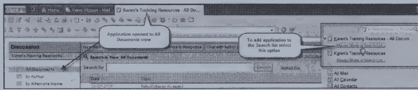

> 列出的搜索选项之一是 Windows 搜索。此选项搜索我们的本地驱动器，并将其找到的文件的链接返回到 Lotus Notes 中的搜索视图。

## SideBar

侧边栏位于 Lotus Notes 屏幕的右侧。它包含一些关键应用程序，例如日历、Sametime（IBM 的聊天应用程序）以及我们的 RSS 提要、小部件和活动。侧边栏的概念是，用户可以在收件箱中工作，同时在右侧查看侧边栏的“一览日程”面板中当前日历上的内容。

我们侧边栏中可用的内容取决于组织中已提供的内容。例如，我们的组织可能未启用 RSS 提要；如果是这种情况，我们将在侧边栏中看不到提要面板。以下是侧边栏的屏幕截图。此侧边栏有三个面板：提要、一览日程和 Sametime 联系人。

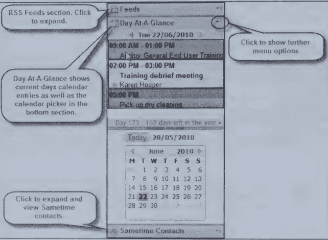

侧边栏有三种状态或三种查看方式——打开、关闭和细条：

- 打开允许我们看到所有侧边栏选项。
- 关闭意味着它不可见。我们必须单击下一个屏幕截图中显示的小白色箭头来打开它。
- 细条意味着我们只能看到可用图标。我们可以单击图标来打开侧边栏。以下屏幕截图显示了侧边栏处于细条状态：

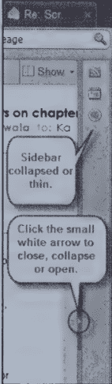

我们的侧边栏可以包含以下组件：

- **Sametime 联系人**：Sametime 是 IBM 的聊天应用程序。从侧边栏中，我们可以使用所有 Sametime 功能，例如查看我们的联系人，并且如果他们可用，则可以与当前联系人聊天以及添加或删除联系人，还有许多其他功能。如果组织中未启用 Sametime，我们可能在侧边栏中看不到此选项。以下是 Sametime 在侧边栏中的外观屏幕截图。Sametime 在下一章中将详细讨论。

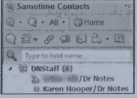

- 一览日程：这显示当前日期的日历条目，例如会议、预约等。我们可以使用箭头在日期间前后导航，或单击下方日历以选择不同日期查看。如果双击任何日历条目，将打开该条目。或者，我们可以右键单击并选择“在新窗口中打开”选项。

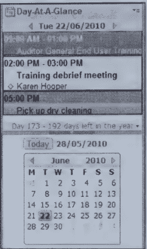

- 提要：这显示我们已订阅的 RSS 提要。在此部分中，我们还可以管理和添加新提要。这在第 3 章“提要”中有详细说明。

- 活动：此应用程序有助于在类别下组织我们的文档。

- Quicker：这是一个与 Lotus Notes 集成的文档管理应用程序。

我们可以更改在侧边栏中显示哪些应用程序。每个面板都包含一个面板菜单，我们可以使用该菜单来操作面板（包括浮动或删除面板），以及应用程序的上下文命令。

## Lotus Notes browser

在 Lotus Notes 内部，有一个内置浏览器或嵌入式浏览器。该浏览器允许我们直接从 Lotus Notes 内部打开和浏览网页。

我们可以通过单击“文件 | 首选项 | 搜索”，然后单击列表中的搜索引擎，来更改嵌入式浏览器在其搜索栏中使用的 Web 搜索引擎。

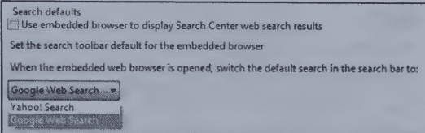

我们可以通过以下方式打开浏览器：

- 单击 Open 按钮，然后单击 Web browser。如果我们想打开多个浏览器页面，可以重复此步骤。
- 将网址 (URL) 键入 Address 工具栏，然后单击 Go 按钮（位于 Print 按钮左侧）。如果 Address 工具栏未显示，在工具栏区域右键单击并选择 Address。如果我们要将刚打开的页面加入书签，请选择 Create | Bookmark。

从内嵌浏览器工具栏中，我们可以：

- 单击 Back 可导航到上一页。
- 单击 Forward 可导航到下一页。
- 单击 Stop 按钮可停止网页加载。
- 单击 Refresh 按钮可重新加载网页。
- 单击 Go home 按钮可返回设置为主页的页面。
- 单击 Print 按钮可打印显示的网页。
- 选择 Print 按钮旁的向下箭头，然后单击 Page Setup 可更改打印显示网页的页面设置。
- 选择 Print 按钮旁的向下箭头，然后单击 Print Preview 可预览打印后的显示网页效果。

以下是浏览器工具栏：

Lotus Notes 默认使用内嵌浏览器。我们可以通过访问 File | Preferences，单击 Web Browser，然后选中 Use the browser I have set as the default for this operating system 选项来禁用它。这意味着 Lotus Notes 将使用 Internet Explorer 或 Firefox 进行浏览。

## 首选项

我们可以选择许多选项来个性化 Lotus Notes。某些首选项可能由公司 IT 部门代为设置，因为他们拥有一组可设置的策略，这些策略决定了几乎所有可能的首选项和功能。例如，IT 部门可以设置策略，以确定是否将 Open List 显示为按钮，或者是否将其显示为停靠状态。

我们可以自定义 Lotus Notes，使其按我们想要的方式运行和显示。以下是一些可用首选项的示例：

- 决定 Lotus Notes 客户端外观和手感的基本设置
- 我们的 Mail、Calendar、To Do 和 Contacts 应用程序
- 复制
- Lotus Sametime
- IBM Lotus Symphony（例如 Spreadsheets，如果可用）
- Activities 或 Websphere Portal 帐户（如果组织使用它们）

我们已经探索过一些可用的首选项，例如窗口和主题以及工具栏首选项。

要访问首选项，请选择 File | Preferences。可设置的首选项繁多；为简化查找特定首选项，请在首选项对话框顶部的字段中键入名称，如以下屏幕截图所示：

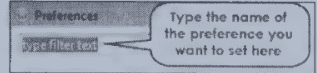

一个值得启用的绝佳首选项是 Document AutoSave，它位于 Basic Notes Client Configuration 选项下。

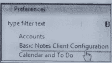

要启用它，只需选中 AutoSave every 字段旁的复选框，然后选择分钟数。默认时间为 15 分钟；在以下屏幕截图中，我已将时间更改为 8 分钟。

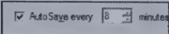

启用后，Lotus Notes 可以自动保存我们正在处理的文档，以防止因系统崩溃或停电导致数据丢失。

AutoSave 可在我们的邮件文件以及任何已升级并启用了 AutoSave 选项的其他数据库中使用。

如果发生崩溃，重新启动 Lotus Notes 时系统会提示恢复文档；如果选择 Yes，系统将随后提供下列选项：

- **Recover**：此选项将打开所选文档，然后关闭对话框。
- **Recover All**：此选项将打开列出的所有文档，然后关闭对话框。
- **Remove**：此选项将从 AutoSave 数据库中删除所选文档。
- **Remove All**：这将从 AutoSave 中删除列出的所有文档。

还有一种手动恢复文档的选项。如果在崩溃后首次打开 Lotus Notes 时选择对提示回答 **No**，我们可以随时通过选择 **File | AutoSave | Recover AutoSaved Documents** 来恢复文档。

## 摘要

在本章中，我们探索了 Lotus Notes 的客户端界面，包括 Open List、主页和 Sidebar 以及许多其他选项。现在我们应该熟悉：

- 使用 Open List 和 Thumbnails
- 主页的功能
- 可用快捷方式（请记住 Ctrl+M 可创建一条消息）
- 使用 Sidebar
- 使用窗口选项卡
- 工具栏选项
- 帮助您按想要的方式自定义 Lotus Notes 的首选项

在接下来的章节中，我们将进一步探索首选项。
