# 掌握 Lotus Notes 邮件

电子邮件是企业和社会中最重要的沟通形式之一。它被称作 mail、e-mail、备忘录或消息等多种名称，是一种通过一次操作进行沟通、发送文件并联系许多人的人性化方式。

邮件是我们通常每天使用的业务工具。当邮件系统宕机时，工作往往会完全停滞！由于它是我们依赖的工具，因此了解其所有功能至关重要。这就像拥有一辆汽车，如果启用特定功能可以节省燃油；但是，除非我们知道如何启用节油功能，否则我们可以从 A 地到达 B 地，但无法节省燃油！

本章将帮助我们更详细地了解邮件，并协助我们提高使用 Lotus Notes 邮件的效率。本章和下一章都将探讨节省时间的功能。在本章中，我们将讨论以下主题：

- 在 Lotus Notes 中访问邮件
- 创建和回复消息
- 寻址消息
- 编辑工具
- 附件
- 查看邮件
- 文件夹
- 邮件图标
- 即时拼写检查
- 空白主题警告
- 签名
- 删除邮件

## 在 Lotus Notes 中访问邮件

探索邮件的第一步是在 Lotus Notes 中打开邮件。我们可以通过几种方式打开邮件：

- 首先，从主页单击 Mail 图标，如以下屏幕截图所示。如果单击 New 按钮，将创建一条新消息。

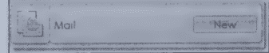

- 另外，单击 Open 并从列表中选择 Mail。

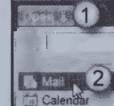

## 创建和回复消息

在以下章节中，我们将讨论如何创建和回复消息，包括审查消息操作以及设置发送选项。

### 创建消息

打开邮件后，我们可以单击 New 按钮，然后选择 Message 来创建消息，如下所示。从消息下拉列表可以看出，还有其他可用选项，例如 Meeting、Contact 等，我们可以创建这些内容。

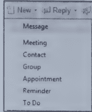

创建消息的另一种方法是使用键盘快捷键 Ctrl+M。这可以在 Lotus Notes 中的任何位置执行，而不仅仅是在打开邮件时——例如，我们可以在日历中、在 Contacts 内部或从主页使用 Ctrl+M 选项来创建消息。

### 消息操作

现在我们已创建消息，将探索一些消息操作。在消息顶部，我们可以看到启用我们执行某些操作的按钮。以下是可用选项的屏幕截图。我们将简要探讨每个选项。

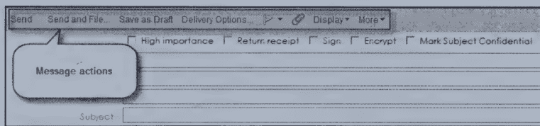

- Send：不言而喻；单击后将发送消息！
- Send and File...：发送消息时，这是一个绝佳选项，因为它不仅允许发送消息，还允许同时将消息归档到我们的文件夹中。单击 Send and File... 时，我们将看到包含所有个人文件夹的 Folders 对话框。以下是选择 Send and File 选项时出现的 Folders 对话框屏幕截图。我们将选择要将消息归档到的文件夹，然后单击 OK 按钮或按 Enter 键。消息将被归档到该文件夹，同时还会自动归档到 Sent 和 All Documents。请注意，这并不意味着消息在三个位置有三份副本。我们的个人文件夹中只有一份消息副本；Sent 和 All Documents 只是引用。这意味着如果从个人文件夹中删除消息，它也将从 Sent 和 All Documents 中删除。

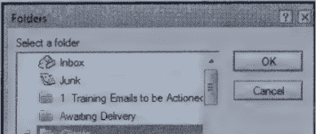

当 **文件夹** 对话框打开时，如果我们知道文件夹名称，可以开始键入文件夹名称，该文件夹将被突出显示。然后按下 _Enter_ 键，消息将被归档到该文件夹。与滚动相比，这通常是一个更快的选择，尤其是当我们有多个文件夹时。键入文件夹名称时，可以在状态栏中查看已输入的内容；如果输入有误，可以删除已输入的内容。

- **保存为草稿**: 此选项将我们的消息保存到“草稿”文件夹。

- **发送选项**: 包括心情戳和防止复制等选项（我们将在下一节单独介绍）。

- **标记**: 我们可以在发送前为消息添加标记。我们将在下一章更详细地探讨标记。

- **附件**: 单击此图标可允许我们向消息添加附件。请注意，我们也可以从 Windows 资源管理器将附件拖入备忘录正文；我们将在本章后面详细介绍此功能。

- **显示**: 单击此按钮时，我们可以查看有关如何显示消息的更多选项。我们可以选择是否显示 BCC 字段、**其他邮件选项** 或 **发件人信息**。以下是启用 **其他邮件选项** 选项时所见内容的截图：

| 高重要性 | 回执 | 签名 | 加密 | 将主题标记为机密 |
|---|---|---|---|---|

- **高重要性** 通过红色感叹号向发件人指示。

- **回执** 在收件人阅读或预览消息时向我们发送通知。

- **签名** 向消息添加电子签名，以确保消息未被篡改。

- **加密** 将消息标记为机密，只有 To、CC 和 BCC 字段中列出姓名的人才能阅读。

- **将主题标记为机密** 将“将主题标记为机密”添加到主题字段前面。

- **更多**: 这是最后的消息操作，从此处我们可以访问 **选项...**、**外出办公...** 等，如截图所示。我们将在本章后面以及下一章详细探讨这些操作。

## 发送选项

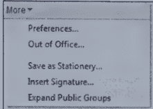

当我们在新消息中单击“发送选项”按钮时，将打开带有两个选项卡的对话框。

### 基本选项卡：

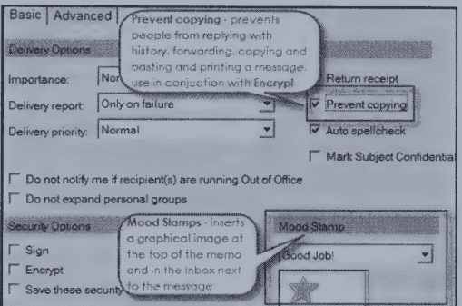

请注意回执和发送报告之间的区别——回执选项在某人阅读或预览消息时向我们发送通知，而发送报告选项会告知我们消息何时未能送达收件人，其默认选项为“仅在失败时”。其他可用选项包括“确认送达”或“跟踪整个路径”；后者选项会显示发送消息所走的服务器路线。

花点时间查看心情戳。当我想祝贺某人时，我更喜欢在消息中添加“好工作”心情戳。发送敏感消息时，我经常使用“自信”心情戳。我还会选择加密选项，仅允许 To、Cc 和 Bcc 字段中的人阅读，以及“防止复制”选项，防止他人转发、打印、复制到剪贴板或带历史记录回复。组合这些选项可确保消息保持安全。签名选项向消息添加数字签名，以向收件人确认发件人的真实性。

请注意，这三个选项通常仅适用于组织内部发送的消息，可能不适用于发送给外部人员（例如其他公司的人）的消息。

### 高级选项卡：

在高级选项卡中，有允许我们添加“请在...前回复”日期的选项。我们还可以选择将备忘录的回复发送给另一人或多个其他人。我们还可以添加自己的名称。一些组织有共享邮件文件，例如 Sales，发送到公司名称的 sales 地址的消息会进入一个中央邮件文件。最好将这些地址以及我自己的地址添加到“此备忘录的回复应发送至”字段，以便我们合作的人了解特定通信的情况。

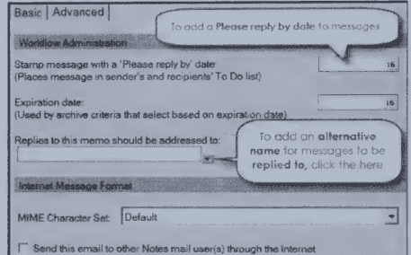

## 回复消息

我们可以从收件箱或从备忘录内回复消息。回复选项如下：

- **仅带历史记录回复（默认）** 和 **仅带历史记录回复全部**：此选项包含原始备忘录的历史记录，但不包含附件。回复全部将包括 To、CC 和 BCC 字段中的所有人员，而回复选项仅包括 To 字段中的收件人。

- **带历史记录和附件回复** 或 **带历史记录和附件回复全部**：此选项包含原始备忘录的历史记录和附件。

- **回复** 和 **回复全部**：此选项不包含原始电子邮件的任何历史记录或附件。

> 回复消息时，请使用永久笔功能，该功能以与原始消息不同的颜色添加我们的注释。我们还可以使用高亮笔在原始消息中突出显示文本以进行强调。从编辑工具栏中访问永久笔和高亮笔。

## 寻址消息

我们可以通过从联系人或公司目录中选择收件人姓名来寻址消息。我们也可以将姓名直接输入到 To、Cc 和 Bcc 字段中。如果直接输入姓名，Lotus Notes 将使用类型提前功能，根据我们输入的前几个字母来完成姓名。

### 如何寻址消息

这就像输入某人的姓名一样简单，但还有以下其他选项：

- 1. 创建消息时，光标会自动跳转到新消息的 To 字段。如果知道某人的姓名，只需输入即可，会出现姓名列表。此列表显示我们的最近联系人，因为 Lotus Notes 会跟踪我们最常沟通的人员，并将这些姓名移至类型提前列表的顶部。请注意，列表不是按字母顺序排列的。

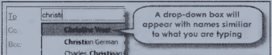

- 2. 许多人有多个电子邮件地址。如果联系人中的人有备用电子邮件地址，我们会在下一个截图中看到一个箭头（如圆圈所示）。单击箭头后，会显示备用电子邮件地址，如下所示：

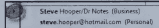

- 3. 如果我们要发送电子邮件的人不在列表中，并且知道他们存在于公司目录中，请单击列表底部的选项——搜索目录。此选项将显示公司目录中所有以我们输入的内容开头的姓名。

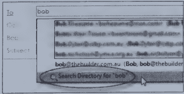

- 4. 我们也可以通过单击 To 从联系人或公司目录中选择姓名。这将打开选择地址对话框，允许我们选择要搜索的地址簿（目录）（步骤 1）。在“查找以...开头的姓名”字段中输入姓名（步骤 2）。最后一步是单击相应按钮，将搜索到的人员添加到 To、Cc 或 Bcc 字段（步骤 3）。

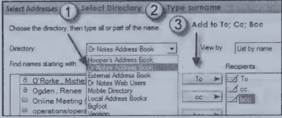

## 保护 To、Cc 和 Bcc 字段中的姓名

在发送消息时，我们通常与客户或供应商沟通，需要谨慎处理 To、Cc 和 Bcc 字段中允许显示的内容。我们可以利用 Bcc 字段，仅让这些人看到自己的姓名。收件人收到消息后，只会看到自己的姓名或“未披露收件人”。使用此选项可以保持隐私。

> > 当我给我儿子的篮球队发送电子邮件时，我使用 Bcc 字段，因为这可以保持团队成员和家长的电子邮件地址私密。

## 防止个人组展开

发送消息时，转到“发送选项”。然后在“基本”选项卡上，勾选“不展开个人组”选项。收件人收到备忘录后，只会看到组名称，而不会看到组内的个人。默认情况下，如果未选中此选项，组名称不会显示给收件人，只会显示组成员。

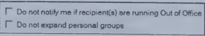

## Formatting messages

Many times when we send a message, we want to format it in a particular way. There are several formatting options in Lotus Notes. Note that whatever formatting we can do in mail, we can also do in calendar entries, To Dos, and documents in Lotus Notes application which have rich text fields.

当我们发送消息时，很多时候希望以特定方式对其进行格式化。Lotus Notes 中有多种格式选项。请注意，无论在邮件中可以进行的何种格式化，都可以在 Lotus Notes 应用程序中具有富文本字段的日历条目、待办事项和文档中执行。

We can access formatting options in the following different ways:

我们可以通过以下不同方式访问格式选项：

- From the Toolbar
- 从工具栏
- From the Text menu as shown here:
- 从 文本 菜单，如下所示：
- From Text properties, which can be accessed by the right-click menu or via the keyboard shortcut Ctrl+K
- 从 文本属性，可通过右键菜单或使用键盘快捷键 Ctrl+K 访问
- From the right click menu there is a subset of formatting options available
- 从右键菜单可使用一部分格式选项
- Using keyboard shortcuts such as Ctrl+B for bold
- 使用键盘快捷键，例如 Ctrl+B（用于粗体）

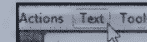

The following is a screenshot of the right-click menu, the formatting options are highlighted:

以下是右键菜单的截图，格式选项已高亮显示：

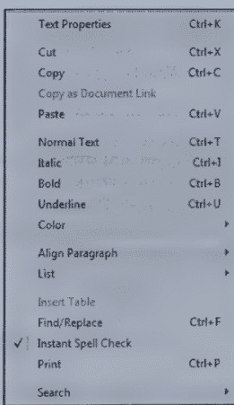

## Using the Permanent Pen and Highlighter Pen

## 使用永久笔和高亮笔

The Toolbar has several formatting options. The following is a legend of the Editing Toolbar for our reference:

工具栏包含多种格式选项。以下是编辑工具栏的图例，供我们参考：

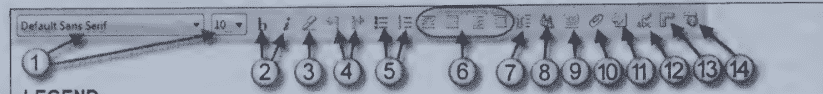

| 1 Font selection & size | 5 Bullets & Numbers | 9 Insert Table | 13 Ruler |
| --- | --- | --- | --- |
| 2 Bold & Italics | 6 Alignment | 10 Attach a file | 14 Context Help (F1) |
| 3 Permanent Pen | 7 Spacing | 11 Import | |
| 4 Indent & Outdent | 8 Styles | 12 Check Spelling | |

| 1 字体选择与大小 | 5 项目符号与编号 | 9 插入表格 | 13 标尺 |
| --- | --- | --- | --- |
| 2 粗体 & 斜体 | 6 对齐方式 | 10 附加文件 | 14 上下文帮助 (F1) |
| 3 永久笔 | 7 间距 | 11 导入 | |
| 4 增加缩进 & 减少缩进 | 8 样式 | 12 拼写检查 | |

Here is an example of the text properties dialog box, which has several tabs with options. The following screenshot shows the Font (a) tab with the Color options selected:

以下是文本属性对话框的示例，其中包含带选项的多个选项卡。以下截图显示了选中颜色选项的 字体 (a) 选项卡：

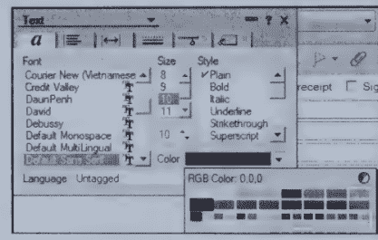

We mentioned as a tip the Permanent Pen and the Highlighter Pen as great tools to use when replying to messages because of their ability to allow us to show our text in a different color and also to highlight text. There is also the Text Color icon in the Toolbar; highlight text or put your cursor in a position where you want to change to another color then click this button to select a color.

我们之前提到，永久笔和高亮笔是回复消息时极佳的工具，因为它们能让我们以不同颜色显示文本，也能对文本进行高亮显示。工具栏中还有 文本颜色 图标；选中文本或将光标置于想要更改颜色的位置，然后单击此按钮以选择颜色。

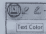

To use the Permanent Pen, simply click the Permanent Pen icon in the Toolbar and start typing. To turn it off, we just need to click the icon again. When using the Permanent Pen, our cursor will have a pen-like icon.

要使用永久笔，只需单击工具栏中的永久笔图标并开始输入即可。要关闭它，只需再次单击该图标。使用永久笔时，光标会显示为笔形图标。

To use the Highlight Pen, click the **Highlight Pen** icon and highlight text by dragging left to right over the text; to undo anything we have highlighted, drag right to left. To turn off the Highlighter Pen, click the **Highlighter Pen** icon again – basically it is toggle on and toggle off.

要使用高亮笔，请单击**高亮笔**图标，然后通过从左向右拖过文本来选中文本；要撤销已选中的内容，请从右向左拖动。要关闭高亮笔，请再次单击**高亮笔**图标——基本上是开关切换。

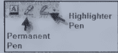

### Changing the Permanent Pen font and color

### 更改永久笔字体和颜色

By default, the permanent pen font is red, bold, and Default Sans Serif. To change these options, follow these steps:

默认情况下，永久笔字体为红色、粗体且为默认无衬线字体。要更改这些选项，请执行以下步骤：

- Create a memo and put the cursor in the body of the memo.
- 创建备忘录并将光标置于备忘录正文中。
- Click on the **Text** menu, then **Text Properties**. Alternatively right-click and select **Text Properties** from the menu.
- 单击 **文本** 菜单，然后单击 **文本属性**。或者右键单击并从菜单中选择 **文本属性**。
- Click the Font (a) tab.
- 单击 字体 (a) 选项卡。
- Select a font, size, style, and/or color.
- 选择字体、大小、样式和/或颜色。
- Go to the **Text** menu and select **Permanent Pen - Set Permanent Pen**.
- 转到 **文本** 菜单并选择 **永久笔 - 设置永久笔**。
- Discard the memo.
- 放弃备忘录。

### Dragging and dropping text

### 拖放文本

We can drag-and-drop text from within a document or message. We can also drag text from one document or message to another via the window tabs. We just need to highlight the text we want to move and then drag it to the desired location.

我们可以在文档或消息内拖放文本。也可以通过窗口选项卡将文本从一个文档或消息拖到另一个文档或消息。只需选中要移动的文本，然后将其拖到所需位置即可。

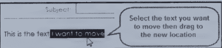

## Shortcut keys in Lotus Notes

## Lotus Notes 中的快捷键

The Ctrl key on our keyboard comes in quite handy when we are editing text within Lotus Notes. Following are some common usages of the Ctrl key within Lotus Notes:

在 Lotus Notes 中编辑文本时，键盘上的 Ctrl 键非常实用。以下是 Lotus Notes 中 Ctrl 键的一些常见用法：

| Keyboard shortcuts | Description |
| :--- | :--- |
| Ctrl+B | Selected text is made bold |
| Ctrl+I | Selected text is made italics |
| Ctrl+U | Selected text is underlined |
| Ctrl+Z | Undo option |
| Ctrl+C | Selected text is copied |
| Ctrl+V | Selected text is pasted |
| Ctrl+X | Selected text is cut |

| 键盘快捷键 | 说明 |
| :--- | :--- |
| Ctrl+B | 所选文本设置为粗体 |
| Ctrl+I | 所选文本设置为斜体 |
| Ctrl+U | 为所选文本添加下划线 |
| Ctrl+Z | 撤销选项 |
| Ctrl+C | 复制所选文本 |
| Ctrl+V | 粘贴所选文本 |
| Ctrl+X | 剪切所选文本 |

## Further formatting options

## 更多格式选项

If we click on the Create menu, we can see more formatting options. We can add pictures, page breaks, a horizontal rule (which is similar to a thick line), sections that collapse text under a heading, computed text that allows you to add animated text, hotspots that can link to URLs or file links, tables, images, and objects.

如果单击 创建 菜单，可以查看更多格式选项。我们可以添加图片、分页符、水平线（类似于粗线）、在标题下折叠文本的章节、允许添加动画文本的计算文本、可链接到 URL 或文件链接的热点、表格、图像和对象。

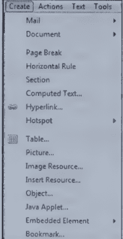

When copying an Excel® spreadsheet into a message, use the Paste Special and select Paste link to source from the options presented. This will paste the spreadsheet into the message. Now if we double-click on the spreadsheet, it will activate Excel®.

将 Excel® 电子表格复制到消息中时，使用“粘贴特制”，并在显示的选项中选择“粘贴链接到源”。这会将电子表格粘贴到消息中。现在，如果双击电子表格，它将激活 Excel®。

If we add a table into a message or Lotus Notes document, we can copy the table and paste it into Excel® — the cells will be maintained and the information copied across.

如果在消息或 Lotus Notes 文档中添加表格，可以复制该表格并将其粘贴到 Excel® 中——单元格将被保留，信息将被复制过去。

## Attachments

## 附件

Many times, the reason we send a message to someone is because we want to send them a particular file. To send a file, we must attach it to the message.

很多时候，我们向某人发送消息的原因是想发送特定文件。要发送文件，必须将其附加到消息中。

## Adding attachments to messages or documents

## 向消息或文档添加附件

There are four ways to add an attachment to a message or document:

向消息或文档添加附件有四种方式：

- Go to the menu and select File | Attach. A Create Attachments dialog box will open; browse here to select the attachment(s) we want to add and then click the Create button.
- 转到菜单并选择 文件 | 附加。将打开“创建附件”对话框；在此处浏览以选择要添加的附件，然后单击 创建 按钮。
- Click the Attach icon in the Toolbar or the Attach button below the Toolbar. Both actions will result in the opening of the Create Attachments dialog box as it does when we select File | Attach.
- 单击工具栏中的 附加 图标或工具栏下方的 附加 按钮。这两种操作都会打开“创建附件”对话框，就像选择 文件 | 附加 时一样。
- If we have Windows Explorer open, and our message or document is open in Lotus Notes, we can drag the attachment from Windows Explorer to the Lotus Notes icon in the Task bar, and then drop into the message or document we have open in Lotus Notes. If we resize the Windows Explorer dialog box to be smaller than the Lotus Notes window, we can simply drag from Windows Explorer straight to the message or document we have open in Lotus Notes.
- 如果已打开 Windows 资源管理器，且消息或文档已在 Lotus Notes 中打开，可以将附件从 Windows 资源管理器拖到任务栏上的 Lotus Notes 图标，然后放入 Lotus Notes 中打开的消息或文档。如果将 Windows 资源管理器对话框的大小调整为小于 Lotus Notes 窗口，可以直接从 Windows 资源管理器拖到 Lotus Notes 中打开的消息或文档。

The following is a screenshot of the Create Attachments dialog box; refer to the number legend to understand each area:

以下是“创建附件”对话框的截图；请参考数字图例以了解各个区域：

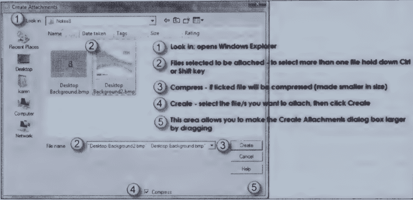

> We can also drag attachments from a message or document to a new message or document. Select attachment, drag to tabs, go to new message or new document, and then continue to drag to the position where we want to place it in the attachment.

> 我们也可以将附件从一个消息或文档拖到新消息或新文档。选中附件，拖到选项卡，转到新消息或新文档，然后继续拖动到要在附件中放置的位置。

## Working with attachments

## 处理附件

Now that we know how to add attachments, we need to explore what we can do with attachments.

既然知道了如何添加附件，我们需要探索可以对附件执行哪些操作。

When we double-click on the attachment, we will see the Open Attachment dialog box as shown in the next screenshot. From here we can select Open, Edit, View, Save, and Cancel. Alternatively if we right-click, we will see more available options.

双击附件时，将如下一个截图所示看到“打开附件”对话框。在此处可以选择 打开、编辑、查看、保存和取消。或者，如果右键单击，将看到更多可用选项。

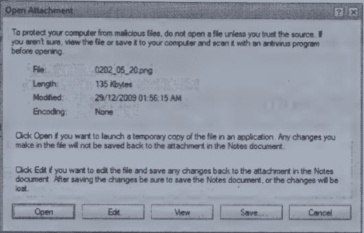

### Opening attachments: Open button

### 打开附件：打开按钮

When we click the Open button, the attachment will be opened in the program it was created in. For example, if it is a Word attachment, it will launch Microsoft Word and open the attachment. When we click the Open button, it is similar to when we are opening a Microsoft document in "Read Only" mode. Any edits to the document will not be saved unless we select File | Save As. Use this option only when we want to view the attachment in the program it was created in.

单击“打开”按钮时，附件将在创建它的程序中打开。例如，如果是 Word 附件，它将启动 Microsoft Word 并打开附件。单击“打开”按钮类似于以“只读”模式打开 Microsoft 文档。除非选择 文件 | 另存为，否则对文档的任何编辑均不会保存。仅在想要在创建附件的程序中查看附件时使用此选项。

### Editing attachments: Edit button

### 编辑附件：编辑按钮

When we click the Edit button, it allows us to open and edit attachments. An example of where we would use this option is if someone has sent a message with an attachment that they require us to update. We would select Reply with History & Attachments, which creates a new message with the history and a copy of the original attachment. Select the attachment we need to update and double-click or right-click and Edit; the attachment will open in the program it was created in. Update the attachment and then select the save option in the program it was created in. The attachment in the message has now been updated and we can send the message. This is the only place where the attachment edit has been saved so make sure we save the memo by either sending it or saving it as a draft. If we need to access the edited attachment, it can be found in the Sent and All Documents.

单击“编辑”按钮时，允许我们打开和编辑附件。使用此选项的示例是，如果有人发送了一条带附件的消息，要求我们更新该附件。我们会选择“回复并包含历史记录和附件”，这会创建一条新消息，包含历史记录和原始附件的副本。选择需要更新的附件，双击或右键单击并选择“编辑”；附件将在创建它的程序中打开。更新附件，然后在创建附件的程序中选择保存选项。消息中的附件现已更新，我们可以发送消息。这是附件编辑被保存的唯一位置，因此请确保通过发送备忘录或将其保存为草稿来保存备忘录。如果需要访问已编辑的附件，可以在“已发送”和“所有文档”中找到。

### Viewing attachments: View button

### 查看附件：查看按钮

The view option allows us to open the attachment in Lotus Notes rather than launching the program it was created in. This option is excellent for viewing the attachment quickly; previewing zipped files without unzipping them; or for viewing files of programs we do not have installed.

查看选项允许我们在 Lotus Notes 中打开附件，而不是启动创建它的程序。此选项非常适合快速查看附件；在不解压缩的情况下预览压缩文件；或查看我们未安装程序的文件。

## 保存附件：保存按钮

当我们单击 **保存** 按钮时，它会打开 Windows 资源管理器。我们可以浏览到要保存附件的位置，然后单击 **保存**。

## 使用多个附件

如果在一条消息或文档中有多个附件，我们可以右键单击一个附件，然后从右键菜单中选择任何可用选项。

- **全部保存**：此选项会将消息中的所有附件保存到我们选择的位置。
- **全部保存并删除**：这允许我们不仅保存到 Windows 资源管理器，还可以删除消息中的附件，从而节省邮箱空间。它会留下文本指示您已删除文件，并给出被删除的文件名。
- **全部删除**：这会从备忘录中删除附件。

## 打印附件

我们可以通过选择 **查看** 按钮来打印附件，这将在 Lotus Notes（*不是*在它创建所在的应用程序中）中打开附件，然后从 **文件** 菜单中选择 **打印** 或按 Ctrl+P。

或者，若要在其原始应用程序中打印附件，请选择 **打开** 按钮，然后从 **文件** 菜单中选择 **打印**，或使用键盘快捷键 Ctrl+P。

## 查看邮件

当我们打开邮件时，可以选择以不同方式显示邮件。例如，我们可以选择显示预览窗格，或者可能只想显示未读备忘录。在本节中，我们将探索这些不同选项。

## 预览窗格

我们可以使用预览窗格预览邮件，这样就无需打开和关闭每条消息。预览允许我们查看文档内容，而无需打开实际文档。

要访问预览窗格选项，请单击收件箱顶部的 **显示** 按钮。从此处，我们可以在底部或侧面预览邮件。要关闭预览窗格，请选择 **隐藏预览** 选项。

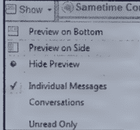

> 我在预览窗格中打开时启用了“将文档标记为已读”首选项，该选项位于“首选项”>“基本 Notes 客户端配置”选项卡的“其他选项”区域中——它是列表中的第一个选项。正如首选项名称所暗示的，当我单击电子邮件进行预览时，该电子邮件会被标记为已读。我选择了此选项，因为我主要预览电子邮件，因此它帮助我跟踪已读内容。

预览窗格是我们所在视图或文件夹中打开的单独框架，暴露所选文档的一部分。

要调整预览窗格大小，请选择分隔两个窗格的栏，并拖动到我们偏好的大小。

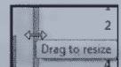

> 当我们预览消息时，如果已请求回执，将发送回执！

## 对话

我们可以将消息及其所有回复分组查看，以便同时阅读消息和回复。将消息及其所有回复分组称为对话，对话使我们免去了在邮件中查找单个回复的麻烦。

我们还可以一次对对话中的所有消息执行操作。例如，我们可以通过将对话移动到文件夹，将对话中的所有消息移动到文件夹。

以下是对话示例。在此对话中，有两条消息。列出的第一条消息是原始消息，来自 Joanne，主题为信息请求。当前位于收件箱中。

第二封电子邮件是 Karen Hooper 回复 Joanne 的邮件，内容为：谢谢。希望您喜欢。这是在备忘录正文中写入的。这是因为在对话中，列出的所有回复都显示回复的第一行，而不是主题。此消息位于“已发送”文件夹中。

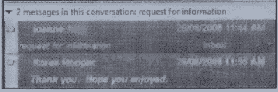

## 查看对话

要查看对话，请从“单个消息”（消息和回复分别显示和排序）切换到“对话”（消息及其回复分组在一起）。这些选项在“显示”按钮下可用——与您选择预览选项的同一位置。

我们可以在收件箱、所有文档和个人文件夹中切换到对话模式。

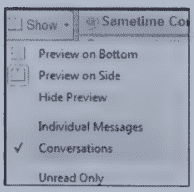

进入对话模式后，会话中最新的回复会显示出来，任何其他回复和原始消息都会折叠在最新回复下方。

以下是未展开的对话示例；我们可以看到该对话中有两条消息。我们将单击箭头图标（称为 Twistie）以展开或打开对话：

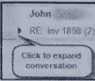

当我们展开对话时，每条消息都显示在一行上。原始消息显示其主题，每条回复显示备忘录正文中的第一行文本。当我们展开对话时，收件箱的其余部分会变灰，要关闭对话，请单击收件箱中的一个区域。对话将折叠，收件箱将不再变灰。

如果我们希望，可以保持在对话模式下。当收到属于特定对话的新消息时，该消息会出现在收件箱的顶部或底部（取决于我们选择如何显示新消息）。该消息显示为未读，对话中的消息数量会增加；我们还可以查看谁发送了回复，包括日期和时间。

> **注意：** 对话只能按日期查看和排序。按发件人等其他列排序会自动将视图或文件夹切换回单个模式。

以下表格说明了可与对话一起执行的不同操作。

| 任务 | 说明 |
| :--- | :--- |
| 对折叠对话中的所有消息执行操作 | 单击对话将其选中，然后执行操作。例如，要删除对话中的所有消息，请单击对话，然后右键单击对话并选择 **删除**。 |
| 对展开对话中的所有消息执行操作 | 如果对话中的所有消息均未选中，请单击对话标题以选中所有消息，然后执行操作。 |
| 对对话中的一条消息执行操作 | 如有必要，展开对话。然后单击消息将其选中，并执行操作。例如，要删除对话中的一条消息，请单击消息将其选中，然后右键单击消息并选择 **删除**。 |

## 删除对话

当我们删除对话时，将如以下屏幕截图所示提示，确认个人知晓其删除该对话中所有消息的操作。

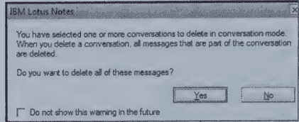

## 关闭对话

要关闭对话模式，只需转到“显示”按钮并选择“单个消息”。或者，当我们处于对话模式时，将在收件箱顶部看到一条信息栏，告知我们正在以对话模式查看消息。要返回收件箱的原始格式，请单击“清除”按钮；这将带我们返回到单个消息。

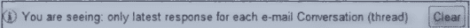

## 查看未读邮件

通常，如果我们可以只显示未读电子邮件，那将很有用。在 Lotus Notes 中，要执行此操作，可以转到“显示”按钮并选择“仅未读”。

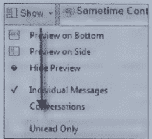

要返回显示已读和未读邮件，请转到“显示”按钮并选择“仅未读”，或者，当您查看“仅未读”时，将在收件箱顶部看到一条信息栏，告知您正在查看未读消息。有一个“清除”按钮也会带您返回到已读和未读消息。

读取消息后，可以将其标记为未读，或选择多条消息并将其标记为未读。

## 如何将消息标记为未读或已读

可以通过选择消息并然后执行以下操作，将已读消息标记为未读或反之：

- 按键盘上的 Insert 键（可能缩写为 INS）
- 右键单击并选择“标记为已读”或“标记为未读”

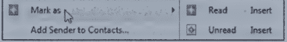

## 使用文件夹管理邮件

所有收件邮件都直接进入收件箱。过了一段时间，收件箱可能会变得非常大，协助管理收件箱以及对消息进行排序的一种方法是将它们归档到文件夹中。

在本章前面，我们探讨了发送邮件和“发送并存档”选项，该选项允许我们发送消息的同时将其存档到相应文件夹中。

在本节中，我们将探讨如何创建文件夹以及如何将接收到的消息归档到文件夹中。

首先，让我们了解如何创建文件夹。

## 创建文件夹

要创建文件夹，请执行以下步骤：

- 打开邮件，单击收件箱顶部“文件夹”按钮右侧的下拉箭头。

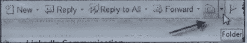

- 我们将看到以下选项：移动到文件夹、从文件夹移除、发现文件夹和创建文件夹——选择“创建文件夹”选项。

- 3. 将打开“创建文件夹”对话框。光标将放置在“文件夹名称”字段中；在此字段中键入新文件夹的名称。请注意，文件夹在我们的邮件中按字母顺序列出。如果我们希望特定文件夹始终位于列表顶部，可以在文件夹名称前添加数字或字母。例如，要使“培训”文件夹列在我们的文件夹顶部，可以在名称开头添加数字“1”或字母“a”——1. Training 或 a.Training。

- 4. 下一个选项是为新文件夹选择位置。该选项允许我们在另一个文件夹内创建文件夹或创建主文件夹。如果我们希望此文件夹成为另一个文件夹的子文件夹，可以选择要在其中创建新文件夹的文件夹；如果不选择文件夹，则新文件夹将是主文件夹。

- 5. 单击“确定”按钮以关闭对话框并创建文件夹。

> 创建文件夹时，可以通过拖动对话框右下角来调整“创建文件夹”对话框的大小。这样我们可以查看当前文件夹并最大限度地减少滚动。

我们可能已经注意到，当收件箱中有未读邮件时，收件箱名称会加粗，未读邮件数量会显示在右侧，如下一个屏幕截图所示：

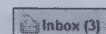

文件夹也是如此。当文件夹中有未读邮件时，文件夹名称会加粗，未读邮件数量会显示在右侧；如以下示例所示，Int Dealers 文件夹中有一封未读邮件：

有时我们创建文件夹后需要重命名或删除它，因为它已不再需要。以下部分介绍如何执行这两项任务。

## 重命名和删除文件夹

我们经常会创建文件夹，但过一段时间后可能需要更改文件夹名称，或者在某些情况下将其删除。以下是执行这些任务的方法：

- 1. 单击“文件夹”旁边的 + 图标展开文件夹。
- 2. 选择要重命名或删除的文件夹，然后右键单击。
- 3. 将出现如下屏幕截图所示的菜单。选择“重命名文件夹...”以重命名文件夹。系统将提示输入新名称；输入新名称，然后单击“确定”按钮。
- 4. 要删除文件夹，请从菜单中选择“删除文件夹”。系统将显示一条通知，指出此操作无法撤销，是否要继续？选择“是”按钮继续，或选择“否”取消删除文件夹。

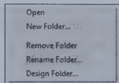

我们还可以通过简单地将文件夹拖放到新位置，将文件夹从一个子文件夹移动到另一个文件夹，或从主文件夹移动到子文件夹。

## 选择邮件

在管理邮件时，我们通常需要选择多封邮件，以便将选定的邮件归档、删除或转发给其他人。

## 选择一个或多个邮件或文档

我们通常需要选择文档，以便对其进行归档、删除或将其转发给其他人。以下是可能的场景：

- 一个或多个连续文档：单击一个文档，然后按住 Shift 键，再单击要选择的最后一个文档。
- 一个或多个非连续文档：按住 Ctrl 键，然后单击每个文档。
- 视图中的所有文档：单击“编辑 | 全选”，或“编辑 | 取消全选”，或 Ctrl+A。
- 左侧边距中的勾选框：我们可以选择一个首选项：文件 | 首选项 | 基本 Notes 客户端配置 | 其他选项 | 为选定文档在边距中显示勾选标记。该首选项允许我们在边距中单击。我们还可以按空格键选择文档，并使用上下箭头键导航到不同的文档。

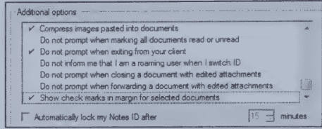

在邮件中选中一条消息后，可以执行以下操作：删除、打印、归档、复制、转发或标记为未读/已读。

## 归档邮件

如前所述，文件夹对于组织邮件很有用。我们可以将一条消息放入一个文件夹或多个文件夹中。当我们选择一条或多条消息，然后选择“移动到文件夹”选项时，会看到“移动”、“添加”或“取消”的选择。

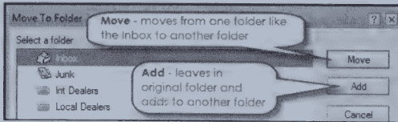

- 当我们将消息移动到文件夹时，Lotus Notes 会将消息从当前文件夹移除并放入目标文件夹。
- 当我们将消息添加到文件夹时，Lotus Notes 会保留消息在当前文件夹中，并将消息添加到目标文件夹。
- 当我们选择取消时，对话框将关闭且消息不会被移动。

> 归档邮件时，如果我们使用 **移动到文件夹** 选项，**移动到文件夹** 对话框将打开。如果我们知道文件夹名称，可以开始输入文件夹名称，该文件夹将被选中并高亮显示。然后如果按 Enter 键，消息将被归档到该文件夹中。通常，与滚动相比，这是一个更快的选项，尤其是当我们有多个文件夹时。

> 只有一条消息。如果删除位于多个文件夹或视图中的消息，该消息将从所有文件夹和视图中删除。

归档邮件的另一种方法是拖放。我们可以将邮件从收件箱拖动，然后将其放入文件夹中。要将消息移动到文件夹，请在导航窗格中显示目标文件夹，然后将消息或选定的消息拖入文件夹。

现在我们已经学习了如何创建文件夹和归档邮件，希望我们的收件箱看起来更加井然有序。在下一节中，我们将学习如何查找邮件。

## 查找已归档的邮件

有时我们可能会将一条消息归档，然后不记得将其归档到哪个文件夹中。其他时候，我们可能没有归档该消息，或者可能正在搜索我们发送的消息。下一节讨论所有文档，这是查找消息的绝佳位置。

## 所有文档

所有文档包含收件箱、已发送和我们文件夹中的所有消息。事实上，它显示邮件中的每条消息（已删除消息除外），是搜索电子邮件的绝佳位置。如果我在收件箱中找不到一封电子邮件，我通常会去所有文档，按发件人排序，然后在那里查找该消息。要按发件人排序，请单击列标题。基本上所有列标题都可以排序；单击一次将其设为升序，然后再单击一次即可恢复默认排序。

我们可以按如下所示在侧边导航器的“跟进”下访问所有文档：

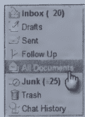

在所有文档中，有一列显示消息已归档到哪个文件夹。在以下屏幕截图中，文件夹列被红圈圈出：

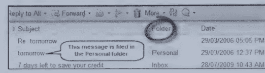

如果我们打开了侧边预览窗格，可能看不到文件夹列或任何列。这是因为没有足够的空间显示列。在下一节中，我们将了解，我们将看到的不是列，而是消息顶部的“按...排序”按钮（在列标题的位置）。我们可以单击“按...排序”按钮来访问不同的列，将出现一个带有不同排序选项的菜单，如下所示，请注意，文件夹列从此区域不可用。

## 发现文件夹工具

查找消息归档位置的另一种方法是使用发现文件夹工具。以下是使用此工具的说明：

- 1. 选择想要知道其文件夹位置的消息。
- 2. 在操作栏中，单击文件夹图标，然后选择发现文件夹。
- 3. 如果消息位于文件夹中，将出现一个对话框并显示文件夹名称。如果它在我们的收件箱或已发送文件夹中，如果需要，我们有“添加到文件夹”选项。

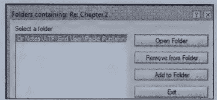

- 4. 要关闭发现文件夹对话框，请单击退出按钮。

## 邮件图标

以下是我们在邮件文件夹和视图中将看到的图标列表。还有其他图标，但这些通常与日历和待办事项有关，将在后续章节中介绍。

| 图标 | 图标帮助 | 收件箱位置 | 说明 |
|---|---|---|---|
| ![Icon] | ![未读邮件] | 消息左侧 | 已接收的未读消息，未读消息为粗体，或可通过首选项下的 **字体和颜色** 选择为 **纯红色文本**。 |
| ![Icon] | ![高优先级] | 消息左侧 | 高优先级 – 当此人发送消息时，他们选择了高重要性的发送选项。 |
| ![Icon] | ![已回复消息图标] | 消息右侧 | 绿色箭头表示消息已回复。如果打开消息，将看到历史记录部分。 |
| ![Icon] | ![已转发消息图标] | 消息右侧 | 蓝色箭头表示消息已转发。如果打开消息，将看到历史记录部分。 |

| 图标 | 图标帮助 | 收件箱位置 | 说明 |
|:--- | :--- | :--- | :--- |
| [Icon] | 已回复并转发的消息图标 | 消息右侧 | 绿色和蓝色箭头表示消息已被回复和转发。如果打开消息，将看到历史记录部分。 |
| [Icon] | 回形针图标 | 消息右侧 | 回形针图标表示该消息带有附件。 |

## 拼写检查

当我们输入消息并拼写错误单词时，会在该单词下方看到一条红色波浪线。如果右键单击该单词，将看到拼写替代建议，以及将单词添加到词典或跳过的选项。

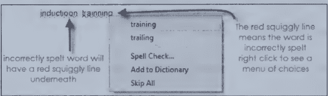

当我们发送备忘录时，如果有拼写错误的单词，将再次提示更正拼写。如果想跳过拼写检查，有一个**原样发送**按钮。

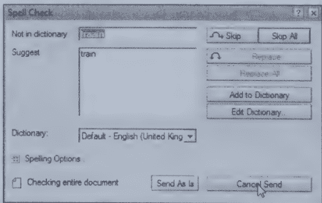

在**首选项**中有一些用于拼写检查的绝佳选项。我发现，从事制造业或处理零件编号的人，选择**忽略包含数字的单词**选项会受益，因为他们处理的许多零件编号都包含数字和字母。

启用**即时拼写检查**选项，可通过在单词下方添加红色波浪线，立即显示我们拼写错误的内容。

| 部分 | 选项 |
|:--- | :--- |
| 英语默认设置 | |
| | [x] 忽略包含数字的单词 |
| | [ ] 忽略大写单词 |
| | [ ] 在下一次语言标记更改前保存即时词典更改 |
| | [x] 启用即时拼写检查 |
| 即时更正 | |
| | [x] 更正常见的输入错误（例如，将 teh 替换为 the） |
| | [x] 将每个句子的首字母大写 |
| | [x] 更正最初的两个大写字母 |

**即时更正**选项不言自明，我已全部启用，因为它们是绝佳选项。

> 每个国家/地区都提供词典，因此我们需要确保在**拼写检查**首选项中选择了所在国家/地区的词典。

> 如果已设置签名，切勿忘记将签名中的姓名和其他详细信息**添加到词典**。

## 主题警告

发送消息时，如果未输入主题，在尝试发送消息时会提示输入主题。出现提示时，可以输入主题并通过选择**是**重新发送。或者，可以选择**否**在不带主题的情况下发送消息。

## 将签名添加到消息

在 Lotus Notes 中，与其他邮件产品一样，我们可以设置标识我们及我们详细信息的签名。可以添加公司徽标、电话详细信息、vCard 和甚至网址。我已将公司职位和相关详细信息添加到签名中。要设置签名，需遵循以下说明：

- 打开邮件，然后单击消息顶部操作栏中的**更多**按钮。接着选择**首选项**…。

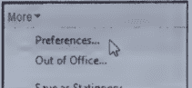

- 选择**签名**选项卡。如果需要，选中**自动将签名附加到我的外发邮件底部**选项。如果不选择此选项，将需要通过消息中的**更多**按钮并选择**插入签名**来手动将签名添加到消息。

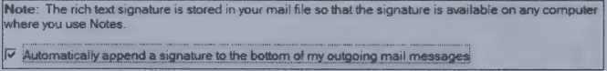

- 如果要将 vCard 附件作为签名的一部分添加，请单击**附加我的 vCard**按钮。

- 然后可以输入签名，并通过单击**T**再单击**文本**来对其进行格式化。还可以添加图形、粘贴图像或导入图像等。

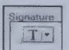

在**T**下提供的选项如下面的屏幕截图所示：

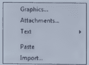

> 我已选择**自动将签名附加到我的外发邮件底部**选项。如果向某人发送消息且不希望附加签名，只需在备忘录中选中签名并将其删除即可。

## 删除消息并从垃圾箱恢复

在 Lotus Notes 中删除消息非常简单。可以右键单击并从菜单中选择**删除**。也可以选择消息并按*删除*键。还可以单击消息顶部操作栏中的**删除**图标，如下所示：

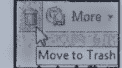

删除消息后，消息会立即被移除并放入垃圾箱，直至到期。可以通过打开**垃圾箱**，选择要恢复的消息，然后选择**恢复**按钮来恢复已删除的消息。需要在消息到期前恢复，要确认垃圾箱何时会被删除，请转到**首选项 | 邮件**并查看**我的垃圾箱文件夹中 # 小时后删除文档**。

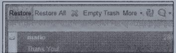

## 摘要

在本章中，我们探讨了 Lotus Notes 邮件的许多方面。我们了解了创建、回复和寻址消息。我们还了解了编辑消息的不同方式。我们探讨了处理附件、文件夹、拼写检查和设置签名。

在下一章中，我们将深入了解邮件工具，这些工具可以帮助我们更高效地处理邮件。
