# Lotus Notes 邮件工具

在上一章中，我们了解了 Lotus Notes 邮件的基础知识。在本章中，我们将重点介绍可用的高级功能以及如何最佳利用它们来帮助我们高效管理邮件。

花些时间探索可用工具，你可能会惊讶地发现，一旦开始使用其中一些工具，可能会想以前怎么没有它们。我最喜欢的工具之一是信纸——这就像是我定期发送的电子邮件（如月度报告）的模板。我认识的许多同事都有信纸，他们设置信纸发送给旅行社，其中包含所有相关详细信息，如常旅客号码、护照详细信息等等。

另一个工具是“复制到新建……备忘录/日历/待办”，它将所选消息中的文本复制到新建备忘录、日历条目或待办事项中。我使用此工具将备忘录中的详细信息复制到日历条目，以便日历中直接包含备忘录中的所有信息，这意味着无需搜索原始电子邮件。

我也很喜欢查找可用时间工具，这是消息、日历条目和待办事项上可用的上下文菜单选项。选择一条消息（例如想与之会面的人的消息），顾名思义，它会自动找到我们双方都可用的第一个时间，并给我们创建会议邀请的选项。这比从零开始在日历中操作少几个步骤。

在本章中，我们将探讨以下主题：

- 发件人颜色和收件人图标
- 协作历史记录
- 查找可用时间
- 复制到新建……备忘录/日历/待办事项
- 后续功能（标记）
- 信纸
- 消息撤回
- 拼写检查

- 外出办公
- 管理垃圾邮件
- 规则
- 邮件大小指示器
- 归档
- 邮件首选项

## 发件人颜色和收件人图标

通常，我们需要快速识别收件箱中的特定电子邮件，特别是当电子邮件仅发送给我们、我们被抄送，或电子邮件来自某个特定人员时。我们可以指定文本和背景颜色，以识别特定发件人的消息。例如，可以使用一种颜色组合来识别重要项目上的同事，另一种颜色组合用于我们的经理，再用另一种组合用于朋友的个人消息。可以指定多种颜色组合。在下面的屏幕截图中，已为特定人员选择了红色和蓝色的背景颜色：

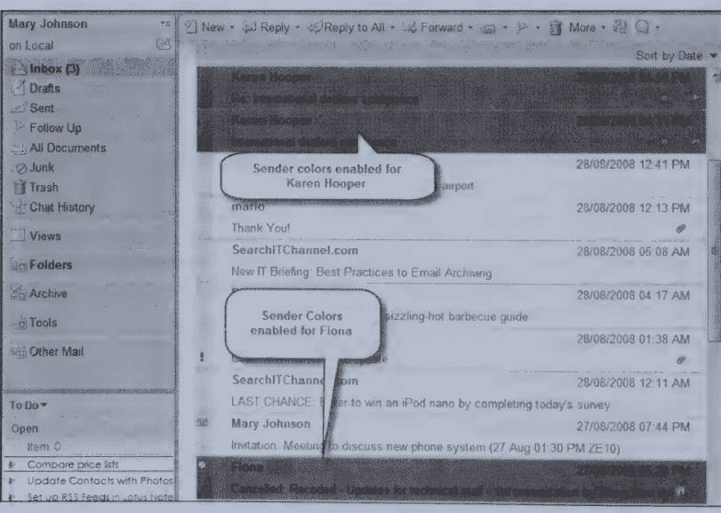

我们还可以显示图标，以标识在收件人（To）字段中我们是唯一收件人，或者我们的名字仅出现在抄送（Cc）字段中的消息。

## 指定用于标识发件人的颜色

我们可以按照接下来的说明启用发件人颜色：

- 1. 如果需要，打开您的电子邮件。
- 2. 单击消息列表上方的更多按钮，然后单击首选项。
- 3. 选择发件人颜色选项卡。

- 4. 在第一个发件人名称字段中，输入我们希望以第一种颜色组合显示其消息的人员的一个或多个姓名。按 Enter 键分隔姓名（而不是使用逗号作为分隔符）。要从目录中选择姓名，请单击字段旁边的向下箭头。

- 5. 选择背景颜色和/或文本颜色。
- 6. 单击确定。
- 7. 要删除所有颜色组合，请返回到首选项中的发件人颜色选项卡，单击恢复默认颜色，然后单击确定。

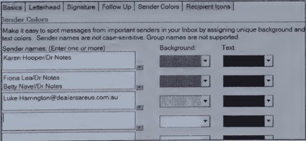

## 显示用于标识您的收件人级别的图标

将某人抄送到一条消息中通常意味着该消息内容仅供参考，我们可能不需要回复或采取任何行动。电子邮件礼仪规定，如果我们希望某人对我们在电子邮件中包含的项目采取行动，我们会将其姓名添加到收件人字段中。因此，能够立即识别出我们被抄送的电子邮件或我们的姓名位于收件人字段中的电子邮件对我们来说非常方便。以下是启用此功能的说明：

- 1. 如果需要，打开邮件。
- 2. 单击消息列表上方的 **更多** 按钮，然后单击 **首选项**。
- 3. 转到 **收件人图标** 选项卡。
- 4. 选择一个或多个显示字段，以显示实心圆（如果 **仅发送给我的邮件**）、半圆（如果 **发送到收件人字段中不超过此数量收件人的邮件**，然后选择数量），或空心圆图标（如果 **作为抄送发送给我的邮件**）。
- 5. 要在邮件使用备用电子邮件地址或群组名称地址给我们时显示所选图标，请在下方字段中指定一个或多个备用地址或群组名称，此步骤为可选。
- 6. 单击 **确定** 以保存设置。

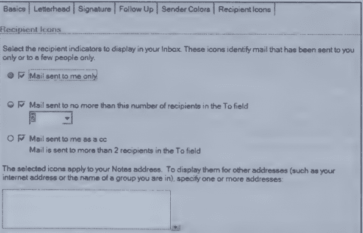

## 协作历史记录

协作历史记录包含多种功能。我们可以查看与我们其中一位联系人之间的协作或通信历史记录，例如电子邮件、有时聊天记录（如果您已保存）或会议。协作历史记录包括选定联系人在过去两周内的所有活动。

## 查看某人的协作历史记录

按照接下来的说明，查看协作历史记录中可用的选项：

- 1. 在邮件中，选择来自要查看其协作历史记录的联系人的一条消息。
- 2. 右键单击该消息，我们将在菜单选项顶部看到所选联系人的姓名。这在以下屏幕截图中标记为步骤 1。
- 3. 选择联系人的姓名，我们将看到扩展菜单。我们将看到扩展菜单。
- 4. 选择协作历史记录。这是以下屏幕截图中的步骤 2。
- 5. 将出现一个包含协作列表的对话框；选择并双击以打开其中一条协作记录。

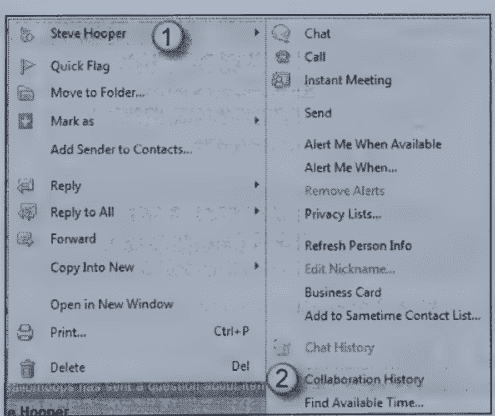

## 查找可用时间

通常，当我们收到某人的消息并意识到需要与他们组织会议时，查找可用时间功能是一个很好的快捷方式，可以向我们显示我们自己和消息发件人的第一个可用时间，以便我们可以与他们创建会议。

- 1. 我们可以通过右键单击邮件中某人的姓名来选择上下文菜单；然后我们可以看到其姓名列在上下文菜单顶部。

- 2. 当我们选择其姓名时，将出现扩展上下文菜单。

- 3. 选择查找可用时间以打开日程安排器并查看我们自己和所选联系人的第一个可用时间。如果我们选择的联系人是组织外部的人员，则日程安排器会显示灰色的时间段，因为信息不可用；但是，它确实会显示我们的第一个可用时间。

- 4. 从日程安排器窗口，我们可以创建会议，如以下屏幕截图所示：

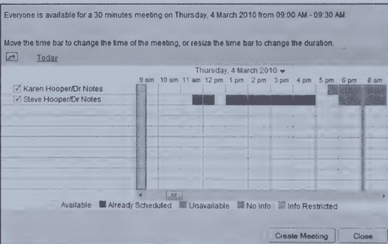

## 复制到工具

通常，我们可能会收到一封电子邮件，其中包含需要粘贴到会议、备忘录或待办事项中的详细信息。复制到工具允许我们选择一条消息、日历条目或待办事项，然后将这些文档之一中的信息复制到新消息、日历条目或待办事项中。这样可以节省在消息和目标文档之间复制和粘贴信息的麻烦。此功能可从右键菜单和 **更多** 按钮下使用，如下所示：

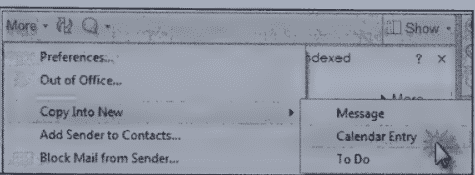

> 可以将消息拖放到日程概览时间段区域，以从该消息创建日历条目。

## 后续处理功能

“后续处理”功能，或在某些其他邮件应用程序中称为“标记”，是管理我们电子邮件的绝佳工具。很多时候，当我们收到一封无法立即回复的电子邮件时，我们通常会将其留在收件箱中，以便记得稍后处理；我们甚至可能将其标记为未读以进一步提醒自己。问题是，收件箱是为接收电子邮件而设计的，因此，随着新邮件不断涌入收件箱，我们需要跟进的电子邮件会被推得越来越靠后。

将电子邮件标记为跟进有助于我们管理需要回复的那些电子邮件，因为它会用图标标记消息，使其与其他消息区分开来；我们还可以设置提醒，并在特殊的跟进视图中查看标记的消息，以便更轻松地管理它们。

### 将消息标记为跟进

将消息标记为跟进是个好主意。我们只需在文件夹或视图中选择一条或多条消息，并通过执行以下任一步骤来添加标记：

- 1. 单击消息列表上方的标记图标，选择 **添加或编辑标记**...

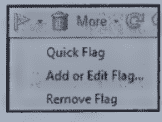

- 2. 输入标记优先级以及跟进操作、日期、时间和提醒（如果需要）。

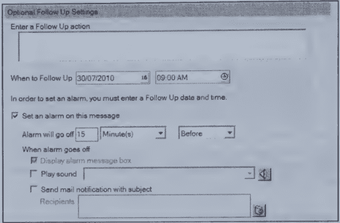

- 选择一条或多条消息，然后将其拖动到后续处理文件夹（这会将消息从收件箱中移出）。然后输入首选项。

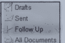

- 右键单击并选择快速标记（这会应用在邮件首选项中设置的选项）。

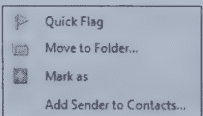

- 3. 快速标记选项类似于标记消息的快捷方式。在了解快速标记选项之前，让我们先看看在选择添加或编辑标记选项时可以选择的几个选项。

> > 当我们创建电子邮件时，可以选择添加标记。当我们想要标记正在发送的电子邮件以供跟进时，这很方便，并且可以避免在发送消息后必须进入“已发送”文件夹来执行该任务。

当我们添加或编辑标记时，我们将看到一系列选项，用于根据重要性以及我们希望如何接收通知来管理标记。我通常会使用此区域作为留言板，为那些需要更多细节的消息设置备注和提醒。如果我们已经添加了标记，并希望更改其中一些选项，可以选择用于添加标记的同一菜单——添加或编辑标记。

### 重要性

我们拥有的第一个选项是选择将显示在我们为跟进所选消息旁边的标记优先级图标。有三个优先级可供选择：

- 紧急
- 普通
- 低

如下一张屏幕截图所示，只需单击与我们为跟进所标记内容相关的优先级；在以下屏幕截图中，已选择普通优先级：

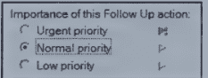

### 可选跟进设置

在“输入后续操作”中，我们可以添加与消息所需跟进相关的评论。我使用此区域的方式与便利贴相同，用于为我正在处理的事物添加一些评论或操作。当我们即将休假且无法处理完所有消息时，这非常有用。只需在“输入后续操作”中添加评论，在休假结束后，我们就可以查看评论以刷新对状态或所需操作的记忆。如果我们需要与他人分担工作或管理某个人的邮件，可以添加评论，让对方了解跟进的状态，并告知他们需要做什么，而无需为此单独发送一条消息。在我们忙碌的生活中，为那些无法立即处理的消息添加评论是一个巨大的优势。

可用的其他跟进设置包括：

- **何时后续处理**：此选项可帮助我们指定后续处理日期，以及可选的后续处理时间——我喜欢提醒，并且经常使用此选项。我也喜欢查看每个后续处理的到期日期，以便我可以管理时间。这就像是我们需要处理的消息的“待办事项”列表或“优先级”列表。

- 播放声音：此选项适用于设置了闹钟的人。使用此选项，我们可以选择在闹钟响起时播放的声音。单击扬声器图标以测试所选声音。我们可能希望为不同优先级选择单独的声音，或设置专门用于后续跟进的声音。

- 带主题的电子邮件通知：此选项会在闹钟响起时发送电子邮件。如果我们想提醒其他人有事项需要跟进，这是一个绝佳选择。确保在“收件人”字段中输入我们希望接收通知的人员地址。单击地址簿图标从目录中选择姓名。我认识很多人，他们会给自己发一条消息，提醒自己需要跟进某条消息！

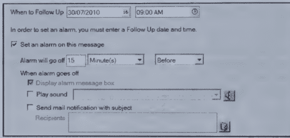

> 随时都可以编辑旗帜选项。我有时这样做是为了更改截止日期或在“输入后续跟进操作”字段中添加其他评论。例如，我可能已经打电话给那个人，被告知他们正在休假。我会将截止日期更改为他们返回后一两天，并添加评论，注明我打电话的日期以及他们目前正在休假。

## 快速旗帜

快速旗帜选项允许我们快速添加带有预设选项的旗帜。要添加快速旗帜，我们有以下选项：

- 选择一条或多条消息，然后单击消息列表上方的旗帜图标，如下所示：

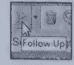

- 选择一条或多条消息，然后单击消息列表上方的旗帜图标并选择快速旗帜：

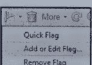

- 选择一条或多条消息，然后右键单击并选择快速旗帜：

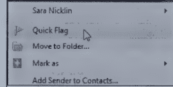

- 在消息内部，单击电子邮件标题上方按钮行中的旗帜图标。

## 设置快速旗帜选项的后续跟进首选项

快速旗帜具有与添加旗帜时相同的可用选项。我们可以按照以下说明设置此首选项：

1. 如有必要，打开邮件。
2. 单击消息列表上方的“更多”，选择“首选项”，然后选择“后续跟进”选项卡。
3. 对于“优先级”，选择在标记消息时要显示的优先级。
4. 勾选“设置后续跟进日期”，输入数字，并选择“天”、“月”或“年”以设置默认后续跟进日期。要添加后续跟进时间，请选择“设置后续跟进时间”并选择一天中的时间。
5. 勾选“设置触发闹钟”，然后输入数字。选择“天”、“小时”或“分钟”，并选择“之前”或“之后”以设置在后续跟进日期或时间之前或之后多长时间触发闹钟。然后执行以下任一操作：
   - 要在使用快速旗帜功能时应用默认闹钟设置，请勾选“对快速旗帜使用闹钟设置”。
   - 要在闹钟响起时播放声音，请勾选“播放声音”，并从下拉列表中选择要播放的声音。单击扬声器图标以测试所选声音。
   - 要在闹钟响起时发送电子邮件，请勾选“发送电子邮件通知给”，并输入应接收通知的人员地址。单击地址簿图标从目录中选择姓名。
6. 单击“确定”。

要使闹钟与后续跟进旗帜配合使用，我们必须首先在首选项中启用它们。转到“文件 | 首选项 | 日历和待办事项”，选择“闹钟”选项卡并勾选“显示闹钟通知”，然后单击“确定”。

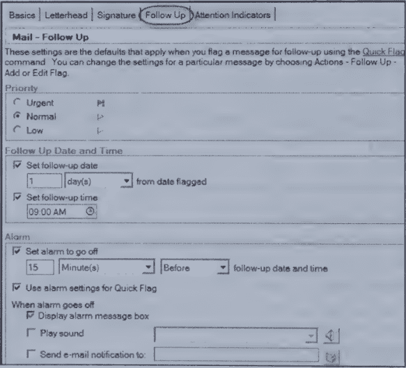

## 后续跟进视图和迷你视图

后续跟进视图位于“已发送”下方。我们可以将消息拖动到此文件夹以添加后续跟进旗帜，也可以打开此视图来管理我们的后续跟进。从此区域，我们可以对列进行排序，打开或预览已标记的消息，编辑旗帜，并删除旗帜。

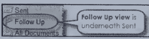

后续跟进迷你视图始终在视线范围内，因为它显示在邮件文件左侧导航器的底部，这是一个非常宝贵的功能。

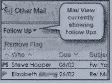

从此区域，我们可以对列进行排序，打开已标记的消息，编辑旗帜，并删除旗帜：

- 可以通过将光标移动到消息上方来显示消息的所有列。或者，我们可以调整此窗口的大小。

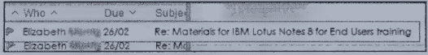

- 可以通过双击消息来打开它。
- 可以通过单击“删除旗帜”从迷你视图和后续跟进视图中删除消息（完成操作后）。消息保留在其他邮件视图或文件夹中，但不再带有后续跟进旗帜。
- 在迷你视图中，我们可以调整视图和列的大小：
  - 通过拖动“后续跟进”字样上方的区域，垂直调整迷你视图的大小。
  - 通过拖动其右边缘，水平调整迷你视图的大小。
  - 通过拖动列分隔线，调整列的大小。
  - 通过拖放列标题，重新排列列的顺序。

使用迷你视图，我们可以选择显示会议通知和待办事项，如果不希望显示后续跟进消息，可以不显示。我们可以单击“后续跟进”字样旁边的向下箭头，切换到显示“新通知”（日历通知，例如邀请或接受等）或“待办事项”。

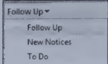

在迷你视图中，有一个专门用于优先级旗帜图标的列。我们会在收件箱和邮件中其他可以看到优先级图标的视图中看到此列。然后，我们可以单击列标题将所有优先级分组在一起；这将把所有高优先级的后续跟进项放在列表的顶部。

## 允许代理人在管理我们的邮件时添加后续跟进旗帜

我们可以授予代理人（通常是个人助理）代表我们在邮件中添加后续跟进旗帜的权限。此选项在“访问与代理 | 邮件首选项”中启用。代理人必须获得读取、编辑和创建任何文档、发送邮件、启用“外出办公”访问或更高权限。

> 当我在收件箱中标记一条消息后，我会将其归入某个文件夹。我可以从后续跟进视图或迷你视图访问该消息，因此没有必要将其保留在收件箱中——这是保持收件箱大小最小化的绝佳选择。

> 当我们显示对话时，可以为对话标记后续跟进操作，这样做时，旗帜会添加到对话中的每条消息。

## 删除旗帜

有几种方法可以从电子邮件中删除旗帜。如果已完成后续跟进操作且不再需要该电子邮件，最明显的做法就是直接删除它！在迷你视图中，单击“删除旗帜”按钮。

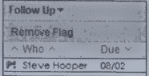

或者，从任何视图或文件夹，或从电子邮件内部，选择“后续跟进”按钮，然后选择“删除旗帜”，如下所示：

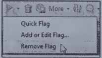

## 信纸

Lotus Notes 中的信纸概念类似于 Microsoft Word 中的模板，我们可以创建包含可重复使用信息的消息。例如，许多人力资源部门都有一个用于发布职位空缺的标准消息。IT 部门可能会发送一条宣布服务器中断的标准消息，等等。这些消息中的信息大部分都相同。例如，服务器中断备忘录会有不同的服务器名称和日期，但“收件人”和“主题”字段中的值等其他信息将保持不变。因此在这些情况下使用信纸可以避免我们每次都重新创建消息。我遇到过不少人，他们创建了信纸用于预订机票或住宿。信纸包括他们的常旅客信息以及护照详细信息等等。他们通常还会包含一个带有“日期”、“时间”、“出发地”、“抵达地”等标题的表格，这样在请求航班时，他们只需输入详细信息并在表格中制表键跳转即可。

我们可以创建带有文本或图形的信纸，并包含可重复使用的收件人列表。

> 如果信纸包含附件，我们每次需要发送信纸时都可以编辑附件。

## 创建信纸

创建信纸非常简单。共有三个选项，如下所示：

### 选项 1：

- 1. 创建一条消息并添加所需文本、收件人列表（如有必要）、发送选项以及消息中需要的任何其他元素。
- 2. 从“更多”按钮中选择“另存为信纸”；我们将看到提示要求为信纸命名。

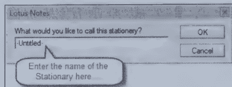

- 3. 输入名称并单击“确定”按钮（或按 Enter 键）。
- 4. 信纸将保存在“信纸”文件夹中。

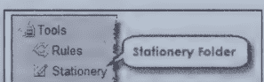

### 选项 2：

- 1. 在邮件侧边导航器中，展开“工具”，然后选择“信纸”。
- 2. 单击“新建信纸 | 消息”。
- 3. 添加所需文本、收件人列表（如有必要）、发送选项以及消息中需要的任何其他元素。
- 4. 单击“保存”，输入信纸名称，然后单击“确定”。

### 选项 3：

- 1. 在邮件侧边导航器中，展开“工具”，然后选择“信纸”。
- 2. 单击“新建信纸 | 个人”。
- 3. 在“标题”下方的第一组括号之间，插入要在消息顶部显示的任何文本或图形。请注意，导入是包含图形的最佳方式。
- 4. 在一组红色括号之间，插入要直接显示在消息正文之前的任何文本或图形。
- 5. 在最后一组括号之间，插入要在页面底部显示的任何文本或图形。如果我们想在该字段中添加签名，可以将其插入到红色括号之间，然后剪切并粘贴到最后一组括号之间。
- 6. 单击“保存”，输入信纸名称，然后单击“确定”。

在所有三个选项中，我个人更喜欢选项一。

## 编辑、重命名或删除信纸

通常我们需要调整已创建的信纸。我们可能需要更改收件人列表或在备忘录正文中添加新部分。有时，我们可能需要删除不再需要的信纸，或者需要重命名信纸。

编辑、重命名或删除信纸需要遵循以下步骤：

- 1. 在邮件侧边导航器中，展开 **工具** 并选择 **信纸**。
- 2. 选择要更改的信纸。
- 3. 执行以下任一操作：
  - 单击 **编辑**，对信纸进行更改，然后单击 **保存**。
  - 单击 **重命名**，输入信纸的新名称，然后单击 **确定**。
  - 单击垃圾桶图标删除信纸。

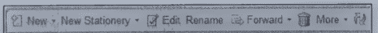

## 如何使用信纸

创建信纸后，我们会发现使用起来非常简单。信纸存储在 **信纸** 文件夹中。要使用信纸，可以进入 **信纸** 文件夹并双击所需的信纸。或者，如果我们在收件箱中，可以单击 **更多** 按钮并选择 **使用信纸的新消息**；这将打开一个提示框，列出 **信纸** 文件夹中存储的信纸，我们需要选择所需的信纸。

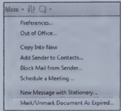

## 信纸书签

最常用的信纸可以设为书签，以便轻松访问。我们可以打开信纸消息，然后将打开的信纸窗口选项卡拖到 **打开** 按钮或 **书签栏**。这将导致信纸列在 **打开** 按钮或 **书签栏** 中。以下截图显示，我已将 **差旅请求** 信纸设为书签。当我需要使用 **差旅请求** 信纸时，只需从 **打开** 按钮或 **书签栏** 单击打开即可。

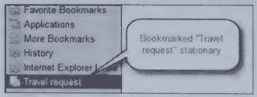

如果我们发现自己经常搜索发给某人（或某些人）的最后一封电子邮件，将内容复制到剪贴板，粘贴到新备忘录中，做一些小修改，然后定期发送，那么是时候考虑使用信纸了！

## 消息撤回

有时我们会发送一封电子邮件，然后立即意识到要么发错了人，要么忘记附件，要么根本不应该发送！我们可以撤回已发送且已保存的消息。如果在消息尚未准备好发送时就发送了，或者想要编辑已发送消息的内容并重新发送，这非常有用。请注意，某些组织可能已禁用此功能，因此“撤回消息”按钮对我们不可用。

### 如何撤回消息

如果发现已发送需要撤回的消息，请按照以下步骤操作：

- 1. 在邮件中，打开“已发送”或“所有文档”。
- 2. 选择要撤回的消息。
- 3. 在消息列表上方，单击“撤回消息”按钮，或者也可以单击“更多”按钮，然后选择“撤回消息...”选项。请记住，如果未显示此按钮，则 IT 部门可能已禁用此功能。

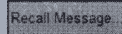

- 4. 如果消息发送给了多个收件人，请选择要从中撤回消息的收件人，通过选中或取消选中显示的名称。

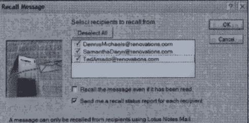

- 5. 即使收件人已打开或预览了消息，也要从收件人处撤回消息，请选择“即使已读也撤回消息”。请注意，许多 IT 部门允许撤回未读消息，因此即使可以选择此选项，如果不允许，也不会撤回消息。这是一个可选步骤。
- 6. （可选）要禁止撤回状态报告，请选中“向每个收件人发送撤回状态报告”选项。撤回状态报告会确认消息是否成功撤回。
- 7. 单击“确定”。

要使消息撤回生效，我们和消息收件人都必须使用 Lotus Notes 8 客户端、邮件模板和邮件服务器。消息收件人必须选择基本邮件首选项“允许他人撤回发送给我的邮件”。如果消息正从我们的组织发送到外部，则无法撤回消息，因为消息撤回仅在组织内部有效。

如果单击“发送”按钮时系统提示保存消息，而我们选择了“否”，则无法撤回该消息，因为它未保存在“已发送”视图或“所有文档”中。

## 拼写检查

拼写不是我的强项，我必须承认我非常喜欢拼写检查功能，并且一直在使用。有很多选项可以设置拼写检查功能的运行方式。首先，可以设置首选项来检查所有消息的拼写，然后可以设置默认词典、数字和大小写的处理方式，还可以选择其他词典。还有启用即时拼写检查的选项，可在输入时识别拼写错误的单词。

### 为消息启用拼写检查

可以让 Lotus Notes 在发送前自动检查所有消息的拼写，或者也可以手动检查消息中的拼写错误。还可以启用即时拼写检查器，在输入时显示拼写错误的单词。我们在第 5 章“掌握 Lotus Notes 邮件”中讨论了即时拼写检查；在本章中，我们将了解其他拼写检查选项。

### 手动执行拼写检查

创建一条消息来测试接下来的步骤：

- 1. 在消息打开时，选择消息正文中要检查拼写的文本。
- 2. 选择“工具 | 拼写检查...”。当 Notes 不认识某个单词时，Notes 会显示“拼写检查”对话框。

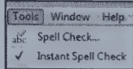

### 输入时执行拼写检查（即时拼写检查）

创建一条消息来测试接下来的步骤：

- 1. 在消息打开时，选择“工具 | 即时拼写检查...”。当 Notes 不认识某个单词时，该单词下方会出现红色波浪线。
- 2. 右键单击拼写错误的单词；我们将看到拼写的替代建议，以及将单词添加到词典或跳过它的选项。

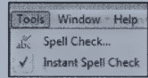

### 执行自动拼写检查

在这种情况下，Notes 在发送消息时检查拼写。

- 1. 选择“文件 | 首选项”，单击“邮件”，然后单击“基本”选项卡。
- 2. 选择“发送前检查邮件拼写”。
- 3. 单击“确定”。

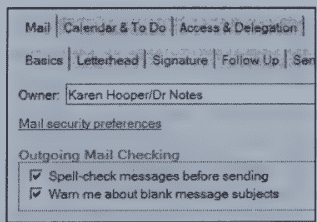

> > 我们可以启用即时拼写检查以及发送前自动检查消息的选项。这样，输入时会显示拼写错误的单词，并在发送消息时提示纠正遗漏的单词。

我们不应忘记将签名添加到词典中。如果不这样做，每当我们发送消息并启用了拼写检查选项时，它将拼写检查我们的名字以及我们添加到签名中的所有内容。如果拼写检查器捕获了签名的部分内容，请在拼写检查对话框中选择“添加到词典”按钮。

## 设置拼写检查首选项

如前所述，我们可以选择不同的拼写检查选项来自定义拼写检查器。

1. 单击“文件”|“首选项”。
2. 单击“拼写检查”。
3. 设置以下任一选项：

   - 从“主要词典”列表中选择语言词典，然后单击“设置为默认值”。

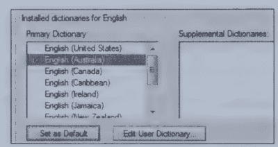

   - 选择“补充词典”选项，在此我们可以看到可选择的补充词典。这需要由我们的 IT 部门安装。
   - “编辑用户词典”选项列出了我们添加到词典中的所有单词，例如我们的姓名、公司名称、产品名称以及我们使用的缩写。我们可以在“首选项”中或在提示时从拼写检查对话框中编辑此词典。在此区域内，我们可以在“新建/选定单词”字段中输入新单词，然后单击“添加”按钮来添加新单词。我们还可以选择诸如 Admin 之类的单词（如图所示），更改拼写，然后单击“更新”按钮。最后，我们可以通过在列表中选择单词，然后单击“删除”按钮来删除用户词典中的单词。
   - 有一个“忽略包含数字的单词”选项。对于使用包含字母和数字的零件号或型号的产品的人来说，这是一个非常好的选项。我们还可以设置“忽略全大写单词”。
   - 我们还有一个适用于多语言文档的选项——在下一次语言标记更改之前保持即时词典更改。
   - 选择“启用即时拼写检查”选项将用下方的红色波浪线突出显示拼写错误的单词。
   - 在“即时更正”下，我们可以选择希望自动更正的典型键入错误。

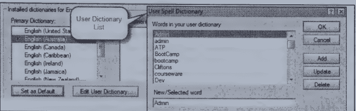

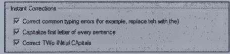

4. 单击“确定”。

> 即时更正功能仅适用于 Lotus Notes 8.5.1 英语客户端。

## 非在办公室

每当我们休年假或不在办公室时，启用非在办公室功能非常重要。当同事或客户给我们发送电子邮件时，他们会收到通知，告知我们不在办公室，包括不在办公的日期，更重要的是，我们何时返回办公室。在 Lotus Notes 8.5 中，缺席通知会立即发送。

我实际上不仅在休假时才使用我的非在办公室功能。如果我当天在参加培训，通常要到当天晚些时候或第二天才能查看电子邮件，因此我也会启用它。参加会议或其他商务外出时，我也会启用它。我们可以编辑非在办公室，为每次外出发送自定义消息。通知服务仅在我们指定的离开和返回时间之间发送回复，并且只向每个发件人发送一条回复。

### 启用非在办公室功能

启用此功能的步骤如下：

1. 在“邮件”或“日历”中，单击**更多**按钮，然后选择**非在办公室**…

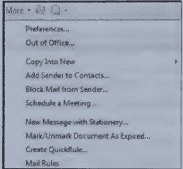

2. 输入**离开**日期和**返回**日期。如果外出时间少于一天，请选中**指定小时数**，并输入外出的小时数。具体取决于我们组织的服务器配置，我们可能可以选择小时数，也可能只能选择日期。选中**会议期间不可用**，以向他人显示我们在这些时间无法参加会议及其他相关活动。

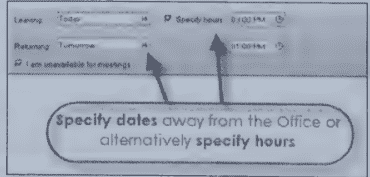

3. 在**标准通知**选项卡上，如有需要，编辑**主题**字段，并选择**在主题中追加返回日期**，以便发件人清楚地看到我们何时返回。在**其他正文文本**中，添加任何进一步详细信息，例如外出的原因或我们外出期间代替我们工作的人员的联系方式。要清除此字段，可以单击**主题**字段上方的**重置默认值**按钮，然后添加新详细信息。

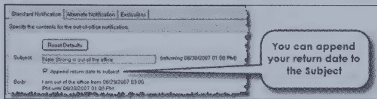

4. 如果要发送替代通知，请选择**替代通知**选项卡，向特定人员或来自特定域（如 @sampledomain.com）的人员发送替代的非在办公室通知。在**收件人**字段中指定人员和域。然后指定替代通知的内容。

5. 如有需要，单击**排除**选项卡，以在满足特定条件时取消非在办公室通知。在相关字段中指定所需的条件。此处有一个选项可防止回复发送到从 Internet 接收的消息。如果这是我们的偏好，请选中**不自动回复来自 Internet 地址的邮件**。

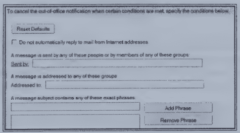

6. 单击**启用并关闭**，或者，如果我们已启用非在办公室通知但更改了一些非在办公室设置，请单击**保存并关闭**。

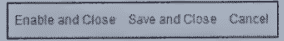

### 如何禁用非在办公室功能（如有必要）

默认情况下，非在办公室功能会自动禁用自身；但是，在某些组织中，我们需要手动禁用非在办公室，因为它未启用为服务运行。如果我们确实需要自己禁用它，非在办公室会向我们发送提醒。

1. 打开“邮件”或“日历”。
2. 在消息列表上方，单击“更多”|“非在办公室”。
3. 单击“禁用并关闭”。

**缺席时长：**
最短时间为一小时。最少天数为一天。不能设置 1 天 4 小时。必须选择时间或日期之一。

我们可以允许邮件代理启用非在办公室通知。在邮件文件首选项的**访问与委托**部分中，选择**邮件、日历、待办事项和联系人**组件，然后授予**读取、编辑和创建任何文档、发送邮件、启用非在办公室或更高权限**。

## 垃圾邮件

我们经常收到不需要的电子邮件。可以通过将这些电子邮件添加到垃圾邮件中来阻止它们；此功能称为**阻止发件人邮件**。此功能允许我们筛选传入消息，并将特定发件人的消息直接移动到垃圾邮件中，以便它们绕过收件箱。除了**已发送、规则、信纸和跟进**之外，我们可以在所有邮件视图和文件夹中使用此功能。垃圾邮件中的邮件需要手动删除。

### 管理垃圾邮件

按照以下步骤将邮件添加到垃圾邮件中。

1. 打开“邮件”，选择要将其消息添加到垃圾邮件的发件人的一条消息。

2. 在收件箱中，单击**更多**按钮，然后选择**将发件人邮件发送到垃圾邮件**。将打开垃圾邮件发件人列表对话框，如下一张屏幕截图所示。选择是要阻止来自单个发件人的邮件，还是阻止来自以发件人域结尾的任何地址的邮件。

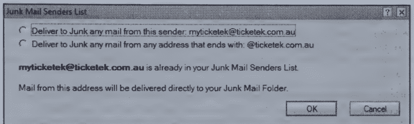

3. 单击“确定”。此发件人的消息现在将直接进入垃圾邮件，位于侧边导航器中，如下突出显示：

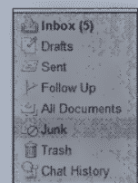

4. 要取消阻止，在垃圾邮件中，选择**管理垃圾邮件发件人列表**按钮；这将打开垃圾邮件发件人列表对话框，我们可以选择一个名称进行删除，或单击**全部删除**按钮。我们可以删除垃圾邮件中的电子邮件，但发件人详细信息将保留在垃圾邮件发件人列表中。

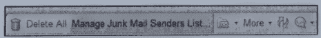

> > 我们还可以从“规则”文件夹管理垃圾邮件，我们将在下一节中介绍。

## 规则

我们的收件箱经常被大量消息淹没，这可能会让人感到不知所措。防止这种情况的一种方法是使用规则来管理邮件。我们可以使用邮件规则，对收到的符合特定条件的新消息自动执行操作。我们可以创建一条规则来检查来自特定发件人或包含特定主题的消息，并自动将消息移动到特定文件夹、将消息副本发送给某人，或在看到它们之前删除不需要的消息。例如，我订阅了几个网站，并设置了规则，将这些网站发来的新闻通讯直接移动到一个文件夹，以便它们绕过我的收件箱。

我们创建的邮件规则存储在邮件文件的 **规则** 文件夹中。我们可以前往该文件夹添加新规则，也可以编辑已创建的规则。我们可以编辑规则、更改其顺序以使一条规则优先于另一条规则、在不想使用时将其关闭，或将其彻底删除。

我们可以在侧边导航栏的 **工具** 下访问 **规则**。

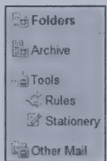

有一个 **快速规则** 选项，它是最常用规则配置的简化集，可以快速应用——因此得名 **快速规则**。

下表说明了一些 **快速规则** 和 **规则** 设置，供我们参考：

| 条件 | 定义 |
| :--- | :--- |
| 包含 | 包含查找部分匹配。例如，如果我们选择了规则来处理主题中包含 "sales" 的消息，它将处理主题字段中包含 "sales conference" 以及 "sales enquiry" 的消息。 |
| 不包含 | 我们需要小心，因为该设置与包含条件完全相反，通常与包含或等于连用。 |
| 等于 | 等于查找完全匹配。在我们的销售示例中，它将仅处理主题中只有 "sales" 的消息。 |
| 不等于 | 与不包含类似，但它查找完全匹配。 |

### 创建快速规则

按照以下步骤创建快速规则：

- 1. 打开邮件并选择要应用快速规则的消息。
- 2. 选择 更多 | 创建快速规则。
- 3. 由于快速规则基于所选消息中的信息，我们将在 **发件人**、**主题** 和 **域** 字段中看到值。如有必要，我们可以编辑这些值。例如，如果我们选择的主题字段中没有文本，这些字段可能为空。
- 4. 完成规则有三个步骤。对于每个条件，我们可以为每个字段值指定以下任意状态——**包含**、**不包含**、**等于** 和 **不等于**。
  - i. 首先，我们需要选择要匹配的条件。有三个条件需要配置——**发件人**、**域** 和 **主题**。我们可以选择其中一个条件或全部三个条件。

    | 条件 | 操作符 | 值 |
    | :--- | :--- | :--- |
    | 当发件人 | 包含 | specialoffer@myerone.com.au |
    | 当域 | 等于 | myerone.com.au |
    | 当主题 | 包含 | 你的绝佳选择，尽享优惠与奖励 |

  - ii. 我们需要决定何时采取操作——针对一个或所有选定的条件。

    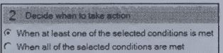

  - iii. 选择要执行的操作：
    - **移动到文件夹**：我们需要选择要将消息移动到的文件夹。
    - **将重要性更改为高**：此选项会在消息上添加红色感叹号图标，以指示消息为高重要性。
    - **不接受消息**：这将删除消息。请注意，消息不会存储在 **垃圾箱** 中，且无法恢复。

    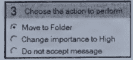

- 5. 单击确定保存配置。新的快速规则已创建并存储在 工具 | 规则 文件夹中。新的快速规则作用于传入消息，但收件箱中符合规则条件的现有消息不受影响。

如果快速规则提供的选项不够，我们可以创建一条规则。

### 创建规则

规则有更多选项可配置，功能非常强大，因为还有更多可选操作和包括异常在内的更多配置。

- 1. 在邮件的侧边导航窗格中，转到 工具 | 规则，或者单击 更多 按钮，然后选择 邮件规则。这将打开 规则 文件夹。
- 2. 在 规则 文件夹中，单击 新建规则。
- 3. 在 新建规则 对话框中，有两个区域需要配置。在第一个区域中，我们需要指定条件。规则有多个可配置的条件。

| 要检查的条件 | 选项 | 其他选项 |
| :--- | :--- | :--- |
| 发件人 | 包含, 不包含, 等于 & 不等于 | |
| 主题 | 包含, 不包含, 等于 & 不等于 | |
| 正文 | 包含, 不包含, 等于 & 不等于 | |
| 重要性 | 包含, 不包含, 等于 & 不等于 | 高, 正常, 低 |
| 发送优先级 | 包含, 不包含, 等于 & 不等于 | 高, 正常, 低 |
| 到, 抄送, 密件抄送 & 到和抄送 | 包含, 不包含, 等于 & 不等于 | |
| 正文或主题 | 包含, 不包含, 等于 & 不等于 | |
| Internet 域 | 包含, 不包含, 等于 & 不等于 | |
| 大小 | 小于, 大于, 等于, 不等于 | |
| 窗体 | 包含, 不包含, 等于 & 不等于 | 注意：窗体的一个示例是备忘窗体 |
| 黑名单, 白名单 | 包含, 不包含, 等于 & 不等于 | |
| 所有文档 | 无可用选项 | |

> **所有文档** 条件允许我们在规则启用时，对到达我们邮箱中的所有消息执行操作。例如，我们可以选择 **所有文档**，并指定在办公室外时将我们收到的所有电子邮件的副本发送到备用电子邮件地址。

- 4. 添加一个条件后，我们可以添加更多条件和/或异常。

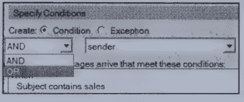

- 5. 我们可以随时使用屏幕右侧的按钮 **删除** 或 **全部删除** 条件。

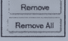

> 添加要检查的文本时，请勿使用引号。文本不区分大小写。

- 6. 输入条件后，下一步是 **指定操作**。规则有多个可用操作，我们可以添加多个操作。可用操作列表如下：

| 操作 | 选项 | 其他选项 |
| :--- | :--- | :--- |
| 移动到文件夹 | 选择要移动到的文件夹 | |
| 复制到文件夹 | 选择要复制到的文件夹 | |
| 发送副本给 | 完整或仅标题 | 输入要发送到的姓名 |
| 设置过期日期 | 数字 | 天, 周, 月, 年 |
| 将重要性更改为 | 高, 正常, 低 | |
| 停止处理 | 无可用选项 | |
| 删除 (不接受消息) | 无可用选项 | |

> > **发送副本给** 是一个很好的选项，可在我们办公室外时允许另一个人管理我们的邮件。他们收到消息副本，而我们仍然收到原始邮件。

- 7. 单击 添加操作。
- 8. 单击 确定 关闭对话框；规则现已启用。

从选项可以看出，规则非常广泛。创建后，规则按其在 规则 文件夹中出现的顺序（从上到下）执行。我们可以通过使用 规则 文件夹顶部的按钮将规则上移或下移来更改规则顺序。

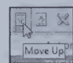

我们可以随时编辑或禁用规则，如果不再需要，也可以删除规则。

## 邮件大小指标和配额

在某些组织中，邮件管理员可能会设置配额，以帮助管理用户邮件的大小。如果设置了配额且我们的邮件大小超过设定限制，我们将看到警告消息，告知我们已超过配额。此外，发送给我们的新邮件可能会被延迟，并且在我们将邮件大小减小到低于配额之前，可能无法保存已发送的邮件。如果启用了配额，我们将在邮件左上角看到一个指示器，如下面的屏幕截图所示。

当我们访问存储在服务器上的邮件时，邮件配额状态指示器显示为温度计。

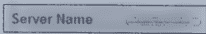

当我们访问本地副本时，邮件配额状态指示器显示为被温度计重叠的信封：

将鼠标悬停在任一指示器上，将显示一个摘要，其中包含温度计、当前邮件数据库大小和配额以及邮件服务器名称：

## 减小邮件大小的提示

管理邮件可能是一项麻烦事。以下是一些可能有助于减小邮件大小的提示。

- **删除邮件：** 按大小对单个邮件文件夹和视图进行排序，以找出并删除不再需要的最大邮件。执行此操作的一个好位置是“所有文档”，因为它包含所有已发送、已归档和已接收的邮件。删除邮件后，请确保进入“垃圾箱”文件夹并清空垃圾箱。

- **存档邮件：** 如果启用了存档，请存档不再活动的邮件。存档将在本章后面讨论。

- **更改保存已发送邮件的首选项：** 如果保存已发送邮件的首选项设置为“始终”，则我们可能不必要地保存许多已发送邮件，因为我们发送的每条邮件都会保存在我们的邮件中。考虑将设置更改为“始终提示”，这样每次发送邮件时都会提示我们是否要保存它。如果选择“否”，则该邮件将无法在我们的邮件中访问。如果在发送邮件时选择“发送并归档”选项，则该邮件将自动保存。

- **文件附件设置：**
  - 回复包含文件附件的邮件时，使用“仅回复历史记录”选项，该选项会删除附件但保留原始文本。
  - 为防止在邮件中接收大附件，我们可以创建一条规则，指定如果大小（字节）大于（我们选择的数字），则删除。

## 存档

如上所述，存档是减小邮件大小的一个绝佳解决方案。当我们设置存档时，它会创建当前邮件应用程序的副本，并将其本地存储在计算机上。它会在 Windows 资源管理器中创建一个名为 Archive 的新目录。如果我们需要备份存档应用程序，并且命名约定保持默认值，则可以在 Windows 资源管理器的 IBM\Lotus Notes\Data\Archive 目录中找到它。

我们可以从侧边导航器中的邮件文件访问存档数据库，如下所示：

若要打开我们的存档，请在侧边导航器中展开“存档”，然后选择要打开的存档。在上述屏幕截图中，唯一可用的存档是 Mail 2008。打开后，存档应用程序几乎与我们当前的邮件相同（不含所有邮件）！它看起来略有不同，因为存档应用程序是黄色的，并且标题不同，如下一张屏幕截图所示：

在存档之前，我们必须配置存档设置（我们将稍后介绍）。我们可以拥有多个存档数据库。有些人每年都有一个存档数据库。其他人则倾向于只有一个存档数据库。决定存档数量的一个考虑因素是大小。如果我们想备份存档应用程序，可能需要控制大小，因此需要拥有多个存档。

### 设置存档

设置存档非常简单，请按照以下步骤操作：

1. 在“操作 | 存档 | 设置...”下访问存档菜单选项。

2. 单击右侧的“创建...”按钮。

3. 这将打开“创建存档条件”对话框。在此处，我们有四个部分需要完成：

   i. 为存档数据库指定一个描述性名称，并选中 **启用此条件**。启用条件后，将在邮件侧边导航器中显示指向新存档的链接，如我们之前的示例所示，即 **邮件 2008**。

   ii. 单击 **选择条件...** 按钮，以确定我们想要存档的频率和文档。默认值为 **超过 365 天未修改**。我们可以更改这些选项。

   iii. 接下来，我们需要决定 **对所选文档应执行的操作**。默认值是 **将文档复制到我在此处指定的存档应用程序**，然后 **清理此应用程序**。另一个选项是 **仅清理此应用程序而不进行存档**，但不建议这样做，因为如果需要，无法检索已删除的文档。

   iv. 最后，**要如何清理此应用程序中的文档**提供两个选项。第一个选项是从当前邮件中完全删除文档，这样我们就只能从存档应用程序访问该文档。第二个选项是在当前邮件应用程序中保留文档的子集或摘要。这可确保我们在当前邮件文件中看到归档文档，且归档文档上带有蓝色摘要图标，表示该文档已被存档，并且附件已被删除，或者附件已被删除且原始消息中保留 40KB 文本。此选项的优点是，我们可以在当前邮件文件中打开归档文档，并选择 **操作 | 打开归档的文档**；这将打开包含所有原始数据的原始消息，这些数据现在存储在我们的存档应用程序中。

4. 单击“确定”以关闭。随后，系统将提示我们，要使用启用的条件，必须通过在“操作\存档”菜单下选择 **立即存档** 选项，或单击 **是** 按钮来安排存档。计划将在我们分配的时间自动执行存档。

如果我们通过单击 **否** 按钮选择不安排存档，则在创建存档应用程序之前需要手动存档一些文档。

存档有四种方式：

- **操作 | 存档 | 立即存档**：这将存档符合存档条件的文档。
- **操作 | 存档 | 归档所选文档**：这将存档我们当前选定的任何文档。
- 让计划存档根据存档条件进行存档。
- 将文档拖放到侧边导航器中的存档数据库。

> **最近归档的文件夹**：我们可以通过在存档中打开 **最近归档** 文件夹，轻松找到最近存档的邮件。存档邮件的主题行显示 **（已归档）**，标题中包含存档邮件的日期，这非常方便。

随时可以通过选择 **操作 | 存档 | 设置** 来 **编辑**、 **删除** 或 **禁用** 每个数据库的设置。

在存档设置中，我们将看到“高级”选项卡，如下一张屏幕截图所示：

在此区域中，默认情况下，只有在能够删除所有回复的情况下，存档才会删除文档。响应的一个示例是对电子邮件的回复。保持此选项被选中后，我们将始终能够显示整个对话。

还有一个选项是“将所有存档活动记录到日志应用程序”。每次发生存档时，这都会生成一份报告，并可以包含指向实际存档文档的链接。日志是一个单独的应用程序，并存储在“高级”选项卡中列出的路径中。

## 邮件首选项

在本章和前一章中，我们设置了许多邮件首选项，以特定方式配置我们的邮件。例如，我们可能已启用拼写检查，以便在发送备忘录时自动检查拼写。我们还可能设置了发件人颜色，因此特定人员的邮件将以不同颜色突出显示。邮件首选项可以从“文件 | 首选项 | 邮件”菜单访问，也可以在“邮件”中单击“更多”按钮并选择“首选项”。

从“文件 | 首选项 | 邮件”选项访问邮件首选项，可让我们配置更多区域，因为我们可以设置 Internet 选项以及发送和接收首选项。

在“邮件”中使用“更多”按钮访问首选项，然后选择“首选项”，将为我们提供以下可选选项卡：

## 信头

本章中，如前所述，我们已了解如何配置上一张屏幕截图中每个选项卡上列出的大多数首选项。在“基本”选项卡中，我们有启用拼写检查以及查看和文件夹管理的选项。在“签名”选项卡中，我们可以设置签名以附加到我们发送的每个备忘录。“后续跟进”和“发件人颜色”选项卡允许我们配置快速标记选项，并对特定发件人的消息进行颜色编码。

我们尚未查看的首选项是信头。我们可能已经注意到，在创建消息时，备忘录的标题通常会包含一个图形，如下一个带有枫叶的示例所示：

我们可以通过进入邮件首选项，单击信头选项卡并浏览不同的信头选项来更改此图形。对于我们选择的每个图形，右侧有一个预览屏幕。我最喜欢的之一是冲浪板。如果我们愿意，可以选择无信头。

信头仅在组织内部可见。当消息发送到外部时，信头会被删除或作为附件发送。如果我们不希望信头在发送给外部人员时变成附件，请不要忘记无信头选项。

## 上下文菜单（右键菜单）

上下文菜单提供了常用功能的快捷方式，例如：

- 快速标记：为消息添加标记
- 移动到文件夹...：允许我们将消息归档到文件夹中
- 标记为：提供将消息标记为“已读”或“未读”的选项
- 将发件人添加到联系人...：在我们的联系人中创建发件人联系人
- 回复：提供回复消息发件人的选项
- 全部回复：提供回复消息发件人以及抄送和密件抄送字段中收件人的选项
- 转发：转发包含历史记录和附件的消息
- 复制到新建：提供将消息复制到另一条消息、日历条目或待办事项的选项
- 在新窗口中打开：在新窗口中打开当前选定的消息
- 打印...：打开打印对话框
- 删除：将消息移动到“垃圾邮件”

## 添加表格和节

表格可以添加到消息和文档中，节亦如是，如下文所述。

## 表格

表格是输入数据的绝佳工具。我们可以使用制表键在单元格之间移动。在 Mail 中创建信纸时，我经常使用表格，因为我发现它们更容易布局我的消息。

以下是我们可以在 Lotus Notes 中创建的表格示例。创建表格时，我们可以看到“表格”菜单，从中可以选择表格属性。在表格属性中，我们可以为单元格选择颜色、单元格边框大小和样式，添加诸如投影阴影之类的边框效果，甚至可以创建动画表格。

| 产品 | 零件名称 | 零件编号 | 单位成本 |
| :--- | :--- | :--- | :--- |
| ![产品图片] | 巴克·罗杰斯棕色火箭 | 100-012-AA | $1,500.00 |
| | 绿色星球 | 100-012-5B | $1,680.00 |
| | 滑流粉色 | 100-012-CC | $600,000.00 |
| | 太空包 | 100-012-CC | $2,651,886.00 |

## 节

节有助于在文档中组织文本。例如，如果我要向 Lotus Notes 文档添加策略信息，我可能希望将文本组织成不同的段落。然后，我可以将这些段落添加到节中，这些节会将文本折叠为标题。当某人想要阅读该段落的内容时，他们单击标题，即可展开该节。这会总结文档，并让人们快速识别感兴趣的段落。

节可以是展开或折叠状态。我们还可以在节中创建节。以下屏幕截图显示了“Acme 清洁产品”节正在展开。

## 打印文档

在 Lotus Notes 中，我们可以打印文档和视图。

- 1. 要打印，首先我们需要选择要打印的文档，然后选择“文件 | 打印”或按 Ctrl+P。
- 2. 选择打印机，单击“设置”按钮以选择双面选项等。
- 3. 在“打印内容”窗口中，我们可以确定打印的显示方式。我建议选择每个选项并单击“预览”按钮进行查看。
- 4. “质量”选项卡允许我们选择首选项。
- 5. “副本”选项允许我们选择要打印的副本数量。

### 打印内容部分

在打印对话框中有一个“打印内容”部分，如下图所示：

可以选择以下任何选项：

- **按屏幕显示的布局**：将打印屏幕上显示的所有内容。
- **选定的视图**：将按视图中列出的方式打印文档。如下例所示，将打印“日期”列和“主题”列：

| 日期 | 主题 |
| :--- | :--- |
| | v iPad (Karen Hooper) |
| | 不认为它会销售 (Karen Hooper 14/04/2010) |
| | 我们有了这个想法 (Karen Hooper 15/04/2010) |

- **选定的文档**：将分别在单独页面上打印选定的每个文档。

> 别忘了预览我们即将打印的内容。

## 摘要

在本章中，我们探索了 Lotus Notes 中可用的邮件工具。其中许多工具旨在帮助我们更高效地工作。例如，为消息标记或标记为后续跟进可以帮助管理收件箱，使用信纸可以通过准备好现成的电子邮件模板来节省时间，在拼写检查器的个人词典中添加签名的简单技巧可以避免每次发送消息时都出现拼写检查提示，等等。规则也非常强大，是一个绝佳的工具。希望能充分利用这些工具并将它们投入使用！
