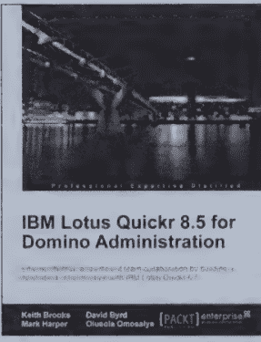
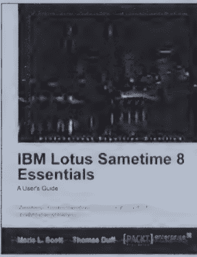
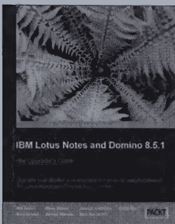
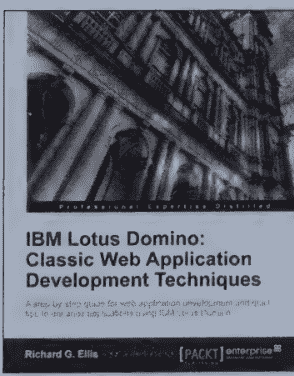
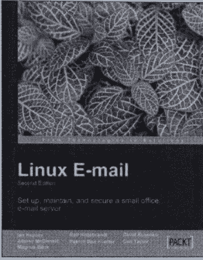
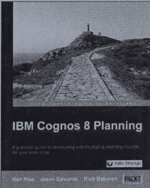

# 索引

## A

- 归档
  - 关于 88
  - 设置，步骤 88-92
  - 设置，方式 91

- 附件
  - 添加，到文档 35
  - 添加，到消息 35
  - 创建附件对话框 36
  - 编辑，使用编辑按钮 37
  - 多个附件，使用 38
  - 打开，使用打开按钮 37
  - 保存，使用保存按钮 38
  - 查看，使用查看按钮 37

## C

- 协作历史记录
  - 关于 59
  - 选项，查看 59

- 会话，邮件
  - 操作 41
  - 删除 42
  - 关闭 42
  - 查看 40, 41

- 复制到新建备忘录/日历/待办工具 55

- 复制到工具 60, 61

- Ctrl 键，Lotus Notes
  - Ctrl+B 34
  - Ctrl+C 34
  - Ctrl+I 34
  - Ctrl+U 34
  - Ctrl+V 34
  - Ctrl+X 34
  - Ctrl+Z 34

## E

- 电子邮件分类
  - 颜色，指定 57
  - 图标显示，用于收件人级别指定 58

## F

- 查找可用时间功能 60

- 文件夹
  - 创建，用于管理邮件 43, 44
  - 消息，选择 45
  - 多个文档，选择 45, 46
  - 多个消息，选择 45, 46
  - 删除 44, 45
  - 重命名 44, 45

- 后续跟进功能
  - 关于 61
  - 标记，添加 63
  - 允许代理人添加标记 68
  - 标记，编辑 63
  - 标记，移除 68
  - 后续跟进视图 66
  - 消息，标记 61, 62
  - 迷你视图 67
  - 可选设置 63
  - 优先级 63
  - 快速标记选项 64, 65

## H

- 主页
  - 自定义 12
  - 功能 12
  - 屏幕截图 11
  - 快捷方式 12

## I

- 界面，探索
  - 窗口选项卡 7

## J

- 垃圾邮件
  - 关于 80
  - 管理，步骤 80, 81

## L

- Lotus Notes
  - 浏览器 18
  - 关闭 6
  - 主页 7
  - 界面，探索 7
  - Ctrl 键 34
  - 邮件，访问 24
  - 邮件工具 55
  - 打开按钮 9
  - 打开列表 9
  - 密码提示 6
  - 个性化，首选项 20
  - 侧边栏 15
  - 启动 6
  - 信纸 69
  - 缩略图 11
  - 工具栏 13

- Lotus Notes 浏览器
  - 打开 19
  - 工具栏 19
  - 使用 18

- Lotus Symphony 5

## M

- 邮件图标
  - 高优先级 49
  - 消息已转发 49
  - 消息已回复 49
  - 消息已回复和 50
  - 回形针 50
  - 未读消息 49

- 邮件首选项
  - 关于 92
  - 信头 93

- 邮件大小指示器
  - 显示 86
  - 邮件应用程序大小，减小 87

- 邮件，Lotus Notes
  - 访问，方式 24
  - 会话 39, 40
  - 管理，使用的文件夹 43
  - 预览窗格，使用 38, 39
  - 未读邮件，查看 42
  - 未读消息，标记为已读 43
  - 未读消息，标记为未读 43
  - 查看 38

- 邮件管理，使用的文件夹
  - 文件夹，创建 43, 44
  - 文件夹，删除 44, 45
  - 文件夹，重命名 44, 45
  - 消息，归档 46
  - 消息，选择 45

- 邮件工具，Lotus Notes
  - 归档 88
  - 协作历史记录 59
  - 复制到工具 60
  - 查找可用时间 60
  - 后续跟进功能 61
  - 垃圾邮件，管理 80
  - 邮件首选项 92
  - 外出办公 77
  - 撤回消息按钮 73
  - 规则 82
  - 发件人颜色 57
  - 拼写检查 74
  - 信纸 69

- 消息
  - 操作 25
  - 地址 29
  - 地址，在密件抄送字段中 30
  - 地址，在抄送字段中 30
  - 地址，在收件人字段中 30
  - 地址，选项 29, 30
  - 附件，添加 35
  - 创建 24, 25
  - 删除 53
  - 投递选项 27, 28
  - 格式 31
  - 防止个人组展开 30
  - 撤回 73
  - 撤回，步骤 73, 74


- 回复 28
- 还原，从垃圾桶中 53
- 签名，添加 52, 53

- 邮件操作
  - 附件 26
  - 送达选项 26
  - 显示 26
  - 标记 26
  - 更多 26
  - 另存为草稿 26
  - 发送 25
  - 发送并归档 25

- 邮件，归档
  - 关于 46
  - 所有文档 47, 48
  - 使用发现文件夹工具 48, 49
  - 搜索已归档的邮件 47

- 邮件，格式设置
  - 编辑工具栏选项 32
  - 使用亮点笔 33
  - 选项 34, 35
  - 访问选项 31
  - 更改永久笔颜色 33
  - 更改永久笔字体 33
  - 使用永久笔 32
  - 属性对话框 32
  - 拖动文本 33, 34
  - 放置文本 33, 34

## O

- 打开列表
  - 日历图标 9
  - 联系人图标 9
  - 自定义 10
  - 邮件图标 9

- 办公外出
  - 关于 77
  - 缺席持续时间 80
  - 禁用 80
  - 启用 78, 79

## P

- 永久笔
  - 更改颜色 33
  - 更改字体 33
  - 使用 32

- 首选项，Lotus Notes
  - 访问 20
  - 文档自动保存 20
  - 启用 20, 21
  - 示例 20

## Q

- 快速标记选项，跟进功能
  - 首选项，设置 65

## R

- 规则
  - 访问 82
  - 创建，步骤 84-86
  - 邮件规则 82
  - 快速规则，创建 83, 84
  - 设置 82

## S

- Sametime 5
- 发送副本给选项 86
- 快捷方式，主页
  - 列表 12
- 侧边栏
  - 关闭状态 16
  - 组件，活动 18
  - 组件，每日概览 18
  - 组件，信息源 18
  - 组件，Quickr 18
  - 组件，Sametime 联系人 17
  - 信息源面板 16
  - 关键应用程序 15
  - 打开状态 16
  - 屏幕截图 16
  - 精简状态 16
- 签名，添加到邮件 52, 53
- 拼写检查
  - 关于 74
  - 自动 75, 76
  - 启用，针对邮件 74
  - 实时拼写检查 75
  - 首选项，设置 76, 77
  - 启用实时拼写检查选项 51
  - 忽略包含数字的单词选项 51
  - 即时更正选项 51
  - 使用 50

## T

- 缩略图
  - 快捷方式 11
  - 查看 11

- 工具栏
  - 关于 13
  - 自定义 13
  - 重新定位 13
  - 搜索所有邮件工具栏 14

## V

- 视图按钮 37

## W

- 窗口选项卡
  - 外观，选择 8

# 感谢购买

## IBM Lotus Notes 8.5 用户指南：LITE

### 关于 Packt Publishing

Packt 发音类似 'packed'，其第一本书《用于有效 MySQL 管理的 phpMyAdmin 精通》于 2004 年 4 月出版，此后继续专注于出版针对特定技术和解决方案的高度聚焦图书。

我们的图书和出版物分享了您的 IT 同行在调整和定制当今系统、应用程序和框架方面的经验。我们的面向解决方案的图书为您提供知识和能力，以定制您正在使用的软件和技术来完成工作。与您过去见过的 IT 图书相比，Packt 图书更具体、更不笼统。我们独特的商业模式使我们能够为您提供更聚焦的信息，让您了解更多需要知道的内容，而减少不需要知道的内容。

Packt 是一家现代且独特的出版公司，专门为开发者、管理员和新手社区制作高质量、前沿的图书。如需了解更多信息，请访问我们的网站：www.packtpub.com。

### 关于 Packt Enterprise

2010 年，Packt 推出了两个新品牌，即 Packt Enterprise 和 Packt Open Source，以继续专注于细分领域。本书属于 Packt Enterprise 品牌，该品牌专注于企业软件图书的出版——企业软件是指主要供应商（包括但不限于 IBM、Microsoft 和 Oracle）创建的、通常用于其他企业的软件。其书籍将为这类软件的广泛用户（包括管理员、开发人员、架构师和最终用户）提供相关信息。

### 为 Packt 撰稿

我们欢迎所有有兴趣撰写书籍的人士的咨询。书籍提案应发送至 author@packtpub.com。如果您的书籍创意仍处于早期阶段，并在撰写正式书籍提案之前希望先与我们讨论，请与我们联系；我们的一位责任编辑将与您联系。

我们不仅在寻找已出版的作者；如果您具备扎实的技术技能但缺乏写作经验，我们经验丰富的编辑可以帮助您发展写作生涯，或者仅仅是为您的专业知识获得一些额外回报。

```
LITE Code: 8EE5Q63OP1RU
```



## IBM Lotus Quickr 8.5 for Domino 管理指南

ISBN: 978-1-84968-052-3 平装：252 页 通过构建坚实的社交基础设施，使用 IBM Lotus Quickr 8.5 确保高效的团队协作

- 1. 深入了解 IBM Lotus Quickr 8.5 团队协作、存储库和连接器
- 2. 升级到 IBM Lotus Quickr 8.5 最新版本的推荐最佳实践
- 3. 轻松将徽标、颜色、模板等自定义为您的设计



## IBM Lotus Sametime 8 基础：用户指南

ISBN: 978-1-849680-60-8 平装：284 页 借助此协作软件掌握在线企业通信

- 1. 使用 Sametime 功能（例如即时消息和在线会议），与组织内外的同事和团队成员安全协作
- 2. 通过加入图形、图像和表情符号，使您的即时消息通信更加有趣，用更少的词语传达更多信息

## IBM Lotus Notes 和 Domino 8.5.1

ISBN: 978-1-847199-28-7 平装：336 页 升级您的系统，拥抱 Lotus Notes 和 Domino 8.5.1 平台的激动人心的新功能

- 1. 升级到 Lotus Notes 和 Domino 的最新版本
- 2. 了解新功能并将其应用于您的业务
- 3. 全面涵盖 Domino 附件对象服务 (DAOS)、Domino 配置调优器 (DCT) 和 iNotes



## IBM Lotus Domino：经典 Web 应用程序开发技术

ISBN: 978-1-849682-40-4 平装：344 页 Web 应用程序开发的分步指南，以及使用 Lotus Domino 增强应用程序的快速提示

- 1. 用于将传统 Domino 应用程序 Web 化的经典技术
- 2. 演示如何将 HTML、CSS 和 JavaScript 合并到设计中
- 3. 提供测试、调试和故障排除的技巧和建议




## Lotus Notes Domino 8：升级指南

ISBN: 978-1-847192-74-5 平装：276 页 最新 Lotus Notes Domino 平台的新增功能

- 1. 升级到 Lotus Notes 和 Domino 的最新版本。
- 2. 了解新功能并将其应用于您的业务
- 3. 理解变更和新功能的影响


## Domino 7 应用程序开发

ISBN: 978-1-904811-06-0 平装：228 页 为最新 Lotus Notes Domino 平台编写和升级应用程序

- 1. 掌握 Lotus/Domino 7 中的所有主要新开发者功能
- 2. 使用 DB2 作为 Domino 数据存储，优化代码以提高性能，采用最佳实践



## Linux 电子邮件

ISBN: 978-1-847198-64-8 平装：376 页 设置、维护并保护小型办公室电子邮件服务器

- 1. 涵盖您轻松搭建自己的 Linux 电子邮件服务器所需的所有信息
- 2. 了解如何提供电子邮件 Web 访问、病毒和垃圾邮件保护等



## IBM Cognos 8 规划

ISBN: 978-1-847196-84-2 平装：424 页 构建明确的策略以实现行业领先的结果

- 1. 使用 Cognos 8 规划构建和部署有效的规划模型
- 2. 包含设计规划模型的创意和技巧


## IBM Lotus Notes 8.5 用户指南：LITE


IBM Lotus Notes 是一个集成的桌面客户端选项，提供安全性丰富的“电子邮件和日历”功能，并具备强大的协作业务应用平台。Lotus Notes 能帮助您高效、快速且富有成效地将业务沟通提升到新水平。这本令人兴奋的用户指南能让业务用户简单高效地掌握 Lotus Notes 的客户端界面和邮件功能。

本书简短，聚焦于 Lotus Notes 的重要客户端界面和邮件功能，同时让业务用户对基本功能有更深入、更清晰的理解，为使用邮件时遇到的众多问题提供解答。

## 本书适用人群

如果您是一位希望充分利用 Lotus Notes 的业务用户，那么这本书就是为您而写。无论是初学者还是资深专业人士，本书旨在涵盖客户端界面和邮件功能、最佳实践、技巧、窍门和工具，助您在 Lotus Notes 8.5 中更智能地工作——几乎不费吹灰之力。

## 从本书中您将学到什么

- 通过自定义 Lotus Notes 首选项，提高工作效率
- 使用新功能和高级功能，轻松实现高效的邮件管理
- 掌握 Lotus Notes 邮件工具，例如规则、信纸等
- 发现使用客户端界面和商务电子邮件的专家提示和最佳实践


$19.99 US £12.99 UK ISBN 978-1-849683-86-7 51999

