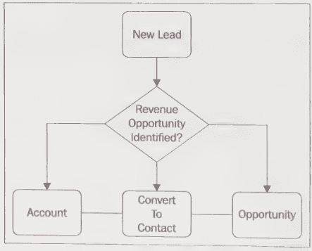
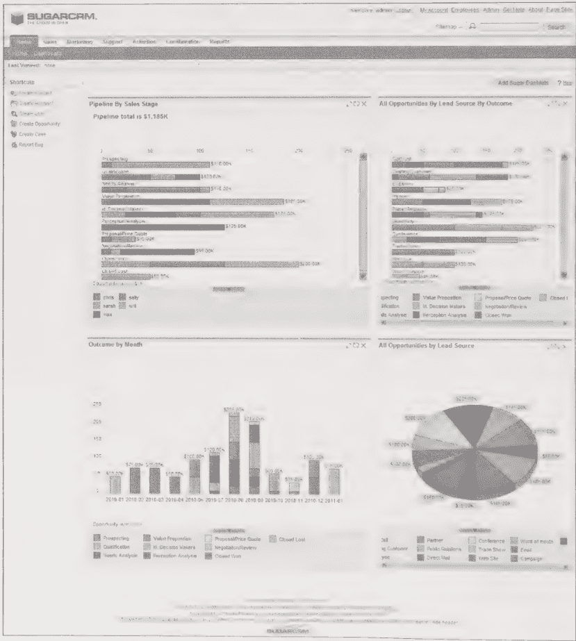

## 一劳永逸？CRM 随您定制

在第一章中，您了解了 CRM 软件发展的历史，了解了其对小企业的可负担性和可访问性近年来如何改善，以及 CRM 轻松定制以适应您的业务有多么重要。

您还认识了 RayDoc Carpets, Doors, and Windows 及其老板 Doc。在本章中，我们将开始分析您特定业务的 CRM 需求，并继续使用我们的 RayDoc 案例研究作为如何将 CRM 功能与业务需求相匹配的示例。

在本章中，并且在本书中尽可能如此，我们将主要关注实施 CRM 系统所追求的业务目标和利益，而不仅仅是安装和使用 SugarCRM 系统的机械操作。

为了帮助我们实现这一目标，本书的几个大章节专门介绍您需要经历的业务分析过程，以确定您的业务如何能最好地从 CRM 系统中受益。这个练习将使您能够识别您可能需要对现成的 CRM 产品（例如 SugarCRM）进行哪些定制，以使其适应您开展业务的方式。随着本书的推进，业务分析部分将涉及越来越雄心勃勃和先进的业务功能，帮助您识别这些领域的需求，并指导您完成实施这些定制、将 CRM 系统引入您的业务以及其他对成功实施至关重要的任务。

本章包含了第一个此类业务分析部分。本节的目的是提供企业差异的广泛概述，帮助您在所有小企业的多维空间中定位和识别您自己的业务。一家在单一办公室通过互联网向其他企业销售的三人公司的 CRM 需求，是否与一家拥有十个地区办事处并通过上门服务向消费者销售的五十人公司的 CRM 需求不同？当然不同，这些差异就是我们即将要处理的问题类型的示例。

使用 CRM 系统改变您的业务并不那么困难，但首先您必须了解您业务的 CRM 需求以及谁应该参与识别它们，以便您做出正确的改变。让您业务中的其他利益相关者参与进来，将有助于确保新系统在引入时获得接受，并且是识别过程的重要组成部分。

CRM 解决方案如果没有用户接受就不可能成功。获得用户接受最有效的方法之一是确保用户从 CRM 系统中获得价值。如果没有这种价值感，用户接受的挑战将难以克服。这就是为什么在处理系统应解决的业务问题识别过程时，包括代表组织不同方面的个人非常重要的主要原因。最成功的 CRM 实施是那些业务文化和 CRM 系统的使用无缝交织在一起的实施。

一旦我们研究了不同企业不同的 CRM 需求，我们将看到 Doc Newhart 需要如何应用 CRM 来改善 RayDoc 的运营方式。我们还将使用 _CRM Requirements Worksheet_ 来识别您业务的具体 CRM 需求。

最后，我们将解决如何定制 CRM 系统的实际问题，寻找哪些类型的合作伙伴来帮助您完成该过程，如何记录您的定制要求，以及如何管理定制合同。

## 识别您业务的 CRM 需求

导致一个企业与另一个企业有非常不同的 CRM 需求的业务高级特征包括以下内容：

- **业务模式**：一个地点还是多个地点？特许经营？地区销售办公室？产品还是服务？高或低的单位销售价值？
- **客户**：他们在哪里？他们是谁——企业还是个人？

## 哪些业务活动将包含在您的 CRM 中？

在您为企业实施 CRM 的过程中，必须做出的一项更重要的决定是 CRM 的 _应用范围_。您必须就 CRM 的理念做出高层次的选择——您是仅将其用于管理销售流程，还是认为它在整体业务管理方法中发挥重要作用？

您需要检查以下功能列表，并决定在您企业的 CRM 实施中实施哪些功能——至少在初始实施阶段：

- 销售自动化和线索跟踪
- 日历和活动管理
- 销售管道跟踪和监控
- 服务呼叫跟踪
- Web 到线索捕获
- 文档管理
- 电子邮件
- 与其他系统集成，例如您的会计解决方案
- 报告和分析

根据您业务的性质，一些更高级且有用的功能可以包含在您的 CRM 中，如下所示：

- 项目跟踪和管理
- 营销自动化
- 知识管理
- 电子营销活动管理
- 高级报告生成
- 销售团队和区域定义
- 财务指标和绩效的集成视图
- 产品目录管理，跟踪销售库存、企业资产以及支持合同覆盖的客户产品
- 创建客户报价单和/或发票

为了帮助您梳理这些主题，并帮助您做出更明智的选择，这里对它们进行了更详细的解释，重点介绍了小型企业中常见的各种选择、自定义和变体。

决定在 CRM 实施中包含哪些基本应用领域，是识别 CRM 安装所需自定义集合的第一阶段。稍后，在附录 E 中，我们将详细讨论如何实际对 SugarCRM 安装进行一些自定义，但目前我们的任务仅仅是根据您业务的性质和需求，识别最可能需要自定义的应用领域。让我们来检查标准功能的初始列表。

## 账户和联系人管理

从根本上说，CRM 应用程序旨在捕获有关您的账户以及您在其中打交道的联系人的信息。账户是指您与之开展业务的所有其他公司的完整集合。术语会根据您的业务类型而有所不同，但账户通常代表合作伙伴、供应商和其他公司或组织。

虽然账户通常代表某种形式的公司或组织，但联系人被视为您与之开展业务的个人。联系人通常与账户相关联，但也可以独立存在。他们通常代表从您的企业购买过产品或服务的个人，或者可能是您在账户中与之经常沟通并已完成该购买的某个人。

大多数企业的 CRM 使用情况都是这样，但即使是这种基本功能在许多公司也需要修改。一些公司更加关注联系人，因为他们向个人销售，这种理念被称为 **Business-to-Consumer** 或简称 B2C。然而，其他企业几乎只关注账户，因为他们只向其他企业销售，这种模式被称为 **Business-to-Business** 或简称 B2B。

许多公司甚至会定制 CRM 的导航系统，以便仅显示账户或联系人，并清晰地代表其模式。好消息是，如今大多数高质量的 CRM 系统（包括 SugarCRM）都通过开箱即用的功能提供这种自定义能力。

## 线索和机会管理

企业及其相关 CRM 实施之间的下一个主要区别在于线索和机会领域。线索通常被视为代表潜在收入的个人，通常已对您的产品或服务表现出一定程度的兴趣。它们与联系人不同，因为联系人是已与您的企业建立购买客户关系的个人。

机会用于跟踪与向账户、联系人、线索或其组合销售产品或服务相关的潜在财务承诺。除了它们代表的货币价值外，许多企业还会记录其他相关信息，例如预计成交日期、正在销售的产品或服务、负责管理销售的员工以及其他同样重要的信息。

如果您的公司使用潜在客户或潜在客户列表（有时在贸易展览会上获得，甚至购买），那么您很可能需要区分线索和联系人。这种分离有助于保持数据库整洁，避免将可能永远不会购买您任何产品或服务的个人条目添加到客户列表中。

对于某些企业来说，这种区分完全不必要，相反，这些个人被存储为联系人。在这种情况下，通常会为每个联系人分配一个属性，以区分潜在客户和现有客户，甚至其他类别。

与系统的其他领域一样，能够自定义 CRM 用户界面将很有用，以便移除不需要线索的公司的任何与线索相关的菜单或导航。大多数优秀的 CRM 解决方案（包括 SugarCRM）都提供这种功能。

如果您选择将线索和联系人分开，您会发现到某个时候，您需要将线索提升为联系人。这种提升通常要在线索经过资格审核后才会发生。资格审核过程不仅用于确认个人的基本信息（例如其电子邮件地址），还用于识别他们可能代表的潜在收入机会。一旦识别出机会，就可以将其提升为联系人，并将其与账户和机会关联。从图形上看，它大致如下所示：

不同的公司有许多不同的生成线索的方式，例如，来自互联网网站、广告、口碑推荐、直邮活动等等。无论您的企业使用哪种方式，衡量每个活动的成功率都很重要。这种分析将使您能够确定哪些营销技术能为您的企业带来最大价值。CRM 系统（包括 SugarCRM）允许您通过线索、机会、账户和联系人上的一个属性来跟踪此信息。

此属性称为 _线索来源_，可以通过从下拉框中显示的预定义列表中选择适当的线索来源值，为上述实体之一分配一个值。在这种情况下使用下拉框有助于突出与自定义相关的一个重要点；在规划自定义时，您应该牢记您正在收集的数据类型。

某些场景更适合使用 _复选框_，而其他场景最适合使用下拉框，如 _线索来源_ 值的情况。下拉框在此场景中很有效，因为它有助于减少通常会使后续指标失效的数据输入错误。但是，如果您无法使用自己的值定义列表，其使用就会受到限制。

将下拉框填充为与您的业务独特相关的选项，是一种非常常见的 CRM 自定义形式，并且正在成为所有主流 CRM 系统（包括 SugarCRM）广泛支持的“自己动手”功能。

另一个通常需要自定义的选项是机会的 _销售阶段_。虽然销售流程不同阶段有相对标准的行业公认术语，但它们会根据所涉及的业务性质、规模、客户以及典型销售周期的长度而有很大差异。您打算跟踪的销售周期阶段列表是您最可能想要对 CRM 进行的自定义。

与销售阶段相关的是一个百分比，代表成交的可能性，范围从 0% 到 100%。一些组织很少关注可能性百分比，仅根据销售阶段跟踪机会。其他组织则恰恰相反，按可能性百分比对机会进行排名，很少关注销售阶段。还有其他组织两者都跟踪。您需要决定对您来说什么重要，并确保机会列表和销售管道图表呈现该信息，让您有能力根据该信息进行筛选，并专注于机会。

## Sales Force Automation (SFA)

One very important productivity tool that a CRM system can provide is often referred to as **Sales Force Automation** or simply **SFA**. While this can include functions such as dashboard, fundamentally, sales force automation is an automated flow of sales leads into the CRM, their conversion into opportunities, and their tracking as a successful or unsuccessful conclusion. This includes features, such as the following:

- Lead capture from a public website, or from partners
- Promotion of a lead to an opportunity or contact after it has been qualified
- Automatic e-mail notifications to sales people when a new lead or opportunity is assigned to them
- Tracking of current and historical account activities against both contact and account profiles
- Association of key documents to accounts and contacts, such as proposals, contracts and agreements, and marketing collateral

A key improvement in productivity comes from automated lead capture into your CRM, from an information capture form on your public website, or from leads sent to you from a supplier or other partners. If you have a current supply of sales leads, you should identify how to automate their entry into your CRM. Many CRM systems, such as SugarCRM, have a **SOAP-based (Simple Object Access Protocol)** application programming interface that external systems can use to enter, read, or modify data from the CRM system. If you do not have a current supply of sales leads, you should consider creating an information capture form on your public website and devise a strategy for diverting traffic to your website.

Once a lead has been qualified as a genuine sales opportunity, it needs to be re-classified as an opportunity within the CRM system. Most CRM tools have the ability to convert a lead into an opportunity. You need to decide if this is how you will use your CRM to manage the transition from leads to opportunities.

Your CRM server will most likely be connected to the Internet and have access to an e-mail system. As a result, it has the capability to automatically e-mail salespeople when they are assigned a new lead or opportunity, or for that matter, a number of other types of information. Typically, your CRM will let you enable or disable this automated notification system and you will need to decide if your CRM will use it or not.

## Sales analytics

Each opportunity in a CRM system has an expected sales value, a sales stage, and an expected closing date. Adding up this information across all the opportunities in the system produces a prediction of the future sales of the business, known as the **sales pipeline**.

The sales pipeline is a key tool for anyone managing a smaller business. Usually a smaller business has more limited financial resources to buffer it from a downturn in business, making it that much more important to be able to detect a negative sales trend at the earliest possible moment.

It is critically important to remember that the information represented in the sales pipeline is only of value if users are diligently using the CRM system. Outdated or erroneous sales information is of little value and does not help you properly gauge the health of your business.

Like most software designed to summarize financial activity for management personnel (known as **Executive Information Systems — EIS** or **Decision Support software**, or **Business Intelligence software — BI software**), most CRM systems present the sales pipeline in a graphical chart form, frequently with the ability to highlight some portion of the chart and 'drill down' to the source data that underlies that portion of the chart.

A series of charts that support sales and business management functions is often called a **Dashboard** or a **Digital Dashboard** and is a powerful tool for ensuring that sales are on track in the coming months, as well as for diagnosing and uncovering shortcomings in the sales process, product features, pricing, and personnel.

## One Size Does Not Fit All – CRM Your Way

SugarCRM includes a variety of dashboards that represent both pending and closed opportunities. In addition to presenting the data from different angles, you are also allowed to select and click on a segment of the dashboard, to drill down and inspect the data that makes up that particular section of the dashboard. A sample of the SugarCRM dashboard screen follows:

A fundamental choice that has to be made when presenting the sales pipeline is whether or not to discount the opportunities in the pipeline by the percentage likelihood of their closing. The latter is often referred to as the weighted value. For example, should a US$100,000 opportunity with a 25% probability of closing be counted as US$25,000 or as US$100,000? While the truth is that it will most often result in no income, or US$100,000 of income, the fact that the opportunity is considered only 25% likely to result in a sale may mean that you prefer to count this opportunity as only US$25,000 in the pipeline. Both practices are very common, and only you can decide which behavior is correct for your business.

## Customer service and contracts

Every CRM offers at least basic customer service and support features. Some of the capabilities typically offered are as follows:

- **Case management**: A service incident, trouble ticket, or case (different systems and industries use different terminology) can be created with a date stamp, contact information for the customer reporting the issue, and a description of the nature of the problem. If a potentially defective product is involved, the type or model of the product and the serial number of the unit can be tracked.

- **Software bug tracking**: If a service case involves a defect or issue in some customer software system then a _Bug Report_ is created and it will note the software involved, along with its revision and the nature of the issue (bug or desired enhancement). It will also track the status of the issue, that is responsible for resolving it and will record the eventual disposition of the issue. If the CRM system provides sufficient customization capabilities, you may be able to retool this feature for the purpose of tracking product defects or other issues.

- **Service contract management**: Service Contracts are typically tracked using the model of a master agreement for each account with any number of subcontracts per master agreement. Each subcontract may be related to any number of assets being supported. Each subcontract and asset in turn will have a service incident history associated with it to track the case history by item of equipment and by subcontract. A mechanism usually exists to remind account managers when service contracts are nearing their renewal dates, so that a proposal for the renewal may be prepared and sent to the customer.

Not every business needs these service and support features. You will need to identify what your business requires in the service and support area and decide if the standard features are a good fit for you, whether or not some need to be hidden as they are not required, or if some extended capabilities need to be custom-built for you.

## Knowledge management

The employees at your business represent experience and knowledge. Each possesses differing levels of knowledge pertaining to a wider variety of subjects including;
the manner in which certain processes are conducted at your business, the solution to a specific problem or fault with one of your products, and the best techniques for handling a customer service situation.

These are all immensely valuable to an organization. Among other benefits, it helps ensure that rules are being followed and helps improve customer service. The problem, however, is that in many organizations, this information exists only in the minds of the various employees, where its value becomes limited.

CRM vendors have long recognized a need for businesses to have a place where they can store not only customer data, but also these invaluable nuggets of knowledge that help a business function more efficiently.

Knowledge management tools are highly adaptable and can be used to store anything ranging from information related to the most recent product promotions your organization is conducting to scripts that tele-sales staff use when placing calls. Customer service departments or call centers tend to have a natural inclination towards these tools. These tools facilitate the process of tracking problems with their respective solutions, that in turn help propagate knowledge among staff. In addition, they help simplify the process of training new staff members, and ensure that loss of business critical knowledge is kept to a minimum if a staff member leaves your organization.

## Activity management

A CRM system is almost certainly the best place for you to enter all your appointments, meetings, scheduled calls, and planned tasks – in short, all the business activities that have a time and date associated with them. Not only does entering this information in the CRM help you to associate the activities with the related accounts and contacts, thereby helping to generate accurate account history, but it also provides a groupware environment for scheduling meetings. This groupware environment is aware of all the scheduled activities for everyone in the company.

Prior to adopting a CRM system, most small and medium businesses used Microsoft Outlook, Outlook Express, or Microsoft Exchange to fulfill their business activity management needs. Other popular solutions include Lotus Notes and many other lesser known groupware products. While Outlook is a reasonable calendaring solution for an individual (and Exchange helps to link together calendars across a business), this solution can never help you to position these activities within the larger CRM context. Tracking of history and getting insight into future or past activities relating to specific accounts or contacts is cumbersome in those environments.

如果所有这些关于 Outlook 和 Exchange、Lotus Notes、Outlook Express 等等的讨论对你来说都很陌生——不用担心。它们仅仅是满足你的 CRM 将能很好且更有效地满足的需求的其他方式，因为它们是专门设计用来改善与客户关系管理的。

## 电子邮件管理

自 20 世纪 90 年代初电子邮件引入大众以来，其使用量呈爆炸式增长。商业世界迅速采用了这一新工具，因为它提供了一种快速且廉价的与他人沟通的方式。

如今，电子邮件地址和电话号码一样普遍，并且经常被企业作为与客户沟通的主要工具。多年来，这种转变也体现在 CRM 产品中。

现代 CRM 系统，例如 SugarCRM 包含允许你通过内置电子邮件客户端或连接到其他流行电子邮件工具（如 Microsoft Outlook）来管理电子邮件通信的组件。此类功能的价值等同于跟踪你可能与客户进行的任何其他互动。电子邮件通信成为客户历史记录中的另一项，就像记录电话通话一样。

CRM 系统提供此功能，以确保考虑所有沟通点，从而对任何给定客户产生更准确的视图。如果没有它，你的员工将不知道可能仅通过电子邮件讨论过的事项。

对任何和所有通信的综合视图有助于改善你业务的客户服务。你应该确保你的 CRM 系统能够有效地管理电子邮件，无论是通过内置工具还是通过将其连接到你首选电子邮件客户端的扩展程序。

## 营销自动化

CRM 系统最有价值的特性之一是其整合客户数据的能力。这种整合对你业务的许多方面都有帮助，包括你的营销团队。

所有企业都需要一定程度的营销来产生新业务。有时这以在线营销的形式出现，有时则是电子邮件甚至直邮。无论你的企业利用哪种选项，你的 CRM 系统都必须能够促进挖掘客户数据并执行营销活动的过程。

搜索功能应允许你使用喜欢的标准对数据库进行细分。CRM 系统应能够执行批量电子邮件活动，以及通过 Microsoft Word 或其他流行的文字处理解决方案合并表单信件。

同样重要的是，你的 CRM 系统必须提供协助跟踪此类活动效果的工具。在批量电子邮件活动的情况下，你会想确保可以跟踪点击次数和其他统计数据。在过程的后期，你还需要能够监控通过这些活动获得的线索和机会的数量，并衡量它们代表的收入金额。这种自动化有助于你的企业将营销工作集中在对你的企业最有益的方法上。

## 员工目录

如果你的企业只有少数几名员工，那么员工目录可能是不必要的。在这种情况下，你可以选择从 CRM 系统的用户界面中删除对其的访问权限。

然而，随着公司的发展，员工人数达到 25、50，甚至 100 人，记住每个人的分机号、电子邮件地址、职位，甚至是他们的脸，变得越来越困难。即使是规模较小的企业，如果业务分布在多个地区办公室，也会很好地利用员工目录。

员工目录是一份非常方便的所有人联系信息列表，在你无法将名字与面孔对应，或无法将面孔与名字对应的情况下，它通常还包括个人的缩略图图像。

## 界面整合

界面整合是指在 CRM 中使用的一系列工具和技术，允许员工将大部分时间花在 CRM 系统中，很少有业务活动没有以某种方式集成到 CRM 中。

通常集成到 CRM 中的一些活动和功能，只是为了减少跳出浏览器界面来执行各种业务任务的需求，包括以下内容：

- 新闻源（RSS, Atom）
- 集成的基于 Web 的电子邮件
- 外部 Web 链接和应用程序的集成
- 财务指标视图

很明显，通过添加新闻、电子邮件、常用外部网站和链接到财务系统，CRM 成为员工可以在其中工作的环境，他们可以早上登录并全天保持运行。你应该考虑一下你希望在 CRM 实施中包含的其他类型的信息。

## 文档管理

仅存储在某位员工计算机硬盘上的文档不是公司资源。在公司每台硬盘上都存有副本的文档不是标准化的或受版本控制的。在这两种情况之间，正确的答案是你 CRM 系统中的文档库。

通常，你的 CRM 系统将允许用户在系统中存储文档，并包括标题描述、文件类型、状态和修订号。通常还会输入一些关键字，以便更轻松地找到文档。与将其存储在计算机硬盘上不同，文档库通常允许用户使用较新的修订版本更新文档，同时保留每个以前的修订版本完整，以防你需要恢复到它。文档的状态指示它是草稿文档、旧的存档文档还是批准的当前版本。

基于 Web 的文档管理为任何企业提供关键优势，允许所有重要的业务文档——医疗索赔表格、HR 政策和指南、员工手册、设计、规格、销售材料、合同等等——远程访问和下载。文档管理是任何企业的重要能力，你需要决定哪些文档是你的企业需要存储在 CRM 中的，以及如何组织它们。

## 报告和分析

CRM 系统擅长捕获和存储大量数据的能力。从客户电话号码到最新的收入机会，一切都可以并且都存储在其中。

然而，CRM 系统的真正价值来自于以不同方式访问这些数据的能力，而不是存储数据的能力。当员工搜索联系人以检索其电话号码时，他们依赖于 CRM 系统向用户提供数据的非常基本的能力。

需要提供的数据类型（以及格式）将根据用户是谁以及预期用途而有所不同。销售经理使用同一系统，可能更感兴趣的是查看当前季度预计成交的所有机会列表。相比之下，营销团队成员可能更感兴趣的是查看最近营销活动产生的线索数量。

为了提供这种洞察力，CRM 系统必须包括允许你生成 _报告_ 和其他 _分析_ 工具的功能。这就是为什么基于开源技术的 CRM 系统可能比基于专有技术的 CRM 系统有价值得多的另一个重要原因。在前者的情况下，你可以自由使用内置的报告和分析工具，或者如果它们不符合你的需求，你可以通过其他更符合你喜好的工具来利用数据。在专有系统的情况下，通过其他工具来满足你的需求通常意味着额外的支出，假设存在这样的选项。

## 业务模型及其特定要求

在上一节中，我们研究了基本 CRM 应用程序的不同组件，并确定了这些应用程序可能需要为你的业务进行定制的若干原因。在本节中，我们将审视你的业务本身，并检查为什么你的 CRM 可能需要调整以完美适应它。

企业在其根本性质上差异很大。他们向谁销售以及如何销售？他们销售什么——产品还是服务——价格昂贵吗？企业本身位于何处，是否有多个地点？让我们来看看企业的一些这些区别特征，并看看它们如何影响企业的 CRM 需求。

## B2B 还是 B2C？

CRM 需求的第一个区别因素之一涉及你的客户。你是 B2B（企业对企业）还是 B2C（企业对消费者）业务模型？也就是说，你是向其他企业还是个人销售？

在采用 B2B 业务模型的公司中，典型的 CRM 数据模型（账户和联系人）通常是一个很好的匹配。在极端情况下，一些公司将更喜欢删除对联系人的菜单访问权限，并专注于账户——只将联系人作为与账户关联的名称保留。设计重点围绕这一概念的 CRM 系统有时被称为 **账户中心系统**。

但在 B2C 商业模式中，许多公司倾向于移除对账户的导航访问，将重点放在联系人——即公司开展业务的个人身上。专注于个人的 CRM 系统通常被称为 **以联系人为中心的系统**。

SugarCRM 有些混合性质，因为它提供了偏向于以账户为中心的方法的功能，但通过一些定制和对功能的创造性重新利用，它也能有效满足以联系人为中心的需求。

## 产品还是服务？

你的业务性质是什么？你是制造或转售产品，范围从陶瓷到洗衣机不等吗？你是销售服务，例如房屋粉刷、园林绿化或窗户清洗，还是像汽车修理工那样，既按小时收取人工费，又销售维修所用的更换零件？如果你只销售产品，销售是否还包括产品支持或保修服务？产品是否会定期磨损或需要在可预测的时间表上进行维修，从而代表经常性收入机会？例如，需要定期更换机油的汽车。

如果你的业务包含产品保修或支持环节，你将希望能够跟踪每个客户特定产品的支持期限。如果你的产品需要定期维护，例如汽车，你可能还希望记录联系每位客户进行服务的合适时间。

在 CRM 系统中，产品和服务的处理方式截然不同。产品通常列在目录中，非常标准化。当它们被销售时，会产生一次性收入事件。

如果你的产品具有显著价值并伴随支持服务（例如计算机设备——PC 或打印机），你的 CRM 需要捕获产品的品牌和型号（理想情况下还包括序列号），并将其链接到客户记录，以跟踪合同支持服务的资格。因此，你的 CRM 需要理解资产和服务合同的概念。

如果你的业务向客户提供服务，且这些服务在相当长一段时间内提供，你的 CRM 需要能够建模一种不是一次性收入事件，而是随时间推移的收入流（以及潜在成本）的销售。例如，Kelly Girl 提供一项服务——临时办公室员工的服务。如果一名 Kelly Girl 临时工被安排在六月至八月的三个月任务中，那么销售应建模为六月 X 美元、七月 Y 美元和八月 Z 美元的收入流。在 Kelly Girl 向相关员工支付的实际工资方面，这三个月也会有相应的成本流。

这类销售通常被建模为随时间交付的项目，如果你的业务销售这类服务，你的 CRM 需要能够跟踪这些“收入流”机会，以及常规的“收入事件”机会。

## 平均交易价值、销售周期和经常性业务模式

如果你的业务具有相当高的平均交易价值——例如超过 1,000 美元——那么通常在财务上跟踪你的客户和向他们销售的机会是有意义的——尤其是如果你有一个持续几周或更长时间的销售周期来跟踪机会。这是经典的 CRM 应用——跟踪账户和联系人以及与之相关的销售机会，然后将其全部汇总为销售管道。这能让你对未来几个月的销售情况有良好的了解。

但是，如果你的常规销售周期不到一小时呢？或者你的平均交易价值更接近 20 美元而不是 1,000 美元？

如果你经营的是 CD 音乐商店、视频租赁店或专业冷冻肉类商店等业务，那么你有大量较小的交易，每笔交易都接近于客户的冲动购买。在这种情况下，你实施 CRM 的真正原因是增强你的经常性业务模式。如果你通常会有这些相同的客户一次又一次地回来，你将从在 CRM 中跟踪这些客户以进行营销目的中获益匪浅。选择加入的电子邮件营销活动、作为忠诚度机制的折扣俱乐部会员资格——这些将是你的关键活动之一。你需要一个能够提供电子营销和忠诚度营销功能的 CRM，这些功能将推动你的业务取得成功。

在这种情况下，你仍然会跟踪账户和联系人，但线索和机会的重要性要低得多。你的销售管道也接近于无关紧要。如果你属于这种类型的业务，请认识到这一事实，并了解你的 CRM 需要进行哪些类型的更改，以帮助你和你的员工关注对 _你的_ 业务重要的事情——而不是对另一种类型的业务重要的事情。

## 业务位置

你在哪里销售？在你的商店？在你的办公室？在客户的场所？通过互联网？

你的员工在哪里？他们在办公室吗？在外为客户服务和销售吗？他们在单一的中央办公室工作，还是分布在多个区域办公室？

这些是你 CRM 方程中最重要的变量之一。毕竟，如果我们试图管理客户关系，我们需要知道这些关系发生在哪里！这意味着，我们需要知道你的客户和员工的所在地。

如果你的业务仅在单一地点——你的商店或办公室——产生销售，那么显然你的沟通挑战不如拥有十几名在家工作的海外销售代表的企业那么大。

你需要回答的关键问题之一是：当你或你业务中任何与客户打交道的人与客户接触时，他们是否坐在电脑前并在线？如果不是，你可能需要特殊的 CRM 设施，以便他们在需要时可以访问客户历史记录，并在信息发展时输入更新信息。

让我们来研究以下两种更常见的场景：

- **多个区域办公室**：CRM 服务器可以位于世界任何地方，所有办公室的员工都可以通过用户名和密码访问它——安全且性能良好——只要他们拥有快速可靠的互联网连接。拥有多个区域办公室的小型企业是 CRM 安装的理想候选者，因为它们可能会从 CRM 提供的改进沟通以及准确和最新的账户信息中获益匪浅。

- **外勤销售人员**：无论你有多少个办公室，这些人都是最难提供良好服务的。除了通过家庭或办公室电脑上的网页浏览器使用 CRM 之外，他们可以使用 CRM 的一些方式包括以下内容：

  - 通过笔记本电脑在酒店房间的高速互联网连接上访问 CRM 系统，以更新系统中的当天活动，并查找信息以准备明天的电话。
  - 随时使用高速无线数据服务（如大多数无线运营商提供的 EDGE（GSM 演进增强数据速率））将笔记本电脑连接到互联网。
  - 使用 PDA 浏览器进行手持设备对有限 CRM 功能子集的访问。
  - 使用在其原生应用程序中包含预约和联系人数据的 PDA，与 CRM 数据无线同步。
  - 使用带有独立“离线”安装的 CRM 的笔记本电脑。当他们返回办公室时，他们的私有 CRM 安装可以与主安装同步，以更新旅行中的任何新数据。

如果你认识到你的业务需要使用上述一种或多种技术来服务外勤销售人员，你应该确保你计划采用的 CRM 解决方案能够满足你的要求。

## 规模很重要：两个还是两百个？

你的业务规模会影响你如何管理 CRM、你需要 CRM 提供哪些功能，甚至 CRM 对你组织的重要性。

在小型企业中，员工的职责范围更广——随着组织的发展，职责范围会变窄。随着职责范围变窄，对业务流程、沟通和文档连续性的需求会变得更大。

拥有五十名员工的企业，其员工之间的信息通路远比拥有五名员工的企业多得多。因此，CRM 系统对大型企业的价值更大。

大型企业必须面对这样一个事实：由于职责范围较窄，个别员工只了解客户故事的一部分。此外，员工流动会带来真正的风险，因为当员工离职时，通过工作创建的销售线索、机会和其他信息可能会丢失。如果这些信息存储在 CRM 系统中，不仅你的员工对客户有更全面的了解，而且，也许更重要的是，相关信息超越了任何特定员工。员工可能会离职，但他们的数据仍然留在 CRM 系统中，从而另一名被雇来取代他们的销售人员可以轻松接手工作。

大型企业还有其他小型企业不太可能遇到的问题。在一定规模的组织中，信息隐私变得重要。如果销售人员担心另一个销售团队或人员可能会窃取他们的线索，他们就不会将销售线索输入系统。在小型企业中，倾向于让每个人都知道一切。如果线索被窃取，每个人都会知道它真正属于谁。但是，过了某个点之后，组织会变得分散和缺乏人情味。保护线索和机会数据成为一个真正且合理的担忧。

所有这些都导致了对 **访问控制模型**（Access Control Model）或有时称为 **权限管理基础设施**（Permissions Management Infrastructure, PMI）的复杂需求。在这种系统中，会定义角色，并将查看特定类型数据或执行特定操作的权限分配给这些角色。然后，员工会被分配一个或多个角色，并被禁止查看某些记录、删除数据或完全访问某些功能。

例如，在北美销售组织中，账户管理通常按地理区域划分，如西海岸、东海岸、美国中部和加拿大。大多数销售人员只能看到他们所管理区域对应的线索和商机。然而，销售经理希望查看更广泛地理区域的线索、商机和销售管道。角色允许这种级别的控制。

最后，企业的规模决定了为获取和部署 CRM 工具而实际分配的预算。在五人公司中，CRM 实施预算可能为 3,000 至 5,000 美元。在五十人公司中，该预算更可能为 25,000 至 50,000 美元。还需要注意的是，小型公司不太可能拥有任何内部技术支持能力，这会影响使用 CRM 系统的总体成本。在这些环境中，在办公室运行 CRM 服务器可能超出企业的财务能力。

你应该考虑贵公司对数据安全性和权限管理的需求，以及为 CRM 实施设定预算。你的预算应考虑许可成本（如有），以及用于定制工作和员工培训的辅助服务。最后，不要忘记考虑自行管理服务器与使用按需服务提供商所涉及的成本。

## 国际需求

如果你的员工生活和工作在多个国家，那么你的 CRM 很可能需要支持多种语言。语言支持有许多方面，包括用于以下所有内容的语言：

- 你输入到 CRM 中的信息
- CRM 应用程序的用户界面
- 在线帮助系统
- CRM 的书面文档
- 货币值的适用货币

你需要确定用于向 CRM 输入数据的语言，并确保选择大多数用户能够理解的语言，即使这不是他们的母语。

许多语言使用英语中不存在的字符和重音符号。如果这是你业务的常见需求，你的 CRM 工具需要允许用户输入、显示和打印此类数据，而不会出现麻烦。

你的 CRM 供应商应该能够告知你用户界面以及应用程序的内联帮助系统和可打印文档支持的语言。与用户主要语言匹配的界面和帮助系统将有助于用户采用，即使输入的数据本身不是同一种语言。

SugarCRM 在用户界面方面支持多种语言，但可打印文档和内联帮助系统目前仅提供英文。国际支持的另一个方面是日期显示的格式。日期值在 CRM 系统数据库中的存储方式远不如系统提供一种机制，允许用户选择其首选的显示格式重要。常见格式包括 12/23/2006、23/12/2006 和 2006/12/23。SugarCRM 可以轻松处理所有这些格式。

除了日期，不同国家在数字和货币的呈现格式上也有所不同。北美的小数分隔符是句点（.），而千位分隔符是逗号（,）。在欧洲的大部分地区，例如，小数分隔符是逗号（,），千位分隔符是句点（.）。因此，在北美表示为 12,234,678.90 的值，在欧洲甚至拉丁美洲会表示为 12.345.678,90。如果你的员工需要能够以不同格式呈现数字和货币值，你会希望检查你的 CRM 是否支持此功能。SugarCRM 允许单个用户将这些参数定义为其个人偏好的一部分。

一个相关的话题涉及表示货币条目的数值，例如，商机的预期收入。在不同国家有员工并使用不同货币的企业，在处理这些货币值方面面临独特的挑战。假设所有值都代表特定货币可能会导致许多问题。如果巴西的销售人员以雷亚尔输入一个值，但加拿大的销售经理将其读作加元，该值将是不正确的。

另一种解决方案是企业统一使用一种货币，并让每个人都在此假设下输入数据。这种方法的问题在于它依赖用户准确执行货币之间的转换。此外，用户在输入数据前进行计算的额外步骤对用户来说是不便的，而不便会导致系统被放弃。

许多 CRM 系统，包括 SugarCRM，通过允许使用多种货币和定义基础货币来解决此问题。配置后，用户可以使用他们熟悉的货币输入值，SugarCRM 将在显示数据时处理计算。

## 如何让 CRM 软件适应我的业务？

如我们在 _第 1 章_ 中所见，CRM 定制分为几个类别。它们如下：

- 小型外观更改
- 小型用户界面更改
- 大型应用程序更改
- 应用程序集成

小型外观更改需要会使用计算机图形软件的人的技能，并且可能还需要一些简单的 **HTML (Hyper Text Markup Language)** 和 **CSS (Cascading Style Sheets)** —— 用于生成和格式化网页的代码。如果你的员工中没有人具备这些技能，你将需要当地网页开发和图形设计组织的服务。如果你已经有公司标志和相应的配色方案，定制 CRM 外观的成本不应很高，但如果你希望创建新标志，或修改现有标志或配色方案，请预期要支付额外服务的费用。

小型用户界面（UI）更改通常可以通过使用 CRM 包中内置的定制工具来完成。例如，在 SugarCRM 中，管理功能允许系统管理员访问设计工作室，在那里他们可以向模块添加新字段、修改屏幕、重命名字段标签以及执行其他相关操作。下拉选择列表可以定制，菜单选项可以重命名或隐藏，外部网站可以链接到新菜单项。

你可以自由探索这些功能，并使用它们进行你想要的所有小型 UI 更改。或者，一些企业选择聘请专门从事 CRM 系统定制的公司来执行此项及其他更高级的定制工作。请注意，即使你聘请外部公司来应用定制，你或你组织中的另一位合适人员也需要提供输入，以帮助指导定制工作。

作为这项工作的前奏，你应该记录你希望应用的更改，包括标签的文本、所需的字段类型（基于你的数据输入需求）、字段长度和其他相关信息。最好假设接收你需求的人完全不了解你开展业务的方式，即使事实并非如此。请记住，虽然定制你系统的人能够提供关于定制开发的指导，但你的请求尽可能描述性至关重要，从而留给误解的空间很小。

对于绝大多数组织，大型应用程序更改和应用程序集成工作将需要使用专业的 CRM 开发和定制公司。这项工作可能很昂贵，因此，在识别合适的提供商时需要一些尽职调查。有助于做出决定的一些关键指标包括以下内容：

- CRM 供应商的推荐。
- 专注于 CRM 实施和定制工作，而不是更广泛的开发服务。你需要一个比你拥有更多 CRM 经验和知识的合作伙伴，而不是更少。
- 检查和批准定制公司执行的、复杂性和规模相似的示例工作。
- 公司对你询问的响应时间、对你业务痛点的理解以及提出建议的能力。
- 开放性。表现得好像在隐瞒什么的公司，通常确实如此。这种行为有时会蔓延到他们不愿意分享关于定制将如何执行的信息，而这些信息通常属于公共领域。

你可能希望分步进行定制，以确保每一步都负担得起并产生可衡量的实际效益，以及测试供应商。注意不要陷入前期加载的协议，即在看到让你对供应商感到放心的更改之前，就为定制支付大部分预算。

