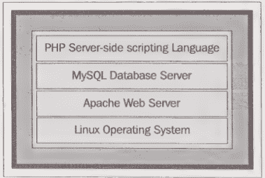
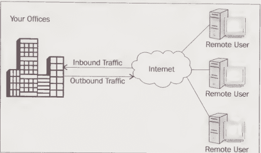

## CRM 部署选项

前几章介绍了与在小型企业中使用 CRM 系统相关的某些理论元素。我们还讨论了根据您组织的性质、业务模式和客户，您预期会有哪些特殊要求。现在，我们终于要开始工作，面临为您的企业安装 CRM 的挑战。

在本章中，我们将采取系统的方法，为您的企业做出正确的部署选择。首先，我们将详细了解您可用于 CRM 部署的替代方案，包括 **On-Demand**（您无需进行任何安装）、**Collocation**（他人在属于您的服务器上托管和安装）、传统的 **On-Premise** 安装（您拥有并管理自己的服务器）以及最后，面向小型组织的 **Shared Server** 托管选项。

虽然本章涉及了 Collocation 和 On-Premise 部署的使用，但本章并未提供在这些环境中安装的详细说明，而是在 _附录 A 和 B_ 中提供。

在您调查本书的该部分之前，审查在部署自己的服务器时应考虑的一些问题非常重要。该列表中的一些重要事项包括以下内容：

- 选择操作系统：您必须权衡使用 **Windows Server** 与 **Linux**（或其他操作系统）的价值，反之亦然。
- 服务器的硬件配置：它必须能够处理您预期的即时负载，并允许至少 18 到 24 个月的预期增长。
- 识别可重新用于该任务的现有基础设施：您的部署不需要新硬件；它需要能够处理当前负载并留有增长空间的硬件。
- 建立强大的数据备份和安全计划：您的 CRM 系统中的数据可以说是您企业拥有的最有价值的信息。您必须将其视为如此，并为最坏的情况做计划。您必须能够从任何事情中快速恢复，包括硬件被盗和自然灾害。
- Internet 带宽：您办公室当前的 Internet 连接可能足以满足当今的电子邮件和网页浏览需求，但可能不足以满足您 CRM 系统的响应式使用，尤其是如果您使用 On-Demand 提供商时。

如前所述，本章并未具体介绍安装 CRM 系统的过程；但是，它确实详细讨论了上述问题。这些信息应该能帮助您为部署做出明智的决策。

## 部署替代方案

使用 SugarCRM 作为您的 CRM 解决方案的一个优势是其在多个方面的 _灵活性_。目前，我们最关心的灵活性是其能够在各种环境中安装的能力。SugarCRM 在支持的部署选项范围方面相当独特。

您必须从中选择的四个基本选项如下：

- **On-Demand**：在这种情况下，您支付费用以获得使用 SugarCRM 应用程序的权利。费用通常基于每月和每用户模式，但可能因提供商而异。这种部署的优势是部署速度快，并消除了备份服务器等责任。企业选择不使用此模式的一些原因包括以下内容：
  - 数据存储在他人的服务器上
  - 除了应用程序之外，对数据的访问有限
  - 对可以应用于系统的某些自定义有限制

  如果您打算广泛集成 CRM 系统，后一点可能会成为一个真正的问题。
- **Collocation**：此选项与前一个选项的主要区别在于，您提供将托管您安装的服务器，而不是支付费用以获得使用预配置服务器的权利。由于您负责提供服务器，您也负责进行适当的硬件采购，以提供冗余和高可用性。您仍需支付每月费用，同时承担配置和维护硬件的责任，尽管许多 Collocation 提供商以额外费用提供可能符合您预算的维护服务。此外，您还负责安装和维护您的 SugarCRM 安装；但是，这种对服务器和安装的控制级别也消除了 On-Demand 环境固有的各种限制。Collocation 也有助于解决带宽和灾难恢复需求。Collocation 服务提供商能够提供高带宽连接，如果您尝试在办公室获得相同的连接，可能成本高得多。他们的设施还配备了强大的安全和备份措施。这些措施保护您的服务器及其数据，其中包括处理火灾和停电等紧急情况的系统。
- **On-Premise**：此选项应该相当不言自明——您购买服务器（或使用您已有的服务器），然后在其上安装所需的软件。在此模式下，您承担维护硬件、安装适当软件以及处理安全措施（如备份、安全、防火等）的责任。但是，结果是您完全控制的系统。由于这种努力有时超出许多小企业的财务能力，因此有诱惑通过消除某些组件（尤其是价值较低的项目，如安全）来削减成本。请记住，您的 CRM 系统中的数据是您企业的命脉。它可以说是您企业最重要的资产。请将其视为如此。
- **Shared Server**：这不出所料是最便宜的，也是容量最低的选项。您的 SugarCRM 实例托管在您按月租用并与其他用户共享其功能的服务器上。这些服务不仅包括服务器空间，还包括先前讨论过的备份和其他安全服务。由于托管提供商的普及，共享托管服务的成本几乎所有企业都负担得起。但是，绝大多数这些服务提供商的业务是提供通用托管平台，客户倾向于用于托管网站，而不是像 SugarCRM 这样的应用程序。虽然许多提供商能够提供有利于与 SugarCRM 有良好体验的服务，但遇到其服务阻碍 SugarCRM 安装、性能或整体使用的提供商并不罕见。托管提供商进行系统更改从而导致 SugarCRM 不再正常工作的情况也并非未曾发生过。同样，他们的优先事项不是您拥有一个可正常工作的 SugarCRM 系统，而是他们的服务能够在其市场中有效竞争。这也意味着他们提供的功能（例如直接访问数据）将因提供商而异。对于许多企业来说，低成本足以忽略潜在的风险和限制，但尽管如此，如果您选择此选项，您必须在选择服务提供商时谨慎。

一种日益流行的部署选项是使用云计算服务，例如 Amazon Elastic Compute Cloud (Amazon EC2) (http://aws.amazon.com/ec2/)。它提供了许多与 Collocation 选项相同的好处；但是，与 Collocation 不同，您不需要提供物理服务器。您以每月约 100 美元（撰写本文时）的低成本租用虚拟服务器，使您能够部署非常全面的解决方案。

除了降低成本之外，云计算还为您提供了灵活性，可以通过点击几下鼠标轻松添加更多服务器进行扩展。此过程允许您在几分钟内将处理能力加倍（三倍、四倍，等等）——在过去几年中，此过程可能需要几天才能完成。

此类服务的流行程度如此之高，以至于您甚至可以找到已预先安装 SugarCRM 的虚拟服务器，消除了可能复杂的设置工作，并使其更接近 On-Demand 选项的开箱即用模式。

让我们来看看各种选项的对比图表，如下所示：

| | On-Demand | Collocation | On-Premise | Shared Server |
|---|---|---|---|---|
| 初始成本 | 低 | 中等 | 中等 | 低 |
| 持续成本 | 中/高 | 中等 | 低 | 低 |
| 初始设置 | 容易 | 复杂 | 复杂 | 有些复杂 |
| 您的持续工作量 | 低 | 中等 | 中等 | 中/高 |
| 定制适配 | 有限 | 优秀 | 优秀 | 不一 |
| 数据安全性 | 优秀 | 优秀 | 自行提供 | 优秀 |
| 性能 | 优秀 | 优秀 | 可能优秀 | 不一 |

可以从前面的图表中推断出几个重要点。

首先，请注意，使用 Collocation 或 On-Premise 选项时，您的初始支出会更高。这完全合理，因为两者都要求您提供物理服务器，您可能需要购买——除非您已有合适的服务器可用。即便如此，您可能仍需购买服务器操作系统。相关的是，您还可能产生额外成本来开发和实施数据备份和安全解决方案。支付经验丰富的 SugarCRM 顾问一笔象征性的费用来安装您的系统，也是一项明智的投资。

后一点涉及一个许多人容易陷入的低效场景。
大多数企业家倾向于具有“亲力亲为”的心态，这意味着他们尽可能喜欢自己动手做事。有时，这是出于必要或财务资源短缺，而在其他情况下，不同的动机解释了这种行为。然而，危险在于，安装一段软件有时最好交给经验更丰富的人来处理。

有些人花费 3 到 4 小时（或几天）试图完成安装并不罕见，而经验丰富的 SugarCRM 顾问应该能在不到一小时内完成同样的工作。你应该权衡你的时间价值与聘请顾问所产生的成本。除非你的时间每小时价值低于 10 美元，否则你可能会发现，聘请顾问来执行该任务是一种更具成本效益的方法。

图表中应强调的第二个重要点与部署后成本有关。按需部署（On-Demand deployment）所需的前期投资很少，但从长远来看，可能会相当昂贵。你的订阅基于每用户每月的费用，通常起价约为每月 30 美元。因此，五个用户的实施将代表每月 150 美元或每年 1,800 美元。此外，一些按需服务提供商要求至少 12 个月或更长时间的承诺。此类安排不仅代表财务承诺，也代表对 CRM 解决方案的承诺，强调了认真评估其提供的功能集是否满足您业务需求的重要性。对于用户数量较少的企业来说，财务部分可能是一件微不足道的事情，因为它消除了维护服务器的负担等。但是，如果您的业务有超过 10 个用户，您应该考虑本地部署（On-Premise deployment），不仅出于财务原因，而且为了满足在按需环境中可能无法实现的各种定制需求。

如果您将 SugarCRM 用作按需服务，那么您很可能不会有一台专门用于为您的业务运行 SugarCRM 的完整服务器。相反，您的服务提供商很可能会使用共享服务器设施——物理服务器资源的受控部分——来支持您的业务 CRM 部署。

如果您计划使用 CRM 来存储大量业务共享文档，您应该向您的按需服务提供商查询您的订阅是否适用任何磁盘空间限制——这些限制通常出奇地低。

从审查表中，您还应该注意到，共享服务器方法是部署 CRM 系统成本最低的选项。它具有成本效益，但您的定制能力以及处理更大数据和用户负载的能力将很大程度上取决于服务提供商。如果您的服务提供商提供的磁盘空间有限，并且您打算将大量文件、文档等与您的 CRM 数据一起使用，您可能会很快遇到磁盘空间问题。一些服务提供商还会限制您允许使用的带宽数量。更大的数据和用户负载可能会导致该限制很快达到。鉴于当今可用的托管提供商和选项范围很广，因此非常重要，需要非常仔细地评估他们提供的各种功能。一些重要因素包括：磁盘空间限制、shell 访问、远程 MySQL 连接和带宽限制。一般来说，即使在最好的情况下，此选项也不应用于超过 10 个用户。

对于大多数拥有超过 10 名员工的企业来说，部署选项之间的选择是成本与复杂性和精力之间的权衡。还存在舒适度问题。虽然按需提供商采取了许多预防措施来确保系统可用性并保护数据和服务器（例如使用监控设备、安全服务器区域等），但依赖另一方来保障安全的想法有时超出了某些企业的舒适度水平。

无论您为企业选择哪个选项，对相关技术功能至少有基本了解都是有益的。这些功能包括带宽或连接速度、性能和可扩展性，以及备份和安全程序。这些信息将使您成为一名知识渊博的消费者，并反过来帮助您的决策过程。

在本地部署（On-Premise）和托管部署（Collocated）的情况下，还有其他重要主题必须讨论和评估。虽然我们在本节前面简要提及了一些主题，但重要的是我们要更详细地审视它们。接下来的部分将引导我们完成这一审查。

## 选择服务器操作系统

服务器和网络操作系统已经存在很长时间了。许多年前，Novell Netware、Banyan Vines 和众多 UNIX 变体（最著名的是 Sun Microsystems 的 Solaris）是这个市场的主要参与者，但今天，针对中小型企业的网络/服务器操作系统最大的参与者是 Microsoft Windows 和 Linux。

选择哪个最适合您的需求可能是一个令人困惑且有时令人生畏的过程。例如，Microsoft Windows 提供多种版本，包括 **Web 版**、**标准版**、**数据中心版** 等。除了定价之外，各种版本在扩展性（即处理更苛刻计算需求的能力）方面也有所不同。

例如，Web 版和标准版的 64 位版本限制为 32 GB 内存，且不支持 **集群** —— 一种用于提供冗余并提高可扩展性的技术。另一方面，数据中心版不仅支持集群，还能支持高达 2 TB 的内存（1000 GB = 1 TB）。由此可见，您的决定将很大程度上取决于您预期的需求。如果您预计有大量数据（超过一百万个账户或联系人），您将希望确保使用支持至少 8 GB 内存的 Windows 版本。数据需求在 100,000 或更少（账户或联系人）的范围内，可能使用 4 GB 内存即可正常运行，但您应该记住前面的陈述：您今天选择的硬件应该能够处理当前的负载，以及未来 18 到 24 个月内预期的负载。

如果您以前从未使用过 Linux，但正在考虑将其用于 CRM 服务器，您应该为截然不同的选择过程做好准备。首先，Linux 有非常多不同的版本（通常称为 **发行版** 或 "**distros**"），以至于在这本书中列出所有版本需要我们花费整整一章来讨论。各种发行版主要在文件系统结构（即配置文件和工具的位置）和包含的软件方面有所不同。关于哪个发行版最好的强烈观点也同样很多，但此讨论超出了本书的范围。不过，我们将讨论主要的发行版，即 **Red Hat**、**Fedora Core**、**CentOS** 和 **Ubuntu**。

与 Windows 类似，这些发行版的不同迭代将支持不同的硬件配置。但是，与 Windows 不同的是，使用更具可扩展性的版本与使用功能较弱的版本所产生的成本不会改变，因为操作系统是 **免费** 的。

Red Hat 是这一规则的例外。Red Hat 的 **Enterprise Linux Server** 是一种基于订阅的产品，价格范围为每年每台服务器 US$349 到 US$2,499。订阅包括软件更新和支持。

相比之下，Windows Server 2008 的成本起价约为每台服务器 US$470（Web 版），最高可达每处理器 US$3,000（数据中心版）。您还可能会产生 **客户端访问许可证**（CAL）的额外成本，这是一种允许网络上的计算机合法连接到服务器的许可证，通常每个约 US$30。这些成本仅适用于 **许可证**，不包括支持服务。

## CRM 部署选项

财务资源非常有限的企业可能会得出结论，Red Hat Enterprise Linux 和 Windows Server 都超出了他们的承受范围。即使你不处于这种情况，也会感到欣慰的是，Fedora Core 和 CentOS 都是广泛使用的零成本替代方案，并且恰好都是 Red Hat 的衍生版本。特别是 CentOS，旨在成为 Red Hat Enterprise Linux 的克隆版，并且拥有大量追随者。如果你之前没有听说过它，并且担心其可行性，那么 SugarCRM（公司）在其按需数据中心（在撰写本文时）使用 64 位版本的 CentOS 这一事实应该有助于消除你的顾虑。

最后提到的发行版是 Ubuntu。Ubuntu 与众不同之处在于，它长期致力于推动 Linux 在桌面端的普及。它主要因其易用性而获得流行。Ubuntu 的服务器安装当然是可行的，许多用户今天正在成功地将其用于 SugarCRM 实现。总的来说，选择哪个发行版通常成为个人偏好和舒适度的问题。

购买服务器操作系统的成本刚刚已经解释，选择权在你。显然，如果你仅根据许可成本来做决定，Linux 将是一个更具成本效益的选择。在实践中，这两种操作系统都足以满足你的 CRM 需求，此外，每种都需要一定的维护投资，这些成本在前期并不容易显现。因此，你的选择通常更多地受到许可和持续支持成本的影响，而不仅仅是许可成本。

你能够获得的技术资源的水平和类型无疑会对你的选择产生一些影响。你需要有人随时待命以防紧急情况，也许在开始时需要有人来设置东西，并且可能需要每周执行备份。有许多独立的网络和服务器支持人员靠从事这类工作谋生，找到资源应该不难。价格会有所不同，但与这些个人合作每年可能花费你 5,000 美元到 10,000 美元，并且取决于你的情况，这可能是一个完美的选择。

当然，按需选项每用户每月 30 美元仍然是一个选择。

## 指定你的服务器硬件

在家里，我们大多数人将计算机用作用于工作或娱乐的独立工作站。我们中的一些人可能还会将家里的几台计算机连接成一个网络，方式与办公室类似。当几台计算机连接在网络中时，通常有一个或多个特殊计算机连接到网络上，这些计算机设计为所有用户的共享资源。这些特殊的、通常更强大的计算机称为服务器。

我们大多数人都足够熟悉家庭或办公室个人计算机或 PC。通常的产品是所谓的三盒配置——系统单元、显示器和键盘。虽然计算机服务器看起来可能与 PC 非常相似，但它在影响成本的硬件方面存在许多根本差异。

请注意，HP 和 Dell 等厂商有许多低端服务器使用非奇偶校验内存、**Parallel Advanced Technology Attachment (PATA)** 或 **Serial Advanced Technology Attachment (SATA)** 磁盘驱动器，以及单个电源。它们可以相当有效地用于小型 SugarCRM 安装（不超过 10 个用户）。但是，你应该始终努力追求你所能负担的最高容量和可靠性。请记住，它必须满足你当前和未来的需求，至少 18 到 24 个月。低成本解决方案今天可能看起来有吸引力，但很少在长期内有回报。通常最好在前期投资更多资金购买更高质量的组件，而不是为以后出现的问题付费，因为那些问题会更昂贵。

例如，**Error Correction Codes (ECC)** 内存具有检测和纠正半导体内存开始失效时可能出现的最常见形式错误的能力。相比之下，典型的 PC 内存没有这种能力（由于缺少称为奇偶校验的功能），当然也没有纠正这些错误的能力。PC 检查其内存是否实际工作的唯一时间是在系统启动时——当你打开它时。由于你打算让服务器一直开机，这种方法显然行不通。

同样，服务器的电源通常通过两个以冗余方式连接到服务器的物理电源单元提供。如果一个单元失败（不罕见），故障会被报告，但系统将继续使用正常工作的电源单元运行。你将消除立即的影响，并有机会在计划的维护窗口时间更换电源，而不是在故障发生时更换。

**Redundant Array of Inexpensive Disks (RAID)** 硬盘配置旨在提供性能和冗余。这些配置需要使用多个硬盘协同工作，将数据分割成更小的块，从而减少访问时间。有不同级别的 RAID 配置，编号为 0 到 6（跳过 2）。实施 RAID 系统所需的驱动器数量将取决于你选择的级别。可以从两个驱动器（RAID 0）到最多四个驱动器（RAID 6）。

## CRM 部署选项

冗余级别也直接与你选择的级别相关。RAID 0 不应在服务器环境中使用，因为它不提供任何形式的冗余。你应该考虑使用 RAID 5 或 6，因为它们提供最佳的性能和冗余。在这些环境中，硬盘故障不会导致数据丢失。RAID 5 和 6 系统专门设计为容忍此类问题而不会导致数据丢失。

服务器中使用的中央处理器 (CPU) 或处理器通常是多核处理器（至少两个核心）。根据你预期的负载，你可能更适合使用四核芯片。经验法则是核心越多，性能越好，因为计算工作会在各个核心之间分配。

系统内存大小可能是服务器和 PC 之间最大的区别。大多数 PC 用户（从事图形设计和其他高要求任务的人除外）在 PC 中使用 2 到 4 GB 内存即可工作得很开心——通常 2 GB 是标准。相比之下，很少有服务器使用少于 2 GB 内存，至少那些性能良好的服务器。大多数服务器至少使用 4 GB 内存。有了更多内存，许多用户的工作可以在执行时同时保留在内存中，而不是在内存空间不足时暂时发送到硬盘。由于系统内存至少比硬盘快 100 倍，任何涉及硬盘的操作都会显著减慢系统。还值得注意的是，像 SugarCRM 这样的数据库应用程序，在为数据库服务器提供更多内存时性能更好。

这些差异中的一些在下表中总结：

|    | PC    | Server    |
|---|---|---|
| **Form factor**    | Desktop, Tower    | Tower, Rack mount    |
| **Memory type**    | Non-parity    | ECC (Error Checking and Correcting)    |
| **Memory size**    | 2 GB to 4 GB    | 4 GB to 32 GB    |
| **Hard disk technology**    | PATA / SATA    | SATA / RAID    |
| **Hard disk speed**    | 5,400 RPM to 10,000 RPM    | 10,000 RPM to 15,000 RPM    |
| **LAN interface**    | Ethernet 10/100, Wireless    | One or more Giga-Ethernet    |
| **Power supply**    | Single 250 W to 450W    | Redundant 500W    |
| **Processor (CPU**    | Single Dual Core Chip    | One or more Quad Core Chip    |
| **Video**    | Often High Performance for Gaming    | Low Performance / Generic    |
| **Users**    | One–Local    | Many – Remote    |

服务器用于许多任务。例如，网络可能有一个特定的服务器充当数据库服务器。这类服务器会针对快速可靠的磁盘存储和高内存容量进行优化。另一台服务器可能是应用程序服务器——即在上面运行应用程序，并将结果传达给使用这些应用程序的 PC 上的用户。应用程序服务器通常会配备大量内存和 CPU 算力，以便快速完成所有应用程序处理。应用程序服务器的一个示例是 SugarCRM 服务器——SugarCRM 应用程序实际上是在服务器上运行的，而多个用户 PC 只是运行显示网页的网页浏览器。这些网页会向用户展示其特定会话中正在发生的情况。

对于拥有 10 个或更少用户的企业，用作合并数据库和应用程序服务器的 SugarCRM 服务器应类似于以下配置：

- RAID 5 配置下的 500 GB 磁盘空间
- 4 GB ECC 内存
- 两个双核或一个四核 CPU
- 单个千兆以太网连接到网络
- 不间断电源 (UPS)
- CentOS Linux 或 Windows Server Standard Edition (32 位)

对于拥有大约 25 个用户的企业，以下配置更为合适：

- RAID 5 配置下的 1 TB 磁盘空间
- 8 GB ECC 内存
- 两个四核 CPU
- 单个千兆以太网连接到网络
- 不间断电源 (UPS)
- CentOS Linux 或 Windows Server Standard Edition (64 位)

对于拥有 100 个用户的企业，服务器规格将类似于以下配置：

- RAID 6 配置下的 2 TB 磁盘空间
- 32 GB ECC 内存
- 四个四核 CPU
- 双千兆以太网连接到网络
- 不间断电源 (UPS)
- CentOS Linux (64 位) 或 Windows Server Enterprise Edition (32 或 64 位)

## 基于 Web 的应用程序平台

在当今的计算世界中，有三个主要的基于 Web 的应用程序开发和交付平台。它们如下：

- Microsoft 的专有 .NET 平台
- Sun Microsystems 的部分开源 Java 平台
- 开源 LAMP (Linux-Apache-MySQL-PHP) 平台

每个环境都为开发人员提供了一套全面的工具，用于构建和测试基于 Web 的应用程序，并为应用程序用户提供访问途径。此外，所有平台都有其忠实的追随者和拥护者。

SugarCRM 采用了上述技术中的后者，即由开源社区开发并广泛称为 LAMP 的技术栈。

LAMP 代表 Linux、Apache、MySQL 和 PHP（加上 Perl 和 Python——另外两种流行的开源脚本语言，超出了本书的范围）。

LAMP 技术栈如下所示：

如您所见，Linux 和 Apache 是构建 LAMP 技术栈的基础。它们构成了一个强大的系统，极大地促进了不仅 Linux 和 Apache，而且许多利用它的开源应用程序（例如 SugarCRM）的成熟和采用。

MySQL 是一种流行的开源数据库服务器，由瑞典的 MySQL AB 开发，以速度、可扩展性和可靠性著称。虽然它不提供昂贵的企业级解决方案（例如 Oracle 或 Informix）的所有功能，但它仍然非常适合中小型企业的需求，包括 SugarCRM 用户。

LAMP 概念的优势之一是，其四个组件中的每一个都可以独立使用——更重要的是，可以用其他类似技术替换。这种功能使管理员能够创建高度定制的技术栈，并允许利用该技术栈的应用程序在广泛的操作系统下运行。

除了使用替代脚本语言（例如 **Python** 或 **Perl**）之外，LAMP 最常见的更改是在操作系统级别。遇到使用 Windows 代替 Linux 的技术栈并不罕见，这种组合被称为 **WAMP** 技术栈，而其他三个组件保持不变。

该技术栈具有足够的灵活性，允许同时修改多个组件，同时仍能提供预期的功能。例如，另一种常见的组合被称为 **WIMP**，其中 Microsoft Windows 取代 Linux，Microsoft **Internet Information Services (IIS)** 取代 Apache Web 服务器。

一般来说，Windows 的占用量远大于 Linux；因此，WAMP 技术栈将比使用 LAMP 技术栈需要更多资源。对于平均 25 人的企业，如果使用 LAMP 技术栈，您的 CRM 服务器可以使用 4 GB 内存，但如果您想使用 WAMP，8 GB 是更稳妥的选择。除了这一谨慎提示之外，WAMP 技术栈应该和 LAMP 技术栈一样运行良好，同时还能提供在许多人熟悉的环境中运行的优势，简化管理任务。

切勿将上述陈述视为为基于 LAMP 的部署使用性能不足的服务器辩护的理由。上述评论是同一台服务器上 LAMP 与 WAMP 性能的直接对比。由此延伸，这也意味着一般来说，LAMP 可以在资源较少的情况下表现良好，但它也有自己的局限性。您应该像对待任何其他关键业务系统一样对待您的 LAMP 服务器。请记住，它需要处理您当前以及未来 18 到 24 个月的需求。

最后，关于 WIMP 的说明。WIMP 技术栈并不总是受到欢迎，主要是由于 IIS 和 PHP 之间过去的稳定性问题。然而，近年来，许多此类问题已得到解决，Microsoft 也表现出了改进对 PHP 支持的真诚兴趣。今天，尽管它仍不如 LAMP 或 WAMP 部署流行，但已有许多组织成功使用它。

## 备份和安全注意事项

备份和安全是如果您承担本地部署责任时最可能出现问题的两个方面。如果您正在考虑这种部署选项，并且对服务器的备份和安全问题经验不足，那么本节对您非常重要。

显然，一旦您的梦想 CRM 运行起来，您会希望组织中的每个人都使用它，并希望将其作为企业的中心数据中心。您的 CRM 系统将存储的数据的性质和重要性使得采取必要预防措施以确保系统不会失败变得至关重要，否则可能导致长时间停机，甚至更糟，数据丢失。

因此，您需要制定数据备份策略来保护数据。一种解决方案是购买数据备份设备——通常是基于磁带的，但也可能涉及网络附加磁盘存储。大多数备份解决方案可能有点昂贵，但采用可靠的备份计划是完全强制性的。丢失所有数据将是一项昂贵得多的冒险。

确实存在一些廉价的备份解决方案，例如将外部 USB 硬盘连接到服务器，并将服务器硬盘备份到外部硬盘。以类似的方式，您也可以为服务器购买第二个驱动器，并将主驱动器备份到次要驱动器。请注意，备份时打开的文件大多数情况下不会通过简单的操作系统级文件或驱动器复制进行备份——所以请非常小心。

许多服务器管理员会选择使用内部磁带备份设备和适当的磁带备份软件，执行每日增量备份和每周完整备份。每周轮换磁带驱动器中使用的磁带，并保留至少 5 条磁带进行轮换。应每月测试一次所述备份。这可以通过识别最近创建的文档并检查是否可以从备份中成功恢复来轻松完成。

无论您选择哪种选项，请确保将备份副本存放在安全的位置，远离您的办公室，例如银行保险箱、家中的保险箱或其他地方。

## 服务器安全

您的 CRM 服务器很可能拥有永久的互联网连接，以便远程用户在办公室外也能访问其数据。他们将访问的数据可能是您企业拥有的最重要、最敏感的信息。警报应该在您脑海中响起，提醒您务必确保服务器得到妥善保护，因为这种组合对于怀有恶意意图的人来说太具诱惑力了。网络攻击，或试图窃取您的竞争信息，是您必须规划的众多非常现实威胁中的两个。

首先，安全专家总会告诉您，没有任何东西是绝对安全的。仅仅存在不同级别的安全性——每一级都比上一级更繁琐、更昂贵——您需要在业务环境中实施一个明智且适当的安全级别。

您应该考虑的一些最低安全措施包括以下内容：

- UPS（不间断电源）可在停电时防止服务器崩溃。Windows 和 Linux 都有实用程序，可以接收来自 UPS 的消息，通知服务器 UPS 已切换到电池备份，以便如果停电时间过长，服务器可以以受控方式关闭。
- 锁闭的服务器机房，以便只有授权员工才能访问服务器，降低其被盗、被损坏或数据被泄露的可能性。
- 监控系统是防止盗窃或破坏的有效威慑手段。您应该考虑安装一个能够监控服务器机房的系统。
- VPN（虚拟专用网络）可限制服务器暴露在互联网上的程度，同时允许远程用户不间断地访问系统。
- 服务器与互联网连接之间的防火墙，仅允许从互联网访问 Web 服务器的有限且特定的访问权限。

如果您在自己的办公室安装 SugarCRM 服务器，通常会将服务器放置在防火墙后面以保护其免受外部世界的威胁，但会通过在防火墙上打开端口到 SugarCRM 服务器上的 Web 服务器来允许外部访问。从安全角度来看，更好的做法是实际拥有独立的 Web 服务器和应用程序服务器，并在它们之间设置安全规则——但对于小型公司来说，这并非必要的安全措施。

如果您的 SugarCRM 服务器将进行托管，应使用类似的网络配置，但您必须确保就此事与您的服务提供商进行沟通。

如果您使用的是按需服务，那么这些都不重要，除非您可能希望询问服务提供商当前正在使用的安全架构，以及它如何处理 Web 服务器和应用程序服务器问题。

## 紧急情况和自然灾害

备份和安全措施旨在保护您免受可预见的意外事件的影响。不幸的是，还有其他可能出现的情况，往往被自行维护服务器的个人所忽视。

火灾和洪水是您必须准备应对的另外两种危险。如果火灾损坏了您的办公室，您希望手头有适当的灭火设备来保护您的服务器。

您还必须做好应对水灾的准备，例如办公室发生洪水或水管爆裂。为了降低此类潜在风险，明智的做法是不要将服务器放置在靠近水管的区域。此外，您的服务器不应放置在所选区域的地板上。它应放置在服务器机架中，以免被踩到或被上涨的水轻易损坏。

最后，维护服务器的区域必须保持凉爽。有时这需要购买额外的空调设备。一个有 3 到 4 台服务器的密闭房间会很快变热，而服务器不耐热。在极端情况下，此类环境中的热量可能导致服务器重新启动甚至关闭，进而导致意外停机。

## 带宽容量和可靠性考量

我们都有过访问一个有用网站的经历，该网站包含大量有价值的信息，但因其速度低或响应迟缓而感到沮丧。您需要确保您的 CRM 用户永远不会有这样的体验。

## 带宽，或连接速度，是基于 Web 的 CRM 系统（如 SugarCRM）良好性能链条中的重要一环。

在上图中，**出站流量**以称为上行链路或上传速度的速度从**您的办公室**离开到**互联网**。**入站流量**通过下行链路或下载速度到达您的建筑物。请注意，对于连接到您办公室服务器的**远程用户**来说，上行链路连接可靠且快速非常重要，以便尽可能快地传输数据。

通常，如果办公室下载速度慢，您的员工会抱怨，因为网页浏览或从外部电子邮件服务检索电子邮件会很慢。

如果办公室的互联网连接上行链路速度慢，员工也会抱怨（至少那些在办公室外访问您 CRM 系统的员工会抱怨）。

因此我们必须得出的结论是，如果我们打算将 CRM 服务器放置在办公室，我们需要确保办公室拥有快速的下载和上传连接。

**远程用户**的另一个潜在瓶颈是他们在办公室外使用的连接速度。对于这些用户，入站流量的速度将直接影响他们使用 CRM 系统的体验。从办公室传输到远程用户计算机的数据，其速度只取决于两者之间最慢的链路。例如，如果办公室的服务器能够通过其出站流量链路以 10 mbps 的速率传输数据，但远程用户使用的入站流量链路仅限于其十分之一的速度，那么从办公室到远程用户计算机的数据将以 1 mbps 而不是 10 mbps 的速率接收。

最后一种情景突出了确定办公室适当速度时面临的一些挑战。在上一个示例中，提高办公室出站流量连接的速度将毫无益处，因为瓶颈在接收端。

## CRM 部署选项

另一个需要考虑的因素是互联网在您业务中的日常重要性。例如，软件开发公司很可能比 T 恤印刷公司，或者比如说 RayDoc Carpets，拥有更高的带宽要求。

对于普通白领企业（如果有这样的东西的话），25 名员工/用户每人 2 mbps 的下载速度通常就足够了。如果 CRM 服务器在办公室，白天由远程员工访问，或在夜间从家中访问，您很可能需要为每十个并发远程用户提供大约 1 兆比特的上传或上行链路速度。您的需求可能决定您需要为 CRM 服务器获取专用连接，以消除其他活动对连接的饱和。

如果您打算远程访问 SugarCRM，应避免上行链路速度低于 1 兆比特。当然，在较慢的连接上它仍然可以工作，但您可能会发现响应时间不理想，并且可能会让您感到沮丧。

许多互联网连接在下载方向上比上传方向更快。这些连接被称为非对称连接。如果您的 CRM 服务器位于您的办公室，您的企业就有资格拥有一个上传和下载速度更接近对称或平衡的互联网连接。

当您使用按需服务进行 CRM 部署，或将服务器托管时，您的服务器受益于提供商位置的互联网连接在两个方向上都比您的办公室快得多。它也是一个更可靠的连接。通常，这些提供商会为其互联网连接管道使用多个供应商，因此如果一个供应商提供的连接失败，另一个供应商的连接将自动继续传输流量。

这种冗余通常对小企业来说难以负担。如果您打算使用本地 CRM 部署，缺乏这种冗余可能是您不得不接受的事情。尽管如此，您应该调查您所在地区冗余连接的价格，并了解您所在地区互联网服务提供商提供的保证可用性水平。向您的业务伙伴征求他们的意见也无妨。

最后，如果您选择按需或托管部署选项，请确保您知道允许消耗的带宽数量（每个用户或整个服务器），否则您可能最终需要支付带宽超额费用。一些提供商没有任何限制，或者限制不切实际，但提前了解任何限制以避免任何额外费用非常重要。

