## SugarCRM 基础

现在我们已经介绍了 CRM 系统提供的一些基本功能，列举了其对中小企业的价值，并研究了如何定制 CRM 以适应每个使用它的企业的理论方面，是时候使用我们在上一章中部署的 SugarCRM 服务器了。

在本章中，我们将带您了解 SugarCRM。我们的任务导向、系统化方法还将把 SugarCRM 系统及其用户界面的具体内容与 CRM 系统的一般原则联系起来。

本章将介绍基本 CRM 功能，并展示它们在 SugarCRM 中如何被解释和执行。这些基本 CRM 概念包括：

- 常见的 CRM 流程和术语
- 创建账户和联系人，并将多个联系人关联到单个账户
- 通过关联数据之间的链接来获取客户的完整视图
- 从线索到机会再到联系人和账户，创建和跟踪销售管道
- 创建和监控销售活动并累积活动历史记录
- 通过参考同事的日历与同事安排活动

## CRM 流程和术语

CRM 工具是一个系统，首先需要了解有关您的账户及其联系人的所有静态信息。一旦 CRM 获得这些知识，它就会利用这些知识，保留和组织与这些账户和联系人相关的所有日常业务活动的信息。经过几周的定期使用后，CRM 系统将能够轻松呈现与您的账户和联系人相关的有价值的历史信息，包括成功和不成功的销售机会、与员工的互动或他们的客户服务咨询。

## 访问 SugarCRM 系统

在开始使用系统之前，请确保您的系统上已安装并配置了适当的软件。您只需要以下内容：

- 在您的计算机上运行的当前 Web 浏览器：SugarCRM 已与多种浏览器进行测试并支持。以下浏览器已知可以与 SugarCRM 配合使用：
  - Firefox 2.0 及更高版本 (www.mozilla.org/firefox)
  - Apple Safari 3.0 及更高版本 (www.apple.com/safari/)
  - Microsoft Internet Explorer 6 及更高版本 (www.microsoft.com/ie)

如果您尝试使用 Internet Explorer 4 或 Netscape 4.x 等旧版 Web 浏览器访问 SugarCRM，可能会遇到问题。如果您不确定自己使用的是哪个 Web 浏览器版本，请单击浏览器菜单栏上的“帮助 | 关于”或类似选项。版本号将会显示。

- Web 浏览器中启用了 JavaScript 和 Cookie 支持：JavaScript 和 Cookie 支持都必须在浏览器的安全设置中启用，并且通常默认处于开启状态。如果您在访问系统时遇到问题，请检查浏览器配置设置，以确保已启用 JavaScript 和 Cookie 支持。（请参阅 Internet Explorer 中的“工具 | Internet 选项 | 隐私和安全”选项卡，或 Firefox 中的“工具 | 选项 | 隐私和 Web 功能”选项卡。）

- 可以访问运行 SugarCRM 软件的服务器：您的系统或网络管理员将能够为您提供一个可以访问该系统的互联网地址（URL）。如果您尚未拥有 SugarCRM 实例的访问权限，请参阅附录 A 和 B，了解分别在 Linux 和 Windows 上安装的说明。

接下来，我们需要登录系统并选择一种语言和一个主题（主题决定应用程序的外观）。如果您未提供正确的用户名和密码，SugarCRM 不会授予您访问系统的权限。

使用系统中的管理区域，您的系统管理员会为每个系统用户分配登录凭据——用户名和密码。此管理区域仅对具有管理权限的用户开放。如果您没有用户名和密码组合，请联系您的系统管理员。

要访问 SugarCRM，请将 URL 输入到 Web 浏览器的地址栏中。您应该会看到类似于下面的屏幕。这是 SugarCRM 登录屏幕。如果您看不到登录屏幕，请验证您是否正确输入了 URL。如果您没有输入错误，请联系您的系统管理员以验证您是否拥有正确的 URL。

单击“选项”将允许您选择所需的语言，前提是已安装除英语（美国）以外的语言。也可以在“选项”部分中选择一个主题。您所做的选择仅适用于您的用户名，不会影响其他也访问该系统的用户。

语言选择直接影响您与系统交互的能力，因为它提供了您熟悉的语言编写的界面。主题用于进行视觉更改，例如颜色和图形，更多是个人喜好的问题。请注意，如果您通过低带宽连接连接到 SugarCRM 系统，使用图形较少的主题会更好。下面的截图显示了一个 SugarCRM 登录屏幕：

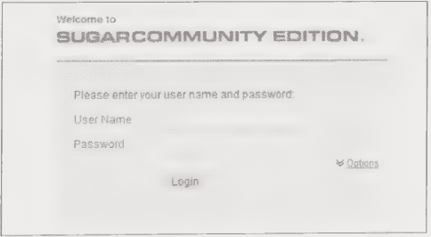

一旦 SugarCRM 登录屏幕出现，请按照以下步骤登录：

1. 在“用户名”框中输入您的用户名
2. 在“密码”框中输入您的密码
3. 选择您要使用的语言和主题（如果适用）
4. 单击“登录”按钮

## SugarCRM 快速导览

成功登录系统后，将显示 **Home** 选项卡，如下图所示。请注意，本概述假设您使用具有管理员权限的帐户登录了系统。屏幕布局的各个关键元素已按如下方式突出显示：

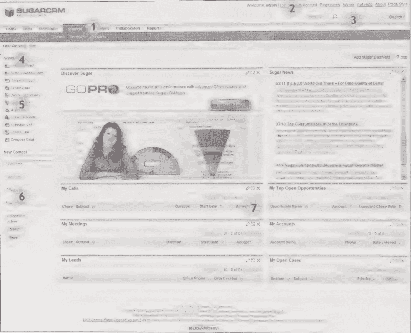

- **Navigation tabs**：默认情况下，它们按功能组织。单击主标题可选择模块，例如 **Contacts** 或 **Accounts**。

- **System links**：**My Account**、**Employees**、**Logout** 和 **About**。**Admin** 链接仅可供分配了管理权限的用户使用。

- **Search box**：它有助于在 SugarCRM 保存的关键数据中搜索文本字符串。

- **Last viewed**：它是您最近查看过的记录的有用轨迹。

- **Navigation shortcuts box**：这些是在每个模块中有用的特定快捷方式。

- **Quick new item box**：它是一个快速数据输入框，用于为当前模块创建新项目。

- **Main screen body**：在 **Home** 选项卡上，这包括 **Cases**、**Opportunities**、**Appointments**、**Leads**、**Tasks** 和销售管道图。还可以使用 **Add Sugar Dashlets** 按钮添加其他项目。

**Home** 选项卡的屏幕布局与所有其他选项卡使用相同的布局。在选项卡之间移动时，快捷方式列表中可用的快捷方式会根据特定选项卡发生变化。主屏幕正文显示由 _选项卡名称_ 指示的信息。**Quick New Item** 案例会更改，以根据选项卡提供创建新项目的快速访问，例如 **New Contact**、**New Account**、**New Opportunity** 等等。

## 主题

前面我们提到，您可以选择备用主题来更改与 SugarCRM 使用相关的外观方面。在继续之前，让我们快速看一下。在屏幕的 **System Links** 区域（右上角）中，单击 **Page Styles** 链接，并将主题值更改为 **Links**。更改主题值会导致 SugarCRM 自动应用新设置。

请注意，更改主题会导致 SugarCRM 屏幕的许多方面发生变化。导航选项卡不再是选项卡，而是转换为侧边菜单系统。基本上，快捷方式与选项卡的位置已互换。此外，配色方案和图形也非常不同。

无论使用哪个主题，都会显示相同的 CRM 信息。只是布局不同。选择您喜欢的主题，或不时更改它，以在使用 CRM 系统时保持一些乐趣。如果您有兴趣自定义现有主题，或者也许创建自己的主题以匹配您公司的品牌，您将在 _Chapter 5_ 中找到所需信息。

> 在本章的其余部分，我们将假设您在安装 SugarCRM 时，还选择安装了示例数据。（有关安装 SugarCRM 的附录中 _Database Configuration_ 部分的更多信息，请参阅。）稍后，我们将快速重新安装以删除演示数据，然后导入您自己组织的数据。

## SugarCRM 基础：数据关系

在深入了解应用程序的特定功能领域之前，了解系统内部关系和层次结构的某些方面非常重要。

在本书中，我们一直提到 _Accounts_、_Contacts_、_Opportunities_ 和其他构成 CRM 系统的数据实体。我们还讨论过，CRM 系统的一些主要目标是存储此类信息，并轻松演示它们之间的关系。正是这种理念，使 CRM 系统不仅能为您提供有关待处理销售的信息，还能提供与之相关的客户信息。为了实现这一点，CRM 系统中必须存在规定数据实体如何相互关联或连接的规则。为了更好地了解 SugarCRM，我们必须首先检查这些有助于构建其层次结构的规则。

在 SugarCRM 的世界中，Account 是顶级实体。默认情况下，所有其他数据项（包括 Contacts、Opportunities、Cases 等）都可以轻松链接到 Account。您还可以将任意数量的这些项链接到任何给定的 Account。此功能允许将多个联系人链接到单个帐户，通常称为一对多关系。

以下插图描绘了层次结构：

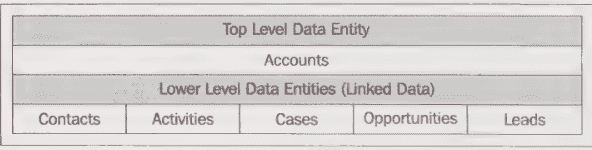

虽然低级数据实体可以轻松链接到 Accounts，但它们在彼此之间链接的方式上受到限制。例如，Case 默认情况下期望链接到 Account。只有在首先链接到 Account 之后，才能将其与 Contact 关联。此示例突出了一个可能需要自定义的区域，具体取决于您的业务使用的是 B2B 还是 B2C 模式。

此外，有些关系只能以单一方式建立。一个很好的例子是 Task 和 E-mail 之间的关系。可以在两者之间建立关系，但要做到这一点，您必须访问相关的电子邮件并在那里建立关系，因为尝试反向操作是不允许的。如果您尝试通过访问 Task 来做到这一点，您会觉得无法建立该关系。

关于低级项目之间关系的最后一个重要点是，它们通常表示一对一关系。刚才解释的 Task 和 E-mail 示例很好地突出了这一点，因为只有一个 Task 可以链接到任何给定的 E-mail。

## SugarCRM 导航：帐户和联系人

那么——我们来了——SugarCRM！

让我们更熟悉一下使用系统。首先，（我将假设您从现在起已切换回正常的 Sugar Theme）尝试访问几个模块，方法是先将鼠标悬停在组标题选项卡上，然后选择显示的模块名称之一。例如，将鼠标悬停在 Marketing 上，然后选择 **Accounts** 以访问帐户模块，如下图所示：

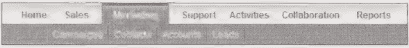

不同的信息集组织在不同的模块中，每个模块都有一个选项卡，您单击它以访问和使用它。

SugarCRM Community Edition 5.5 中的模块按以下方式分组：

| Group header tab name | Modules |
|---|---|
| Home | Home, Dashboard |
| Sales | Accounts, Opportunities, Leads |
| Marketing | Campaigns, Contacts, Accounts, Leads |
| Support | Cases, Accounts, Contacts |
| Activities | Activities, Calendar, E-mails, Calls, Meetings, Tasks, Notes |
| Collaboration | E-mails, Documents |
| Reports | Dashboard |

SugarCRM 的 Professional 和 Enterprise Editions 扩展了此列表，一些额外项目为产品、报价、预测和报告以及团队销售和工作流功能提供模块。

系统管理员可以控制特定用户可以访问哪些模块，在某些情况下，用户也可以隐藏或重新排列选项卡。用户还可以选择不使用分组，而是使用代表每个模块的选项卡，具体取决于其导航偏好。如果您不使用组选项卡方法，您会发现 SugarCRM 只能在导航区域显示 12 个选项卡。其他模块可以通过可见最后一个选项卡右侧的溢出区域访问。使用在左侧像菜单系统一样列出模块的主题（例如 Links 或 Pipeline）消除了对溢出区域的需求，因为用户可访问的所有模块都会自动显示。

## 列表和详细信息视图屏幕

将鼠标悬停在 Sales 上并单击 Accounts 选项卡。这将显示系统中所有帐户的列表。在 SugarCRM 中显示列表的屏幕称为列表视图。此屏幕是 Accounts 列表视图。如果您安装了演示数据，您的屏幕应该类似于以下内容：

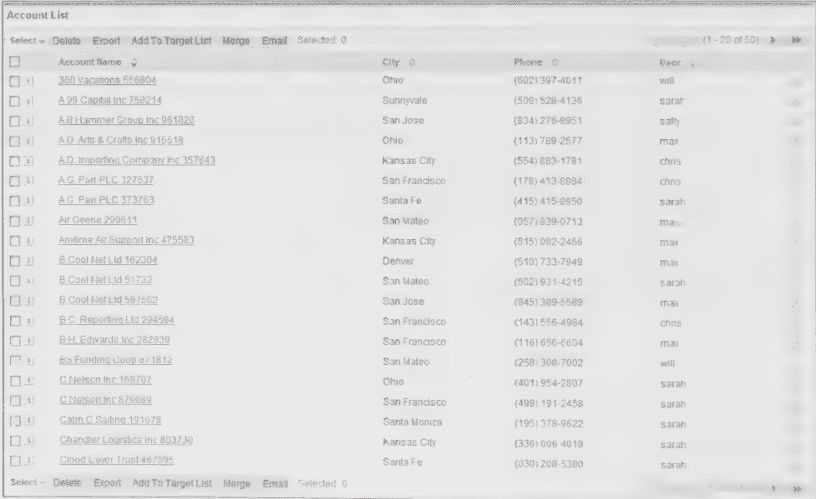

让我们想象一下，我们正在查看 RayDoc 的帐户列表——RayDoc 组织的一组示例帐户、联系人、线索、机会等。显然，公司名称是编造的，因为我们不能在此处公开真实公司的信息，但这里的示例数据是为了演示系统所需的所有关键功能，以使您的 CRM 部署取得真正的成功。

在账户列表的右上角，你可以看到一些控件和信息，这些控件和信息表明系统中实际上有 50 个账户，而你当前正在查看第 1 到第 20 个账户。提供了“下一页”和“上一页”控件，用于浏览完整账户列表的各个部分，以及跳转到列表的整体开头或结尾。

你还可以在屏幕顶部看到一个“账户搜索”面板，它用于按名称或其他字段（例如城市或电话号码，如下面的屏幕截图所示）搜索特定账户：

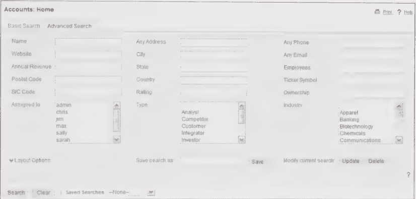

重要的是要明白，这个搜索面板实际上是一个过滤面板——只有符合过滤条件的账户才会被列出。可以应用多个限制条件。你可以查找所有以 a 开头且位于纽约市的账户，所有满足这些约束条件（过滤条件）的账户都会被列出。要返回查看完整的账户列表，只需单击搜索面板中的“清除”控件以移除所有过滤条件。要访问更全面的过滤条件集，请单击“高级搜索”选项卡。

重要的是要明白，默认显示给你的账户列表是系统中的所有账户集合。使用该系统的销售人员可能希望专注于自己的账户。这可以通过在搜索面板中选择“仅显示我的项目”复选框来实现。此功能是依赖于前面提到的“分配给”值的另一块功能区域。

当你在浏览器窗口中移动鼠标指针时，你可以看到每个账户名称上都有一个链接。如果单击账户名称，你将进入该账户的详细视图。现在就让我们这样做，单击 NW Capital Corp 582183。

## 主面板和子面板

检查账户详细信息屏幕会发现，顶部有一个关于账户的常规信息块，下面是一系列包含相关信息的块，例如活动、历史记录、联系人、机会、线索、案例等等。

顶部的常规信息块称为主面板，如下面的屏幕截图所示：

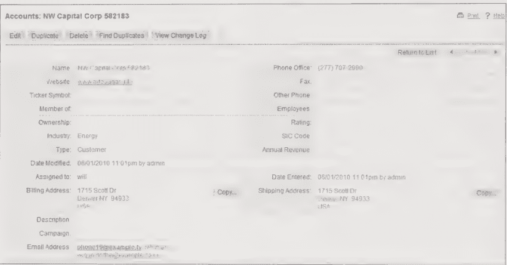

主面板下方的相关信息块称为子面板。因此，我们看到一个活动子面板、一个历史记录子面板、另一个联系人子面板，等等，如下图所示：

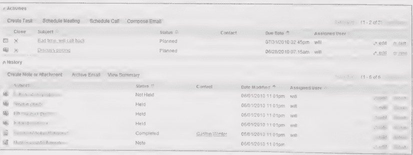

我们还在主面板上方看到几个按钮——编辑、复制、查找重复项和删除。这些按钮作用于特定的账户记录，允许我们编辑、复制或删除它。

单击“查找重复项”允许你搜索数据库中与当前条目可能重复的记录。如果找到任何重复项，你可以合并记录以创建一个单一的幸存主记录。此功能有助于尽可能保持数据库的清洁。

在每个子面板上方，我们还看到许多按钮。让我们以活动子面板为具体示例。这个子面板提供了创建任务、安排会议、安排通话和撰写电子邮件的按钮。虽然我们将稍后更详细地讨论这些不同的活动，但目前只需理解这些按钮允许你将新活动添加到这个详细信息视图屏幕中，这些活动会自动链接到或关联到当前账户。

你还会注意到，在活动子面板中每个打开的活动的主题、联系人和关联到字段上都有链接。单击这些链接将带我们进入活动的详细信息视图、相关联系人或相关项目。这是你第一次瞥见 CRM 系统中链接的巨大威力，这些链接加快了相关信息之间的导航。

仍在活动子面板中，注意每个列出的活动右侧的“编辑”和“rem”链接。这些链接旨在让你快速编辑或从账户中取消关联活动。

类似的原则适用于其余的子面板——提供按钮和链接来创建新项目、编辑或删除现有项目，或进入这些相关项目信息的完整详细信息视图。

详细信息视图屏幕布局还包括以下其他实用控件：

- 每个子面板的隐藏控件：使用户能够限制垂直屏幕滚动，以专注于对他们特别重要的数据，并减少每个屏幕的带宽要求。后者对于带宽或资源有限的环境很有帮助。每个隐藏的子面板可以通过单击出现在折叠或隐藏子面板上的“显示”链接来恢复。隐藏子面板是一种粘性操作——子面板将无限期保持隐藏，直到你单击“显示”链接。
- VCR 控件：在每个详细信息屏幕上，顶部都有“下一页”和“上一页”链接（也称为轻推控件），使用户能够浏览模块中记录的详细信息视图，而无需返回列表视图来选择记录。提供了“开始”和“结束”控件，以直接跳转到模块中的第一条和最后一条记录。
- 返回列表：每个详细信息视图顶部的此链接可用于返回该模块的列表视图。
- 查看更改日志：每个模块的更改日志功能按记录跟踪对特定字段所做的更改。每次审计字段更改时，都会自动创建更改日志条目。该条目记录了更改了哪个字段、旧值和新值、更改的用户以及更改日期。

## 编辑视图屏幕

如果你查看屏幕左侧，你会看到导航快捷方式框。从这个菜单中（再次假设你使用的是标准 Sugar 主题），单击“创建账户”快捷方式。你将看到账户编辑视图屏幕，其中一部分在以下屏幕截图中显示：

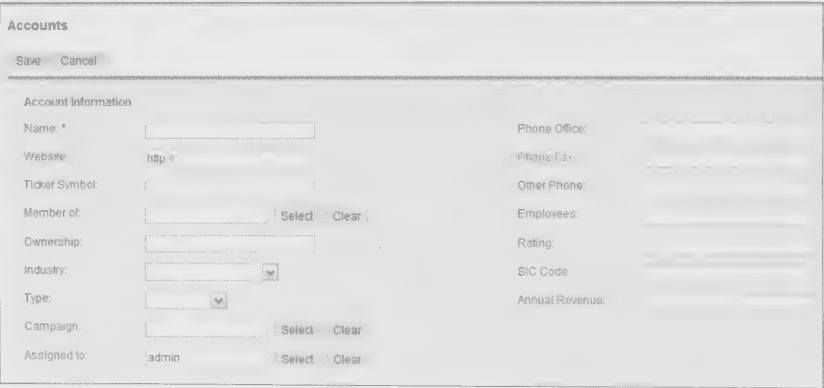

为了获得一些第一手经验，我们将为 RayDoc 创建一个账户。使用以下信息输入 RayDoc 业务的数据，然后单击“保存”按钮。

账户名称：RayDoc

办公电话：(310) 555-1212

网站：www.raydoc.com

此时需要注意的是，你现在第一次在 SugarCRM 中保存了一些数据。在像 SugarCRM 这样的基于浏览器的系统中，除非单击“保存”按钮，否则数据不会被保存。如果你在单击“保存”之前关闭浏览器，数据将会丢失。另一个需要注意的是，数据不是保存到你的 PC 或笔记本电脑上，而是直接保存到 SugarCRM 服务器。因此，数据立即可供系统中任何其他用户访问，前提是安全设置不限制他们对其的访问。

这种方法与旧一代系统相比的优点在于，它允许从任何地方访问数据，只要用户的 PC 连接到互联网并运行浏览器。无论你距离服务器 100 英尺还是 100 英里，你对数据的视图都将完全相同。

回到我们的数据输入示例，现在你在 RayDoc 账户详细信息视图上，我们将继续添加一个关联的联系人。单击联系人子面板中的“创建”按钮，你应该会看到以下内容：

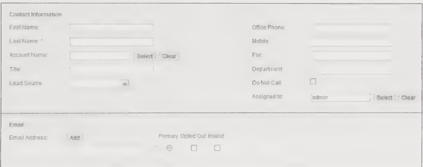

使用以下数据填写新联系人记录表单：

名：Doc

姓：Newhart

请注意，只显示有限数量的字段。如果你希望填充未显示的其他字段，请单击“完整表单”按钮。输入数据完成后，单击“保存”按钮。另一个需要强调的重要点是，系统会自动从相关账户记录继承电话号码。其他重合字段也会如此，但你可以独立更改账户或联系人的数据。复制行为仅在创建新条目时适用。

现在记录已保存，**RayDoc** 账户的详细信息视图中应包含联系人子面板中的 **Doc Newhart** 条目，如下面的屏幕截图所示：

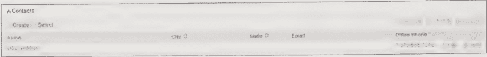

为了加强在 SugarCRM（以及任何优秀的 CRM 系统）中前后、上下和横向链接的能力——请单击联系人 **Doc Newhart** 的姓名以查看其联系人详细信息视图屏幕。从该屏幕，单击账户名称链接以返回 RayDoc 的账户详细信息视图屏幕。请注意，左上角导航选项卡下方的 **最近查看** 链接区域正在累积最近访问的记录列表，以简化返回这些记录的过程。

现在向 RayDoc 账户条目添加另一个联系人，重复我们刚才描述的过程。但是，除了你的姓名之外，不要输入任何其他数据。你现在应该在 RayDoc 账户详细信息视图屏幕的 **联系人** 子面板中看到两个联系人。这是另一个重要点。我们重复使用了 RayDoc 账户主面板中的所有基本账户信息来创建第二个联系人。我们不需要再次输入这些信息。此外，如果 RayDoc 账户的任何信息发生更改，我们只需编辑 RayDoc 账户记录，而不必编辑我们关于该处联系人的信息。这是 CRM 系统相对于 Microsoft Outlook 2003 之类的联系人管理器的一个关键优势。它理解账户和联系人是两种分开的信息类型，它们相互关联，而不是被挤在一起混成一种令人不满意的混合体。

## 数据关系与搜索

同样，为了加强 SugarCRM 中导航的速度和强大功能，请浏览到你自己的联系人记录。然后返回 RayDoc 账户详细信息视图，再转到 Doc 的联系人记录。一个联系人可以关联到一个账户，而该账户又可以关联到该账户中的其他联系人——这一切都非常迅速。而且，这与你的日常工作需求非常相关。

现在，请自行探索联系人列表视图：将鼠标悬停在 **营销** 选项卡上，然后单击 **联系人**。请注意，你可以在联系人列表上方的 **联系人搜索** 面板中搜索特定联系人。单击 **高级搜索** 会显示更全面的搜索字段列表，如下图所示：

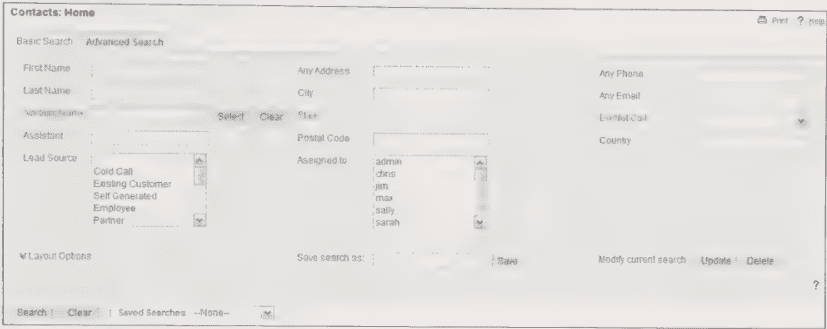

搜索功能固有的一个有用特性是，可以根据个人的名或姓独立进行搜索。随着数据库的增长，这一特性的价值将变得更加明显，因为会有许多情况：你可能不记得某人的全名，但记得其名或姓。

沿着同样的思路，它允许你通过通配符字符搜索值的一部分。例如，要搜索姓氏包含字母 "son"（如 Gunderson）的联系人，你可以在姓氏字段中输入 %son，SugarCRM 将返回匹配的结果。

## SugarCRM 基础：安全性

现在你已经对输入数据、搜索以及在不同条目之间建立关系的过程有了一定了解，是时候讨论安全性和访问控制这个重要话题了。除了前面提到的用户名和密码之外，你可能还需要控制访问你的 SugarCRM 安装的各个用户可以访问哪些记录。

这是一个需要与你的利益相关者和项目领导讨论的重要话题。CRM 系统的本质决定了其默认允许所有用户访问所有数据。这完全合理，因为该系统的核心理念是促进一组用户之间的沟通。然而，随着时间的推移，你将希望调整安全设置，以控制哪些用户可以查看、编辑或删除某些数据。

目前，你会注意到的最明显的安全组件是所有数据条目上的 **分配给** 字段。使用 SugarCRM 时，你会注意到数据库中的每条记录（无论是账户、联系人、商机还是其他类型）都包含此字段。默认情况下，SugarCRM 会自动将此字段填充为最初将记录输入系统的用户姓名，但允许用户选择不同的受让人。

请注意，默认情况下，只能将记录分配给单个用户。将数据分配给多个用户的功能（称为 **团队**）是开箱即用的功能，仅面向 Professional 和 Enterprise Edition 订阅者。

此机制是 SugarCRM 安全基础的组成部分。如果你是单用户，这可能意义不大，但篡改此字段可能会导致问题，例如无法访问某些记录以及其他异常情况。

本书 _第 5 章_ 中讨论的更高级安全功能都依赖于此字段，因此它非常重要。

## 销售管道：线索和商机

现在你已经练习将账户和联系人放入系统，并将联系人关联到账户，让我们继续了解 CRM 系统可以为你组织的几种其他数据类型。

大多数现代 CRM 系统都设计为将 _线索_ 和 _商机_ 作为独立的数据实体来纳入。它们被视为独立的信息项，即使它们听起来非常相似。普遍接受的区别是，线索是指以某种方式来到你这里的个人的信息，但你无法确定他们是否对你的产品和服务感兴趣。他们需要经过资格审查。另一方面，商机是线索在你与该人接触并确认他们确实对你公司所提供的产品有真实且合格的兴趣后所转化的东西（他们有真实的业务问题、解决问题的资金，并且你正在与拥有采购权的人交谈）。

在 CRM 术语中，向客户销售商品和服务的过程归结为一系列步骤，大致如下：

- 获取和跟踪线索
- 将其审查为真正的商机
- 量化这些商机并为其设定预计成交日期
- 将所有商机汇总到销售管道中，以查看全局情况
- 将商机成交为销售

这种设计为你的业务带来的预期好处如下：

- 你可以以比以往更具体、更可量化的方式预测未来几个月的预期销售额。销售管道是你的远程预警系统，它会显示你的业务水平何时下降，或增长速度快于预期。在小型企业中，在进行业务规划时，它是你最好的朋友，能让你更详细、更远程地展望未来，帮助你做出适当的人员配置和支出决策。
- 你的所有销售线索、商机和账户历史记录现在都正式记录在企业拥有的中央系统中。你面临来自销售人员的威胁和敲诈，或销售人员突然离职的风险已降低。如果销售人员离开组织，你仍然拥有企业为之付费开发的所有线索和商机，以及帮助新销售人员快速有效地接管账户所需的账户历史记录。
- 账户上的销售人员不是组织中唯一能访问活动历史记录详细信息的人。其他与客户有直接接触的人员现在拥有信息，使他们能够就涉及你任何客户的问题做出更明智的决策。

系统初始推出后，这一切对 Doc 有何影响？我们的初始任务是找到他所有的线索。其中大部分线索都沉寂在销售人员的收件箱里——如果他们有兴致，在无聊的日子里可以处理一下。

因此，Doc 必须召集所有销售人员，收集所有这些线索。在持续的基础上，大多数线索来自公司，来自 RayDoc 合作的供应商，而不是直接来自个别销售人员，因此可以由 Kay 在她的空闲时间输入系统。然后这些线索会同时分配给一名销售人员，确保有人负责跟踪它们。直接发送给销售人员的线索必须由该销售人员输入——这将在不久的将来用作培训材料。

一旦所有历史线索都收集齐，Kay 就将它们输入到 SugarCRM 中。现在，让我们自己输入一条线索来熟悉这个流程。将鼠标悬停在 **Marketing** 选项卡上，然后选择 **Leads**。点击屏幕左侧的 **Create New Lead** 快捷方式，你应该会看到以下屏幕：

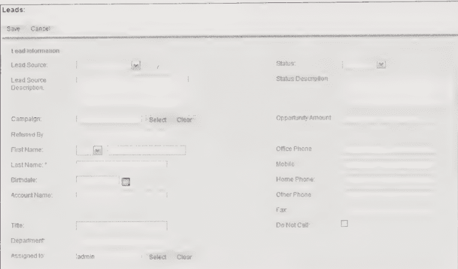

使用以下信息输入新的线索记录，然后点击 **Save** 按钮。你现在应该会看到线索详细信息屏幕，其中包含主面板以及 **Open Activities** 和 **History** 的子面板。这些子面板将让你跟踪销售人员与你转交给他们的线索进行的日常活动。

Lead Source: Word of Mouth  
First Name: Mr. Fred  
Last Name: Namath  
Account Name: SPAR Aerospace  
Office Phone: (562) 555-1313

每个线索的一个关键字段是 **Status** 字段。当线索首次输入时，它会自动设置为 **New**，当线索分配给特定的销售人员时，应将其设置为 **Assigned**。如果线索转换为机会，它会自动变为 **Converted**。勤勉地使用此字段，可以让你有效地衡量业务获得的新线索数量，以及衡量转化为潜在销售或机会的数量。

另一个关键字段是 **Lead Source**。当它与状态字段结合使用时，更容易衡量每个线索来源产生的线索比例，这通常代表特定的营销活动。此类信息被视为关键的业务推动因素，因为它让你能够快速查看营销资金在哪里投资效果最好，以及哪些渠道产生了最多的实际收入。

为了继续我们演示线索生命周期的示例，让我们想象一下，Doc 或他的一名销售人员给线索 **Mr. Namath** 打了电话。与他交谈一段时间后，销售人员确定 **SPAR Aerospace** 是 RayDoc 真正的潜在新客户。因此，应将 **Fred Namath** 线索转换为机会，以记录和跟踪此活动。在线索详细信息屏幕的顶部有一个 **Convert Lead** 按钮。现在点击它，你应该会看到类似下面的屏幕：

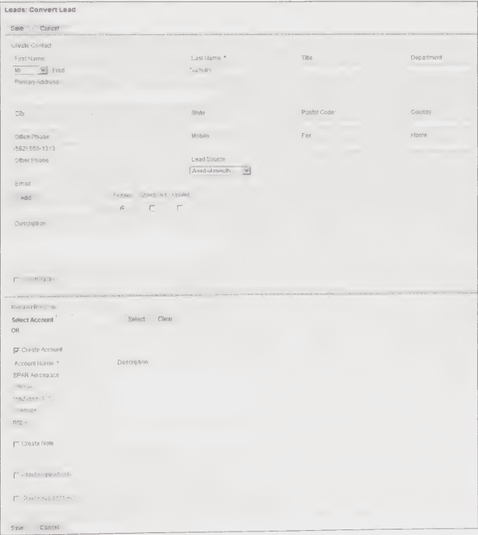

如你所见，转换线索基本上将线索转换为联系人，并可选地允许你同时创建客户、机会，甚至预约。如果你愿意，还可以创建一个笔记或附件（例如上传的 Microsoft Word 或 Excel 文件）以链接到 **Account** 记录。

根据 Doc 与 Fred 的交谈，我们选择点击 **Create Opportunity** 框，以输入与更换窗户潜在销售相对应的数据。请注意，你必须为机会提供金额和预计成交日期。完成后，点击 **Save** 按钮一次性保存所有新的信息记录。你随后会看到类似下面的屏幕，确认线索转换成功：

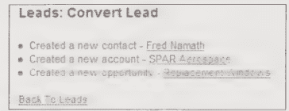

现在将鼠标悬停在 **Sales** 上并点击 **Accounts**。使用搜索面板查找 **SPAR Aerospace** 的客户记录。点击该记录以查看通过 _线索转换_ 过程输入的客户详细信息屏幕。（请注意，主面板和子面板已分为两张图片，尽管它们应该在你的屏幕上同一页面显示）：

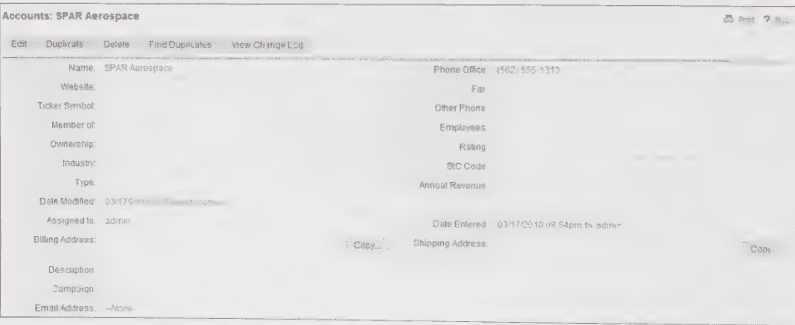

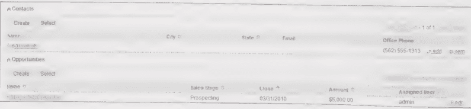

请注意，除了原始线索外，我们现在还有一个客户，以及链接到该客户的联系人和机会。再次练习你的导航技能。点击机会，确保结果屏幕显示相关联系人。点击联系人。该屏幕应显示其链接的客户。点击客户。我们回到了起点。这就是 CRM 的乐趣——一切都相互连接。你可以链接大量的客户历史、联系人历史、相关联系人、相关机会、线索和其他数据，然后返回并快速浏览所有关系。

## 聚合机会：销售管道

现在我们已经了解了创建客户、联系人和线索的过程，以及将线索转换为联系人、机会和客户的过程，可以开始组装销售管道了。将鼠标悬停在 Sales 上，然后点击 Opportunities 以查看演示 RayDoc 数据集中所有机会的列表。你应该会看到类似下面的屏幕：

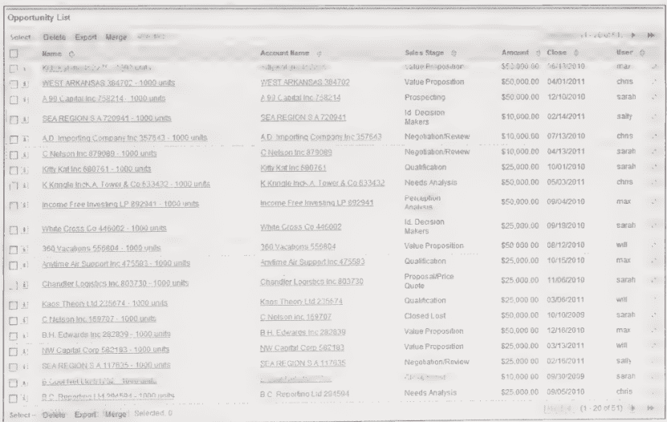

显然，能够看到我们为未来业务识别的所有机会非常有用。但是，也有缺点。默认情况下，我们只能看到系统中 51 个机会中的 20 个，从而限制了我们对管道的即时查看。我们需要前后翻页才能查看其余条目，或者调整系统设置以容纳每页更多条目。

该列表还显示每个机会的预估价值和成交日期，以及销售阶段，以指示每个机会在销售流程中的位置。但是，我们看不到表示成交概率的百分比，也看不到机会的自动总计。我们可能还希望看到按成交概率百分比加权的机会总计——以便对未来销售有更现实的预期。

首先，让我们详细查看一个机会，以了解机会记录包含哪些信息。我们在上一节中生成了一个机会，但并未实际使用机会编辑视图屏幕。要访问编辑视图，请点击列出的第一个机会，然后点击 **Edit** 按钮。你应该会看到类似下面的屏幕：

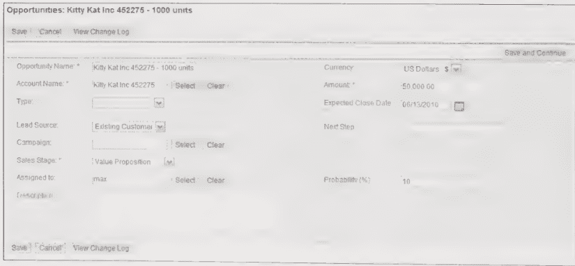

机会的一个关键属性是 **Sales Stage**。在前面的截图中，你可以看到销售阶段的下拉框及其各种可用选项。（如果这些选项不符合你业务的运作方式，可以对其进行自定义。）

机会中包含的其他重要信息包括业务的 **Expected Close Date**、成交的百分比 **Probability**、该机会的 **Lead Source** 以及涉及的业务 **Type**（新客户或现有客户），这些变量提供了关于机会的进一步信息。既然我们已经回顾了机会包含的各种数据，请继续点击 Cancel 按钮退出该屏幕。

机会列表视图屏幕非常有用；但是，显然有许多视图和问题它无法解答。其中一些包括以下内容：

- 我们最好的线索来源是什么？
- 我们的总销售管道是多少？
- 销售管道按预计成交日期的月份如何细分？
- 大多数机会在销售流程的哪个阶段进入？
- 目前最成功的销售人员是谁？

## 仪表板

为了回答上述问题，高质量的 CRM 系统提供带有机会数据可视化分解的图形仪表板，对其进行总计，并按关键指标（如销售阶段、线索来源和客户代表）进行小计。

### SugarCRM 基础

你可能已经在 **Home** 选项卡屏幕上看到了这样的图形图表，但要查看完整的图表集，请将鼠标悬停在 **Home** 上，然后点击 **Dashboard** 链接。你将看到类似下面的屏幕：

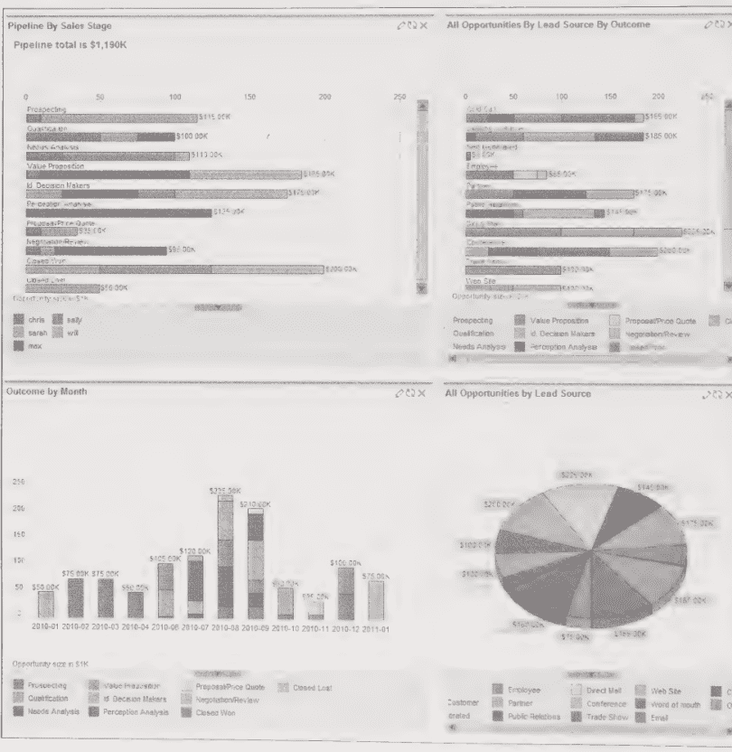

显示的四个图表说明如下：

1. 按销售阶段划分的管道图表：此图表也可在 Home 选项卡上使用，但你 Home 选项卡上的图表仅显示专门分配给你的机会的数据，而不是整个组织的数据。此图表通常由小企业主或销售经理使用，因为它能提供销售管道成熟度的整体感觉。他或她可以回答这个问题——“是否有足够的未来业务来实现销售目标？”此外，堆叠柱状图的呈现方式能直观地表明哪些销售人员拥有最大金额的机会，以及哪些销售人员的机会中有不成比例的比例处于早期阶段。在 Doc 的例子中，他使用此图表来留意任何可能在夸大其词、声称自己即将有多少业务的销售人员，因为这通常表现为大量机会，而其中大部分处于早期销售阶段。以下是相同的图表：

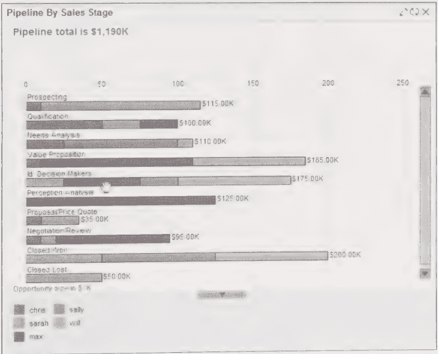

### 2. 按线索来源和结果划分的机会图表：

此图表可帮助您快速直观地了解哪些线索来源产生了最高价值的机会。颜色编码的堆叠条形图有助于展示哪些线索来源在转化为销售方面特别出色或糟糕。它向 Doc 展示，他的资金是更适合投入在家居装修杂志中刊登门窗更换广告，还是在当地市场的电视指南频道上投放广告。

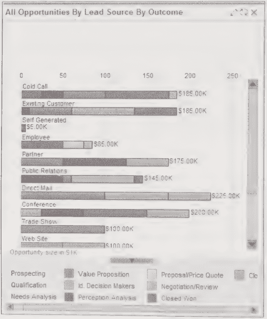

### 3. 按月份划分的结果图表

此图表按月显示预计和已成交的销售。堆叠条形图根据机会的销售阶段是“已赢”、“已输”还是其他（意味着机会的预计成交日期在所示月份，但尚未对我们的业务或竞争对手产生有利成交）来细分机会。

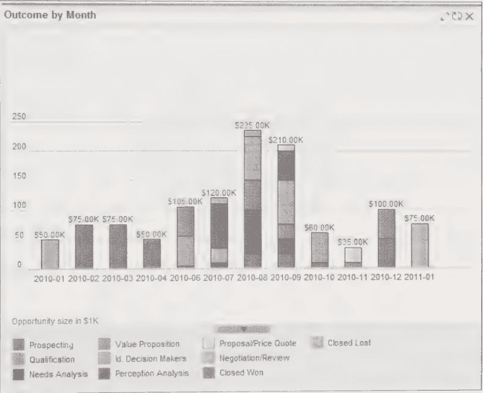

### 4. 按线索来源划分的所有机会图表：

此图表提供了所有机会的饼图可视化，按各自的线索来源值进行细分。

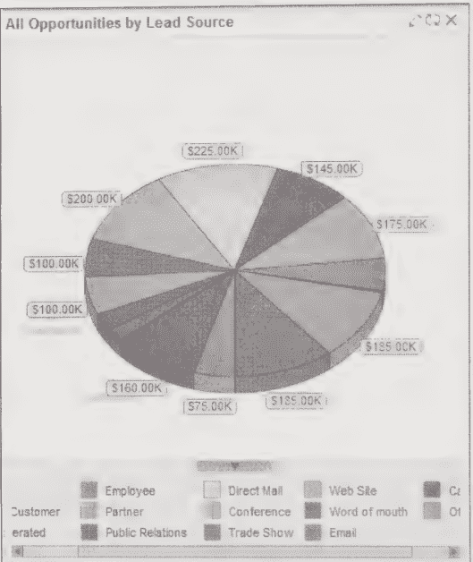

这些图表中的每一个在右上角都有一个编辑控件，允许您为驱动图表的数据设置一些过滤器。图表上显示的机会可以限制为特定销售人员的机会、特定时间段内到期的机会、特定销售阶段的机会，或来自特定线索来源的机会。

每个图表还为您提供了将鼠标悬停在感兴趣区域以查看更多信息的功能。如果在第一个图表中，您将光标悬停在开拓阶段的线索上，图表下方的区域将显示设置为该阶段的机会数量及其总价值。

最后，每个图表都提供了一种名为 **drilldown** 的功能。要查看该功能的实际效果，请将鼠标光标悬停在第一个图表中开拓阶段的机会上。接下来，单击图表中代表这些机会的条形图。系统将自动打开 **Opportunities List** 屏幕，并过滤为仅显示图表图形表示的数据背后的那些机会。这个方便的功能允许偏好数据可视化呈现的用户快速查看所需信息，同时为那些更习惯于简单文本和数字的用户提供相同的信息。

综合起来，仪表板的这些功能应能显著提高您预测未来几个月销售、了解哪些线索生成策略对您最有效，以及找出那些可能习惯性高估其销售管道价值或概率，或反复无法在预测日期前完成交易的销售人员问题的能力。

对于销售人员本身，此工具可以作为激励，以生成新机会，或完成明显落后于预测日期的业务，同时也作为一个组织工具。

## 日程安排

在任何企业中，都有一系列小事件——会议、电话、备忘录、电子邮件，或几个月后重新审视问题的提醒。任何 CRM 的一个非常重要的方面是能够安排这些活动，并将其与涉及的相应账户和联系人关联。

SugarCRM 包含一个完整的团队日程安排系统，允许用户轻松管理这些活动或将其委托给其他用户。该系统既包括图形日历，也包括列表式日历。让我们花点时间来查看第一个选项。

## SugarCRM 基础知识

要访问图形日历，请将鼠标悬停在 **Activities** 上，然后单击 **Calendar**。您应该会看到类似下面的屏幕：

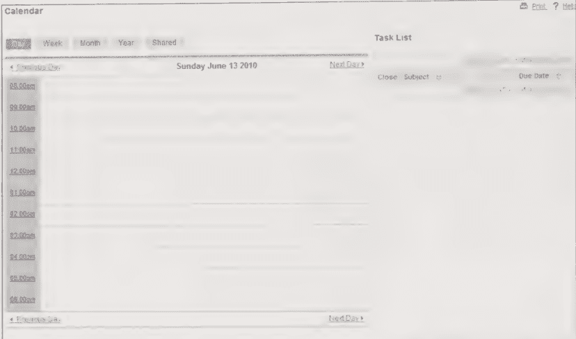

这是 **Calendar** 选项卡的 _默认_ 视图——当前日期的日视图。如您所见，有按钮允许您将视图更改为当前周、月甚至年。此外，在这些视图中的每一个中，都有轻推控件，可用于转到前一天、周、月或年。

还有一个额外的视图，通过单击 **Shared** 按钮访问。这对于关注其他用户的活动很有帮助。单击它将允许您在同一日历中显示多个用户的计划活动，省去您单独检查每个用户活动的麻烦，并简化涉及多个用户的活动安排。

现在花点时间单击 **Week**、**Month**、**Year** 和 **Shared** 按钮，以熟悉应用程序提供的显示布局和导航按钮。请注意，在这些视图中的每一个中，您可以单击任何一天的数字以 _缩放_ 到该日期的日视图。

日视图与其他视图不同，还在屏幕右侧显示当前任务列表。这些任务特定于当前登录的用户，日历上显示的活动也是如此（共享视图除外）。

要了解日历的工作原理，让我们花点时间安排一个明天上午 11 点与 Kitty Kat Inc 452275 的 Rachel Wason 的约会，讨论他们的装修计划。从当前屏幕，单击 Next Day 链接。当您看到该日期的活动时，单击日历显示左侧的 11:00 AM 链接。此时，应会出现一个小弹出框，让您快速安排通话或会议。选择 Meeting 单选按钮，将主题输入为 Discuss Renovation Plans，然后单击 Save。

您现在应该会看到会议的详细信息屏幕，它应该类似于以下内容：

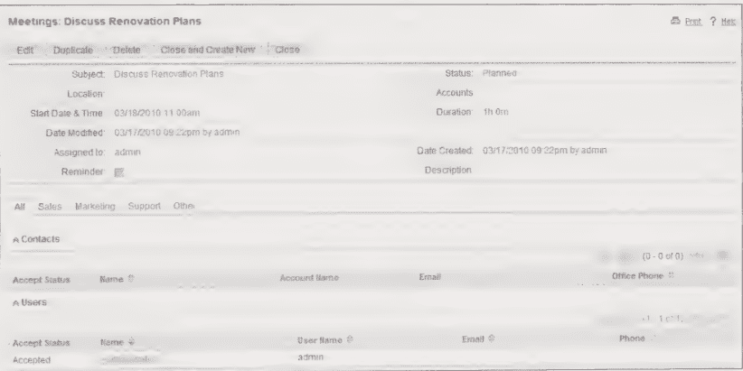

要邀请其他参与者——无论是贵公司的员工（定义为 CRM 系统中的用户）还是客户（来自 CRM 数据库中的联系人数据）——请单击 Edit 按钮，然后向下滚动到屏幕底部的 Add Invitees 区域。在此示例中，在名字框中输入 Rachel，然后单击 Search 按钮。您的屏幕应该如下所示：

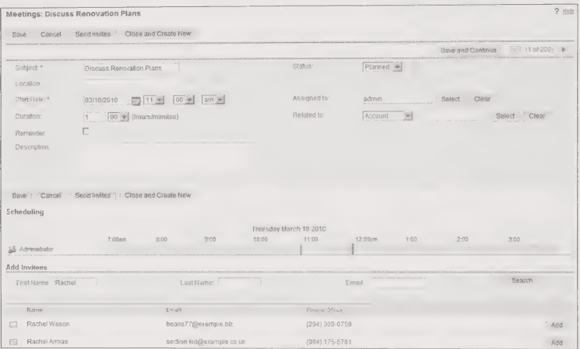

现在只需单击 Rachel Wason 姓名右侧的 Add 按钮，将她添加到会议的受邀人列表中。

请注意，Rachel Wason 和 Rachel Armas 姓名左侧的小图标告诉您他们是联系人。用户将显示类似于屏幕日程安排部分中管理员所示的图标。

从会议的编辑视图中，您可以添加更多细节到会议记录中，这些细节在您首次创建时的小弹出框中不可用。您可以指定与会议相关的账户，调整会议时长（默认设置为一小时），输入会议地点，并从受邀人列表中添加或删除与会者。

为了说明其中一些功能，让我们将会议时长设置为 30 分钟，并邀请来自 **Kitty Kat Inc 452275** 的 **Jorge Grounds**，同时将会议链接到 **Kitty Kat Inc 452275** 账户。完成后，您的会议详细信息视图应如下所示：

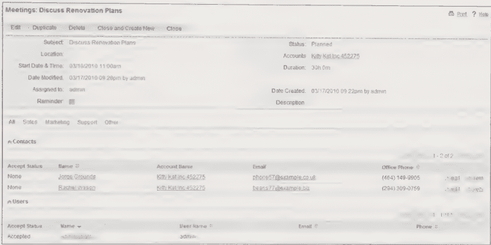

同样，CRM 系统连接所有客户信息的能力在此发挥作用。单击链接 **Kitty Kat Inc 452275**，您将看到该账户的详细信息屏幕，其中包含多个打开的活动，包括您刚刚添加的会议。在该活动中，它显示 **Rachel Wason** 作为联系人。单击链接到她的详细信息视图，您将看到新会议列在她的打开活动中。现在单击该会议的主题，您将返回会议的详细信息视图。

这让您初步了解了 SugarCRM 中的日程安排功能。在下一节中，我们将了解更多关于日历的一般信息，以及系统用户可以创建和跟踪的各种活动。

## 销售活动

上一节教会了我们使用日历所涉及的一些基础知识。我们还学习了添加会议的过程，但会议只是您在 SugarCRM 中跟踪的五种活动类型之一。五种不同的活动类型是 **Meetings**、**Calls**、**Tasks**、**Notes** 和 **E-mails**。让我们现在更详细地查看这些活动。

所有五种类型都可以在 SugarCRM 系统的 **Activities** 选项卡中创建和查看。单击 **Activities** 选项卡，查看该模块中可用的快捷方式列表。有快捷方式可访问五种活动各自的列表视图，或创建任何类型的活动（电子邮件除外，对于电子邮件，您必须转到 **Emails** 选项卡）。请注意，呼叫列表视图是您进入 **Activities** 选项卡时看到的默认屏幕。

电子邮件活动在 SugarCRM 中是一种特殊情况，因为它们除了在活动选项卡中存在外，还有自己的选项卡。当您单击任何电子邮件相关快捷方式时，您会注意到 **Emails** 选项卡会亮起，以显示您正在 **Emails** 模块中。

以类似的方式，您会注意到，如果单击任何呼叫相关或会议相关快捷方式，**Calendar** 选项卡会亮起，以指示您现在位于 **Calendar** 模块中。因此，实际上，只有任务和笔记完全包含在活动模块中。

活动在 CRM 系统中很重要，原因有两个。首先，它们帮助每个人维护活动日程并为其发出提醒。**Home** 选项卡特别强调 **My Upcoming Appointments** 和 **My Open Tasks**，以进一步突出这一点。

其次，非常重要的是每个用户的活动都应在 CRM 系统中安排（而不是在 Outlook 或其他系统中）。这将确保组织中的每个人都了解与您的潜在客户和当前客户相关的即将发生和过去的活动。此活动历史记录对于协助销售经理和总经理，以及任何从前任销售人员那里继承账户的销售人员至关重要。它将帮助他们快速全面地了解任何账户的状态。

让我们更详细地查看 **Kitty Kat Inc 452275** 的活动。单击该账户最后查看的条目以快速到达那里——或者单击 **Account** 选项卡，然后查找它。屏幕顶部应类似于以下内容：

# Accounts: Kitty Kat Inc 452275

Edit Duplicates Delete Find Duplicates View Change Log

Name: Kitty Kat Inc 452275  
Website: www.supportgroup.com  
Ticker Symbol:  
Member of:  
Ownership:  
Industry: Machinery  
Type: Customer  
Date Modified: 03/17/2010 05:43pm by admin  
Assigned to: max  
Billing Address: 999 Baker Way  
Los Angeles CA 95163  
Description:  
Campaign:  
Email Address: show@supportgroup.com  
admin@supportgroup.com  

Phone Office:  
Fax:  
Other Phone:  
Employees:  
Rating:  
SIC Code:  
Annual Revenue:  

Date Entered: 03/17/2010 05:43pm by admin  
Shipping Address: 999 Baker Way  
Los Angeles CA 95163  
U.S.A.

All Sales Marketing Support Activities Collaboration

Activities

Create Task Schedule Meeting Schedule Call Compose Email

| Close | Subject | Status | Contact | Due Date | Assigned User |
|-------|---------|--------|---------|----------|---------------|
| X | Get more information on the proposed deal | Planned | | 01/17/2011 11:00am | max |
| X | Follow-up on proposal | Planned | | 08/26/2010 12:15pm | max |
| X | Follow-up on proposal | Planned | | 04/29/2010 10:15am | max |
| X | Discuss Renovation Plans | Planned | Jorge Grounds | | admin |

History

Create Note or Attachment Archive Email View Summary

| Subject | Status | Contact | Date Modified | Assigned User |
|---------|--------|---------|---------------|---------------|
| Follow-up on proposal | Held | | 03/17/2010 05:43pm | max |
| Demo | Held | | 03/17/2010 05:43pm | max |
| Call Information | Note | | 03/17/2010 05:43pm | |

每个活动左侧都有一个小图标，显示它是会议、呼叫、笔记、电子邮件还是任务。在 Activities 子面板中，您只会看到会议、呼叫和任务。Activities 部分代表待处理或尚未执行的项目。电子邮件和笔记，以及已关闭的会议、呼叫和任务，都列在 History 子面板下。它们代表已经发生的项目。

我们之前安排的会议列为待处理活动，关联了 Rachel Wason，状态为 Planned。为了说明账户历史记录的工作原理，让我们假设我们已经举行了那次会议。

要表示这一点，您将单击该会议的关闭框——显示为 X。这样做允许您编辑会议，您可以在其中添加与会议相关的笔记，并在必要时调整持续时间等其他值。完成后，单击 Save。现在，会议显示在 History 子面板下，状态为 Held。勤勉使用此功能将使您能够快速了解潜在客户和当前客户的信息，所有这些都在一个易于访问的系统中。

## Creating a note

让我们探索更多类型的活动，从笔记开始。想象一下，当我们与 Kitty Kat Inc 452275 会面时，他们讨论了场所的重大翻新，包括新门、窗户和地毯。Rachel Wason 实际上浏览了一份关于翻新的 PowerPoint 演示文稿，其中包含了结果建筑的艺术家绘图、数字明细、新门和窗户的尺寸以及所需新地毯的面积。为了确保任何与该账户联系的人都能访问这些详细信息，让我们在此账户的详细视图上做一个笔记。我们还将附加 PowerPoint 文件。

在 **History** 子面板中，单击 **Create Note or Attachment** 按钮。请注意，**Account Name** 已预填。选择合适的联系人；为笔记输入主题，并在 **Note** 字段中输入一些描述性文本。要附加 PowerPoint 文件，请单击 **Browse** 按钮并选择合适的文件。选择文件后，单击 **Save** 按钮。文件将被上传，笔记将保存，所有用户都可以通过 **Kitty Kat Inc 452275** 账户详细视图屏幕上的 **History** 子面板访问它。

## Creating a task

现在我们已经举行了会议，并将笔记添加到账户历史记录中，我们需要为自己创建一个提醒，为 Kitty Kat Inc 452275 的 Rachel 准备报价。从账户详细视图屏幕，转到 **Activities** 子面板并单击 **Create Task** 按钮。您将看到任务编辑视图，它将如下截图所示：

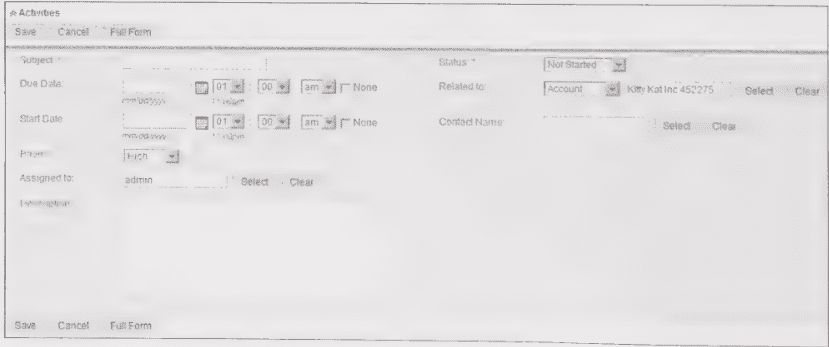

输入 **Subject**，然后通过单击到期日期末尾的 **None** 复选框取消选中，并使用日历弹出窗口选择日期来选择 **Due Date** 和时间。您还可以设置任务的 **Priority**，为其分配 **Status**（**Not Started**、**In Progress**、**Completed**、**Pending Input** 或 **Deferred**），并为任务输入 **Description**。

完成后，单击 **Save** 按钮返回 **Kitty Kat Inc 452275** 的账户详细视图，其中 **Activities** 子面板中有一个新任务。现在单击 **Home** 选项卡，您应该在 **My Open Tasks** 区域中看到此任务。您还会注意到，如果您转到 **Activities** 选项卡并单击快捷栏中的 **Tasks**，您应该看到列出的所有任务，包括此任务。

## Scheduling a call or meeting

几天后，Doc 在他为自己设定的截止日期前完成了给 Rachel 的提案。然后他将任务标记为“已完成”，并想将提案发送给 Rachel，几天后再给她打电话跟进。他将提案发送给 Rachel（请参阅即将到来的关于管理电子邮件的部分），询问她什么时候适合通话。她回复了一封电子邮件，提及时间和日期，Ray 需要将该通话预约到他的日历中。他单击 **Activities** 选项卡，然后单击 **Schedule Call** 快捷方式。他看到的屏幕如下所示：

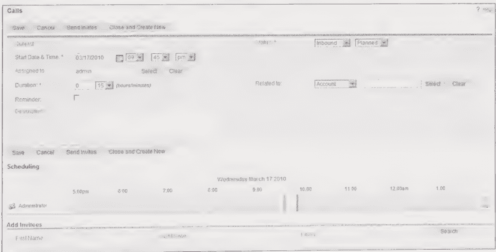

他开始输入通话详细信息，键入**主题**，设置**日期**（使用日历弹出窗口）和**时间**，并选择**账户**。当他浏览屏幕底部区域时，他意识到自己遇到了问题。他的电话开始和结束时间以深色块标记在他的一天时间轴上。不幸的是，他的一天中有一个蓝色段标记着预先存在的承诺，而新通话的拟议时间与此冲突。这个示例突出了日历系统不仅通过提供一种易于跟踪活动的方式来帮助您管理活动，而且还通过提醒您潜在的日程安排冲突来避免重复预订特定时间段的方式。在此示例中，它提供了足够的警示，提示 Doc 联系 Rachel 约定新时间。

您的 CRM 系统还允许您预订涉及多名员工和客户联系人的通话和会议。这是通过在相应活动的编辑屏幕底部添加其他个人作为**受邀人**来实现的。要搜索并添加其他受邀人，输入他们的名或姓进行搜索，然后单击您希望包含的条目旁边的**添加**按钮。为了避免日程安排冲突，任何员工条目的空闲/忙碌状态都以与 Doc 相同的方式显示。

您可能会问，如果无法查看客户的承诺日历，将客户添加为受邀人有什么意义？这样做将允许您通过单击编辑视图顶部的**发送邀请**按钮，通过电子邮件向他们发送邀请。邀请不仅会提醒收件人有关活动，还会提供相关详细信息，例如预定的日期和时间。

如果收件人碰巧有权访问发送邀请的 SugarCRM 系统，他们还可以登录系统，并从其各自的**主页**选项卡中接受、暂时接受或拒绝该活动。接受该活动将自动将其添加到该用户的日历中，而拒绝它将将其标记为已拒绝且不会添加到用户的日历中。

## 管理电子邮件

在上一节中，当 Doc 需要向 Rachel 发送提案时，他就在 SugarCRM 内部完成了。这是因为 SugarCRM 包含其自己的电子邮件客户端，允许您发送和接收电子邮件，并自动将这些电子邮件链接到相应的账户或联系人。

让我们回顾一下 Doc 发送电子邮件所使用的流程。首先，如果仍然可见，请单击**Rachel Wason** 的**最近查看**链接以访问其详细信息视图，或在**联系人**模块中查找该联系人。

在该账户的**活动**子面板中，找到**撰写电子邮件**按钮并单击它。您将看到**撰写电子邮件**屏幕，在 Doc 的场景中，它看起来大致如下：

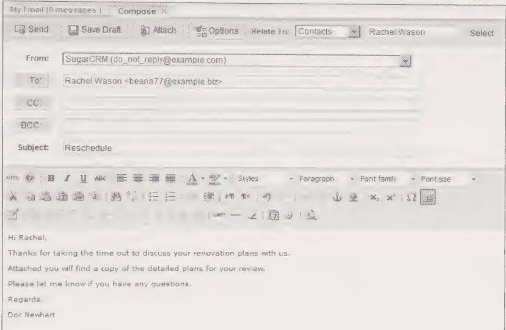

请注意，Doc 已使用**浏览**按钮将提案附加到电子邮件中。当 Doc 单击**发送**按钮将此电子邮件发送给 Rachel 时，他将收到一条确认电子邮件已发送的消息。然后，他可以单击返回到 **Rachel Wason** 联系人详细信息记录，查看已发送的电子邮件现在已包含在**历史记录**子面板中，从而允许 RayDoc 的任何其他人查看最新的通信。

让我们进一步了解 SugarCRM 的电子邮件功能。将鼠标悬停在**协作**选项卡上，然后单击**电子邮件**链接以访问电子邮件客户端。

电子邮件客户端在用于发送或接收电子邮件之前需要进行一些配置。电子邮件设置可以通过将鼠标悬停在**活动**选项卡上，选择**电子邮件**，然后单击**设置**按钮来定义。您需要知道您的电子邮件服务器连接信息才能完成该过程。

## 电子邮件模板

在撰写电子邮件时可以引用电子邮件模板（请注意上一张截图中撰写电子邮件屏幕上的使用模板字段）。当您创建电子邮件模板时，可以插入变量占位符，用于名、姓、地址或电子邮件等信息。保存的模板随后可以应用，变量占位符将从链接的账户或联系人记录中提取的真实数据填充。这在电子邮件面向一个或多个个人，或通过电子邮件营销活动进行批量营销（本书后面将讨论）的场景中尤其有帮助，因为它可以个性化每条消息，让收件人感觉谈话仅与他们有关，而不仅仅是大规模电子邮件的一部分。以下图片演示了一个已插入一些变量占位符的电子邮件模板。请注意其与撰写电子邮件窗口的相似之处。

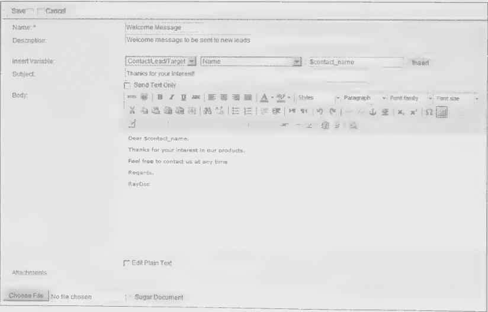

## 高级用户界面功能

在离开本入门章节之前，我们需要解决一些重要的 SugarCRM 用户界面功能，包括以下内容：

## 打印信息

SugarCRM 中的大多数列表和详细信息视图屏幕在主体右上角都有一个**打印**图标。单击此图标会将屏幕内容更改为更适合打印的同一信息版本，然后您可以使用浏览器的**打印**按钮进行打印。以下图片显示了转换为打印的**账户列表**视图屏幕：

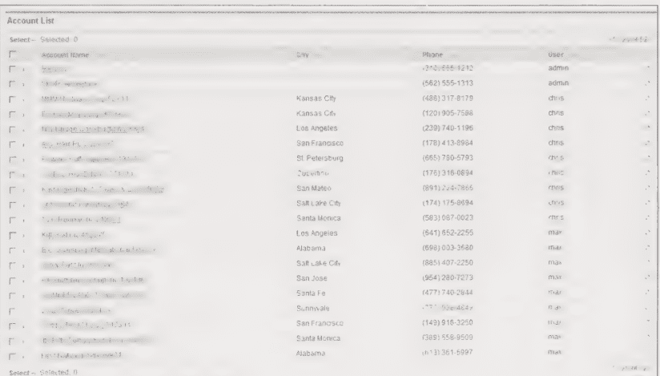

## 获取帮助

与**打印**图标一样，大多数 SugarCRM 列表和详细信息视图屏幕在主屏幕主体右上角都包含一个**帮助**图标。单击**帮助**图标将导致系统显示上下文相关的帮助，类似于以下内容：

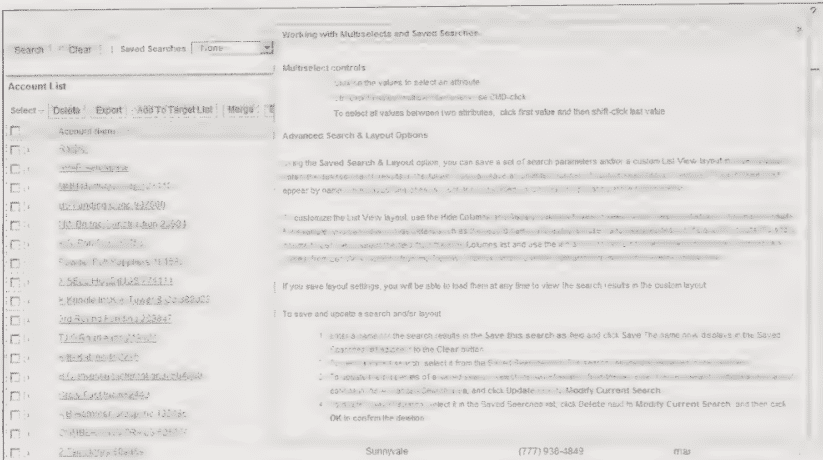

它不旨在作为导师，但确实提供了与您正在工作的系统当前区域相关的有用信息。

## 导出信息

本质上，SugarCRM 中的所有列表视图屏幕在条目列表的左上角和左下角都有一个高亮显示的**导出**链接。此功能允许您通过简单选择条目来导出当前列表中的记录。要选择它们，可以勾选行项目左侧的复选框，或选择**选择**下的一个选项。

完成选择后，单击**导出**链接，您的信息将输出为**逗号分隔值 (CSV)** 格式文件（Microsoft Excel 可以轻松读取）。试试看，使用 Excel 在桌面上打开导出的文件，查看其内容。以下是一个示例结果，将如下屏幕所示：

|   | A | B | C | D | E | F | G | H | I | J |
|---|---|---|---|---|---|---|---|---|---|---|
| 1 | | | | | | | | | | |
| 2 | 8529fa5c-962b-dc44-4b43-1a7742c766 | Katy Inc | 45275 | 3/17/2010 17:43 | 3/17/2010 17:43 | 1 | 1 | 1 | 2 | seed_max_id | Customer |
| 3 | 4c559a5b-7c6d-0dc4-40a4-1a7742c26 | S C Investing International | 504338 | 3/17/2010 17:43 | 3/17/2010 17:43 | 1 | 1 | 1 | 0 | seed_max_id | Customer |
| 4 | 4e64746c-8c3c-2e19-15b8-1a7742c7d1 | MMM Mortuary Corp | 527118 | 3/17/2010 17:43 | 3/17/2010 17:43 | 1 | 1 | 1 | 0 | seed_max_id | Customer |
| 5 | 4e64746c-8c3c-2e19-15b8-1a7742c8b | B5 Funding Corp | 937689 | 3/17/2010 17:43 | 3/17/2010 17:43 | 1 | 1 | 1 | 0 | seed_max_id | Customer |
| 6 | 1e4b107-49c8-408e-9c3c-1a7742c8b | B5 Funding Corp | 937689 | 3/17/2010 17:43 | 3/17/2010 17:43 | 1 | 1 | 1 | 0 | seed_max_id | Customer |
| 7 | 3b4049a-4611-4188-618b-1a7742c5ce | W Bridge Construction | 23964 | 3/17/2010 17:43 | 3/17/2010 17:43 | 1 | 1 | 1 | 0 | seed_max_id | Customer |
| 8 | 1abf6b58-51b8-4e57-62e0-4b417760bf | A B Hammer Group Inc | 132166 | 3/17/2010 17:43 | 3/17/2010 17:43 | 1 | 1 | 1 | 0 | seed_max_id | Customer |
| 9 | 4e64746c-8c3c-2e19-15b8-1a7742c3c8 | CUMBERLAND AND TRAILS | 580775 | 3/17/2010 17:43 | 3/17/2010 17:43 | 1 | 1 | 1 | 0 | seed_max_id | Customer |
| 10 | 4e6482c1-cbf9-4e19-15b8-1a7742c3c8 | CUMBERLAND AND TRAILS | 580775 | 3/17/2010 17:43 | 3/17/2010 17:43 | 1 | 1 | 1 | 0 | seed_max_id | Customer |
| 11 | 4e066a3c-cab1-8133-2bb2-4b417760c1 | A G Pair PLC | 327537 | 3/17/2010 17:43 | 3/17/2010 17:43 | 1 | 1 | 1 | 0 | seed_max_id | Customer |
| 12 | 12a96c9f-5c40-1913-4b48-1a77803ad | Power Puff Suppliers | 191562 | 3/17/2010 17:43 | 3/17/2010 17:43 | 1 | 1 | 1 | 0 | seed_max_id | Customer |
| 13 | 1e4b107-49c8-408e-9c3c-1a7742c3c8 | CONS TRUST | 4281784 | 3/17/2010 17:43 | 3/17/2010 17:43 | 1 | 1 | 1 | 0 | seed_max_id | Customer |
| 14 | 1e4b107-49c8-408e-9c3c-1a7742c3c8 | First National Bank | 593997 | 3/17/2010 17:43 | 3/17/2010 17:43 | 1 | 1 | 1 | 0 | seed_max_id | Customer |
| 15 | 1e4b107-49c8-408e-9c3c-1a7742c3c8 | K Kingle Inck A Tower & Co | 398076 | 3/17/2010 17:43 | 3/17/2010 17:43 | 1 | 1 | 1 | 0 | seed_max_id | Customer |
| 16 | 1e4b107-49c8-408e-9c3c-1a7742c3c8 | Billy Bentley Conglomerate Inc | 548773 | 3/17/2010 17:43 | 3/17/2010 17:43 | 1 | 1 | 1 | 0 | seed_max_id | Customer |
| 17 | 1e4b107-49c8-408e-9c3c-1a7742c3c8 | First National Bank | 593997 | 3/17/2010 17:43 | 3/17/2010 17:43 | 1 | 1 | 1 | 0 | seed_max_id | Customer |
| 18 | 1e4b107-49c8-408e-9c3c-1a7742c3c8 | First National Bank | 593997 | 3/17/2010 17:43 | 3/17/2010 17:43 | 1 | 1 | 1 | 0 | seed_max_id | Customer |
| 19 | 1e4b107-49c8-408e-9c3c-1a7742c3c8 | TJ Outsourcing Inc | 239671 | 3/17/2010 17:43 | 3/17/2010 17:43 | 1 | 1 | 1 | 0 | seed_max_id | Customer |
| 20 | 299b6c5c-39b8-591c-1d4a-4b417760c0 | Rg/Cxc | 3/17/2010 20:11 | 3/17/2010 20:11 | 1 | 1 | 1 | 0 | seed_max_id | Customer |
| 21 | 1b42b713-b4b0-4603-4b9b-4b417760c0 | SPAR Aerospace | 3/17/2010 20:54 | 3/17/2010 20:54 | 1 | 1 | 1 | 0 | seed_max_id | Customer |

## 批量操作

如**导出**示例中所述，能够从列表中选择记录，允许对所选项目执行进一步操作。例如，您可以使用屏幕底部的**更新**和**删除**按钮，分别对记录进行批量更改或删除：

- 如果我们以**账户列表**视图屏幕作为**更新**的示例，多个账户可以重新分配给另一个用户，或分配新的行业分类或类型。只需在列表中选择适当的记录，然后选择新的账户类型，例如**客户**，最后单击**更新**按钮。您可以通过在屏幕的**批量更新**部分中定义相应字段的适当值，同时更改多个字段的值。

- **删除**按钮的工作原理类似，它要求您在单击**删除**按钮之前选择要删除的记录。

- 请注意，SugarCRM 不包括撤销功能，因此使用这些功能时必须小心。

## 输入名片

SugarCRM 中最好的秘密之一是**输入名片**快捷方式。它在**主页**和**联系人**模块中可用。此功能允许用户输入新联系人，但如下图所示，它还提供在同一屏幕上创建新账户、机会和后续会议的选项。

此功能不仅减少了输入数据所需的按键次数，还便于后续处理。通过一个简单的屏幕，您可以输入个人的信息，以及其工作地点的信息，并为自己设置提醒，以便致电与其讨论需求，或与其聊聊您如何能为其提供服务。名片在以下截图中显示：

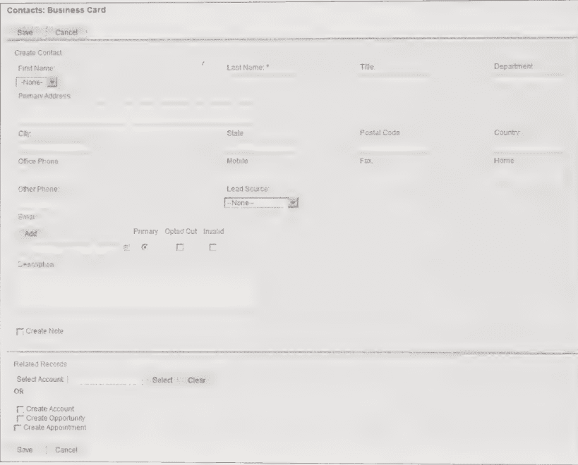

## 从 vCard 创建

在 **Contacts** 选项卡上有一个名为 **Create from vCard** 的快捷方式。如果您已有联系人的 vCard 文件，此功能可让您快速创建联系人。如今，许多人倾向于在电子邮件中附加 vCard，因此这可以是新联系人数据输入的一种非常快速且便捷的方式。

例如，如果您在桌面上有新联系人的 vCard，只需单击 **Create from vCard** 快捷方式，您将看到如下截图所示的屏幕。然后单击 **Browse** 按钮，使用出现的对话框找到您想要的 vCard 并选择它。最后，单击 **Import** vCard 按钮，即可完成。

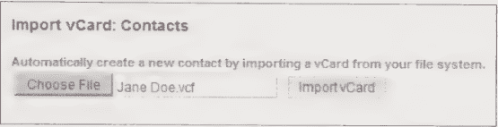

## 快速新建项目

SugarCRM 中几乎每个模块的列表视图屏幕左下角都有一个 **Quick New Item** 框。此框会根据您所在的模块或选项卡而有所不同，并允许您创建与当前选定模块相对应的新项目。例如，单击 **Contacts** 将显示联系人列表视图以及用于创建新联系人条目的 **Quick New Item** 框。

它不包含新项目可能包含的所有字段，但它包含所有必填字段，允许您快速添加新条目。

## 摘要

在本章中，我们介绍了使用 CRM 系统的基础知识，例如将信息输入系统，以及在相关信息项之间快速导航。我们涵盖的一些关键主题包括以下内容：

- 如何访问 CRM 系统。如何使用不同的主题来美化用户界面以及屏幕布局的主要组件。
- 如何在 CRM 系统中导航，使用不同的模块选项卡，并讨论每个模块的列表、详细信息和编辑视图屏幕。
- 如何输入账户和联系人，以及它们之间的链接。
- 每个详细信息视图屏幕上的主面板和相关子面板的信息结构是什么样子。
- 线索如何转化为商机，以及商机如何汇总形成销售管道。
- 仪表板如何帮助您直观地解释销售管道，按月份和销售人员进行细分，并为业务的好转和下滑提供远期预警系统。
- 如何使用 SugarCRM 日历来规划您的业务日程，检查日程冲突，并讨论同事的日历。
- 如何在 SugarCRM 中输入业务活动，以及为所有账户和联系人积累活动历史记录的价值。
- 许多特殊的用户界面功能如何提高数据输入过程的速度，并简化几项常见任务的执行。

在下一章中，我们将通过处理更高级的 CRM 主题（如界面整合、项目管理、文档管理、客户服务管理和其他主题）来完成对 SugarCRM 如何提供全面 CRM 功能的探索。我们还将从 CRM 中删除示例数据，导入您自己的数据，然后探索 CRM 系统在您的业务中承担更广泛角色的更多高级方式。
