## 扩展 SugarCRM 系统的业务角色

在上一章中，我们介绍了账户、联系人、线索、商机、销售管道以及使用整合日历的 CRM 基础知识。

在本章中，我们将处理 CRM 系统在您的业务中角色的扩展，超出基本 CRM 功能的范围。我们将介绍一些现代 CRM 系统中最常见的其他相关应用程序。这些应用程序经常被添加到 CRM 系统中，以利用 CRM 系统被公司大多数人使用，并且已经包含了关于业务客户、合作伙伴和供应商的所有信息这一事实。

这些高级 CRM 主题包括以下内容：

- 删除示例数据：将数据库重置以消除默认数据
- 营销活动：创建和运行电子邮件营销活动

## 重置数据库

要开始本章，我们先删除 SugarCRM 安装中的示例数据，以便它能接收您的数据。此练习将帮助您熟悉导入数据的过程，随着您对 SugarCRM 的使用越来越多，您可能会发现这在未来非常有帮助。

清除示例数据的最快方法是重新安装 SugarCRM。请注意，此步骤仅为了完全清除所有示例数据才需要。它 *不是* 成功导入的要求。我们的主要目标是将数据库重置为不再包含任何数据的状态。

## 扩展 SugarCRM 系统的业务角色

我们的第一步将是重新启用 SugarCRM 安装程序，这将允许我们轻松删除示例数据。要重新启用安装程序，请导航到 SugarCRM 安装文件夹，并使用您选择的文本编辑器编辑 `config.php` 文件。找到以下内容的行：

```
'installer_locked' => true,
```

将其更改为：

```
'installer_locked' => false,
```

保存更改，打开您的网络浏览器。假设您按照附录 A 或附录 B 中的说明最初安装了 SugarCRM，您应该能够通过浏览 `http://<ip address of server>/sugarcrm/install.php` 再次启动安装程序。

正常进行安装向导，但在到达提示您输入数据库信息的页面时要小心。确保您在 **数据库名称** 字段中输入与您安装示例数据时使用的 _相同_ 数据库名称。单击下一步之前，输入您可能需要连接到数据库服务器的任何其他值，例如 **数据库管理员用户名**，然后验证 **用示例数据填充数据库？** 是否设置为 **否**。单击 **我接受** 以确认您希望覆盖数据库并继续其余的安装过程，直到完成。下次您访问此 SugarCRM 安装时，它应该不再包含任何示例数据。

现在阅读 _附录 C_，并将您的账户和联系人数据导入 SugarCRM 系统。_附录_ 还为您提供了从当前联系人管理器（以 Microsoft Outlook 为例）导出账户和联系人数据的说明，以防您需要帮助。如果您愿意，也可以从 Salesforce.com 或自定义逗号或制表符分隔文件将线索和商机导入 SugarCRM。一旦您导入了自己的账户和联系人数据，请随时开始添加商机，以便仪表板开始反映您业务的真实状态。

## 营销活动

到目前为止，我们已经了解了像 SugarCRM 这样的 CRM 系统如何用于管理客户相关信息和历史记录，以及跟踪商机和销售管道。现在，让我们开始探索一些营销自动化方面以及其他使 CRM 系统成为许多企业数据中心的功能。让我们从电子邮件营销开始。

CRM 系统一个特别强大且潜在盈利的方面是能够进行电子邮件营销活动。CRM 系统包含创建有效电子邮件营销活动所需的所有工具；它们跟踪您的线索和联系人，并在其功能集中包含电子邮件发送功能。让我们详细研究一个电子邮件营销活动。

为了说明营销活动是如何开发、管理、执行，然后跟踪成功的，我们将为 RayDoc 开发一个示例营销活动。您可能希望在跟随本书示例的同时，为您自己的业务开发一个。

## 目标、线索和联系人

首先，我们需要讨论一些相关术语。创建营销活动涉及一种新类型的信息——目标。以下是关于目标及其与线索和联系人关系的一些重要点：

- 目标为营销活动提供输入。目标可以来自租用的列表、网络注册表单、贸易展览会、您的线索或您的联系人。您可能与该人有现有业务关系，也可能没有。对于我们的示例，我们将假设您已创建一个名为 _My July E-mail Campaign_ 的电子邮件活动，其收件人列表总计 12,000 个目标，由您购买的 10,000 个电子邮件地址和您联系人列表中的一个子集（总计 2,000 个条目）组成。
- 线索是活动的结果。他们是响应活动的人，但不一定是已经购买您产品的人。活动可以是像您的标准网站注册表单这样的 _持续性_ 入站活动。或者，活动可以是外发电子邮件活动。假设您有 200 人点击了您 _My July E-mail Campaign_ 的特殊网站注册表单链接，完成并提交了表单。这 200 人现在是 SugarCRM 中的线索。他们应该被标记为线索来源值 _My July E-mail Campaign_，以便正确跟踪您的活动在产生线索方面的有效性。
- 现在您开始线索资格审查过程，分析您收集的关于这些线索的信息。您发现这 50 个线索符合您的目标资格标准。您现在将这 50 个线索分配给相应的销售人员。
- 销售人员随后尝试联系线索并启动销售流程。假设 Doc 与其中一个线索交谈，该线索表示有兴趣了解更多产品信息。Doc 现在将把此线索转换为联系人，并创建一个商机。


总而言之，目标（Targets）用于发起营销活动，潜在客户（Leads）是营销活动的结果，而联系人（Contacts）则是有兴趣购买或已购买您产品的合格潜在客户。未来的营销活动反过来可以利用这些相同的记录来生成更多的联系人、潜在客户，并识别进一步的追加销售或交叉销售机会。

既然您已经了解了理论，让我们开始实践。将鼠标悬停在 **Marketing** 选项卡上，然后单击 **Campaigns** 以访问 Campaigns 模块。

在 SugarCRM 中，您可以创建营销活动来管理批量电子邮件及其收件人（即目标）的发送。您可以通过从联系人或潜在客户中选择，或者从 _Comma Separated Values_ (CSV) 或 _Tab Separated Values_ (TSV) 文件中批量导入，将目标添加到营销活动的目标列表中。我们将在本章稍后介绍这一过程部分。让我们先为 RayDoc 创建一个营销活动。

Doc 刚刚开始供应一种名为 Superflor 的新型层压木地板，他对此感到非常兴奋。它外观出色，制造质量优良，来自他的一家关键供应商，并且价格非常有竞争力。他想让大家知道它，并获得一些早期销售来向供应商展示。

在尝试定义营销活动之前，您必须先定义电子邮件设置；否则，您会发现创建营销活动的过程无法完成。要定义电子邮件设置，请单击 **Admin | Inbound Email | New Bounce Handling Account**，您将看到类似于以下的屏幕：

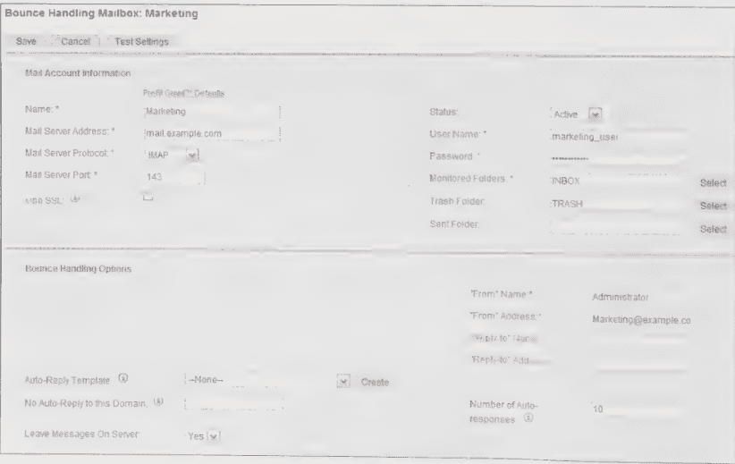

在 **Name** 字段中输入 **Marketing**，然后在其余字段中提供您希望使用的电子邮件帐户的相应设置，并单击 **Save**。

完成电子邮件帐户设置的定义后，您可以创建 Superflor 营销活动。要创建它，请将鼠标悬停在 **Marketing** 选项卡上，然后单击 **Campaigns**。接下来，单击 **Campaign Wizard** 快捷方式。您会注意到有三个选项，即 **Newsletter**、**Email** 和 **Non-email based Campaign**，如下图所示：

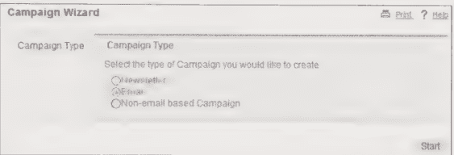

请注意，从这三个选项中，SugarCRM 只能自动跟踪 **Newsletter** 和 **Email** 选项的指标。**Non-email based Campaign** 选项完全依赖手动输入来衡量效果。

此外，Newsletter 和 Email 营销活动之间存在细微差别。前者用于定期消息传递。例如，当公司每月向客户提供更新时。后者用于批量电子邮件营销活动，例如季度促销。

最后，它们在处理退订请求方面有所不同。从 Newsletter 退订的收件人将被移除为包含该收件人的特定 Newsletter 营销活动的收件人。但是，从 Email 营销活动退订的收件人将被标记为已选择退出 **所有** 批量电子邮件活动。对于我们的示例，请选择 **Email** 并单击 **Start**。您现在将看到以下屏幕：

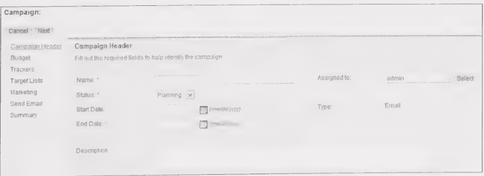

## 扩展 SugarCRM 系统的业务角色

输入以下信息以定义营销活动：

**Name:** Superflor

**Status:** Active

**Start Date:** Today's date

**End Date:** A month from today

输入给定值后，单击 Next。您现在应该看到以下屏幕，您可以在其中输入与营销活动相关的财务信息：

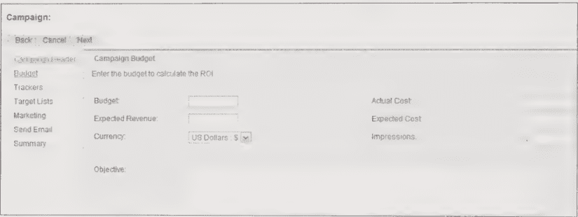

这对您以后的指标很有帮助，因为它将允许您正确衡量从营销活动中获得的每个潜在客户的成本。输入信息后，单击 Next 以访问 Campaign Tracker URLs 屏幕，类似于以下内容：

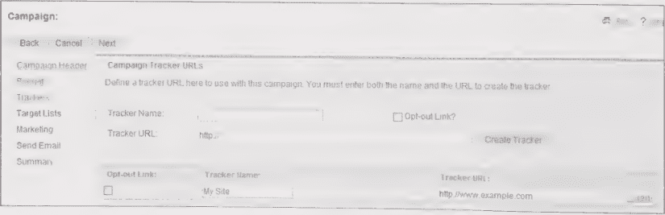

Tracker URL 用于衡量点击率，即收件人访问您网站页面的次数。它是一个有效的工具，用于监控访问您网站特定页面的收件人数量。

Tracker URL 由两部分组成：第一部分是您选择的描述符，第二部分是网站地址。该地址代表您网站上的一个页面，通过营销活动发送的电子邮件的收件人可以在该页面上获取有关您正在推广的特定产品或服务的更多信息。名称源于这样一个事实，即 SugarCRM 会自动跟踪通过包含该页面的电子邮件点击访问该页面的次数。

我们的营销活动将包含一个 Tracker URL 条目，包含以下信息：

- **Tracker Name:** My Site
- **Tracker URL:** `http://(your company's website address)`

输入给定信息后，单击 Create Tracker 按钮。您一定注意到了 Tracker Name 字段右侧的 Opt-out Link? 复选框。选中它将允许您将链接定义为退订链接。如果收件人单击它，收件人的电子邮件地址将自动标记为已选择退出所有电子邮件通信。

单击 Next 继续，您将被要求提供一个包含电子邮件预期收件人的目标列表，如下图所示：

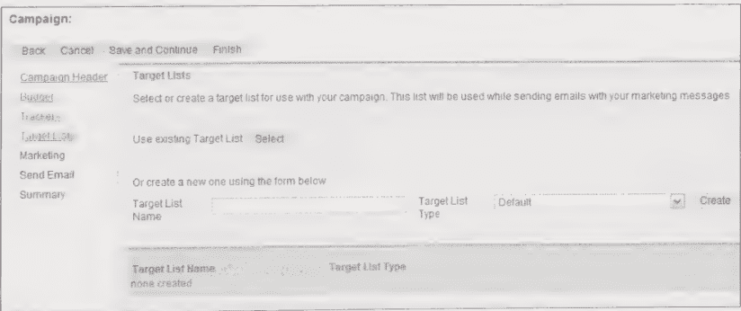

由于我们尚未创建目标列表，我们将定义一个空列表。在 **Target List Name** 中输入 `Superflor Target` 并单击 **Create**。关于如何用收件人填充目标列表的说明将在本章稍后提供。

单击 **Save and Continue** 以访问 **Marketing Email** 定义屏幕。在 **Name** 字段中输入 Superflor Intro，并按照以下屏幕截图所示定义其余值：

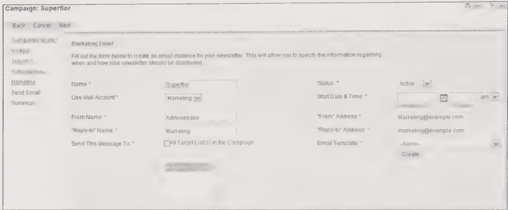

假设您已按照本节前面所述定义了电子邮件帐户，您应该能够为 **User Mail Account** 设置选择 **Marketing**。选择它，将 **Status** 设置为 **Active**，并为 **Start Date & Time** 输入当前日期和时间。

请注意，**Email Template** 尚未定义，下拉菜单仅显示系统定义模板的选项。以下部分将介绍为我们的营销活动创建电子邮件模板的过程。

## 创建电子邮件模板

要执行电子邮件营销活动，Doc 需要一个电子邮件模板。要在定义营销活动时创建它，请单击 **Marketing Email** 屏幕上的 **Create** 按钮。或者，如果您希望在任何其他时间创建模板，可以将鼠标悬停在 **Collaboration** 选项卡上，单击 **Emails**，然后选择 **Create Email Template** 快捷方式。然后将出现以下屏幕：

## Email Templates:

继续在消息正文中输入一些文本。如果您希望嵌入 SugarCRM 中的字段，请使用 **Insert Variable** 选项将其嵌入光标当前位置，如上一屏幕截图所示——紧跟在消息正文中的 **Dear** 之后。**Insert Tracker URL** 选项允许您添加用于衡量点击率的跟踪链接。要插入它，请从下拉菜单中选择所需的 Tracker URL 并输入链接所需的文本。在此示例中，使用了文本 **Superflor**。单击 **Insert URL Reference** 将在光标当前位置插入带有提供文本的链接。

对您的消息满意后，单击 **Save**，然后单击 **Next** 以进入营销活动定义的下一阶段。系统将提示您发送电子邮件或直接完成。单击 **Finish** 按钮。


## 将目标添加到营销活动

现在我们需要将一些目标添加到这个电子邮件营销活动中。我们将把它们添加到前面章节中定义的测试目标列表中。在营销活动详细信息视图中，单击营销活动摘要屏幕 **目标列表** 部分中的 **Superflor Target**，如下图所示：

接下来，您需要将一些目标添加到 **Superflor Targets** 列表中。要添加它们，请单击 **目标**、**联系人**、**线索** 或 **用户** 的 **选择** 按钮，以选择相应的条目。完成选择后，您的 **Superflor Target** 列表应类似于以下图像：

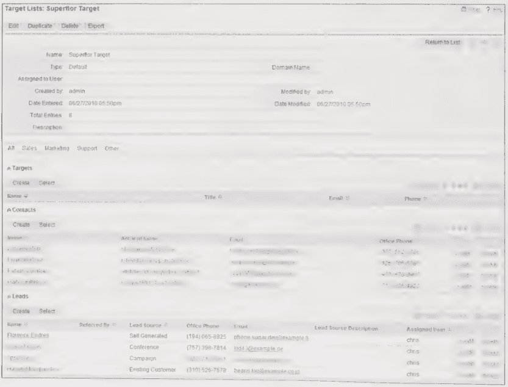

现在我们已经选择了一些目标（在实际操作中，您当然会选择更多），可以发送电子邮件了。例如，将鼠标悬停在 **营销** 选项卡上并单击 **营销活动** 以选择 **Superflor**，然后单击顶部的 **发送电子邮件** 按钮。系统将提示您选择收件人目标列表。仅显示与营销活动关联的目标列表。选中 **Superflor** 条目旁边的复选框，然后单击 **发送** 以发送电子邮件，如下图所示。如果您未来的营销活动包含多个目标列表，在发送电子邮件时可以随意选择其中任意多个。

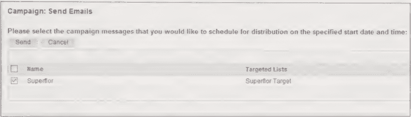

**发送** 按钮上的标签可能有些误导。实际上，电子邮件被放入队列中，而不是立即投递。队列必须由 SugarCRM 处理，电子邮件才能投递。下一节将更详细地讨论电子邮件队列。

## 大量电子邮件队列

现在我们已成功配置电子邮件营销活动的各个组件并将其放入队列，那么问题来了，我们如何实际投递这些电子邮件？

假设您的 SugarCRM _Scheduler_ 已配置并运行，系统将在电子邮件营销活动中定义的日期和时间到达时自动处理队列。如果您拥有系统的管理员权限，请在 **管理** 控制面板的 **大量电子邮件管理器** 部分中查看，您将看到队列中的各种电子邮件。

## 扩展 SugarCRM 系统的业务角色

检查电子邮件队列的另一种方法是单击给定营销活动详细信息视图屏幕上的 **查看状态** 按钮。相关部分在以下图中显示：

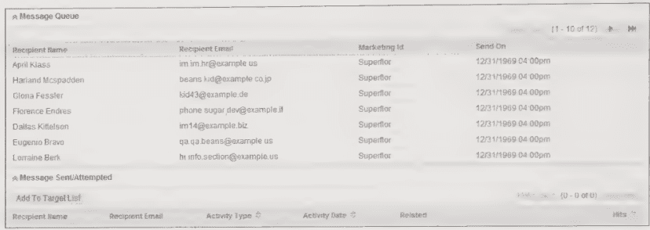

仔细观察图像会发现，有两个重要部分，即 **消息队列** 和 **已发送/尝试的消息**。 **消息队列** 显示待发送的消息。更重要的是，后者部分显示已发送的消息。

当然，这假设之前配置的电子邮件设置运行正常。检查 **已发送/尝试的消息** 部分将揭示与发送过程相关的潜在问题。如果您注意到该部分中任何标记为 **失败** 的条目，请单击 **管理 | 电子邮件设置** 来验证系统电子邮件服务器设置。

此类问题的常见原因包括：

- 简单邮件传输协议 (SMTP) 邮件服务器地址不正确
- SMTP 用户名或密码输入错误
- 缺少 PHP 库，例如 **互联网消息访问协议 (IMAP)** 或 **安全套接字层 (SSL)**

如果您使用的是 SugarCRM 的托管版本，可用于故障排除的工具可能有限。但是，测试该过程的一个好方法是使用 **telnet** 工具从 SugarCRM 服务器手动连接到您的邮件服务器，并手动发送相关的 SMTP 命令来发送消息。如果手动过程失败，SugarCRM 也会失败。

通过 telnet 模拟行为的详细步骤会因您的设置而异，但是，有关执行这些步骤的信息在互联网上很容易找到。

## 营销活动指标

电子邮件发送后，您可以通过访问营销活动的详细信息视图屏幕并再次单击 **查看状态** 按钮来监控营销活动的有效性。除了查看队列中仍有多少封电子邮件外，您还将看到阅读您电子邮件的收件人数量、点击率（以及他们访问了哪个 URL）、选择退出的收件人数量以及其他详细信息，如下图所示：

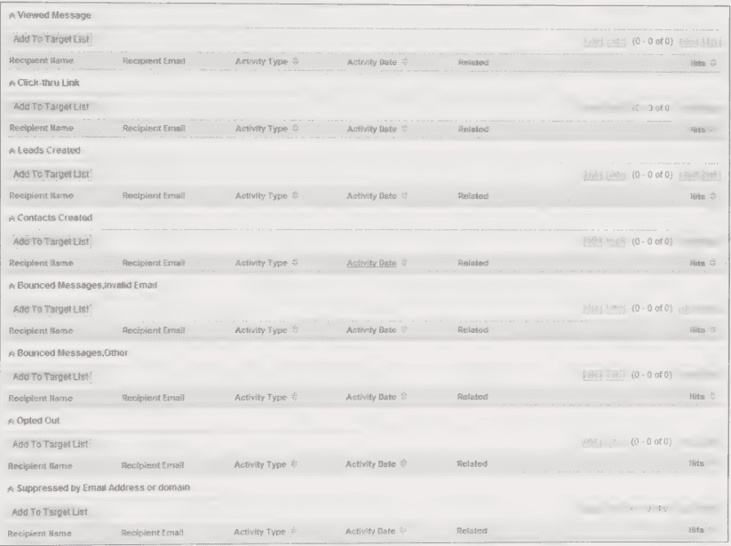

虽然前面的图像中未显示，但状态屏幕还跟踪您的营销活动生成的账户、线索和商机数量。此度量基于所述记录的营销活动值与当前检查的营销活动匹配。

最后，如果您单击营销活动详细信息视图屏幕上的 **查看 ROI** 按钮，您将能够查看与营销活动相关的财务信息，如下图所示：

| 名称    | 主管    | 分配给:    | admin    |
|---------|---------------|-----------------|----------|
| 状态  | 活动    | 最后修改:    | 06/27/2010 05:00pm by admin |
| 开始日期 | 04/29/2010    | 创建日期:    | 06/22/2010 05:00pm by admin |
| 结束日期 | 07/29/2010    |    |    |
| 类型    | 电子邮件    |    |    |
| 预算: 美元 $    |    | 展示次数    | 0    |
| 预期成本: 美元 $ |    | 已赢得的商机    | 0    |
| 实际成本: 美元 $ |    | 每次展示成本: 美元 $ | $0.00    |
| 预期收入: 美元 $ |    | 每次点击成本: 美元 $ | $0.00    |

除其他信息外，您还将能够查看每次点击和展示的成本。这些工具可让您更好地评估哪些营销活动最具成本效益。

## 摘要

在本章中，我们介绍了 SugarCRM 的高级营销自动化方面，这些方面将您的 CRM 系统的角色从纯粹的 CRM 功能的狭窄范围扩展到一种稍广泛的吸引新客户的工具。本章讨论的关键主题包括：

- 删除最初试验的示例数据并导入您的实时数据
- 营销活动：如何创建电子邮件模板，使每个目标都能收到个性化电子邮件，如何组装电子邮件营销计划的目标列表，如何在 SugarCRM 中控制大量电子邮件队列，以及如何自动跟踪电子邮件营销活动的点击率

在 _第 6 章_ 中，我们将通过使用其他功能、自定义工具和技术以及其他 SugarCRM 商业和开源附加模块的功能来处理多个业务场景，从而完成对 SugarCRM 软件功能的探索。

我们将看到更多各种 CRM 系统功能的示例，这些功能有助于满足业务需求，例如客户服务、项目管理和其他业务需求。在探索商业 Sugar Professional 产品或其他地方提供的其他 CRM 模块后，您将知道可以集成到 SugarCRM 框架中的业务管理能力几乎没有限制。
