## SugarCRM 生态系统

在前两章中，您已经阅读了 SugarCRM 系统提供的基本 CRM 功能。我们还看到了标准系统可以执行的许多扩展功能，这些功能使其超越纯粹的 CRM，进入更广泛的业务管理角色。

SugarCRM 不仅由 SugarCRM 公司支持，还由全球庞大的用户社区支持。其中许多个人也是贡献者，因为他们为其他人可能遇到的问题提供解决方案。这可能以技术查询的答案形式出现，或者在其他情况下，他们是对系统的更正或增强。

虽然许多社区成员提供他们开发的附加组件的开源或免费版本，但有些仅收费提供。SugarCRM 公司为您提供了两个地方，方便您找到这些贡献。第一个是 SugarForge.org，包含大量增强功能和附加组件，其中绝大多数可以免费使用和/或开源。互补网站 SugarExchange.com 主要用于维护商业附加组件和增强功能的目录。

在本章中，我们将探讨一些 SugarCRM 社区版的免费附加组件，这些组件可以将其进一步扩展到多个方向。在此过程中，我们还将了解使用模块加载器工具的过程。这些附加组件可以分类如下：

- SugarCRM 社区版
  - 增强搜索：在本书前面，我们讨论了 SugarCRM 中可用的搜索功能。虽然有用，但默认功能可能相当有限。此增强功能扩展了默认功能，允许按日期范围、OR 条件和其他可能性进行搜索。

+   Google contacts/calendar connectors: Google offers a long list of quality web-based services aimed at helping both individuals and businesses of all sizes. Both Google Calendar and Google Contacts are attractive options for smaller-sized businesses because they are easy to use and ubiquitous. The latter also makes it a perfect extension for CRM systems, and these connectors aim at allowing you to extend your CRM data to these Google services.

+   Microsoft Outlook connector: Integration with Microsoft Outlook is critical to many organizations. These utilities allow you to synchronize data between Outlook and your SugarCRM deployment. If you prefer to use Outlook as your primary e-mail client, you will want to give this a look.

+   Microsoft Office integration: The prior chapter showed you some of the e-mail marketing capabilities that are a part of SugarCRM. However, many organizations do not exclusively use e-mails for their marketing activities. Direct mail campaigns are another popular form of marketing products and services, usually leveraging Microsoft Office to produce the piece. Office integration components allow you to create form letters in Microsoft Word and execute mail merge leveraging your customer information in SugarCRM.

+   ZuckerReports: This is a must for all Community Edition users. Given that Community Edition does not include a reporting module, you would only be able to generate reports using other tools, such as Crystal Reports, MS-SQL Reporting Services, and others. However, none of those tools are ready for SugarCRM and require intimate knowledge of the database. ZuckerReports offers a streamlined solution to reporting needs and is tightly integrated into SugarCRM.

+   Development toolkit & enhanced studio: Not all enhancements are specifically targeted at addressing end user needs or day-to-day requirements. Some of them are geared towards admin level tasks or simplifying the customization process. These tools are great examples of this, as they provide simple methods that make the process of applying more advanced customization features far easier.

+   Open quotes and contracts: This is an important functionality that is not included in SugarCRM Community Edition, but is critical to many sales organizations. This enhancement brings this much needed functionality to Community Edition users.

+   VeryThinClient: Provides access to SugarCRM data through wireless devices, such as smartphones or connected PDAs.

+   Security suite: This enhances the security model in SugarCRM to permit the assignment of data to multiple users, or teams, providing greater flexibility over data access.

Additionally, we will examine important aspects of the Professional and Enterprise Editions of SugarCRM that differentiate them from the Community Edition. This comparison should help you make a more informed decision regarding the more appropriate edition for your organization.

+   SugarCRM Professional/Enterprise Edition
    +   Product catalog and products module: These two modules within Sugar Pro provide a product catalog defining the products handled by your business, and a products module that lists the physical products in your inventory, on order, or the ones that are sold to clients.
    +   Quotes module: This Sugar Pro module uses data from the product catalog module to prepare customer quotations.
    +   Forecasting: This module within Sugar Pro provides the ability to generate individual and roll-up sales forecasts.
    +   Standard and custom reporting: Reporting is likely to be the single most important feature that differentiates Sugar Pro from the Open Source version. The reporting module in Sugar Pro gets better with each release, and is now a very capable system.
    +   Sales teams: This is a key feature of Sugar Pro. Sales Teams provides you with the ability to create teams of users who can share data between themselves that other users may not access. Combined with the Access Control Lists from release 4.0, they provide a good solution to data security.

At the end of this chapter, we also have a section about the SugarCRM online forums where users can interact and exchange ideas with other SugarCRM users and administrators.

Let us dive right in to these many and varied extensions to the SugarCRM Community Edition product. By the time we are done, you will be surprised and impressed at the range and capability of the features available to you, to enhance your SugarCRM Community Edition system that will help meet your evolving business needs.

Configuration management, or the tracking and documenting of modifications applied to the system becomes an important practice at this point. Since the enhancements that we will be exploring will be modifying your SugarCRM installation, it is vital to highlight the importance of documenting the changes that have been made as a general best practice. This will help pinpoint the source of any problems, or unintended changes in functionality that may arise through the installation or use of modules or other modifications.

As we go through the various add-ons, we will see how they relate to a small business, such as RayDoc, and discuss the real business value that they offer.

## SugarCRM Community Edition

SugarCRM has gained a lot of popularity because of the fact that it is a very cost-effective solution for many small or medium-size businesses. Its value has been greatly enhanced by the large community of users who have followed SugarCRM's lead and have also provided a number of product enhancements and add-ons for free. However, where exactly do you find them?

## SugarForge.org and SugarExchange.com

Open your web browser and navigate to `http://www.sugarforge.org`. On this website you will find dozens of projects that can be freely downloaded and installed onto your SugarCRM system. Take a moment to browse around and familiarize yourself with the various projects that are available. Be sure to bookmark the website for your future reference. You might notice that the various projects highlighted in the previous section of this chapter are all freely available for download on SugarForge.

Make a note of the details pertaining to the various projects. For example, the versions of SugarCRM that they support and other details. Some projects, while popular, do not support more current versions of SugarCRM. Overlooking this detail might cause you some frustration and aggravation when attempting to install it, hence you should be quite diligent in your selection.

Another website is SugarExchange.com that can be accessed by using the URL http://www.sugarexchange.com. It contains a variety of other enhancements and add-ons, or in some cases, more feature-rich versions of projects that are already available on SugarForge.org. It follows a model similar to the one that SugarCRM (the company) employs for its offerings. The main difference between the two websites is that SugarExchange.com is intended to be a catalog of commercial add-ons and enhancements for SugarCRM. Take a look at some of the items in the catalog and you will notice that they require purchase, unlike the items in SugarForge.org. Furthermore, you will notice that many of the projects are also not intended for use with SugarCRM Community Edition, as they are only used with the Professional and/or Enterprise Edition.

We will assume that the installation files corresponding with the various enhancements and modules to be examined have already been downloaded. As we progress through the rest of this chapter, we will learn how these installation files are used through the **Module Loader** tool, and then examine the enhancements in greater detail.

## Module loader

Before we dive into the functionality provided by the various modules and enhancements, we need to familiarize ourselves with the typical installation process.

Locate the **Enhanced Search** project on SugarForge.org and download the most current installation files. Save them onto a convenient location as we will use them in the following exercise to highlight the usage of the Module Loader tool.

You may have noticed that the installation files are contained in a ZIP archive. Do not unzip these files unless the documentation for the projects specifically instructs you to do so.

Our first step in the installation process will be to access the **Module Loader** tool found within the Admin control panel in SugarCRM. To access it, login to SugarCRM as an admin level user and then click on **Admin | Module Loader**.

## 现在应该出现类似下面的屏幕：

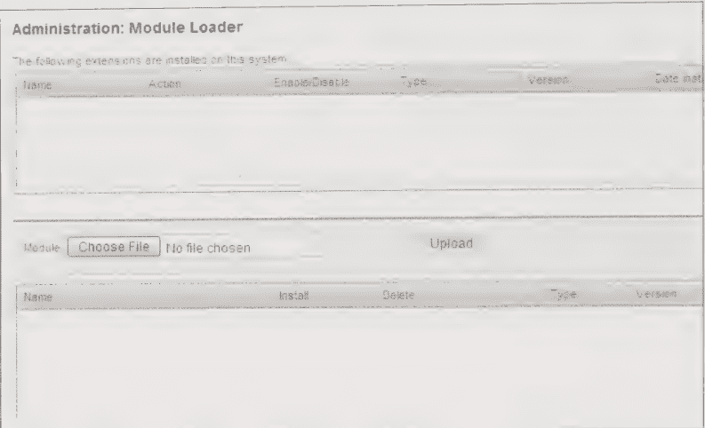

接下来，我们需要单击 **Choose File** 按钮。这样将允许您选择要安装的模块对应的安装文件。导航到先前下载的 zip 文件所在位置并选择它。继续单击 **Upload** 按钮。

单击 **Upload** 按钮将把 zip 文件复制到 SugarCRM 服务器并为其安装做好准备。这样做后，您会注意到模块已添加到 Module Loader 工具的底部区域。要完成安装，请单击相应条目旁边的 **Install** 按钮。然后您需要接受许可证并继续完成安装向导的其余步骤。

成功安装模块后，单击 **Back to Module Loader** 按钮。请注意，模块条目已从底部列表移至顶部，所有已安装的模块和增强功能都显示在此处。如果您决定稍后禁用或卸载某个模块，只需单击列表中其条目旁边的 **Disable** 或 **Uninstall** 按钮即可。

既然我们已安装 Enhanced Search 模块，让我们更仔细地了解一下它的功能。

## Enhanced search

迄今为止我们所考察的所有工具都有一个共同点；它们都为 SugarCRM 提供了新功能。然而，之前的任何工具都不修改现有功能的行为。Enhanced Search 功能将是我们首次涉足这一领域。

如前所述，SugarCRM 中可用的搜索功能是定位系统中数据的非常有用的方式，但同时其功能也相当有限。用户遇到的一个常见问题是，搜索行为无法从默认的 AND 连接器更改为 OR。无法做到这一点会带来许多挑战，如果搜索条件需要搜索多个字段，这些挑战会更加严重。

例如，如果您希望搜索办公电话号码以 310 开头或州字段设置为 California 的联系人，您会发现默认搜索功能只会返回办公电话号码以 310 开头且位于 California 的记录；这不是您要找的记录集。Enhanced Search 修改了现有功能以消除这一限制，并且总体上以多种方式提供更丰富的搜索体验。

安装通过 Module Loader 执行，当安装完成其功能后，它立即对所有 SugarCRM 用户可用。安装后，列表视图屏幕上的 Advanced Search 面板应类似于以下内容：

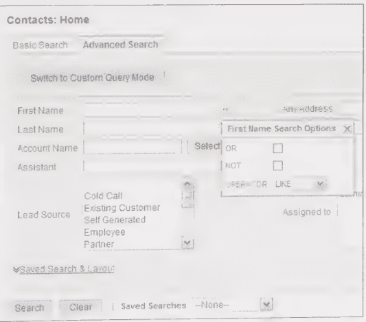

请注意显示字段后面紧跟的向下图标。单击该图标允许您选择与搜索相关的各种选项，包括以下内容：

- OR
- AND
- Operator (LIKE, RLIKE, EQUALS, IN, and BETWEEN)

这些选项允许您通过将默认连接器 AND 更改为 OR 来操纵搜索功能的行为，以便执行搜索，其中所需结果满足正在搜索的各种字段中的一个或多个字段的指定条件，而不是所有字段。LIKE 和 RLIKE 运算符允许您在不知道确切值的情况下搜索值的一部分。例如，如果您希望获取街道地址包含 **Main Street** 的所有联系人列表，无论门牌号如何，使用 LIKE 并使用以下搜索值将为您提供这些结果：% **Main Street** %。

此场景还让我们了解 RLIKE 选项的用法。与 LIKE 选项类似，它也用于搜索值的一部分，但它允许您在同一字段中查找多个值中的一个。例如，我们可以使用此选项搜索地址在 **Main Street** 或 **Broadway Avenue** 的联系人，方法是使用 RLIKE 和以下搜索值：**Main Street | Broadway Avenue**。

与 RLIKE 运算符类似的是 IN 运算符，它允许您通过以下方式指定值来搜索同一字段中的多个值：'value 1', 'value 2', 'value 3'。区别在于，使用 IN 会导致 SugarCRM 搜索在指定字段中与任何指定值精确匹配的记录，而 RLIKE 只需要字段包含该值，而不考虑字段中任何其他信息。

最后，使用 BETWEEN 选项允许您通过定义日期范围来搜索日期字段。这是 SugarCRM 默认不提供的常见搜索请求。

对于普通用户，例如 RayDoc 的用户，能够使用多种方法搜索数据非常强大且必不可少。

## Google connectors

可在 `SugarForge.org` 上免费获得，这些工具将允许您将 SugarCRM 系统中的数据同步到 Google 日历和/或 Google 联系人（取决于您选择安装的连接器）。

此增强功能解决的主要业务需求是将 CRM 数据扩展或暴露给非 SugarCRM 用户或系统。通过这些连接器，您将能够在 Google 日历中查看最初在 SugarCRM 中安排的活动。一旦在 Google 日历中，您可以像使用其他活动一样使用这些活动，包括与他人共享，或使用 Google Sync 将其同步到移动设备。

同样，联系人连接器允许您使用 SugarCRM 中的信息填充 Google 联系人列表。这又提供了一种扩展 SugarCRM 数据的方法，与 Google 日历场景类似，Google Sync 可用于将数据同步到移动设备。

即使是 RayDoc 这样的组织也能从这种功能中受益。例如，将 SugarCRM 数据同步到 Google 日历将允许他们与客户共享日历，让客户在不先联系 RayDoc 的情况下查找方便的预约时间。RayDoc 的服务人员还可以使用 Google Sync 配合 Google 联系人连接器，在其 BlackBerry 设备上维护客户姓名列表。这样，即使他们没有互联网访问权限，或身处无线服务不可行的区域，也能查看宝贵的联系人信息。当然，如果您使用的是 Android 智能手机，过程会更加无缝，因为手机与 Google 之间的同步是内置的，不需要 Google Sync 组件。

安装后，您需要配置连接器以将其链接到特定的 Google 帐户。您可以使用个人 Google 帐户或与企业帐户关联的帐户。如果您还没有 Google 帐户，则需要先注册一个才能继续。

掌握 Google 帐户信息后，并假设您已安装其中一个连接器，请单击 SugarCRM 中的 **My Account** 链接，然后单击左侧快捷菜单上的 **Google Account**。应出现以下屏幕：

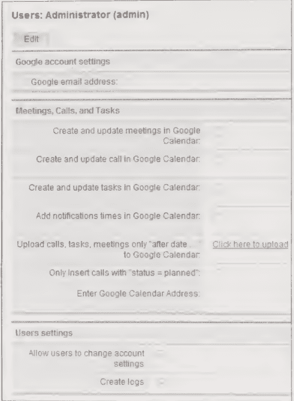

通过单击 **Edit** 然后 **Save** 调整设置。请注意，设置特定于每个 SugarCRM 用户。这允许 RayDoc 的用户从该功能中受益以启用它，而不希望使用它的用户可以简单地忽略它，而不会影响任何其他用户。

配置后，数据将在 SugarCRM 和 Google 之间自动同步。

## Microsoft Outlook connector

本书的这一部分，以及随后讨论 Microsoft Office 集成的部分，仅面向 Microsoft Windows 用户。如果您将用于访问 SugarCRM 安装的工作站未使用 Windows，则可能希望跳过此部分。

SugarCRM 的内置电子邮件客户端适用于许多组织，但与 Microsoft Outlook 等功能齐全的电子邮件客户端应用程序相比，功能有限。对于某些组织，功能差异过大，他们最好继续使用 Outlook。

然而，挑战在于，这样做意味着您与客户或潜在客户之间的电子邮件通信不会自动链接到 SugarCRM 中对应的记录，也不会供其他用户日后参考。

为解决此问题，已在 SugarCRM 和 Outlook 之间开发了多个连接器。它们都提供类似的功能；它们在 Microsoft Outlook 中提供功能，允许 Outlook 用户将日历项目、联系人和电子邮件与 SugarCRM 同步。

我们将更仔细地了解 **GrinMark** Microsoft Office 外接程序 for SugarCRM 解决方案，因为它还包含允许我们将 SugarCRM 与 Microsoft Word 集成的功能。我们将在下一节中更详细地研究这一点。但是，欢迎探索 SugarForge.org 上可用的其他选项，例如 **KINAMU** Outlook Connector，因为它们提供类似的功能。

要开始研究 GrinMark 外接程序，让我们先快速了解其安装过程，因为它不利用 SugarCRM Module Loader 功能。安装过程通过双击 GrinMark 外接程序安装程序文件 (`GrinMarkOfficeSetup.msi`) 启动，就像处理其他基于 Windows 的程序一样。

你会注意到，安装过程采用了大多数 Windows 应用程序常见的向导驱动方式。Setup Wizard 界面如下截图所示：

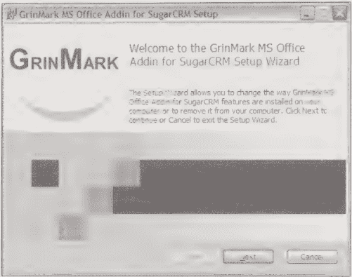

成功安装 GrinMark 插件后，你会注意到 Outlook 中的一些新选项可以通过 GrinMark 工具栏访问。在使用它们之前，你必须先提供 SugarCRM URL、用户名和密码。提供此信息的最简单方法是访问 **SugarCRM Connection and License Settings** 屏幕。你可以通过选择 **Start | Programs | GrinMark | SendTo SugarCRM Config**，然后单击 **SugarCRM Connection and License Settings** 按钮来访问此屏幕。

将出现类似于以下的屏幕：

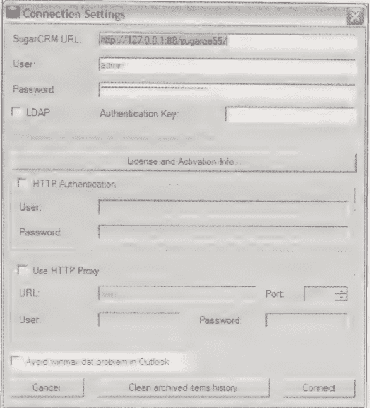

输入完 SugarCRM 连接详细信息后，单击 **Connect**，然后单击 **OK** 按钮关闭屏幕。现在返回 Outlook，我们将查看连接器提供的各种功能。

连接器提供的最重要的功能可能是能够将 Outlook 中的电子邮件归档到 SugarCRM。同步电子邮件的过程非常简单。要将消息归档到 SugarCRM，请在 Outlook 中选择该消息，然后单击 GrinMark 工具栏。

如果所选消息的 TO 或 FROM 电子邮件地址已在 SugarCRM 中记录，则该消息将自动复制并链接到相关联系人。在不存在的情况下，系统将提示你在 SugarCRM 中搜索相应的记录。

搜索屏幕应类似于以下内容：

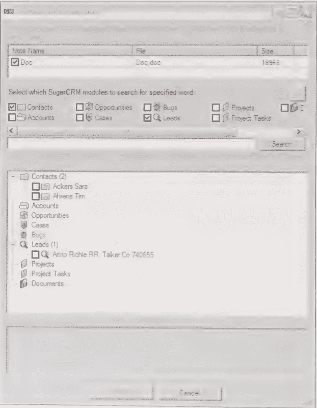

请注意，它允许你搜索 SugarCRM 中的各种模块。要搜索记录，请在搜索字段中输入值，然后单击 **Search** 按钮，如下面的屏幕截图所示：匹配的结果将显示在屏幕底部。一旦你确定了相应的记录，请选择它，然后单击 **GrinMark** 按钮。

你可能会注意到，搜索屏幕使你能够将其链接到机会、项目、案例和其他实体。此功能允许你更准确地跟踪电子邮件通信，因为它还允许你跟踪其相关的特定实体。

Outlook 连接器除了归档电子邮件之外，还提供了进一步的功能。另一个流行的功能是能够在 Outlook 和 SugarCRM 之间同步活动。此功能与电子邮件归档功能之间的一个重要区别在于，活动同步是双向的；在 SugarCRM 中输入的项目可以同步到 Outlook，反之亦然。此外，在任一应用程序中对其所做的更改都将同步到另一个应用程序。最后，你需要一份 GrinMark 的授权副本才能使用此功能。

同步活动与归档电子邮件的过程类似；选择一个项目，然后单击 GrinMark 工具栏。与电子邮件归档过程类似，你也可以选择相关的机会、项目、案例等。

## SugarCRM 生态系统

GrinMark 还提供了一种方法，通过 Contact Synchronizer 工具自动化 Outlook 和 SugarCRM 之间的同步过程，该工具可通过选择 **Start | Programs | GrinMark | Contact Synchronizer** 访问，并将显示以下屏幕：

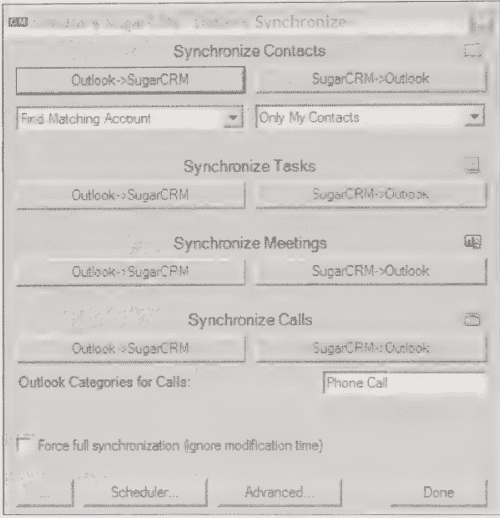

如前图所示，你可以通过单击相应的同步按钮，快速在两个应用程序之间同步数据。请注意，你可以选择同步方向，以及它适用的数据。

最后，单击 **Scheduler** 按钮允许你定义同步活动或联系人的频率。此外，有关使用 GrinMark 的更详细信息可在 GrinMark **Getting Started Guide** 中找到，该指南可在 `SugarForge.org` 上下载。

对于 RayDoc 的工作人员来说，连接器是解决其在使用 SugarCRM 时主要关注问题的理想方案。多年来，他们在 Outlook 中开发了许多文件夹、规则和其他技术，以有效管理他们的电子邮件。他们立即担心，如果局限于 SugarCRM 电子邮件客户端，就会失去这些功能。

Outlook 连接器通过允许用户继续使用他们已经习惯的电子邮件系统，而无需学习新系统，从而帮助消除这一障碍。请记住，用户必须感觉到他们从使用系统中获得了价值，否则他们会找到不使用它的理由。

## Microsoft Office 集成

自从计算机引入工作场所以来，许多人推测这将开启无纸化办公的时代。然而，事情并没有完全按此方式发展，基于纸质的通信在当今的商业世界中仍然占有一席之地。

也许最常见的用途是直邮活动，目的是打印表格信、信封，甚至邮寄标签。虽然 SugarCRM 本身没有打印这些项目的能力，但它包含相关数据，例如姓名和地址。

相反，Microsoft Word 能够轻松生成表格信、信封或邮寄标签，但它不包含你想要在上述项目上打印的数据。SugarForge.org 上的几种解决方案旨在解决这个特定问题，使 Microsoft Word 能够从 SugarCRM 数据库读取数据。最终结果是一种强大的技术组合，允许你根据 CRM 数据轻松快速地生成表格信、信封，甚至邮寄标签。

虽然让两个不同的软件包相互通信以产生此类结果听起来可能很复杂，但实际上是一个相当简单的过程。在我们逐步介绍实现此目标所需的步骤时，你可能会注意到，这些步骤与执行电子邮件营销活动所涉及的步骤非常相似。简而言之，集成的工作方式如下：

- 在 Microsoft Word 中创建带有嵌入字段的模板（类似于电子邮件模板）
- 将信件作为文档保存到 SugarCRM 中
- 使用 GrinMark 实用程序执行邮件合并

创建模板的过程非常简单。首先，在 Microsoft Word 中像写任何其他信件一样写一封信。每当你在信中到达想要插入 SugarCRM 中某个数据的位置时，请输入相应模块和字段的代码，例如：$contact_first_name 用于联系人的名字，$account_name 用于联系人相关账户的名称。

当你对信件满意后，将其保存，并将其作为新条目添加到 SugarCRM 的 **Documents** 模块中，同时确保启用 **Template?** 复选框。如有必要，请参阅本书前一章，了解添加新文档的详细信息。

最后一步是打开 GrinMark Document Templates 工具，打印或发送你的合并信件。GrinMark Document Templates 可通过选择 **Start | Programs | GrinMark | Document Templates** 访问。你将看到 SugarCRM 中所有文档条目的列表，但你只需关注那些已定义为模板的条目。从列表中选择模板，然后单击 **Proceed**。单击 **Proceed** 后应出现的屏幕示例如下：

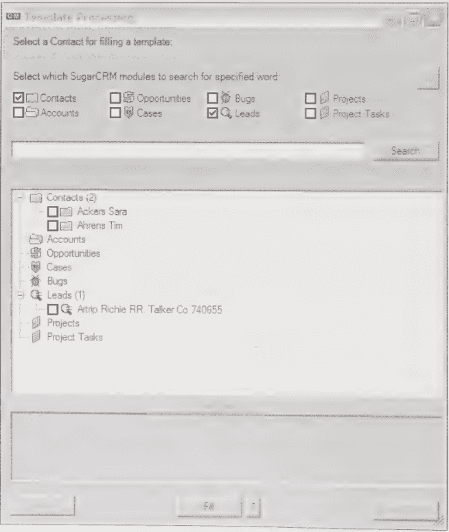

请注意，它允许你在 SugarCRM 系统中搜索应包含在合并中的记录。

选择过程本身非常简单，你只需启用要包含的条目旁边的复选框即可。完成后，单击屏幕底部的 Fill 按钮，你之前创建的 Word 文档的副本应该会出现，只不过现在，你嵌入的字段将被所选联系人的实际数据替换。你现在可以打印、保存或发送合并后的文档。

请注意，SugarCRM Professional 和 Enterprise 版本都包含一个用于 Microsoft Outlook、Word 和 Excel 的插件，作为订阅价格的一部分。虽然此插件与 GrinMark 等插件的原理通常相同，但生成邮件合并所涉及的机制要简化得多。此外，该过程与 SugarCRM 各个模块（包括联系人、线索、账户和活动）中内置的邮件合并功能集成得更加紧密。

对于 RayDoc 来说，能够利用其 SugarCRM 数据打印个性化的服务合同或信件，使这一增强功能非常值得。RayDoc 还计划使用此功能，为新进入系统的线索创建发送的宣传材料。

如果数量增加，他们将考虑升级到 Professional Edition，以利用 SugarCRM 提供的更简化的 Word 插件。

## ZuckerReports

勤勉使用 CRM 系统可以带来许多重要好处，但要获得它能为你的业务提供的洞察，需要能够生成报告或其他指标。然而，SugarCRM Community Edition 不包含报告解决方案，其指标仅限于我们在本书前面讨论过的仪表板。

ZuckerReports 非常有效地满足了这一非常重要的需求，使其成为 SugarForge.org 上最受欢迎的模块之一。

安装有时可能会带来挑战，因为它与其他模块相比体积较大，但这些问题通常可以通过调整以下一个或多个 PHP.INI 设置来解决：

- upload_max_filesize
- post_max_size
- max_execution_time

分别设置为 50M、50M 和 300 即可。请记住，如果需要调整设置，不要忘记重启 Web 服务以应用修改。安装完成后，ZuckerReports 提供了许多强大的功能。

首先，它提供了一种工具，允许你根据 SugarCRM 系统中包含的任何模块（默认模块或自定义模块）创建各种报表。这是通过一个大多数 SugarCRM 用户都能轻松上手的简单界面来实现的。

报表的创建首先是生成一个定义参数的模板，例如目标模块、字段、筛选条件和其他报表参数。为了让你了解这个过程，让我们创建一个列出 SugarCRM 中所有商机的报表。

我们的第一步是访问 ZuckerReports 模块。你可以通过在 SugarCRM 的主导航区域选择 **ZuckerReports** 选项卡来访问它。点击它应该会显示类似于以下的屏幕：

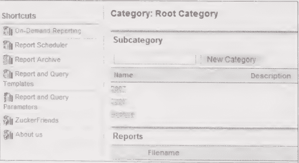

接下来，点击 **Report and Query Templates**，然后点击 **New Listing Template**。填写字段以匹配以下内容：

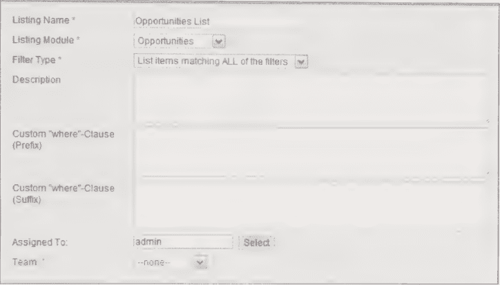

点击 **Save**。详细视图屏幕上的 **New Filter** 和 **New Order Criteria** 部分允许你分别应用筛选条件和排序顺序。对于我们的示例，我们将应用一个筛选条件，将输出限制为仅显示价值超过 5,000 美元的商机，如下面的屏幕截图所示：

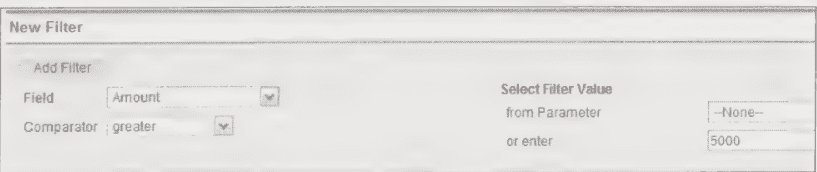

要应用此筛选条件，请输入前面屏幕截图中所示的值，然后点击 **Add Filter** 按钮。可以通过重复刚才描述的过程来应用其他筛选条件。

现在你已经定义了一个基本的报表模板，可以生成输出了。点击 **Run Report** 按钮，你将看到以下屏幕截图：

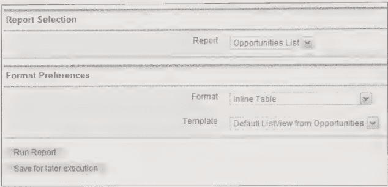

**Format Preferences** 部分允许你修改一些输出功能，但目前请保留默认设置并点击 **Run Report**。报表现在应该在屏幕上显示。这个示例虽然基本，但演示了 ZuckerReports 的一些功能。然而，它的功能远不止我们刚才看到的这些。

如果需要，你也可以通过简单地提供适当的 SQL 查询来生成更高级的报表，通过 **Query Template**。然而，也许最强大的功能是它能够与 JasperReports、Microsoft Office 和其他相关工具集成。

JasperReports 是一个功能齐全的报表和商业智能解决方案，提供从基本求和报表到更高级的下钻和图表等众多功能。

报表模板也可以在 Microsoft Word 或 Excel 中创建。此功能简化了报表创建过程，同时还提供了另一种执行邮件合并的选项。

如果你熟悉 **iReport**（JasperReports 的辅助工具），你也可以使用它来生成报表模板。

如你所见，ZuckerReports 为各种报表需求提供了非常全面的解决方案。对于 RayDoc 这样的组织，ZuckerReports 可以生成并提供管理层监控业务状态所需的洞察，例如跟踪销售线索、潜在客户转化率以及许多其他统计数据。

有关使用 ZuckerReports 或 JasperReports 的更多信息，请访问 SugarForge.org 上的项目页面，网址如下：
http://www.sugarforge.org/projects/zuckerreports/ 或 http://www.zuckerfriends.com/

## 开发工具包和增强工作室

虽然手动应用自定义功能是一项非常强大的功能，但它并不是最高效的方法，尤其是当你需要应用大量自定义功能时。

_开发工具包和增强工作室_ 模块大大减少了进行众多自定义所需的工作量。一些常见用途包括以下内容：

- 条件下拉列表
- 计算字段
- 代码字段

条件下拉列表是用户的常见需求。它指的是一种数据录入技术，其中下拉列表中显示的值是动态的，并且相互依赖。因此，如果用户正在输入记录并为下拉列表 1 选择值 A，那么下拉列表 2 中的值将反映与下拉列表 1 中的选择相关的值。如果用户为下拉列表 1 选择值 B，则下拉列表 2 将显示不同的值列表。

显然，这将简化 RayDoc 员工的数据录入过程，并使其成为更加用户友好的体验。这最终将提高 SugarCRM 的采用率。

> 相应的 SugarForge.org 项目页面包含示例以及有关其用法和功能的更多信息，网址如下：http://www.sugarforge.org/projects/devtoolkit/ http://www.sugarforge.org/projects/enhancedstudio/

## 开放报价和合同

大多数销售组织依赖使用报价来达成交易或商机，一旦交易达成，所述交易可能涉及服务合同或组织可能需要跟踪的其他持续合同。

然而，SugarCRM 社区版不包含允许你轻松为潜在客户生成报价的功能，也不包含跟踪相关合同的功能。此功能仅在专业版和企业版中可用。

作为社区版用户，解决这些限制的最佳方案之一是使用 _开放报价和合同_ 模块。它是一个非常全面的解决方案，还包括产品目录以简化报价过程。

此模块的一些亮点包括以下内容：

- 能够打印合同或报价的 PDF 版本

- 合同自动版本控制

- 层级产品目录

- 合同到期电子邮件通知

从上述亮点可以看出，它是一个功能齐全的解决方案。如果你需要一个集成到 SugarCRM 系统中的报价解决方案，这个模块绝对值得一看。更多信息可在以下网址找到：

`http://www.sugarforge.org/projects/openqc/`

## VeryThinClient

多年来，无线访问重要业务数据（例如存储在 SugarCRM 中的数据）的普及程度大幅提高。如今，远程员工或外出人员——尤其是习惯使用支持网络的移动设备的人——期望能够在移动设备能够获得信号的任何地方访问此类信息。

虽然 SugarCRM 是一个基于 Web 的应用程序，但原生移动客户端仅对专业版和企业版用户可用。虽然可以通过移动设备的 Web 浏览器直接使用社区版，但这将证明相当麻烦。幸运的是，问题的解决方案确实存在，并有助于将此功能带给社区版用户。

VeryThinClient 提供了一种提供移动访问的方法。通过此工具，外出人员可以直接从服务器轻松访问 SugarCRM 数据，并在适合其设备的界面中操作。

有关此工具的更多信息可在以下网址找到：

`http://www.sugarforge.org/projects/verythinclient/`

## 安全套件

SugarCRM 社区版用户遇到的一个常见限制是无法将记录分配给多个用户。专业版和企业版通过团队功能（本章后面将解释）解决了这一限制。

安全套件旨在将类似功能带给社区版用户。使用安全套件，你可以定义团队，即一个或多个 SugarCRM 用户的分组。反过来，SugarCRM 中的记录可以分配给一个或多个预定义的团队。就像“分配给”字段可以控制哪个用户可以访问记录一样，安全套件也可以。

虽然安全限制可能不是你 SugarCRM 安装的当前需求，但它们通常会随着时间变得重要。安全套件是安全需求的必备工具。有关其功能的详细信息可在以下网址找到：

`http://www.sugarforge.org/projects/securitysuite/`

## SugarCRM 专业版/企业版

SugarCRM 在商业软件市场中堪称先驱。它与竞争对手和该领域其他供应商最显著的区别在于，它是开源产品，而大多数其他产品都是闭源的专有系统。像任何其他公司一样，他们必须以一种能够赚取一些收入的方式来构建业务，否则将不复存在。

这对于一家旗舰产品是开源解决方案的公司来说是一个独特的挑战，因为该解决方案对所有人免费开放。SugarCRM 通过提供不同版本的 SugarCRM 相当有效地应对了这一挑战，正如我们在本书前面讨论过的那样。

## 产品目录和产品模块

像 SugarCRM 和其他供应商这样的 CRM 系统都被称为 **front-office** 应用程序。业务的前端是面向客户的业务部分，这些应用程序经常被使用。

**back-office** 应用程序是那些与内部运营和供应商接口，并编制财务报表和结果的应用程序。

将前端和后端操作集成到一个应用程序中是面向大型企业（例如 SAP）的昂贵 **ERP (Enterprise Resource Planning)** 系统的目标。这些解决方案通常花费数百万美元。可以说，NetSuite（公司名称也是其高级产品的名称）是针对小型企业的系统中最好的，能够将前端和后端活动集成到一个系统中。然而，它也相当昂贵，并且仅作为按需解决方案提供。

在实践中，许多小型企业可以通过简单地将后端活动中最常用和最广泛的方面添加到前端应用程序中，来获得集成系统的大部分好处——让它也涵盖我们可能称之为“中端”的部分。这将包括准备客户报价单、发票、销售订单，并可能甚至包括订单处理。如果您的 CRM 系统可以帮助您做到这一点，那么您公司中广泛的部分——面向客户和影响客户的部分——将变得高效得多。

如果您拥有这样的扩展 CRM 系统（现在涵盖前端和中端），并将生成的发票或销售订单数据链接到您的会计系统（通过数据导出，或通过与在线系统的 Web 服务链接），您可以以低廉的价格创建一个非常有效的解决方案。

您还可以创建一种情况，即会计软件只需要有限数量的用户许可证。只有真正将交易过账到分类账的会计人员才需要许可证——这与集成系统不同。这种方法还将会计功能真正归入后端——尽量减少业务中与客户或利润创建没有直接关系的部分。

SugarCRM Community Edition 没有任何这些后端（或也许，中端）功能，但 SugarCRM Professional 和 Enterprise 包含支持这种方法的模块。

此类模块的最初两个模块是 **product catalog** 和 **products module**。产品目录位于系统的 _administrator_ 区域，用于跟踪您可供销售的产品、库存数量和其他属性。然后，products module 跟踪这些产品的流动——任何已报价、订购或运送给客户的单位。让我们更深入地研究这些组件。

## 产品目录

在定义产品目录中的项目时，有四个产品目录管理功能可供使用。这些功能用于维护产品目录中的项目，以及产品类别、产品类型和制造商。

产品目录管理选项显示产品目录中所有当前项目的列表视图。您可以单击列表中某个项目的名称以查看该项目的详细视图，并可能对其进行编辑。您也可以使用快捷菜单在产品目录中创建新项目，或切换到查看制造商、产品类别或产品类型。导入设施进一步简化了构建目录的过程。

请注意，产品类型是产品目录中项目的高级分类，而产品类别是低级分类。一个产品类型可能对应软件的广泛领域，而产品类别可能对应更窄的领域，例如电子表格、文字处理器或 CRM 软件。这种分类技术使目录中的产品分类更加详细。

在创建新目录项或编辑现有项目时，输入包括项目名称、关联 URL、税务类别、可用性、供应商、类别和类型、成本、列表价和采购价以及相关货币的数据。还有一个默认定价公式，可以设置为固定价格、利润率、成本加成、列表价折扣或与列表价相同：

+   * 产品类型管理选项允许您维护可用于对产品目录中的项目进行分类的产品类型。每个产品类型由名称和描述以及条目在下拉列表中出现的顺序组成。

+   - 产品类别管理选项允许您维护可用于对产品目录中的项目进行分类的产品类别。每个产品类别由类别名称、父类别名称、描述以及条目在下拉列表中出现的顺序组成（在类别树出现后，这在很大程度上已不再重要）。

+   - 制造商管理选项允许您维护可作为产品模块中选择项的制造商。每个制造商条目由名称和状态（**Active** 或 **Inactive**，如果状态为非活动，则会将其从制造商下拉列表中移除）以及条目在下拉列表中出现的顺序组成。

## 产品模块

products module 跟踪已报价、订购或运送的产品。

请注意不要将 products module 与 _administration_ 区域中的产品目录功能混淆。后者仅用于定义可供销售的产品，而前者用于监控订购量、相关客户及其成本。

产品可以从产品目录中的项目创建，也可以通过简单输入所需的任何名称作为产品名称来自定义创建。产品列表视图如下图所示：

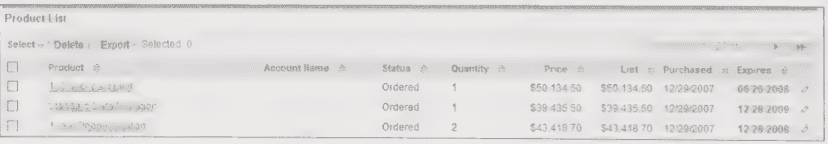

通过检查产品列表，员工可以确定产品的活动情况——哪些报价、订单和发货正在进行。

## 报价模块

**Quotes** 模块是另一个扩展 CRM 系统向后端类型功能延伸的特性。该模块使用产品目录模块的数据（如前一章所述）来准备客户报价单。报价列表视图如下图所示：

| Quote List |
| --- |
| Select - Delete Export Selected 0 |
| Number Subject Account Name Stage Amount Valid until Team User |
| Super-Hard Screaming Corporate Draft $283,887.96 05/04/2008 USA East Region will |
| Draft $600,651.95 12/05/2008 USA East Region frankie |
| Closed Dead $449,210.40 07/25/2008 USA East Region frankie |
| Delivered $463,828.03 01/16/2008 USA East Region barbara |
| Confirmed $432,480.33 08/25/2008 USA East Region frankie |
| Closed Dead $252,277.71 05/30/2008 USA East Region frankie |
| Draft $708,028.69 01/14/2008 USA East Region ben |

进入 **Quotes** 模块后，您将看到 **Quote List** 视图屏幕——显示系统中当前的所有报价。您可以单击报价以查看报价详情，并进一步单击详情视图以编辑报价。

准备报价很简单。单击 **Create Quote** 快捷方式，在弹出的屏幕上，输入报价主题、报价有效期至的日期，并选择 **Bill to** 和 **Ship to** 账户（如果两者相同，有一个方便的按钮可以将一个复制到另一个）。

接下来，单击 **Add Group** 按钮以定义报价上的初始产品分组，然后单击 **Add Row** 按钮将项目添加到该组中。在每一行上，使用 **Select** 按钮从目录中选择产品，然后设置数量，如果需要，可以从默认价格编辑单价，如下图所示：

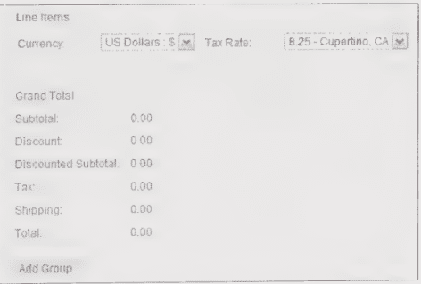

您可以创建更多组来组织报价单的各个部分，因为它们满足不同的需求、需要在不同的时间表交付，或出于各种其他原因。

当你完成后，只需点击 **Save**。报价现在可用于创建机会（如果报价请求是突然提出的），或者可从报价生成 PDF——可作为提案或发票呈现。Sugar Pro 提供标准 PDF 模板，可对其进行编辑以包含您的公司徽标和地址详细信息。示例如下图所示：

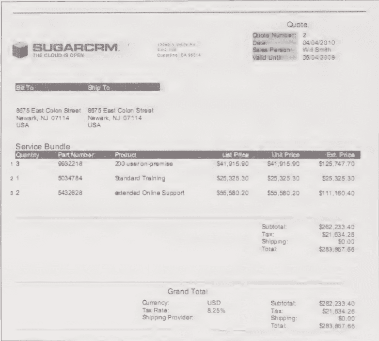

## 预测

销售人员（客户经理、客户主管、销售代表，无论当天偏好的头衔是什么），在拥有庞大销售团队且由销售经理或销售副总裁监督的组织工作，通常都太熟悉这句话——“你的承诺数字是多少？”错过承诺数字，离“被枪毙”就不远了！

SugarCRM Professional 和 Enterprise 版包含一种机制，允许销售经理为每位销售人员正式确定承诺数字，并将其汇总到区域或组织层面。这些承诺数字以其礼貌的名称——预测——而闻名。

预测流程始于预测周期的定义——通常是财务季度或月份。这是在系统的 **Administrator** 区域中完成的。

定义预测周期后，每位销售人员可以通过使用 **Forecasts** 选项卡设置其预测承诺。进入后，该模块显示预测历史记录。这显示了用户可用的时间段列表，以及用户为这些时间段所做的所有历史承诺。示例如下图所示：

| Date Committed | Opportunities | Weighted Amount | Best Case | Worst Case | Likely Case |
|---|---|---|---|---|---|
| 01/04/2008 10:38 | 18 | $ 302,000 | $ 241,600 | $ 193,280 | $ 144,960 |
| 01/04/2008 10:38 | 6 | $ 57,500 | $ 46,000 | $ 36,800 | $ 27,600 |
| 01/04/2008 10:38 | 16 | $ 276,000 | $ 220,800 | $ 176,640 | $ 132,480 |
| 01/04/2008 10:38 | 15 | $ 84,000 | $ 67,200 | $ 53,760 | $ 40,320 |

从前面的屏幕可以看出，例如，我们可以注意到一位用户曾为 Q4 进行过仅 US$53,760 的预测——但现在是 US$40,320——这是基于 15 个加权价值总计 US$84,000 的机会。下面的屏幕截图显示了预测工作表的另一个示例：

| Direct Report | Best Case | Likely Case | Worst Case | Commit Date | Est. Best Case | Est. Likely Case | Est. Worst Case |
|---|---|---|---|---|---|---|---|
| Barbara Bovley | $0 | $0 | $0 | | 0 | 0 | 0 |
| Will Smith | $0 | $0 | $0 | | 0 | 0 | 0 |
| Totals: | $0 | $0 | $0 | | 0 | 0 | 0 |

Last Commit Date: Best Case: $0 Likely Case: $0 Worst Case: $0
Enter amounts that you would like to commit for Best Case: Likely Case: Worst Case: the selected Time Period

Copy Values Commit

该预测是在预测工作表上输入的（如上一张屏幕截图所示），可从 **Forecast History** 快捷方式访问。在其中，用户选择要预测的时间段，该时期的所有机会将自动显示，并附带其加权值。**Commit** 按钮用于为预测时间段输入新承诺。请注意，该时间段的先前承诺历史记录也会显示。

如果用户监督任何其他销售人员（每个用户的个人资料都有一个 Reports To 设置，用于定义其主管），那么他们会看到前面屏幕的一个变体，该变体允许他们查看自己的预测加上所有直接下属预测的汇总。顶部的单选按钮允许用户在 My Forecasts（显示类似于前一张图的屏幕）或 My Team's Forecasts 之间进行选择。

该系统为销售预测提供了良好的硬性承诺记录，以及坚实且不可否认的审计跟踪！此外，汇总系统提供了一种实用且快速的方式，将销售预测扩展到甚至大型组织。

## 标准报告和自定义报告

与 Community Edition 不同，报告工具内置于 SugarCRM 的 Professional 和 Enterprise 版中。通常，业务系统中的报告功能分为两类：标准报告和自定义报告。标准报告顾名思义——是一系列预定义的报告，系统创建者确信这些报告对您至少有时会相关。

自定义报告系统更难创建，它们为用户提供定义自己的报告的能力。在 SugarCRM Community 或 Professional Edition 的情况下，用户至少希望能够指定要从中提取报告信息的模块、要呈现的数据列，以及如果任何列是数字且需要求和。

当您首次点击 SugarCRM 中的 **Reports** 模块时，您将看到系统中默认可用的所有报告的列表视图。请随意探索它们并查看其输出。如果您找不到符合您需求的报告，您可以选择克隆默认报告之一并对其进行调整以符合您的需求，或者从头开始创建一个新报告。通常，克隆方法更受青睐，因为它省去了重新定义报告每个方面的麻烦，尽管它需要一个与您期望的结果相对接近的现有报告，而该报告可能存在也可能不存在。报告的列表视图如下图所示：

| Report List | | | | | | | |
|---|---|---|---|---|---|---|---|
| Select -- * Delete Mark as Favorite Selected 0 | | | | | | | |
| [ ] Report Name | Module | Report Type | Date Created | Team | User | Schedule Report | |
| [ ] FY07 Forecast w/GRAPH | Opportunities | Summation with details | 01/04/2008 10:35 | Global | admin | -- none -- | |
| [ ] FY07 Forecast | Opportunities | Rows and Columns | 01/04/2008 10:35 | Global | admin | -- none -- | |
| [ ] Marketing - Leads by Campaign | Leads | Summation with details | 01/04/2008 10:35 | Global | admin | -- none -- | |
| [ ] Open Cases By Priority By User | Cases | Summation with details | 01/04/2008 10:32 | Global | admin | -- none -- | |
| [ ] Opportunities By Lead Source | Opportunities | Summation with details | 01/04/2008 10:32 | Global | admin | -- none -- | |
| [ ] Partner Account List | Accounts | Rows and Columns | 01/04/2008 10:32 | Global | admin | -- none -- | |

为了了解此过程，让我们看看构建自定义报告是什么样子。

对于我们的示例报告，我们将构建一个非常有用的报告，该报告列出系统中分类为客户的所有账户，然后在每个账户中，列出该账户中每个联系人的姓名和联系信息。

因此，要构建此报告，首先我们点击 **Create Custom Report** 按钮，您将看到以下屏幕：

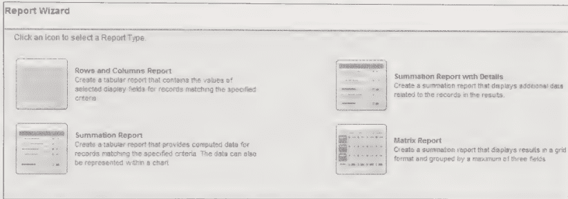

该过程的第一步是选择我们希望创建的报告类型。点击 **Rows and Columns Report**。您现在需要选择将从中提取数据的模块。点击 **Accounts**。

要应用我们的过滤器，请在屏幕左侧的可用字段部分选择 **Type** 字段。执行此操作后，屏幕应类似于以下内容：

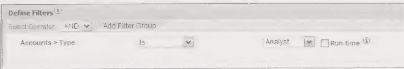

请注意，过滤器定义的一部分允许您为所选字段选择一个值。鉴于我们希望关注 **Type** 字段设置为 **Customers** 的账户，请将下拉列表值更改为匹配，然后点击 **Next** 以继续进行 **Reports Wizard**。

在 **Choose Display Columns** 选项卡上，我们实际组装报告的真实信息。此屏幕允许我们通过从 **Available Fields** 部分简单选择它们，来插入账户模块以及任何相关模块的字段。

## SugarCRM 生态系统

首先，从**可用字段**部分选择**名称**字段来插入账户名称。现在来到稍微棘手的部分。如果你查看**可用字段**部分上方的树形结构，你会看到当前选定的文件夹属于**账户**。此选择与字段列表配合使用。如果你希望插入来自相关模块（例如**联系人**）的字段，请在**账户**文件夹中选择**联系人**文件夹。这样做将更新**可用字段**部分以反映**联系人**模块字段，你现在可以为报表选择它。继续输入联系人的电话号码字段。最终结果应类似于以下内容：

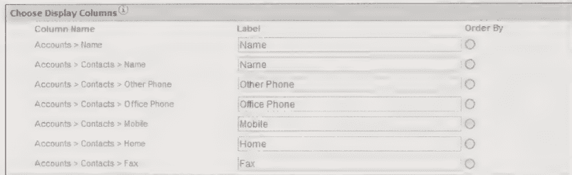

单击下一步为报表提供名称。继续单击**保存并运行报表**以生成报表。它应该类似于以下内容：

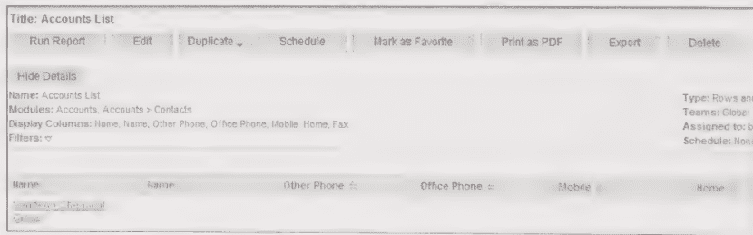

注意**另存为 PDF**（以 PDF 格式打印报表）选项，以及**导出**按钮。它们可用于输出数据以供其他工具使用。

如果用户现在单击**所有报表**快捷方式并搜索模块值为**账户**的报表，系统应显示新定义的报表以及其他专为**账户**模块设计的报表，如下图所示：

| 报表列表 |
| --- |
| 选择 ▼ 删除 标记为收藏夹 已选：0 |
| 报表名称 模块 报表类型 创建日期 团队 用户 计划 R |
| 按类型分类的账户 按行业分类的账户 账户汇总 01/04/2008 10:32 全局 admin --none-- |
| 账户列表 账户 行和列 9/4/05/2010 01:45 全局 barbara --none-- |
| 客户账户列表 账户 行和列 01/04/2008 10:32 全局 admin --none-- |
| 合作伙伴账户列表 账户 行和列 01/04/2008 10:32 全局 admin --none-- |
| 选择 ▼ 删除 标记为收藏夹 已选：0 |

## 用户团队

SugarCRM 社区版在权限管理和数据安全方面存在显著弱点，因为其记录只能分配给单个用户。为了解决这一弱点，专业版和企业版允许您将数据分配给一个或多个团队。团队被定义为一个或多个 SugarCRM 用户的集合。

用户可以被分配给一个或多个团队，使他们拥有（例如作为销售经理）查看西部、中部和东部地区的销售机会和客户信息的能力，如果为每个地区定义了一个团队的话。

数据访问规则非常简单——如果您在分配该数据的团队中，则可以看到该数据。如果数据分配给所有员工都属于的团队，那么团队中的每个人都可以看到该信息。由于您可以将多个团队分配给系统中的任何给定记录，安全模型变得相当灵活，并能够满足各种安全需求。

## 增强的角色管理：字段级访问

SugarCRM 社区版中的角色管理允许您控制用户在系统中可以执行的各种功能。这包括控制用户可以查看、编辑、删除、导出等记录。专业版和企业版在此概念的基础上进一步扩展，还集成了字段级控制。

字段级控制使角色成为一个更详细的安全工具。有了此功能，用户可以被禁止查看或编辑记录上的某些字段，尽管他们可能对记录整体拥有完全访问权限。

要定义字段级控制，只需通过管理控制面板中的**角色管理**工具编辑安全角色，然后单击左侧列中的所需模块。

单击模块将显示其包含的所有字段列表，然后您可以继续选择角色中用户对给定字段将拥有的权限级别。完成修改后，像往常一样保存更改。

## 参与 SugarCRM 在线社区

查找 SugarCRM 信息、技巧和技术援助的最佳场所之一是 SugarCRM 论坛。您可以通过将 Web 浏览器指向 `http://www.sugarcrm.com/forums/` 来访问论坛。阅读或搜索论坛无需注册用户，但如果您希望发布消息，则需要注册。

另一个重要网站是开发者网站。在那里，您将找到各种文档、示例以及有关使用 SugarCRM API 的其他详细信息，以及更高级的自定义技术。您可以访问开发者网站 `http://developer.sugarcrm.com/`。

## SugarCRM 用户论坛

SugarCRM 论坛既有经验丰富且技术知识丰富的用户，也有新手和困惑的用户。在论坛中，有主要部分涉及以下内容：

- 公告
- 一般讨论
- 功能请求
- 开发者
- 安装与升级帮助
- 翻译者
- 下载
- 分类信息
- 帮助

还有针对一系列主题的面向业务的讨论的特定论坛，以及针对不同用户的外语论坛。

新用户通常经常访问_一般讨论_、_帮助_和_安装论坛_。一旦您稍微掌握一些基础，_功能请求_和_下载_区域将变得非常有用和有趣。_开发者_和_翻译者_区域根据其名称相当专业。_分类信息_区域是寻找 CRM 合作伙伴的一种方式——尽管通常它被寻找 SugarCRM 熟练分包商的技术业务人员所访问。

虽然您可以在不注册会员的情况下阅读论坛帖子，但要发布自己的帖子，您必须注册。您可以提供最少的个人信息，或添加照片、签名文件和其他个人数据，以帮助其他人知道他们正在与谁互动。

关于此话题的最后一点说明是，这些论坛的一般性质是培养社区意识。但是，重要的是要记住，大多数其他参与者都是像您一样的用户，并无义务以任何方式参与。许多人选择出于善意或简单的帮助愿望，自愿贡献时间和经验来帮助他人，以造福整个社区。由此，很容易理解为什么礼貌和耐心是论坛成员中受重视的特质。

## 摘要

在本章中，我们介绍了 SugarCRM 社区版的多个流行插件。它们中的每一个都以增强 SugarCRM 系统对您业务价值的方向扩展系统，通过适应您不断增长的需求、简化用户采用和系统定制。

- _SugarForge.org_ 是免费增强和模块的主要来源，而 _SugarExchange.com_ 是商业增强或模块的主要来源。
- Google 日历和联系人连接器将您的 SugarCRM 数据扩展到 Google 服务和非 SugarCRM 用户。它还提供了一种易于使用的机制，用于与移动设备同步数据以供离线访问。
- Microsoft Outlook 集成通过允许用户继续使用他们偏好的电子邮件客户端来提高用户采用率。
- 与 Microsoft Office 的集成可以轻松利用，为您的营销工作生成个性化信函或直邮件。
- 增强搜索模块为高级搜索模块添加了重要功能，例如在连接器之间切换或更改默认操作数的能力。
- 尽管社区版缺乏报表解决方案，但 ZuckerReports 是一个功能齐全的报表解决方案，并与 SugarCRM 紧密集成。
- 有些增强功能，如增强的工作室和开发工具包，旨在简化开发和应用各种类型自定义的过程。
- 报价和合同管理需求可以通过开源报价和合同模块轻松解决。
- 社区版中的数据分配功能限制您将记录分配给单个用户的能力。安全套件通过提供允许使用团队将数据分配给多个用户的工具来增强这些功能。
- SugarCRM 的专业版和企业版包含社区版中没有的各种功能，例如团队、产品目录、报价、预测和其他功能。

我们还介绍了各种 SugarCRM 网站——这是了解 Sugar 在线社区并获取更多免费 SugarCRM 插件的好地方——并学习了如何使用用户论坛。论坛可以帮助您找到有类似自定义和扩展需求的人，与他们交流经验，甚至找到其他用户开发的免费开源解决方案。

在下一章中，我们将探讨将新 CRM 系统引入其用户的关键问题，并确保该系统被视为对您业务管理流程的一个易于使用、功能强大且有价值的补充。对于任何 CRM 系统要提高您的业务效率，人们必须使用它，并且有许多技术可用来确保他们确实使用它。

