## 管理您的 CRM 实施

到目前为止，本书已介绍了引入 CRM 概念、了解不同组织之间 CRM 需求的差异，以及通过安装和使用 SugarCRM Community Edition（及一系列插件）作为中小企业的候选 CRM 解决方案来详细研究 CRM 的主题。

现在您已具备良好的 CRM 术语和功能背景，我们将研究将新 CRM 解决方案引入组织时面临的一些现实挑战。本章的目标是让您了解如何着手并构建自己的 CRM 实施项目，重点关注以下重要主题：

- 成功 CRM 实施的关键步骤
- CRM 培训流程——意识、熟悉度和认同
- 上线：分步引入——渐进而非革命
- 持续反馈和改进

您将发现，成功 CRM 实施的关键之一是采取分步的方式。让 CRM 运转起来的一个好方法是先进行第一阶段实施，最大限度地减少干扰和培训需求，同时为所有关键利益相关方最大限度地提升感知收益。

## 成功 CRM 实施的关键步骤

在深入具体细节之前，您应该明白，任何成功的 CRM 实施都有一个压倒性的属性：开放且频繁的沟通与协作。

新 CRM 系统将显著影响的典型群体，因此应参与其选择、开发和交付的群体如下：

- 执行赞助人
- 项目经理
- 实施团队
- 首席培训师
- 内部或外部网络管理和 IT 人员
- 财务管理
- 销售管理
- 销售一般人员
- 行政管理
- 行政一般人员

这个群体将是您的 CRM 实施团队。

成功的 CRM 实施还有一个重要共同因素。实施团队应相对保守地管理项目——设定现实目标，以适度的步骤分阶段实施，并将整个过程视为持续改进，而非一次性事件。引用 Clint Oram（SugarCRM 联合创始人）的话：“思考宏大，从小处着手，快速行动。”

任何成功 CRM 实施的另一个关键因素与其提供的感知价值有关。所有用户都必须感到从系统中获得了一些价值。这反过来又会促使他们在系统实施后，为支持其开发和使用付出努力。例如，如果系统能计算佣金报告，销售一般人员可能会有动力，并会接受这样的论点：只有当所有机会和已完成的销售都在系统中时，数字才会正确。感知价值对其成功至关重要。如果用户觉得使用系统没有带来价值，他们会很快找到不使用它的理由。这是一种危险的局面，因为这种抵触是 CRM 项目失败的常见原因。

## 规划实施

现在您已将这些非常重要的原则牢记在心，让我们来规划您的实施。

首先，您需要查看上述列表，并将其转化为贵组织中合适的人员和合适的人数。显然，群体规模和规划工作量应与业务规模相匹配。对于十人组织，实施过程可能需要 3 到 4 人。对于 RayDoc 规模的公司——约 25 人，可能有 6 人左右会发挥作用。人数会迅速趋于平稳，在 200 人的企业中，参与 CRM 实施过程的人员不超过 10 到 12 人即可。

您最重要的两位参与者是执行赞助人和项目经理。项目经理将提供动力，确保项目成功执行；而您的赞助人将为所有其他参与者提供鼓励和资源，让他们各尽其职。后者还在将 CRM 确立为公司文化的一部分方面发挥着关键作用。

通常，执行赞助人可能是总裁、所有者、财务主管，有时也可能是销售经理。如果您有内部 IT 团队，赞助人不应来自该团队。您需要确保业务和人员方面的因素能够正常运作。

虽然技术组件也很重要，但它不是最大的风险。您需要确保 CRM 实施是因为某些感知到的业务流程不足而进行的，并且所选解决方案之所以被选中，是因为它最能解决这些问题。执行赞助人不仅应能恰当传达这些不足，还应传达他们希望通过使用 CRM 系统获得的业务改进。简而言之，您的项目不应由技术推动，而应由业务需求牵引。

您的项目经理应来自贵组织，而非为此工作受聘的人员。他们可以与供应商实施团队的对应人员密切合作，但应是所有利益相关者都认识和信任的人。您的项目经理还应是一位以非常称职、注重细节而闻名的人，并且以公开沟通、接受建议、不过分政治化而著称。如果参与 CRM 实施团队的人员觉得自己只是花瓶，并未真正参与其中，他们会很快变得消极。如果员工觉得解决方案是强加给他们的，他们会以愤世嫉俗、抵触，甚至最坏情况下缺乏承诺来反应。

您的项目经理需要成为您的倡导者——一位具有人际交往能力，能让组织内员工对新 CRM 系统感到兴奋的人。随着实施越来越多地需要项目经理投入工作，您需要处理其正常工作量，为 CRM 相关工作腾出空间。

与任何举措一样，最好不要从一张白纸开始。虽然您不希望在第一次会议上向 CRM 实施团队展示一份不可更改的计划，但您也不希望简单地问他们：“您认为应该做什么？目标是什么？潜在的技术解决方案是什么？”

为了专注并管理就特定目标集、特定技术解决方案和特定定制供应商达成一致的过程，建议项目经理和执行赞助人为第一次会议准备一份初始简报。此沟通应说明当前业务流程中感知到的某些关键不足、潜在解决方案、CRM 实施团队的组成、拟议的时间表以及拟使用的技术候选方案。

在所考察的潜在解决方案方面，最好是候选系统的短名单上有可供团队成员试用的演示版本。显然，SugarCRM Community Edition 是该名单上一个非常好且具成本效益的候选方案，但必须听取其他意见。

CRM 实施团队的定期会议，加上会议之间的离线调查和准备，应能迅速产生一组业务目标、一套商定的技术基础以及定制规格说明。这些规格说明可以简单到标注了更改的屏幕布局打印副本，也可以是更详细的需求文档。无论哪种情况，请始终牢记，应用定制的人不应被迫去猜测您期望的目标，尤其是如果该人是您公司外部的人员。

请记住，该人员会将您的文档作为定制的蓝图。如果期望目标留待其自行解读，最终结果可能不是您的 CRM 实施团队所设想的那样。

作为检查清单，您的规划应旨在实现以下目标：

- 确定执行赞助人
- 确定项目经理
- 选定 CRM 实施团队成员
- 为第一次团队会议生成初始简报
- 召开第一次会议


分配职责和任务，以便进行调查并就关键主题向团队进行简报，例如以下内容：

- 识别并记录需要改进的业务流程
- 记录建议的改进措施
- 确定实施的前三个目标
- 讨论将使用的基础技术
- 展示可执行实施和定制的供应商候选者
- 讨论分阶段实施计划
- 讨论实施第一阶段的建议目标
- 讨论数据迁移的方法
- 讨论培训的方法
- 讨论在组织内逐步引入的方法
- 在后续会议上进行简报，并就上述主题作出关键决策

显然，较大的组织将执行刚刚解释的流程的更全面且较慢的版本，而较小的组织将拥有更简化且更快的流程。

## 一些常见陷阱

为了强调前一部分提出的观点，并突出规划和沟通对 CRM 实施过程的重要性，以下是通常遇到的一些经典错误列表：

- 未能让某人从头到尾负责该流程。
- 未能从需求收集阶段就让利益相关者（尤其是最终用户）参与进来。
- 未能关注当前业务流程、预期的业务流程改进，或将实现该变革的系统规格说明。
- 无法清晰地沟通或记录当前业务流程或目标。不要让目标处于可解释的状态，因为他人的解释与您期望的目标一致的可能性相当小。
- 认为实施 CRM 意味着购买 CRM 软件，将其安装在服务器上，然后通知预期用户。
- 在整个项目过程中，未能持续努力地向每个用户和利益相关者传达其特定利益，以确保他们的认可。
- 初始项目阶段规模过大，或者仅仅因为认为阶段是软弱或不足的表现而继续推进。这会导致前期支出过多，延迟实施，并使初始的良好意愿与早期项目成功之间的时间差距过大，难以弥合。
- 采用非常严格的开发流程。CRM 系统更多是关于人而非技术。您应该使用的方法是 **Agile Programming** 这种方法。在这种方法中，早期原型用于生成反馈。用户界面的连续迭代确保用户感到参与、受到授权并感到满意。很少有业务用户能在一开始就描绘出系统或屏幕的每个关键细节。同样，很少有系统架构师确切知道用户想要什么。先做得差不多，试用一下，然后进行调整。如有必要，重复此过程。
- 未能及早培训培训师，未能为他们提供足够的资源来彻底培训所有用户，也未能规划推出过程以留出足够的培训时间。
- 未能在项目开始时定义成功的实施应该是什么样子。
- 未能建立对 CRM 系统和持续开发阶段的定期审查，以进一步改进业务流程和用户满意度。

## 团队协作才能取得胜利

如前所述，CRM 实施需要整个参与团队的参与。是的，高级赞助商和项目经理尤为重要，但代表团队的每个人或每个群体都很重要，并且必须从头到尾持续参与该过程。

这种持续的参与，加上所有团队成员之间持续的有效且频繁的沟通，是所有成功的 CRM 实施所共有的唯一共同点。

就像引入任何新的业务举措一样，人们知道他们是否真正参与其中，或者只是被少数精英引导参加会议，试图赢得他们的配合。

处于管理职位的团队成员通常应参与偶尔的 _pre-meeting_ 会议，以确保他们提前熟悉特定的 CRM 系统或解决业务问题的方案。然后，他们可以在整个团队面前支持它，或在提交给整个团队之前帮助进行更改。

在 CRM 实施过程中最常见的错误之一，是在团队协作过程中没有足够关注来自普通销售、运营和行政人员的意见。使用 CRM 系统所能获得的好处取决于这些人将输入系统的数据的分析和使用。出于这个以及另外两个非常重要的原因，这些人从项目早期就参与进来非常重要。

第一个原因是功能方面。这些用户最适合就构建高效的数据录入流程提供意见，因为他们将负责日常录入。此外，他们可以就屏幕和视图定制的最佳行动方案以及日常使用所需的报告提供见解。

第二个原因是人为因素。CRM 实施需要赢得这些人的支持，如果每个人都参与其中并重视他们的意见，而不是强加一个解决方案给他们，每个人都会做出更积极的反应。

您可能希望用于管理 CRM 实施团队的一些技术（取决于您业务的规模）将包括以下内容：

- 定义电子邮件群组，让整个团队保持最新状态——从心理上讲，这使团队中的每个人都是平等的。
- 在需求定义过程中，让团队每周面对面会面一次，并让整个团队面对面签署需求。
- 在开发期间，团队可以每两周会面一次，以审查进度与计划的对比情况，并审查任何升级的问题。
- 在第一轮开发完成后，团队应再次每周会面一次。继续这样做，直到整个组织部署完成。
- 假设没有关键问题，在部署完成一个月后，让团队再次会面，以审查初始反馈并进行或规划调整。
- 在初始部署后三个月和六个月再次会面，以进行进一步审查。

## 设定项目目标和规格说明

在 CRM 实施团队第一次会议上提出的初始简报说明中，您应包括建议的项目目标，以当前业务流程为基础进行阐述，并讨论应如何改进这些流程。如果需要，您还应为实施过程建议时间表和阶段。

经过一些初步讨论后，并根据您业务和 CRM 实施的规模，应指派一名或多名团队成员详细记录建议的项目目标。这些目标可以在后续会议上提出并达成一致。

首先简单达成一致，即每个业务流程可以如何改进，而不关注任何特定的 CRM 技术，这将有所帮助。

这种方法使团队能够首先解决业务需求，然后指派一名或多名成员识别用于该项目的核心 CRM 技术的建议候选者简名单。

完成后，候选者简名单应提交给整个团队，并根据其满足商定业务需求和可信参考的能力，达成一致的获胜候选者。

然后，团队可以生成并选择列表、详细信息和编辑视图屏幕的建议屏幕布局草图和规格说明。这些可能只是现有 CRM 屏幕的小变体，也可能需要大量定制。完成该项目的总体时间表和预计阶段也应在此阶段讨论并达成一致。

一旦团队制定并商定了一套详细的项目业务目标，确定了所需的项目时间表和阶段，商定了核心 CRM 技术，并制定了详细的图纸和规格说明，就该寻找 CRM 开发合作伙伴了。他们将帮助您搭建 CRM 系统，并将实际上加入（之前仅限内部成员）的 CRM 实施团队。

## 选择 CRM 开发合作伙伴

如果您认为可以不借助外部帮助完成这一切——再想想吧。问自己以下问题：

- 我是否经历过几十次 CRM 实施，并了解可能出错的原因？
- 我是否拥有多年 CRM 实施中获得的数据导入和处理技术的经验？


+   - 我是否有信心将业务流程转化为软件工作流和屏幕设计？
+   - 我能否在内部赢得信心，证明外部领域专家也能胜任？

在寻找合适合作伙伴的过程中，你的首要任务是列出候选公司的简要名单。你的名单可以从 SugarCRM 合作伙伴目录开始，该目录可在以下网址查阅：http://www.sugarcrm.com/crm/partners/partnerfinder.html。请确保你找到的合作伙伴不仅专注于销售或托管软件，还专注于标准软件的定制增强开发——因为你无疑会需要这些功能。

你会发现，该目录按主要地理区域（如北美和欧洲）组织。合作伙伴公司不在你所在的地理区域，不应成为将其从名单中剔除的理由，因为世界各地都有许多信誉良好的组织。

其他可靠的信息来源是你的创业同行。询问你的专业同事是否对专注于此类工作的公司有任何正面推荐，这没有任何坏处。

为构建 CRM 开发合作伙伴候选名单，最后的建议是：直接在你偏好的搜索引擎中搜索你打算使用的 CRM 名称，然后查看右侧的广告以及左侧的链接。

一旦团队成员整理好候选公司的简要名单（最多三到四家即可），他们应将名单带回 CRM 实施团队，以便批准并分配评估工作。不要拆分评估工作——应由同一位或两位人员与所有候选公司交谈，并向团队提交报告和建议。

应重点考虑与内部项目经理的个人契合度、已证明的能力和知识、高质量的参考实现、可信且可接受的拟议项目时间表，以及预算内具有高感知价值的可接受定价。

在做出最终合作伙伴选择之前，团队应根据初始规格和候选公司的预估开发预算做出暂定选择。然后，你应共同合作，制定一份包含非常详细规格和固定开发成本的最终协议。如果你能成功做到这一点，你就找到了 CRM 开发合作伙伴。

一旦你最终选择了 CRM 开发合作伙伴，你可能需要支付一笔可观的首期定金作为开发工作的预付款，然后就可以开始运行了。

不可避免地，在这个过程中，可能会提出以下问题：

+   • 为什么不直接雇佣一名通用程序员来满足我们的需求，例如一名 PHP 专家？

这个问题通常是出于对实现目标所需成本和财务投资的担忧而提出的。其想法是，这样的人会收取比提供专业技能的人更低的费用。

虽然以这种方式满足你的需求当然是可能的，但这在某种程度上反映了前几章中关于本地部署与按需部署的讨论。聘请不熟悉你所选 CRM 解决方案的程序员，会将教导他们 CRM 系统中与你的定制需求相关的重要方面的负担放在你身上。

鉴于程序员也不太可能熟悉定制系统的最佳技术，你还面临最终工作可能采用不推荐技术的风险。例如，使用非升级安全的方法，未来可能会引起其他问题。

因此，虽然这个想法起初听起来在财务上很有吸引力，但你应该谨慎自己所承担的额外负担。对于大多数组织来说，额外的责任和风险超过了感知到的节省。

## 系统开发

典型的 CRM 开发过程，即使是在针对你业务的整体 CRM 实施计划的单个阶段内，也被分解为若干主要领域。这些包括对账户模型、联系人、项目的增强，以及你可能需要的自定义报告和图表。

虽然其中一些更改可能会相互交互，但许多不会。识别彼此相当独立的功能集群应该相当容易。

通常，最佳做法是让合作伙伴在场外开发这些功能，然后一次向你介绍一个新的功能集群进行评估（通常是通过仅向你暴露的开发网站）。除非你花费时间和金钱来制定一份非常详细的规格说明，否则总会出现一些问题，例如，“我以为那个控件会是下拉列表，而不是单选按钮”，或者，“我希望选项卡顺序是这样的……”，或者，“当你在那个字段中选择一个值时——这个其他字段应该被预先填充。”

对每个功能集群逐一进行初步验收测试，可以让内部 CRM 实施团队清晰地专注于它，并有助于确保它们以满足你特定业务需求和要求的方式实施。CRM 实施团队随后可以逐个处理各个功能集群，直到应用程序的完整第一遍实施并获得验收。

现在，应由你的团队对集成的 CRM 应用程序进行完整的验收测试，并应针对评估网站上的特定软件修订版本进行正式签署。

完成此操作后，CRM 应用程序要么由托管供应商托管（可能是你的 CRM 开发合作伙伴），要么将自定义 CRM 应用程序软件交付给你，以便在你自己的服务器硬件上安装。如果是后者，你需要对安装在你自己的服务器上的应用程序进行进一步的简短验收测试。

## 数据导入

在验收测试进行期间，你希望导入 CRM 解决方案的任何过去的 CRM 或联系人管理器数据都应该被准备、转换和导入。数据导入、检查和清理本身很容易花费数周时间（当有大量数据，并且来自笨拙且复杂的源格式时）——所以请确保你留出足够的时间。

不要认为大工作是将数据导入 CRM，然后之后再清理它。大工作是将数据清理干净。问问自己——在数据进入 CRM 之前，是否有任何转换应该对数据执行？例如，按邮政编码将账户分配给用户？你会设计并运行重复项扫描吗？

另一个不应忽视的重要因素是 CRM 系统与你的数据导入相关的准备工作。源系统很可能无法直接对应你 CRM 系统中的模块。你可能需要添加字段或模块，专门用于存放导入文件中在你的 CRM 系统中没有自然目标的数据。

你还应考虑源数据的格式。CSV（逗号分隔值）和其他基于文本的文件格式虽然很流行，但也是最容易出问题的。不幸的是，包括 SugarCRM 在内的许多 CRM 系统的内置导入工具倾向于使用这些文件，从而带来问题。然而，这些挑战可以通过使用专门设计用于从各种来源读取数据并将其导入众多系统（包括各种 CRM 解决方案）的第三方数据迁移工具来克服。

其中许多数据迁移和操作工具也是开源的，并且可以在互联网上免费获得。其中一些工具包括 **Talend Open Studio**、**Apatar**、**Jitterbit** 和 **SnapLogic**。虽然有帮助，但有效使用这些工具需要一定的技术能力。

当你批准了软件定制和开发流程，并且你的导入数据看起来完全正确时，你就可以开始向过程中最重要的人——它的用户——介绍你的新 CRM 了。

## 试点测试

CRM 系统的试点测试是部署过程中的关键步骤。CRM 系统的每个部分都应由至少一名最依赖该部分正常运行的用户进行测试。例如，销售管理团队应测试销售漏斗图表，销售人员和财务人员应测试销售和服务的佣金报告，行政总务人员应测试账户、联系人、机会、线索和案例屏幕的可用性。管理人员应评估管理报告，等等。

考虑一下，在实施一年后，没有人会清楚地记得它是否按时完成，或是否在预算内。他们只会记得你是否生产了一个现在是组织业务流程关键部分的系统。他们会记得他们是否喜欢该系统，是否觉得自己是其引入的一部分，以及是否从其使用中获得了一些好处。

如果初始试点测试表明用户对系统的可用性存在重大不满，或者系统遵循所需业务流程的准确性存在问题，项目经理不应害怕将系统退回重新加工。

## CRM 培训流程

CRM 培训有两个目标。一个是让用户熟悉系统并教他们如何使用它。另一个目标是为实施产生积极的动力和热情。


为了实现后一个目标，你需要确保人们喜欢他们所看到的内容，尤其是普通销售人员，以及在一定程度上普通行政人员——因为这两类人最有可能产生抵触和负面反应。
因此，你的方法应该如下：

## Session 1：初始管理层培训和产品接触

#### 目标：

在第一个会议中，以下要点包含在目标中：

- 在高级管理层中建立意识，激发提问，并在由最有可能支持 CRM 实施及其目标的个人组成的受控群体中尽早发现任何不足之处。
- 与 IT 最终确定并澄清所有系统访问详细信息。

#### 与会者：

名单包括以下人员：

- 首席培训师
- 项目经理
- 执行赞助人
- 内部或外部网络管理和 IT
- 财务管理
- 销售管理
- 行政管理

在第一个会议之后，应鼓励所有与会者去使用系统，输入实时数据，并记录任何问题、疑问或不喜欢的地方。

#### 后续步骤：

你的下一步如下：
- 一周后，同一组人应重新集合参加 Session 2

## Session 2：管理层培训完成和问题管理

#### 目标：

涵盖以下要点：

- 完成管理层培训，使高级管理层对系统的功能以及如何操作系统有良好的了解。
- 让管理层对系统感到热情。
- 确保管理层对 CRM 系统的广泛推广给予全力支持。
- 使管理层能够专业地回答关于系统的问题，并纠正员工后来可能出现的任何错误信息。
- 解决管理层对系统功能的任何担忧并澄清任何误解。此外，识别在系统广泛推广之前必须解决的任何最后时刻的系统不足之处。

#### 与会者：

这与 Session 1 相同，但 IT 是可选的。

#### 后续步骤：

在 Session 2 期间，涵盖以下要点作为你的后续步骤：

- 必须识别、记录、总结并由 CRM 实施团队同意任何强制性修复，然后进行开发和应用。
- 如果需要任何修复，同一组人应重新集合参加 Session 3 以审查修复。

## Session 3：展示最终系统调整（可选）

#### 目标：

在第三个会议期间，以下应被视为你的目标：

- 加强系统会随时间演变，并且将真正由用户需求指导的认知。
- 确保管理层对 CRM 系统的广泛推广给予全力支持。

#### 与会者：

这与 Session 1 相同。

#### 后续步骤：

一周后安排 Session 4。

## Session 4：普通用户培训会议

#### 目标：

在 Session 4 期间，以下作为你的目标进行涵盖：

- 请注意，Session 4 可能会安排多个班级。每个班级不应超过 6 名用户。按部门分开用户是个好主意——销售人员的问题与行政人员的问题不同。
- 以全面且逻辑的方式展示 CRM 系统的功能和操作方法。
- 激发课堂参与和提问。
- 记录用户反馈并允许用户提出问题。
- 定义使用范围的初始目标（部门管理层参与对此是强制性的）。

#### 与会者：

名单包括以下人员：

- 首席培训师
- 项目经理（如果有很多会议，则不是所有会议都需要）
- 销售管理
- 销售普通员工
- 行政管理
- 行政普通员工
- 所有将使用系统的其他普通员工

#### 后续步骤：

两周后可选的后续会议 Session 5。

## Session 5：培训完成（可选）

#### 目标：

Session 5 将向你展示如何：

- 结束任何未决的问题
- 解决过去两周内出现的任何问题
- 代表用户似乎不确定的培训部分
- 确保所有用户持有积极态度
- 记录任何未决的担忧或问题

#### 与会者：

以下是 Session 5 期间参与的与会者名单：

- 首席培训师
- 项目经理
- 所有希望参与的员工

#### 后续步骤：

你的下一步如下：

- 向 CRM 实施团队展示培训结果，包括任何识别出的未决问题。

## CRM 培训材料

CRM 培训会议的最重要先决条件如下：

- 一位能够理解业务背景，并能与用户在其水平上相处的优秀培训师。
- 一个安静的培训室，配备连接到培训师笔记本电脑/PC 的投影仪、一张会议桌，以及足够容纳所有与会者的空间。
- 不超过六名与会者的小组，以创造建设性的学习环境，并防止在反馈会议期间产生分歧。
- 所有用户应在会议前在系统中预先配置，以便他们可以看到自己已经设置为用户。这样他们可以在会议期间使用 CRM 系统完成练习，并在会议后继续熟悉它。
- 突出培训中讨论的关键主题的讲义，用户可以使用这些讲义来跟进和做笔记，并在会议后将其作为参考点。

同样重要的是，你要注意用于用户培训的时间安排。如果你的 CRM 实施团队尚未识别要改进的业务流程，或确立 CRM 系统的目标，你会发现关于什么应该或不应该成为范围的一部分以及如何在 CRM 系统中处理它的不同意见会迅速浮现并阻碍培训过程。

预计每个培训会议将持续 75 到 90 分钟。时间更长，与会者就会想要避免参加——注意力只能维持这么久。

虽然我们之前概述的各个会议有不同的目标和与会者，但主要会议（1 和 4）中要呈现的材料，以及用于强化会议（2 和 5）的备用材料，在很大程度上是相同的。

本节的其余部分包含建议内容，用于组成一组投影片和讲义，作为这些会议的培训材料。

如果你以幻灯片形式呈现材料，在幻灯片软件和网络浏览器（运行着一个实时会话）之间来回切换是一种有用的技术，以便用实时软件中的具体内容来说明一般要点。

始终准备好停止演示来回答问题——用户必须始终感觉到公司在倾听他们。

## Slide 1：什么是 CRM 系统？

此幻灯片将 CRM 系统定义如下：

- 一个管理你组织与其客户之间关系周围的信息和流程的系统
- 主要目标是提高客户满意度和保留率、销售效率和绩效
- 整合你的员工与你的客户之间的所有通信
- 包含销售和营销自动化工具以及服务/支持工具
- 不是联系人管理器——它通常基于账户和联系人之间的区别
- 包括机会跟踪和销售管道、线索来源分析、企业日历和电子邮件

## Slide 2：我们的业务目标是什么？

此幻灯片讨论以下内容：

- 它要求你填写你的 CRM 实施团队识别的目标
- 在你的列表中，你可能希望包括以下内容：
  - 提高客户满意度和保留率
  - 提高销售效率和绩效

## Slide 3：我们将最常使用 CRM 的哪些功能领域？

Slide 3 回答以下问题：

- 同样，你需要填写你组织的关注重点领域
- 你是否只会使用核心基本 CRM 功能，还是将其使用范围扩大到包括营销活动、项目管理、文档管理等等？


## Slide 4: 什么是 SugarCRM？

本幻灯片定义了 SugarCRM，并包含以下内容：

- 加州商业开源供应商提供的领先 CRM 实现方案
- 通过 Web 浏览器提供 CRM 功能（及更多功能）
- 用户在哪里寻求支持——内部和外部？
- 其他资源：手册、SugarCRM.com 等等

## Slide 5: CRM 基础 1—系统访问、屏幕布局、导航

第 5 页幻灯片讨论以下内容：

- 登录 – 用户名、密码、选择语言和主题
- 主要屏幕布局元素
- 导航 SugarCRM – 选项卡或侧面板导航、快捷方式
- 列表、详细信息和编辑视图
- 执行搜索
- 主面板和子面板
- 退出登录

## Slide 6: CRM 基础 2—账户和联系人

包括以下内容：

- 账户信息内容
- 联系人信息内容
- 关于将联系人与账户关联的信息
- 权限和安全 – 谁可以看到我的信息？

## Slide 7: CRM 基础 3—机会和销售管道，主页选项卡

第 7 页幻灯片涵盖以下要点：

- 机会信息内容
- 主页选项卡—我的管道，我的主要机会
- 仪表板图表

## Slide 8: CRM 基础 4—日历

第 8 页幻灯片介绍了日历，包括以下内容：

- 主页选项卡日历
- 日历模块—天、周、月、年视图
- 共享日历

## Slide 9: CRM 基础 5—活动（呼叫、会议、任务、笔记）

涵盖以下活动：

- 创建任务
- 安排呼叫
- 安排会议
- 做笔记—文件附件
- 即将到来的：预约、呼叫、会议
- 我的未完成任务

## Slide 10: CRM 基础 6—电子邮件

第 10 页幻灯片讨论以下内容：

- 输入您的电子邮件设置
- 接收电子邮件
- 发送单封电子邮件
- 系统电子邮件通知
- 电子邮件模板

## Slide 11: CRM 基础 7—高级界面功能

第 11 页幻灯片解释了以下主题：

- 打印
- 获取帮助
- 数据导入和导出
- 批量更新
- 快速新建项目框
- 输入名片
- 从 vCard 创建

## Slide 12: 扩展 CRM 1—RSS 新闻和外部网站

第 12 页幻灯片包括以下内容：

- 界面整合概念
- RSS 新闻源
- 外部网站

## Slide 13: 扩展 CRM 2—营销活动

第 13 页幻灯片涵盖以下要点：

- 目标对象与线索和联系人
- 目标列表
- 营销活动
- 电子邮件营销计划
- 批量电子邮件队列

## Slide 14: 扩展 CRM 3—文档管理

第 14 页幻灯片讨论以下要点：

- 文档信息内容
- 文档修订
- 文档上传
- 文档下载

## Slide 15: 扩展 CRM 4—项目管理

涵盖以下内容：

- 项目信息内容
- 项目任务
- 监控项目状态

## Slide 16: 扩展 CRM 5—客户服务管理

第 16 页幻灯片讨论以下内容：

- 服务案例
- Bug 跟踪器
- 案例和 Bug 历史记录

## Slide 17: 扩展 CRM 6—随时随地

第 17 页幻灯片解释以下要点：

- 各种远程访问技术的优缺点
- VeryThinClient—无线访问
- Google 连接器

## Slide 18: 扩展 CRM 7—外联

第 18 页幻灯片讨论以下内容：

- 网站线索收集
- 客户自助服务门户

尽可能为用户提供可以在各自计算机上执行的简短练习。这有助于保持他们的注意力，更重要的是，有助于巩固所讨论的概念。

您还应该考虑录制会议视频并将录像提供给用户。这样做将允许用户在闲暇时或需要复习时查看材料。

最后，最有效的学习方法因人而异。有些人喜欢视觉内容，而另一些人则无所谓。请务必在演示文稿中包含带注释的屏幕截图和其他视觉组件，以突出或强化重要要点。

## 上线：分步引入

一旦员工了解了新的 CRM 系统并接受了充分培训，就可以上线了。

一种常见的技术是分段进行一般用户培训，通常按部门进行，并在每个部门接受培训后使其上线。如果您采用这种方法，请务必在每个部门接受培训后留出足够的时间。这将使他们有时间熟悉系统，并在下一组人员接受培训之前，由支持人员解答他们可能有的任何问题。这将有助于控制支持人员的工作量，并使他们能够更快地响应，因为他们不会不堪重负。

这是各种 CRM 顾问采用的常见方法。在整个过程中，重要的是要确保您准确了解组织中所有部门和角色的用户接受度（从验收测试到试点测试）。一旦让一组人员上线，另一组人员的负面反馈可能表明存在严重问题。

## 持续反馈和改进

正如企业一样，每个 CRM 系统都需要持续评估和改进。随着您的业务发生变化，您的 CRM 系统也必须随之改变。其中一些变化可能是由业务环境的变化引起的。作为回应，您的 CRM 必须不断发展和改进，以维持并提升您在行业中的竞争地位。

在 CRM 系统实现高水平的内部用户满意度之前，应至少每个业务季度审查一次，以改进可用性，此外还应审查任何自动化更多业务流程的潜在机会。

一旦系统在内部广受欢迎，应至少每六个月审查一次，以寻找潜在的改进和增强机会。特别是，应寻求更高级方法（通常涉及外部连接）的机会，以改善客户关系和满意度，例如以下内容：

- 客户自助服务门户
- 自动化网站线索收集
- 自动化客户电子邮件
- 产品发货和问题解决通知
- 电子邮件营销活动

## 摘要

在本章中，我们分析了管理和交付 CRM 实施的过程。我们研究的一些关键主题包括以下内容：

- CRM 实施团队的构成
- 成功 CRM 实施的关键步骤
- 如何规划您的 CRM 实施
- CRM 实施中应避免的一些常见陷阱
- 真正的团队参与的重要性
- 如何设定 CRM 实施项目目标和规格
- 如何选择 CRM 开发合作伙伴
- 管理您的数据导入流程
- CRM 培训流程，适用于管理层和员工
- CRM 培训材料 – 提供了 CRM 培训幻灯片的建议内容
- 分步引入您的 CRM 系统，作为成功的初始 CRM 实施和整体长期 CRM 计划的关键
- 持续的用户和客户反馈，从而改进 CRM 系统，是保持您的业务以最佳竞争状态运行的关键

在下一章中，我们将继续研究更高级的 CRM 主题，这些主题将把您的 CRM 与所有关键业务流程，以及与您现有的客户和未来的潜在客户越来越紧密地联系起来。通常，组织会在 CRM 实施的初始阶段完成后，作为其持续改进计划的一部分来处理这些功能。我们将讨论一些相当复杂但重要的 CRM 问题，例如将您的 CRM 系统与您的公共网站以及客户自助服务门户集成。这些不是 CRM 介绍第一阶段的典型目标。因此，您可以选择将本章之后的主题视为您未来 CRM 实施计划中可能处理的业务流程的概述。


## 将您的客户与 SugarCRM 关联

毫无疑问，任何 CRM 系统最重要的目标，就是让您的客户对您的公司持有正面看法，并让他们感觉到您公司正在发生令人兴奋的事情，例如：

- 他们接触的员工既关心客户又知识渊博
- 新的、更好的信息系统即将投入使用
- 您的公司对产品和服务问题反应迅速，并关心其客户

将 CRM 系统的访问权限仅限于企业员工，当然会对上述第一条产生积极影响，但不一定会对其他条目产生影响。要真正改善客户对您组织的看法，您可以做出的最大改进之一，就是允许客户几乎直接与您的 CRM 系统进行交互。使这成为可能的一些活动如下：

- 直接从公共网站捕获客户线索和信息请求，并在 CRM 系统中记录。
- 高效跟踪客户服务请求及相关产品/服务缺陷，以帮助改进您的产品和客户满意度。
- 开发与 CRM 系统配合的客户自助服务门户，允许客户自行提交服务案例、查看案例的最新状态，并更新自己的客户档案。

我们大多数人在自己的生活中，都可以原谅或理解家人、朋友或供应商偶尔让我们失望或犯错——只要他们能够诚实、有效地与我们沟通。此外，只要能及早发现任何错误，纠正措施就能更快地实施。将您的 CRM 系统更直接地与客户集成，并不比这更复杂——即促进与客户更有效、更准确、更及时的沟通。此类举措的净效果是，您的客户感到知情、受重视并获得授权。

## 从您的网站捕获线索

将公司网站上的线索直接捕获到 CRM 中，是您在简化业务流程以节省时间和精力方面可以实施的最佳早期举措之一。本节将指导您如何使用 SugarCRM 完成此操作。

在过去，设置类似于刚才描述的流程，需要程序员和网站管理员的专业知识和协调。协调所有人的努力以实现目标，有时本身就会成为一项任务。在您的线索捕获表单最终上线之前，可能已经过去了好几天。幸运的是，那些日子已经一去不复返了。

SugarCRM 包含一个工具，可让您快速轻松地创建一个用于从网站捕获线索的表单。通过此工具，您可以选择与您想要捕获的数据对应的字段，并创建一个可直接使用的 Web 表单。让我们通过 SugarCRM 的工具设置一个 Web 线索捕获表单。

> 线索捕获工具专门用于将数据导入到“线索”模块中。如果您选择不使用“线索”模块，或者希望使用类似的技术在不同模块中捕获数据，则应使用 SugarCRM 的 **SOAP API** 来完成任务。有关 SOAP API 的更多信息，请参见 _附录 E_。

要开始设置过程，请将鼠标悬停在 **Marketing** 选项卡上并选择 **Campaigns**。在左侧的快捷菜单中，单击 **Create Lead Form**，如下图所示：

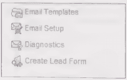

单击后，您将看到一个屏幕，允许您选择希望通过表单捕获的字段，如下图所示：

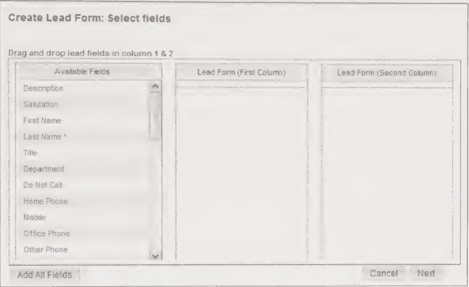

字段选择过程非常简单。在呈现的三列中，最左侧的一列将显示与“线索”模块对应的所有字段列表（包括自定义字段）。

要为表单选择一个字段，只需将其从左侧的字段列表拖放到最右侧的两列之一即可。

最好将生成的表单布局可视化为类似于编辑视图或详细视图布局的形式。字段可以水平或垂直并排显示，但只能在两列之一内。大多数组织更喜欢垂直方式，这是我们将采用的技术。不过，请随意尝试。

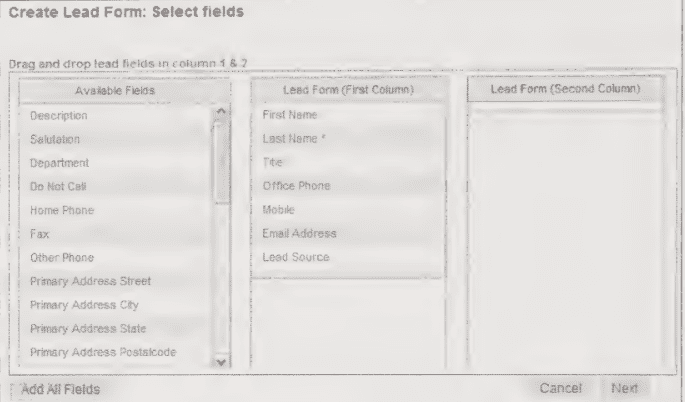

继续选择字段以匹配上图，以及您可能希望包含的任何其他字段。请注意，必填字段标有星号，如同在编辑视图屏幕中一样。您必须确保包含所有必填字段，以确保流程按预期工作。

此外，您会注意到我们已选择“线索来源”字段。这样做将允许网站访问者做出相应选择，表明是什么驱使他们访问您的网站。在您对字段选择满意后，单击 Next。

现在您需要设置一些最终参数，如下图所示：

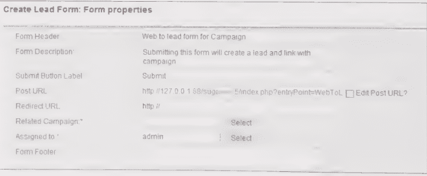

您无疑会想要修改表单标题。此值对应于网站访问者在浏览器中将看到的页面标题，因此您希望将其定制为比通用文本更友好的内容。

我们正在构建的表单与您在日常网页浏览中可能遇到的任何其他 Web 表单并无不同。因此，它也将包含一个按钮，供访问者单击以发送他们输入的数据。如果您希望按钮标签显示为除默认标签 Submit 以外的内容，请相应更改提交按钮标签。

重定向 URL 和相关活动字段也非常重要。前者用于指定访问者在单击线索捕获表单上的提交按钮后将被发送到的 URL，而后者用于将特定营销活动与表单关联。建立这种关系至关重要，因为它将帮助您正确衡量营销工作的效果。

最后，分配给选项允许您定义一个用户，线索在输入 SugarCRM 时将被分配给该用户。您可能希望考虑创建一个特定用户，例如 WebCapture，并将线索分配给该用户。这样做将使您能够快速识别通过 Web 线索捕获工具进入系统的记录，与其他方式进入的记录区分开来。

在应用编辑后单击生成表单，您应该会看到类似于以下内容：

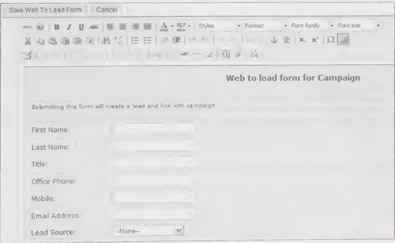

## 将您的客户与 SugarCRM 关联

默认表单现在应在 SugarCRM 的 HTML 编辑器中显示。这是一项便捷功能，因为它允许您操作表单的外观和感觉，使其符合您网站已有的外观和感觉。不过，您可能希望忽略这一点，因为其他选项允许您更轻松地将其集成到网站中。要访问这些功能并保存表单，请单击 **保存 Web 到线索表单** 按钮。

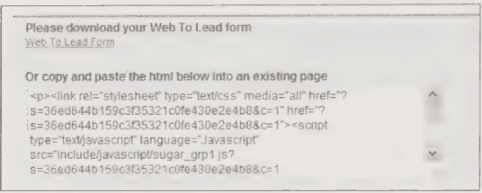

SugarCRM 提供了一个完全格式化、可直接使用的 Web 表单，您可以通过单击 **Web 到线索表单** 链接下载。但是，如果您愿意，可以复制框中显示的代码，然后将其嵌入到您已有的页面之一。第二种方法可以省去您修改默认页面的美观方面以匹配您网站的麻烦。

要开始将数据接收到您的 SugarCRM 系统中，只需将表单放在 Web 服务器上，填写字段并提交表单。请确保放置表单的服务器能够访问您的 SugarCRM 系统，否则它将无法工作。

您可以通过在 Web 浏览器中打开表单并提交数据来测试它，如下图所示：

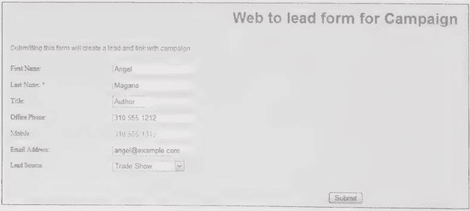


假设一切运行正常，记录将自动出现在您 SugarCRM 系统的线索模块中，无需您或其他用户进行任何干预。此外，新记录的电子邮件通知将自动发送给定义的指定用户，以告知他们新条目，以便他们可以采取行动。通过使用附加模块，例如 SierraCRM 的 **Process Manager**，还可以自动执行进一步操作，例如安排后续跟进电话。请记住，所有这些都可以自动发生，在此我们开始看到 CRM 系统的真正好处。

很少有事情比开车途中，在 BlackBerry 上收到一封电子邮件，告知您已收到新线索更令人满意的了。尤其是，当您知道这一切都发生自动时！

从流程角度来看，将每个新线索自动输入 CRM 系统的概念，使得将该线索转换为联系人、输入新销售机会的详细信息或将其纳入电子邮件营销活动变得快速而简单——所有这些都不会因人为错误而导致数据转录错误或线索丢失。

> 需要注意的一点：大多数线索捕获网站会捕获高达 50% 的错误数据。您网站的一些访问者会在表单中输入任何他们喜欢的内容；可能会污染您的数据库。这突显了另一个原因，即使用 **WebCapture** 等用户名输入它们是有益的。这样做将允许您轻松过滤线索，仅显示由 **WebCapture** 创建的线索，进而允许您清理它们，无论是通过删除它们还是执行其他数据完整性检查。

## 客户自助服务门户

在自动化线索捕获流程后，将客户链接到 CRM 系统的最常见后续步骤是自助服务门户。

正如其名称所示，这是一种软件系统，使您的客户能够以完全自主的方式与您的组织交换信息。在此初始实现中，我们将向您展示如何实施一个系统，允许客户直接在您的 CRM 系统中提交和管理服务案例。

我们大多数人都有过需要联系呼叫中心来解决客户服务问题或其他事项的经验。通常，该过程涉及等待一段时间。如果您幸运，等待的时间不会太长，但与此同时，花费 30 到 45 分钟等待或被转来转去并非罕见。更糟糕的是，您通常需要在正常营业时间内进行这些呼叫，这意味着您在浪费时间等待时无法处理正常工作。

自助服务门户提供的基本功能是通过允许客户在他们最方便的时间联系您来赋予客户权力。客户不再受特定营业时间的限制，也不必在呼叫队列中等待或在电话选项的迷宫中导航。如果他们需要您公司的帮助来解决问题，他们只需访问您的网站并提交问题即可。

同样，客户不需要直接联系您来查看他们之前提交的案例。他们只需再次访问您的网站，就可以查看他们的案例。

此功能与 SugarCRM 内置的案例模块协同工作。通常，用户会利用此模块来跟踪他们从客户那里收到的服务呼叫。通过此功能，组织的所有成员都能随时了解客户可能遇到的任何问题。

Bug Tracker 模块通过提供一个中央存储库来跟踪所有已知产品缺陷，很好地补充了案例模块。反过来，由此类缺陷产生的所有案例都可以与给定的错误相关联，使您能够衡量其对客户的影响。它们共同可以作为非常有效的工具，不仅用于提供客户服务，还用于优先处理产品开发需求和提高客户满意度。

然而，该过程可能效率低下，因为它依赖用户首先输入数据以生成案例。以这种方式赋予客户权力，使他们能够直接与案例模块交互，不仅使您更容易获得反馈并了解问题，还让客户感觉到您关心听取他们对自己问题的看法。这就是自助服务门户希望实现的目标。

## 自助服务门户配置

在深入了解配置和使用自助服务门户的具体细节之前，您必须首先了解一些重要的边界。

首先，尽管这是 SugarCRM 企业版的内置功能，但它不是社区版的功能。要获得此功能，我们必须使用 `SugarExchange.com` 上可用的 SugarCRM 附加组件，加上名为 **Joomla!** 的开源 **CMS** (**内容管理系统**) 的组合。如果您已经在使用其他 CMS 包或出于其他原因无法使用 Joomla!，您可能希望跳到下一章，因为您将无法使用本练习中描述的功能。

第二个也是最后一个重要的注意事项是，在撰写本文时，该附加组件不支持高于 5.2 版本的 SugarCRM 社区版。

现在我们对一些重要限制有了清晰的了解，让我们开始部署此功能的过程。

## 安装 Joomla!

假设您已在目标服务器上安装了 SugarCRM 社区版，那么您已经为安装 Joomla! CMS 包建立了完美的环境。与 SugarCRM 类似，它也利用 LAMP 或 WAMP 系统软件平台。就像 SugarCRM 一样，它也是一个开源应用程序。

您可以从项目网站下载 Joomla!，网址位于 `http://www.joomla.org`。

我们的练习将使用 Joomla! 1.5 版本（完整包）。假设您已成功下载并将其安装到服务器上。如果您需要该过程的帮助，请访问 Joomla! 网站查看其文档并获得进一步协助。

假设 Joomla! 已正常运行，请继续访问管理员页面。它应该类似于以下内容：

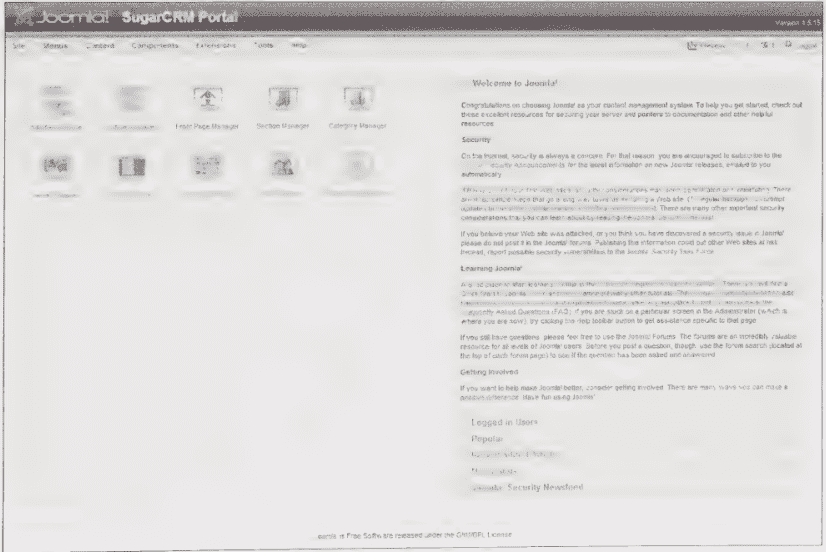

我们暂时先停留在管理员页面。

## 安装 Joomla! 的 SugarCRM 门户组件

我们的下一步将是下载并安装 **Sugar Portal for Joomla** 附加组件。该附加组件将充当 Joomla! 和 SugarCRM 之间的桥梁，以提供我们所寻求的功能。

您可以从以下网址的 Sugar Portal for Joomla 项目页面下载它：

`http://www.sugarexchange.com/product_details.php?product=474`

Sugar Portal for Joomla 包含两个 Joomla! 组件，以扩展其功能，如下所示：

- **com_sugarbugs**：此组件使用 Sugar 的 SOAP 通信设施将 Joomla! 门户链接到 SugarCRM，以提供搜索、创建和编辑软件错误报告。

- **com_sugarcases**：此组件使用 Sugar 的 SOAP 通信设施将 Joomla! 门户链接到 SugarCRM，以提供搜索、创建和编辑服务案例。

我们的示例将重点介绍案例组件。

为了在 Joomla! 中安装和使用这些对象，您首先需要在 SugarCRM 中定义一个门户用户。这将代表 Joomla! 用于与 CRM 系统通信的 SugarCRM 凭据集。

在 SugarCRM 的管理区域中，创建一个新用户——通常使用用户名 **Portal**，并选中 **Portal Only User** 复选框。此用户将专门为此目的使用，不会作为普通用户有效登录 SugarCRM。如以下屏幕截图所示：

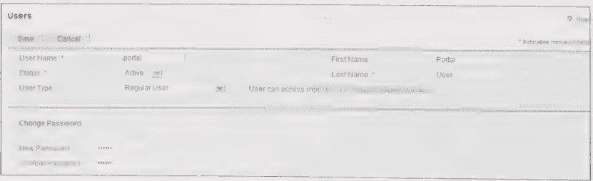


IMPORTANT: 你必须在继续之前下载并阅读 Sugar Portal for Joomla 项目页面上的安装说明（install.txt）。该文档包含有关配置更改的重要信息，这些更改必须手动应用到 SugarCRM 中，以启用门户功能。

接下来，你必须使用 Joomla! 管理区域安装 Joomla! 链接到 SugarCRM 所需的各种组件。你应先安装 com_sugarcases，然后安装 com_sugarbugs。关于安装 Joomla! 组件的帮助可以在 http://www.joomla.org 上找到。

一旦组件在 Joomla! 中成功安装，我们需要对其进行配置，以便它们能够与你的 SugarCRM 实例进行通信。让我们来看看配置 SugarCRM 案例组件的过程。

在 Joomla! 中，选择 **组件 | Sugar 案例 | 配置**。更新 **密码**、**Sugar Soap 位置** 和 **用户名** 字段，以反映先前在 SugarCRM 中创建的门户用户和密码组合。

你还需要输入与你的安装对应的 URL。可以通过在使用 SugarCRM 时查看 Web 浏览器中的地址字段轻松获取 URL。例如，你的测试安装可能显示 URL 为 `http://127.0.0.1:88/sugarc52/` 或 `http://sugarcrm.example.com/`（如下图所示）。无论哪种情况，你都需要在末尾追加文本 `soap.php`，使其分别读取为 `http://127.0.0.1:88/sugarc52/soap.php` 和 `http://sugarcrm.example.com/soap.php`。完成后保存更改。

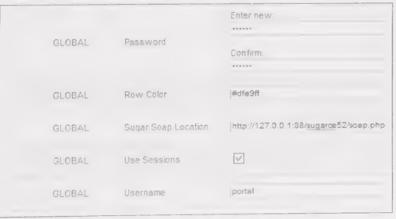

然后，你将有机会选择希望在 Joomla! 中显示的 SugarCRM 案例记录字段。目前请保持默认设置，如下图所示。如果需要，以后随时可以修改。

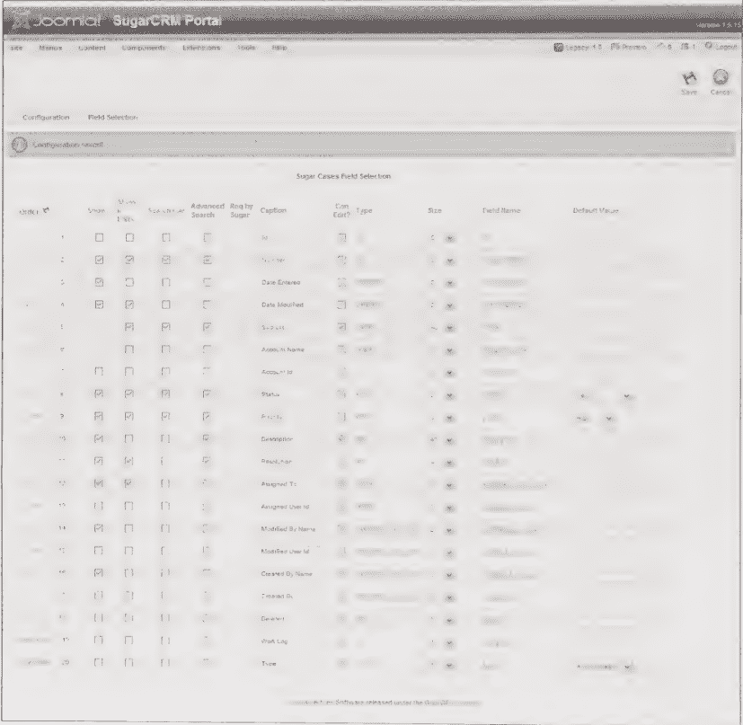

最后，你需要将 SugarCRM 案例添加到 Joomla! 菜单系统中，以便网站访问者能够访问它。

要添加菜单选项，请选择 菜单 | 用户菜单 并单击 新建。选择 Sugar 案例，并为标题输入 支持案例。将访问级别设置为 已注册，并验证 在参数（系统）部分下 显示标题页 是否设置为 是。完成后单击 保存。下图显示了如何添加菜单选项：

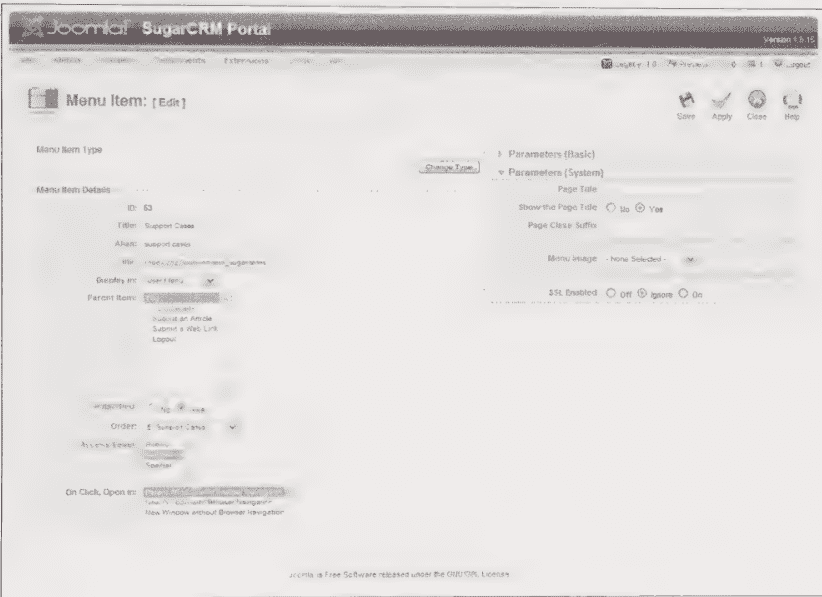

Joomla! 方面应该就完成了，但如何将 SugarCRM 中的数据与特定的 Joomla! 用户关联起来呢？

这是通过联系人记录上的门户字段来实现的。切换到 SugarCRM 并访问联系人模块。选择一个随机联系人并访问其编辑视图屏幕。在屏幕的最底部，你应该找到以下内容：

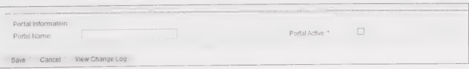

门户激活复选框启用/禁用当前联系人记录的门户访问权限。门户名称字段中指定的值更为重要，因为它用于建立 Joomla! 用户与 SugarCRM 联系人之间的关系（如下图所示）。反过来，这使 Joomla! 能够显示和管理与指定联系人相关的案例。

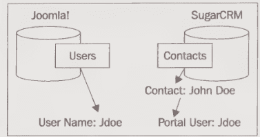

在门户名称字段中输入一个值，并在记录上启用门户激活复选框，然后保存记录。请记住你在门户名称字段中指定的值，因为你将需要创建一个与该值同名的 Joomla! 用户，如下一节所述。

## 创建新的 Joomla! 用户

使用 Joomla! 管理菜单导航到 站点 | 用户管理器，然后单击 新建 图标以创建新用户。输入用户信息后（请注意，你需要将组设置为 已注册），单击 保存 图标。确保你创建的用户与 SugarCRM 中的门户名称字段的值匹配。

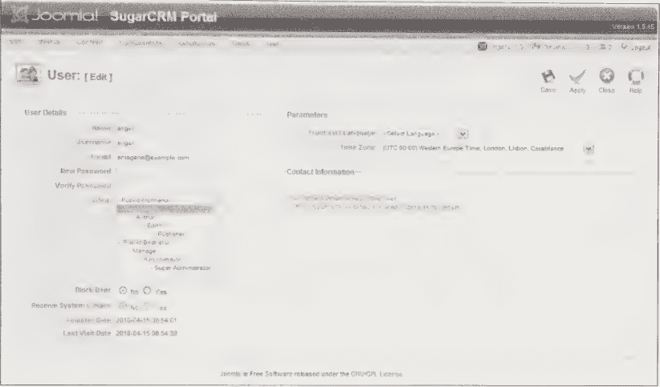

## 使用你的新自助服务门户

你现在应该能够使用你的自助服务门户了。退出 Joomla!，然后通过导航到 `http://localhost/joomla` 以刚刚创建的新 Joomla! 用户身份登录到常规 Joomla! 网站。

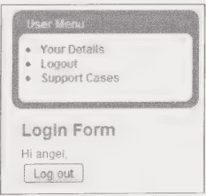

## 将你的客户链接到你的 SugarCRM

单击 **支持案例** 的链接。从此处，你有 **主页**（列出与你的用户相关的所有案例）、**新建**（创建新案例）和 **搜索**（查找特定案例）的选择。请注意，下图演示了一个默认的 Joomla! 页面。你很可能希望对其进行修改，以匹配你网站其余部分或一般企业形象和风格指南的品牌。请放心，此类修改可以通过标准 CSS 修改和 Joomla! 自定义技术来完成。

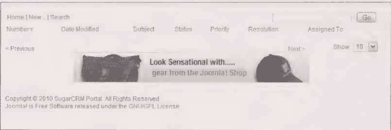

单击 **新建** 以创建新案例。为案例输入名称和描述，如下图所示：

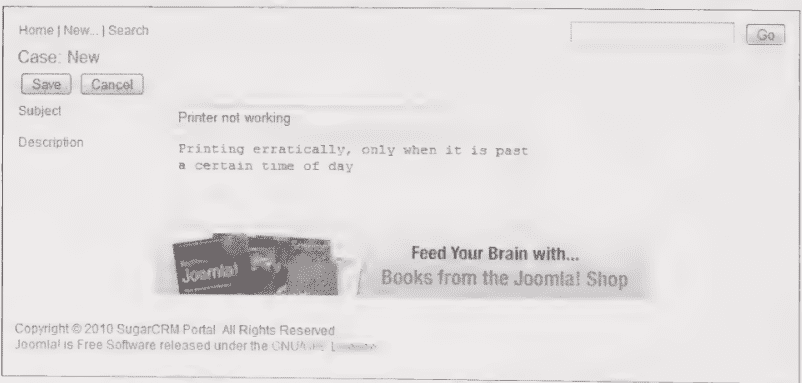

单击 **保存** 后，案例将被提交并输入到 SugarCRM 中。在门户中，你应该看到以下内容：

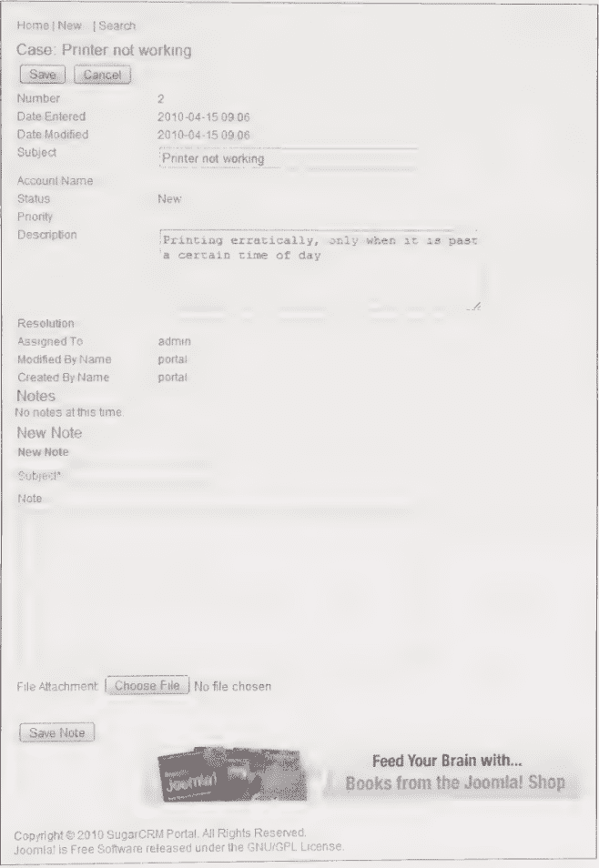

现在，切换到 SugarCRM 并查看与刚刚提交案例的 Joomla! 用户关联的联系人的详细信息视图屏幕。这在下图中显示：

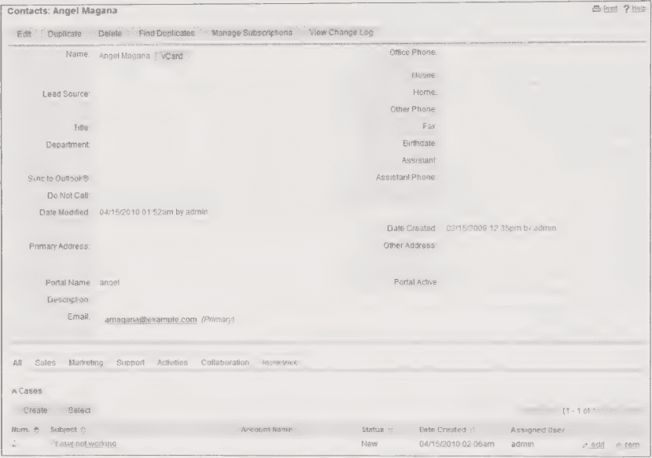

如你所见，案例不仅被输入到 SugarCRM 中，而且还自动链接到了相应的联系人。

虽然我们在此仅展示了自助服务案例管理功能，但它确实很好地突出了可能性。此组件使用 SugarCRM 的标准 SOAP 接口，通过投入一些开发时间来进一步完善相关的 Joomla! 组件，你可以创建各种客户自助服务应用程序，例如文档共享门户、项目跟踪门户等等。

这种技术的使用在未来几年只会越来越快。既然你已经看到了它能为企业带来什么，你真的想在没有这些工具的情况下与那些充分利用这些工具的公司竞争吗？

## 摘要

在本章中，我们介绍了将你的 CRM 链接到外部世界（更具体地说，是你当前和潜在的客户）的两个关键技术。

线索捕获应用程序易于设置，并且在创造收入和降低管理成本方面对利润有直接影响。

开发客户自助服务门户是最大化 CRM 投资回报的关键技术。它们能让你的客户更加了解情况并更满意，同时提高客户服务和支持领域的效率并降低成本。

从此，前途无量。未来 CRM 领域将有许多新发展。一个备受期待的趋势是 CRM 系统充当自己的门户——为客户和供应商提供经过精心控制和监管的 CRM 直接访问。这将使他们只能看到系统设置允许的信息和导航功能。

以 CRM 领域（尤其是针对小型企业的 CRM 这一火热领域）当前的演进和发展速度，我们可以预期在未来一年左右会出现这种类型的发展以及许多其他发展。我期待着更新这本书来描述它们。

## 在 Linux 上安装 SugarCRM

你在 Linux 驱动的服务器上安装 SugarCRM 时会遇到的第一个挑战之一是决定选择一个合适的 Linux 发行版。

在本书前面，我们提到过存在许多选项，这反过来使选择过程变得有些令人生畏。幸运的是，有一些参数可以帮助我们做出选择。更具体地说，你要确保选择一个包含满足 SugarCRM 系统要求的所需软件（Apache、PHP 和 MySQL）版本的发行版。

你可以通过访问 SugarCRM 网站上的官方系统要求网页来熟悉受支持的版本，该网页位于以下 URL：

`http://www.sugarcrm.com/crm/products/supported-platforms.html`

现在看一下网页，你会注意到，默认情况下，它显示有关 SugarCRM 最新版本的信息。在撰写本书时，那是 5.5.1 版本。


如果你正在安装旧版本（例如 5.2 版或甚至 4.5.1 版），可以使用网页左侧的快捷方式来查看该版本的系统要求。

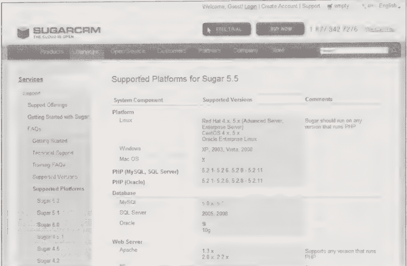

现在回到选择合适发行版的话题。

在互联网上快速搜索关于哪个发行版最好的信息，肯定会得到一长串结果。关于什么样的特质使一个发行版优于其他发行版，存在许多不同的看法，以至于这变得不那么有帮助。

我们将跳过那场讨论。我们的示例将使用 CentOS 发行版，版本 5.4，原因有两个重要方面。

首先，CentOS 基于 Red Hat Enterprise Linux 发行版，可以说是当今使用最广泛的发行版。这一点的重要性不在于应该随大流，而在于庞大的用户社区代表着广泛的支持。

相关地，这也意味着与其他发行版相比，该系统接触到了更多样化的环境（例如，不同的硬件配置、不同的用户负载等）。通常，这种接触会导致经过更彻底测试、更稳定且更具容错性的软件。巧合的是，这种方法也是开源开发的基本原则，即让尽可能多的人访问代码，以便他们能够及时改进代码或发现问题。

选择 CentOS 的最后一个原因要简单得多：SugarCRM 的数据中心使用它。鉴于 SugarCRM（公司）使用它来提供 SugarCRM On Demand 服务，很难反对其使用。CentOS 已在专门为 SugarCRM 和大量用户设计的环境中证明了自身。它应该能够同样好地处理你的 SugarCRM 需求。

你现在需要获取 CentOS 并安装它。要获取 CentOS 的副本，请访问 http://www.centos.org 并单击下载链接。请注意，有 i386（32 位）和 x86_64（64 位）版本的链接。SugarCRM 对此问题相当中立，两个版本都可以工作。但是，如果你想知道 64 位版本的可行性，它与 SugarCRM 数据中心使用的相同。

本节的其余部分将假设你已经下载了必要的软件并创建了必要的光盘，或者能够读取 ISO 文件。关于创建光盘的详细信息可以在以下网址找到：
http://www.centos.org/docs/5/html/CD_burning_howto.html

> 在访问 www.centos.org 时，你可能已经注意到 CentOS 5.4 版包含 PHP 5.1.6 版。如果你安装的 SugarCRM 版本比 5.2 新，则需要将 PHP 版本更新为你之前访问的支持平台网页上列出的版本。安装更新的分步说明可在以下网址找到：
> http://wiki.centos.org/HowTos/PHP_5.1_To_5.2

## 基本 CentOS Linux 安装

要安装 CentOS Linux Server，请执行以下步骤：

- 将 CentOS 安装光盘，光盘 1（如果你下载了 DVD 映像则为 DVD）插入目标系统并重新启动。你应该能看到类似于以下的屏幕：

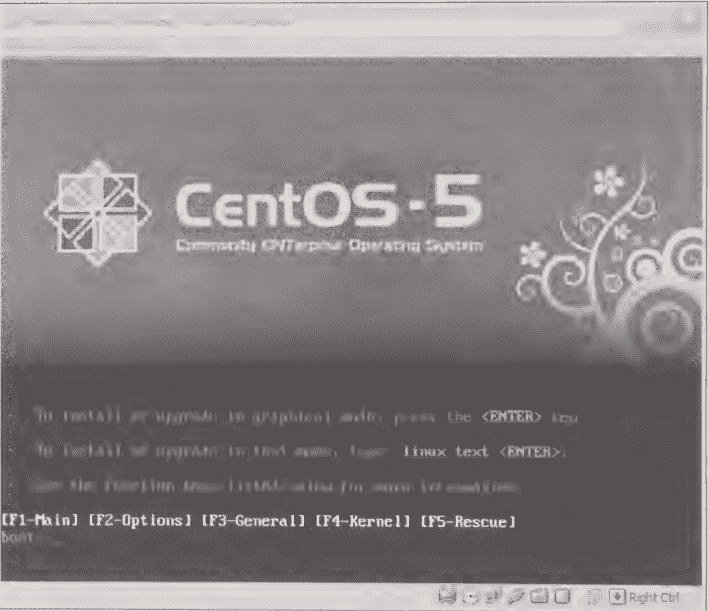

- 按 Enter 键开始安装过程。

- 在提示测试 CD 映像时选择 Skip。你应该看到以下屏幕：

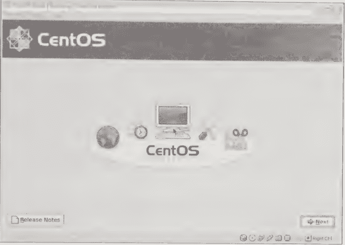

- 继续安装向导，选择所需的语言、键盘布局和其他参数。继续安装过程，直到看到以下屏幕：

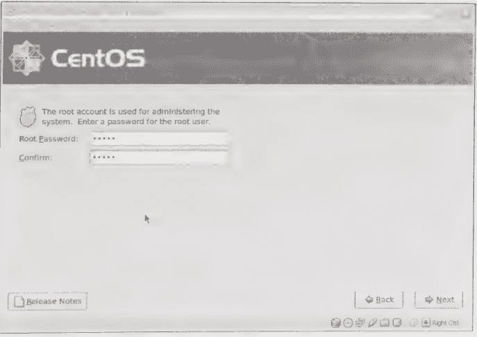

## 在 Linux 上安装 SugarCRM

- 在提示时，为你的 _root_ 用户定义一个强密码，并确保将其记录在安全的地方。

- 接下来，你需要对软件选择屏幕上的默认选择进行一些调整，如下图所示：

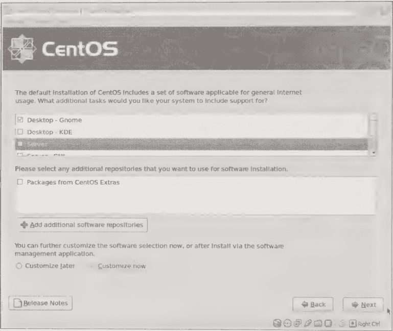

- 在继续之前，验证 **Server** 和 **Customize Now** 已被选中。这将确保你安装所有必要的组件。

- 在接下来的屏幕上，选择 **Servers** 和 **MySQL Database**，如下图所示：

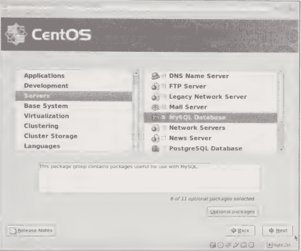

- 继续向导的其余部分并启动安装过程，如下一张图所示：

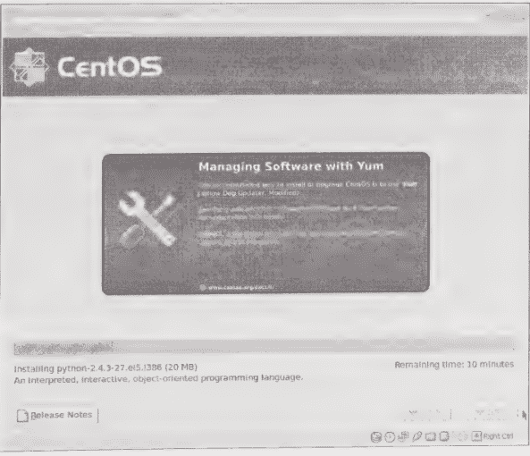

安装过程完成后，我们需要调整一些设置，以确保我们的 PHP 环境已正确配置并处于正确的版本级别。

如果你还记得本节前面提到的，CentOS 5.4 版包含 PHP 5.1.6 版，不应与比 5.2 新的 SugarCRM 版本一起使用。但是，无需担心，因为安装更新版本的 PHP 的分步说明可在以下网址找到：

`http://wiki.centos.org/HowTos/PHP_5.1_To_5.2`

你可能已经注意到，这些图片是在 **Sun VirtualBox** 虚拟机上进行安装时拍摄的。虚拟机正是如此，即物理服务器的数字表示。VirtualBox 是当今提供这种日益流行功能的各种软件包之一。

虚拟化的流行主要归功于其降低成本的能力。由于单个物理服务器可以用于托管多个虚拟机，每个虚拟机执行不同的功能，因此硬件和其他辅助成本（如电力）得以降低。然而，危险在于物理服务器上的重大故障可能会影响其托管的所有虚拟机——这带来了一定的风险。

如果你正在考虑为你的 SugarCRM 部署使用虚拟化技术，无论是用于 Web 还是数据库服务器组件，请放心，这是一种完全可接受（且常见）的部署方法，尤其是在使用 Linux 时。

让我们现在继续配置我们新安装的 CentOS 系统，以准备托管 SugarCRM 安装。

## 配置 CentOS Linux 安装

首次启动时，CentOS 会自动提示你对其配置进行一些调整，以更好地满足你的需求。你可以如下图所示配置防火墙设置：

## 防火墙

你可以使用防火墙来允许其他计算机访问你计算机上的特定服务，并防止外部世界的未经授权的访问。你希望允许访问哪些服务（如果有的话）？

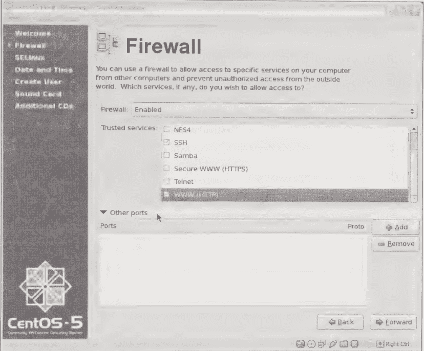

执行以下操作以配置防火墙设置：

- 如果你打算使用安全连接访问你的 SugarCRM 实例，请调整防火墙设置以启用 WWW (HTTP) 和 Secure WWW (HTTPS)。

- 如果你打算从服务器以外的系统访问你的 MySQL 数据库，则需要在 **其他端口** 部分中添加端口 3306。

- 继续完成向导的其余部分，当你到达登录屏幕（如下图所示）时，以 **root** 身份登录，使用安装时定义的密码。

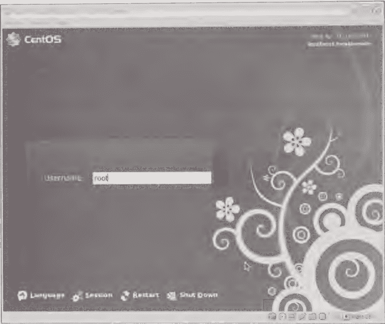

现在你已登录系统，我们需要验证 PHP 设置并安装 SugarCRM 所需的一些 PHP 扩展。

此时应安装 PHP 更新。如果你打算安装比 5.2 更新的 SugarCRM 版本，请在完成升级之前不要继续。要检查你的 PHP 版本，请选择 **应用程序 | 附件 | 终端** 并执行命令：

```
php -v
```

本章的其余部分假设你的系统上已经安装了受支持的 PHP 版本。它还假设你熟悉在 Linux 操作系统中执行浏览和编辑文本文件等功能。


## 配置 PHP

在开始调整 PHP 设置之前，您需要安装几个重要的扩展。第一个是 `php-imap`，用于电子邮件功能，另一个是 `php-mbstring`，用于双字节字符支持。

要安装它们，请执行以下命令：

- `yum install php-imap`
- `yum install php-mbstring`

这些扩展成功安装后，继续修改您的 PHP 配置。

要修改 PHP 配置，请执行以下步骤：

- 导航到 `/etc` 并使用您选择的文本编辑器打开文件 `PHP.INI`。
- 搜索 `memory_limit` 参数并将其值设置为至少 **64M**（首选 256M）。如果不调整，在尝试使用 SugarCRM 时，空白屏幕和其他异常行为的倾向会发生。
- 搜索 `max_execution_time` 并将其设置为 **300**。值过低通常会导致开始但保持不完整的操作。例如，导出大量记录可能会失败，而导出较小的同一数据集却成功。
- 将 `max_input_time` 设置为 **300**。这允许 5 分钟的窗口来上传大文件。值不足通常会导致在使用 **升级向导**、上传文件/附件或使用 **模块加载器** 时出现问题。
- 搜索 `display_errors`，并将其设置为 **Off**。这将抑制警告消息的显示，否则这些消息会干扰显示。
- 搜索 `post_max_size`，并将其设置为 **25M** 以允许上传大文档。然后搜索 `upload_max_filesize`，并将其设置为 **25M**。这两项更改的效果将是允许 20 兆字节大小的文档文件上传到系统中。
- 搜索 `session.gc_maxlifetime`。请注意，默认情况下它设置为 **1440** 秒，即 24 分钟。这控制 SugarCRM 会话在终止前可以处于空闲状态的时间长度。会话代表与 SugarCRM 的唯一连接，并在用户访问系统时自动启动。如果用户的会话被终止，用户需要重新登录才能与 SugarCRM 交互。3600 或 1 小时的值通常足够，但请随意增加或减少其值。
- 确保在 php.ini 中设置上述值时，整行前面没有分号，因为这表示该行仅仅是注释且不应被处理。
- 最后，我们需要在扩展部分添加以下行以启用 IMAP 和 MBString 模块：

  ```
  extension=imap.so;
  extension=mbstring.so;
  ```

- 保存对 PHP.INI 文件的更改，并重新启动 Web 服务器以应用更改。

您可以随时通过创建并查看包含以下代码的 PHP 文件来验证 PHP 设置：

```php
<? php
phpinfo ();
?>
```

验证后，将文件的扩展名更改为非 .php 的其他内容，以防止意外访问该信息。

环境现在应该已准备好托管您的 SugarCRM 安装。让我们继续在 CentOS 服务器上安装 SugarCRM 的过程。

## 安装 SugarCRM 社区版

配置服务器后，您的第一步是下载 SugarCRM 社区版的安装文件。文件可以从以下 URL 下载：

http://www.sugarcrm.com/crm/download/sugar-suite.html

单击 **立即下载** 按钮将提供最新版本的 SugarCRM 社区版。在撰写本书时，最新版本为 5.5.1。下载前，验证当前可供下载的版本不包含 **BETA**、**RC1**、**RC2** 或类似附加到其名称的标识，通常位于版本号之后。此类迭代是产品的 _开发中_ 版本，不应在生产环境中使用。它们仅应用于测试目的。

您也可以选择使用 **以前版本、补丁和升级** 链接下载旧版本。如果您选择其中一个旧版本，请确保不要下载名称中包含 **升级或补丁** 标签的安装包。

关于下载页面的最后一点需要引起您的注意。请注意，有适用于各种操作系统的 **堆栈安装程序**。这些安装程序简化了在各种平台上部署 SugarCRM 的过程。它们通过提供一个安装 SugarCRM 所需的基础（Web 服务器、PHP 和 MySQL/MS-SQL）以及 SugarCRM 本身的包来实现这一点。

虽然对于开发、测试或培训部署很有用，但使用过程中遇到的问题可能难以排查。它们也可能难以修改，有时这是必要的，例如，当我们需要更新包含的 PHP 版本时。

我们将遵循的安装过程假设您已通过单击本章前面提到的 **立即下载** 按钮下载了 SugarCRM。以下图片显示了 SugarCRM 社区版的下载页面：

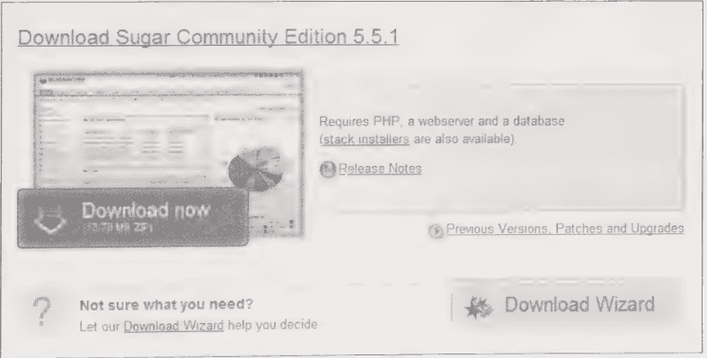

单击 **立即下载** 按钮后，执行以下步骤：

- 将安装包的内容解压缩到 `/var/www/html` 目录。
- 您现在应该有一个名为 `/var/www/html/SugarCE-Full-5.5.1` 的文件夹。将 `SugarCE-Full-5.5.1` 重命名为 `sugarcrm`。

## 在 Linux 上安装 SugarCRM

也许在 Linux 服务器（包括 CentOS）上导致安装问题的最常被忽略的问题是权限设置。因此，执行以下命令以确保安装成功非常重要。

- 通过执行以下命令将 `sugarcrm` 目录的所有权更改为 Apache 用户和组：

  ```
  chown -R apache.apache sugarcrm
  ```

- 通过执行以下命令修改文件和目录权限：

  ```
  chmod -R 755 sugarcrm
  ```

您应咨询安全专家，以验证这些更改是否会将漏洞引入服务器配置。最终目标是配置安全设置，以允许运行 Web 服务器的用户从 `sugarcrm` 目录创建、修改和删除文件。安装完成后，您可以进一步收紧安全性，并将这些更改仅限于 `cache` 和 `custom` 子目录及其内容。无论如何，如果安全是一个问题，应寻求合格安全专家的建议，最好是有 Linux 系统经验的人。

安装过程的其余部分将在您的 Web 浏览器中执行。因此，验证 CentOS 服务器上的 Web 服务器是否正常运行非常重要。

要测试它，请在服务器上启动 Web 浏览器并尝试访问 `http://localhost`。如果一切按预期工作，您应该看到 Apache 测试页面。

如果遇到问题，请验证所需服务是否正在运行。您可以通过执行以下命令来做到这一点：

- `service httpd restart`
- `service mysqld restart`

如果启动时发生错误，您需要先解决该问题，然后再继续下一部分，该部分将引导您完成 SugarCRM 安装过程。

要开始安装过程，请将 Web 浏览器指向以下 URL：

`http://<ip address of server>/sugarcrm`

如果您打算允许 LAN 或内部网络外部的用户访问，您应该使用与服务器关联的公共或面向互联网的 IP 地址。如果您的意图是将访问限制为仅 LAN 或内部网络上的用户，您应该使用所有预期用户都可以用来连接到服务器的 IP 地址。使用 127.0.0.1 或 localhost 会导致访问仅限于服务器本身。

您可以使用 ifconfig 和 hostname 命令分别确定 IP 或服务器地址。如果您需要确定公共 IP 地址的帮助，请咨询您的网络或 DNS 管理员。

一旦您在 Web 浏览器中输入了正确的地址，它应该自动将您带到安装向导欢迎页面，如以下屏幕截图所示：

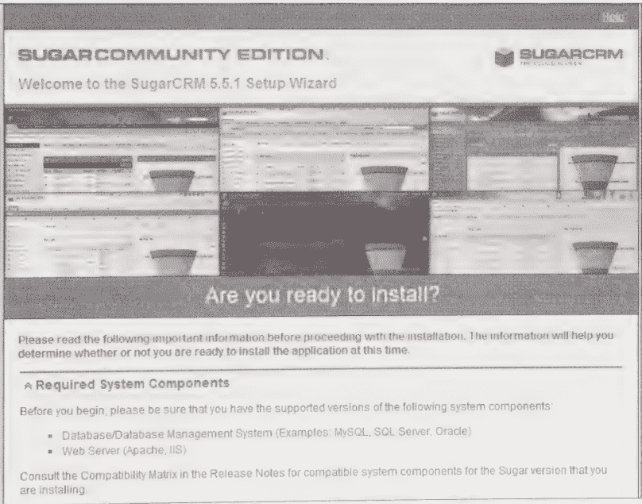


## 在 Linux 上安装 SugarCRM

安装步骤如下：

- 欢迎屏幕：单击“下一步”按钮开始安装过程。
- 许可证屏幕：查看并接受条款（如果您同意如下截图所示的条款）：

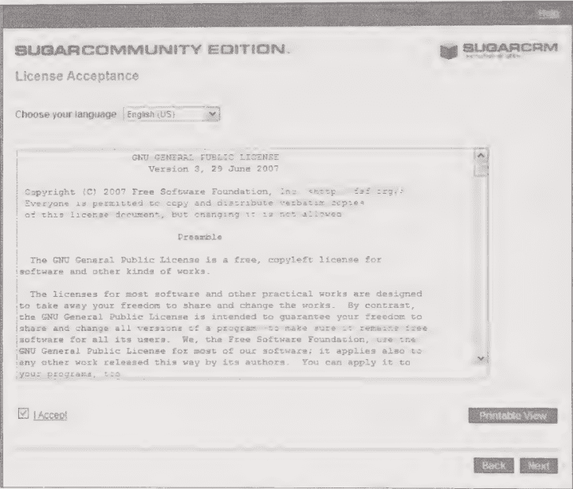

- 系统检查屏幕：接下来您将看到 SugarCRM 系统检查屏幕。SugarCRM 安装程序会检查安装环境的多个方面，并在此屏幕上向您报告其状态。如果您的 PHP 安装中有某些内容未正确配置，您将看到类似于下图的屏幕。在继续之前，必须先解决这些错误。常见问题包括以下内容：

- 缺少或禁用的 PHP 扩展
- 文件权限不正确
- PHP 参数不当

## 系统检查接受

兼容性检查期间检测到错误。为了使您的 SugarCRM 安装正常运行，请采取适当措施解决下面列出的问题，然后单击重新检查按钮，或尝试重新安装。

| 组件 | 状态 |
|---|---|
| MB 字符串模块 | Sugar 应用程序所需的与多字节字符串 PHP 扩展（mbstring）相关的功能未找到。 |
| 可写的 SugarCRM 配置文件 (config.php) | 通常，mbstring 模块在 PHP 中默认未启用，必须在构建 PHP 二进制文件时使用 --enable-mbstring 进行激活。有关如何启用 mbstring 支持的更多信息，请参阅 PHP 手册。配置文件存在但不可写。请采取必要措施使文件可写。根据您的操作系统，这可能需要您运行 chmod 766 来更改权限，或右键单击文件名以访问属性并取消选中“只读”选项。 |
| 可写的自定义目录 | 自定义目录存在但不可写。您可能需要更改其权限（chmod 766）或右键单击它并取消选中“只读”选项，具体取决于您的操作系统。请采取必要措施使文件可写。 |
| 可写的数据子目录 | 下面列出的文件或目录不可写或丢失且无法创建。根据您的操作系统，纠正此问题可能需要您更改文件或父目录的权限（chmod 766），或右键单击父目录并取消选中“只读”选项并将其应用于所有子文件夹。 |

- **安装选项**：一旦错误被纠正（或如果未发现任何错误），您将被提示选择安装方法。保持默认设置为 **Typical**，并单击 **Next**，如下图所示：

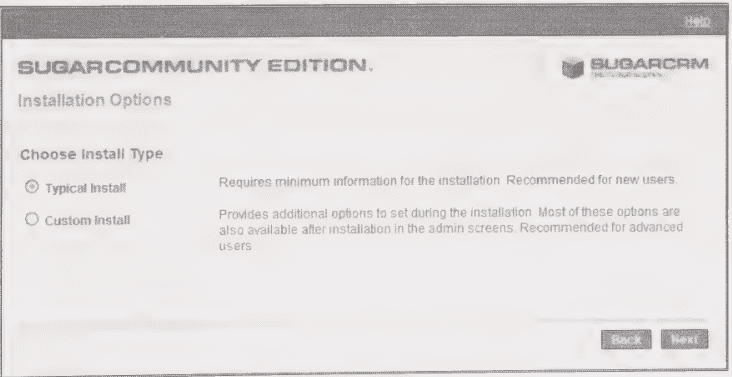

## 在 Linux 上安装 SugarCRM

- 数据库类型：除非您添加了对 MS-SQL 的支持，否则您的唯一选择应该是 MySQL（检测到 MySQLi），如下图所示。单击 Next 继续。

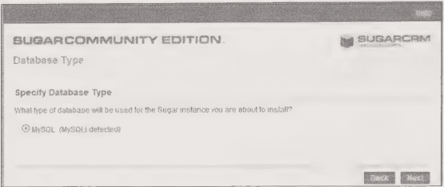

- 数据库配置屏幕：输入连接到 MySQL 服务器所需的参数。基于我们之前安装 CentOS 所做的工作，您应该为数据库名称输入 sugarcrm，为主机名输入 localhost，为数据库管理员用户名输入 root，并将数据库管理员密码字段留空。您可能希望更改的唯一其他设置是是否用演示数据填充数据库的选项。这些显示在下图中：

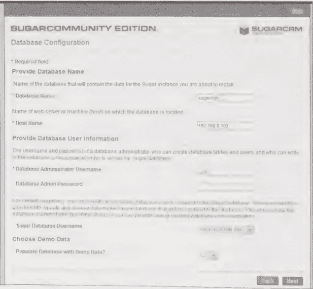

## 站点配置屏幕

就像您为 CentOS 安装提供了 root 用户的密码一样，您也必须为默认用户 admin 提供密码。请务必将此密码存储在安全的地方。站点配置屏幕如下图所示：

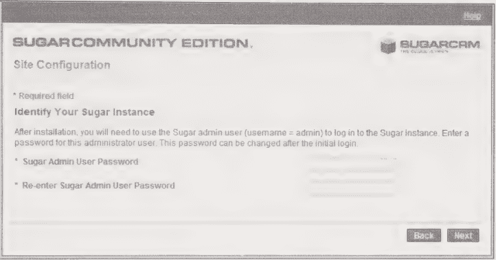

## 区域设置屏幕

您还可以在安装过程中微调一些默认用户偏好设置。这些包括日期和时间格式以及其他设置，如下图所示：

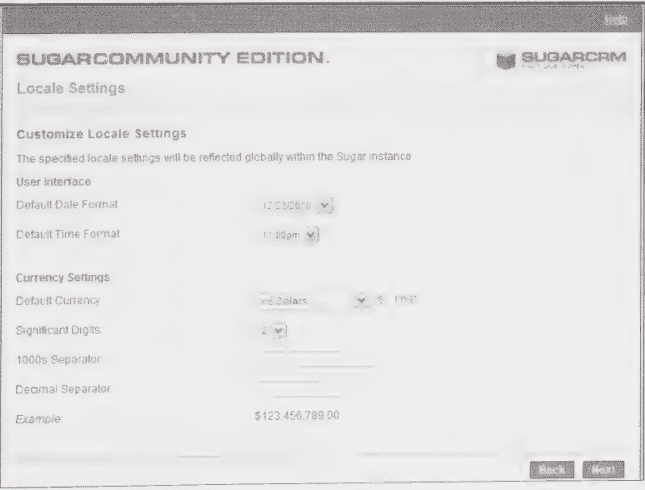

- 确认屏幕：最后，安装程序将显示一个摘要屏幕，其中包括向导中先前定义的许多设置。如果您需要在安装前进行更改，这是您最后的机会。您可以使用 Back 按钮应用更改，或单击 Install 提交安装。确认屏幕应出现，将类似于下图：

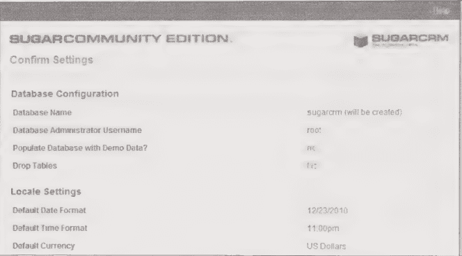

单击 Finish 按钮后，安装过程将立即开始。该过程通常不到几分钟，但如果您选择安装演示数据，可能需要更长时间。

完成后，您应该看到类似于下图的屏幕：

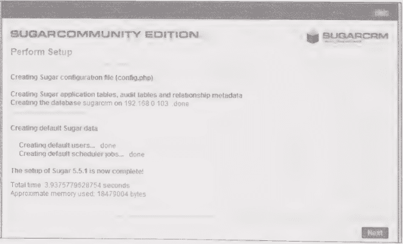

## 附录 A

单击 Next 继续，您将被提示注册，如下图所示。这不是必需的，但有助于 SugarCRM，因此请考虑这样做。

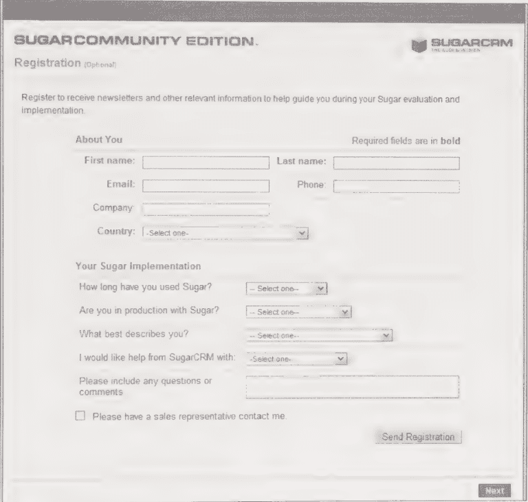

完成注册屏幕后，单击 Next 按钮。

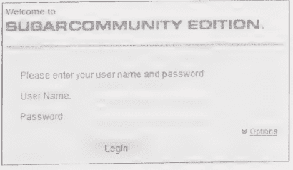

## 在 Linux 上安装 SugarCRM

恭喜！您现在已成功在 CentOS Linux 服务器上安装了 SugarCRM！

您应该看到类似于前一图所示的登录屏幕。您可以使用用户名 _admin_ 和在安装过程中定义的密码登录（作为 SugarCRM 用户）。

## 在 Windows Server 上安装 SugarCRM

SugarCRM Community Edition 的副本可免费下载，网址为 http://www.sugarcrm.com/crm/download/sugar-suite.html。单击 **Download now** 按钮将提供最新版本的 SugarCRM Community Edition。截至撰写本书时，最新版本为 5.5.1。下载前，请验证当前可供下载的版本不包含 BETA、RC1、RC2 或类似附加在名称后的标识，通常位于版本号之后。此类迭代是产品的 _in-development_ 版本，不应在生产环境中使用。它们仅应用于测试目的。

您也可以选择使用 **Previous Versions, Patches and Upgrades** 链接下载旧版本。如果您选择其中一个旧版本，请确保不要下载名称中包含 **Upgrade** 或 **Patch** 标签的安装包。

关于下载页面，最后一点值得您注意。请注意，有适用于各种操作系统的 **stack installers** 可用。这些安装程序通过提供一个包来简化在各种平台上部署 SugarCRM 的过程，该包安装 SugarCRM 所需的基础（Web 服务器、PHP 和 MySQL/MS-SQL），以及 SugarCRM 本身。

虽然有用，但使用过程中遇到的问题可能难以排查。它们也可能难以修改，有时这是必要的，例如，当我们需要更新包含的 PHP 版本时。

我们将遵循的安装过程假设您已通过单击本章前面提到的 **Download now** 按钮下载了 SugarCRM。

在基于 Windows 的系统上安装 SugarCRM 之前，您必须先就系统配置做出几个重要决定。

## 关于我们的安装

本书 _Chapter 3_ 讨论了 SugarCRM 如何利用 LAMP 堆栈作为其基础以及它提供的灵活性。后一点允许有不同技术偏好的个人轻松利用他们更熟悉或更喜欢的技术，同时仍能成功使用 SugarCRM。一个很好的例子是使用 Microsoft SQL Server 而不是 MySQL 作为数据库服务器组件。

然而，我们的示例假设唯一会更改的变量是操作系统。以下部分将指导您完成在基于 Windows 的计算机上安装 SugarCRM 的过程，分别使用 Apache 和 MySQL 作为 Web 服务器和数据库服务器。

本章的最后几部分讨论了一些关于利用 Microsoft 的 Internet Information Services (IIS) Web 服务器或 Microsoft SQL Server 的安装的重要事项。

## 选择 Windows 版本

您可能注意到，前面的讨论没有涉及选择 Windows 版本的问题。SugarCRM 对此特定方面相当中立，因此您的决定应基于其他因素，例如预期负载和硬件。

如果您的安装是针对单个用户，Windows XP 对 SugarCRM 来说和 Vista 或 Windows 7 一样可接受。当然，较大的用户负载应使用更合适的版本，例如 Windows Server Standard 或其他类似选择。请记住，许可成本将根据您选择的 Windows 版本而有所不同。

现在，让我们来看看安装过程。


## 使用 MySQL 和 Apache 安装 SugarCRM

虽然 Windows 操作系统的各个版本都内置了 Web 服务器（IIS），但一些用户更倾向于使用 Apache Web 服务器。Apache 是一种广泛使用的开源 Web 服务器，可从 `http://www.apache.org` 下载。让我们来了解在 Windows 系统上安装它的过程。

为简化流程，建议下载 **MSI** 安装程序包。此外，应下载最新的稳定版本，通常由“_最佳可用版本_”标识。此外，还应考虑下载包含 SSL 支持的版本，以防将来需要。

除了 Apache，还需要安装 PHP。请注意，即使选择使用 IIS，也必须安装 PHP，因为 PHP 不是 Web 服务器的内置功能。可从 `http://www.php.net` 下载 PHP 所需的安装文件。

在下载 PHP 之前，请验证所选版本是否受 SugarCRM 支持。受支持版本的完整列表可在 SugarCRM 官网的系统要求页面上找到，网址如下：

`http://www.sugarcrm.com/crm/products/supported-platforms.html`

同样，需要下载并安装受支持的 MySQL 版本。可从 `http://dev.mysql.com` 下载。

本节其余部分将假设您已下载 Apache、PHP 和 MySQL 的相应 MSI 安装包。

## 安装 Apache Web 服务器

要安装 Apache，双击先前下载的相应 MSI 包。它应显示以下屏幕：

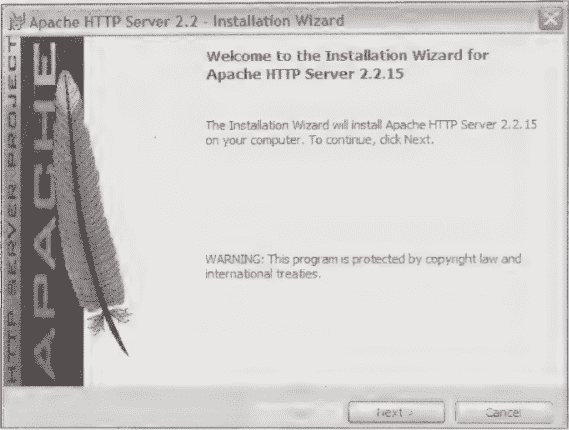

正常进行安装向导，并在如下所示的屏幕中输入您的信息：

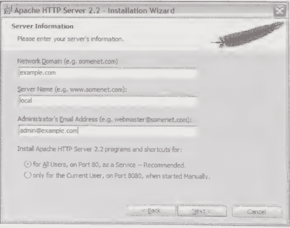

如果没有域名，可以使用 example.com。此外，应确保选中 **for All Users** 选项，以便将其作为服务安装。单击 **Next** 继续。继续完成向导的其余部分，一路接受默认选项。

安装过程完成后，安装程序将尝试启动 Apache。如果同一台计算机上已安装并运行 IIS（或其他应用程序，如 Skype），可能会收到端口已被占用的错误消息。要解决此问题，您需要关闭 IIS、Skype 或其他应用程序，然后启动 Apache；或者，也可以将 Apache 使用的端口号从默认的 80 更改为未被占用的其他值。

要更改 Apache 使用的端口号，请选择 **Start | All Programs | Apache HTTP Server 2.2 | Configure Apache Server | Edit Apache httpd.conf configuration file**。搜索读取为 **Listen 80** 的行，并将 80 更改为不同的值。保存更改，然后通过选择 **Start | All Programs | Apache HTTP Server 2.2 | Control Apache Server | Start** 再次尝试启动 Apache。请注意，您可能还需要调整 SSL 端口（默认端口 443）。

## 安装 PHP

成功安装 Apache 后，继续安装 PHP。要安装 PHP，请启动先前下载的相应 MSI 安装包。

单击安装向导的前几个屏幕，直到到达以下屏幕：

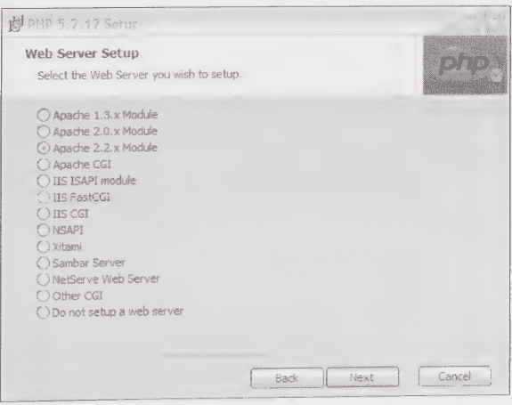

验证在前一屏幕上已选择 **Apache 2.2.x Module**，然后单击 **Next** 继续。随后将显示以下屏幕：

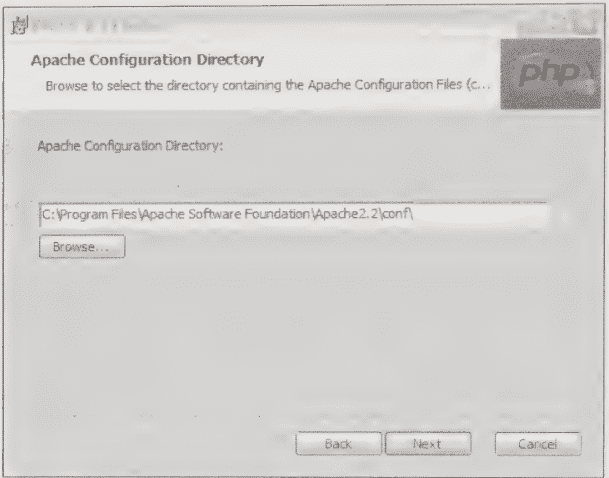

输入 Apache 配置文件的路径。默认情况下，此路径应设置为 C:\Program Files\Apache Software Foundation\Apache2.2\conf\，如上一张屏幕截图所示。如果不确定，请在系统中搜索名为 httpd.conf 的文件，并指定包含该文件的路径。

SugarCRM 需要多个 PHP 扩展才能正常运行。安装向导允许您定义要安装的扩展。但是，为简化我们的示例，我们将简化流程，只需在以下图像的 PHP 节点上选择 **Entire feature will be installed on local hard drive**，即选择安装所有组件：

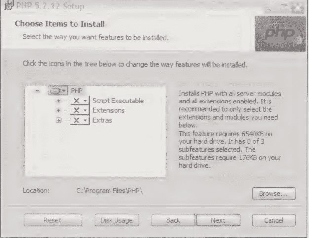

继续完成安装过程并重启 Apache。要验证 PHP 是否正常工作，请创建一个名为 `test.php` 的文件，内容如下：

```php
<?php
Phpinfo();
?>
```

将文件放在以下位置：

`C:\Program Files\Apache Software Foundation\Apache2.2\htdocs`，并尝试通过 Web 浏览器导航到 `http://localhost/test.php` 打开它（您可能需要调整 URL 以包含自定义端口号）。如果一切正常，您应该看到显示 PHP 版本号和其他相关信息的屏幕。

既然您已拥有可用的 Apache 和 PHP 安装，现在需要安装数据库组件。

## 安装 MySQL

与其他组件一样，启动先前下载的相应 MSI 包以启动安装过程。MySQL 安装向导将自动出现，如下图所示：

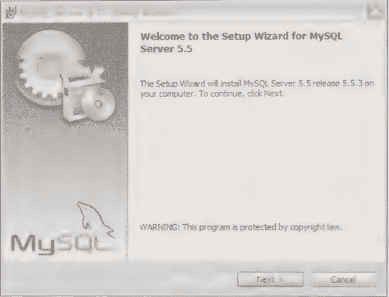

继续完成向导，在提示时选择默认选项。完成后，您将有选项配置服务器，如下一张屏幕截图所示：

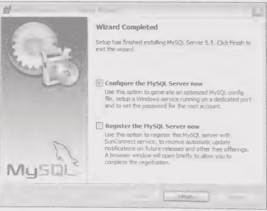

验证已选择 Configure the MySQL Server now，然后单击 Finish。

现在将显示一系列屏幕，允许您修改服务器配置。以下屏幕截图显示服务器实例配置屏幕：

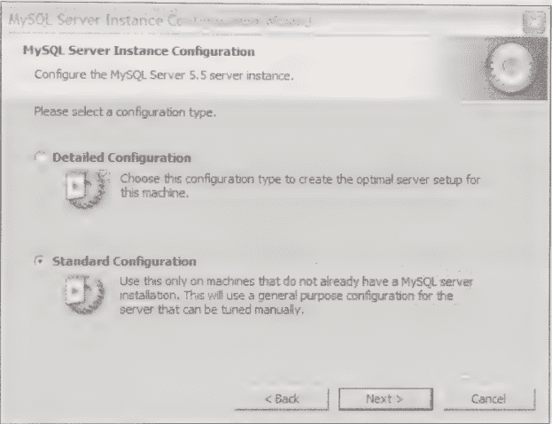

在 MySQL Server Instance Configuration 屏幕上选择 Standard Configuration，然后单击 Next 继续。

在随后的屏幕上，接受默认选项以作为服务安装并继续。为 root 用户（即默认管理员级用户）提供密码，并继续到结束。

SugarCRM 所需的所有组件现在都应已安装并可正常运行。如果这些项目中的任何一项出现故障，请勿尝试安装 SugarCRM，因为这很可能会导致 SugarCRM 出现问题。在配置错误或故障的堆栈上尝试安装通常会导致时间浪费和沮丧。

最后，您现在可以安装 SugarCRM。

## 安装 SugarCRM Community Edition

我们将遵循的安装过程假设您已通过单击本章开头提到的 **Download now** 按钮下载了 SugarCRM。单击 **Download now** 后，执行以下步骤：

- 将安装包的内容解压缩到名为 C:\Program Files\Apache Software Foundation\Apache2.2\htdocs 的文件夹。
- 您现在应该有一个名为 C:\Program Files\Apache Software Foundation\Apache2.2\htdocs\SugarCE-Full-5.5.1 的文件夹。将 SugarCE-Full-5.5.1 重命名为 sugarcrm。

安装过程的其余部分将在 Web 浏览器中执行。

要开始安装过程，请将 Web 浏览器指向 `http://<ipaddress of server>/sugarcrm`

如果您打算允许 LAN 或内部网络外部的用户访问，则应使用与服务器关联的公共或面向 Internet 的 IP 地址。如果您的意图是将访问限制为仅 LAN 或内部网络上的用户，则应使用所有目标用户都可以用来连接到服务器的 IP 地址。使用 `127.0.0.1` 或 `localhost` 代替其中任何一个都会导致访问仅限于服务器本身。

您可以使用 `ipconfig` 和 `hostname` 命令分别确定 IP 地址或服务器地址。要执行这些命令，请选择 **Start**，然后键入 **cmd** 并单击 **OK** 打开命令窗口。在出现的窗口中键入命令。如果您需要确定公共 IP 地址方面的帮助，请咨询您的网络或 DNS 管理员，因为这可能需要防火墙或其他网络修改。


## 在 Windows Server 上安装 SugarCRM

您的 Web 浏览器应会自动将您带到如下截图所示的安装向导欢迎页面：

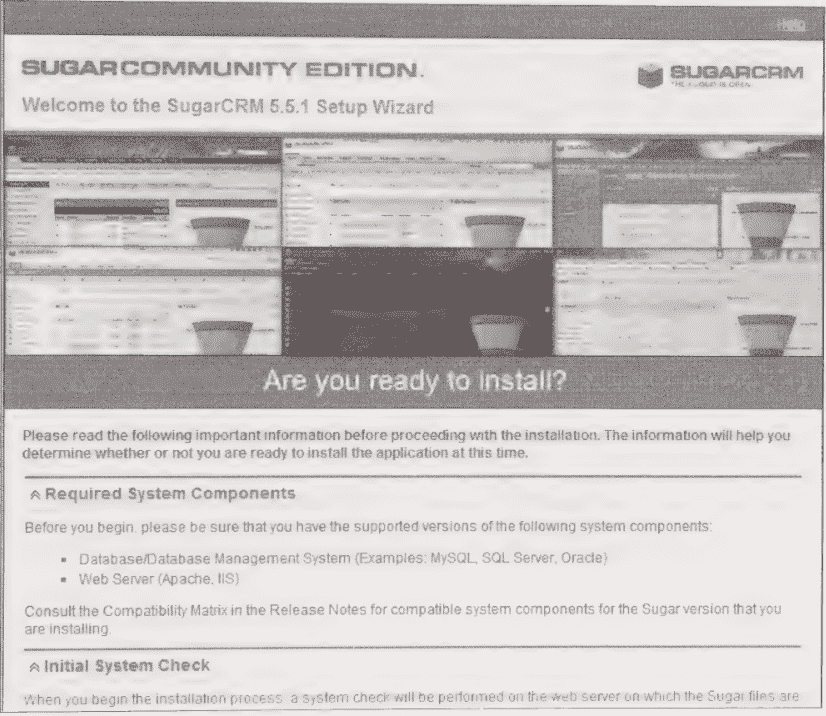

安装步骤如下：

- 欢迎屏幕：单击“下一步”按钮继续进入许可证接受页面，如下图所示：


- 许可证屏幕：如果您同意条款，请单击“我接受”，然后单击“下一步”继续。

- 系统检查屏幕：接下来您将看到 SugarCRM 系统检查屏幕。SugarCRM 安装程序会检查安装环境的多个方面，并在此屏幕上向您报告其状态。如果您的 PHP 安装中有某些内容未正确配置，您将看到类似于下图的屏幕。在继续之前，必须先解决这些错误。常见问题包括以下内容：

  - 缺少或禁用的 PHP 扩展
  - 文件权限不正确
  - PHP 参数不正确

## 系统检查接受

兼容性检查期间检测到错误。为了使您的 SugarCRM 安装正常运行，请采取适当措施解决下面列出的问题，然后单击重新检查按钮，或尝试重新安装。

| 组件 | 状态 |
|---|---|
| MB 字符串模块 | Sugar 应用程序所需的多字节字符串 PHP 扩展（mbstring）相关功能未找到。通常，mbstring 模块在 PHP 中默认未启用，必须在构建 PHP 二进制文件时使用 --enable-mbstring 进行激活。有关如何启用 mbstring 支持的更多信息，请参阅 PHP 手册。 |
| 可写的 SugarCRM 配置文件 (config.php) | 配置文件存在但不可写。请采取必要措施使文件可写。根据您的操作系统，这可能需要您运行 chmod 766 来更改权限，或者右键单击文件名以访问属性并取消选中“只读”选项。 |
| 可写的自定义目录 | 自定义目录存在但不可写。您可能需要更改其权限（chmod 766）或右键单击它并取消选中“只读”选项，具体取决于您的操作系统。请采取必要措施使文件可写。 |
| 可写的数据子目录 | 下面列出的文件或目录不可写或丢失且无法创建。根据您的操作系统，纠正此问题可能需要您更改文件或父目录的权限（chmod 766），或者右键单击父目录并取消选中“只读”选项，并将其应用于所有子文件夹。 |

- 安装选项：一旦错误被纠正（或如果未发现任何错误），您将被提示选择安装方法。保持默认设置为 **Typical**，并单击 **Next** 继续。


数据库类型：除非您添加了对 MS-SQL 的支持，否则您的唯一选择应该是 MySQL（检测到 MySQLi），如下图所示。单击 Next 继续。


数据库配置屏幕：输入连接到 MySQL 服务器所需的参数。您应该为数据库名称输入 sugarcrm，为主机名输入 localhost，为数据库管理员用户名输入 root，并提供数据库管理员密码值。您可能希望更改的唯一其他设置是是否用演示数据填充数据库的选项。如下图所示：

> IMPORTANT：MySQL 用户 root 是默认的 MySQL 管理员，对所有数据库操作拥有完全访问权限。通常不建议在生产系统中使用它，因为这会带来安全风险。为了加强安全性，建议您创建一个仅供 SugarCRM 使用的 MySQL 用户。有关创建 MySQL 用户和其他 MySQL 管理操作的详细信息，可以在以下网址找到：http://dev.mysql.com/doc/refman/5.1/en/index.html


## 在 Windows Server 上安装 SugarCRM

- 区域设置屏幕：您还可以在安装过程中微调一些默认用户首选项。这些包括日期和时间格式以及其他设置，如下图所示：


- 确认屏幕：最后，安装程序将显示一个摘要屏幕，其中包含您在向导中先前定义的许多设置。如果您需要在安装前进行更改，这是您最后的机会。您可以使用 Back 按钮应用更改，或单击 Install 提交安装。确认屏幕如下图所示：

## SugarCRM Community Edition

确认设置

#### 数据库配置

| 设置 | 值 |
|---|---|
| 数据库名称 | sugarcrm (将被创建) |
| 数据库管理员用户名 | root |
| 用演示数据填充数据库？ | no |
| 删除表 | No |

#### 区域设置

| 设置 | 值 |
|---|---|
| 默认日期格式 | 12/23/2010 |
| 默认时间格式 | 1:09pm |
| 默认货币 | US Dollars |

单击 **Finish** 按钮后，安装过程将立即开始。该过程通常只需几分钟，但如果您选择安装演示数据，可能需要更长时间。

完成后，您应该会看到类似于下面的屏幕：

## SugarCRM Community Edition

执行设置

创建 Sugar 配置文件 (config.php)
创建 Sugar 应用程序表、审计表和关系元数据
在 192.168.0.103 上创建数据库 sugarcrm...完成

创建默认 Sugar 数据

创建默认用户... 完成
创建默认调度器作业... 完成

Sugar 5.5.1 的设置现已完成！

总耗时：3.9375779628754 秒。
近似内存使用量：18479004 字节。

## 在 Windows Server 上安装 SugarCRM

单击 Next 继续，您将被提示进行注册。这不是必需的，但有助于 SugarCRM，因此请考虑执行此操作。


完成注册屏幕后，单击 Next。


恭喜！您已成功在 Windows 服务器上安装 SugarCRM！

您应该会看到登录屏幕，如上一张截图所示。您可以使用用户名 _admin_ 和在安装过程中定义的密码登录（作为 SugarCRM 用户）。要允许其他用户访问系统，只需向他们提供在 SugarCRM 登录页面时 Web 浏览器中显示的 URL 即可。当然，前提是您已经为他们创建了用户名和密码。

## 在 Microsoft SQL Server 上安装 SugarCRM

使用 Microsoft SQL Server (MS-SQL) 进行 SugarCRM 安装与使用 MySQL 没有区别。主要区别在于，在安装过程中，您需要为数据库类型选择 **Microsoft SQL Server**，而不是默认的 **MySQLi**。

但是，在到达那个点之前，您需要确保您有受支持的 MS-SQL Server 版本可用，并且它也正在运行。如果您需要安装 MS-SQL 的帮助，您应该查看 Microsoft 网站上的文档，位于 `http://msdn.microsoft.com/en-us/library/ ms143516(SQL.90).aspx`

关于其使用，有几条重要说明需要牢记。也许最重要的是，确保您希望使用的 MS-SQL 服务器配置为支持使用 **Mixed Mode** 身份验证。如果不这样做，将不必要地使安装过程复杂化，因为您将无法在定义数据库配置参数时简单地指定数据库管理员用户名和密码的默认过程。

其次，您的 PHP 安装可能未启用 MS-SQL 扩展。如果 SugarCRM 安装向导不允许您选择 MS-SQL 作为选项，那么很可能 MS-SQL 扩展未启用或未安装。如果您遇到这种情况，请检查您的 `PHP.INI`，并验证它是否包含以下行：

```
ext=php_mssql.dll
```


如果缺失，请添加它，保存更改，然后重启 Web 服务并再次尝试。如果遇到提示找不到扩展的错误，则表示您的 PHP 安装中未包含对 MS-SQL 的支持。要解决此问题，要么重新安装 PHP 并确保安装 MS-SQL 扩展，要么找到所需的 DLL 文件并将其应用于您的 PHP 安装文件夹。

要重启 Web 服务，请选择“开始 | 运行”。键入 services.msc 并单击“确定”。在显示的列表中，右键单击 Apache2.2 或 World Wide Web Publishing（取决于您使用的是 Apache 还是 IIS 作为 Web 服务器），然后选择“重启”。

查找 DLL 文件可能会稍微棘手一些。一个不错的起点是位于 http://www.php.net/ 的 PHP 主网站，但也可能需要在互联网上进行一些一般性搜索。

## 在 Internet Information Services (IIS) 上安装 SugarCRM

IIS 可能已安装在目标服务器上，也可能未安装。一种快速检查方法是选择“开始 | 控制面板 | 管理工具”。如果您看到用于管理 Internet Information Services 的选项，则一切就绪。如果您看不到任何与 IIS 相关的内容，则需要通过“添加/删除程序”工具进行安装。

要安装 IIS，请选择“开始 | 控制面板 | 添加/删除程序”并单击“添加/删除 Windows 组件”。Windows 将显示可添加到您的 Windows 安装中的组件目录。选择 Internet Information Services 并继续完成向导的其余步骤，直到它为您安装完 IIS。

在 IIS 上安装 SugarCRM 所面临的最大挑战可能是配置 PHP。

一般来说，安装 PHP 将涉及遵循本章前面“安装 PHP”部分中概述的相同说明。但是，您将希望在安装向导的 Web 服务器设置屏幕中选择 IIS FastCGI。如果您使用的是 7.0 之前版本的 IIS，则可能需要使用 IIS ISAPI 模块或 IIS CGI 选项。有关此主题的其他帮助可以在 IIS PHP 网站上找到，网址为：http://php.iis.net/

与 Apache 一样，在尝试安装 SugarCRM 之前，验证 PHP 是否正常运行并正确配置非常重要。

一旦您确认 PHP 已正常运行，就可以开始安装过程，但在这样做之前，您必须将 SugarCRM 文件放置在正确的位置，以便 IIS 能够识别它们。

本章前面标题为“安装 SugarCRM Community Edition”的部分提供了有关提取和放置 SugarCRM 安装文件的说明，这些说明是针对 Apache Web 服务器的。在该部分中，您被要求将文件放在名为 `C:\Program Files\Apache Software Foundation\ Apache2.2\htdocs\sugarcrm` 的文件夹中。

由于 IIS 为其文件使用不同的文件夹结构，您将把文件放在以下文件夹中：

`C:\Inetpub\wwwroot\sugarcrm`。

执行此操作后，您将能够遵循本章前面描述的相同安装说明。

## 权限

与 Linux 等其他操作系统相比，Windows 上的权限问题通常较少。但是，确保相应的 SugarCRM 文件夹可由您选定的 Web 服务器运行所在的用户访问非常重要。

对于 IIS 实现，这是 Internet User 帐户，其名称始终以 **IUSR_** 开头，因此很容易识别。对于 Apache 安装，您可能需要使用 Windows 任务管理器实用程序来检查其运行所在的用户，然后相应地设置权限。要访问 Windows 任务管理器，请右键单击 Windows 状态栏并选择 **任务管理器**。单击 **进程** 选项卡并查找名为 **apache.exe** 的条目。检查 **用户名** 列的值以确定 Apache 运行所在的用户。如果 **用户名** 列不可见，请在 **查看 | 选择列** 下选择它。

## 数据导入和导出

任何 CRM 软件最重要的方面之一是能够导入和导出数据。

前者允许您使用逗号分隔值 (CSV) 文件或其他文件格式等数据源批量输入数据。通过此功能，从其他系统（例如会计解决方案）迁移数据的过程得到了简化。它还对导入您在贸易展览会、社交活动等处可能获得的潜在客户列表很有帮助。

导出功能同样重要。导出功能允许您轻松从 CRM 系统中提取有价值的数据，从而允许您在其他系统（例如数据清洗服务）中对其进行处理。

随着 CRM 工具在组织中的作用越来越大，通过导入和导出工具向 CRM 系统插入和提取数据的能力变得越来越重要。您的组织中也应如此，因为您的目标应该是创造一种文化，使 CRM 系统成为您所有业务和相关客户数据（会计信息除外）的中心或中央存储点。

SugarCRM 支持从多种不同的流行竞争系统以及在线数据服务或自定义创建的数据文件中导入各种类型的数据。

一些亮点如下：

- 帐户可以从 Salesforce.com、ACT! 或通过自定义逗号分隔或制表符分隔文件从大多数其他系统导入
- 联系人可以从 Salesforce.com、ACT!、Outlook 或通过自定义逗号分隔或制表符分隔文件从大多数其他系统导入
- 潜在客户可以从 Salesforce.com 或通过自定义逗号分隔或制表符分隔文件从大多数其他系统导入

就像潜在客户、机会、呼叫、会议等一样，各种其他数据类型也可以从 Salesforce.com 或通过自定义逗号分隔或制表符分隔文件导入。

需要注意的是，Salesforce.com、Microsoft Outlook 和其他竞争产品的选项仅提供字段映射的快捷方式，这应该能为您节省一些导入时间。但是，导入工具并不直接与这些其他产品通信以提取要导入的数据，而是仍然依赖于使用 CSV 文件来执行导入。

责任在于您将数据从其他系统导出为格式正确的 CSV 文件，该文件随后可以在 SugarCRM 的导入设施中使用。

在我们查看导入工具的几个示例之前，让我们简要提及导入工具的一个额外原生功能。除了允许您在各种模块中创建新记录外，导入工具还允许您更新现有记录。这是通过使用匹配键来实现的，我们将在本章后面讨论。

让我们来看看导入帐户和联系人的过程。

## 导入帐户和联系人

如果您正在从另一个 CRM 系统导入帐户数据，那么该系统很可能理解帐户和联系人之间的区别。作为回顾，前者通常是组织或公司，后者是个人。此外，一个帐户可以有多个联系人，每个联系人都有单独的数据。

将联系人导入 SugarCRM 相当简单。首先，您使用旧的 CRM 应用程序或联系人管理器将数据导出为 .CSV 文件格式。然后，您使用 **联系人** 模块（可通过导航快捷方式框访问）中的导入功能来导入数据。如果导入的联系人记录引用未知帐户，则会自动为该名称的帐户创建新记录。

但是，需要注意的一件事是，当以这种方式自动创建帐户记录时，它们基本上是空的——它们有关联的联系人，但没有记录地址或电话信息。因此，您通常应该先导入帐户数据，创建包含地址和电话信息（以及可能的帐户类型和大量其他信息，具体取决于您的旧 CRM 系统）的完整记录。这可以避免创建相当空的帐户记录，并稍后手动添加其余信息。

请参阅以下部分，了解导入帐户、联系人和潜在客户的确切步骤。


## 导入前分析

您的源 CSV 文件中的数据很可能采用以下模式表示：值后跟逗号。

例如：

"Angel", "Magaña", "ACME CRM"

"John", "Smith", "Big Company"

此模式 *非常重要*，尽管应当注意，最后一个值后不使用逗号。在此示例中，表示了三列：名、姓和公司名称。

此外，新记录由新行标记分隔。因此，在前面的示例中，以 *Angel Magaña* 作为名称的行表示一条记录，而以 *John Smith* 作为名称的行表示另一条记录。

如果您想知道是否可以使用双引号以外的其他分隔符，当然是可以的。但是，您必须在任何给定行以及整个文件中保持一致。您不能对一列使用一个分隔符，对另一列使用另一个分隔符，也不能对一条记录使用一个分隔符，对另一条记录使用不同的分隔符。

如果您尝试导入的 CSV 文件没有一致的模式，您的导入将 *失败*。当文件格式不正确时，会出现一些常见问题，包括以下内容：

- 可用源字段列表不完整
- 成功导入一条或多条记录后导入失败
- 读取源文件时出错
- 数据被截断

除了常见问题列表外，还有导致这些问题的常见来源列表。它们包括以下内容：

- 多余的逗号、双引号或新行标记
- 分隔数据与非分隔数据混合

通常，上述问题都是用于创建您尝试导入的 CSV 文件的导出过程造成的。

## 导入帐户

在本节前面，我们提到过，您可能正在从中获取源数据的其他 CRM 系统可能已经识别并补偿了帐户和联系人之间的差异。但是，如果您的数据是从更简单的联系人管理器（例如 Microsoft Outlook）导入的，那么仅可用联系人数据，如果您希望为这些记录创建帐户-联系人关系，则需要发挥创造力。如果您需要协助从 Microsoft Outlook 导出数据，请参见本章后面的 _从当前联系人管理器导出联系人_ 部分。

我们将假设您导出的文件已经处于适合导入的适当状态。

这也是清理数据中重复记录和其他完整性问题的绝佳时机。在导入数据之前执行此步骤，有助于确保 SugarCRM 中的最终结果质量良好，并允许您立即使用它。

所有这些问题都必须通过外部工具进行更正。在尝试导入数据之前，您应该先对源文件进行初步分析，以确保这些问题已被消除。如果不这样做，只会导致沮丧和时间损失。

另一种可能性是，您的导出文件包含多行文本字段。例如，注释或评论区域。这些字段是多余新行标记的主要区域，因为用户可能在其他应用程序中输入字段时使用了回车符。鉴于新行标记表示新记录，文件的模式将再次偏差，源文件将无法正确读取。

其他问题是由数据本身造成的。例如，如果有人输入带有逗号 (,) 的联系人姓名，例如 _Magaña, Angel_，那么导出的文件可能包含一个包含多余逗号的值。多余的逗号会破坏文件的模式并导致读取问题。

例如，Microsoft 应用程序不分隔数值的情况并不罕见。这有可能造成问题，因为它会破坏模式，导致某些列包含分隔值，而其他值未分隔。

如果您正在从区分帐户和联系人的系统导入帐户数据，请继续执行步骤 6。如果您只有导出的联系人数据，并且需要对其进行处理或手动清理以充当要导入的帐户数据，请按以下方式执行步骤 1 到 4（示例假设原始数据位于名为 Contacts.csv 的文件中）：

1. 将导出的 Contacts.CSV 文件复制一份，并将副本命名为 Accounts.CSV。
2. 使用 Excel 编辑 Accounts.CSV 文件。首先，按公司名称对文件进行排序。
3. 现在是较复杂的部分：当您按公司名称滚动浏览数据时，您会看到连续的记录具有相同的公司名称，因为该帐户有不止一个联系人。为了避免 SugarCRM 中出现多个相同帐户的副本，您可能需要删除或合并这些重复项。当然，您可能有正当理由保留具有相同帐户名称的多个记录。例如，如果您与同一组织的不同分支机构合作。
4. 还要注意那些相似但不完全相同的公司名称，这是由于输入公司名称的方式不一致造成的——您应该删除所有重复记录，只保留公司名称拼写与您希望在 SugarCRM 中看到的完全一致的那条记录。
5. 现在您有了一组干净的帐户数据，将 Excel 文件另存为 .CSV 文件类型，然后继续导入此帐户数据。
6. 在帐户模块的导航快捷方式框中单击“导入帐户”功能。
7. 指定数据源。选择 Salesforce.com、ACT!、逗号分隔或制表符分隔。选择适当的分隔符（如有必要），然后单击“下一步”按钮继续。对于处理过或手动清理过的 Outlook 文件，其中字段名称不再与从 Outlook 导出的内容完全匹配，请使用逗号分隔的数据源。
8. 上传导出文件。使用“浏览”按钮定位 Accounts.CSV 数据文件，然后单击“下一步”按钮继续。

## 9. 确认字段并导入。

此屏幕（请参见下一张图）显示四列数据。第 2 列（标题行）是关键——它包含从旧 CRM 或联系人管理器导出的字段名称。第 4 列显示您即将导入的第一条记录的示例数据。第 1 列（数据库字段）是您需要介入的地方——您需要使用此列中的所有下拉框控件，选择每个传入的帐户字段应导入到 SugarCRM 中的哪个字段（或选择不映射此字段以跳过它）。

#### 导入步骤 3：确认字段并导入

在下面的列表中，选择导入文件中应导入到系统中每个字段的字段。完成后，单击“立即导入”

| 数据库字段 ① | 标题行 ① | 默认值 ① |
|---|---|---|
| -- 不映射此字段 -- ▼ | 标题 | |
| -- 不映射此字段 -- ▼ | 名 | |
| -- 不映射此字段 -- ▼ | 中间名 | |
| -- 不映射此字段 -- ▼ | 姓 | |
| -- 不映射此字段 -- ▼ | 后缀 | |
| 名称 * ▼ | 公司 | |
| 添加字段 | 显示高级选项 | 另存为映射 ① |

注释：
必填字段：名称
以 Address Street 2 和 Address Street 3 结尾的字段在插入数据库时会与主 Address Street 字段合并在一起

< 返回 立即导入

## 10. 花些时间来探索传入字段的名称和相应 SugarCRM 字段的名称，直到您确定已定义了它们之间的最佳映射。如果您是从 Outlook 导入，一个特别重要的字段映射是将传入的 Company 字段映射到 SugarCRM 中的帐户名称字段。

## 11. 当您确定字段映射正确后，请单击屏幕底部的“立即导入”按钮。在此之前，您可以选择单击“另存为自定义映射”复选框，并为此映射提供一个名称，以便将来可以再次使用。


12. 将显示“导入结果”屏幕。它将汇总导入和跳过的记录数量，并提供跳过原因的相关信息。汇总下方将列出所有已导入数据的完整列表。

13. 现在您可以选择单击“撤销上次导入”、“导入更多”或“完成”按钮。如果您对数据导入结果满意，请单击“完成”按钮；如果您想返回重试（可能需要调整字段映射），则单击“撤销上次导入”。

## 导入联系人

现在您已拥有一组包含完整描述性数据的账户记录，请按以下步骤导入联系人数据：

- 1. 单击联系人模块导航快捷方式框中的“导入联系人”功能。

- 2. 指定数据源：选择 Salesforce.com、Microsoft Outlook、ACT!、逗号分隔或制表符分隔，然后单击“下一步”按钮继续。

- 3. 上传导出文件：使用“浏览”按钮查找联系人管理器导出的数据文件，然后单击“下一步”按钮继续。

- 4. 确认字段并导入：此屏幕（参见前一张图片）显示四列数据。第 2 列（标题行）是关键——它包含从旧 CRM 或联系人管理器导出的字段名称。第 4 列显示您即将导入的第一条记录的示例数据。第 1 列（数据库字段）是您需要操作的地方——您需要使用该列中的每个下拉框控件，选择 SugarCRM 中的字段，以便将每个传入的联系人字段导入其中。

- 5. 花些时间探索传入字段的名称和相应 SugarCRM 字段的名称，直到您确定已在两者之间定义了最佳映射。一个特别重要的字段映射是将传入的“公司”字段映射到 SugarCRM 中的“账户名称”字段，以便将联系人与正确的账户关联。（确保您已更正在“导入账户”部分第 4 步中发现的数据中不一致的公司名称。）

- 6. 当您满意且字段映射正确时，单击屏幕右下角的“立即导入”按钮。在此之前，您可以选择单击“另存为自定义映射”复选框，并为此映射提供一个名称，以便将来再次使用。

7. 将显示“导入结果”屏幕。它将汇总成功导入的记录数量、跳过的记录数量以及跳过原因。汇总下方将列出所有已导入数据的完整列表——包括联系人以及自动创建的任何账户。

8. 现在您可以选择单击“撤销上次导入”、“导入更多”或“完成”按钮。如果您对数据导入结果满意，请单击“完成”按钮；如果您想返回重试（通常是为了改进字段映射），则单击“撤销上次导入”。

## 导入线索和机会

线索和机会通常仅由完整的 CRM 系统跟踪，而非简单的联系人管理器。如果您的旧系统是 Microsoft Outlook 或类似的联系人管理器，则可能没有数据可导入。如果您是从完整的 CRM 系统（例如 Salesforce.com）迁移，则线索和机会数据可以从该系统导出，并以与前文所述导入联系人数据非常相似的方式导入 SugarCRM。

## 更新记录

本章前文提到，可以通过导入实用程序更新现有记录。要实现此功能，我们必须拥有一个包含匹配键和相关索引的源文件。

匹配键是一个唯一值，既存在于目标数据库中的记录中，也存在于正在导入的源数据文件中。它用于将源文件中的记录与 SugarCRM 数据库中已存在的记录关联起来。如果源文件中的数据最初是从 SugarCRM 导出的，则可以使用 ID 值作为键。否则，您需要自行制定解决方案。

键值本身可以是数字、字符或两者的混合。此外，其长度无关紧要。但是，该值需要满足两个条件。首先，该值必须是唯一的。唯一性确保 SugarCRM 数据库中只有一条记录会与源数据文件中的任何记录匹配。其次，包含匹配键值的 SugarCRM 数据库字段必须已建立索引。根据 SugarCRM 数据库中包含匹配键值的字段，您可能需要创建自定义索引。

创建自定义索引的过程会因所选数据库平台而略有不同。如果您不确定该过程，请参阅以下网站上的 MySQL 和 Microsoft SQL Server 文档：

- http://dev.mysql.com/doc/refman/5.0/en/index.html
- http://msdn.microsoft.com/en-us/library/ms130214 (v=SQL.90).aspx

我们的示例假设我们正在使用账户模块，并使用名为 custom_c 的自定义字段来存储匹配键值，并且我们已为其创建了自定义索引。由于已满足要求，我们可以通过在“导入步骤 1”屏幕上单击“创建和更新记录”来启用更新功能，如下图所示：


继续选择您的文件并进入导入字段映射屏幕。在那里，您将单击位于屏幕左下角的“显示高级选项”按钮。单击后，您应该在屏幕右下角看到类似以下的内容：


此区域（如前一张图片所示）允许我们通过选择其相关索引来选择匹配键。请注意，选项仅限于 SugarCRM 定义的索引，尽管可以通过轻微自定义修改列表。

假设您已将自定义索引应用于数据库（如我们对 custom_c 字段所做的那样），您需要让 SugarCRM 系统了解新索引。

要将其添加到系统配置中，您必须先使用记事本、vi 或其他文本编辑器创建一个名为 custom.php 的文件，内容类似于以下内容：

```php
<?php
$dictionary['Account']['indices'][] = array('name'
=>'idx_custom', 'type'=>'index',
'fields'=>array('custom_c'));
?>
```

请记下 Account 引用，因为它指定了受影响的模块。请注意，它以单数形式指定。用户常犯的错误是将模块名称以复数形式指定，这会导致此类自定义失败。所有模块引用都必须以单数形式。

"name" 部分表示在前一张图片的索引列表中显示的描述符。您可以随意使用本示例中指定的值，或使用您选择的描述符。

"type" 部分应保持如前一段代码片段所示，但请注意紧随其后的 "fields" 部分。此部分用于指定带有自定义索引的列。您需要相应地调整它，以反映您选择的字段名称，在本例中为 custom_c。

完成后，将文件放在以下目录中：

`custom/Extension/modules/Accounts/Ext/Vardefs.`

使用管理员级别帐户访问 SugarCRM，并使用管理控制面板中的“修复”选项对账户模块执行修复。下次在账户模块中使用导入向导时，新索引将可作为匹配键之一进行选择。

## 导出信息

SugarCRM 具有灵活的数据导出功能。基本上，所有 SugarCRM 模块都具有导出功能，可通过单击每个列表视图屏幕列表部分左上角的“导出”链接来访问，包括活动、账户、联系人、文档、线索、机会、缺陷、电子邮件、营销活动、潜在客户、项目和案例。

在每种情况下，都会生成一个 .CSV 文件，其中包含当前使用模块的所有选定记录（而不仅仅是当前在屏幕上显示的记录）。.CSV 文件可以使用 Microsoft Excel、记事本、WordPad 或其他文本编辑器打开查看，并且大多数软件都可以轻松将其解析为输入文件。

|    | A    | B    | C    | D    | E    | F    |
|---|---|---|---|---|---|---|
| 1    | id    | name    | date_entered    | date_modified    | modified_user_id    | created_by    |
| 2    | 86124fCa-c962-2b4d-0143-4ba17710c760    | Kitty Kat Inc. 452275    | 3/17/2010 17:43    | 3/17/2010 17:43    | 1    | 1    |
| 3    | e45a95a2-7a0e-cac1-4b8b-4ba177f4226    | B. C. Investing International 504338    | 3/17/2010 17:43    | 3/17/2010 17:43    | 1    | 1    |
| 4    | eeb8744e-8b3c-a3b3-616e-4ba1779d79d1    | MMF Montuary Corp 527118    | 3/17/2010 17:43    | 3/17/2010 17:43    | 1    | 1    |
| 5    | 26de0e79-7b98-009a-4ac1-4ba1772ad2e6    | BS Funding Corp 997600    | 3/17/2010 17:43    | 3/17/2010 17:43    | 1    | 1    |
| 6    | 3685b707-49bc-48cd-a1b8-4ba178beeae2    | Grow-Fast Inc 62443    | 3/17/2010 17:43    | 3/17/2010 17:43    | 1    | 1    |
| 7    | 591c049a-4831-4180-e464-4ba178acf0ae    | N A Bridge Construction 23984    | 3/17/2010 17:43    | 3/17/2010 17:43    | 1    | 1    |
| 8    | bba9ab6-b518-4c37-62c0-4ba1770800b    | A B Building Group Inc 132186    | 3/17/2010 17:43    | 3/17/2010 17:43    | 1    | 1    |
| 9    | dd1091d3-8a7-0878-50d9-4ba1776c3c4    | CUMBERLAND TRAILS 626770    | 3/17/2010 17:43    | 3/17/2010 17:43    | 1    | 1    |
| 10    | g98a2e1-c568-k6d-6c04-ba177028731    | A Tall Stores 883459    | 3/17/2010 17:43    | 3/17/2010 17:43    | 1    | 1    |
| 11    | 64066d63-ca53-5713-32d-4ba177623631    | A G. Parr PLC 327537    | 3/17/2010 17:43    | 3/17/2010 17:43    | 1    | 1    |
| 12    | 1239b5f-50c-819-f13b-4ba1778aaea    | Powder Puff Suppliers 191582    | 3/17/2010 17:43    | 3/17/2010 17:43    | 1    | 1    |
| 13    | 29ebc239-b556-a9c-37e-4ba177ac383d    | CONS TRUST (AZ) 817814    | 3/17/2010 17:43    | 3/17/2010 17:43    | 1    | 1    |
| 14    | 38941400-042c-e062-0539-4ba1775536e4    | X-SELL HOLDINGS 774114    | 3/17/2010 17:43    | 3/17/2010 17:43    | 1    | 1    |
| 15    | 5de441e-1749-04e5-99e0-4ba177447ace    | K Kringle Inc.K. Tower & Co 389028    | 3/17/2010 17:43    | 3/17/2010 17:43    | 1    | 1    |
| 16    | 177ba847-391e-7c95-1578-4ba1773992a3    | Jitty-Bitty Conglomerate Inc 548773    | 3/17/2010 17:43    | 3/17/2010 17:43    | 1    | 1    |
| 17    | 9e1a0d95-0619-469f-750d-4ba1770463cc    | First National S/B 909917    | 3/17/2010 17:43    | 3/17/2010 17:43    | 1    | 1    |


前面的屏幕截图显示了从 **Accounts** 模块导出并在 Microsoft Excel 中查看的 CSV 文件示例。您可以看到，CSV 文件中基本导出了整个数据库表，包含列标题，包括 **Record ID**（用作每个账户记录唯一引用的长字母数字字符串，大多难以理解）以及 SugarCRM 内部使用的其他字段。

## 从当前联系人管理器导出联系人

我们将以 Outlook 2003 为例说明如何导出联系人管理器数据。其他系统的工作方式通常类似。要从 Outlook 2003 导出数据，请执行以下步骤：

- 在 **File** 菜单下，选择 **Import and Export**。随后将显示 **Import and Export Wizard** 对话框。
- 选择操作 **Export to a file**，然后单击 **Next** 按钮。
- 选择创建类型为 **Comma Separated Values (Windows)** 的文件，然后单击 **Next** 按钮。
- 选择要从中导出的 Outlook 文件夹——通常是联系人文件夹——然后单击 **Next** 按钮。
- 输入要创建的导出文件的文件名和目录位置，然后单击 **Next** 按钮。
- 单击 **Finish** 按钮确认您要导出此文件的意图。
- Outlook 2003 将创建所需的 .CSV 文件。您可以使用 Microsoft Excel 或简单的文本编辑器轻松查看该文件，以确认您打算导出的数据已被导出。

导出文件可能的样子摘录如下：

| Title | First Name | Middle Name | Last Name | Suffix | Company |
|-------|------------|-------------|-----------|--------|---------|
| | Angel | | Magaña | | ACME CRM |
| | John | | Smith | | Big Software Co. |

## 其他选项

虽然许多用户对内置的导入和导出功能已经足够满意，但其他用户需要更高级的解决方案来迁移、导出或操作数据，可能是为了自动化例程或数据清理/格式化。幸运的是，有各种工具能够胜任这些任务，值得探索。其中包括以下工具：

- Talend Open Studio (http://www.talend.com)
- SnapLogic (http://www.snaplogic.com)
- Apatar (http://www.apatar.com)
- Jitterbit (http://www.jitterbit.com)

关于这些工具的优点是，它们也是开源的，并基于经过验证的开源技术。

## 系统管理员角色

本节面向 SugarCRM Community Edition 的系统管理员。管理员通过单击 SugarCRM 屏幕右上角的 **Admin** 链接访问额外的系统管理控制面板。请注意，**Admin** 链接仅显示给已被授予管理员访问权限的用户。

每个共享业务系统都需要系统管理员来执行系统范围的清理工作。SugarCRM 在此方面也不例外。

其中一些职责发生在初始系统安装和设置期间。其他则是常规维护活动，在新用户加入系统或其他用户离开时执行。在本附录中，我们将讨论以下主题：

- 初始系统设置期间的系统管理要求是什么？
- 系统管理员的持续职责是什么？
- 谁应该担任系统管理员？
- 是否应让不止一个人拥有管理员访问权限？

## 系统管理职责

系统管理职责分为两类。一类是在系统安装时执行的，另一类是在系统使用期间需要定期或临时执行的。

在系统安装期间，系统管理职责包括以下内容：

- 将所有必要用户添加到系统，包括他们的名和姓、用户名和密码以及其他用户设置或偏好
- 将各自的用户名和密码以及其他登录信息发送给用户
- 为用户提供配置其电子邮件帐户和选项的说明
- 定义安全角色并将用户分配给这些角色
- 使用配置选项卡或配置选项卡组功能来隐藏和组织导航选项卡
- 使用重命名选项卡功能根据需要更改任何选项卡的名称
- 使用系统设置功能更改系统徽标并定义其他系统默认值
- 使用 Studio 应用模块自定义，例如添加自定义字段或更改字段标签
- 定义系统货币和汇率
- 配置系统电子邮件设置
- 使用模块加载器工具安装系统增强或其他模块
- 定义重复的系统任务（即基于 Linux 的服务器上的 crontab，或在 Windows 服务器上使用调度程序），以启用系统调度程序，该调度程序用于电子邮件营销活动、运行计划报告和其他计划系统活动

系统安装并运行后，系统管理员可能需要定期执行以下任务：

- 添加新用户或停用已离开组织的用户的凭据
- 为忘记密码的用户重置密码
- 更新汇率
- 维护角色设置
- 检查 SugarCRM 更新
- 当 SugarCRM 发布新版本软件时，使用升级向导管理系统升级
- 创建 SugarCRM 程序文件和自定义内容的系统备份
- 使用 MySQL 管理工具（如 phpMyAdmin 或 SQLyog）备份 SugarCRM 数据库
- 监控 SugarCRM 服务器上的磁盘空间使用情况

## 谁应该担任系统管理员？

从前面的列表可以看出，系统管理员有大量工作要做，以帮助安装和维护 SugarCRM 系统。

这告诉您，无论您选择谁担任系统管理员，该人都需要有时间来完成这些新职责。此外，管理员必须是可以信任所有用户访问信息和公司最敏感数据的人，因为管理员可以查看整个 SugarCRM 系统中的所有数据。

许多企业选择与管理其 PC 和网络的同一个人担任系统管理员。在较小的企业中，此人通常是兼职承包商，而不是员工。

如果外部承包商已经在管理您所有的网络访问信息，那么将 CRM 的钥匙也交给他们也不会让事情变得更糟——所以如果您倾向于这样做——那就大胆去做吧。但是，请确保与该承包商签订良好的保密和不竞争协议。

这些任务本身不需要严肃的技术技能即可正确执行。在获得少量技术建议后，企业中的高级经理可以很好地担任系统管理员的角色——尽管让他们花时间重置用户密码可能不是时间利用的好方式。但是，他们将了解并控制谁在 CRM 中访问企业的关键数据。

## 是否应授予不止一个用户系统管理员权限？

系统的设计是，如果只有一个系统管理员，该用户不能被禁用，也不能移除其系统管理员权限。这防止您创建出没有任何用户拥有管理员级别权限的情况。

通常，大多数企业在系统中维护两个系统管理员。一个通常是真正的管理员，承担大部分日常工作，而另一个通常是高级经理，监督系统但不定期执行管理任务，除非主管理员缺席。

## 系统安装时的管理职责

下面的屏幕显示了顶级管理屏幕。接下来提到的管理功能均可从此屏幕访问。


## 配置系统设置

系统设置包含以下六个部分：

- 第一个部分用于定义 **用户界面** 选项。此部分用于控制显示功能（例如，ListView 屏幕默认显示的记录数量、重新排列子面板的功能、SugarCRM 中使用的公司徽标以及其他选项）。

- 第二个部分用于启用代理连接（作为中继到外部世界或互联网的连接），以便 SugarCRM 服务器访问外部信息，例如有关 SugarCRM 更新的信息。如果启用，您需要定义代理主机、端口号和其他相关选项的设置。

- 第三个部分用于启用或禁用与 **SkypeOut** 的集成。启用后，允许用户单击系统中的电话号码，通过 Skype 拨打外线电话。请注意，电话号码必须包含相应的国家代码才能使用此功能。

- 第四个部分用于启用 SugarCRM **邮件合并** 功能。由于 SugarCRM 的 Microsoft Word 插件设计为仅适用于 SugarCRM 的专业版和企业版，而第三方解决方案（例如 Microsoft Office 的 GrinMark 插件）往往不依赖于此选项的状态，因此操作它的可能性极低。

- 第五部分用于更多 **高级** 设置。其中包括记录内存使用情况和慢执行查询的功能。这些功能是优化系统的有用资源。**开发者模式** 选项在自定义系统时很有帮助，因为它会导致 SugarCRM 绕过其缓存机制并更快地应用自定义设置。此选项仅应在自定义系统时使用，其他所有时间都应禁用。

- 最后，底部的 **日志设置** 部分是监控和排查问题的有用工具。例如，将 **日志级别** 设置为 **调试** 会导致 SugarCRM 记录其用于执行功能（例如插入或更新记录）的 SQL 查询。稍后审查这些信息有助于找出问题的根源，例如数据未保存或记录未显示等问题。

前六个选项在以下屏幕截图中显示：

## 系统设置：

| 用户界面 | |
|---|---|
| 每页列表项数：20 | |
| 显示服务器响应时间：☑ | |
| 防止用户自定义主页布局：☐ | |
| 主页上 Sugar Dashlets 的最大数量：15 | |
| 系统名称：SugarCRM | |
| 当前徽标：① | |
| 选择新徽标：① 选择文件 未选择文件 | |

| 代理设置 | |
|---|---|
| 使用代理服务器？ ④ ☐ | |

| SkypeOuts | |
|---|---|
| 启用 SkypeOut® 集成？ ⑤ ☐ | |

| 邮件合并 | |
|---|---|
| 启用邮件合并？ ⑥ ☐ | |

| 高级 | |
|---|---|
| 验证用户 IP 地址：☑ 记录内存使用情况 | |
| 记录慢查询：☐ 慢查询时间阈值（毫秒） | |
| 最大上传大小：3000000 : 显示错误堆栈跟踪 | |
| 开发者模式：☐ | |
| vCal 更新时间段：① 2 | |

| 日志设置 | |
|---|---|
| 日志文件名 sugarcream Edenson :log 追加后 | |
| 最大日志大小 10MB 默认日期格式 :%c | |
| 日志级别 致命 ☑ 最大日志数量（滚动前） 10 | |

保存 恢复 取消

## 定义货币和汇率

**货币** 屏幕用于定义除默认美元以外的货币。  
对于每个新定义的货币，必须输入名称、符号（例如 $）、兑美元汇率  
以及 ISO 代码（例如加拿大元的 CAN）（如以下屏幕截图所示）。请注意，每个用户可以在其用户首选项屏幕中选择默认货币。


## 定义安全角色

SugarCRM 中的角色旨在限制系统中某些用户的访问权限。从管理区域选择 **角色管理** 选项将显示 **角色列表** 视图屏幕。它列出系统中定义的角色，并提供创建新角色或按用户列出角色的快捷方式。

## 系统管理员角色

您可以为用户组定义角色，并指定这些用户应有权访问哪些模块。例如，销售人员需要访问机会和仪表板模块，市场人员需要访问市场活动模块，但并非所有员工都需要访问这些模块。如下图所示，每个角色定义了分配了特定角色的用户可见的模块，以及用户在每个模块中将拥有的功能。


要创建角色，请单击 **创建角色** 快捷方式，在 **名称** 和 **描述** 字段中分别输入角色的名称和描述，然后单击 **保存**。调整设置以控制角色可以访问的模块以及可以在每个模块中执行的功能。请注意，当模块从角色中排除时，其他模块中与排除模块相关的子面板的访问权限也会被删除。单击 **保存** 以保存角色的这些设置。

要将用户分配给角色，请使用该角色的详细视图。在屏幕底部的 **用户** 子面板中，单击 **选择** 按钮以显示用户列表。您可以勾选要分配给此角色的用户名。如果用户属于多个角色，则其在每个模块中的访问权限由其任何角色分配的最严格访问权限定义。

非常重要的是，您要了解默认情况下，所有用户都可以访问所有数据和所有模块。角色与单个记录上的 **分配给** 字段的结合使用是控制对模块及其数据访问的主要机制。如果您需要控制特定用户对某些记录的访问，则应在允许用户访问系统之前定义角色并将其分配给相应的用户。

## 配置系统选项卡

系统管理员和用户可以轻松配置应用程序顶部显示哪些选项卡。**配置选项卡** 管理选项允许管理员定义哪些菜单选项卡对所有用户可用，哪些将被省略。管理员还可以控制单个用户是否允许更改其各自的选项卡设置，通常通过 **我的帐户** 屏幕进行控制。管理员排除的任何选项卡都无法由用户重新添加。

## 配置选项卡组

在管理页面上选择 **配置选项卡组** 选项允许您定义类似于 SugarCRM 默认提供的选项卡组。此功能允许您创建更符合用户导航要求和系统使用情况的组。

作为管理员，您可以修改现有的选项卡组或创建新组。此外，您可以更改组的顺序。用户将无法操作这些组。

## 添加系统用户

要向系统添加新用户或编辑用户设置，请从主 **管理** 屏幕选择 **用户管理**。请注意，用户不能被删除。他们可以被设为 **非活动**，或回收到新的用户记录中，但不能被删除。SugarCRM 这样设计主要是为了避免系统中存在与不存在的用户关联的数据。

已知分配给不存在用户的数据会引起问题，有时这些问题看起来彼此完全无关。在某些罕见情况下，此类记录已知会导致升级问题。出于此原因，建议您不要绕过系统并强制删除用户。

## 用户管理屏幕如以下屏幕截图所示：


使用 **创建用户** 快捷方式定义新用户。您不仅需要提供用户名，还需要提供密码和用户状态。创建用户后，您可以向其提供 SugarCRM 安装的 URL，以及其用户名和密码，以便他们开始使用。

## 密码管理

如前一节所述，创建新用户的过程涉及定义密码，该密码随后提供给目标用户。该用户随后可以通过访问 SugarCRM 中的 **我的帐户** 屏幕来更改密码。

这种自由会带来潜在的安全问题。鉴于用户可以自由定义自己喜欢的密码，存在他们可能创建一个非常容易猜测的密码的可能性。这种情况可能允许非预期或恶意用户访问您的 SugarCRM 系统。

为解决此问题，管理员可以对密码定义一些限制。限制是通过单击管理屏幕上的 **密码管理** 选项来定义的。单击 **密码管理** 后将显示以下屏幕截图：


## 密码管理

保存 取消

#### 系统生成的密码

启用系统生成的密码功能 (1)

系统生成的密码过期时间

- 无

密码在多少天后过期 密码在登录后过期

#### 用户重置密码

启用忘记密码功能 (1)

生成的链接过期时间：(2)

- 无

链接在 30 天后过期

启用 reCAPTCHA 验证 (1)

#### 电子邮件模板

包含系统生成密码的电子邮件模板

系统生成的密码电子邮件 创建 编辑

包含系统生成的重置密码链接的电子邮件模板

忘记密码电子邮件 创建 编辑

#### LDAP 支持

启用 LDAP 身份验证 (1)

## 使用 Studio

作为管理员，您无疑会发现自己处于需要自定义 SugarCRM 安装的情况。幸运的是，SugarCRM 提供了一系列用于此目的的工具。

管理主页显示了一组统称为 **开发者工具** 的工具。它们包括以下内容：

- Studio
- 下拉列表编辑器
- 模块生成器
- 模块加载器
- 重命名选项卡

这些工具共同使管理员用户能够执行广泛的自定义任务，减少对自定义软件开发的需求。有关这些工具的更多信息，请参阅 _附录 E_，其中详细讨论了这些 SugarCRM 自定义工具。

## 定义系统电子邮件

系统电子邮件设置用于多种目的。最基本的用途是在分配记录时向用户发送电子邮件通知。它还可用于监控组电子邮件收件箱，例如 support@example.com 或 sales@example.com。最后，如果您打算通过内置的营销活动工具发送大量电子邮件，则必须定义电子邮件设置。

要配置电子邮件设置，请在管理屏幕上单击 **电子邮件设置**。在此页面上，您可以为您的安装定义邮件传输代理（sendmail 或 SMTP），并通过启用 **分配通知** 选项来启用向用户发送通知电子邮件。请注意，您的选项将取决于您使用的 SugarCRM 版本，因为版本 5.5 及更高版本默认不允许使用 **sendmail**。

大多数 Linux 环境包含 **sendmail**，但 SMTP 通常也是一个选项。如果您不确定做出哪种选择，请咨询您的托管提供商（针对托管部署）或查看服务器的电子邮件服务配置。

如果您希望配置 SugarCRM 以监控组邮箱，请单击管理屏幕上的 **入站电子邮件** 选项。接下来，单击 **监控新邮件帐户** 以输入电子邮件收件箱设置，例如服务器地址、用户名和密码。请务必为 **分配到组文件夹** 字段设置一个值。一旦开始运行，SugarCRM 将自动检索该帐户的电子邮件，并将其添加到分配的文件夹中。要访问电子邮件，用户可以将文件夹添加到其电子邮件配置中，它们将自动显示。

请注意，配置屏幕还允许您每次从指定的电子邮件收件箱检索电子邮件时自动创建一个支持案例。

也许电子邮件配置最常见的用途之一是通过 SugarCRM 内置的营销活动工具发送大量电子邮件。如果您在托管环境中使用 SugarCRM，您应该向提供商咨询有关您被允许发送的电子邮件数量的任何限制或注意事项。此外，您应该调查您所在地区是否有任何立法旨在控制您可以向谁发送电子邮件或在什么条件下发送。

要在 SugarCRM 中使用电子邮件活动，管理员必须首先在管理主页的系统部分的 **调度器** 选项中启用 **系统调度器** 并配置 **计划列表**。

系统调度器有两种不同的启用方式，一种适用于 Linux 服务器，另一种适用于 Windows 服务器。对于 Microsoft Windows，您可以使用任务计划程序。对于 Linux，您可以使用 cron。

对于 Linux，以 root 用户身份，在 shell 提示符下键入以下命令，将 _path-to-sugar_ 替换为您自己的 Sugar 安装目录路径，并将 _apache_ 替换为 Web 服务器运行的适当用户名（通常默认为 **apache** 或 **wwwrun**）：

```
/echo "0,10,20,30,40,50 * * * * cd </path-to-sugar>;<path-to-php> ../scheduler.php" | crontab -u apache/
```

这将设置一个 cron 作业，每 10 分钟检查一次是否有电子邮件需要发送。如果有，大量电子邮件队列管理器将处理模板并立即向收件人发送电子邮件。有关 **cron** 实用程序的更多信息，请参阅 http://en.wikipedia.org/wiki/Cron。

对于 Windows，您首先需要创建一个批处理文件，以导致 Windows 执行 PHP 与 SugarCRM 调度器功能相关的脚本。通常，它是一个包含类似以下内容的批处理文件：

```
cd C:\xampple\htdocs\sugarc55\php.exe -f cron.php
```

将 `C:\xampple\htdocs\sugarc55\` 更改为反映您 SugarCRM 安装位置的适当目录，并粘贴到名为 `SugarScheduler.bat` 的文本文件中。请记住您在计算机上保存 `SugarScheduler.bat` 的位置，因为我们将在下一步中需要该信息。

接下来，选择 **开始 | 设置 | 控制面板 | 计划任务**。双击 **添加计划任务**。当 **计划任务向导** 询问您希望 Windows 运行的程序时，浏览并选择 `SugarScheduler.bat` 文件。继续完成向导的其余部分，确保在询问何时执行此任务时单击 **每天** 选项。请注意，您可能需要以管理员级别用户身份登录 Windows 才能完成此过程。

在单击计划任务向导的 **完成** 按钮之前，勾选 **完成时打开此任务的高级属性** 复选框。单击 **完成** 后，将显示一个新的对话框。单击 **计划** 选项卡，然后单击 **高级** 按钮。勾选 **重复任务** 复选框，并指定在 24 小时内每 10 分钟重复一次。

## 经常性管理职责

本节描述了在 SugarCRM 社区版安装的整个生命周期中需要定期或临时执行的管理职责。

## 用户管理

需要创建新用户，如果现有用户休长假（例如产假），可能需要将其暂时标记为 **非活动**。您可以在本节前面了解如何添加新用户。

要将用户标记为 **非活动**，请转到 **管理** 主屏幕，选择 **用户管理**，选择您希望标记为 **非活动** 的用户，然后单击 **编辑** 按钮。将 **状态** 字段设置为 **非活动**，然后单击 **保存**。

如前所述，用户不能被删除。通常，最好的解决方案是将用户标记为“非活动”一段时间（例如六个月），然后重命名该用户。

## 重置密码

如果您需要重置用户的密码，请转到 **管理** 主屏幕，选择 **用户管理**，然后选择相应的用户。在其详细信息视图屏幕上，单击 **编辑**，然后定义新密码。完成后单击 **保存**。

然后，您需要通过电子邮件或电话告知用户其新的临时密码。为他们提供登录 SugarCRM 后更改密码的说明也很有帮助。

或者，您可以选择在 **密码管理** 面板中打开 **启用忘记密码功能**。这样做将允许用户在无需麻烦管理员执行该任务的情况下重置其密码。

## 常规维护

有六个主题属于 SugarCRM 系统的常规维护范畴。它们如下：

- 更新汇率
- 维护安全角色
- 检查并安装软件更新
- 系统备份
- 数据备份
- 监控

其中一些主题，例如汇率和角色的维护，在本章前一节 _系统安装时的管理职责_ 中已得到充分解释。然而，让我们探讨其他主题。


## 检查 SugarCRM 更新

您可以使用 SugarCRM 管理功能“Sugar Updates”自动检查更新，然后单击“立即检查”，如下图所示：


您可以设置系统自动检查更新，也可以手动执行。如果手动操作，系统将执行更新检查，并在“立即检查”按钮下方显示最新更新的名称。

您也可以访问 [http://www.sugarcrm.com/crm/download/sugar-suite.html](http://www.sugarcrm.com/crm/download/sugar-suite.html) 来检查软件更新。

无论是自动还是手动，如果您发现 SugarCRM 软件有任何更新，可以下载这些升级或补丁文件，然后使用升级向导进行安装。有关使用升级向导的更多信息，请参阅本章后面的内容。

## 系统备份

没有理由不建立可靠的备份流程。您 SugarCRM 系统中包含的客户数据的价值远远超出了实施和维护备份流程所涉及的成本。

要正确备份 SugarCRM 安装，您必须备份 SugarCRM 系统文件夹和 SugarCRM 数据库。这两者应被视为不可分割，并且需要不同的技术。本节仅讨论备份系统文件夹的过程。下一节将涉及备份 SugarCRM 数据库的相关主题。

备份 SugarCRM 系统文件夹（即包含 SugarCRM 安装文件的文件夹，包括您可能已安装到软件中的自定义内容）是一项相当简单的任务。您可以使用管理屏幕中的“备份”功能来执行此备份。

## 系统管理员角色

要创建备份，请输入要存储备份的文件夹名称以及要生成的备份文件名（ZIP 格式）。建议您提前检查可用磁盘空间，否则备份可能会失败。请注意，备份过程将包括电子邮件附件和其他链接文件，包括与文档和笔记条目相关的文件。如果您大量使用这些功能，备份文件的大小将迅速增长。同样，此备份过程不包括 SugarCRM 数据库，必须通过紧随其后的章节中讨论的不同技术进行备份。

要从生成的 ZIP 格式文件恢复系统软件，必须执行手动重新安装过程，使用此 ZIP 文件而不是您最初使用的分发文件。与生成 ZIP 文件的备份过程类似，通过此 ZIP 文件恢复 SugarCRM 安装不会恢复您的 SugarCRM 数据库。下图显示了系统备份屏幕：


## 数据备份

如前一节所述，没有理由不备份您的数据库，尤其是考虑到其易变性。强烈建议您还将备份介质的副本存放在安全的异地位置，例如银行保险箱。这将有助于防范可能发生在原始备份和/或服务器所在地点的自然灾害、盗窃或其他紧急情况。至少，应每天执行一次数据库备份，并且您应至少保留 2 周的备份集进行轮换。如果您大量使用 SugarCRM 系统，还应考虑在一天中进行增量备份。

要从 MySQL 服务器备份系统数据，请使用 MySQL 管理工具，例如 phpMyAdmin 或 SQLyog。两者都提供对所有数据库管理功能的访问，包括创建数据库备份的功能。或者，如果您有 shell 访问权限，可以直接执行 MySQL 命令行转储。要了解有关 phpMyAdmin 或 SQLyog 的更多信息，请访问以下网站：

- [http://www.phpmyadmin.net](http://www.phpmyadmin.net)
- [http://www.webvog.com](http://www.webvog.com)

## 检查可用存储空间

除了硬盘上的数据完全丢失之外，很少有事情比硬盘空间不足更糟糕。您可以在 Linux 服务器上以 root 身份登录 shell 并使用 `df -h` 命令来检查可用磁盘空间。

您可以在 Windows 服务器上，只需在“此电脑”中右键单击用于数据存储的硬盘即可检查可用空间。这将显示类似于以下内容的对话框：


只要硬盘上至少有 5 GB 的可用空间，就不必太担心。任何等于或少于此值的情况都值得关注，并应被视为添加新硬盘、更换现有硬盘或更换服务器的合适时机。浏览系统电子邮件（及附件）和文档库也是个好主意，因为大部分磁盘空间都在那里使用。作为参考，这些文件存储在 SugarCRM 文件夹结构的 `cache/upload` 文件夹中。

删除操作处理起来可能有点棘手，因为您应该在 SugarCRM 界面中删除记录，然后通过文件系统（例如 Windows 资源管理器等）删除相关文件。您可以通过将 `cache/upload` 文件夹中的文件名与 SugarCRM 数据库中已删除记录的 **ID** 值匹配来识别相关文件。

## 使用升级向导

升级向导用于将系统软件从一个版本升级到下一个版本，也可从管理屏幕访问。它是一款复杂的软件，还会执行 SQL 脚本来升级数据库结构，以应用正在安装的版本所需的更改。升级向导屏幕如下图所示：


升级向导还提供了一种快速上传和安装现有版本补丁的方法。

安装前，您应注意升级向导中的警告，该警告建议在克隆的实例上执行升级。如果您在尝试升级之前没有备份系统和数据库的当前状态，那么从失败的升级中恢复到旧版本可能会证明是一项困难且耗时的挑战。

要安装更新或补丁，请单击 **下一步**，然后执行以下步骤：

- 记下升级向导突出显示的任何系统问题。您需要在继续之前纠正这些问题。一旦环境被认为可接受，请单击 **下一步** 继续。
- 浏览以选择升级的 ZIP 文件并单击 **上传**。上传文件会将升级文件排队以进行安装。接下来，您可以随时单击 **安装** 来安装升级文件。
- 继续完成向导，并单击 **提交** 以完成安装。
- 升级向导会自动解压缩并安装文件。所有已排队和已安装的升级历史记录都显示在 **升级向导** 屏幕上的列表中。

请注意，您通常无法卸载升级、补丁或更新。后者是 SugarCRM 定期发布的较小规模的软件更新，主要旨在纠正软件中已识别的问题。

除了确保在克隆的实例上执行升级并备份系统之外，确保成功的第二条最重要的建议是检查系统要求。

许多用户在尝试升级 SugarCRM 安装时会遇到问题，因为他们假设当前使用的 SugarCRM 版本和希望升级到的版本都具有匹配的系统要求。通常情况并非如此，这会导致问题。

例如，SugarCRM 4.5.1 版支持 PHP 4.x 版本，而 SugarCRM 5.5 版不支持。在不先升级 PHP 的情况下尝试升级，将导致安装时及之后出现许多问题。

## 使用模块加载器

模块加载器是一项非常创新的功能，它使独立的第三方软件模块能够为 SugarCRM 应用程序框架开发，然后动态安装或卸载。

模块加载器定义了第三方模块的标准打包格式——一个包含清单文件的 ZIP 文件。清单文件包含的一些信息如下：

- **Acceptable_sugar_versions**：加载此模块必须存在的 SugarCRM 支持的版本。
- **Acceptable_sugar_flavors**：支持的 SugarCRM 版本（社区版、专业版、企业版）。目前 Sugar 支持开源版、专业版和企业版。
- **Name**：模块的用户可读名称。加载和安装模块时，此名称将显示在 SugarCRM 管理界面中。
- **Description**：在 Sugar 管理界面中显示的模块描述。


+   - **Author**: 编写该模块的个人或公司的名称。
+   - **Published Date**: 模块发布或最后修订的日期。
+   - **Version**: 模块的版本。
+   - **Type**: ZIP 文件中包含的包类型。
+   - **Icon**: 模块加载器应在 SugarCRM Admin 界面中用于显示此模块的图标文件在 ZIP 文件中的相对路径和名称。
+   - **Copy_files**: 指定文件夹和文件的 **From** & **To** 源和目标的文件复制指令数组。安装过程会遍历此树，按指定移动文件。文件夹会被递归复制。

要使用模块加载器，只需从 **Admin** 主屏幕选择该选项，即会出现以下屏幕：


模块加载器屏幕分为两个窗格。屏幕上半部分列出当前已安装的所有模块，下半部分列出已上传但尚未安装的模块。

假设您已下载要安装的模块 ZIP 文件，请单击 **Choose File** 按钮浏览 ZIP 文件，然后单击 **Upload**。模块将排队等待安装。

完成此步骤后，您可以单击 **Install** 安装软件，或单击 **Delete Package** 删除排队的软件。如果选择安装，系统将提示您同意许可证，然后提交安装。安装模块所需的时间取决于所安装的模块，但进度条会让您了解进度。

要卸载模块，请单击屏幕上半部分已安装模块列表中模块名称旁的 **Uninstall** 按钮。随后需要在模块实际卸载前确认您的操作。

## Customizing SugarCRM

您无疑需要自定义 SugarCRM 实例，以更好地适应您的业务需求。如本书 _第 1 章_ 和 _第 2 章_ 所讨论，自定义通常分为以下几类：

+   - **Cosmetics**: 更改配色方案，添加公司徽标。
+   - **User interface**: 隐藏某些功能，使其对所有用户或特定用户不可见，重新排列屏幕布局，从屏幕中添加和删除字段，更改字段名称，以及编辑下拉框中显示的选项集。
+   - **Major application changes**: 向应用程序添加全新模块，或对现有模块的业务逻辑和功能进行重大更改。
+   - **Application integration**: 将 CRM 应用程序与其他业务应用程序和流程关联，以更彻底地自动化和集成您的业务运营。

本附录将讨论应用此类修改的技术，并探讨以下工具：

+   - **Studio**: 管理员级工具，用于添加/删除字段、自定义模块的外观和感觉，以及其他功能。
+   - **Module builder**: 管理员级工具，用于在 SugarCRM 系统中定义自定义实体。
+   - **Logic hooks**: 编程工具，根据用户发起的事件（例如保存记录）执行任务。
+   - **Model-View-Controller (MVC)**: 允许您以多种不同方式扩展系统，并提供非常丰富和强大的功能。

## Making changes to SugarCRM modules

在开始自定义系统之前，您应花点时间识别必要的更改并相应规划。

首先，您应有条不紊地浏览所有打算使用或正在使用的 SugarCRM 模块，然后检查系统中默认使用的所有术语（字段标签、选项卡名称和下拉值）。

此练习的目标是识别应用程序中需要修改以匹配您组织词汇的所有区域。在此过程中，您还可能识别出希望应用的其他类型的更改。例如，您可能希望将默认字段的行为从常规文本字段更改为下拉字段。在其他情况下，您可能发现需要添加新字段来跟踪记录的其他属性。

记下您识别的所有修改的完整集合，并妥善跟踪它们，直到全部处理完毕。与 CRM 实施团队的同事协商，确保每个人都同意必要的更改。

一旦您确定了需要进行的更改，就可以开始将它们应用到系统中。

## Non-upgrade safe and upgrade safe

在进一步讨论自定义系统的过程之前，理解关于 SugarCRM 灵活性和可扩展性的一个关键点非常重要。

作为开源应用程序意味着所有代码都可访问，并可根据您的需求进行调整。但是，进行此类更改会带来一个问题——SugarCRM 的升级不会尊重这些修改，您需要在每次需要升级系统时手动重新应用它们。此类修改被称为 _non-upgrade safe_，通常涉及对安装目录中 `include`、`cache` 或 `modules` 文件夹（以及其他文件夹）中的文件进行修改。

您会发现，通常有多种方法可以将特定修改应用到 SugarCRM。有时，非升级安全的方法似乎更合适或更简单。但是，除非您打算对 SugarCRM 的内部工作原理进行根本性更改，否则不太可能需要进行此类修改才能实现您的目标。通常建议您避免进行非升级安全的修改，以避免未来的问题和麻烦。

SugarCRM 提供了各种工具和技术，允许您以 _upgrade safe_ 的方式进行广泛的自定义。后一术语是指以一种方式对系统进行更改，使得未来的升级不会造成损害或创建需要重新应用更改的情况。

本节描述了允许您进行升级安全自定义的各种自定义工具。通过使用它们，您将能够实现添加新字段、更改下拉列表值、根据用户发起的事件执行操作等目标。

让我们先来看看自定义 Studio。要访问它，您需要进入 SugarCRM 安装的 **Admin** 区域，并在 **Developer Tools** 部分单击 **Studio**。

## Customization Studio

自定义 Studio（如下图所示）允许您应用广泛的自定义。使用此工具可以进行的一些更改包括以下内容：

+   • 布局修改

+   • 标签更改

+   • 添加/删除自定义字段


前面的图片演示了自定义 Studio。请注意左侧面板上的模块列表以及屏幕底部可访问的其他工具。如果您展开左侧面板中的某个文件夹，将看到各种其他选项。这些选项的描述如下：

+   • **Labels**: 允许您修改相应模块中的标签。可用于修改字段和子面板标题的标签。

+   • **Fields**: 用于添加、删除或修改自定义字段的工具。也允许标签更改。默认字段不能通过此工具修改，除字段标签更改外。

+   • **Relationships**: 描述当前模块与系统中其他模块之间建立的链接。

+   • **Layouts**: 通过选择适当的视图，可以对构成模块的各种视图进行修改。例如，EditView 用于修改编辑视图屏幕。您还可以修改搜索和快速创建屏幕。

+   • **Subpanels**: 用于自定义当前模块详细视图屏幕上显示的子面板。请注意，活动和历史记录子面板不可访问。这是因为生成它们所使用的机制与生成其他子面板的机制截然不同。

要使用这些工具，只需单击它们，Studio 屏幕将更新以反映所选选项。例如，让我们了解向 Accounts 模块添加自定义字段的过程。

假设您已在 Studio 中，展开屏幕左侧 **Modules** 部分中的 Accounts 文件夹。接下来，单击 **Fields** 查看当前定义的字段列表。如果我们的目标是修改现有字段，只需从当前显示的列表中单击它即可。但是，我们的目标是创建新字段，因此现在必须单击 **Add** 按钮。随后应出现以下屏幕：


有几点关于此屏幕需要注意。首先，SugarCRM 允许您从多种字段类型中进行选择，包括文本、整数、下拉列表、复选框等。对于我们的示例，我们将选择 `TextField`。使用以下参数填写其余字段：

`Data Type: TextField`

`Field Name: test`

`Display Label: Test`

输入上述参数后，单击 **Save** 按钮以提交字段。重要的是要理解，虽然该字段现在是 accounts 模块（及数据库结构）的一部分；但在您将其放置在某个布局上之前，您将无法在模块中看到该字段。因此，添加字段的过程实际上分为两步：首先是定义字段，其次是将字段放置在必要的布局上，以便用户可以编辑或查看它。为了完成此过程，让我们将字段放置在 Accounts 模块的 EditView 布局上。

## 自定义 SugarCRM

首先，在 Studio 左侧 **Fields** 选项下方展开 **Layouts** 文件夹。单击 **EditView**，您应该会看到类似于以下的屏幕：


您必须首先在布局上找到或创建一个空的 **filler** 区域，以便放置字段。要创建新的 **filler** 区域，您可以直接从左侧工具箱中将 **New Row** 组件拖动到现有面板上的所需区域。最终结果应类似于以下（新行插入在现有 **Campaign** 字段上方）：


如果您希望将字段放置在 EditView 的新部分或面板上，则首先要使用 **New Panel** 组件并将其放置在 EditView 布局上。创建新的 **filler** 区域后，从工具箱中将字段拖动到其中一个空的 **filler** 区域，即可将其放置在视图上。

您现在必须指示 SugarCRM 将更改应用到系统中。为此，请单击 **Save & Deploy** 按钮。您可以通过导航到现有账户的编辑视图屏幕或创建新账户来验证更改是否已应用。如果您想知道 **Save** 按钮的功能，它用于保存您的修改，但不会将更改应用到系统中。此选项对于需要长时间完成且在完全完成前不应部署的自定义非常有用。

如果您查看账户的详细信息视图屏幕，您会注意到新的自定义字段不可见。原因是您仅将自定义字段添加到了 EditView 布局。此示例旨在强调布局之间相互独立。从 EditView 添加或删除字段不会影响 DetailView 或 ListView，反之亦然。要在 DetailView 上显示该字段，您必须返回 Studio 并相应修改 accounts 模块的 DetailView 布局。

可以使用相同的技术添加其他字段，如果您愿意，还可以从布局中重新排列或删除已有的字段。要删除某个项目，请在 Studio 中访问相应的布局，然后将该项目从当前位置拖动到工具箱中的垃圾桶图标上。

在使用 Studio 时，您可能注意到屏幕底部有一系列按钮。它们用于访问其他自定义工具，包括 **Module Builder** 和 **Dropdown Editor**。Module Builder 工具将在本章后面详细介绍。现在，让我们来查看 Dropdown Editor。

## Dropdown Editor

Dropdown Editor 是管理员非常有价值的工具。它允许编辑系统中所有下拉列表框中的值。呈现给用户的选项可以被编辑、删除、重新排列，也可以定义新值。例如，如果您输入新的账户记录，您会注意到 Industry 字段有多种选项可供选择，包括 Apparel、Banking、Engineering 以及各种其他选项，但这些可能不适用于您的业务。通过使用 Dropdown Editor，您可以操作值出现的顺序，以及输入新值、修改和删除现有值。

## 自定义 SugarCRM

要编辑下拉列表，请单击 Studio 中的 **Dropdown Editor** 按钮，并选择要编辑的下拉列表名称。如果您不知道与要编辑的下拉字段对应的适当列表是哪个，请执行以下步骤来识别下拉列表：

- 单击 **Studio** 按钮
- 选择包含相关下拉字段的相应模块
- 展开文件夹并单击 **Fields**
- 单击与相关字段对应的条目
- 记录 **Drop Down List** 参数的值


根据前面的图像，该图像显示了 accounts 模块中 industry 字段的设置，要修改的下拉列表名为 **industry\_dom**。因此，当您访问 Dropdown Editor 工具时，您需要单击 **industry\_dom** 列表。

## 这样做将呈现以下屏幕：


在前面的屏幕上，您可以为所选下拉列表添加、删除或修改条目。要添加值，请滚动到页面底部，将值键入 **Item Name** 和 **Display Label** 字段，然后单击 **Add**。您可能会想，如果我们在两个字段中键入相同的值，为什么会有两个字段。采用双字段技术的原因是，它允许您独立定义要存储在数据库中的值和要在屏幕上显示的值。这种用法的一个简单示例是：您可能只想根据用户选择 **Yes** 或 **No**，在数据库中仅存储字母 Y 或 N，而不是存储整个值。在此示例中，Y 将是 **Item Name**，Yes 将是 **Display Label**。可以通过单击条目最右侧的铅笔图标进行修改，而单击垃圾桶图标将删除条目。

也可以重新排列项目显示的顺序。要重新排列，您可以将它们拖放到所需位置，或使用屏幕底部的 **Sort Ascending** 或 **Sort Descending** 按钮。

完成更改后，请单击顶部的 **Save** 按钮。与对布局的修改不同，在此处单击 **Save** 按钮不仅保存您的更改，还将其应用到系统中。

## Logic hooks

我们迄今所考察的所有自定义 SugarCRM 的技术都依赖于使用内置工具，并且不需要编程专业知识即可使用。

Logic hooks 将是我们涉及仅能通过一定编程专业知识才能完成的自定义功能的首次尝试。访问服务器的文件系统有助于简化过程，但并非必需。

首先，让我们描述一下什么是 logic hook，以便您更清楚地了解其功能。Logic hook 是一段自定义 PHP 代码，允许您扩展 SugarCRM 功能。构成 logic hook 的代码会在 SugarCRM 中发生某些活动时被调用。例如，用户保存记录（现有或新记录）、删除记录以及其他操作。反过来，这些操作触发的自定义 PHP 代码可以编程为通过 PHP 可能实现的几乎任何事情。您的主要限制将是您的 PHP 技能。

同样重要的是要理解，logic hooks 旨在与数据交互，而不是与用户交互，并且它们旨在是升级安全的。

为了进一步澄清后一点，logic hook 可以编程为执行操作，例如在记录在 SugarCRM 中保存时自动从记录中获取值，然后将其复制到另一台服务器上的数据仓库。但是，它不能用于向用户显示屏幕警报或弹出窗口，以通知他们复制过程出现问题、成功情况或任何其他类型的交互。同样，logic hook 可以与数据交互，但不能与用户交互。

对于我们的示例，我们将创建一个 logic hook，以确保在此 SugarCRM 系统中输入联系人姓名时的统一性。更具体地说，它强制执行：每当保存联系人时，名和姓的值始终以正确的大小写保存。例如，如果用户分别为名和姓字段输入 JOHN 和 DOE，则在保存数据时，这些值将存储为 John 和 Doe。

为了实现此目标，我们需要创建一个 logic hook，它会自动将名和姓字段的值更改为正确的大小写。我们必须首先创建一个 logic hook 定义文件，该文件包含 SugarCRM 用于确定不仅哪些操作会导致自定义代码运行，还包含要运行的自定义代码所在文件位置的信息。这是一个标准 PHP 文件，可以使用您选择的文本编辑器（Notepad、vi 等）创建，但其名称必须始终为 `logic_hooks.php`。


# 示例中的 `logic_hooks.php` 文件如下所示：

```php
<?php
$hook_version = 1;
$hook_array = Array();
$hook_array['before_save'][] = Array(1, 'NameCasing',
                                     'custom/modules/Contacts/ProperCasing.php',
                                     'PC', 'convertToProper');
?>
```

除最后一行外，前面的所有代码均为标准代码。最后一行至关重要，因为它告诉 SugarCRM 在何时执行代码（`before_save`）、哪个文件包含相关代码（`ProperCasing.php`）、包含相关代码的类名，以及最后，类中应执行代码的函数。

如果你对前两个参数（1 和 NameCasing）有疑问，它们是任意值，你可以随意定义。该数字用于对逻辑钩子进行排序，适用于你有多个逻辑钩子的情况，而第二个值仅仅是当前逻辑钩子的标签。

> 要添加同类型的其他逻辑钩子，只需复制此最后一行，并更新其中包含的各个参数即可。

接下来，我们必须创建上面引用的文件，即 `ProperCasing.php`，该文件将包含确保数据以正确大小写输入的 PHP 代码。该文件如下所示：

```php
<?php
class PC {
    function convertToProper(&$bean, $event, $arguments)
    {
        $bean->first_name = ucwords($bean->first_name);
        $bean->last_name = ucwords($bean->last_name);
    }
}
?>
```

你会发现实际上只需要很少的代码。`$bean` 引用是访问当前记录和数据库连接的方法。这使我们能够检查受影响模块中当前记录所包含的任何字段中的数据，并允许我们更改其值。

最后一步是将文件放置在正确的位置，以指示 SugarCRM 在用户使用联系人模块时调用代码。为此，`logic_hooks.php` 和 `ProperCasing.php` 文件都需要放置在安装目录的 `custom/modules/Contacts` 文件夹中。如果目录结构不存在，请通过 Windows 资源管理器、FTP 客户端等手动创建。确保模块名称的大小写和拼写与 `sugar install directory/modules/` 文件夹中找到的名称一致。

文件放置在正确的文件夹后，尝试输入一个名和姓字段均为全小写值的联系人。观察记录保存后这两个字段会发生什么变化。

可以通过各种 PHP 文件对系统应用许多其他自定义。这包括更改默认字段和自定义字段的行为、修改各种屏幕等。最棒的是，这些更改也是升级安全的，执行此类更改的能力是 SugarCRM 架构的核心，我们将现在对其进行考察。

## 模型-视图-控制器（MVC）

SugarCRM 的架构采用 MVC 设计模型，从而使其成为高度可定制的应用程序。该模型的目标是将系统的各个组件分离到功能区域，包括数据（模型）、用户界面方面（视图）和数据库操作（控制器）。它首次在 SugarCRM 的 5.0 版本中引入，并使系统的可定制性显著提高。

你可以进行的一些潜在更改包括以下内容：

- 具有特殊行为的自定义列表、详细信息和编辑屏幕
- 在各种视图上添加或删除按钮
- 创建依赖下拉列表
- 插入自定义 JavaScript
- 抑制特定子面板
- 数据的条件样式

可能性几乎是无限的，仅受限于你的想象力和编程能力。让我们看几个快速示例，让你体验这种架构的便捷和强大。

在第一个示例中，我们将更改案例模块中名称字段的默认行为，从文本更改为下拉列表。这将允许我们将分配给该字段的值限制为列表中定义的值。这是一种有助于强制执行一致性并改进指标的技术。

请注意，创建下拉列表字段需要指定一个包含用户可选择值的下拉列表。我们将假设本练习中使用的下拉列表名为 `cases_names`，该列表之前是使用下拉列表编辑器工具创建的。

要修改名称字段的默认行为并将其转换为下拉列表，请创建一个包含以下内容的 PHP 文件：

```php
<?php
$dictionary['Case']['fields']['name']['type']='enum';
$dictionary['Case']['fields']['name']['options']='cases_names';
?>
```

保存文件并将其命名为 `vardefs.ext.php`。请注意，文件虽然很小，但非常强大。第一行覆盖了名称字段定义的默认类型，并将其更改为 enum，这是 SugarCRM 用于下拉列表字段的值。第二行指定字段应使用的下拉列表的名称。如前所述，我们想要使用的值所在的下拉列表名为 cases_names。

接下来，你需要将文件放置在名为 `sugar install directory/custom/Extension/modules/Cases/Ext/Vardefs` 的目录中。如果目录结构不存在，请手动创建目录结构，并确保与前面所示的大小写匹配。

最后，需要将更改应用到 SugarCRM 系统。这是通过管理控制面板中的 **Repair** 选项完成的。以管理员级用户身份登录 SugarCRM，然后选择 **Admin | Repair | Quick Rebuild & Repair | Repair** 以应用修改。_如果不执行此步骤，你的修改将不会显示！_

修复过程完成后，检查你的案例模块，它现在应该将名称字段显示为下拉列表字段。

让我们进一步扩展此示例，假设我们还希望在访问案例的详细信息视图时，通过将 **Assigned To** 字段的文本颜色设为红色来突出显示它。这样做有助于引导用户的视线关注关键信息，并可用于你认为同样重要的任何其他字段。

## 模块构建器

你可能会发现，在审查 SugarCRM 系统时，它可能不包含适合存储对业务运营至关重要的信息的模块。例如，RayDoc 可能希望存储有关各种工作所用材料的信息，并将其链接到相应的客户条目。这样，RayDoc 的任何人都可以查看执行特定工作所用材料的列表。

显然，利用 MVC 模型可以实现许多事情，多到无法在本书中全部介绍。幸运的是，SugarCRM Wiki 和 Developer Blog 包含有关此主题的更详细信息（以及更多示例）。你可以在以下位置访问它们：

- http://www.sugarcrm.com/wiki/index.php?title=Model-View-Controller_(MVC)
- http://developer.sugarcrm.com

要完成示例并应用更改，请确保再次在 **Admin** 控制面板中使用 **Repair** 选项。

customCode 部分是实现我们目标的关键。这种技术允许你将自定义 HTML/JavaScript/CSS 注入到 SugarCRM 的默认视图配置中。请注意，虽然我们特别使用 DetailView，但类似的技术也可以用于其他视图。

```php
array('name' => 'case_number', 'label' => 'LBL_CASE_NUMBER'),
array('name' => 'assigned_user_name', 'customCode' => '
<span style="color: red">${fields.assigned_user_name.value}</span>'),
```

前面的部分对应于包含 Assigned To 值的显示行的定义。要修改它以红色显示此值，请将前面的代码更改为反映以下内容：

```php
array (
array('name' => 'case_number', 'label' => 'LBL_CASE_NUMBER'),
'assigned_user_name',
),
```

使用你选择的文本编辑器编辑 detailviewdefs.php 并找到以下内容：

实现此目标的最简单方法是复制默认的 DetailView 定义文件（detailviewdefs.php），该文件存储在 sugar install directory/modules/Cases/metadata，并将其放置在 sugar install directory/custom/modules/Cases/metadata。同样，如果目录结构不存在，请手动创建。

## 自定义 SugarCRM


默认情况下，SugarCRM 不包含存储此类信息的自然位置，但 Module Builder 允许您创建自定义模块来满足此类需求。

使用 Module Builder 不仅可以创建和修改自定义模块，还可以将其中包含的数据链接到现有模块，或在它们之间建立关系。当现有模块与预期的自定义模块之间存在 *一对多* 关系时，它们对于跟踪信息特别有帮助。

可以通过打开 Studio 然后单击 **Studio Builder** 按钮来访问 Module Builder。如果您选择创建新模块，会发现 SugarCRM 提供了一些模板，有助于减少创建模块所需的工作量。

自定义模块可用于跟踪公司所需的几乎任何类型的数据。其中一些可能性包括以下内容：

- 产品
- 会员信息
- 个人详细信息，例如爱好

Module Builder 功能的完整概述可在以下网址查看：

`http://www.sugarcrm.com/crm/node/10024/task$3Dshow51modulebuilder/ tmp1$3DGw`

## 使用 SOAP 和 REST API 进行集成

SugarCRM 包含一个基于 SOAP 的 API，允许您或具有编程专业知识的其他人以编程方式与 SugarCRM 中的数据进行交互。

这对于将系统与贵公司已在使用的其他应用程序集成非常有帮助。例如，您可以使用它来与会计系统交换数据，将 SugarCRM 与您的网站集成，以及进行许多其他操作。您可以使用 API 从 SugarCRM 添加、修改、删除或读取数据。

随着 SugarCRM 版本 5.5 的发布，API 中引入了额外的增强功能，使其能够支持 **表述性状态转移 (REST)** 和自定义方法。

详细信息和示例可在以下 SugarCRM 开发者网站上查看：

`http://developer.sugarcrm.com`

## 关于 SugarCRM 6.0 的一些说明

您可能已经注意到，虽然本书主要关注 SugarCRM 的较新版本，但大部分内容围绕该产品的 5.x 迭代版本展开。这部分是因为该项目在 SugarCRM 6.0 进入测试阶段之前就已启动，因此当时无法访问。它随后已完成发布周期，值得简要讨论。

#### SugarCRM 6.0 包含哪些内容？

6.0 版本中投入的绝大部分开发工作都围绕提供新用户界面展开，如以下屏幕截图所示：


与早期版本截然不同，新界面大大简化了导航，并为系统带来了时髦的新外观。

除了外观变化之外，**Studio** 工具也已增强，以允许在应用程序中搜索相关记录时自定义弹出视图。

性能增强功能也已纳入此版本，以及大多数其他供应商通常随新版本一起包含的常规错误修复。

当然，最明显的变化是新界面。但是，新界面是专属于 Professional 和 Enterprise Edition 用户的功能。

Community Edition 用户会注意到界面的一些小增强——主要集中在列表、详细信息和编辑视图中。但是，不应期望获得与 Professional 和 Enterprise Editions 的新界面等效的增强功能。

## 我应该使用 SugarCRM 6.0 吗？

通常，我会建议您在发布后等待两到三个月再升级任何生产系统或安装任何软件的新版本。这是一个有用的经验法则，可以让社区广泛的经验揭示常见问题和解决方案，而不会妨碍您的生产系统。到本书付印时，SugarCRM 6.0 将已发布几周，可以被视为在生产环境中使用是安全的。

然而，这并不意味着没有需要考虑的问题。

新用户界面——专属于 Professional 和 Enterprise Edition 用户，利用了 SugarCRM 在版本 5.5 发布时首次引入的主题框架。主题（如本书 _第 4 章_ 中所述）允许您以多种方式操纵 SugarCRM 的外观和感觉，包括配色方案和菜单选项的位置。

许多 SugarCRM 用户发现此功能非常有帮助。这是因为它允许他们选择一种与 SugarCRM 协作的方式，更符合他们对界面的一般偏好，或者有助于视力障碍用户更轻松地与系统交互的颜色选择。

然而，与早期版本相比，SugarCRM 6.0 仅包含有限数量的主题。特别是 Community Edition 仅包含一个主题。此外，使用 5.5 主题框架开发的自定义主题在升级后将无法正常工作，无论您使用的是哪个版本的 SugarCRM。

前面的讨论突出了在升级或安装版本 6.0 之前应考虑的重要问题。

简而言之，版本 6.0 的主要优势是新界面，但这是专属于 Professional 和 Enterprise Edition 用户的功能。此外，旧主题与版本 6.0 不兼容（无论哪个版本），升级后将无法访问。新用户不太可能受到影响，当然，除非经典主题不符合他们的喜好。
