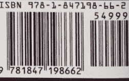
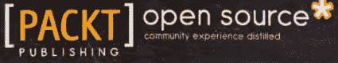

## 索引

## A

- acceptance testing 201  
- Access Control model, requisites 49  
- account-centric system 44  
- accounts, business activities  
- about 33  
- importing 270-274  
- ACT! 13  
- activity management, business activities 40, 41  
- agile programming 184  
- Amazon EC2  
- URL 64  
- Amazon Elastic Compute Cloud. See Amazon EC2  
- analytics, business activities 43, 44  
- AND connector 148  
- Apache web server  
- installing 250, 251  
- SugarCRM, installing 249  
- URL 249  
- Apatar  
- about 190  
- URL 281  
- Apple Safari support, SugarCRM 82  
- application changes, CRM customization 52  
- application integration 305  
- application server 71  
- asymmetric internet connections 78  
- average transaction value, requisites 46

## B

- B2B 33  
- B2B business model, requisites 44, 45  
- B2C 33  
- B2C business model, requisites 44  
- back-office applications 166  
- backup 74  
- bandwidth capacity, server requisites 76, 77  
- BETA 236, 247  
- BETWEEN operator 148  
- Bug Tracker module 212  
- Business-to-Business. See B2B  
- Business-to-Consumer. See B2C  
- business activities, CRM  
- about 31, 32  
- accounts 33  
- activity management 40, 41  
- analytics 43, 44  
- contacts 33  
- document management 43  
- e-mail management 41  
- employee directory 42  
- interface consolidation 42, 43  
- knowledge management 40  
- leads 129  
- marketing automation 41, 42  
- reporting 43, 44  
- sales force automation 36  
- tracking leads 33-35  
- tracking sales pipeline 37, 39  
- tracking service cases 39  
- Business Intelligence (BI) software 37  
- business models, specific requisites 44  
- browser support, SugarCRM  
- about 82  
- Apple Safari 82  
- Firefox 82  
- Microsoft Internet Explorer 82

## C

calendaring system, SugarCRM  
about 109  
calendar tab 110  
graphical calendar, accessing 110  
working 111-113  
call  
scheduling 117, 118  
calls activities, SugarCRM 114  
campaign metrics 139  
Cascading Style Sheets. See CSS  
case management, business activities 39  
Cases module 212  
case study  
introduction 25  
requisites analysis 56-59  
CentOS  
about 68, 226  
installing 228-232  
selecting, factors 227  
URL 227  
CentOS, installing 228-232  
CentOS Linux installation  
firewall settings, configuring 232, 233  
PHP extensions, installing 234  
PHP settings, verifying 234  
Central Processing Unit (CPU), server hardware 70  
chown -R apache.apache command 238  
Client Access Licenses (CAL) 67  
cloud computing  
about 64  
benefits 64  
clustering 67  
collocation model, CRM deployment 61-63  
com_sugarbugs component  
about 214  
configuring 215  
installing 215  
com_sugarcases component  
about 214  
configuring 215  
installing 215  
Comma Separated Values. See CSV files  
Community Edition (CE), SugarCRM versions 21  

configuration management 144  
contact-centric systems 45  
contacts 130  
contacts, business activities  
about 33  
exporting, from contact manager 280  
importing 270, 275  
Content Management System (CMS) 212  
contracts module  
about 143, 164  
capabilities 164  
cookies support, SugarCRM 82  
cosmetic changes, CRM customization 51, 305  
Create from vCard shortcut, SugarCRM 124, 125  
CRM  
about 12  
business activities 31, 32  
business benefits 17, 18  
capabilities 32  
data hub 54  
deployment models 61-64  
deployment options 20  
development partner, selecting 186-188  
features 14, 15  
history 19  
implementing 180-182  
issues, listing 31  
requirement analysis 30  
CRM customization 15, 16  
CRM implementation  
about 180  
factors 180  
groups, affected 180-182  
objectives 182  
pitfalls 183, 184  
planning 181, 182  
project goals, setting 186  
project goals, specifying 186  
system development 188  
team management, techniques 185  
team participation 184, 185  
CRM solutions, smaller business  
Microsoft CRM 20  
NetSuite 19  
Salesforce.com 19

### D

dashboard 37, 103  
data backup strategy 74, 298  
database  
resetting 127, 128  
database server 71  
data hub, CRM 54  
data import 189  
Decision Support software 37  

Delete button, SugarCRM 123  
deployment, CRM 61-64  
deployment options, CRM  
about 20  
Hosted Application Pack 20  
On-Demand model 20  
On-Premise option 20  
Server Appliance option 20  
detail views screen  
about 88, 89  
controls 91  
development toolkit module  
about 142, 163  
benefits 163  
URL 163  
df -h command 299  
digital dashboard 37  
distros 67  
Doc Newhart 24  
document management, business activities  
43  
drilldown 109  
Dropdown Editor tool 311-313  

### E

e-mail activities, SugarCRM 114  
e-mail management  
about 118, 119  
e-mail templates 120  
e-mail management, business activities 41  
e-mail marketing campaign  
about 129  
executing 134, 135  
targets, adding 136, 137  
e-mail template  
about 120  
creating 134, 135  
EDGE 47  
edit view screen 92-94  
EIS 37  
employee directory, business activities 42  
Enhanced Data rates for GSM Evolution  
(EDGE) 47  
Enhanced search functionality  
about 141, 147  
AND connector 148  
BETWEEN operator 148  
EQUALS operator 148  
IN operator 148  
LIKE operator 148  
OR connector 148  
RLIKE operator 148  
enhanced studio module  
about 142, 163  
benefits 163  
URL 163  
Enter Business Card shortcut, SugarCRM  
123, 124  
Enterprise Edition (ENT), SugarCRM versions 21  
Enterprise Linux Server 67  
Enterprise Resource Planning (ERP) 166  
EQUALS operator 148  
Error Correction Codes (ECC) memory,  
server hardware 69  
Executive Information Systems (EIS) 37  
Export link, SugarCRM 122  

### F

features, CRM 14, 15  
Fedora Core 68  
fields 308  
Firefox support, SugarCRM 82  
firewall, security measures 75  
forecasting module  
about 143, 170  
example 171, 172  
form factor, server hardware 70  
front office applications 166  

### G

general maintenance, SugarCRM  
about 296  
data backups 298  
storage availability, checking 299, 300  
system backups 297, 298  
updates, checking 297  
Google connectors  
about 142, 149  
benefits 149  
configuring 149, 150  

graphical chart  
Opportunities by lead source by outcome  
chart 106  
Pipeline by sales stage chart 105  
The all opportunities by lead source chart  
108  
The outcome by month chart 107  
GrinMark Microsoft Office Add-in  
about 151  
mail merge, performing 157, 158  
URL 151  
Groupware 17  

### H

hard disk speed, server hardware 70  
hard disk technology, server hardware 70  
hardware, server requisites 68  
Help icon, SugarCRM 122  
Hosted Application Pack 20  
hostname command 239, 256  
HTML 51  
Hyper Text Markup Language. See HTML  

### I

ifconfig command 239  
inbound traffic, server bandwidth 77  
information  
exporting 279  
IN operator 148  
installation, Apache web server 250, 251  
installation, CentOS 228-232  
installation, Joomla! 213  
installation, MySQL 254, 255  
installation, PHP 251-253  
installation, SugarCRM Community Edition  
about 236, 256  
confirmation screen 244, 262  
database configuration screen 242, 260  
database type 242, 260  
license check screen 258  
license screen 240  
locale settings screen 243  
local settings screen 262  
login screen 246, 265  
options 241, 259  
registration screen 245, 264  
site configuration screen 243, 261  
system check screen 240, 258  
welcome screen 240, 258  
integration, CRM customization 52  
interface consolidation, business activities  
42, 43  
international offices, requisites 49-51  
Internet Information Services (IIS)  
about 73  
SugarCRM, installing 266, 267  
ipconfig command 256  
iReport 162  
ISAPI Module 266  

### J

JasperReports 162  
Javascript support, SugarCRM 82  
Jitterbit  
about 190  
URL 281  
Joomla!  
about 212  
installing 213  
new Joomla! user, creating 218  
SugarCRM cases, adding to 216, 217  
SugarCRM portal, installing for 214  
URL 213  
Joomla!, components  
com_sugarbugs 214  
com_sugarcases 214  
Joomla! user  
creating 218  

### K

KINAMU Outlook Connector 151  
knowledge management, business activities 40  

### L

labels 308  
LAMP 72  
LAMP stack  
about 72  
Apache web server 72  
Linux operating system 72  
MySQL database server 72  
PHP server side scripting language 72  
LAN interface, server hardware 70  
Last viewed, SugarCRM 84  
layouts 308  
lead capture tool  
about 206  
web lead capture form, setting up 206-211  
leads, business activities  
about 33-35, 96-101, 129  
importing 276  
leads, capturing  
about 206  
lead capture tool, used 206  
Leads module 206  
LIKE operator 148  
Linux  
SugarCRM, installing 225  
Linux-Apache-MySQL-PHP. See LAMP  
list views screen 88, 89  
location, requisites  
about 46  
multiple regional offices 47  
outbound sales persons 47, 48  
logic hooks 305, 314, 315  

### M

Main screen body, SugarCRM 85  
manifest file, contents  
Acceptable_sugar_flavors 301  
Acceptable_sugar_versions 301  
Author 302  
Copy_files 302  
Description 301  
Name 301  
Published Date 302  
Type 302  
Version 302  
marketing automation, business activities  
41, 42  
marketing campaigns  
about 128  
creating 130-132  
target 129-133  

### mass emailing queue 137, 138  

### match key 276  

### Maximizer 13  

### meeting  

### scheduling 117, 118  

### memory size, server hardware 70  

### memory type, server hardware 70  

### Microsoft CRM  

### about 20  

### URL 20  

### Microsoft Internet Explorer support, SugarCRM 82  

### Microsoft office integration 142, 157  

### Microsoft Outlook 13  

### Microsoft outlook connector  

### about 142, 151  

### GrinMark Microsoft Office Add-in 151  

### Microsoft SQL Server (MS-SQL)  

### SugarCRM, installing 265, 266  

### Microsoft Word 157  

### mixed mode authentication 265  

### Model-View-Controller (MVC) 305, 316-318  

### module builder 305, 318  

### module loader  

### about 145, 301  

### using 145, 146, 301-303  

### module loader tool  

### about 146  

### using 141  

### modules, SugarCRM  

### about 87, 88  

### modifying 306  

### MS-SQL Reporting Services 142  

### MSI installer package 249  

### MySQL  

### about 72  

### installing 254, 255  

### SugarCRM, installing 249  

### N  

### navigation, SugarCRM  

### about 87  

### data relationships 94, 95  

### detail view screen 88, 89  

### edit view screens 92-94  

### list views screen 88, 89  

### main panel 90, 91  

### searching 94, 95  

### subpanel 90, 91  

### navigation shortcuts box, SugarCRM 85  

### navigation tabs, SugarCRM 84  

### NetSuite  

### about 19  

### URL 19  

### note  

### creating 116  

### O  

### on-Demand model 20  

### on-Premise option 20  

### on demand model, CRM deployment 61-66, 227  

### on premise model, CRM deployment  

### about 61, 63  

### server issues 66  

### open quotes module  

### about 143, 164  

### capabilities 164  

### URL 164  

### opportunities, business activities  

### about 33-35, 96, 100-103  

### importing 276  

### OR connector 148  

### outbound traffic, server bandwidth 77  

### P  

### Parallel Advanced Technology Attachment.  

### See PATA disk drives  

### password management 292  

### passwords  

### resetting 296  

### PATA disk drives, server hardware 69  

### permissions 267  

### Permissions Management Infrastructure (PMI), requisites 49  

### PHP  

### configuring 235  

### installing 251-253  

### PHP, configuring  

### steps 235, 236  

### php-imap 235  

### Q  

- Quick New Item box, SugarCRM 85, 125  
- quotes module  
  - about 143, 168  
  - quote, creating 169  
  - quote list view screen 169  

### R  

- RayDoc  
  - about 26  
  - future 26  
- RayDoc Carpets, Doors, and Windows case study 25  
- RayDoc CRM requisites, case study 56-59  
- RC1 236, 247  
- RC2 236, 247  
- records  
  - updating 276, 278  
- recurring business model, requisites 46  
- Red Hat 67  
- Red Hat Enterprise Linux 226  
- redundancy, internet connections 78  
- Redundant Array of Inexpensive Disks (RAID), server hardware 69  

### S  

- sales activities, SugarCRM  
  - about 113  
  - call, scheduling 117, 118  
  - e-mail management 118, 119  
  - meeting, scheduling 117, 118  
  - note, creating 116  
  - task, creating 116, 117  
- sales cycle, requisites 46  
- Salesforce.com  
  - about 19  
  - URL 19  
- sales force automation, business activities 36  
- sales force automation, features 36  
- SalesLogix  
  - about 20  
  - URL 20  
- sales pipeline tracking, business activities 37, 39  
- sales teams module 143, 175  
- SATA disk drives, server hardware 69  

- php-mbstring 235  
- php -v command 234  
- phpMyAdmin  
  - URL 298  
- pilot testing  
  - about 190, 201  
  - example 190  
- Pipeline by sales stage chart 105  
- Portal Active checkbox 218  
- power supply, server hardware 70  
- pre-import analysis 271, 272  
- Print icon, SugarCRM 121  
- product based business model, requisites 45, 46  
- products catalog module  
  - about 143, 167  
  - functions 167  
- products module 143, 167, 168  
- Professional Edition (PRO), SugarCRM versions 21  

- relationships 308  
- reliability, server requisites 76, 77  
- reporting, business activities 43, 44  
- reporting module  
  - about 143, 172  
  - custom report, creating 173, 174  
- Representational State Transfer (REST) 319  
- requirement analysis 30  
- requisites, business models  
  - about 44  
  - average transaction value 46  
  - B2B 44, 45  
  - B2C 44, 45  
  - location 46  
  - products 45, 46  
  - recurring business model 46  
  - sales cycle 46  
  - services 45, 46  
- REST API  
  - SugarCRM, integrating 319  
- RLIKE operator 148  
- role management 175  

### Implementing SugarCRM 5.x

### 关于 Packt Publishing

Packt，发音为 'packed'，于 2004 年 4 月出版了第一本书 "_Mastering phpMyAdmin for Effective MySQL Management_"，随后继续专注于出版针对特定技术和解决方案的高度聚焦图书。

我们的书籍和出版物分享了您的 IT 同行在调整和定制当今系统、应用程序和框架方面的经验。我们的解决方案导向图书为您提供知识和能力，以定制您正在使用的软件和技术来完成工作。Packt 图书比您过去见过的 IT 图书更具体、更不笼统。我们独特的商业模式使我们能够为您提供更多聚焦的信息，让您了解更多需要知道的内容，而减少不需要知道的内容。

Packt 是一家现代且独特的出版公司，专注于为开发者、管理员和新手等社区制作高质量、前沿的图书。有关更多信息，请访问我们的网站：www.packtpub.com。

### 关于 Packt Open Source

2010 年，Packt 推出了两个新品牌，Packt Open Source 和 Packt Enterprise，以继续其专业化的重点。本书是 Packt Open Source 品牌的一部分，该品牌是围绕开源许可构建的软件图书的家园，并为从高级开发人员到初学者网页设计师的任何人提供信息。开源品牌还运行 Packt 的开源版税计划，通过该计划，Packt 为每本关于其软件出售的图书的开源项目提供版税。

### 为 Packt 撰写

我们欢迎所有有兴趣撰写的人士的咨询。图书提案应发送至 author@packtpub.com。如果您的图书构思仍处于早期阶段，并且希望在撰写正式图书提案之前先讨论，请联系我们；我们的一位委托编辑将与您联系。

我们不仅在寻找已出版的作者；如果您拥有强大的技术技能但没有写作经验，我们经验丰富的编辑可以帮助您发展写作生涯，或者仅仅为您的专业知识获得一些额外回报。

### Liferay Portal 5.2 系统开发

ISBN: 978-1-847194-70-1 平装本: 552 页

Liferay Portal 5.2 系统开发

- 学习如何使用 Liferay 工具作为 Java 开发者创建自己的应用程序，包含实践示例
- 使用 JSR-286 Portlet、扩展环境和 Struts 框架自定义 Liferay 门户
- 使用 Portlet、钩子和主题构建自己的社交办公系统并管理自己的社区
- 唯一面向 Java 开发者的 Liferay 图书

### TrixBox 使用指南

ISBN: 978-1-904811-93-0 平装本: 168 页

安装和运行家庭及办公 VoIP 系统的分步指南

- 规划和配置您自己的 VoIP 和电话系统
- 设置语音邮件、会议和呼叫录音
- 清晰实用的教程，采用案例研究格式

请访问 www.PacktPub.com 获取我们图书的相关信息

美国制造
肯塔基州列克星敦
2012 年 1 月 29 日

### 实施 SugarCRM 5.x

SugarCRM 是一款流行的客户关系管理（CRM）系统。它是中小型企业尝试 CRM 系统而无需投入大量资金的理想方式。尽管 SugarCRM 经过精心设计以便于使用，但要实现可衡量的业务成果需要仔细的规划和研究。

本书将为您提供开始使用这一强大 CRM 系统所需的所有信息。它是一本易于遵循的指南，帮助您发挥 SugarCRM 的全部功能。本书演示了如何安装 SugarCRM，以及如何通过根据您的需求定制和集成 CRM 到您的组织中来充分利用它。书末提供了 SugarCRM 6.0 的简要概述。

#### 本书适用人群

如果您是一名具备合理 IT 技能的中小型企业主/经理、系统实施者，或希望为自己实施 SugarCRM 的系统管理员（无论是作为第一个 CRM 还是作为现有解决方案的替代品），本书适合您。

希望扩大对该主题理解的现有 SugarCRM 用户会发现本书很有价值。使用本书不需要编程知识。

#### 您将从本书中学到的内容

- 根据您的需求和资源分析并权衡部署选项
- 为 SugarCRM 安装 CentOS LAMP 栈
- 审查适用于您 SugarCRM 系统的强大内置定制工具和流行的第三方增强功能
- 了解持续维护需求，例如备份和用户管理
- 了解 SugarCRM 最流行的功能之一 - 电子邮件营销活动功能
- 使用 SugarCRM 数据导入工具并了解使用时遇到的一些常见问题
- 扩展 SugarCRM 以允许第三方访问以添加或查看其中包含的数据

$ 49.99 美元 £ 30.99 英镑

ISBN 978-1-847198-66-2 54999

价格不包含当地销售税或增值税（如适用）

Packt Publishing, 伯明翰 - 孟买 www.PacktPub.com

