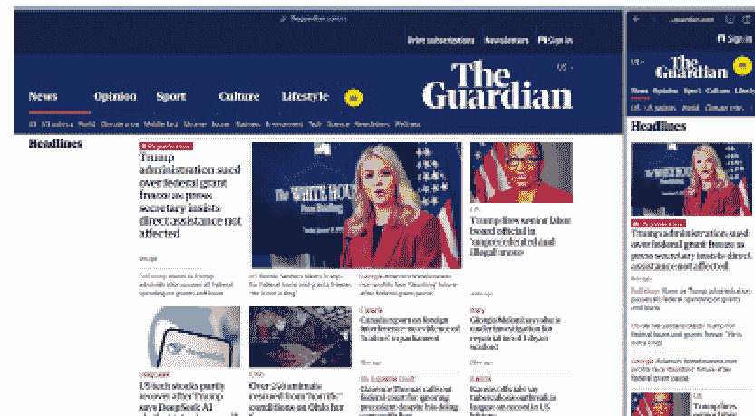
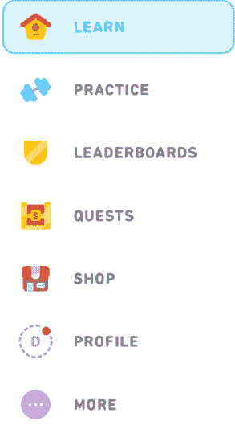

# 第 1 部分

## 包容性设计的
基础

本开篇部分为设计无障碍且包容的数字体验奠定了基础。在四个章节中，您将了解塑造当今数字世界包容性设计的核心理念、法律框架和实践方法。从理解无障碍的发展历程和用户需求的多样性，到应对全球立法和融入伦理责任，这些章节将无障碍重新定义为不仅仅是清单，而是一种以人为本的设计承诺。

您还将学习如何开展尊重 lived experience、挑战掠夺性做法并将洞察转化为可执行设计决策的包容性用户研究。

在本部分结束时，您将具备所需的知识、心态和基础实践，以开始构建不仅合规而且真正包容的数字产品。

本部分包含以下章节：

- *第 1 章，数字时代的包容性设计定义*
- *第 2 章，了解多样化的用户需求：残疾类型与辅助技术*
- *第 3 章，无障碍设计中的法律与伦理考量*
- *第 4 章，包容性产品的用户研究与测试*

### 1

#### 数字时代的包容性设计
定义

*作者 Dale Cruse*

设计中无障碍的历程揭示了我们对人类多样性和技术对社会影响的理解发生了深刻而重大的转变。我们已超越狭隘、规定性的做法，拥抱一种更全面的视角，庆祝人类能力和经验丰富而复杂的光谱。这种转变代表了设计演进；从根本上重新构想技术如何连接和赋能不同能力和情境下的人们。

在当今数字世界中，理解包容性设计至关重要：它是对创作者的专业必需，通过扩大市场和创新带来商业优势，确保法律合规，并随着技术日益成为日常生活核心而帮助构建更无障碍的数字社会。

整体方法是为包容性设计提供全面的基础，从将无障碍视为事后考虑转变为将其视为使所有用户受益的基本设计原则。

在本章中，您将探索数字无障碍的演进、通用设计的原则以及以用户为中心的方法论。您将学习如何创建赋能所有能力用户的包容性产品，将无障碍从事后考虑转变为嵌入核心设计原则。

目标是为包容性设计提供实践基础，展示其如何推动创新和连接。您将获得重新思考方法的工具，确保您的工作反映所有用户的多样化需求。

随着技术成为日常生活的核心，这一知识至关重要。通过拥抱包容性设计，您不仅能提升专业技能，还能为一个更公平的数字社会做出贡献，在那里技术服务于每个人。

因此，在本章中，我们将涵盖以下主题：

- 了解数字无障碍的历史背景和演进
- 探索通用设计的七项原则
- 实施以用户为中心的设计方法论
- 认识包容性的商业案例

##### 了解数字无障碍的历史背景和演进

过去，无障碍通常是设计的滞后补充，临时解决方案被附加到现有产品上。沮丧的用户在使用无法解释图形、经常误读单词、经常崩溃、并且需要为每个新软件版本手动更新的屏幕阅读器时苦苦挣扎。文本转语音系统带来了额外的挑战，其机械声音和理解力差。原始的键盘控制在应用程序之间无法一致工作。许多放大工具在显著减慢计算机速度的同时还会扭曲文本和图像。独立的屏幕阅读器尤其成问题——笨重的软件难以与主流应用程序良好配合。所有这些限制都提供了不佳的体验，并强化了残疾是“其他”或与常态分离的观念。幸运的是，这些解决方案与今天更无缝集成的系统相比相去甚远。

随着我们对残疾和人类多样性的理解加深，我们的设计方法也随之演进。万维网诞生于 1989 年，带来了新的无障碍挑战和机遇。1999 年发布《网络内容无障碍指南》是一个里程碑，为标准化的网络无障碍实践铺平了道路。这些指南引入了键盘导航、图像替代文本和适当的标题结构等关键标准——这些功能现在已成为网页设计的基石。其影响是革命性的：首次，全球开发者拥有了创建无障碍网站的共同框架，导致残疾人士的互联网访问能力大幅改善。

##### 从为残疾设计到为人类的多样性设计转变

在拥抱更广泛的包容性设计观之前，该领域最初专注于通过针对性解决方案解决残疾。设计师创建了专门的功能，如盲人用的屏幕阅读器、聋人用的闭路字幕，以及运动障碍者用的替代输入设备。这些针对残疾的适应是至关重要的一步，帮助许多人访问数字内容并为无障碍标准奠定了基础。然而，这种狭隘的方法往往导致隔离式解决方案，使残疾用户显得不同，并且对特定损伤的关注意味着错失创造更具普遍益处功能的机遇。

设计师意识到为无障碍设计的功能正在帮助所有人。想想闭路字幕——它们最初是为听力障碍者、学习新语言的人或在嘈杂环境中导航的人设计的，但哇，它们真的流行起来了！现在你有语言学习者紧盯着它们，学习新单词，以及在繁忙咖啡馆或健身房里静默追随自己最喜欢节目的观众。就像它们找到了全新的受众一样。

语音控制功能讲述了类似的故事——最初为运动障碍者设计，它们已成为任何人做饭时手脏、多任务处理的父母或需要免提操作的司机日常便利。这些曾经专门的功能现在如此常见，以至于许多人甚至不再将其视为无障碍工具。这一洞见引发了设计思维的革命。

包容性设计认识到我们都在能力滑动尺度上，随着时间和情境而变化。即使视力 20/20 的人也可能在烈日下眯着眼看智能手机上的小文本。拥抱这些多样化的场景使我们能够创造让每个人都脱颖而出的产品。

这种新思维将残疾视为流动而非固定。历史上，残疾通常被定义为永久性、使人丧失能力的状况——使一个人从根本上与常态不同。但这一观点已经演变。今天，我们更广泛地理解残疾为个人能力与其环境之间不匹配，由永久性、暂时性或情境性损伤塑造。骨折的手臂、抱着婴儿的父母或在颠簸公交车上的通勤者——所有人都会面临暂时性障碍，限制其与数字系统的交互。包容性设计迎合这些日常挑战，使每个人的生活更顺畅，并反映了对人类能力的更细致理解。

- **交叉性：** 考虑多种因素如何叠加加剧无障碍挑战。例如，同时听障且行动受限的用户可能会面临需要量身定制解决方案的独特障碍。
- **需求变化：** 理解用户需求会随时间演变，尤其随着人口老龄化并面临与年龄相关的功能损伤。例如，老年人可能受益于更大的触控目标和简化的导航，以适应运动技能和视力的下降。
- **文化多样性：** 考虑用户体验中的文化和语言差异。例如，为从右到左的语言设计支持，或确保图标和图像具有文化包容性，可以使产品在全球范围内更具无障碍性。

磨练这一技能使设计师能够创建更具包容性的产品，吸引更广泛的受众。这种方法提升市场覆盖面，推动创新，增强品牌声誉，并降低法律风险。

##### 在现有设计中发现无障碍障碍

包容性设计中的另一项关键技能是能够发现当前设计中的无障碍障碍。这些障碍形式多样：

- **视觉：** 对比度低的文本、依赖颜色的信息，或缺少替代文本的图像。
- **听觉：** 没有字幕或文字记录的视频，或没有文字备份的音频内容。
- **运动：** 过小的触控目标或键盘导航死胡同。
- **认知：** 术语繁多的语言，或不增加意义的标题。快速定时提示或复杂导航等设计选择也会增加认知负荷，或对患有心理健康状况的用户触发焦虑。
- **语音：** 仅语音的界面没有文字替代，或语音识别难以应对多样化的口音和语音模式。

发现这些障碍就像同时扮演侦探、技术高手和共情者。你必须亲手使用辅助技术，紧跟最新的无障碍指南脉搏——关键是——把各种能力的人真正带入你的设计游乐场。这不仅仅是简单地打勾；它涉及深入理解不同的人如何导航数字世界。

虽然自动无障碍检查器可以发现一些问题，但许多障碍只有通过动手测试和用户反馈才会显现。例如，机器人可能会对所有图像都有替代文本给出点赞，但它无法判断该文本是否描绘出有意义的画面。

设计师和开发者可以从第一天起就打造包容性的数字体验，而不是在以后追赶无障碍功能。

包容性设计是关于创建能与人类多样性全谱系产生共鸣的体验。它具有前瞻性，涉及每个人所拥有的多种能力、情境和偏好。这意味着引入历史背景，拥抱残疾的社会模式，并磨练识别和拆除通往确保数字世界为每个人服务的道路上障碍的技能。

为了将这些原则付诸实践，让我们探索包容性设计中最具影响力的框架之一：通用设计的七项原则，它提供了创建真正无障碍体验的具体指导。

##### 探索通用设计的七项原则

1997年，罗纳德·梅斯及其北卡罗来纳州立大学团队发布了一个改变游戏规则的框架：通用设计的七项原则。最初为物理空间打造，这些原则在我们的数字世界中找到了新的使命，重塑了我们创建包容性在线体验的方式。

以下是七项原则：

- 1. **公平使用：** 这是数字迎宾垫。一个允许每个人根据需要调整文字大小和颜色对比度的网站体现了公平使用的实践。
- 2. **使用灵活性：** 无论你点击、说话还是打字，真正灵活的设计都能适应用户。这是一款无论用指尖还是语音命令都能感觉自如的应用。
- 3. **简单直观使用：** 一个设计良好的电子商务网站能让你从浏览顺利过渡到结账？那就是简单和直观性的体现，让每个人都能轻松在线购物。
- 4. **可感知的资讯：** 一个提供字幕、音频描述和文字记录的视频播放器？那就是可感知资讯的实践，确保没有人错过内容。
- 5. **容错性：** 想想一个表单会温和地指出错误并告诉你如何修正。那就是确保手指一滑不会变成令人沮丧的折磨。
- 6. **低体力消耗：** 具有批量操作和键盘快捷键的内容管理系统体现了这一原则，使数字任务更简单。
- 7. **大小和空间以便接近和使用：** 这转化为与所有屏幕和手指都能良好配合的设计。让我们创建易于点击的触控目标，并设计布局，无论在手机还是桌面上都能很好地工作。

拥抱这些原则不仅仅是设计数字产品；它让我们能够创造欢迎每个人的体验。这时我们才意识到，出于无障碍而诞生的功能往往会成为人人喜爱的通用功能，从而让我们的数字世界变得更好。

在数字世界中将通用设计原则付诸实践涉及重新构想我们对数字体验的整体方法，确保每一次互动对所有能力的人来说都是直观、公平和赋能的。通过从一开始就优先考虑包容性，我们创建的数字环境不仅满足多样化需求，还能为每个人促进创新和连接。

以下示例说明了包容性设计原则如何在实践中应用，展示了从一开始就优先考虑无障碍和适应性如何带来创新、以用户为中心且惠及所有人的解决方案。

- **从一开始就包容：** 将多样化的用户需求视为你的设计缪斯，而非事后考虑。苹果的 VoiceOver 从 iOS 最初版本就内置其中，而不是后来添加。微软的 Xbox Adaptive Controller 是通过与残障游戏玩家的持续合作设计，其核心功能从一开始就成形。
- **灵活布局：** 创建在任何设备上看起来都很棒的自适应界面，从智能手机到桌面显示器。BBC News 网站自动在设备间调整布局和图像大小，同时保持可读性。《卫报》的响应式设计从桌面上的多列布局无缝切换到移动端单列布局，同时不丢失内容或功能。

图 1.1：《卫报》在网页和移动端的首页

- 多感官魔力：自助式互动方法包括视觉、听觉和触觉。让用户选择口味。Google 地图提供视觉导航、语音引导和转弯的触觉反馈。Netflix 提供音频描述、字幕和视觉控制，让用户混合搭配他们偏好的内容消费方式。
- 保持清晰：拥抱语言和导航的简洁。这不是简化；这是打开。Gov.uk 用简明语言取代了复杂的政府术语，提高了用户理解度。Duolingo 使用简单、一致的导航模式和清晰的图标，帮助用户专注于学习而非弄懂界面。

##### duolingo

图 1.2：Duolingo 清晰的按钮和界面

- **与辅助技术好好配合：** 确保你的产品能很好地与屏幕阅读器、语音识别等配合使用。Twitter 的图像描述功能与屏幕阅读器配合良好，使视觉内容对盲人用户和低视力用户来说更易访问，尽管他们的需求可能不同——例如，低视力用户可能更依赖缩放工具和对比度调整而非全屏阅读。Microsoft Word 提供强大的无障碍功能，包括正确标记的表单字段和导航辅助，使文档对屏幕阅读器用户更易使用。

- **测试中的多样性：** 从能力光谱各端的用户那里收集反馈。他们的见解是设计的黄金。Airbnb 对色盲用户进行可用性测试，以改进其地图界面和房产照片。Facebook 的无障碍团队包括残障工程师，他们在发布前测试新功能。
- **保持了解：** 密切关注无障碍指南的最新动态。WCAG 不仅仅是一个缩写；它是你的设计指南针。采用这些无障碍要求促使 WordPress 更新其编辑器以实现更好的键盘导航。美国银行定期更新其移动应用以满足不断发展的 WCAG 指南，确保持续的无障碍改进。

这些原则融入数字设计的 fabric 中，创造的不仅是无障碍的产品，更是令人愉悦的体验。关键在于认识到源于无障碍的功能往往会成为人人喜爱的通用功能。

通用设计的七项原则不是指南，而是一份欢迎数字体验的配方。在整个设计过程中拥抱这些原则，意味着不仅仅是勾选要求；它为每个人打开了更直观、更灵活、更人性化的数字体验之门，无论其能力或生活状况如何。

为了有效地将这些原则付诸实践，我们需要了解如何实施以用户为中心的设计方法论，将真实的人置于开发过程的核心。

##### 实施以用户为中心的设计方法论

以用户为中心的设计将人们置于创作过程的核心，深入了解所有用户的生活、需求和体验，并将他们的视角贯穿于设计 fabric 的每一根线中。通过采取这种方法，我们不仅仅是在创造产品，我们打造的是与人类多样性产生共鸣的体验。无障碍不是事后考虑，而是从第一天起就成为主角。

##### 理解多样化的用户需求和体验

理解多样化的用户要求我们超越自身的体验，考虑人们与技术交互的多种方式。这是以用户为中心设计的第一个飞跃——认识到我们的用户就像雨林生态系统一样多样，每个人都有其独特的能力、偏好和生活背景。

想想看：

- 一位用户可能因永久性视觉障碍而浏览数字世界。
- 另一位可能因运动损伤而暂时单手使用。
- 又一位可能在海滩度假时因屏幕眩光而感到困扰。

要真正把握这种用户需求的万花筒，设计师需要：

- **成为人口统计侦探：** 深入研究跨越各种背景、年龄和技术熟练程度的用户研究。设计师可能会通过对不同年龄组和技术背景的用户进行结构化访谈开始，记录他们如何导航常见任务以识别模式和痛点。
- **掌握能力字母表：** 从视觉到听觉，从运动到认知——考虑人类能力的全范围和挑战。例如，在设计移动应用时，设计师应同时使用标准触控控制和语音命令或开关控制等替代输入方法进行导航测试，以确保通用访问。
- **拥抱变化：** 请记住，用户需求不是一成不变的。它们会随着时间、情境甚至情绪而变化。设计师可以通过创建具有可调设置灵活界面来应对这一点，例如阅读应用可根据一天中的不同时间或用户疲劳程度的不同而调整界面。
- **连接交叉性的点：** 认识到身份的不同方面如何交织，创造出独特的无障碍难题来解决。设计师可能会遇到一位既色盲又因运动障碍而使用键盘导航的用户，这需要在界面设计中仔细考虑颜色对比度和键盘焦点指示器。

在认识到这些多样化的用户需求和交叉性考虑之后，下一步是开发有效的研究方法来深入理解它们。让我们探索具体的技术，帮助捕捉用户体验的全谱系并将其转化为可操作的见解。

##### 包容性用户研究和测试技术

要真正为所有人设计，我们需要深入挖掘用户体验。以下是一些强大的技术来发掘那些隐藏的见解：

- **撒大网：** 在招募参与者时，要考虑多样性的所有形式。真正有效的研究小组应反映社会的多样性 itself，汇集不同能力、年龄、文化和技术熟练程度的人，每个人都贡献其独特的视角。
- **设身处地：** 真正的情境探究就像在用户生活中当一只苍蝇。设计师通过在用户自然环境中观察用户，记录他们在真实世界情境中如何与技术交互，并提出深思熟虑的问题来发掘见解，从而实现这一点。
- **共情训练营：** 共情地图、用户角色和其他工具让你的团队有机会走进用户的鞋子里：
  - **共情地图** 是一种视觉工具，通过将观察结果组织到四个象限来帮助团队理解用户：他们说什么、想什么、感受什么、做什么。它捕捉用户的行为、情绪和动机，以建立更深的共情并为设计决策提供信息。
  - **用户角色** 是基于研究的虚构目标用户代表，旨在体现他们的目标、行为、需求和挑战，帮助团队将设计决策与受众的真实体验和优先事项保持一致。
- **无障碍侦探工作：** 对你的数字产品进行定期审计就像健康检查。利用高科技工具和人工测试来嗅出设计中潜伏的任何障碍。
- **试驾技术：** 邀请依赖辅助技术的用户来测试你的产品。这就像拥有专家顾问，他们可以发现你可能从未考虑过的问题。
- **共同创造：** 在有效的设计工作坊中，多元用户不仅仅是反馈提供者——他们是创意过程的副驾驶。这些会议可以激发任何设计师独自无法想到的想法。

在与用户共同创造中收集见解后，下一个关键步骤是通过系统迭代来完善这些想法。这种持续的原型、测试和完善过程确保我们的协作见解演变为真正有效的解决方案。

图 1.3：Xbox Adaptive Controller 被一众辅助技术环绕以实现游戏（由 Geni 创建，根据 CC-BY-SA 4.0 许可：https://creativecommons.org/licenses/by-sa/4.0/）

但真正让这款控制器与众不同的不只是其酷炫功能——而是其诞生的旅程：

1. 微软深入残障游戏玩家世界，通过深入研究发掘需求和挑战。
2. 职业治疗师和无障碍专家成为他们的副驾驶，在整个设计过程中每一步都提供指导。
3. 他们制作了一个又一个原型，让目标受众试驾每个版本。
4. 反馈成为他们的北极星，促使进行重大的设计转向以提升可用性和无障碍性。
5. 他们退一步看大局，使从包装到设置的一切都与控制器本身一样无障碍。

结果？一款改变游戏规则的产品，它不仅仅服务于目标受众——它实现了公平竞争，证明了通过适当的设 计和倡导者的见解，任何人都可以玩游戏。

虽然包容性设计的伦理论据令人信服，但许多组织也需要了解其业务影响才能完全致力于实施。让我们探讨包容性设计如何通过扩大市场、增加创新、提升品牌声誉和降低法律风险来推动业务成功。

##### 认识包容性的商业价值

包容性设计是正确的做法——但你知道它也是明智的商业举措吗？它直接改善业务绩效，创造适用于每个人的数字产品。根据 Forrester 和 Microsoft 2016 年的一份报告，无障碍设计可以改善客户满意度、提升品牌认知度并增加市场覆盖范围。此外，投资无障碍的公司更有可能促进创新和员工生产力。

当我们以多元用户为出发点设计时，我们扩大了市场覆盖范围、提升了用户满意度并构建了更具创新性的解决方案：

- **更大的受众，更大的利润：** 当你为所有人设计时，你就为更多客户铺设了红地毯。通过满足服务不足社区的需求，你可以进入新市场并释放巨大的收入潜力。
- **创新点火：** 包容性设计挑战你的团队跳出思维定式，往往带来新鲜的解决方案。这种创造性解决问题可以激发突破，提升整个产品线并让你与竞争对手脱颖而出。
- **品牌提升：** 向世界展示你关心并看着你的声誉飙升。这就像一个真正有意义的公关活动。消费者越来越倾向于选择与自身价值观一致的品牌，而包容性可以成为强大的差异化因素。
- **法律安全网：** 领先于无障碍法规，保持律师远离。积极拥抱无障碍不仅能最大限度地降低法律风险，还能将你的公司定位为负责任的行业领导者。
- **通用吸引力：** 关键是：为无障碍设计的功能往往会让所有用户感到愉悦。从字幕到语音命令，这些创新提升了每个人的可用性，创造了更直观、更愉快的体验。

##### 法律合规与风险缓解

数字无障碍不仅仅是一种最佳实践——在许多地区，它还是一项法律要求。美国的《美国残疾人法案》和欧洲的《欧洲无障碍法案》等法律都要求企业确保其数字产品对所有用户都可访问。从一开始就融入包容性设计，可以让企业避免昂贵的诉讼和后期改造的麻烦。这种主动的方法还能让他们轻松适应未来的无障碍法规。拥抱包容性不仅仅是明智之举；它还是合规和风险管理的积极策略。

图 1.4. 纪念《美国残疾人法案》的旧金山街头艺术。丹·丰特斯创作的壁画。戴尔·克鲁斯拍摄。

#### 总结

本章探讨了包容性设计的基本原则，追溯了其从基本无障碍功能到惠及所有用户的全面方法的演变。你已了解通用设计七项原则及其在数字产品中的应用，发现了实施以用户为中心的设计方法的技术，并了解了如何为包容性构建令人信服的商业案例。正如本章所揭示的，*包容性设计不仅仅是让技术可访问——它是让技术对每个人都更好。*

在数字无障碍日益决定社会参与的当今数字环境中，这些知识至关重要。理解包容性设计原则有助于为所有人创造更好的产品，同时扩大市场覆盖面并降低法律风险。此外，随着组织认识到包容性设计推动创新并提升所有人的用户体验，这些技能正变得对设计师、开发者和产品经理必不可少。

本章为更深入的探索奠定了基础。随着我们继续前进，我们将深入研究不同用户群体的独特需求，包括对特定残疾、心理健康考虑以及支持包容性访问的辅助技术的更深入了解。

在本章中，我们将涵盖以下主题：

- 理解残疾：一种体验光谱
- 在数字环境中对残疾类型进行分类
- 审视辅助技术的作用
- 将用户需求映射到设计解决方案
- 以 lived experience 为中心：与用户一起设计，而非为用户设计

##### 理解残疾：一种体验光谱

就像人类体验中的许多其他身份一样，残疾也存在于一个光谱中：

- 情境性残疾与情境相关，例如在刺眼阳光下尝试阅读手机，或抱着婴儿时用一只手操作平板电脑
- 暂时性残疾源于短期状况，例如受伤或手术后的恢复期
- 慢性病，如关节炎或偏头痛，会波动，造成好日子和坏日子
- 永久性残疾，如失明或瘫痪，是持续性的，但在塑造人们的互动方式上同样多种多样

除了定义之外，重要的是要认识到这些体验是多么流动且常常不可见。一个人在一生中……甚至在一天之内……都可能在不同类别之间转换！疼痛发作、疲劳、行动能力变化或感官超负荷都可能在从一个时刻到另一个时刻改变一个人驾驭数字世界的方式。

例如，一名因慢性病导致视力波动的学生在糟糕的日子里可能需要高对比度设置和放大文字来完成作业，但在好日子里却毫无问题。如果这些选项不可用，他们将如何保持对学习的投入？

或者，考虑一名新父母，因睡眠不足和环境噪音而暂时听力清晰度下降。在那一刻，视频通话中的实时字幕可能是一项必不可少的功能。这些小小的便利会向外扩散，惠及更广泛的受众。

当我们理解到每个人在生命中的某个时刻都会面临障碍时，无障碍就变得普遍——轮椅坡道帮助送货员和推婴儿车的父母，而闭路字幕则支持从嘈杂环境到语言学习者的多样化需求。

这是包容性设计背后的基础理念：无障碍不是例外，而是期望。通过将灵活性和选择嵌入我们的数字环境中，我们赋予所有用户权力——不仅是医学定义上的残疾人。

重要的是，残疾不仅仅是医学问题；它也是社会性的。它源于某人的身体或心智与他们所 navigating 的环境或系统之间的不匹配。一个人的残疾可能并非源于其自身状况，而是源于一个不支持键盘导航的网站，或一个仅依赖声音而没有替代文字的应用。这种视角转移了责任：不再要求个人适应无障碍系统，而是要求系统满足真实人群的需求。

随着我们继续前进，将残疾归为更广泛的类别以了解它们如何影响数字互动会很有帮助。毕竟，与其将其框定为满足少数人的需求，不如在为所有人设计时打开数字机会。下一节将探讨这些类别——视觉、听觉、运动和认知——并介绍支持每一种的设计策略。

##### 在数字环境中对残疾类型进行分类

在设计数字产品时，了解人们与之互动的多样化方式至关重要。残疾不是孤立的状况——它们是人类体验的一部分，并影响个人感知、处理和参与技术的方式。因此，重要的是要指出，“残疾”是一个身份群体，可以与其他任何身份交叉。你可以是穆斯林且残疾、同性恋且残疾、Z 世代且残疾，等等。列表可以一直列下去。

在残疾的范畴下，四种主要的残疾类别——视觉、听觉、运动和认知——涵盖了广泛的状况并带来独特的挑战。解决这些挑战需要深思熟虑的设计，考虑人类能力的全光谱。

###### 视觉残疾：无视力导航

对于盲人或视力低下用户来说，导航数字界面涉及将视觉信息转化为其他形式，例如音频或触觉反馈。但可能会出现问题。例如，屏幕阅读器用户依赖结构良好的代码来导航网页。如果网站缺乏语义化标题或图像的描述性替代文本，就感觉像在嘉年华里穿过镜子迷宫。

###### 运动残疾：重新思考互动

运动残疾涵盖了广泛的状况，从震颤和关节炎到瘫痪和截肢。这些状况影响用户通过鼠标、键盘或触摸屏等物理方式与设备互动的方式。

考虑一名使用头部指针或开关控制进行导航且灵活性有限的用户。每次点击或移动都需要付出努力，因此过于复杂的流程或小而难以点击的按钮会造成不必要的障碍。以简洁和高效为目标进行设计（例如提供大触控目标并最大限度地减少完成任务所需的交互次数）可使技术更易访问。

语音控制是运动残疾用户的另一项变革性工具。然而，语音启用界面必须考虑语音模式的差异。例如，口吃者或甚至非母语口音者可能难以被某些系统理解。提供多种输入选项可确保没有人被排除在外。

###### 认知残疾：简化复杂性

认知残疾——如 ADHD、阅读障碍和智力残疾——影响用户感知、处理和对信息采取行动的方式。一个杂乱的网页和不一致的导航很容易让 ADHD 用户感到不知所措，而冗长的密集文本块可能会让阅读障碍用户完全不愿参与。

简化复杂性会产生差异。将内容分解为更小、更易消化的块，使用一致的设计模式，并融入视觉辅助，可以帮助用户保持专注并更有效地处理信息。例如，一个使用通俗语言和直观图标来解释保险覆盖选项的健康保险网站，比一个埋在行业术语中的网站更易访问。

交互式内容也可以支持认知无障碍。预算应用使用彩色图表来显示支出习惯，为可能难以仅凭数字数据理解的用户提供视觉清晰度。

同样重要的是要考虑精神和心理健康残疾，这些残疾经常被错误地归为认知障碍，但在影响数字互动的方式上有所不同。焦虑、创伤后应激障碍、抑郁症等状况会使某些设计选择——如定时表单、弹出窗口或意外运动——变得极度痛苦或完全无法使用。例如，如果表单包含倒计时计时器，即使他们知道任务很简单，具有焦虑症的用户也可能会完全放弃该表单。

##### 视觉障碍辅助技术

对于视觉障碍人士，访问数字内容需要以其他方式来感知和交互信息。此类辅助技术将文本、图像和界面转换为无障碍格式，以支持独立导航和参与。

###### 屏幕阅读器：让数字内容可听见

**屏幕阅读器**是一种辅助技术，将屏幕上的文本转换为语音，使盲人或低视力用户能够浏览网站、应用程序和数字文档。JAWS、NVDA 和 VoiceOver 等工具会解析网页结构，并以语音方式向用户传达。

有些用户——尤其是聋盲人士——会将屏幕阅读器与**可刷新的盲文显示器（RBD）**配合使用，后者将屏幕阅读器的输出转换为触觉盲文。屏幕阅读器负责处理内容，而盲文显示器则提供另一种输出格式，使用户能够通过触觉访问数字环境。

为了有效运行，屏幕阅读器在很大程度上受益于语义化 HTML 和良好实现的 ARIA。清晰的标题、地标、标签和角色有助于这些工具向用户传达有意义的结构和上下文。缺乏这种结构，用户体验可能会变得混乱或不完整。

例如，当标题、链接和表单字段被正确编码时，屏幕阅读器可以识别它们。然而，当按钮完全没有无障碍名称时，屏幕阅读器可能会完全跳过它，或者笼统地播报——“按钮”，没有任何上下文——让用户猜测它的功能。

即使按钮有标签，标签本身仍然很重要。一个标记为“Button123”的按钮可能在技术上满足名称要求，但它无法告诉用户任何信息。想象一下，在线购物时听到的是“Button123”而不是“添加到购物车”。你会点击它吗？既不知道它是否会将商品添加到购物车，也不知道它是否会从你的信用卡扣款？

无障碍设计不仅仅是让内容可导航，更是让它清晰明了。一个结构良好的页面配合有意义、描述性的标签，能将令人困惑的体验转变为直观的体验。

###### 屏幕放大镜和高对比度工具

对于低视力用户，**屏幕放大镜**可以放大屏幕上的内容，而高对比度工具则通过增加文本与背景颜色之间的对比度来增强可见性。这些功能对于确保可读性和可用性至关重要。

我们很多人都知道，在眼科检查时瞳孔被散大后，阅读屏幕有多么困难。想象一下，当你费力阅读无法正常缩放的微小文本时，还要尝试完成紧急的银行交易。财务仪表板必须在浏览器放大到 200% 时保持可用。如果按钮重叠或文本在高倍率下变得不可读，用户实际上就被排除在外了。响应式设计实践确保内容无论设置如何都能优雅地适应。

###### 盲文显示器：触觉访问数字内容

RBD 将数字文本转换为盲文字符，使盲人用户能够通过触觉阅读内容。这些设备对于聋盲人士或更喜欢触觉阅读而非屏幕阅读器音频输出的用户尤为重要。盲文显示器与屏幕阅读器协同工作，将内容转换为触觉格式，提供精确、无声的数字信息访问。

为了确保兼容性，网站和应用程序必须使用简洁、语义化的 HTML 和正确实现的 ARIA，以便屏幕阅读器将有意义的信息传递给盲文设备。没有这种结构，内容可能会被跳过、错误表示或无法阅读。

###### 为低视力用户提供的音频描述

对于多媒体内容，音频描述具有类似的作用。**音频描述**会叙述标准对话中未包含的关键视觉元素，例如场景变化、肢体语言或屏幕上的文本。这为盲人用户提供了关键语境，尤其是在教育或叙事环境中。

触觉访问和音频描述共同扩大了盲人用户在广泛数字体验中的访问范围——不仅是阅读，还包括观看、导航和交互。

##### 听觉障碍辅助技术

听觉障碍人士依赖视觉和基于文本的替代方案来访问语音内容、警报和通信工具。此类辅助技术确保通常通过声音传达的信息能以其他格式访问，从而弥补这一差距。

###### 字幕和转录文本：确保音频无障碍

对于聋人或听力障碍用户，字幕和转录文本为访问多媒体内容提供了基本途径。**字幕**在视频上显示语音和相关声音提示，而**转录文本**则提供基于音频的内容（如播客和录制会议）的完整文本版本。

然而，并非所有字幕都是平等的。自动生成的字幕经常包含错误，无障碍倡导者 Meryl Evans 因此将其称为“craptions（糟糕字幕）”。提供准确、经过人工审核的字幕可确保聋人和听力障碍用户能够充分参与内容。

###### 视觉警报：替代基于声音的通知

**视觉警报**——例如闪光或屏幕文本通知——可以提供替代方式，让用户接收重要信息，而不是仅仅依赖听觉线索。例如，通常依赖声音通知的系统警报也应显示可见消息以确保无障碍。

###### 助听器和人工耳蜗的兼容性

许多数字平台与辅助听力设备（如支持蓝牙的助听器和人工耳蜗）集成。兼容性不仅仅关乎设备本身，还关乎音频内容的传递方式。

对于依赖助听器或人工耳蜗的用户，高质量的音频文件、尽量少的背景噪音以及清晰、节奏平稳的语音至关重要。使用标准、未压缩或轻压缩格式（如 MP3、AAC 或 WAV）有助于确保辅助设备能够清晰处理和传输声音。过度压缩或失真的音频可能无法与助听器处理器良好配合，因为助听器处理器通常针对语音频率进行了优化。

在支持**感应线圈（T-coil）系统**的环境中——例如剧院、教室或自助服务终端——确保硬件通过感应回路系统输出声音，或与辅助听力发射器兼容，可能会产生天壤之别。虽然 T-coil 支持主要基于硬件，但与硬件接口的数字系统（如公共广播系统或自助服务终端）必须通过受支持的通道输出干净的音频信号。

简而言之，无障碍音频应当清晰、格式正确，并以能顺畅集成辅助技术的方式传递——无论是通过蓝牙、感应回路系统还是直接音频输入。

##### 键盘导航和替代键盘

许多运动障碍用户依赖**键盘导航**而非鼠标。设计允许用户仅使用键盘即可完整导航的界面，例如确保合理的 Tab 顺序和可见的焦点指示器，可确保无障碍。有些人还可能使用替代键盘，例如单手键盘或屏幕键盘，来与数字内容交互。

##### 认知障碍辅助技术

认知障碍影响个体处理、理解和交互数字内容的方式。此类辅助技术专注于增强理解、减少认知负荷，并为各类用户提高可用性。

###### 文本转语音工具：支持理解

**文本转语音（TTS）**工具将书面文本转换为语音，使认知障碍、学习障碍（如阅读障碍）或读写能力较低的用户受益。这些工具帮助用户更有效地处理和记住信息。

例如，有阅读障碍的学生可能难以理解密集的学术文本，但使用朗读内容的 TTS 工具时可以更轻松地跟上。然而，如果网站包含结构不佳的内容或格式不一致，TTS 工具可能难以清晰地传达信息。

###### 语音转文本工具：减少认知负荷

**语音转文本（STT）**工具将口语转录为文本，为可能在书面语言或打字方面有困难的用户提供替代沟通方式。这些工具对于患有书写困难或听觉处理障碍等疾病的人至关重要。

确保数字平台支持 STT 功能并提供清晰的错误纠正选项，可增强依赖这些工具的用户的无障碍体验。

###### 简化界面和可读性增强

有些用户会遇到认知或信息处理困难，包括患有多动症、智力障碍或读写困难等学习差异的人。其他用户，例如自闭症患者，可能受益于可预测的设计模式和减少的感觉过载，尽管自闭症本身并非认知障碍，但它可能与认知障碍同时发生。

设计能够最小化认知负荷的界面可以显著改善可访问性。以下是有用的功能包括：

- 一致的导航以减少困惑
- 简单的语言和清晰的说明以支持理解
- 内容分块以将文本分解为可管理的部分
- 图标和视觉辅助以强化含义

例如，一个在线税务准备工具如果向用户展示长篇、滚动量大的密集财务术语页面，很快就会变得难以承受——尤其是对于注意力缺陷多动障碍、阅读障碍或处理障碍的人来说。通过将流程分解为带进度指示的分步屏幕，并提供简明语言解释和视觉提示（如图标或工具提示），该工具变得更容易导航并充满信心地完成。

这种包容性的界面设计并不依赖辅助技术，但它确实共享相同的核心目标：使内容更容易访问、理解和使用。随着我们转向下一节，我们将重点关注主动帮助用户在数字环境中导航的工具——以及如何从一开始就考虑到这些技术进行设计。

了解辅助技术的范围只是第一步。确保它们在数字环境中无缝运行才是包容性设计真正成形的地方。这些工具的有效性仅限于它们所交互的系统，因此从一开始就考虑到可访问性进行设计至关重要。在下一节中，我们将探讨如何将辅助技术整合到设计流程中，确保数字体验不仅在技术上可访问，而且对每个人来说都真正可用。

##### 将辅助技术整合到设计中

辅助技术的有效性取决于它们所运行的环境。如果网站是考虑到可访问性而编码的，屏幕阅读器可以更好地导航该网站，而语音识别软件则在为语音命令设计的界面上效果最佳。

当然，我们不能独自为每种残疾做好计划，因为我们不可能以所有可想象的方式使自己残疾。我们不知道我们不知道的事情——直到各种残疾的人以不同的方式与我们的数字环境互动。

这就是为什么与依赖辅助技术的真实用户进行测试是无价的。自动可访问性测试可以识别一些编码错误，但它们无法复制用户的真实体验。例如，视力受损的用户可能会揭示导航问题，这些问题并不明显，例如下拉菜单消失得太快，屏幕阅读器无法检测到。

为辅助技术设计也需要灵活性。考虑一个视频会议应用程序。为听障用户提供字幕、为运动障碍者提供键盘快捷键以及与屏幕阅读器兼容可确保平台对广泛受众可访问。这种灵活性惠及所有人，使应用程序或网站在不同场景下更易于使用。

##### 辅助技术对设计的影响

当我们考虑到辅助技术进行设计时，我们不仅是在解决问题，我们也在创新。这些工具推动我们超越平均用户，创造直观且公平的体验。通过将设计实践与辅助技术的<|message|>要求保持一致，我们确保数字空间对所有人可用。

例如，为电子商务网站设计清晰的标签、可缩放的文本和合乎逻辑的工作流程可提高屏幕阅读器用户的可用性，但这些相同的功能也使在小屏幕上购物或赶时间的人受益。可访问性原则增强了整体用户体验，使产品对每个人都更好。

辅助技术为数字内容提供必要的访问，但其有效性取决于它们与真实用户需求的一致性。仅仅实施这些工具是不够的。设计师和开发者必须考虑不同的残疾如何塑造交互，并确保可访问性功能在实际、有意义的方式中发挥作用。通过将用户需求映射到特定的设计解决方案，我们可以超越通用修复，创造直观、无缝且赋能所有用户的数字体验。

##### 将用户需求映射到设计解决方案

为可访问性设计始于理解用户的多样化需求。最有效的解决方案不是一刀切的——它们可以适应不同的场景、残疾和辅助技术。满足这些需求始于提出正确的问题：我们为谁设计？他们可能会遇到什么障碍？我们如何从一开始就减少或消除这些障碍？

一种强大的方法是内置定制。让用户调整字体大小、切换到深色模式、关闭动画或选择他们喜欢的输入方式，将控制权交到最了解自己需求的人手中。灵活、以用户为中心的体验通常是最可访问的——也是最包容的。

- **挑战：** 该平台使用紧密排列、两端对齐的装饰衬线字体，并且没有调整视觉呈现的方式。这些选择使学生更难解码和保留信息，增加疲劳和挫败感。
- **解决方案：** 使用无衬线、适合阅读障碍的字体，增加充足的行间距，并提供定制选项（如更改文字/背景颜色对比度）可以显著减少视觉压力。虽然不是治愈方法，但可选的文本转语音集成也可能在解码变得太困难时支持理解。

通过应用这些原则并与神经多样性用户进行测试，您可以收集有价值的见解，突出具体的障碍并指导有针对性的可访问性改进。通过了解用户的背景，设计师可以优先考虑影响最大的更改。

##### 映射需求的现实应用

了解用户需求只是第一步——将这些见解应用于现实世界的数字产品才是可访问性产生切实影响的地方。从教育到电子商务再到金融服务，不同行业呈现出包容性设计的独特挑战和机遇。通过检查这些领域中的常见可访问性障碍，我们可以识别出改善所有用户可用性的实用解决方案，而不仅仅是残疾人士。以下示例突出说明了如何通过映射用户需求来创造更可访问、更公平的数字体验。

##### 电子学习平台：消除数字教育的障碍

电子学习平台通常服务于多样化的用户，包括认知障碍、视觉障碍和听力损失者。然而，当可访问性未被考虑时，这些平台可能会对学习造成重大障碍。例如，考虑以下障碍和实用解决方案：

*想象这个场景：* 一名盲人大学生、一名聋大学生和一名患有多动症的第三名学生报名参加了一门在线课程，该课程严重依赖视频内容和冗长的阅读作业。

*现在，他们可能会面临什么挑战？*

- 视频缺乏字幕或文字记录，排除了聋/听力障碍学生
- 长篇、无结构的文本使多动症或阅读障碍学生不堪重负
- 盲人学生遇到导航障碍和不兼容屏幕阅读器的无障碍测验

*解决方案是什么？*

- 为所有视频内容提供字幕和文字记录
- 允许可调节的播放速度以支持听觉处理需求
- 使用清晰的标题和简洁的段落结构内容以增强认知可访问性
- 确保屏幕阅读器兼容性，包括为所有交互元素添加标签
- 为测验和讨论表单启用完整的键盘导航

这些更改改善了残疾学生的访问，同时也使多任务处理者、非母语使用者以及在嘈杂或分散注意力的环境中使用的用户受益。

虽然教育为知识打开了大门，但零售中的可访问设计确保在购物、连接和简单参与日常生活时，这些大门保持敞开。

##### 电子商务网站：确保包容的在线购物

电子商务网站必须满足各种能力的需求，但许多网站未能考虑可访问性，使在线购物对一些用户来说令人沮丧或不可能。

*想象这个场景：* 一名视力低下客户、一名手部活动受限的另一名客户和一名使用屏幕阅读器的第三名客户尝试在零售网站上购物。

*挑战是什么？*

- 表单字段在视觉上已标记但未以编程方式标记，使屏幕阅读器用户感到困惑
- 仅通过字体颜色变化表示的错误消息对色觉缺陷用户来说并不易于理解
- 小的触摸目标和下拉菜单对运动障碍用户来说很困难
- 缺少或描述不充分的替代文本的产品图像使屏幕阅读器用户缺乏上下文

*解决方案是什么？*

- 确保表单字段以编程方式（而不仅仅是视觉上）标记
- 用图标或文字补充颜色编码的消息
- 放大可点击区域并简化键盘和开关控制用户的交互
- 为产品图像添加有意义的替代文本

这些解决方案扩展了所有购物者的可用性，同时减少了购物车放弃率并提高了销售履约率。但可访问性不仅仅关乎便利或转化——它关乎公平，尤其是在财务独立和个人安全岌岌可危时。

随着越来越多的基本服务转向线上，数字可访问性已成为公民权利问题，而非个人偏好。诸如管理银行账户、申请残疾福利、签署医疗表格或审阅法律文件等任务必须同时具备可访问性和安全性。对于残疾人，尤其是使用辅助技术的人来说，当系统未以他们的需求为出发点构建时，隐私和自主权就会面临风险。

例如，一位盲人用户通过屏幕阅读器填写医疗 intake 表格时，应该能够独立完成——无需第三方代为朗读敏感的健康信息。同样，听障用户必须能够以不完全依赖音频的格式接收重要的财务或法律信息。

在这些场景中，可访问设计必须超越可读性——它必须优先考虑准确性、保密性和用户控制。包容性系统不仅仅是良好的商业实践；它们对于保护残疾用户在高风险的数字空间中的尊严、隐私和权利至关重要。

##### 银行和金融工具：改善金融领域的数字可访问性

银行应用和网站处理需要精确和隐私的敏感任务。对于残疾用户来说，不可访问的设计造成的不仅是挫败感，更是自主权的丧失——尤其是在独立管理财务方面。

*想象这个场景：* 一位盲人用户尝试输入 PIN，但该字段与屏幕阅读器输入不兼容。他们被迫向他人求助，从而损害了隐私。认知障碍用户由于实现不佳而无法依赖自动完成功能或使用密码管理器，从而增加了出错或安全问题的风险。第三位行动受限的用户因应用要求仅使用鼠标输入而难以完成交易。

*挑战是什么？*

- 视觉 CAPTCHA、限时验证码和音频提示，排除了盲人、聋人或神经多样性用户
- 不可访问的 PIN 输入字段，阻止了安全、独立的身份验证
- 不支持自动完成功能或密码管理器
- 密集的金融术语和杂乱的数据表格
- 200% 缩放时布局失真，破坏可读性和导航
- 没有可访问替代方案的 CAPTCHA 系统

*解决方案是什么？*

- 实施不依赖视觉或声音的可访问登录选项，例如生物识别和多因素身份验证
- 确保 PIN 字段和安全表单与屏幕阅读器和可访问输入方法兼容
- 支持自动完成功能、保存的凭据和密码管理器集成
- 使用简明语言、逻辑分组以及带有标题、简洁标签和屏幕阅读器友好标记的可访问数据表格来重新格式化财务数据
- 测试与屏幕放大器和浏览器缩放的兼容性（尤其是在 200% 时），以便及早发现响应式设计问题
- 提供非视觉 CAPTCHA 替代方案，例如基于逻辑或多选的选项

这些改进超越了技术合规性。它们保护隐私、支持独立性并建立信任——所有这些在金融领域都是必不可少的。银行的可访问性不仅仅关乎包容——它关乎尊严、安全和平等获得财务赋权的机会。

##### 迭代：成功的关键

映射用户需求不是一次性练习，而是一个持续的过程。随着用户需求的演变，旨在满足这些需求的解决方案也必须随之演变。考虑一家公司推出其应用的可访问版本，却通过反馈发现其实时聊天功能与屏幕阅读器不兼容。这种反馈循环对于完善设计和保持包容性至关重要。

迭代涉及设计师、开发者和用户之间的协作。定期与多样化参与者进行可用性测试可确保解决方案保持相关性和有效性。例如，使用依赖键盘导航的用户测试新的搜索筛选器可能会揭示隐藏的障碍，从而在功能广泛发布前促成改进。

##### 识别差距并弥合它们

没有产品第一次尝试就能完美。用户需求与当前技术或设计能力之间往往存在差距。认识到这些差距是弥合它们的首步。

无论您是在构建新产品还是改造现有产品，最有效的反馈都来自每天使用该技术的用户，而不是试图模拟不熟悉体验的内部团队。

初学者提示：从与 3–5 名使用不同辅助技术的参与者进行有监督的可用性测试开始（例如，屏幕阅读器用户、开关设备用户和依赖语音控制的人）。

专家级举措：建立常设残疾顾问委员会，或从一开始就将残疾专业人士嵌入产品和 UX 团队。

##### 从测试到合作伙伴关系：将反馈整合到工作流程中

除非反馈被整合到决策中，否则它就没有价值。一次性用户测试是个开始，但可持续的可访问性来自于在每个冲刺、发布和评审中建立反馈循环。

以下是如何将可访问协作构建到您的流程中：

- 在 QA 和内部评审期间使用真实辅助技术（而非模拟）。使用屏幕阅读器（JAWS、NVDA、VoiceOver）、屏幕放大器、开关控制和语音导航工具进行测试。
- 创建包含严重程度评级和可访问性影响的错误报告或障碍跟踪机制，以便修复能与视觉或功能缺陷并列优先处理。
- 让设计师、开发者和 QA 参与用户简报，而不仅仅是产品负责人。共同的洞察带来共同的责任。
- 记录所学内容并在团队间分享。避免将可访问性知识孤立，留给单一倡导者。

初学者提示：在您的完成定义中加入屏幕阅读器测试。

专家级举措：在产品团队中指定可访问性联络人，他们直接与残疾用户联系以关闭反馈循环。

##### 从意识到行动：创造问责文化

真正的包容性并不止于测试——它体现在您的组织价值观、工作流程和招聘实践中。创造一种可访问性被期望而非例外的文化需要持续的承诺：

- 用残障人士主导的培训取代同理心工作坊或模拟，重点关注现实影响和解决方案。
- 在冲刺演示、全体会议或回顾中庆祝可访问性成果并突出亲身经历的声音。可见性很重要。
- 确保领导层将可访问性作为跨职能优先事项，而非仅由合规团队事后处理的事项。
- 使用来自残疾用户的可用性评分等指标来衡量进展，而不仅仅是 WCAG 通过/失败率。

初学者提示：启动一个内部可访问性教育系列，聚焦残障人士的声音和实用工具。

专家级举措：将可访问性指标纳入 OKR 或 KPI，将包容性与业务目标保持一致。

您无需模拟残疾就能理解包容的必要性。您需要倾听、招聘、参与和投资。残疾人不需要被想象——他们需要被倾听、信任和纳入。他们的见解不是边缘案例——它们是构建适用于每个人的系统的核心。当可访问性以真实体验为依据时，结果是更好的产品、更好的成果和一个更公正的数字世界。

##### 摘要

在本章中，您探讨了不同类型的残疾——视觉、听觉、运动、认知和心理健康——如何塑造用户与数字体验的互动方式。您了解了这些差异如何影响访问需求，以及屏幕阅读器、可刷新盲文显示器、开关控制和放大器等各种辅助技术如何支持数百万用户的访问。我们还研究了清晰的内容结构、有意义的标签、键盘导航和灵活界面在支持跨残疾类型可用性方面的重要性。

理解这些用户需求对于创建超越技术合规的可访问产品至关重要。你看到了无障碍设计选择如何限制人们获取银行和医疗等关键服务的途径，以及包容性实践——例如简明语言、无障碍身份验证和支持自定义——如何恢复自主性和信任。本章还强调了使用真实用户和辅助技术进行测试的重要性，以及以 lived experience 为中心而不是依赖模拟的重要性。

在下一章中，我们将从理解用户需求转向将法律和伦理考量应用于产品设计。你将学习如何使你的工作与无障碍法律和标准保持一致，将包容性实践整合到设计系统和开发工作流程中，并在团队和组织中扩展无障碍。

##### 无障碍设计中的法律与伦理考量

*By Maya Sellon*

当你打开字幕观看 Netflix 上最喜欢的节目时，你正在受益于无障碍法律的实际成果。这些法律保护不仅确保合规；它们推动为每个人创造更具包容性的体验。但无障碍不仅仅是合规——它也是关于伦理。仅满足法律最低要求的产品可能对许多人来说仍然无法使用，而以伦理驱动的方法则确保体验感觉像魔法一样无缝。包容性设计应融入流程中，而不是事后添加。

某些监管框架，例如**美国《残疾人法案》(ADA)**和**联合国《残疾人权利公约》(CRPD)**，已确立了无障碍的法律要求，并为确保数字空间包容性奠定了基础。然而，法律本身只是起点。真正的包容需要超越合规。伦理设计将重点从满足最低标准转向创造包容性体验。它认识到障碍是由设计选择造成的，而不是由残疾个体造成的。

在本章结束时，你将清晰地了解确立无障碍为基本人权问题而非短暂趋势或设计偏好的主要无障碍法律和国际保护。有了这一基础，你将能够自信地反对对无障碍措施的抵制，无论是关于用户人口统计的问题还是成本驱动的商业担忧。你还将更好地理解法律要求和伦理考量如何相互交织，使你能够倡导将包容性设计作为核心原则而非事后考虑。

在本章中，我们将涵盖以下主题：

- 驾驭全球无障碍立法
- 平衡法律合规与伦理责任
- 预测数字无障碍的未来法律趋势
- 培养以伦理驱动的设计文化

###### 驾驭全球无障碍立法

残疾权利的法律保护不仅仅是监管要求。它们将无障碍定义为基本人权，并塑造社会如何看待包容性。虽然各国的无障碍法律有所不同，但它们是确保平等获取、防止歧视并追究组织责任的关键工具。然而，法律保护远非普遍。仅有 24% 的国家宪法明确禁止歧视或肯定基于残疾的平等权利，而不到 10% 的国家宪法明确保障残疾人的公民权利（UCLA WORLD Policy Analysis Center, 2024）。宪法保护是挑战不平等和 dismantling 歧视性法律的关键起点。在乌干达，法律改革导致为残疾人提供强制性工作场所便利（Shakespeare et al., 2019），而在秘鲁和哥伦比亚，宪法保障已确保残疾人享有投票权（Open Society Foundations, 2019）。虽然这些成功案例凸显了可能性，但仍存在重大障碍——我们将在本章后面探讨。

除了设定法律义务外，这些法律还影响更广泛的社会态度。联合国 CRPD 倡导的社会模式残疾观，已将残疾重新定义为外部障碍而非个体损伤的问题。这一转变产生了深远影响，鼓励政策和设计实践从一开始就优先考虑无障碍，而不是将其视为事后考虑。

以下是法律保护在全球范围内重要的原因：

- **人权与平等：** 残疾权利是人权。超过 90% 的联合国成员国批准了 CRPD，因为它们认识到残疾歧视是需要解决的全球性问题。
- **打击系统性歧视：** 法律保护免受排斥，并有助于打破就业、教育和公共服务中的障碍，确保残疾人不会面临限制其机会和独立性的系统性障碍。

美国《残疾人法案》引入了残疾的民权方法，促进包容性、无障碍和平等地位。这些原则影响了国际框架的发展，特别是联合国 CRPD，该公约采用了类似的基于权利的模式来推动全球残疾权利（Blanck, 2023; Kanter, 2003; Szymanski, 2009）。

这些发展以及日益增长的国际倡导导致了 2006 年联合国 CRPD 的起草——21 世纪首个全面的<|message|> 人权条约，也是承认无障碍，包括数字无障碍，为基本人权迈出的关键一步（UN DESA, n.d.-a）。第 9 条要求各国确保获取物理环境、交通、信息和通信，包括数字服务，强调在生活的各个领域消除障碍的重要性（UNGA, 2006）。

这些法律基础解释了为什么无障碍不仅仅是好的设计——它是法律权利。了解这些义务的来源使你能够自信地倡导符合全球法律标准的包容性、合规的数字产品。

###### 数字无障碍与全球法律框架

数字无障碍已成为确认残疾人权利和消除系统性歧视的关键焦点。**Web 内容无障碍指南 (WCAG)** 是数字无障碍的国际公认标准，WCAG 2.0 也被正式确认为 ISO/IEC 40500:2012。ISO/IEC 40500:2012 预计将被 ISO/IEC DIS 40500 取代，与 WCAG 2.2 保持一致（International Organization for Standardization, 2012）。

WCAG 定义了三个一致性等级——A、AA 和 AAA——表示无障碍程度的递增。每个等级都建立在前一个等级之上，这意味着 AA 级包括所有 A 级要求，而 AAA 级包括 A 和 AA 的所有内容，外加额外的成功标准。AA 级是立法和政策中最常采用的标准（Rogers, 2025）。虽然 AAA 级代表最高标准，但即使是该级别的内容也可能无法完全满足多样化的类型、程度或无障碍需求的组合，特别是在认知、语言和学习方面（World Wide Web Consortium [W3C], 2024b）。

这些指南概述了用于评估网站、应用程序和数字内容是否可供残疾人使用的可衡量成功标准。虽然 WCAG 本身没有法律约束力，但它通常在被纳入国家或地区法律时成为立法的基础。

例如，**欧洲无障碍法案 (EAA)**，计划于 2025 年生效，是确保欧盟成员国无障碍性的重要一步。每个欧盟国家负责

for implementing the EAA’s requirements, determining penalties for non-compliance, and designating enforcement bodies, though some countries already have stronger accessibility laws in place. The EAA introduces common requirements for specified digital products and services, reinforcing WCAG as a benchmark through its reference in EN 301 549, the European technical standard for digital accessibility. This standard establishes baseline accessibility requirements across the EU, aligning with WCAG principles and the broader goals of the UN CRPD (European Parliament & Council of the European Union, 2019; European Telecommunications Standards Institute, 2021).

In April 2024, the U.S. Department of Justice reinforced the importance of digital accessibility, formalizing WCAG 2.1 Level AA as the legal standard for public entities under the Americans with Disabilities Act (U.S. Department of Justice, 2024). While the U.S. legal landscape is shaped by a mix of federal, state, and local laws, with court rulings often leading to fragmented interpretations, this decision further cements WCAG as a foundational standard for web accessibility.

The influence of WCAG extends beyond the U.S. and Europe, shaping digital accessibility laws worldwide. Countries such as New Zealand, Moldova, and Zimbabwe have adopted WCAG into their national design standards (Jordanoski & Meyerhoff Nielsen, 2023). Brazil’s Law for Inclusion of Persons with Disabilities (Law 13.146, 2015) mandates that both public and private sector websites meet accessibility standards (Bianchi, 2021). These laws reflect a growing international commitment to ensuring that digital spaces are inclusive and accessible and highlight WCAG’s pivotal role in shaping accessibility standards worldwide.

One of the earliest global legal victories for digital accessibility came in 2000, when Bruce Maguire successfully challenged the Sydney Organising Committee for the Olympic Games (SOCOG) under Australia’s Disability Discrimination Act for failing to make their website accessible for him as a blind user to purchase tickets online. This ruling marked a landmark moment, establishing that digital inaccessibility could constitute unlawful discrimination (Russell, 2003).

While international laws and accessibility standards set expectations, their effectiveness often depends on enforcement. Legal action plays a key role in ensuring compliance, holding organizations accountable when accessibility is overlooked. One landmark case, National Association of the Deaf, et al. v. Netflix, resulted in a historic settlement requiring Netflix to provide 100% closed captions on its on-demand streaming content within two years (Disability Rights Education & Defense Fund, 2012). The Netflix lawsuit was a pivotal moment for digital accessibility, setting a legal precedent that influenced accessibility policies across the streaming industry, requiring content providers to prioritize inclusive design from the start. This is why, today, you can turn on captions and enjoy almost any program on Netflix – an accessibility victory made possible through legal action.

##### The challenges that remain

The Netflix lawsuit underscored the importance of accessibility while revealing a deeper issue: laws are only effective when they are enforced. Legal victories like this help drive industry-wide change, but enforcement remains inconsistent across regions and industries. Yet, despite legal progress, gaps in enforcement, implementation, and awareness mean that barriers persist. Below are some of the most pressing challenges that continue to hinder accessibility progress:

- **A lack of awareness and education:** Many organizations remain unaware of their duty regarding legal accessibility requirements, leading to poor implementation and widespread noncompliance.
- **Limited enforcement mechanisms:** Even where accessibility laws exist, enforcement is inconsistent, leading to non-compliance.
- **Resource constraints:** Small businesses and underfunded organizations may struggle to meet accessibility standards without financial or technical support.
- **Rapid technological changes:** Laws and standards struggle to keep pace with evolving digital technologies, creating gaps in compliance requirements.

However, a country’s or an organization’s wealth alone doesn’t dictate accessibility success – focused strategies, education, enforcement, and targeted awareness campaigns to address stigma and cultural attitudes are crucial. Challenges will persist without proper support, even with the adoption of legal frameworks and standards (Jordanoski & Meyerhoff Nielsen, 2023).

These challenges aren’t limited to organizations. They reflect broader global patterns. While the CRPD sets a powerful benchmark, not all countries have committed equally, and many that have still struggle to meet their obligations. According to the United Nations Disability and Development Report (2024), accessibility efforts, including in digital spaces, need to accelerate up to 65 times faster to meet global inclusion goals by 2030.

This highlights an important reality: legal frameworks lay the groundwork for accessibility, but compliance alone does not guarantee an inclusive experience. Even in regions with strong laws, organizations must move beyond only meeting legal requirements and embrace their ethical responsibility to create meaningful, lasting change.

##### Balancing legal compliance and ethical responsibility

For many businesses, legal compliance is the primary motivator for accessibility initiatives. Laws such as the ADA, EAA, and the UN CRPD provide a clear legal foundation. The risk of lawsuits, financial penalties, and reputational harm offers compelling arguments to prioritize accessibility. However, a compliance-first mindset risks turning accessibility into a tick-box exercise, where meeting minimum requirements overshadows the broader ethical responsibility to design inclusive experiences that work for everyone.

So, how do you ensure accessibility doesn’t become just another box to tick?

It starts with a mindset – one that views accessibility as part of a longer journey, not a quick fix. If you’re working to improve accessibility, you’re helping lead a cultural transformation, one that prioritizes real inclusion over speed or surface-level solutions. Tools can help, but only when guided by a clear understanding of what they can – and can’t – do.

##### The role and limitations of automated solutions

Automated testing uses software tools to quickly scan digital content against accessibility standards. These tools are particularly valuable for their speed, scalability, and efficiency, supporting high-volume reviews and identification of technical issues. A study by Deque, a web accessibility software and services company known for its axe suite of testing tools, which analyzed over 13,000 web pages, found that automated tools can detect just over 57% of accessibility issues present on a web page (Deque Systems, n.d.). This makes automated testing invaluable for identifying common, quantifiable errors such as missing alternative text or missing form labels.

However, automated testing’s strengths come with significant limitations. The same study revealed that automated tools could evaluate only 16 of the 50 success criteria defined under WCAG 2.1 Level AA, representing approximately 30% of the total criteria (Deque Systems, n.d.). This subset focuses on the most frequent and easily measurable accessibility issues but leaves 70% of success criteria requiring manual evaluation by accessibility professionals or through user testing to ensure compliance and usability.

This distinction is critical. Automated tools may excel at identifying quantifiable technical issues, but they currently cannot evaluate the quality or contextual aspects of accessibility solutions. This gap can create false assurances, giving the illusion that a digital product meets accessibility requirements when, in practice, it does not provide a genuinely inclusive experience.

例如，自动化工具可能会确认替代文本的存在，但不会评估这些替代文本是否具有意义，或者是否传达了图片的用途。也许一张图片包含了关键信息，例如客服电话号码，而替代文本被设置为“呼叫中心支持号码”，却省略了实际号码。自动化工具很可能不会将此标记为错误，但屏幕阅读器用户仍然无法获取该电话号码。

自动化测试中的这类缺陷揭示了过度依赖自动化方法处理无障碍问题所面临的更大挑战。随着无障碍领域的发展，工具市场正在从检测扩展到自动化解决方案。虽然自动化测试有助于检测某些无障碍问题，但现在其他工具被宣传为自动化修复工具。例如，覆盖层是第三方工具，声称无需修改底层代码即可解决无障碍问题。它们常被定位为节省成本的选项，使产品团队能够避免培训或返工费用；覆盖层负责处理无障碍问题，而团队继续照常工作。

然而，这些工具并非没有风险，依赖它们可能会导致法律和声誉上的损害。在一起备受关注的案例中，美国联邦贸易委员会于2025年因一家公司发布误导性广告而对其处以100万美元罚款，裁定该公司通过虚假宣传其覆盖层的能力违反了联邦法律（Lainey Feingold 律师事务所，2025）。批判性评估至关重要，对于“轻松修复”的承诺应持谨慎态度。

##### 无障碍设计的伦理维度

法律合规为无障碍设定了基线，但组织还必须考虑其设计带来的伦理影响。例如，经过深思熟虑的替代设计，例如复杂视觉元素的文本版本，如果从一开始就纳入考量，可以增强可访问性和包容性。然而，为数字产品或网站提供“无障碍版本”可能在技术上符合无障碍标准，但可能会通过强化“他者”感而使用户边缘化。为残障用户创建附加版本可能会重演历史上的隔离做法，并且无法体现通用设计的原则。

相反，道德责任要求组织从一开始就优先考虑包容性。从一开始就进行无障碍设计不仅确保合规，还能促进公平和尊重的用户体验。这也符合商业目标，因为它扩大了市场覆盖面并提升了品牌声誉。

例如，动效设计（如为现代界面增添精致的动画和过渡效果）可以增强视觉吸引力，但可能会让对动态敏感的用户（如前庭障碍患者）感到不适。周到的设计通过尊重用户偏好来预判这一需求。苹果和微软等公司允许用户在系统层面设置“减弱动态效果”偏好。尊重这些偏好、绝不覆盖它们，并确保在保持整体设计完整性的前提下，精心创建替代体验以保留清晰度和可用性，这一点至关重要。

同样，在游戏行业，从一开始就进行无障碍设计已经展示了包容性方法的力量。为游戏添加基本键盘控制这一后期补救措施或许能满足最低合规要求，但往往会导致较低劣的用户体验。相比之下，以无障碍为核心开发的游戏允许盲人玩家利用听觉反馈独立地在赛道上导航。这种方法旨在创造包容性的体验，而不仅仅是满足要求。它表明包容性设计能够推动创新、激发创造力并扩大市场覆盖范围。

##### 超越打勾式的形式主义

无障碍不仅仅是为了避免诉讼；而是要认识到，个体面临的障碍并非其自身固有，而是由我们设计的系统、工具和环境造成的。提供单独的“无障碍版本”内容在技术上可能符合法律标准，但却让人觉得是事后才想起的补充。它给人的感觉是一个匆忙准备的选项，仿佛在说：“我们忘了你，但这里有个东西，你就将就用吧。”

为了弥合合规性与可用性之间的鸿沟，组织必须将重心从仅仅满足要求转向创造无障碍且包容的产品。这一转变涉及：

- **投资于稳健的监控系统：** 无障碍不是一次性的修复。持续的监控工具可以让无障碍问题保持可见并处于关注的首要位置，即使团队更迭、数字产品不断演进，也能支持长期承诺。
- **将无障碍嵌入产品开发生命周期：** 无障碍必须贯穿设计、开发和测试。当设计师、开发者和测试人员将其视为本职工作的一部分时，它就不再是额外任务，既减少了不必要的返工，也自然成为工作常态。
- **改变领导层的态度：** 如果没有领导层的支持，无障碍工作仍将面临资金不足、优先级靠后和被动应对的局面。许多组织陷入一种自我实现的循环，即无障碍总是一项昂贵而临到最后一刻才处理的负担。

可以把包容性设计想象成烘焙蓝莓松饼的过程。当无障碍从开始就被融入其中，就像烘焙前将蓝莓拌入面糊一样，它就成为体验中不可分割的一部分。蓝莓的风味被充分吸收，面糊获得了蓝莓的浓郁口感，最终成品是一个完整而体贴、让每个人都感到愉悦的产品。相比之下，在成品完成后才追加无障碍设计，就像试图把蓝莓硬塞进已经出炉的普通松饼里：既混乱又难看，最终也无法带来同样的体验。

随着无障碍审计日益成熟，必须牢记：工具和流程的有效性取决于其背后的意图。法律合规是必要的基础，但道德责任才能确保无障碍工作转化为对所有用户有意义且公平的体验。

同样，随着技术的发展与数字格局的变化，无障碍法律必须跟上AI驱动界面等创新以及数字公共服务日益普及的步伐。为了更好地预判这些变化，让我们探讨新兴的法律趋势如何塑造无障碍的未来。

##### 预测数字无障碍领域的未来法律趋势

随着技术的进步和数字服务在日常生活中日益普及，无障碍法律也必须同步演进。多个新兴趋势正在塑造法律框架处理无障碍问题的方式，从对数字服务的日益依赖到人工智能的作用。理解这些趋势有助于个人和组织预判未来的法律要求，并主动将无障碍融入其战略。

###### 对数字服务日益增长的依赖

世界各地的政府和组织正在迅速将服务数字化，从医疗保健到银行再教育。例如，数字身份证、电子签证和在线公共服务的兴起带来了更大的便利，但如果在设计时没有考虑包容性，也可能导致无障碍鸿沟扩大。然而，这一进展取决于一些关键前提，如可靠的设备、互联网连接以及可负担的电等公用事业。如果不解决这些基础需求，数字优先战略可能会用新的障碍取代传统障碍，特别是对经济社会处于不利地位的个人和社区而言。

法律框架开始应对这些挑战。例如，《欧洲无障碍法案》要求许多基本数字服务在2025年前实现无障碍，为各行各业的无障碍执法树立了新的先例。然而，合规性仍然

在全球范围内并不一致，组织必须为未来几年内出台更严格的法规做好准备，例如要求数字基础设施无障碍的《欧洲无障碍法案》（EAA）。

需要牢记的事项：

- 为现实世界的人群设计，而不仅仅针对理想条件。并非每个人都拥有最新的设备、最快的互联网连接，甚至并非每个人都能持续接入宽带。应利用人口统计数据、设备使用统计和平均网速，确保你的服务能惠及真正需要它的人，而不只是那些拥有前沿技术的人。
- 提供替代访问方式。有些用户可能出于年龄、残障或个人偏好而更倾向于或需要非数字化选项。确保基本服务不会因为没有无障碍替代方案而被锁定在仅限在线的平台之后，例如提供电话支持或现场协助。
- 考虑数字素养和可发现性。即便用户能够上网，他们也需要知道去哪里，并理解如何使用你的服务。复杂的注册流程、不清晰的导航或过于专业的语言，都可能与缺少屏幕阅读器标签一样构成障碍。

与此同时，由社交媒体平台、公众声音和文化代表性所推动的社会意识，促使残障更广泛地趋于常态化。

##### 文化转变预示政策变革

真实的形象呈现对于打破刻板印象、重塑公众对残障的态度发挥着重要作用。例如，《绝命毒师》演员 RJ Mitte 患有脑瘫，他饰演了患有相同疾病的角色。而使用轮椅的 Marissa Bode 在最近的《魔法坏女巫》电影改编中，是首位被真实选角出演 Nessarose 的演员。除了增加可见度之外，这些塑造还提供了一个契机，可以影响残障的呈现方式，确保故事反映真实经历，而非依赖过时的模式。

社交媒体还放大了关于残障和神经多样性的讨论，使这些状况对公众而言更加可见、更易产生共鸣。这种可见度的提高产生了涟漪效应，为在政策制定过程中有意纳入残障人士铺平了道路。例如，WCAG 3.0 标准草案明确表示其目标是满足更广泛的用户需求，包括认知障碍（W3C, 2024a），这体现了社会变迁如何反映在政策演变中。

随着文化转变持续塑造无障碍期望，组织与政策制定者都必须考虑这些变化如何影响公众态度和法律优先级。

需要牢记的事项：

- 公众期望塑造企业责任。仅靠形象展示是不够的。随着残障包容变得更加可见，客户、员工和利益相关者将期望企业在无障碍方面切实行动，而不仅仅是营销宣传。未能跟上这些期望的企业将面临信誉和消费者信任流失的风险。
- 代表性应超越营销层面。残障包容不仅是活动中展示多样性，还要求在设计过程中雇用、咨询残障人士并与之合作。当有亲身经历的人不参与决策时，假设和刻板印象就会滋生，导致产品、服务和政策无法满足真实需求。

随着无障碍期望不断提升，影响无障碍政策的另一个关键因素是全球人口老龄化。随着人们寿命延长并在晚年继续留在劳动力市场，无障碍需求将扩展到残障包容之外，还须考虑与年龄相关的视觉、听觉、行动能力和认知功能变化。

##### 人口老龄化的影响

全球人口正在老龄化。2022年，65岁及以上人口为7.7亿，占全球79亿人口的9.7%。联合国预计，到2050年这一数字将上升至16亿，占97亿人口的16.4%（UN DESA, 2022）。这一人口结构变化将显著影响工作场所无障碍、医疗服务和数字平台，要求组织针对视觉、听觉、行动能力和认知方面的年龄相关变化进行设计。

这些挑战中有许多与现有标准重叠，例如文本可读性、高对比度和键盘导航指南。然而，大多数无障碍政策尚未完全适应老龄化劳动力和消费群体的具体需求。

各国政府和经济政策团体已开始采取行动。世界经济论坛的长寿经济原则和七国集团的《索尔法尼亚诺宪章》强调了让残障人士参与政策制定，以及设计支持健康老龄化、公平就业和社会包容的制度的重要性（G7 Italia 2024, 2024）。随着人口持续老龄化，组织必须预见到旨在改善老年人可用性的更严格的无障碍法规。欧盟成员国正在将《欧洲无障碍法案》转化为国家立法，这展示了这些原则如何转化为可执行的法律进展，并提供了一个值得关注的清晰范例。

需要牢记的事项：

- 与年龄相关的无障碍需求不限于残障包容。老年人会经历视觉、听力、灵巧度和认知功能的逐步变化，这意味着设计必须考虑清晰的对比度、更大的文本和直观的界面。WCAG 成功标准——包括通俗语言、可预测导航和更大的交互元素目标尺寸——有助于满足这些需求。
- 只关注面向公众的无障碍而忽视自身员工是一个代价高昂的错误。随着人们在劳动力市场中的时间更长，未能提供无障碍工具和环境将导致生产力下降、员工参与度降低，并最终增加企业成本。组织应确保内部平台、数字工具和工作场所政策符合无障碍标准，而不仅仅是面向客户的服务。

随着无障碍要求的扩展，人工智能等新兴技术在塑造数字无障碍未来方面既带来机遇也带来风险。

##### 在人工智能治理中解决无障碍问题

人工智能有潜力显著改善无障碍，但如果在设计时未考虑多样化的用户，也可能加剧现有障碍。语音识别、实时图像描述生成等人工智能驱动功能，已经改变了许多残障人士的访问方式。与此同时，当人工智能在有限数据集上训练或在缺乏人工监督的情况下开发时，往往会排斥或固化有害的刻板印象。

例如，语音识别技术往往难以处理非标准语音模式、浓重口音或言语障碍，这使得语音助手对某些用户不可靠。人工智能生成的内容也可能强化刻板印象，例如生成的图像中包括轮椅，或将所有佩戴助听器的人都描绘为老年人，这反映了训练数据中固有的偏见。

各国政府正开始应对这些挑战。欧盟的《人工智能法案》和美国的《人工智能权利法案》反映了人们对人工智能伦理影响以及安全、包容和透明系统设计需求的日益认识。这些框架与无障碍目标紧密契合，并承认人工智能在医疗、教育和就业等关键领域可能制造或消除障碍（European Commission, 2021; White House, n.d.）。随着人工智能应用持续加速，将无障碍要求纳入人工智能治理必须在塑造未来立法中发挥重要作用。

需要牢记的事项：

- 人工智能的包容性取决于它所学习的数据。在选择人工智能模型时，组织应审查用于训练的数据集，确保它们代表人类经验的全部多样性，包括残障、神经多样性和非标准语音模式。如果开发定制人工智能，团队必须主动纳入多样化的输入，以防止偏见导致排斥或歪曲用户。
- 人工智能生成的无障碍功能应视为补充，而非替代。自动字幕、替代文本和其他人工智能驱动的解决方案可以增强无障碍性，但不应被完全依赖。人工审核仍然必不可少，以确保输出准确、可用且在语境中有意义。
- 人工智能无障碍正成为监管问题，而不仅仅是伦理问题。随着人工智能应用的扩展，企业将被要求确保自动化系统不会制造新的无障碍障碍。及时了解全球人工智能无障碍法规将是保持合规的关键。

通过观察社会运动、日益真实的媒体呈现以及追踪公共话语——无论是对老龄化人口、残障包容还是人工智能监管的态度演变——都会清楚地看到，无障碍法规并非孤立存在。它们是由社会不断变化的需求所塑造的。这些变化凸显了一种日益增长的期望：无障碍不仅仅是合规问题，而是数字和社会进步的基本组成部分。

随着这些运动持续发展壮大，个人和组织必须保持参与，确保包容不是事后想法，而是一项指导原则。这意味着将无障碍融入组织设计、构建和创新的文化之中。

##### 培养伦理驱动的设计文化

随着数字无障碍的发展，组织必须培养一种将包容性视为创作过程重要组成部分的设计文化。通过将意识、教育和伦理责任融入工作流程，团队可以确保所创造的解决方案适用于每个人。

###### 意识是变革的催化剂

无障碍差距往往并非源于有意的排斥，而是源于对用户需求多样性缺乏认识。设计师通常专注于美学和功能性，却没有意识到诸如色彩对比度、屏幕布局或视觉效果等决策会如何

会影响残障人士或任何面临情境性挑战人群的可用性。例如，低视力者可能依赖缩放或深色模式来减轻眼部疲劳，但这些功能同样有益于在昏暗环境中工作或劳累一整天后感到疲劳的用户。

提高认识是迈向包容性设计的第一步。设计师为每个人打造体验，无论是年长用户为舒适调整字体大小、专业人士切换深色模式以减轻视疲劳，还是朋友在嘈杂咖啡馆中依赖字幕。当设计决策反映真实世界使用场景时，它们便超越了美学，确保每个人的需求都被考虑到。

##### 教育是行动的基础

仅有意识是不够的。团队需要可操作的知识，将无障碍融入其工作流程。像 WCAG（Web 内容无障碍指南）这样的标准提供了可靠的基础，通过可衡量的标准确保一致、包容的设计。这些标准是关键的路标，让人们清楚地知道并确信产品对所有人都可用。

然而，无障碍教育不能仅仅依靠设计师。它必须贯穿整个团队，从开发人员和内容创建者到测试人员和领导层。通过认证、工作坊、网络研讨会或无障礙专家的支持进行持续教育，可确保团队始终跟上新兴标准、法律发展和不断演进的技术。这种共享知识还能减少协作障碍、简化决策流程，并避免无障碍被当作事后追加的事项。

投资教育——尤其是*持续*教育——传递出一个信号：无障碍不是可选项；它是高质量、以用户为中心的设计中不可或缺的一部分。

##### 将无障碍融入设计流程

在团队认知的基础上，由伦理驱动的设计文化将无障碍融入设计流程的每个阶段，从研究和原型设计到测试和迭代。通过及早识别并解决障碍，团队可以创造更具包容性、更周到的体验，同时避免事后改造无障碍所需的高昂成本。

设计师在这一过程中发挥着关键作用。将无障碍审查纳入日常工作流——无论是测试色彩对比度、确保键盘和屏幕阅读器用户的逻辑导航，还是考虑动画等视觉元素的影响——都有助于将无障碍嵌入设计核心。

设计文化本质上从来不是静止的。它在改进、迭代和解决问题中蓬勃发展。由伦理驱动的文化将无障碍视为一个持续的过程，应用与改进其他设计结果相同的迭代和解决问题思维。这意味着无障碍必须是主动的，而不是被动的——是设计师从一开始就融入其中的，而不是事后添加的。

最终，设计师不仅仅是在构建产品，他们还在塑造体验。体验可以令每位用户感到被欢迎、被关怀和被赋能；也可能排斥、挫败并破坏用户的努力。通过认识到自身的重要作用，并将无障碍视为卓越设计的标志，设计师可以借助创造力推动有意义、美好且持久的变革。

无障碍不能仅靠某个人或某个团队。设计、开发、内容和质量保证之间的协作，可确保包容性原则贯穿整个产品生命周期，为所有用户创造统一有效的解决方案。

#### 总结

本章探讨了无障碍领域中法律合规与伦理责任的交集。虽然 ADA、CRPD 和 EAA 等法律提供了法律基础，但真正的包容不仅仅要满足法律要求。卓越设计的标志是将无障碍融入文化、流程和决策之中——因为无障碍不只是规则与法规，而是关乎人。

无论是通过人工智能驱动技术、社会期望的转变，还是人口老龄化的现实，无障碍将在人生的某个阶段影响每一个人。如果早期未能优先考虑无障碍，组织面临的风险就是制造障碍、排斥用户、增加成本并削弱长期可持续性。但如果将无障碍视为设计原则而非事后补救，企业和个人都能推动有意义且持久的进步。

我们审视了自动化测试的局限性、文化和技术变革对无障碍政策的影响，以及将无障碍融入组织文化的重要性。通过理解这些因素，个人和企业可以预见法律趋势、倡导伦理设计，并将包容作为核心原则来落实，而不仅仅是法律要求。

将无障碍融入文化和流程，正是把合规转化为有意义包容的关键。但知道无障碍的重要性还不够——你需要确保那些将使用你产品的人真正参与到设计过程中。在下一章中，我们将深入探讨用户研究和测试如何帮助创造满足真实用户需求而非假设的无障碍数字产品。

##### 参考文献

###### 理解全球无障碍立法

Bianchi, F. C. (2021). *拉丁美洲和加勒比地区的数字无障碍创新.* 见 M. A. Stein 与 J. Lazar（编），*无障碍技术与发展中国家*（第81–105页）. 牛津大学出版社. https://doi.org/10.1093/oso/9780198846413.003.0005

Blanck, P. (2023). *国际残障法律与政策*（第148–152页）. 爱德华·埃尔加出版社. https://doi.org/10.4337/9781802208337.ch11

残障权利教育与辩护基金（Disability Rights Education & Defense Fund, DREDF）. (2012年10月10日). *DREDF 在“全国聋人协会等诉 Netflix”案中达成历史性和解，确保 Netflix 的点播流媒体内容在两年内实现100%隐藏字幕.* https://dredf.org/nad-netflix-reach-historic-agreement/

欧洲议会与欧盟理事会. (2019年4月17日). *关于产品和服务无障碍要求的（欧盟）第2019/882号指令.* EUR-Lex. https://eur-lex.europa.eu/eli/dir/2019/882/oj

欧洲电信标准协会（European Telecommunications Standards Institute, ETSI）. (2021年3月). *ICT 产品和服务无障碍要求（EN 301 549 V3.2.1）.* https://www.etsi.org/deliver/etsi_en/301500_301599/301549/03.02.01_60/en_301549v030201p.pdf

Halder, S., 与 Argyropoulos, V. (2019). 结语章：参与、公平与无障碍的挑战和战略路径. 见 S. Halder 与 V. Argyropoulos（编），*残障人士的包容、公平与无障碍：来自世界各地教育者的洞见*（第665–688页）. 帕尔格雷夫·麦克米伦. https://doi.org/10.1007/978-981-13-5962-0_32

国际标准化组织（International Organization for Standardization）. (2012年10月). *ISO/IEC 40500:2012——信息技术——W3C 网页内容无障碍指南（WCAG）2.0.* 检索于2025年4月26日，来自 https://www.iso.org/standard/58625.html

Jordanoski, Z., 与 Meyerhoff Nielsen, M. (2023). 网页无障碍的挑战：对高、中、低收入国家部分政府网站和服务门户的评估. *第16届电子政务理论与实践国际会议论文集*, 101–110. https://doi.org/10.1145/3614321.3614343

Kanter, A. S. (2003). 残障权利法的全球化. *雪城国际法与商法杂志，30*(2), 241–269. https://ssrn.com/abstract=2109768

开放社会基金会（Open Society Foundations）. (2019年12月2日). *最早通过具有里程碑意义的残障权利法的两个国家的故事.* https://www.opensocietyfoundations.org/events/the-story-of-the-first-two-nations-to-pass-landmark-disability-rights-law

Rogers, M. (2025年4月16日). *政府无障碍标准与 WCAG 2.* PowerMapper. https://www.powermapper.com/blog/government-accessibility-standards/

Russell, C. (2003). 残疾人获取技术：被遗忘的创新遗产？*信息与通信技术法，12*(3), 237–246. https://doi.org/10.1080/1360083032000198754

Shakespeare, T., Mugeere, A., Nyariki, E., 与 Simbaya, J. (2019). 非洲的成功：残障人士分享他们的故事. *非洲残障期刊，8*, 522. https://doi.org/10.4102/ajod.v8i0.522

Szymanski, C.-F.-X. (2009). 残障权利法的全球化——从《美国残疾人法案》到《联合国残疾人权利公约》. *波罗的海法律与政治杂志，2*(1), 18–34. https://doi.org/10.2478/V10076-009-0002-Z

加州大学洛杉矶分校世界政策分析中心（UCLA WORLD Policy Analysis Center）. (2017年1月14日——最后修订：2024年7月28日). *残疾人基本权利统计与图表.* Disabled World. 检索于2025年4月25日，来自 www.disabled-world.com/disability/statistics/maps.php

联合国经济和社会事务部（United Nations Department of Economic and Social Affairs, DESA）. (无日期-a). *残疾人权利公约（CRPD）.* https://social.desa.un.org/issues/disability/crpd/convention-on-the-rights-of-persons-with-disabilities-crpd

联合国经济和社会事务部（DESA）. (2024年6月). *2024年残障与发展报告：由残障人士、为了残障人士并与残障人士共同加速实现可持续发展目标（执行摘要预发未编辑版）.* https://social.desa.un.org/sites/default/files/publications/2024-06/Final-UN-DDR-2024-Executive%20Summary.pdf

联合国经济和社会事务部（DESA）. (无日期-b). *《联合国残疾人权利公约》第32条——国际合作.* 联合国. https://www.un.org/development/desa/disabilities/convention-on-the-rights-of-persons-with-disabilities/article-32-international-cooperation.html

联合国大会（United Nations General Assembly, UNGA）. (2006). *残疾人权利公约.* https://www.ohchr.org/en/instruments-mechanisms/instruments/convention-rights-persons-disabilities

United Nations General Assembly (UNGA). (1994). *残疾人机会均等标准规则*。 https://www.un.org/development/desa/disabilities/resources/general-assembly/standard-rules-on-the-equalization-of-opportunities-for-persons-with-disabilities-ares4896.html

U.S. Department of Justice. (2024, April 8). *事实清单：关于州和地方政府提供的网络内容和移动应用程序可访问性的新规则*。 https://www.ada.gov/resources/2024-03-08-web-rule/

U.S. Congress. (2016, January 7). *1973年康复法案，经《劳动力创新与机遇法案》(WIOA)修订*。 https://assets.section508.gov/assets/files/rehabilitation-act-of-1973-amended-by-wioa.pdf

World Wide Web Consortium (W3C). (2024b, December 12). *网络内容无障碍指南 (WCAG) 2.2*。 https://www.w3.org/TR/WCAG22/

##### 平衡法律合规与伦理责任

Deque Systems. (n.d.). *自动化无障碍覆盖率报告*。 https://www.deque.com/automated-accessibility-testing-coverage/

Law Office of Lainey Feingold. (2025, February 2). *警惕人工智能无障碍承诺：美国联邦机构对一家覆盖层公司处以一百万美元罚款*。 https://www.lflegal.com/2025/01/ftc-accessibe-million-dollar-fine/

##### 预测数字无障碍的未来法律趋势

European Commission. (2021, April 21). *关于制定人工智能协调规则的法规提案（人工智能法案）*。 https://eur-lex.europa.eu/legal-content/EN/TXT/?uri=CELEX:52021PC0206

G7 Italia 2024. (2024, October). *G7 包容与残疾：索尔法尼亚宪章*。 Retrieved May 9, 2025, from https://www.g7italy.it/wp-content/uploads/G7-Inclusion-and-disability_Solfagnano-Charter.def_.pdf

Masterson, V. (2024, February 8). *这 6 项“长寿经济”原则可以帮助老龄人口健康生活*。 *世界经济论坛*。 https://www.weforum.org/stories/2024/02/longevity-economy-principles-ageing-population/

United Nations Department of Economic and Social Affairs (DESA). (2022). *世界人口展望 2022：结果摘要 (UN DESA/POP/2022/TR/NO. 3)*。 https://www.un.org/development/desa/pd/sites/www.un.org.development.desa.pd/files/wpp2022_summary_of_results.pdf

White House. (n.d.). 人工智能权利法案蓝图：让自动化系统为美国人民服务。 *科学技术政策办公室*。 Retrieved May 9, 2025, from https://bidenwhitehouse.archives.gov/ostp/ai-bill-of-rights/

World Wide Web Consortium (W3C). (2024a, May 16). *W3C 无障碍指南 (WCAG) 3.0*。 https://www.w3.org/WAI/standards-guidelines/wcag/wcag3-intro

### 4

#### 用户研究与测试
面向包容性产品

By Julianna Rowsell

包容性研究是一种用户研究方法，它有意纳入那些经常被排除在外的群体的人，尤其是残疾人、神经多样性人士以及面临系统性障碍的其他人。它确保我们构建的产品反映更广泛的需求、能力和生活现实。包容性研究不仅仅关乎可访问性；它关乎公平。它质疑谁有权塑造我们所有人依赖的工具和系统，以及当我们不去询问时谁会被排除在外。但包容性并非自动实现。它要求我们从一开始就重新思考如何设计研究、涉及谁、如何接触他们，以及我们愿意根据所学内容做出何种改变。

包容性研究对不同的人以不同的方式是可访问的，但其核心始于一种心态，一种不默认稀缺、太难、太慢或成本太高的心态。它看到了接触和纳入多元参与者的丰富性。当我们将招募，即邀请人们参与我们研究的过程，视为一种障碍时，我们限制的不仅是我们的覆盖面，还有我们的想象力。但当我们将招募视为一种关怀行为时，我们就开始转变我们的方法。它成为以公平为中心的研究的创造性和必要的一部分，是建立信任和关系，而非交易的契机。

作为一名神经多样性研究者，我以不同的方式进行研究。这对那些接受线性方法或传统 UX 流程训练的人来说可能令人困惑且感觉不熟悉，但这种差异正是我的洞察力所在。我不仅仅工作方式不同，我感知方式也不同。我的大脑会循环、停留和跳跃。它首先注意到边缘：摩擦、重置、压倒。多年以来，我被告知这些特质是干扰，需要抚平、隐藏。但它们已成为我的指南针。它们塑造了我如何营造空间、如何在言语之下倾听，以及如何与那些不合拍的东西保持在一起。

我的方法论不是线性的，因为我的思维也不是。我以螺旋方式移动。我会暂停。我会加入呼吸。我让沉默发声。当事情感觉不清晰时，我不会急于解决它，我会倾听。困惑不是失败。它是一道信号灯。一个信号，表明表面之下有更深的东西正在移动。这不是低效。这是一种更慢的精确。当研究过早要求清晰时，我们冒着失去仍在展开之物的风险。我学会了信任混乱的、非线性的和未言说的，因为真理往往就存在于那里。

可访问性是包容性研究的起点。它不仅仅关乎某人是否能加入研究。它关乎为了感到安全、被看见、能够留下需要付出什么。它是关系性的。它受权力、历史、背景的影响。在我们要求某人分享之前，我们必须问自己是否已做好工作去妥善地迎接他们。在这种意义上，无障碍成为脚手架。可访问性是其 lived experience，并包括以下内容：

- 物理和数字无障碍
- 心理安全
- 文化和语言尊重
- 经济和时间相关可用性
- 感官和认知上的轻松

这在实践中的含义是理解可访问性是一种关系。它会根据房间里的人、被提出的问题以及权力如何在空间中流动而发生变化。我们的工作是塑造研究空间，让人们能够以感觉可行、安全且有意义的方式出现。这不会偶然发生。它需要准备、灵活性，以及在我们 ever 要求某人分享其见解之前建立信任的意愿。当我们以此为先导时，可访问性就不再是复选框或功能，它成为一切建立的基础。

在数字空间中，我们了解到无障碍不仅仅关乎某物是否能正常运行；它关乎它是否感觉可用、尊重且安全。研究亦然。当实践变得剥削性，即使出于好意，我们也在复制我们声称要解决的伤害本身。当人们被视为数据点，当他们被要求在没有关怀或互惠的情况下重新打开伤口时，我们不是在实践包容，我们是在表演包容。

这种工作并不快。它也不整洁。但它非常人性化。它有意地移动得更慢。它提出不同的问题：

- 人们能否以尊重其需求的方式充分参与？
- 他们是否感到安全、被看见且有资源，而不仅仅是被邀请？
- 他们的见解是否会塑造下一步，还是仅仅填满一页幻灯片？
- 我们是否尊重他们贡献的成本，还是仅仅收集它？

这些不仅仅是价值观，它们是工作条件。当我们命名可访问性、信任或关系性关怀时，我们也在命名设计支持它们的<|message|> 研究系统的责任。以下各节并非旨在提供完美的答案，而是要从内而外地转变我们对待包容性研究的方式。因为包容性不是交付物；它是一种存在方式。在我们收集见解或验证已构建的内容之前，我们需要问：我们是在创造空间，还是仅仅占据它？

本章有意对你提出很多要求，因为包容性研究不仅仅是一个清单或更好的流程；它是一种思维转变。某些部分可能感觉抽象、混乱或缓慢。这是出于设计。但贯穿始终，我将反思与实践配对，因此即使是最无形的时刻也伴随着有形的工具。

在本章中，我们将探讨以下内容：

- 为包容性研究招募多元参与者
- 为无障碍调整研究方法
- 分析来自多元用户群体的定性数据
- 将研究见解转化为包容性设计解决方案

这些实践不仅让产品变得更好，它们让流程变得更公正、更人性化，并更符合我们试图构建的未来。

##### 招募多元参与者以实现包容性研究

让我们从一个简单但并不总是容易的事情开始。

如果你之前参与过研究，请回想一下过去的招募工作。谁出现了？谁没有出现？为什么会这样？这是一次反思的邀请，而不是评判。你应该诚实地面对我们继承的模式和我们重复的习惯。系统性障碍塑造了排斥。但它们也由我们日常的选择所维持，我们认为谁是“可触达的”，以及我们如何邀请、补偿，并在人们到来后如何回应。

太多的情况下，包容性招募被视为太难、太小众、太慢。但这些信念不仅限制了我们能触达谁；它们也限制了我们认为可能实现什么。

包容性研究要求我们暂停，给予关注，并且是有意地去做。请自问以下问题：

- 你是否得到支持，能够以信任的速度推进，即使时间表要求更快？
- 在快节奏的现实中，你在哪里可以为更深入的参与留出空间？

可及性并不始于会话；它在第一次请求之前很久就开始了。作为致力于包容性的研究者和设计师，我们必须调整我们的方法。传统的招募往往反映了我们声称要挑战的同样的系统性不平等，过滤掉了那些本可以改变我们构建什么、如何构建以及为谁构建的见解的人。如果我们想要做得更好，我们需要重新思考我们如何邀请人们参与，而不是作为事后考虑，而是作为工作的开始。我们必须调整研究方法，以尊重参与者的生活现实、偏好和需求，而不是期望他们去适应为无障碍规范设计的传统研究协议。

###### 重新思考招募作为一种关系实践

如果我们认真对待研究中的公平，我们需要停止把招募当作一项打勾的任务，而开始将其视为一种关系实践。其核心，这不是招募。这是关系建立，以尊重为根基，以关怀为指导，以信任为承载。残障参与者常常将研究体验为剥削性的、不可及的或表演性的。转向关系实践不仅仅是最佳实践；它是赢得信任并将公平融入我们参与方式的必要条件。

在我们建立招募实践时，继续自问以下问题会有所帮助：

- 我们的材料是否可及？
- 我们是否公平地补偿了时间、精力和情感劳动？
- 我们是否在研究过程中建立了关怀和安全保障体系？
- 我们是否在请求见解之前建立了关系？
- 我们是否使用的是值得信赖的社区渠道，还是仅仅使用那些容易触达的渠道？
- 我们是否完成了闭环，并展示了反馈如何塑造了结果？
- 研究结束后我们是否建立了问责制？

这些不是附加项。它们是建立在互惠、互惠和协作而非剥削基础上的研究文化的基石。

补偿也是我们表达尊重的一种方式。当我们要求人们分享他们的时间、精力或生活经验，尤其是当这些经验受到伤害或排斥塑造时，我们需要认识到这对他们意味着什么。公平、灵活的报酬不是形式；它是我们表明他们贡献重要的方式之一。

###### 超越代表性：从边缘设计

代表性关乎与人们在世界中移动的全部复杂性一起设计。尤其是那些被推离“快乐路径”的人——理想化、简化的用户流程，假设稳定的可及性、规范行为和很少的变化。

被视为“边缘案例”的参与者，那些需求或经历不符合假设规范的人，往往揭示了系统失效之处。他们的经历浮现出他人看不到的摩擦。从边缘设计会加深，而非缩小我们所构建的东西。他们是信号承载者。当我们认真对待这些信号时，我们不是在缩小体验，而是在加深它。

一个神经多样性参与者可能不是因为流程不清晰而感到困惑，而是因为它要求他们没有的能量。这不仅仅是布局问题，而是过载、感官输入和模式复杂性。当我们专注倾听时，我们开始理解的不仅是出了什么问题，还有为什么。

研究往往过度聚焦于最容易触达的人：拥有稳定网络、高数字素养以及对研究规范感到舒适的人。但这过滤掉了那些本可以改变我们构建方式的观点。包容性研究要求我们保持复杂性，而不是将其扁平化，尤其是在研究残障和可及性需求时。太多的情况下，残障研究被视为补充性的、轶事性的，或被简化为更广泛研究中的统计切片。这忽略了生活经验的细微差别，并抹去了变化、模式和文化背景。

我们必须建立反映真实、变化且分层的生活的系统，其成果足够灵活，能够容纳人们的现实——这些现实是非线性的、动态的，并且极具人性。

包容性招募没有通用的清单，也没有保证关怀、互惠或信任的逐步公式。但有我们可以不断提出的问题、可观察的模式和可以反复实践的做法。将此视为不是处方，而是起点——可在你的情境中重新审视、重塑和构建。考虑以下问题：

- 我是否让社区成员参与塑造研究过程？
- 我的招募材料是否可及（语言、格式、传递方式）？
- 我是否使用了值得信赖、文化相关的渠道来分享机会？
- 我的补偿是否反映了参与者的时间、努力和生活经验？
- 我是否提供了多种参与方式（同步/异步、口头/非口头）？
- 我是否通过分享成果或更新来完成闭环？
- 我是否尊重了与种族、阶级、性别、语言或地理交叉的可及性需求？
- 我是否在时间、精力和参与边界方面建立了灵活性？
- 我是否在会话中为停顿、情绪或非线性表达留出了空间？
- 参与者是否在塑造问题，而不仅仅是回答问题？
- 如果这个过程被逆转，我会感到安全、受尊重和被重视吗？

重要的是在情境中深思熟虑地应用它们，并具有适应的灵活性。当我们与受影响最大的人一起设计，而不仅仅是为他们设计时，我们创造的系统会更加公正、更具适应性，也更有生命力。这不是关于表面修复。这是关于拒绝默认。这是关于在人们所在之处与他们相遇，承载他们所承受的东西，并让它塑造我们构建的方式。这是关于尊重数据背后的人性。最具变革性的见解并不存在于平均值中。它们存在于边缘。

当然，你不会总是做对。但包容性不是清单，而是一种实践。重要的是我们一次又一次地选择它。

###### 通过互惠招募以残障生活为中心

招募残障参与者不仅仅关乎包容，更关乎改变参与的条款。当我们在招募中以残障生活为中心时，我们开始挑战关于如何、何时以及在何处引入人们的未言明假设。招募往往是交易性的：时间换礼品卡，见解换交付物。但当研究止步于此时，它就有可能变得剥削性。这会让人们感到被利用，而不是被重视。

互惠招募要求我们付出更多。它要求我们放慢脚步，在请求之前建立信任，并创造人们能够充分出现的空间，不仅是回答问题，而是塑造问题。这意味着邀请人们不是作为研究对象，而是作为合作者。这也意味着认识到知识并不只存在于文字记录中。它也存在于宁静、呼吸、绘画、相互理解的瞬间中。例如，一个与聋人社区合作的团队与当地聋人倡导团体共同设计了研究计划，聘请了由参与者选择的口译员，并允许在多次会话中灵活参与。结果不仅仅是更好的数据，而是一个尊重、可持续参与的模式。

虽然招募总涉及某种交换，但它不必是剥削性的。当它以信任和互惠为基础时，它从单向交易转变为共同投资。它是关系性的。它将我们的目标从参与转变为伙伴关系，从收集见解转变为构建回馈的东西。

为了支持这一转变，以下是指导包容性招募实践的几个基础原则：

- 在招募前建立关系。从信任开始，而非外联。
- 公平灵活地补偿。尊重时间、精力和情感劳动，以反映人们的现实。
- 尊重交叉性。理解重叠因素，如残障、种族、性别、阶级和语言，如何塑造人们的经历并影响他们感到安全和受支持所需的条件。例如，一个在城市中心生活的白人轮椅使用者很可能面临的障碍与一个生活在农村地区的种族化自闭症人士截然不同。交叉性提醒我们，可及性永远不是一刀切的；它受到重叠的权力、歧视和特权体系的影响。包容性研究必须考虑到这些分层现实，否则就会强化我们试图弥合的差距。

- 共同设计流程，而不仅仅是产出。从一开始就分享权力。
- 避免剥削性动态。这意味着要超越脚本化的问题和一次性参与。当我们把参与者当作数据来源而不是人时，我们就冒着商品化他们生活经验的风险。

与其期望大家来找我们，不如去他们那里。倾听、回访，并以诚信出现，不是一次，而是随着时间的推移。我们无法远程共创。这就是为什么一些最扎实、最尊重的研究是通过与已经拥有信任的社区建立伙伴关系而进行的，例如倡导团体、文化组织和草根网络。

一个有力的例子是，在我与一群残障和神经多样性参与者的研究参与中，我与一个草根倡导团体合作，从一开始就共同设计招募流程。我们没有使用正式的知情同意书或标准的筛选脚本，而是共同开发了简明语言材料。参与者不仅帮助确定了无障碍需求，还确定了他们希望如何参与，提供诸如语音备忘录、绘画、异步参与或感官友好格式等选项。我们根据人们偏好的方式和精力水平给予报酬，中途退出也不会受到惩罚。口译员和支持人员是应参与者要求而非我们要求被邀请。结果不仅仅是更诚实的洞察——而是一种建立在信任基础上的更深层次的关系，参与者能够影响研究本身，而不仅仅是对其做出回应。

这种方法体现了以下几点：

- 细致而协作的规划
- 灵活性和自主权
- 拒绝一刀切的参与方式
- 相互尊重和可及性作为起点，而非附加项

这种互惠并非理论上的；它正在现实项目中实践，这些项目与残障参与者分享权力并重视他们的方式。

这个例子不仅仅是我记忆中的一个瞬间，而是重塑了我工作方式的多个瞬间。我分享它们并非为了规定，而是帮助他人在自己的生活中认识到这些时刻。包容性研究的成果体现在这些转变中——体现在我们如何倾听、我们注意到什么，以及我们如何将其向前推进。

在下一节中，我们将探讨如何为无障碍调整研究方法，塑造的不仅是我们能触达谁，更是我们如何倾听、参与，以及构建尊重复杂性、支持参与并以信任的速度推进的研究环境。

##### 为无障碍调整研究方法

调整研究方法不仅仅是一个技术挑战；它深具人性。如果我们认真对待以残障生活为中心，我们就不能只是安排一个会议然后希望一切顺利。我们需要在提出请求之前做好工作，以确保我们的方法、工具、时间线和结构是可用、灵活且安全的。

参与从来不是中立的。对于许多残障参与者来说，出现本身就是一种脆弱性的体现，这种体现受制于被排除、被误解或被期望在没有支持的情况下适应的历史。研究提取、简化或遗忘的悠久历史一直存在。慷慨分享的经历太多次都遭遇了沉默。

我记得职业生涯中有一个时期，我在一支主要由残障人士组成的团队工作。我的三位同事是盲人或视力低下的，每个人在数字世界中的导航方式完全不同：

- 一位使用高对比度模式并将所有内容放大到 800%，依赖屏幕放大和视觉提示，而不是屏幕阅读器。
- 另一位出生时就失明，使用屏幕阅读器配合盲文显示器，以线性、精确的方式处理内容，对空间定向需求不大。
- 第三位在 30 岁时失明，也使用屏幕阅读器，但仍以视觉隐喻为锚点来理解数字布局，基于肌肉记忆和残余视力，认为事物应该在屏幕上的某个位置。

这不是理论上的洞察。我亲眼所见：三位盲人同事，一个团队，三种完全不同的导航方式——相同的残障标签，却有不同的时间线、工具和真相。

这改变了我对无障碍的理解。它明确表明没有“通用用户”，也没有唯一正确的参与方式，并提醒我适应不是可选项，而是基础。这就是为什么我们不能仓促进行研究，为什么“最佳实践”并不总是最佳，以及为什么信任不是在签署时建立，而是在微小决策中建立：我们如何出现，我们如何提问，我们如何营造空间。

当参与者被视为合作者而非研究对象或数据点时，被重视的感觉会加深——当他们的故事塑造工作而不消失在文件夹中时。而且当我们跟进时，这种感觉才会真正持久——当人们能够追溯他们提供的东西与因此而改变的东西之间的联系时。

这就是为什么无障碍不能是事后考虑。它必须从一开始就融入其中——不仅在工具或时间线上，更在我们如何倾听、如何跟进以及如何尊重所分享的内容中。

##### 创建更安全、更有赋权的调研空间

心理安全不是锦上添花，而是伦理研究的基石。当我们邀请人们分享生活经验，尤其是那些受排斥、伤害或边缘化塑造的经验时，我们要求的是脆弱的东西。这种分享如果没有相互尊重就无法发生。

建立信任不会偶然发生。它需要意图。这意味着确保人们感到被倾听、被尊重，并且足够安全，可以在没有评判或否定恐惧的情况下表达真理。不仅仅因为这是良好实践，而是因为这是尊重所提供之物唯一的方式。

这表现为在我们知道某个话题可能唤起痛苦记忆时提供内容警告。这表现为给予参与者完全的许可跳过问题、休息或完全离开。这表现为命名其中涉及的情感劳动并以开放态度回应。

跟进很重要。有时，这意味着分享资源，例如当地心理健康服务、残障同伴团体或简明语言的后续材料。有时，这意味着提供支持形式的回访信息、回应参与者反思，或确保会议之外有可信赖的联系人。

我们作为研究者，必须放下紧迫感，或至少质疑哪些紧迫感是自我强加的，哪些是真正不可移动的。我们可能无法放慢每个截止日期，但我们可以选择在我们能控制的决策和我们寻求分享的叙事中以关怀为中心。

以需求的速度推进意味着适应人们的生活节奏。这意味着知道精力会波动——疼痛、疲劳、照顾责任、脑雾或倦怠不会遵循我们的研究日历。这不仅仅是提供灵活的日程或为幻灯片添加替代文本。这意味着认识到可及性不是固定的。它会变化，我们也必须随之变化。

以文本为基础的线框图就是一个简单的例子。对于仪表板，这可能看起来像一个描述屏幕上内容的线性叙述：“顶部是一个搜索栏。下面是两个并排的面板：左侧显示最近文件，右侧显示项目协作者。”没有视觉。没有图层。只是一张由文字构成的地图。这是一种为处理方式不同的人创造空间的方式，

记住，共创绝不应以牺牲某人的身体、能力和福祉为代价。太多时候，研讨会要求人们“全程在线”数小时，假设他们有耐力、安静、结构和持续的专注力。但这种模式让太多人被排除在外。而这不必如此。

当我们消除参与障碍时，我们不仅创造更多空间，更创造了人们感到被看见的条件。当人们感到被看见和被支持时，他们会更充分地参与。

它提出了更深层次的问题：

- 当某人的网络不稳定，或他们的时区使“标准时间”无法使用时会发生什么？
- 感官敏感性如何影响某人参与的能力？
- 需要做些什么才能创造一个环境，让人们在整个过程中而不仅仅是一次感到心理安全地分享他们的真理？

当我们为灵活性设计时，我们转移了可及性的负担。我们不再要求参与者为了适应僵化的系统而勉强自己。相反，我们作为研究者、引导者和设计者，承担责任去迎向他们。

这就是提供可及性和实践公平之间的区别。一种只是把门打开。另一种是重新打造房间。

##### 即使资源紧张，包容性研究在实践中

并非每个团队都有资源、资金、时间或人力来一次性实施每项包容性研究建议。但包容性研究不是全有或全无；它是通过持续、有意的选择建立起来的。包容性研究不必等待许可、完美时机或下一个财政周期。在你现有的地方，用你拥有的东西，有一些小方法可以开始，同时坚守你的价值观。让工作不完美且在进行中。以下是一些小小的转变，即使在资源受限的环境中也能推动你的实践向前：

首先，从小开始：

- 在招募材料中使用简明语言。它不花钱，还能提升可及性。
- 提供异步参与（例如电子邮件、语音备忘录）——非常适合神经多样性或时间受限的参与者。
- 与 1-2 名来自投资不足群体的参与者进行试点。并不理想，但比完全缺席要好。

- 在你的筛选器或介绍邮件中创建一个“信任提示”。提问：“你需要什么才能感到舒适地参与？”
- 预算 50 美元用于互助。给某人买一张公交卡、一顿饭或一个保姆，让参与成为可能。
- 分享研究结果。简短的感谢邮件和你学到的内容的要点列表可以闭环并建立信任。
- 将同意视为一次对话。即使在开始前进行 30 秒的口头确认，也会与正式的豁免书感觉不同。

另外，充分利用你已有的资源：

- 重新分配你现有时间的 5-10%。用它来改善入职流程、反馈循环或协议的可访问性。
- 查看现有工具。你能否将包容性融入已在使用中的工具或流程中（例如带有替代文本的 Miro 白板）？
- 邀请社区合作伙伴审阅你的计划。来自值得信赖的声音的一次快速异步审阅可以重新构建假设。

当你无法做到一切时，你必须问自己，在你所处的环境中，减少排斥的最小改变是什么。即使是一个选择也能建立累积的信任。你不需要完美的条件就能朝正确的方向前进。

##### 提供灵活的沟通方式

并非每个人都能按时出现。患有慢性疾病、神经多样性、残疾或只是生活重担的人，并不总是直线前进。精力时有时无。专注力会减弱又恢复。疼痛会发作。照顾责任会转移。对此没有整洁的日程安排。

然而，研究会议往往像小型的表演一样构建：时间块紧凑、格式固定、存在不言而喻的压力，要求保持在场、保持连贯、保持有用。是的，时间、能力和预算都是真实的限制。但排斥的成本、糟糕的数据、脱节的解决方案或整个社区被排除在外也是如此。更具包容性的做法并不总是花费更多，有时只需要我们注意到什么是可能的。

包容性方法首先要放弃那种僵化。让人们重新安排时间，不带内疚。将较长的会议拆分为较小的部分。让放慢脚步、稍后再回来、选择休息而不是硬撑成为可以接受的事。另外，请记住，人们并不总是以我们预期的方式参与，这不是问题。这正是重点。

对于一些人来说，参与意味着写作而不是说话，尤其是在即时交谈困难时，或语言本身感觉像障碍时。其他人可能需要更多时间，并不是因为他们心不在焉，而是因为他们的精力是波浪式的。疲劳、疼痛、倦怠和脑雾——这些都不会遵循研究日历。参与不是线性的。

这就是为什么包容性研究不能只提供一条进入路径。它需要提供选择。真正的选择。这可能意味着以下内容：

- 在直接进入对话之前，提前发送几条书面提示
- 邀请那些更喜欢口语而非打字的人发送语音备忘录
- 使用异步工具，如共享文档或消息线程
- 为需要与生活节奏相匹配的节奏的人提供更长的时间框架
- 让人们可以选择电话而不是视频，尤其是在技术或精力有限的情况下
- 如果一对一对话有助于减少不知所措的感觉，就使用一对一对话而不是群组通话
- 将说明或原型保留为纯文本，而不仅仅是图像或幻灯片
- 在现场会议期间为处理、停顿或休息留出空间

这些不是“辅助功能”。它们是基本的尊重表现。当我们停止强迫每个人都通过同一个狭窄的门时，我们开始听到更诚实的反思——那些不必强忍不适才能浮现的反思。获取途径不仅仅关乎某人是否能到场，更关乎他们是否以一种不会让他们付出超出能力的方式被欢迎。

##### 与参与者闭环

建立反馈循环对于在包容性研究中保持问责至关重要。参与者需要看到他们的经历如何影响产品开发，才能信任研究过程。

在法律上或实际操作上可行的情况下，定期的研究后更新和持续的总结有助于闭环。即使无法分享完整的产品更新，一封简单的后续邮件总结参与者贡献了什么以及团队学到了什么，仍然可以证明他们的声音很重要。

包容性研究不仅仅关乎邀请谁参与；它关乎确保他们的贡献带来真正的改变，强化关系完整性，并在研究人员与研究参与者之间培养长期关系。

包容性招募不仅仅关乎我们邀请谁；它关乎我们在整个过程中如何与参与者互动。残疾参与者和边缘化社区往往在研究空间中承担情感劳动和脆弱性。他们分享被排斥和伤害的个人经历，我们有责任确保他们在研究结束后感到被看见、被倾听和被重视。

以下是如何将关怀和安全系统嵌入你的研究实践中：

- 在会议前后提供情感检查
- 提供心理健康支持或社区关怀资源
- 确保可访问的沟通渠道以进行持续的信任建设

确保参与者在会议后可以跟进以提问、提供反馈或表达担忧。提供包含研究结果摘要和下一步的后续邮件，有助于参与者看到他们的贡献如何产生影响。残疾参与者在参与研究时往往会重温排斥性经历，这在情感上会很消耗。

##### 研究作为一种动态且以人为本的实践

正如你所见，包容性研究不仅仅关乎改进我们的方法；它关乎重新思考我们的外联方式。它关乎从提取转向协作。从征求意见到与之共同构建。目标不是收集故事然后归档。它是确保这些故事带来真实的东西——重要的东西。

共同设计测试意味着让参与者不仅参与产品评估，还参与塑造研究方法本身，例如决定探索什么问题、为哪些无障碍需求做计划、或从他们的角度来看成功是什么。

当我们通过灵活参与、共同设计测试、创伤知情实践和情感安全的空间将无障碍嵌入研究流程时，我们不仅仅是在增加严谨性。我们让工作更具人性。我们移除了人们通常被期望仅仅为了被听见而克服的摩擦。

但这不是终点。

一旦洞察到来，我们必须带着同样的能量、同样的问责，投入到我们如何理解所听到的内容中。包容性研究并不止于参与。它体现在我们如何解读、如何容纳复杂性，以及我们在不过度简化的情况下如何注意到模式。

它也体现在我们如何抵制长期塑造什么是“有效”、“有价值”或“客观”的主导叙事。研究以关怀开始，应该以问责结束。那里才是意义所在，也是改变可以生根的地方。

在下一节中，我们将探讨分析定性数据意味着什么，以尊重完整背景为中心、关注 lived experience，并为更诚实、更公平地理解当我们认真倾听时真正浮现的内容打开空间。

##### 分析来自不同用户群体的定性数据

数据并非中立。每一段研究数据都承载着其背景的重量、其收集方法的偏见，以及提供数据的那些人的 lived realities。我们必须超越表面，深入到数据中的人性故事。我们在数据集或代码中包含的内容直接影响我们得出的结论和采取的行动。当我们分析来自不同用户群体的定性数据时，我们必须以谦逊、理解和对潜在权力动态的认识来对待。

在分析边缘化社区的数据时，要理解你自己的偏见可能如何影响解读。为了帮助平衡这一点，我们需要优先考虑参与者的声音，而不是我们的假设或信念：

- 有时我们直接询问身份（种族、残疾、性别或收入），因为这是我们的招募目标或伦理义务的一部分。
- 其他时候，参与者选择分享什么，我们并不总是拥有全貌。
- 这两种现实都会塑造我们如何分析。当身份被命名时，我们获得了更多解读的背景。当它们没有被命名时，我们必须小心不要默认单一问题的视角。
- Lived experience 是分层的。对屏幕阅读器挫败感的引述也可能承载着经济不稳定、文化不信任或系统性忽视的重量。
- 交叉性并不意味着我们必须解码一切；它意味着我们要意识到人们并不只带着一个故事出现。例如，一个有视力相关残疾的人也可能是单亲父母或 2SLGBTQ+ 社区的一员（“2S”的使用承认了原住民对性别和性取向的理解，这些理解在主流框架中经常被抹去）。所有这些都会塑造他们的经历以及他们如何 navigating 世界。
- 研究中的反思性意味着为我们所看到的复杂性，以及我们未看到的复杂性，留出空间。

当我们为被投资不足的社区收集数据时，我们不仅仅是在收集信息；我们收集的是由他们复杂的身份塑造的集体经验。这些交织的身份以无法 neatly 归类到单一人口统计框的方式塑造了他们的经历。然而，太多时候，研究成果将这些经历简化为快照，通过将其压入整洁的形状而没有细微差别。

##### 神经多样性作为方法： lived experience 如何改写规则

我曾经以为研究必须看起来是某种样子：从容、准备充分、结构完美。但那种版本的研究往往把我的身体抛在了后面。作为一个 ADHD 者，我的大脑并不线性运作。它更像一个星座，随意地放大缩小。它会过度聚焦于他人错过的模式，然后在感官输入过多时崩溃。那曾经感觉像是一种负担。现在，它是我最信任的指南针。

这就是为什么我在主持时要加入长时间的停顿。这就是为什么我提供异步选项。我会提前发送问题，不仅仅是为了参与者，也是因为我知道这对我以自己的方式参与有多大的帮助。我已经不再认为好的研究是快速、整洁或中立的。与我共存最久的那种研究，那种留在我骨子里的研究，是那种为缓慢、为不知所措、为迷失方向留出空间，同时仍然保持倾听的研究。

研究之后有一个时刻，节奏往往会加快。综合。报告。行动。但如果我们在这里急于求成，我们就会错过真正重要的东西：我们如何承载人们给予我们的东西。

这部分，解释，并不仅仅关乎主题或编码。它关乎意义。而意义并不干净。它是多面的。它自相矛盾。它伴随着中断、犹豫，以及在文字记录中并不总是显现的情感重量。

在许多研究空间中，主题分析变成了一种压缩的过程，将混乱的东西整理干净，以便“对别人有意义”。但在包容性研究中，我们不能负担得起把一切都抚平。我们需要为矛盾、为多重真相、为那些无法轻松放入墙上便利贴的东西留出空间。

尤其当我们在倾听残疾人士或 navigating 层层身份的人时，他们分享的内容来之不易。它是由多年的摩擦、适应和被误解塑造的。所以当我们分析这些数据时，我们必须问：我们是在创造意义，还是在抹除它？

我们知道权衡：时间有限、预算紧张、制度障碍。并非每个项目都允许彻底改变。但每个项目都允许一些东西。而这些东西会累积起来。

##### 意义建构的责任

仅仅见证他人提供的东西是不够的，我们必须考虑我们如何解读这些东西。太多时候，洞察在分析中被扁平化，简化为剥离了上下文、情感和细微差别的引语。但包容性研究要求我们更多。它要求：我们如何承载意义？我们对人们信任我们承载的真理做了什么？这种解释不能被催促或保持中立。它必须是关系性的、反思性的，并且对权力有深刻的觉察。

因此，我回到几个指导我工作的核心问题：

###### 我们是否以反映所分享内容的分量方式进行解释？

有一次，一位参与者分享说，他们停止使用我们产品的一个关键功能，因为它与他们的屏幕阅读器不兼容。之前的迭代对他们来说是可访问的，他们觉得自己失去了赋予他们自主权和自主性的东西。他们描述了因 constantly 需要寻找变通方法而感到尴尬和精疲力竭。他们说话很直白——几乎就像不值得一提，并且像他们期望没有任何改变一样。但我们知道那种感觉：当又一个功能对曾经依赖它的人变得遥不可及时所带来的失望。相反，我没有将其记录为 bug 或“边缘案例”，我与团队一起将其视为排斥的信号。我们将这一洞察重新定义为设计原则：“如果一个人无法使用它，那么没有人能完全使用它。”这不仅仅是技术修复；它提醒我们，可访问性关乎尊重，而非合规。它塑造了我们在整个产品中优先考虑变更的方式。

我把像这样的故事作为身体记忆来承载——不仅仅是研究库中的笔记或标签，而是在某人说“我以前从未被这样问过”之后的那种安静沉重。这种诚实不属于幻灯片。它值得尊敬。它值得以这样一种关怀来承载：你的真理不仅有效，它是我们应该从中构建的视角。

对我来说，解读数据从来不是关于把引语分类到整洁的桶里。它是关于倾听脉动其下的东西。他们没能完全说出的东西。他们信任我去感受的东西。这意味着我问自己，而不仅仅是数据，如果我们有勇气与之共处，这是在试图教我们什么？

###### 我们是否保留了情感、文化和系统性背景，而不仅仅是引语？

作为一名神经多样性的研究者，我在掩饰、爆发、循环的同时出现，在我的系统超负荷时仍尽力为他人提供空间。而我采访的人也做了同样的事。他们回答得精确，但声音里带着疲惫。他们的犹豫承载着比语言更多的东西。我学会了关注这些层面：塑造某人说话方式的文化背景，他们带入房间的系统性重量，一个单一故事往往代表了许多其他故事。我们不需要更多听起来不错的引语。我们需要一种解释来尊重它们产生的条件，并在过程中拒绝抹除它们。

在一个环节中，一位参与者一直很投入也很开放，直到我问到他们与支持服务过去经历的问题。他们安静了下来。不是突然，只是……向内。眼睛向下，语气转变，随后是一个简短的回答，然后我们继续。我没有将其标记为“参与者脱离”或丢弃该数据点。我做了笔记：“此处语气改变，待复查。”

后来，在综合阶段，这一时刻帮助塑造了关于研究环境中情感安全性的更广泛洞察，尤其是在询问人们可能曾受其伤害的机构时。它提醒我要构建创伤知情的提示，在追问前等待，并不仅通过所说的内容来阅读数据，而是通过某些事情停止的地方。

这段经历改变了我撰写协议的方式。在后来的研究中，尤其是在与残疾和神经多样性参与者合作时，我开始在问题之间加入明确的停顿，并添加可选的“跳过”按钮或提示，例如“这是你今天愿意谈论的事情吗？”

我还开始反思研究的感觉，而不仅仅是分享的内容。这揭示了模式：哪些话题导致撤退，哪些格式感觉更安全，以及人们在异步后续中比在现场环节中更愿意敞开心扉。

这些调整不仅仅是为了参与者的舒适；它们带来了更丰富、更诚实的数据。这些小的设计改变——提供选择、命名情感劳动、避免立即追问——帮助将权力重新交还给分享者。我学到的是，沉默是反馈。当我们倾听它时，它教会我们如何设计研究来赢得，而不是要求，人们的信任。

###### 我们是否为与我们假设不符的故事留出了空间？

有时，人们会留下空白的问题。不是因为他们不在乎，而是因为他们在乎。因为太接近，太多，或太累于再次解释。我已经开始将这视为数据。模糊不是失败。那些矛盾或抵抗整洁弧线的披露往往是我最信任的。它们提醒我：这不是关于清晰，而是关于复杂性。如果我们的系统无法承载这一点，也许是系统需要改变。

负责任的解释不是被动的。它是一种作者身份。它塑造了什么被构建、被相信、被支持。我们不仅仅尊重故事，我们参与重塑使它们难以讲述的条件的本身。

如果你在想这在实践中是什么样子，那就是重点。这项工作要求我们与没有简单答案的东西共处。但这并不意味着它不能具有可操作性。本章后面，我提供了切实的方法、招募方法、可访问性提示和综合策略，帮助我们在不将其崩溃的情况下承载复杂性。

当我们分析定性数据时，我们需要关注的不仅是说了什么，也是如何分享的。有人犹豫了吗？跳过问题？沉默？这些不是空白，它们是信号。标记它们。跟进。利用它们来抵抗围绕残疾、创伤或排斥的复杂性往往被打磨掉。

有时，洞察并不是以清晰的方式到来。它是以重量到来。我们的任务不是提取它，而是承载它。承载某人托付给我们的东西，即使他们没有说出口。当这种情况发生时，不要急于定义或解决它。标记它。回到它。让它停留足够长的时间以揭示它在要求你什么。并非一切都以干净的线条或整洁的引语说话。有些真理悄然到来，要求我们在决定它们意味着什么之前多陪伴它们一段时间。

##### 动态数据在流动的世界中

包容性不仅仅关乎谁坐在桌边；它关乎意义是如何被创造的，以及谁的真理被允许塑造系统。在研究中，我们持有数据的方式永远不是中立的。我们优先考虑、丢弃、聚合或解释的内容反映的不仅是我们学到了什么，还反映了我们以谁为中心，谁被我们忽视。

正如数字人类学家 Payal Arora 所提醒我们的那样，全球数字叙事往往忽视了多数世界的非正式、适应性和混乱的 lived realities。包容性设计的先驱 Jutta Treviranus 敦促我们将包容性视为不仅仅是

exception-handling, but as the root of meaningful innovation. Both challenge the tyranny of the average and call us to treat difference as a starting point, not an afterthought.

Still, research often falls into familiar analytic traps:

- **Insight isn’t static:** The trap here is time. One session becomes the story. A single moment is mistaken for a fixed truth. But needs are not static, especially for disabled, neurodivergent, or systemically excluded participants. They’re shaped by shifting energy, evolving tools, and changing contexts. When we freeze what we’ve learned in place, we design for what was, not what’s emerging.
- **From edge cases to systemic signals:** The trap here is the discard. Outliers get framed as noise, deviations from the “norm,” when they’re often the clearest signals of where systems are breaking. What seems like friction for a few is often a flare for deeper design flaws.
- **When insight becomes harm:** The trap here is overreach. Group-level trends get applied to individuals. Nuance collapses into generalization. Statistical discrimination turns differences into stereotypes. This is how systems quietly replicate harm under the guise of objectivity.
- **Over-relying on dominant trends:** The trap here is overrepresentation. What’s statistically common often reflects the most reachable participants, not the most excluded. When we treat the average as truth, we marginalize the very perspectives and lived knowledge that could drive meaningful change.
- **Flattening nuance into categories:** The trap here is forced coherence. Thematic analysis can tidy up contradiction and tension, but lived experience, especially at the margins, rarely fits cleanly. Instead of forcing coherence, we can let complexity stand, treating silence as presence. Pauses, hesitations, skipped questions – these are often signals, not gaps. They might hold fatigue, mistrust, or truths that don’t fit our frameworks. Listening well means listening between the lines.

These aren’t technical oversights – they’re decisions about what we count as knowledge. These are methodological and interpretive choices that shape what’s valued, validated, or dismissed in the process. They reveal what we allow to count as valid knowledge, and what we’re still willing to overlook. To move through them, we need to shift how we hold what’s shared – not as something to extract, reduce, or resolve, but as something to stay in a relationship with. Meaning lives in friction, contradiction, and refusal to be boxed in.

Inclusive analysis refuses to resolve complexity too quickly. It lingers. It asks better questions. It makes space for multiple truths. To move through these analytic traps, we need more than awareness; we need methods that hold contradiction, tools that don’t force consensus, and patterns of practice that slow us down when our instinct is to simplify. Some ways to do this include the following:

- Revisiting findings over time, especially with participants from historically excluded groups
- Creating feedback loops that include participant check-ins and community sense-making
- Designing analysis frameworks that leave room for anomalies rather than collapsing them
- Making silence visible in datasets, not as a gap, but as a meaningful flag

Understanding alone doesn’t create change; it’s what we do with it, how we push it forward, translate it, and let it reshape what gets built that determines whether our research stops at understanding or moves toward impact.

Next, we’ll look at how to carry insights forward into design, not as inspiration, but as a force for transformation, so that what we’ve heard shapes what gets built.

##### Translating research insights into inclusive design solutions

Translation is where things often fall apart. Research gets done, what’s learned gets shared, but nothing changes. Reports sit in folders. Findings get watered down into vague “takeaways.” Product teams keep moving. And the real-world impact, the kind that shifts experience, never happens.

To move from discovery to action, we have to take on the role of translator – not just handing things off but bridging the space between what was heard and what needs to be built. That’s not a handoff; that’s reciprocity in practice.

Too often, insights get treated like static observations instead of something that should reshape the work. They get lost in speed, in roadmap pressures, in the “we’ll get to it later” pile. But the point of inclusive research isn’t just to name barriers. It’s to help remove them.

This isn’t just about fixes. It’s about rethinking the patterns, defaults, and assumptions we’ve let sit too long. What’s surfaced only matters if we carry it forward. Otherwise, it’s just noise.

The stories shared so far aren’t side notes; they’re the work. They show what it looks like to stay with discomfort, to read beyond what’s said, and to let insight reshape the systems we operate in. If we only collect data but don’t let it change us, we’re not practicing inclusion, we’re performing it. Designing for both existing and future users requires flexibility. Designing for now *and* what’s next.

##### Insights as relationships, not output

Creating feedback loops where research findings are shared with participants builds continuity and long-term engagement. We might experience this when a product designed with blind users in mind might technically pass a WCAG compliance check, but if real users struggle with its structure or interaction model, it’s still inaccessible.

When someone tells us where a system failed them, that isn’t feedback, it’s a beacon. It’s a signal that says, “*This didn’t work for me, and I’m still here, trying to help you do better.*” What we do next matters.

Without care, even inclusive products can replicate harm. I’ve seen tools pass every compliance check, yet still feel unusable. I’ve watched teams celebrate optionality, five ways to do a task, but miss the point entirely because none of them truly meet people where they are. That’s not flexibility. That’s noise. It’s the difference between adding features and building alignment.

But that kind of connection doesn’t happen by chance. It requires a system that carries insight across research, design, and implementation, without losing its shape or soul. That’s where I bring in a framework I’ve used across both public and private sector work. I call it *roots, routes, refuge, and realities:*

- **Roots:** Keep us grounded in community, in history, in where this work comes from, and who it’s meant to serve
- **Routes:** Map how insight travels through sprint planning, design audits, and decision logs so it doesn’t disappear in translation
- **Refuge:** Creates space for care, so that researchers, participants, and designers aren’t stretched to breaking
- **Realities:** Anchor us in what’s true, not what’s convenient, or clean, but what’s actually lived

I’ve used this model to compost insight—not to discard it, but to let it break down, be absorbed, and feed the next season of work. This happens when teams risk treating inclusive insight as transactional, or when the most important feedback is too inconvenient to act on quickly. This isn’t a fix-all, but it’s a rhythm.

Remember, when someone shares how a system failed them, treat it as a turning point not just a data point. How you hold that feedback will shape whether they trust you, or anyone else, with it again.

##### Designing from disability, not for it

Inclusive design doesn’t begin with retrofitting fixes onto broken systems; it starts by centering disabled people from the outset. Voice input, for example, was originally built for accessibility, and now powers mainstream tools such as Siri and Alexa. Designing from disability often leads to innovations that benefit everyone.

One approach I’ve found useful is building archetypes and mindsets rooted in lived experience – tools that reflect how people actually navigate complexity, not just how we imagine they do. These frameworks feed design patterns, usability heuristics, and decisions that respond to intersectional needs.

Insight is only powerful if it travels. What we’ve heard must shape decisions, influence investment, and challenge the defaults that have long excluded disabled users.

Typically, research identifies the barriers, design starts to build solutions, and the product moves forward with delivery, but those threads don’t always weave into something whole. Misalignment happens. And when it does, inclusion becomes performative instead of transformative.

To bridge that gap, we need to work with new approaches – all of us. Researchers need to structure observations in ways that are actionable and visible across teams. Designers need to bring accessibility upstream, embedding it in systems, not just screens. Product teams need to make space in their processes, in their priorities, for accessibility to be part of the core build, not the backlog.

That means doing the following:

- Integrate accessibility into design systems, pattern libraries, and components from the start, so it’s not a retrofit every time something new ships
- Ensure research insights inform product roadmaps, success metrics, and sprint planning

But this isn’t work we do alone. Inclusive research is a collective practice – intentional, ongoing, and relational. It requires collaboration across teams: researchers, designers, engineers, product leads, and the communities we’re designing with.

##### 支持设计师将研究转化为可执行成果

设计师工作于研究与执行交汇之处。要支持他们，我们需要能够将意图转化为具体行动的工具。许多人在流程过晚才收到研究主题和模式，使得实施基础的可访问性改进变得困难。其他人则缺乏清晰的可访问性和可用性指南，无法将研究转化为具体的设计决策。即使他们以包容的方式构建产品，也很少得到验证，证明其设计在真实使用场景中对多元用户有效。

为了更好地支持设计师将研究转化为行动，产品团队可以为他们配备实用、以证据为基础的工具，弥合意图与执行之间的差距：

- 针对产品需求量身定制包容性设计指南
- 将参与者学习成果转化为可复用模式的设计系统建议
- 反映真实用户行为而非仅人口统计学的体验旅程地图
- 在发布前对设计进行压力测试的可访问性用户故事和验收标准

例如，仅说“行动障碍用户在使用小触控目标时遇到困难”是不够的。这可能是真的，但并不能为团队提供他们所需的不同设计依据。相反，研究人员可以通过推荐最小可点按尺寸、分享带注释的 mockup 以在上下文中展示可访问的交互，或提供使用真实工具、开关控制、语音导航和自适应输入测试过的原型来使其具体化。

这种具体性赋予力量。它邀请团队参与解决方案。它帮助设计师从意识转向行动，给予他们清晰度和信心，以构建能够为更多人提供更好效用的方式。设计师是我们在此过程中最亲密的合作者之一。研究不仅为设计提供信息，还帮助重塑产品系统的底层默认值。包容性意图体现在我们共同工作的方式中。这就是我们从呼吁更好到将其构建出来，并使包容性生根的方式。

#### 总结

本章追踪了包容性研究从意图到实施的路径，通过以关怀为基础的招募、以可访问性塑造的方法、尊重复杂性的分析，以及对真正所听内容做出回应的设计。

重要的是要记住，我们如何倾听塑造了我们构建的内容。当我们从掠夺性习惯转向包容性实践时，我们会发现最需要我们关注的摩擦，那种从中心看不到的摩擦。这项工作不会总是完美或完整。重要的是我们一次又一次地持续出现，带着愿意适应的意愿，即使在约束条件下也是如此。

在下一章中，我们将从研究转向界面，将可访问性嵌入到布局、对比度、导航和交互中，使包容性意图体现在每一个像素中，而不仅仅是原则上。
