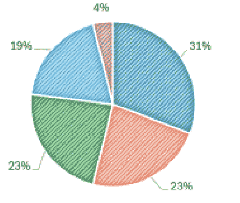
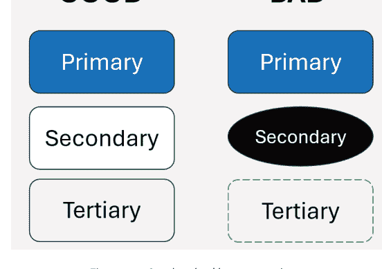
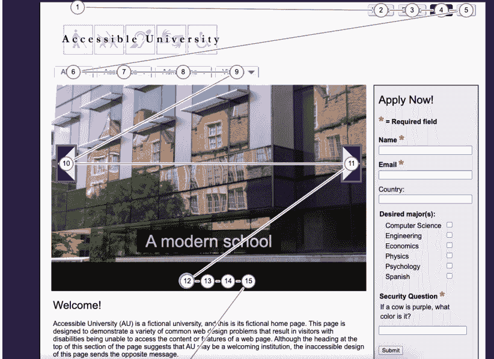

# 第 2 部分

## 为可访问性而设计

在本部分中，你将从基础理论转向实际应用，配备构建可访问数字产品所需的工具和技术。这些章节探讨包容性设计原则如何转化为用户界面设计、内容创作、网页开发和移动体验。

你将学习如何在视觉设计、交互设计、语义 HTML、CSS、ARIA、多媒体内容以及 iOS 和 Android 等移动特定平台上应用可访问性最佳实践。

无论你是在设计色彩、构建 HTML、撰写替代文本，还是为触控和语音输入而构建，本部分展示如何创建对残障人士无缝工作的数字环境——对每个人都更好。

本部分包含以下章节：

- 第 5 章，设计可访问的用户界面：视觉与交互设计
- 第 6 章，创建可访问内容：写作、图像和多媒体
- 第 7 章，开发可访问网站：HTML、CSS 和 ARIA 最佳实践
- 第 8 章，移动可访问性：为触控和语音界面而设计

### 5

#### 设计可访问用户界面：视觉与交互设计

作者 Nandita Gupta

可访问的用户界面是创建对每个人都有效体验的关键，无论其能力或与技术交互的方式如何。在本章中，我们将介绍以可访问性为出发点设计的重点方面，例如有效使用色彩、为认知设计、支持多种输入方式，以及在不同设备和平台上扩展可访问性。目标是帮助你构建不仅可访问，而且对所有用户都直观且引人入胜的界面。

此信息很有价值，因为可访问性对包容性和可用性至关重要。当你深思熟虑地设计时，你会消除障碍，创造更具意义、更灵活的体验，覆盖更广泛的受众。本章为你提供实用的见解和策略，使你的设计真正包容并适应真实用户需求，并涵盖这些策略对残障用户的好处。

在本章中，我们将深入探讨以下主题：

- 在视觉设计中使用色彩
- 考虑到认知障碍进行设计
- 为多种替代输入方式设计
- 扩展设计以改善可访问性

##### 在视觉设计中使用色彩

色彩是视觉设计中的强大元素。它可以唤起情感、引导用户交互并创造难忘的体验。然而，强大的力量伴随着巨大的责任。设计师必须认识到，色彩感知在不同的人、文化和情境中可能存在显著差异。对一组用户来说似乎直观或普遍可理解的东西，对另一组用户来说可能是令人困惑或排他的。

本节将探讨如何以确保所有用户可访问的方式有效使用色彩。我们将深入研究色彩对比度、在信息传递中替代色彩使用图案、形状和图标，以及讨论如何在安全和警告系统中设计文化考量。目标是创建迎合更广泛、更多元受众的设计——其中包括世界卫生组织估计的约 3 亿生活在色彩视觉缺陷中的人。

##### 使用色彩进行时间敏感决策和安全

交通灯提供了色彩如何快速、本能地传达信息的熟悉例子。但对于红绿色盲个体——一种常见的色彩视觉缺陷形式——这些灯光之间的区别可能不清晰，造成潜在的安全风险。这种挑战在制造业等高风险环境中变得更加突出，在那里瞬间决策不仅影响生产力，还影响工人安全。在此类环境中，仅依赖色彩来传达紧迫性、状态或系统状况会引入不必要的风险。

> 公司 RealPars 写了一篇文章，展示了色彩如何在制造系统中产生巨大影响，通过在整个系统中不加区别地使用色彩，不仅造成认知过载，还成为潜在的安全隐患：https://www.realpars.com/blog/high-performance-hmi。

另一个重要考虑是，色彩的含义并非固定；它在不同文化和情境中有所变化。例如，红色在北美和欧洲广泛用于表示危险或“停止”，但在东亚部分地区，它也可以表示庆祝或繁荣。同样，白色在西方文化中可能代表清洁或安全，而在其他文化中则与哀悼和死亡密切相关。这些差异在全球产品中变得至关重要，误解信号可能导致混淆或延误。

相反，将色彩与其他指示器结合使用——如形状、图案、文字标签或听觉信号——以确保信息对所有用户可访问，包括色彩视觉缺陷者。例如，行人交通信号可以通过补充不依赖色彩感知的额外提示来变得更易访问。不要仅依赖色彩，请执行以下操作：

- 使用文字标签，如“停止”和“通行”，直接显示在灯光下方或内部。这有助于色彩视觉缺陷用户，也支持在不熟悉环境中的理解。听觉提示，如语音指令或音调模式，可以进一步增强可访问性。
- 将色彩与形状配对——例如，红色圆形灯表示“停止”，绿色方形灯表示“通行”。这种基于形状的区分即使在色彩难以区分时也能强化含义。
- 加入符号，如红色站立的人形和绿色行走的人形。这些提供直观的视觉参考，尤其对低识字率或语言障碍用户有帮助。

国际标准化组织 International Organization for Standardization 制定国际标准，提供了克服语言障碍并支持跨地区一致解读的一致图形符号集。这些符号将色彩与图案、图标和文字结合，以清晰高效地传达关键信息。通过使用多重冗余提示而非仅依赖色彩，ISO 标准为设计跨不同语言、文化和能力的可访问标识和界面元素提供了实用模型。

> 对某些人可能可访问的解决方案可能对其他人具有触发性。例如，闪烁的红灯配上醒目的警告图标和警报声可以立即吸引注意力并促使快速行动。另一方面，闪烁灯光可能对患有光敏性障碍的用户造成触发。

##### 使用颜色对比确保清晰易读

颜色对比对于确保您的内容对低视力或色盲用户清晰易读且无障碍至关重要。对比度可确保文本在背景上清晰突出，使阅读更轻松。如果没有足够的对比度，用户可能难以区分文本和背景，从而导致挫败感和认知负荷增加。

深灰色或黑色文本配浅色背景（反之亦然）是提高可读性的理想选择，但务必验证对比度是否符合无障碍要求。根据 Web 内容无障碍指南（WCAG）2.1，标准正文文本与其背景的对比度必须至少达到 4.5:1，才能被视为无障碍。对于较大文本（通常是 18 磅常规或 14 磅加粗），最低对比度要求稍低，为 3:1。这些指南有助于确保低视力或色觉缺陷用户能够轻松阅读内容，而不感到费力。

下面是一个示例，展示不同级别的颜色对比度以及它们是否符合 WCAG 指南：

- 1. 差示例 2.67:1（不合格）
- 2. 非常差的示例 1.1:1（不合格）
- 3. 差示例 2.09:1（不合格）
- 4. 好示例 21:1（合格）
- 5. 非常差的示例 1.14:1（不合格）

图5.1：颜色对比度与 WCAG 指南对照

为了支持可读性，设计师必须尽早并经常使用能够测试对比度是否符合无障碍标准的工具来评估颜色组合。WebAIM 的**颜色对比度检查器**等工具让这一过程变得简单：设计师可以输入特定的前景和背景颜色值，并立即获得该组合是否符合 WCAG 要求的反馈。将这类测试融入设计工作流程，可确保内容不仅在理想条件下清晰可读，而且在各种视觉能力和设备设置下也能保持清晰易读。

> **加州州立大学北岭分校（CSUN）** 提供了一篇关于颜色对比好坏的优质文章，以及一张实用的对比表：
> https://www.csun.edu/universal-design-center/web-accessibility-criteria-color-contrast.

##### 在图表中使用颜色

界面和网页中使用的图表和图形是数据驱动设计通过颜色区分类别或突出趋势的另一个例子。然而，仅靠颜色来表示不同数据点是不够的，在颜色之外使用图案或纹理对于感知也很有价值。

例如，在饼图中，每个扇区不仅可以靠颜色区分，还可以通过纯色填充、条纹、圆点或其他图案来区分。即使无法准确感知颜色，这些变化也能帮助用户区分数据集。使用图例时，将每种颜色与清晰的文本标签以及该数据点所代表内容的简要说明配对，可确保无论视觉能力如何，图表都易于理解。此外，所有图表和图形都应包含描述性文本替代内容——可以是标题、摘要或无障碍数据表——以支持依赖屏幕阅读器的用户，以及那些受益于文字背景信息的认知障碍用户。

请看下面的饼图，我们可以看到，图中使用了不同颜色来区分扇区，同时为每个扇区添加了纹理，并用具体数值标注了每个部分：

##### 最喜爱的食物

图5.2：一张使用不同颜色和清晰标签的饼图
（不过为了更好的无障碍性，它还可以进一步改进！）

为了改进它，汉堡和寿司标签使用的颜色非常相似，因此我们可以更改其中一个标签的颜色。我们还可以为每个扇区使用不同的纹理；然而，过多且相互冲突的纹理可能会让用户感到不知所措，因此应谨慎使用。

##### 使用颜色传达错误

在网页设计中，颜色常用于指示错误；例如，填写表单时，绿色表示成功，红色表示失败。然而，有色觉缺陷的用户可能不容易区分这两者，我们不能假设每个人都具有普遍一致的颜色感知。

全球约有 8% 的男性和 0.5% 的女性患有某种形式的色盲，这可能使依赖颜色的信息难以获取。色盲的程度各不相同，有些人难以区分某些色调（如红色和绿色），而有些人则完全无法感知任何颜色（全色盲）。

为确保表单验证流程在视觉设计和颜色方面对用户无障碍，请执行以下操作：

- 在彩色文本旁添加图标，以标示成功或失败。例如，绿色对勾和红色叉号可提供清晰的状态视觉提示，无论用户感知颜色的能力如何。

设计的一致性对于所有用户（包括残障用户）的整体可用性至关重要，可以通过以下指南来实现：

- **可预测模式：** 当模式和行为可预测时，用户能够建立对事物运作方式的熟悉感，从而更轻松地浏览复杂系统或完成任务。
- **布局：** 通过在页面中一致地放置导航元素、按钮和交互组件来保持统一布局，有助于用户快速了解在哪里找到关键功能。这一原则在 WCAG 2.2 中得到强化，该版本引入了跨页面提供一致帮助机制的要求（https://www.w3.org/WAI/WCAG22/Understanding/consistent-help.html）。
- **视觉一致性：** 始终使用相同的图标、按钮和颜色，使用户能够轻松地将操作与其视觉提示关联起来。
- **交互：** 可预测的交互至关重要；遵循常见惯例（例如使用垃圾桶图标表示删除）可以避免混淆，并创造更流畅、更直观的体验。

具体来说，提供类似功能的按钮应保持一致，以提醒用户可点击的元素和行为。下图展示了按钮一致性好与差的示例：

*图5.4：按钮一致性好与差的对比*

一旦这些基础 UX 原则付诸实践，下一步就是确保这些设计模式能在所有用户（包括有无障碍需求的用户）中良好运行。无障碍设计的原则并非一刀切；相反，设计模式应灵活且可调整。以下三个技巧有助于支持无障碍性：

- 许多认知障碍用户依赖键盘快捷键来加快导航。请确保所有交互元素（如按钮、链接和表单）都可以仅通过键盘命令访问，并且焦点顺序合乎逻辑（有关焦点顺序好坏的示例，请参阅本章末尾的*无障碍信息架构*部分）。确保这些键盘快捷键和交互在整个体验中保持一致也很重要。
- 为需要额外信息的复杂交互提供上下文帮助或工具提示。这些内容应易于访问和理解，在引导用户的同时避免信息过载。但请记住，工具提示不应成为糟糕设计的替代品；设计本身应易于理解，而工具提示则以简洁的方式提供额外信息。
- 表单字段、按钮和其他交互元素应始终使用清晰、描述性的标签，让用户一眼就能明白其用途。避免使用“提交”等模糊或通用术语，而应使用具有明确动作指向的语言，例如**提交您的订单**或**保存您的工作**，帮助用户准确了解接下来会发生什么。在适当的情况下，为这些标签补充简短、有用的指导，例如输入示例（**MM/DD/YYYY**）或字段要求（**密码必须至少包含8个字符**），以减少不确定性并防止错误。

##### 渐进式披露与抽象掉不必要的内容

构建渐进式披露和抽象化的关键不在于你向用户界面添加了什么，而在于你暂缓呈现了什么。在交互的每一步中，只呈现必要的信息，避免用户需要记住前几步的细节。这就像烹饪一道复杂的菜肴：先是一长串食材清单，接着是一份混乱无序的说明。虽然提供所有必要信息（如食材、步骤和所需材料）很重要，但以合理的逻辑顺序呈现这些信息可以简化烹饪过程。

同样，对于用户界面，保持任务简单并将复杂流程分解为更小、更易管理的步骤，可以减轻认知负荷。以下是一些在用户界面中构建渐进式披露的可行方法：

-   对于需要更多思考或操作的任务（例如表单提交），请将其分解为更小的步骤。这有助于用户保持专注，并避免因一系列冗长操作而感到不知所措。
-   避免用过多的选择、过多的文字或过多的视觉杂乱让用户应接不暇。选择干净、组织良好的布局，并使用清晰的标题和标签。
-   让用户了解他们在界面/任务中已进展到何处。例如，如果用户正在填写一个长表单，显示进度条或步骤指示器可以帮助他们直观地看到自己在流程中的位置，从而让整个任务不再那么令人望而生畏。在创建进度条时，应结合使用颜色和清晰的文本（例如数字百分比），并确保屏幕阅读器等辅助技术能正确播报进度。

需要特别注意的是，除了支持认知障碍用户外，上述技术还能惠及更大比例的用户，包括具有交叉身份和残疾的人群。在用户体验中抽象信息并建立清晰度，能够支持从听觉到视觉等各种各样的处理风格，从而惠及更广泛的用户群体。

##### 轻松撤销操作

让用户感到自己掌控一切，并且不会因犯错而受到惩罚，这一点非常重要。这对于认知障碍用户尤为关键，因为他们可能需要更多时间完成任务，并且更频繁地犯错。这也与施奈德曼八大黄金法则中的另一条相符：“支持内在控制点，并允许轻松撤销操作。”当用户知道可以毫无后果地撤销或修改操作时，这会减少焦虑、鼓励探索，并让数字环境感觉更安全、更具支持性。

例如，在每个页面上提供“返回”或“取消”选项，可以让用户纠正错误而不用担心造成永久性问题。这在涉及数据敏感和关键决策时尤为重要，例如删除重要信息时，应提示用户确认，并确保继续操作的后果清晰明确。

另一个例子是在签署关键任务时，例如授权更改银行账户或在线完成大额转账。在这种情况下，提供一种简便的方式来审查和撤销操作，并配有清晰的“取消”或“编辑”选项，不仅能减少所有用户的焦虑和错误，对于可能需要额外时间或多次尝试才能确认选择的认知障碍用户尤其重要。

##### 语音命令实现免提交互

语音命令对于行动不便的用户或偏好基于语音导航的用户来说，已成为一种越来越重要的交互方式。为语音命令进行设计，既需要支持基本导航（例如打开菜单和选择选项），也需要支持更复杂的任务（例如填写表单和控制多媒体内容）。

在语音命令中，当用户可能使用诸如 Dragon 之类的辅助技术或诸如听写之类的内置操作系统功能时，需要考虑多个因素。构建针对基于语音的交互和无障碍性进行优化的界面非常重要，应将语音导航集成到所有关键用户旅程和交互中，以提供完全包容的体验。

为了有效做到这一点，设计人员应牢记以下注意事项：

-   **清晰且一致的语音命令：**
    -   定义一组自然、简单的命令，让用户能够轻松学习和使用
    -   确保语音命令在整个界面中保持一致且直观
    -   使命令结构与类似产品或平台中使用的常见模式保持一致
    -   对关键操作使用熟悉的短语（例如“打开菜单”、“返回首页”或“朗读”）
    -   允许措辞上的细微变化（例如“返回首页”、“回到主页”或仅说“首页”），以适应不同的用户偏好和说话风格
-   **反馈与确认：**
    -   尽可能将基于语音的反馈与视觉或触觉提示相结合
    -   在命令执行后提供视觉确认——例如高亮按钮或更改其状态
    -   通过多感官反馈强化交互，帮助用户验证操作是否成功
    -   使用确认提示让语音交互更易访问、更可预测、更令人安心

一个真实案例是使用 Amazon Alexa（https://www.alexa.com/），它支持在各种设备上进行语音控制导航，从智能家居系统到流媒体设备。通过提供清晰、简单的命令（如“播放音乐”或“停止”），用户可以轻松地免提控制设备。此外，通过屏幕通知或设备反馈（例如“音乐正在播放”）提供的视觉反馈可确保清晰度。还可以设置个性化语音命令来控制设备，从而无需键盘或按钮点击。

##### 手势控制增强无触摸交互的导航

手势控制已成为行动能力或灵活性有限的用户的一种强大输入方式。通过使用摄像头、传感器或触摸屏，手势识别允许用户通过滑动、捏合或简单的手部动作等手势与界面交互。为手势控制进行设计时，需要确保手势直观、一致，并提供反馈以引导用户完成任务：

-   保持手势简单、熟悉且易于学习非常重要，以免造成认知过载。复杂或非标准的手势可能会让行动障碍用户感到沮丧；因此，应坚持使用常见手势，如左右滑动、捏合缩放或长按激活。
-   界面和系统还必须在识别到手势时提供视觉或触觉反馈。例如，滑动手势可能会更改屏幕内容或触发页面过渡，而清晰的动画应确认手势已成功执行。
-   在许多情况下，添加个性化设置很有价值，因为某些用户可能会觉得某些手势在身体上难以执行或不舒服。允许用户自定义手势映射，或将手势替换为替代输入（如屏幕按钮或语音命令），可确保界面适应用户的需求，而不是强制采用一刀切的解决方案。

一个真实案例是集成 Cephable（https://cephable.com/），该服务允许用户使用现有输入启用基于语音和手势的交互。用户可以用简单的手势控制设备，例如举手暂停会议或滑动切换频道。通过将直观的手势与清晰的视觉反馈（如屏幕动画或颜色变化）相结合，这为灵活性有限的用户提供了无障碍体验。

##### 辅助技术，包括支持开关、眼动追踪等

自适应开关、眼动追踪设备和吸气吹气系统等辅助技术对于严重运动障碍的用户至关重要。当传统输入方式不可行时，这些技术提供了一种与数字系统交互的手段。

确保您的平台与这些设备兼容，允许用户有效地浏览您的网站或应用，这一点至关重要。除了前面关于语音控制和非手势的信息外，还必须允许用户将操作映射到特定的开关输入或眼球运动。例如，手部活动受限的用户可能使用开关来执行鼠标点击或键盘按键操作。所有交互元素都必须可触及，并且可以通过辅助设备激活，包括逻辑的 Tab 键顺序。设计必须确保焦点指示器可见且易于导航，并允许通过单个或多个输入触发操作。

Apple 的“切换控制”是一个系统，允许用户通过各种外部开关来控制 iPhone、iPad 或 Mac（https://support.apple.com/en-us/118667）。用户可以通过按下映射到特定操作的开关来选择并交互屏幕上的项目。这使得严重行动障碍的用户能够有效地使用 Apple 产品。

为多模态输入（如语音、手势、键盘和辅助设备）进行设计，对于创造无障碍体验至关重要。然而，仅仅在个别情况下应用这些技术是不够的。要真正支持多样化的用户群体，关键在于能够在规模化层面部署和维护所有这些技术，这正是我们接下来要讨论的内容。

##### 大规模设计以改善无障碍性

在规模化层面进行无障碍设计，需要创建一个灵活且包容的设计系统，使其能够满足广泛用户需求和设备。这种方法可确保您的平台在增长过程中始终保持可用和可访问。一个设计良好的系统超越了视觉元素，考虑了可用性、认知清晰度以及所有交互之间的一致性。它包含可重用组件、字体可读性、用户自定义和键盘导航等元素，确保平台对所有人（无论能力如何）都可用。

##### 构建模块化、可访问的设计系统

可扩展的设计系统对于可访问性至关重要。它涉及创建可重用组件（例如，按钮、表单和模态框），并对其进行彻底的可访问性测试。这些组件应足够灵活，能够组装成更复杂的设计而不牺牲可访问性，并且这为可访问平台奠定了可持续的基础。

实现规模的一种方法是使用遵循可访问性标准的可重用组件，例如最小对比度比率和与屏幕阅读器的兼容性，以及如何实现这些组件的指南。设计系统还必须提供有关如何实现这些组件的清晰文档，包括如何添加替代文本、为屏幕阅读器构建内容结构，以及遵守针对运动障碍的触控目标尺寸。

这些要素确保随着平台的演进，新功能将以同样的简洁性、一致性和认知支持为重点进行集成。这适用于符合可访问性标准的组件（例如，适当的对比度和屏幕阅读器标签）并在整个平台中一致重用的组件，例如按钮，以及为整个平台设置交互和导航模式。

##### 应在规模上保持可访问的元素

关键的 UX 元素，如可读性、清晰的语言和用户友好的导航构成了可访问设计的骨干。这些元素支持规模的方式是确保更改仅在设计系统和 UI 工具包中进行一次。因此，使用这些元素的每个设计师或开发人员都会自动将可访问性融入其设计中。

以下是一些元素的关键设计考虑因素：

- **字体可读性：** 优先使用大而清晰的字体并具有足够的对比度，以增强跨设备和用户条件下的可读性。避免装饰性或过于花哨的字体，因为它们会妨碍可读性。相反，选择简单、干净的无衬线字体——例如 Arial 或 Helvetica——它们缩放良好，并在各种屏幕尺寸和分辨率上保持清晰。
- **颜色使用：** 为了确保在规模上实现清晰度和包容性，始终用额外的视觉线索补充颜色，例如图标、图案、下划线或文本标签。
- **引导式焦点：** 使用一致的视觉线索——例如，围绕活动元素（如按钮或输入字段）清晰可见的焦点环——帮助用户在导航时保持方向。遵循 WCAG AAA 建议，此焦点指示器应具有高对比度且持久，确保其在所有页面和组件中保持可见。
- **清晰的语言：** 使用简单、直接的措辞，避免可能让用户困惑的术语，尤其是认知障碍的用户。建立清晰的语言指南，解决语气和可读性水平，以确保内容在整个平台中保持一致且易于理解。
- **基于时间的交互：** 为用户——尤其是认知障碍的用户——提供调整或禁用任务或交互上的时间限制的选项，使他们能够按自己的节奏处理信息。为了在规模上支持可访问性，在平台所有相关区域中一致地实施这些控件，确保用户无论上下文如何都能获得可预测且包容的体验。

##### 通过用户自定义赋能个性化

允许用户自定义其界面可以显著改善可访问性。模块化设计系统为个性化体验奠定了基础，用户可以在其中调整平台以满足其独特需求，例如更改字体大小、颜色或布局。个性化的关键在于构建响应式和动态的用户界面，让用户能够控制字体大小和颜色对比度以满足其偏好或需求。

灵活的设计必须在不同设备上运行，从台式机到手机。它应支持缩放和文本调整大小，而不会丢失功能或破坏界面。跨操作系统的 consistency 在构建包容性体验中发挥着重要作用。这包括清晰、一致的导航，可在不同设备和缩放级别下使用。这一概念与 WCAG 2.2 成功标准 1.4.10：重排（AA 级）相关，该标准指的是网页或应用程序上的内容能够动态适应的能力，调整布局、文本大小和定位，以便用户无需水平滚动或过度缩放即可查看和交互，即使在显示尺寸发生变化时（如在移动设备上或放大时）。

布局是一个至关重要的考虑因素。设计系统应允许客户重新排列各部分，并确保内容能够无缝适应各种屏幕尺寸和方向。现实世界的例子是 Webex，它允许用户在会议体验中自定义其布局，以便能够置顶手语翻译者、更改舞台视图、隐藏无视频的与会者等等。这使用户能够自定义会议体验以实现包容性体验（https://blog.webex.com/collaboration/fostering-inclusive-and-accessible-communication-with-webex-suite/）。

个性化还扩展到语言和本地化。在全球范围内扩展时，支持语言自定义和本地化至关重要，这可能会影响布局、内容结构和焦点行为。某些语言（例如阿拉伯语）从右到左阅读，因此布局必须相应调整。其他语言，如德语，可能由于单词长度更长而需要更多空间。此外，在本地化内容时保持清晰度和一致性也很重要，尤其是对于认知障碍的用户。

##### 可访问性的信息架构

在考虑信息架构时，请考虑多模式输入，包括键盘友好的导航系统。对于有运动障碍的用户或更喜欢键盘导航的用户，使用 Tab 和方向键，确保所有交互元素都可以通过键盘访问。这包括修复选项卡顺序和视觉焦点指示器，为使用键盘和其他输入设备的用户提供无缝体验。

将选项卡顺序组织为逻辑流很有价值，从上到下或从左到右。页面上的所有活动元素都应清晰突出（例如按钮和表单字段），以便用户可以轻松跟踪其焦点，并在适当时包含键盘快捷键，确保它们得到充分记录并且可自定义。

查看下图，虽然视觉阅读者可能能够辨别按钮和信息的层次结构，自然地将注意力转移到“立即申请！”部分，但选项卡焦点顺序会为仅使用键盘或依赖屏幕阅读器的人创造混乱的体验：

Figure 5.5: An example of bad tab focus order

然而，在下图中，选项卡焦点顺序已得到修复，以创建更自然、更易于遵循的模式：

Figure 5.6: An example of good tab focus order

#### 总结

在本章中，我们通过关注关键的视觉和交互原则，学习了如何设计可访问的用户界面。涵盖的主题包括在视觉设计中深思熟虑地使用颜色以确保清晰度和包容性，为认知差异设计以减少障碍，支持多种替代输入方法以满足多样化用户，以及在各种设备和平台上扩展可访问性的方法。这些见解为创建对广泛人群既可用又可访问的界面提供了坚实的基础。

此信息很有价值，因为可访问性是负责任和包容性设计的关键部分。通过了解如何应用这些原则，您可以构建赋能各种能力用户的产品，减少挫败感并改善整体用户体验。以可访问性为出发点进行设计不仅符合法律和道德标准，还能扩大数字解决方案的覆盖面和影响，并影响收入和采用。

在下一章中，您将学习如何创建可访问的内容，特别关注书面内容、图像和多媒体。

