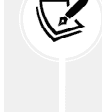
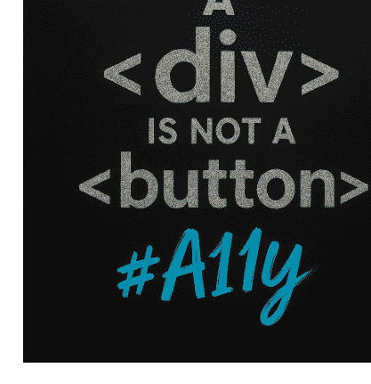
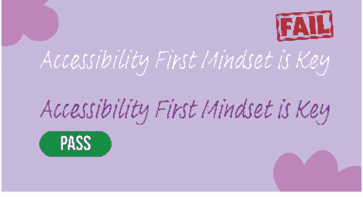
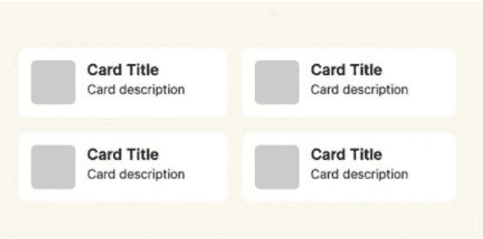
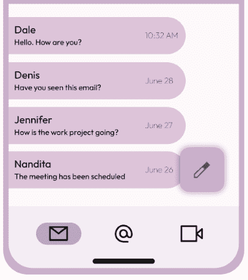

### 6. 创建无障碍内容：写作、图像和多媒体

By Jennifer Chadwick

人们常说内容为王，这确实如此。各种形式的内容被用来讲述故事、提供信息或销售产品。信息必须清晰传达才有意义、被理解并付诸行动。作为一名作者，你正在创造信息。

在本章中，我们将介绍如何创建无障碍内容，使其能够触达尽可能广泛的受众——其中包括残疾人士。我们将探讨文本、图像和多媒体这三种内容类型，以及哪种格式最适合人们的需求。我们将讨论在撰写信息、标签和说明时使用简明语言的重要性。我将为你提供指导原则，帮助你的写作风格对所有人保持包容。

在章节末尾，我将分享一个需求演练练习，你可以作为作者来测试你的内容是否符合残疾人士的关键使用场景。为此，请考虑召集你的用户体验 UX 和视觉用户界面 UI 设计师一起走查原型。

本章涵盖以下主要主题：

- “媒介即信息”
- 审查构建包容性内容方法中的关键行动
- 使不同类型的内容更易访问
- 进行需求演练练习

#### 审查构建包容性方法的关键行动

让我们看看一些充实且可操作的构建包容性写作实践的方法。

这里我们将先看一些更通用的想法，然后稍后我们将查看内容特定的方法。

##### 熟悉用户需求

要创建对残疾人士无障碍的内容，你需要熟悉他们体验内容的方式。W3C 网络无障碍倡议 WAI 网站上有一个名为多元能力与障碍 Diverse Abilities and Barriers 的页面 www.w3.org/WAI/people-use-web/abilities-barriers。

这是一个了解不同残疾相关个人需求和偏好的优秀资源。它提供了人们在工作、学习和购物时引人入胜的用户故事。

它概述了五种残疾类型的数字内容和设计障碍：

- 听觉 e.g., 听力丧失、聋盲、听力障碍等。
- 认知和学习 e.g., 自闭症、多动症、记忆丧失、学习障碍等。
- 身体 e.g., 活动能力问题、四肢瘫痪、截肢、癫痫等。
- 语言 e.g., 口吃、失语、构音障碍 不一致的发音和声音 等。
- 视觉 e.g., 盲、视力受限或低视力、聋盲、色觉缺陷等。

##### 牢记多种用户体验

内容和用户界面设计师必须记住，他们不是最终用户。你的个人需求、感知和能力可能与产品或服务的广泛多样用户不同。

如果主要以自己为中心进行设计，尤其是在你没有残疾的情况下，必然会使几个人无法体验它。相反，从世界万维网联盟 W3C 发布的 WAI 资源开始。它们实用、有效，并直接映射到网络内容无障碍指南 WCAG，该标准被用作全球无障碍法律、法案和法规的基础。

##### 尽可能向真实用户学习

最好的学习方式来自真实的人和他们的亲身经历。邀请残疾人士与你合作并共同设计项目。继续通过访谈、调查、原型演练和小组讨论收集终端用户体验。这种做法令人兴奋、有效且对所有人都有益。你将通过观察并询问人们如何做事以及他们如何使用辅助技术和适应策略来完成任务，从而验证你的新知识。直接向人们学习也有助于你避免对“所有盲人用户”或“所有 ADHD 用户”做出假设。

如果预算或时间限制不允许咨询有亲身经历的人，请使用 W3C 的五种残疾类型列表创建一个清单，并为每种类型创建 1-2 个用户场景或任务。

然后，走查与你的内容样本或设计原型交互的体验。用户是否能够在没有困惑或困难的情况下完成任务或体验内容或设计？如果不能，请记下改进体验或消除障碍的事项。

##### 用简明语言撰写所有内容

国际简明语言联合会 International Plain Language Federation 表示，“如果其措辞、结构和设计清晰到足以让目标读者轻松找到所需信息、理解找到的信息并使用该信息，则沟通即为简明语言” https://www.iplfederation.org/plain-language/。无论你的主题复杂与否 医学术语、技术说明或法律术语 或简单 信息在博客文章中。简明语言写作支持所有层级的阅读理解，以触达最广泛的受众。

Nielsen Norman Group，一家领先的用户体验研究和设计专业公司，于 2017 年对科学、技术和医学领域的领域专家进行了可用性研究。提出的问题：简明语言是否会使高度技术性或学术性内容变得肤浅？研究发现，“即使是受过高等教育的在线读者也渴望简洁、易于扫描的信息” https://www.nngroup.com/articles/plain-language-experts/。

英国政府也进行的研究发现，80% 的人更喜欢以简明语言阅读内容。Mark Morris 是英国政府卫生部清晰英语主管，也是卫生大臣的前演讲撰稿人。在 2014 年的一篇博客中，他创造了一句话，体现了内容作者在拥抱简明语言写作方面的演变。“清晰为王。”

1994 年，微软联合创始人比尔·盖茨看到了在线内容创作在万维网上触达广泛受众的力量。他说，“内容为王。”现在，清晰才是最重要的。

但你不必是复杂医学期刊的作者、卫生部演讲撰稿人，甚至是比尔·盖茨才知道简明语言对所有用户都有用。

稍后在本章中，在名为 Text 的部分，我们将介绍撰写段落、标签和说明的具体简明语言技巧。

##### 熟悉障碍和替代方案

你现在已经了解了残疾需求，并准备应用简明语言原则。但让我们面对现实，某些数字内容媒体 格式 本身对具有不同残疾和需求的人来说并不固有无障碍。例如，你可能选择以视频形式呈现新闻故事，但一些视力障碍人士无法轻松感知屏幕，或根本无法感知。

这是否意味着你不能再使用视频来传达信息，因为有些人无法体验它？当然不是。使用视频格式，但确保它配有媒体替代方案，例如文字记录。文字记录呈现标题、人物描述、口语对话、屏幕上的声音和动作。这就是相同的信息，只是以不同的方式访问。

在本节中，我们了解到，如果你选择使用一种你知道固有地对某些用户无效的内容格式，你必须将其与一种能够触达其余受众的替代格式结合起来。接下来，我们将深入研究每种内容类型以及哪种替代方案最适合残疾用户。

#### 使不同类型的内容更易访问

WCAG 标准围绕四个原则构建，以支持满足终端用户的需求。前三个是：

1. **感知：** “我可以访问内容，识别它是什么、它意味着什么以及该如何使用——没有任何障碍。”
2. **理解：** “我理解内容的用途，其信息或说明足够清晰以便采取行动。”
3. **可操作性：** “我可以根据内容中提供的标签或说明完成操作。”


对于好奇的人来说，第四个原则是**健壮性**：“这个网站或应用程序可以被各种各样的用户代理所解释，包括人们使用的辅助技术，如屏幕阅读器、键盘、开关控制、语音命令等。”但是，这主要与编码和实现有关，我们在此不予考虑。

在接下来的章节中，我们将研究不同类型的内容，并看看如何让它们更易于访问。

##### 文本

文本是一种通用的内容媒介，通常也是最易于访问的。有视觉障碍、学习困难、记忆丧失和/或注意力缺陷障碍的用户使用屏幕阅读器软件来朗读页面上的内容。文本可以被屏幕阅读器（如 JAWS、NVDA、VoiceOver 和 Narrator）以及软件内置的其他阅读工具无障碍地解析。当 PDF 被正确保存时，其中的文本也可以被同样的工具解析。

文本起着告知、指导和识别的作用。文本属于“感知”原则，因为用户可以通过视觉或使用屏幕阅读器软件来访问和感知文本。

在接下来的章节中，我们将探讨如何通过“可扫读性”让文本更易于访问，以及提供简明语言的更多原则。

##### 让页面易于扫读

2008 年，尼尔森诺曼集团（NN/g）在网络上进行了一项眼动追踪用户研究（https://www.nngroup.com/articles/how-little-do-users-read/）。他们发现，在平均网页上，用户在平均访问期间最多只能阅读 28% 的字词；更有可能的是 20%。

在 2010 年针对移动设备的另一项 NN/g 研究（https://nngroup.com/articles/mobile-content-is-twice-as-difficult-2011）中，阿尔伯塔大学的研究人员发现，当内容在手机大小的屏幕上呈现时，与较大的电脑屏幕相比，阅读理解会受到影响。对这个结果的一个简单解释是，在小屏幕上，用户在任意时刻看到的文本更少，因此他们必须更多地依赖记忆来获取阅读时所需的上下文信息。换句话说，较小的屏幕导致了更高的工作记忆负荷。人们无法维持这种更高的负荷，因此他们的理解能力受到了影响。

因此，你可以通过提供准确而简洁的内容来优化每个人的体验。为了帮助你的内容更易于扫读，特别是对于有认知需求、学习障碍或低视力的人群，请考虑以下关于文本格式的建议。

##### 标题

标题的目的是介绍其下方相关内容。

对于你的网页，创建一个带有标题的嵌套结构，用标题介绍每个内容区域。定义主标题主题，然后在下方使用与你的要点相关的“嵌套”子标题。前端开发人员将使用 HTML 标题标签来创建你的嵌套结构。

例如，你的主要标题将是 1 级标题。然后，文档或页面可以包含多个 2 级子标题，在每个 2 级子标题下还可以有 3 级子标题，依此类推。

将内容划分为定义清晰的部分，可以使其更容易扫读。

屏幕阅读器用户可以通过按快捷键跳转到内容（标题、链接、图形、表格等）。在这种情况下，按 *H* 键会朗读每个标题。


> 记住不要过度使用标题。有视觉障碍或学习困难的用户可能会使用文本转语音软件（如屏幕阅读器）来解析屏幕上的内容并了解页面结构。过度使用标题可能导致混乱，因此请确保只在相关时使用标题。

##### 段落

在编写段落内容时，使用清晰、简洁的语言非常重要。此外，考虑将段落长度控制在四到五句话。

将文本分成短段落称为分块。这使得用户更容易扫读文本，无论是眼睛在页面上向下移动，还是使用屏幕阅读器时，语音输出会在每个段落后停顿。它避免了可怕的“文字墙”，这种文字墙可能会让人不知所措。它减少了眼睛疲劳和认知过载。它改善了认知障碍、记忆障碍或多任务处理人群的语言处理能力。


避免使用全大写。对于视觉用户来说，使用全大写字母的文本看起来像是在喊叫。屏幕阅读器不会识别这种文本强调，因此对非视觉用户来说，这种效果无论如何都会丢失。此外，全大写文本减少了单词的独特形状，使阅读障碍者更难快速识别和处理它们。

##### 项目符号列表和编号列表

项目符号列表和编号列表通过使内容更易于阅读和导航来提高可访问性，特别是对于使用屏幕阅读器的人（因为它会宣布内容是一个列表）、认知障碍患者以及受益于结构化信息的人。

使用列表有助于将复杂的想法分解为易于理解的点——但是，当项目不需要按特定顺序排列时，使用项目符号列表；当提供序列（如说明）时，使用编号列表。

##### 导航菜单和按钮标签

导航菜单通常是一组结构化的链接。因此，你的链接文本应清晰描述目标页面，例如“我们是谁”、“我们的服务”或“[产品]如何运作”。不过，有时导航菜单也会使用按钮。

保持这些菜单链接和按钮标签清晰简洁。这对于所有用户理解网站、移动应用或文档的结构至关重要。

模糊或过于复杂的标签可能会让所有用户感到困惑，尤其是认知障碍患者和依赖屏幕阅读器输出的非视觉用户。按钮上的标签和链接文本应立即告诉用户控件的作用、它们如何运作以及预期结果。

为帮助用户，请使用简明语言的描述性标签，避免行话。例如，虽然“Get in Touch”很常见，但请改用“Contact Us”。这将优化理解，并让用户对链接或按钮将带他们去往何处毫不怀疑。

##### 导航地标和菜单链接

理想情况下，页面通过地标（或区域）来定义其结构。地标包括页眉、页脚、主体和导航区，你的导航菜单就位于其中。

开发人员实现代码，以便屏幕阅读器宣布地标类型。但是，如果页面上有两个导航菜单，你的职责是编写简短描述以区分它们。例如，“全局导航菜单”和“北美服务菜单”。

##### 链接

你可能会在段落的句子中使用链接。这为用户提供了一种快速访问另一个页面并了解更多信息的方式。在这种情况下，不要在句子中使用“Click here”或“Learn more”等短语作为链接文本。

首先，并非所有用户都用鼠标点击。而且，屏幕阅读器用户可能会使用快捷键功能，提取网页上所有链接的列表。这会让他们脱离句子的上下文，因此如果你在页面上到处使用“Learn more”等通用术语，用户只会听到一长串“Learn more”链接，无法区分它们。相反，应使用描述句子或段落主题的词语创建超链接。例如，对于句子“Learn more about our accessibility features”，将“accessibility features”设置为超链接，或将整个句子设为链接。

##### 按钮和交互式控件的标签

按钮（或任何交互式控件）上模糊或过于复杂的标签可能会让所有用户感到困惑，尤其是认知障碍患者和依赖屏幕阅读器输出的非视觉用户。标签应立即告诉用户控件的作用、它们如何运作以及预期结果。

根据关于链接的指导，如果可能，请避免在按钮标签中使用“Click here”或“Learn more”。如果非用不可，你必须为开发人员提供一段扩展但简洁的屏幕阅读器描述——例如，使用 `aria-label` 的“Learn more about the Tier One Dental Plan”。或者使用 `aria-labelledby`，它使用屏幕上的现有内容，例如标题。

##### 表单字段标签和说明

在创建表单时，你要确保表单本身有描述，且表单字段标签和说明尽可能易于访问。以下是一些创建标签的最佳实践：

- 表单本身应有一个名称或描述，即“2025 Cast Audition Form.”。开发人员将使用 `aria-label` 或 `aria-labelledby` 将这一点纳入屏幕阅读器。
- 表单字段标签应简洁、具体，并放置在输入字段附近。
- 使用区块和标题来逻辑地组织信息。作为撰写者，你可以与 UX/UI 设计师合作确定结构。
- 使用星号（*）清晰标示必填字段，并确保开发人员使用 `aria-required` 编写表单字段代码，以便屏幕阅读器用户听到“必填”一词。反之，如果大多数表单字段都是必填的，那么过多的星号可能会……

令人不知所措。在这种情况下，写一条说明：“除非标记为可选，否则所有字段均为必填。”

+   - 在相关字段旁边显示清晰、具体的错误消息。准确描述用户需要修正和操作的内容，以便其能继续填写表单。
+   - 理想情况下，将预期的输入格式放在标签中（例如，日期用 MM/DD/YYYY）。屏幕阅读器会同时播报标签和格式说明。这有助于低视力用户使用屏幕放大功能——他们可以一眼看到全部内容。
+   - 输入格式（MM/DD/YYYY）也可以作为字段下方的帮助文本放置，并通过 `aria-describedby` 告知屏幕阅读器用户。
+   - 不要把重要的说明放在占位符文本中。确保说明和格式提示（例如，MM/DD/YYYY）是标签的一部分。

以下是关于说明文本的一些最佳实践：

+   - 使用简单、熟悉的语言，避免行话和复杂的措辞
+   - 说明应使用主动语态，清晰地指示要采取的操作，并按照需要执行的顺序排列
+   - 确保必要的用户信息放在表单开始之前，例如：“您必须年满18岁才能申请此信用卡”

##### 在标题下对相关的表单输入进行分组

在视觉和程序上对主题相关的字段进行分组，例如将姓名字段与地址字段区分开。这有助于将长表单拆分为更易于理解的区块。

##### 数据表格

使用数据表格时，请考虑以下最佳实践：

+   - 确保表格用于表格数据，而不仅仅是用于构建页面布局。
+   - 提供列标题和行标题，以保证清晰性。
+   - 避免合并或拆分单元格，这可能会让屏幕阅读器感到困惑。
+   - 提供 CSV 或 Excel 下载作为替代访问方式。
+   - 为表格中的任何说明性图片或 SVG 文件提供替代文本，以便屏幕阅读器读取。如果图片或 SVG 仅用于装饰，并非数据所必需，则不应包含替代文本。`alt` 属性保持为空，中间没有空格，即 `alt=""`。
+   - 为按钮、开关、菜单、列表和信息图标等交互控件使用标签，就像在表格之外使用这些项目时一样。

还有一些代码和视觉设计实践虽然不由你负责，但可以支持你在数据表格中的内容。在与开发人员和设计师合作时，提醒他们执行以下操作：

+   - 对表格进行编码，确保表格可通过键盘导航，并与屏幕阅读器兼容
+   - 创建带有交替行颜色的视觉风格，以提高可读性

这些最佳实践有助于视障用户，因为屏幕阅读器软件在解析表格时，每当用户移动到每个新列的行中的单元格时，都会播报列标题。这确保用户不会迷失方向，数据关系也保持完整。

一些低视力用户使用放大软件将屏幕放大至 800%。一个包含所有信息的简洁表格很好。他们不必在页面上四处移动来查找信息。有学习困难的用户有时比阅读文本段落更容易理解表格中的关系。

> 如前所述，一些最佳实践与表格本身的设计和编码有关，这由视觉 UI 设计师和开发人员负责。然而，作为内容作者，你很可能要选择格式（在这种情况下是表格）。因此，熟悉最佳实践以及视觉呈现、样式和代码实现如何影响某些残疾用户是很重要的。

##### 文本的平实语言原则

到目前为止，我们已经讨论了页面上文本的格式，以便更容易浏览。现在让我们讨论如何撰写文本本身并传达信息。

##### 在句子开头先交代主语

自新闻业早期以来，新闻报道的第一句话就应回答核心的 5W——谁、什么、何时、何地、为何。先介绍你的主语和主题，然后在句末阐明你的观点。这样，语境从一开始就清晰明了。

##### 保持简洁

史蒂夫·克鲁格在其 2001 年出版的《别让我思考》一书中，强调了在写作以及说明和标签中使用清晰、简单语言的重要性。这样，用户就不必思考——不必耗费脑力去解读你的标签或内容的含义。

他的另一个关键指导是“把每页上的文字删掉一半，然后再把剩下的删掉一半。”结合切中要点的句子写作、平实语言和简洁性，你可以用尽可能少的词表达你想说的一切。

##### 使用主动语态

写作时使用主动动词而不是被动动词：

+   - 被动动词是指句子的主语被施加了某种动作。例如：“自10年前成立以来，B公司一直资助多家儿童慈善机构。”
+   - 主动动词是指句子的主语做出了某个动作。例如：“B公司资助多家慈善机构。它10多年前就开始提供支持，并持续帮助有需要的儿童。”

如你所见，主动语态对读者来说更清晰、更具吸引力，也更能自信地表达主题。

##### 使用简单的词语

根据2023年的一项调查，51%的加拿大人阅读水平达到3级或以上——即一般读写能力。

然而，19%的加拿大人得分在1级或以下（https://decoda.ca/insights-from-canadas-adult-literacy-survey/#:~:text=Key%20Findings%20from%20the%202023%20Canadian%20Survey&text=Literacy%3A%2051%25%20of%20Canadians%20are,at%20Level%201%20or%20below）。

在美国，约54%的成年人阅读水平在六年级或以下（https://en.wikipedia.org/wiki/Literacy_in_the_United_States）。

在英国，平均阅读水平通常被认为约为五年级，相当于英国教育体系中9岁的儿童（https://pmc.ncbi.nlm.nih.gov/articles/PMC11480634/#:~:text=Readability%20matters%20because%20it%20is,%E2%80%90old%20children%20%5B14%5D）。

基于这些统计数据，不要使用复杂的词语，如果简单的词语可以表达同样的意思。在你的语言中使用最简单的术语，你的内容就能覆盖最广泛的受众。

##### 使用可读性工具

在写作时，你可以使用诸如 Hemingway App（https://hemingwayapp.com）之类的在线工具。它会根据学术年级水平对你的文本进行可读性扫描。目标是达到六年级阅读理解水平或更低（基于北美学校教育体系）。或者，

Grammarly（https://www.grammarly.com/）是一个广为人知的基于AI的工具，它可以插入 MS Word 等其他软件程序中，扫描并提供语法纠正和平实语言的建议。

##### 文本的格式组合

记住要组合使用内容格式，以保持不同需求用户的可访问性。例如，如果你使用数据表格，请在平实语言的段落中提供相同的信息，解释数据之间的关系——用两种方式消化相同的内容。

> 在继续阅读本章其余部分时，你会看到文本如何与图片、视频和音频相结合。

让我们提醒自己马歇尔·麦克卢汉说过的话，来结束关于文本的讨论：“媒介即信息。”让你的文本所传达的信息平实而简单。这样，它就能被感知、理解和操作。

##### 图片

让我们看看设计师可能会使用、并且你可能与其合作的不同类型的图片。一些图片类型既包含文字，也包含图形来传达含义。

但首先，了解为什么、何时以及如何为图片和图标等视觉内容使用文本替代方案是很重要的。

##### 图片的类型

说到图片，我们可以将其分为四种类型：

+   - 装饰性图片仅用于纯粹的审美功能，不添加有意义的内容，例如网站上的花卉背景图案。这些图片不需要替代文本。开发人员会保留 `alt` 属性，但它必须为空且没有空格，像这样（`alt=""`）。这意味着屏幕阅读器会忽略它们，避免对视障用户造成不必要的干扰。


- **信息性图片**是指在其内部传达有意义的内容或信息的图片。常见的例子是食谱网站上的分步照片或插图，展示如何从零开始制作蛋糕。这些图片的目的是以视觉形式传达信息。它们需要替代文本来为视障用户描述图片。虽然页面或屏幕上可能有与图片相关的文本，但仍应使用 alt 文本来准确描述图片中具体的内容。此外，alt 文本不应简单重复周围上下文中已说明相同内容的文本。
- **功能性图片**是用于发起操作而非传达信息的图片。它们用于按钮、链接、图标和其他交互元素。因此，alt 文本应描述其功能，而非图片本身——例如，打印按钮仅使用打印图标在视觉上传达其用途。其 alt 文本应为“Print”而非“Printer”。同样，搜索图标是按钮的功能性图片，标签应为“Search”而非“Magnifying glass”。
- **复杂图片**是提供大量详细且有时相互关联的信息或数据点的信息性图片。这些绝非仅仅是装饰性的。数据通常以饼图、条形图、图表或信息图等高度视觉化的格式显示。其中可能混杂着文本、彩色编码的线条、符号和形状。在这种情况下，信息以非线性方式呈现，这使得屏幕阅读器难以导航并以有意义的顺序向视障用户传达信息。

让我们更仔细地看看 alt 文本，以及它为什么重要。我们还将探讨为什么应避免在图片中使用文本。

##### 利用 alt 文本

与设计师合作时，你可能会选择图片、照片或插图来配合你的文章。但如果你使用它们，作为内容创作者，你的职责就是将它们的主题、目的和情感转化为一种方式，以支持盲人、视力受限和/或有认知需求的人，他们可能使用屏幕阅读器来传达图片的含义。

替代文本，或简称为“alt 文本”，是网页、移动应用程序和文档中非文本内容的文本替代。有效的 alt 文本对图片、动画或视频是有意义且描述性的，并说明其主题和动作。

如果你在 HTML 中未为 alt 文本标签提供内容，屏幕阅读器将宣布图片文件名（也许是一串残酷的数字和字母！）或什么都不说——只说“image”。这只告诉用户他们在屏幕上遇到了一张图片。

以下是关于 alt 文本的一些注意事项：

- 使用替代文本简洁地描述有意义的图片。
- 通过标题或链接文本为复杂图片提供详细描述。
- 确保文本替代传达与图片相同的信息。
- 请开发人员正确标记装饰性图片，以避免对屏幕阅读器用户造成不必要的干扰。这意味着你不会添加文本替代，因为它不是必要的。
- 如果页面上的文本在没有图片的情况下已提供足够信息，则将图片标记为装饰性。但如果图片本身具有意义，请添加 alt 文本。


> 有一种误解认为所有图片都需要描述，但这正是内容作者的优势所在，可以判断何时需要、何时不需要。装饰性图片如果只是为了呈现风格而提供视觉效果，则不需要 alt 文本。WAI alt 决策树是内容作者常用的流行工具。它提供一系列是/否问题来帮助你决定图片是否需要 alt 文本：https://www.w3.org/WAI/tutorials/images/decision-tree/。

还值得考虑在 alt 文本的上下文中讨论图表、图标。

##### 图表和图表

图表和图表属于复杂图片，因此需要 alt 文本。但以下是一些具体考虑：

- 提供关键见解和数据关系基于文本的摘要。这有助于屏幕阅读器用户，他们可能无法仅根据图表做出解释和分析。
- 为坐标轴和数据点添加标签，以便清楚图表显示的内容。最终，这对每个人都有好处！
- 提供替代数据视图——例如，相同信息以表格形式呈现。如前所述，有认知需求的人有时更喜欢具有明确信息块中关系的数据表。这可能更容易跟随，而不是图表上多条线和彩色编码的视觉效果。

##### 图标

图标是独特视觉的，可以为目标受众提供所选主题的即时识别，如果使用的是常规图标。例如，帮助图标通常是问号，而搜索图标通常是放大镜。

有趣的是，图标很多时候是独立存在的，没有可见的内容标签。这是出于设计考虑，但最具包容性的方法是将图标与屏幕阅读器可读的文本标签结合使用。

现在，请记住，标签应描述图标的功能，而非图标本身的描述。如前所述，如果你使用放大镜图标，alt 应为“Search”（而非“Magnifying glass”）。

以下是一些更通用的图标及其推荐的 alt 文本：

- 放大镜图标：“Search”用于搜索输入字段
- 购物车图标：“Shopping cart”或“View cart”在交易流程中
- 房屋图标：“Home”用于返回用户主页的链接或按钮
- 信封图标：“Email address”或“Contact us”用于打开邮件客户端或引导用户到联系表单网页的链接或按钮
- 电话图标：“Call us”旁边是启动移动电话呼叫的电话号码链接
- 打印机图标：“Print this page”用于启动浏览器原生打印功能的按钮
- 下载箭头图标：“Download [file name]”作为按钮，或旁边是链接，以在桌面或移动设备上启动下载
- 垃圾桶图标：“Delete”或“Remove”用于按钮或旁边是链接以启动此功能
- 用户资料图标：“Profile”或“Account settings”用于按钮或旁边是链接以打开包含个人资料信息和/或账户设置的新页面或弹出窗口
- 齿轮或扳手图标：“Settings”用于按钮或旁边是链接以启动更改网站或 Web 应用程序内设置，或调用原生应用设置的页面或弹出窗口。

在可能的情况下在图标旁边包含文本标签，并鼓励视觉设计师在页面或屏幕上为此留出空间。这项工作支持所有用户，但尤其是视力低下、学习困难和神经多样性的人。

有时，设计师会在文本链接前放置一个图标以使其在页面上突出，或提供清晰的视觉指示。一个好的例子是电子邮件链接旁边的电子邮件图标。只要链接文本对其目的或目的地具有描述性和意义，就无需为图标添加 alt 文本。它可以仅定义为装饰性。

对此的一个例外是设计师放置在链接之前或之后以指示链接在新浏览器窗口或标签页中打开的图标。此图标是信息性图片，而非装饰性。图标需要 alt 文本，以便非视障用户知道链接会打开新窗口。使用 alt="opens new window" 来实现。或者，图片可以是装饰性的，而链接本身可以具有 aria-label 属性，其中包含可见文本。例如，如果可见标签是 "Learn more"，代码可以是 aria-label="Learn more about Mortgages. Opens new window."

##### 避免图片中的文本

我们已经了解了 alt 文本的重要性，但让我们考虑另一个图片-文本问题：图片中的文本无法被屏幕阅读器软件解析，因此对非视障用户来说完全丢失。

例如，横幅广告是糟糕的设计。它们包含大量文本，通常挤在受限的布局中，使字体大小变小且通常难以阅读，尤其是视力低下的人。对于页面、移动屏幕或文档上的所有内容，请与 UI 设计师合作并告知他们避免使用嵌入文本的图片。

相反，使用页面上的真实文本，并与 UI 设计师合作在下方创建背景图片。对于文本，请要求他们使用 Arial 或 Verdana 等系统字体以获得最佳可读性。

出于实际原因，有时遵循此指导并不现实。尽可能使用系统字体，但在图片中包含文本的情况下，该文本需要在 alt 值中反映出来。


两种字幕类型为开放式和封闭式。开放式字幕始终可见于视频中，而封闭式字幕则可由观众在视频播放器中打开或关闭。出于可访问性考虑，出于此原因，更可取的是使用封闭式字幕，并且你应始终提供它们。然而，在视频中使用文字标题也很重要，尤其是在开头介绍主题时，并在屏幕上显示发言人的姓名和职称。

以下是优化字幕对听障或重听人士影响的最佳实践。同样，暂时无法听到声音的人也会受益：

- 字幕应与口语对话和音效精确匹配。
- 字幕应清楚标明说话人，尤其是在群体对话中。首次使用全名，然后如果屏幕空间有限，可用名字称呼该人。
- 字幕应包含相关的非语音音频（例如，[掌声]，[门吱呀声]）。
- 保持字幕简洁，限制每行文字（最好最多 32 个字符），并在自然的语音停顿处换行。
- 如有需要，提供翻译以提高可访问性。
- 如果你使用软件平台或 YouTube Studio 来管理视频内容和字幕，你将控制此项。将字幕与音频中的语音同步，并留出足够的时间让用户阅读。
- 软件平台可以为你自动生成字幕，YouTube Studio 也有此免费功能。然而，据说准确率在 70% 到 80% 之间。务必校对并编辑以确保清晰和正确。

##### 文字稿

字幕出现在视频屏幕上，而文字稿则是作为单独文本文档提供的内容的书面版本。书面文本包括字幕中的内容——音频描述、口语对话和重要声音——但它还应包括从头到尾屏幕上发生的事情的描述，以便不会遗漏视频中以视觉方式传达的任何信息。

与字幕一样，文字稿为听障和/或重听人士提供了音频轨道的媒体替代方案。它们支持一些有认知需求、记忆力丧失或注意力和专注力缺陷（ADHD）的用户，他们更喜欢按自己的节奏阅读文本，而不是一次性观看或收听整个视频。

以下是创建文字稿的一些最佳实践：

- 逐字转录口语，并准确体现说话者的语气和意图。
- 确保详细描述开场场景、标题和出现的文字，然后提供对发言人、物体和动作的描述。如有需要，包括对故事重要的发生在屏幕外的任何动作或声音。
- 与字幕一样，用说话人的全名作为对话的前缀。如有需要，你可以在其余文字稿中只使用他们的名字。
- 包含相关的音效、音乐提示和重要的背景噪音（例如，[笑声]，[电话铃响]）。
- 将文本分成段落，使用时间戳（如有需要），并保持可读性。
- 在发布前确保语法、标点和清晰度正确。
- 提供基于文本的格式（例如，.txt、.doc 或 HTML）以便于索引和可访问性。
- 提供可下载版本（例如，纯文本、PDF）以提高灵活性。

##### 手语

根据加州大学的研究（https://mayberrylab.ucsd.edu/papers/Chamberlain%26Mayberry08.pdf），手语——而不是书面英语——是许多聋人用户的第一语言。阅读字幕意味着瞬间在语法和词序不同的第二语言之间切换。在 Yoon & Kim 于 2011 年对 62 名以手语为首的聋人成年人的在线学习实验中（https://www.researchgate.net/publication/51669191），字幕提高了理解力，但并未减少认知努力。手语视频仍然更受欢迎。

因此，如果可能，请考虑在你的预录视频中提供手语。搜索你所在地区的机构以提供手语翻译（全球有超过 300 种手语）。他们会录制手语会话，可嵌入到视频输出中。

##### 视频和音频的格式组合

如果你选择视频、动画或电影格式，请确保已准备好替代方案：

- 如果你使用视频，请包含可打开、关闭并在视频播放器中控制的封闭式字幕。包含带有音频描述写入其中的文字稿。
- 创建一个嵌入了音频描述音轨的单独视频。
- 如果你使用音频片段，请包含文字稿。
- 如果你使用播放时间超过三秒的动画，请包含描述目的、动作和任何声音的文字稿。反复闪烁超过 3 秒的闪烁元素可能会因光敏性而诱发癫痫。
- 如果你使用动画 GIF，与静态图像一样，请包含有意义的替代文本。

总之，视频和音频可以成为内容的强大格式，但这些格式会排除具有某些需求和残疾的人。因此，请记住始终以字幕、文字稿和视频及音频文件的标题形式提供文本替代。

##### 社交媒体

社交媒体是指人们在线上用于交流和创建社区的音频、视频、文本、图像、图标、插图以及任何其他媒体格式。其目的是分享观点或想法，或推广你的故事、信息或内容。发布内容的社交媒体平台包括 YouTube、TikTok、Facebook、X（前身为 Twitter）、LinkedIn、Snapchat 和 Reddit。

作为内容创作者，以下是准备社交媒体内容的无障碍最佳实践：

- 在撰写文本帖子时，对多词标签中的每个单词进行大写（例如，#AccessibleDesign 而不是 #accessibledesign）。
- 尽可能为非文本内容（如图像和 GIF）提供描述性替代文本。一些 CMS 平台没有内置此功能——请与某人讨论更新此项。
- 避免在撰写帖子时过度使用表情符号或特殊字符。这是因为表情符号带有替代文本，这可能导致不准确。例如，双手合十的表情符号常被用来表达感谢，但实际上是祈祷的图示——这可能导致你的书面上下文说“谢谢”，但表情符号的替代文本说“祈祷”。此外，表情符号的替代文本可能非常字面化。例如，西红柿 emoji 的替代文本为“eggplant”，但此 emoji 用于表示完全不同的东西。
- 保持发布的消息简洁且结构化。
- 提供视频字幕和文字稿。

再次，应用为不同用户提供内容替代的原则。这些最佳实践支持盲人、低视力、学习困难和神经多样性（ADHD、自闭症）用户，以及听障和重听人士。

作为总结，在设计在线内容发布时，应用考虑多位用户的原则。记住不同用户将如何体验你的信息。提供多种内容格式显示了你对他们需求的体贴。

接下来，让我们看两个应用最佳内容实践的案例研究。

##### 快速案例研究

以下是关于处理文本和图像的两个情景示例。两者都探讨了内容作者的视角，但也提供了用户在体验内容时的视角。

##### 案例研究 1：Sarah，一名与信息图表合作的内容作者

###### 内容作者的视角

Sarah，一名内容创作者，正在设计关于气候变化影响的信息图表。她合作的 UI 设计师提供了一些图形（人物和云朵的图标、饼图和统计数据、以及显示天气降水循环的箭头）。Sarah 希望确保非视力用户能够获取与视力用户相同的信息。

她可能面临的挑战如下：

- 信息图表高度视觉化，依赖图表、图像和图标
- 盲人依赖屏幕阅读器，无法解读视觉元素
- 如果没有适当的无障碍措施，重要数据可能会丢失

现在让我们看看 Sarah 如何使信息图表更易访问：

- Sarah 可以撰写**详细的替代文本**来总结信息图表的关键要点——例如：
- “此信息图表解释了气候变化的五大主要影响：气温升高、冰盖融化、极端天气、海平面上升和生物多样性丧失。每个部分都包含一个统计数据和相关图标。”
- 在信息图表下方，Sarah 还可以提供所有内容的**文本版本**。在这种情况下，她可以写下以下内容：
- “标题：气候变化影响
- 1. 气温升高 – 全球气温自工业化前以来已上升 1.2°C。
- 2. 冰盖融化 – 北极冰层每十年缩小 13%。”


+   3. 极端天气 – 更频繁的飓风、干旱和野火。
+   4. 海平面上升 – 沿海城市因海洋水位上升而面临风险。
+   5. 生物多样性丧失 – 许多物种因栖息地破坏而濒临灭绝。”

+   - Sarah 还可以为喜欢替代格式的用户提供信息图的下载版纯文本或结构化 PDF 版本。

###### 用户视角

在这种情况下，用户是盲人，使用屏幕阅读器浏览网页。当他们打开屏幕阅读器语音输出并用向下箭头键浏览页面时，他们会落在信息图上（一个 .png 文件）。

首先，屏幕阅读器会宣布“图像”，然后大声读出 Sarah 创建的简短详细替代文本，以及开发人员编码到图像中的文本。这让盲用户知道他们遇到了什么（图像）以及内容的快速摘要。接下来，用户按下向下箭头键继续浏览页面。他们会落在可折叠内容部分（手风琴），该部分有一个 Sarah 提供的标题（“气候变化影响”），并通过按钮进行展开和折叠。屏幕阅读器会宣布“按钮。气候变化影响。已折叠。”

通过遵循这些步骤，Sarah 确保盲用户也能访问信息图的信息。这提高了包容性、用户体验并符合无障碍标准。

##### 案例研究 2：Kavana，在网站上为按钮添加标签

###### 内容作者视角

Kavana 是零售公司网站的内容作者。该公司有多个职位空缺，因此他们希望在主页上添加一个号召性用语按钮，引导用户前往其招聘网站的落地页。Kavana 正在阅读 Steve Krug 的书《Don't Make Me Think》。书中提供了一个插图，包含三个按钮示例，每个按钮的标签都不同。顶部有一个从“显而易见”到“需要思考”的刻度。一个代表网站用户的男人正在查看每个按钮并试图决定选择哪一个。

在“显而易见”的一端，按钮标签写着“Jobs”。第二个按钮标签在中间，“Employment Opportunities”。第三个按钮标签在“需要思考”的一端。它写着“Job-o-rama”。Kavana 希望在标签措辞上做出包容性的选择。最后，她选择了“Jobs”。

###### 用户视角

Kavana 开始思考用户将如何理解和解读她选择的标签。

“Jobs”是按钮/链接及其目的地的最简单、最清晰的描述性标签。标签“Employment Opportunities”对于按钮标签设计来说有点长，在此特定页面上占用了空间。用户需要花费更多毫秒来计算其含义并得出结论，该按钮也必须引导他们进入招聘页面。

使用“Job-o-rama”标签，用户被迫弄清楚按钮的目的或目的地。它可能是工作，或其他东西。“o-rama”是什么？这指的是什么？非英语母语者可能无法理解。用户会问自己，按钮会带我进入职位列表网页，还是一个名为 Job-o-rama 的活动？在用户能够采取行动之前，猜测所花费的时间会太长。

这两个示例提供了内容作者和最终用户决策过程的见解。在最后一节中，我将分享一个您可以进行的练习，以收集案例研究和场景。这将加强您一致、包容的写作实践。

##### 进行需求漫游练习

需求漫游练习是一种活动，您可以在任何时候进行，以测试您的内容创意或原型是否满足五种不同残疾类型的需求。目标是思考残疾用户的需求，并确保您的内容能够满足这些需求。这让您更了解并更有信心，您正在实现无障碍和包容性。

该练习本身非常低保真，通常不需要花费任何费用，除了您的时间。您可以独自或与团队一起进行，只需一起审阅内容并询问，这是否满足人们的需求？如果您想直接与真实用户互动，相关费用将是补偿残疾人士在初步用户访谈中花费的时间。

让我们看看如何准备和完成该练习。

###### 第 1 步：收集残疾需求清单

如果可以，请直接从残疾人士那里收集用户体验和残疾需求。使用 Google 表单发送调查，或让人们在 Word 文档上回答问题。或者，通过 Zoom、Google Meet 或 Microsoft Teams 等具有内置实时字幕的无障碍视频会议平台安排一对一或团体用户访谈。这些平台具有内置的实时字幕，可供听力困难的人使用。

如果选择访谈方式，您有两个选项：

- **选项 1 – 仅收集一般用户需求：** 保持访谈开放式和对话式。通过询问某人他们使用哪些类型的辅助技术、如何以及何时使用它们、哪些设计最适合他们，以及哪些设计会造成障碍，来主持访谈。Fable Tech Labs 将企业与使用辅助技术并为其测试产品的社区联系起来。Fable 提供了两篇有用的文章：*Planning Your User Interview*（https://makeitfable.com/article/planning-your-user-interview/）和 *5 Questions You Should Ask In Your Interviews*（https://makeitfable.com/tutorial/5-questions-you-should-ask/）。视频访谈后，您可以回顾会议录音和文本记录以供日后参考。
- **选项 2 – 使用访谈进行漫游练习：** 第二个选项是在视频访谈期间从人们那里收集一般用户需求，但同时也让他们与您一起浏览用户旅程/原型。立即获得好坏反馈。有关练习的完整细节，请参阅*第 2 步至第 4 步*。

如果您无法联系到真实用户，*W3C Diverse Barriers and Abilities* 网页（https://www.w3.org/WAI/people-use-web/abilities-barriers/）是一个很好的替代方案。它提供了五种残疾类型及其在使用数字产品时的需求和偏好的列表。

在回顾这些内容后，请阅读 *Stories of Web Users*（https://www.w3.org/WAI/people-use-web/user-stories/）并将其作为练习的起点。创建一个电子表格或检查清单。复制并粘贴个人的一般简介，列出对用户有效的设计，然后记录对他们造成障碍的设计。这样，您就可以建立一个可供使用的用户角色库。

###### 第 2 步：确定要测试的标准和结果

您现在已经了解了用户体验——设计中什么有效，什么无效。现在是时候收集您在运行需求漫游练习时想要测试的标准了。可用性至关重要，但同时测试您的设计原型是否符合法律无障碍标准也是一个好主意。

####### 使用 WCAG 浏览您的内容

Web Content Accessibility Guidelines（WCAG）是数字无障碍的全球标准，并在许多国家的法律中被引用。如前所述，WCAG 分为四个类别：可感知、可操作、可理解和健壮（POUR）。

您可以在 *How to Meet Quick Reference Guide* https://www.w3.org/WAI/WCAG22/quickref/ 上查看完整的指南列表。在此页面上，您可以根据内容筛选列表。这将显示与您的工作相关的指南（成功标准）。

W3C 还为满足认知和学习障碍（https://www.w3.org/WAI/WCAG2/supplemental/#cognitiveaccessibilityguidance）的 WCAG 成功标准和低视力（https://www.w3.org/WAI/WCAG2/supplemental/#-low-vision-accessibility-guidance）创建了两个有用的补充指南。

####### 测试功能需求

EN 301 549 是欧洲的无障碍标准。其功能需求列表是满足残疾需求的简单用户陈述，强烈建议您将其添加到您的检查清单/电子表格中。只需将其剪切并粘贴到您的电子表格中。功能需求是，对于任何信息通信技术，以下几点都是可能的：

- 无需视觉即可使用
- 视觉受限时可使用
- 无需听觉即可使用
- 听觉受限时可使用
- 无或有限的语言能力即可使用
- 操作或力量受限时可使用
- 活动范围受限时可使用
- 最小化光敏性癫痫触发因素
- 认知、语言或学习能力受限时可使用

加拿大政府网站在此列出了功能需求，以及与产品设计相关的其他要求，包括物理和数字（https://accessible.canada.ca/en-301-549-accessibility-requirements-ict-products-and-services-1）。

###### 第 3 步：计划您的练习活动

现在您已经有了要测试设计创意或原型的可用性和无障碍测试指标，是时候计划活动了，即您的需求漫游练习。


理想情况下，你会召集UI设计师、UX设计师和开发者一起评审设计原型，不仅从书面内容的角度，还要从用户界面体验的整体设计角度。你们可以一起评审用户故事，然后是标准指南和功能需求。

然而，如果你想独自进行“需求走查练习”，你也可以这样做，并从中了解残障人士如何仅与你的内容互动。也许你只有文档中的想法，涉及书面文本、标签、说明和替代文本选择。

##### 步骤4：进行走查练习

现在是时候进行练习了。让我们看看要采取哪些行动。

###### 行动1：评审用户故事和标准

无论是团队还是个人，进入你的检查清单/电子表格，熟悉代表最多五种残障类型的用户故事，这些故事来自用户访谈或WAI资源。记住他们说过的对内容有效和无效的做法。

接下来，查看你已创建的任何检查清单，并将它们作为支持用户故事的指南牢记在心。

记住，在用户旅程中要留意正在使用哪种辅助技术（如果有）。例如，如果你以盲人用户的身份使用键盘和屏幕阅读器软件来走查体验，请思考语音输出的听感，尤其是当页面标题顺序混乱或使用链接时。

###### 行动2：复现五种用户旅程中的每一种

像这样复现五种残障类型：

- 1. 针对第一种残障类型，使用你的原型并走查你的内容想法或设计线框图，从头到尾捕捉用户旅程或任务。
- 2. 对其余四种残障类型重复此练习。
- 3. 如果有时间，可以考虑组合残障类型（例如，想象你正作为一位患有多动症和低视力的人使用你的原型）。
- 4. 在牢记需求和标准指南的情况下，对照你的研究和计划评估用户旅程。你是否遇到了用户面临的障碍？如果是，请继续进行行动3。

##### 行动3：记录你遇到的任何障碍

作为用户，有些事情感觉不对，或者你被设计完全挡住了去路，无法继续。问自己以下问题，并在电子表格中做笔记：

- 障碍的本质是什么？是内容不清晰，还是某种内容格式类型缺少替代方案？
- 所面临障碍的严重程度如何？
  - 严重（Critical）：患有这种残障的用户无法使用系统、网站、应用、社交媒体帖子等的任何部分
  - 高（High）：患有这种残障的用户会发现使用系统、网站、应用、社交媒体帖子等具有挑战性
  - 中（Medium）：用户可以在功能受限的情况下继续使用
- 该障碍是否不符合WCAG成功标准？如果是，是哪一个？
- 该障碍是否不符合301 549功能要求？如果是，是哪一个？
- 你推荐的修复方法是什么？
- （如果相关）你是否会保留内容格式，但确保提供替代方案？
- （如果相关）以尽可能简单的方式传达信息，是否更易于管理，并且对最终用户更好？

##### 行动4：记录你的解决方案

现在，你已经捕获了原型中存在的低、中或严重级别的可访问性和可用性障碍，这些障碍可以在早期阶段修复或移除。利用你从用户故事或访谈以及标准中收集的知识，借助这些资源对内容变更提出建议，并将它们记录在电子表格中。

##### 步骤5：分享你所学到的东西

现在你已经完成了针对最多五种残障类型（可能还有几种组合类型）的练习，以下是一些分享所学内容的方法：

- 记录在走查原型过程中出现的任何额外用户旅程，这些旅程可能特定于你公司的产品或任务。按照W3C的Web用户故事（W3C Stories of Web Users）的相同方式写出它们，包括姓名、残障类型、使用的辅助技术、设计和体验偏好，以及需要避免的障碍。
- 从原始电子表格中提取所有笔记，连同任何用户访谈录音、视频和文字记录，并与团队在一个中心位置共享。定期回顾以保持知识常新。
- 在真实网站或移动应用上复现用户旅程。拔掉键盘和/或在网页或文档上运行屏幕阅读器，亲自体验一下，永远没有坏处！

##### 步骤6：确定由谁解决问题

之后，还有一个额外的步骤是确定谁负责修复你发现的问题和障碍。你可能已经将由内容引起的障碍视为自己需要处理的问题；然而，有时你需要与设计师或开发者合作才能完全消除障碍。

W3C还发布了一个有用的**可访问性角色与责任模型（ARRM）**资源，名为*可访问性涉及的任务*，用以补充构成WCAG指南的**成功标准（SC）**。每个标准都有一个主要责任人、次要责任人和贡献者——即负责确保该标准得到满足的人。其中分别对应内容作者、UX设计师、UI/视觉设计师和前端开发者。

这是另一个很好的团队练习，让团队一起审查需要修复什么、如何修复以及由谁修复。请访问ARRM网站，查看哪些WCAG SC主要由内容作者负责：https://www.w3.org/WAI/planning/arrm/tasks/。

如你所见，需求走查练习作为一种实践方法具有高度可定制性，其目标是让你以每种残障类型的用户的身份，从头到尾走查一遍用户体验。这样做可以让你迅速识别障碍，从而改写内容、重新考虑所选格式，或在需要时添加替代方案。你可以作为内容作者独自完成，将你对用户需求的知识应用到自己的文本、图片和多媒体内容中；也可以与视觉设计师、用户体验设计师和开发者一起进行练习，为项目的各个方面提出解决方案。

#### 总结

在本章中，你学到了在创建内容时牢记多种用户至关重要。你了解了包容性沟通的力量，以及用平实、简单的语言将信息传递给尽可能多的最终用户，无论是通过网页、移动屏幕、文档还是社交媒体平台。你学到了为按钮和控件提供易于理解的标签和说明的重要性。确实，内容为王，但现在我们了解了不同人群的需求，你也就明白了为什么清晰同样为王。

在应用内容策略时，你学会了选择最具包容性的内容格式，以满足大多数残障人士的需求。如果你选择了排除某些用户的格式，如图像、视频和音频片段，使用它们也没问题。你只需要为有视觉和听觉障碍的人提供文本替代方案。

你已经在创建内容时培养了包容性思考的技能。然而，你需要确保持续捕捉并满足受众的残障需求。为此，你学会了如何进行一种免费且有效的练习，以针对不同人群的需求测试你的书面内容和格式选择。你可以独自练习，也可以与团队中的设计师和开发者合作。人是你的策略核心。你正在为改变数字世界贡献自己的一份力量。

在下一章中，你将了解如何开发可访问的网站，特别关注语义HTML、CSS和ARIA。

现在想象一下，如果在你的HTML、CSS或JavaScript第一课中同时教授可访问性原则，那么你今天对网络及其用户的理解会有多大不同？本章的目标是帮助你采用一种“可访问性优先”的思维方式，将可访问性融入你所做的每一个决策中。

在本章中，我们将涵盖以下主题：

- 使用语义HTML构建内容
- 使用CSS实现可访问性样式
- 使用ARIA增强动态效果
- 开发者的测试责任

我真诚地希望，在本章结束时，你将永远不会忘记所学的关于可访问性的知识。你可能仍会遇到自己构建的内容并非100%可访问的时刻，但我希望你能意识到这一点。我希望这会让你感到不安，不是因为内疚，而是因为你明白这对于试图使用你的创作的人来说意味着什么。网络是为每个人准备的，所以让我们以这样的态度开始编码吧。



“可访问性优先”的思维方式意味着将包容性置于每个决策的核心。它将关注点从为假定的“默认用户”设计转变为为每个人设计。

问问自己：我是在为谁创造这个？预期的目的和结果是什么？我是否考虑过这个功能将如何为依赖屏幕阅读器、键盘或语音控制的用户工作？这些问题会带来更好、更周到的设计，使其适用于所有用户。

忽视可访问性不仅仅是错失机会——它会将人们排除在改变生活的产品和服务之外。通过将包容性作为优先事项，你正在构建一个公平、公正且友好的网络。

##### 使用语义HTML构建内容

你还记得你创建的第一个超文本标记语言（HTML）项目吗？我打赌是那个著名的“Hello World”项目。啊，初学编程的日子——学习使用强大的 < 和 > 符号来编写开始和结束标签，以及弄清楚一个简单的 / 如何将开始标签变成结束标签。那些发现的时刻真是太神奇了。


我至今仍记得在 The Last Mile 上上的第一堂 *Intro to Programming* 课上学到的一件事，它一直伴随了我这么多年。讲师用人体来类比解释 HTML、CSS 和 JavaScript。HTML 是骨骼结构——基础。CSS 是皮肤、头发和眼睛颜色，在骨架之上提供样式。而 JavaScript 呢？那是大脑——控制中心，让整个身体具备功能。就像身体需要强壮的骨骼一样，一个网站需要结构良好的 HTML 来保持稳定。

理解 HTML 如何提供结构只是开始。要真正构建可访问、有意义的网站，我们需要更深入，从非语义 HTML 和语义 HTML 的区别开始。

##### 定义非语义 HTML

要欣赏语义 HTML，首先要理解它的对立面，**非语义 HTML**。它指的是诸如 `<div>` 和 `<span>` 之类的通用元素，它们构建网页但不传达含义或上下文。

正如开发者和作者 Manuel Matuzović 所说，“A div is not a button。” `<div>` 元素是一个“纯”容器。根据 MDN Web Docs：“作为一个‘纯’容器，`<div>` 元素本身并不代表任何东西。相反，它用于将内容分组，以便使用 class 或 id 属性轻松设置样式，将文档的某个部分标记为使用不同语言编写（使用 lang 属性），等等。”



图 7.1：提醒：A <div> is not a <button>! #A11y (A11y = Accessibility)

非语义 HTML 的问题在于它提供了结构但没有意义。就像把内容放在一个看不见的盒子里——屏幕阅读器和搜索引擎无法判断它的用途，有时甚至无法察觉它的存在。`<div>` 和 `<span>` 元素，例如，并不传达其内容的用途，使得辅助技术和搜索引擎爬虫更难理解或正确解释页面。

##### 定义语义 HTML

**语义 HTML** 使用能够固有描述其用途的元素来构建网页，使内容更具意义和可访问性。诸如 `<header>`、`<article>` 和 `<section>` 之类的标签提供了对其角色的清晰定义，使浏览器和辅助技术能够有效地解释和导航页面。这提高了可读性，增强了可访问性，并通过为内容提供逻辑层次结构来加强搜索引擎优化。

通过根据其预期角色使用元素而不是视觉上设置非语义元素的样式，开发者可以创建结构良好且直观的网络体验。例如，`<footer>` 自然表示结束信息，而 `<nav>` 清楚地定义了一组导航链接。这些区别提供了清晰度，确保用户，尤其是依赖辅助技术的人，能够以有意义的方式与网络内容交互。

让我们来看一下这段代码块：

```html
<!-- Semantic HTML: Native button -->
<button type="submit">Submit</button>

<!-- Non-semantic imitation: Recreating a button with a <div> -->
<div
    role="button"
    tabindex="0"
    onclick="submitForm()"
    onkeydown="if (
        event.key === 'Enter' || event.key === ' '
    ) submitForm();"
>
    Submit
</div>
```

第一个示例使用语义化的 `<button>` 元素，它默认可访问并支持键盘交互、屏幕阅读器和无需额外代码的表单提交。第二个示例展示了一个带有 `role="button"`、`tabindex="0"` 和 JavaScript 事件处理程序的 `<div>`，以模仿按钮行为。这种方法增加了复杂性，并可能遗漏关键的可访问性功能。

##### 为什么语义 HTML 很重要？

语义 HTML 通过以下方式增强你的网站：

- **有意义的标记：** 内置角色（例如 `<header>` 作为“banner”）和诸如 `<nav>` 和 `<main>` 之类的元素为屏幕阅读器提供有意义的结构，使导航更轻松。通过使用语义 HTML，开发者可以创建一种网络体验，使用辅助技术的用户可以高效地定位内容，跳过重复部分，并像使用鼠标或触摸的用户一样无缝地导航页面。
- **逻辑层次结构：** 正确使用语义标题（`<h1>` 到 `<h6>`）可确保内容直观地结构化，提高所有用户，包括使用辅助技术用户的导航性。除了帮助屏幕阅读器之外，定义良好的标题结构还增强了视觉层次结构，引导用户视线自然地浏览内容。由于大多数人浏览网页而不是逐字阅读，清晰的标题使快速定位关键信息变得更容易。
- **SEO：** 诸如 `<article>` 和 `<h1>` 之类的标签可提高内容的可发现性和搜索排名。就像辅助技术一样，搜索引擎依赖语义 HTML 来理解内容的结构和相关性，有助于更准确地索引页面并有效排名。
- **辅助技术支持：** 诸如 `<form>` 和 `<label>` 之类的元素协同工作以创建可访问的工作流程，确保依赖辅助技术的用户可以有效地导航表单。`<label>` 元素为表单字段提供清晰的文本描述，而 `<fieldset>` 和 `<legend>` 则为分组输入提供上下文。适当的语义标记可确保用户可以使用键盘或语音命令顺利完成表单，使交互更具包容性和可访问性。
- **键盘导航：** 交互元素如 `<button>` 支持键盘使用并有效传达状态。与需要额外脚本才能交互的 `<div>` 或 `<span>` 不同，原生 HTML 元素如 `<button>`、`<a>` 和 `<input>` 自动可聚焦并响应键盘事件，如 Tab、Enter 和 Space。使用语义元素可确保交互组件开箱即用即可访问，无需为事件处理程序或键盘焦点编写脚本修复。

使用适当的语义标记为辅助技术创建了路线图，使残障用户能够更有效地导航。除了可访问性之外，语义 HTML 还改善了协作和 SEO。开发者可以更轻松地理解你的代码，搜索引擎可以更好地对你的网站进行分类。掌握语义 HTML 意味着编写富有同理心、合乎逻辑的代码，使开发者、用户和机器都受益。

语义 HTML 通过赋予内容意义和清晰度，为可访问性奠定了结构基础。但结构 alone 不够；我们 *style* 该内容的方式也在可用性和包容性方面发挥着至关重要的作用。让我们把注意力转向 CSS，探索深思熟虑的样式选择如何支持更具包容性的体验，让所有用户受益。

##### 使用 CSS 进行包容性设计的样式

**层叠样式表（CSS）** 是现代网页设计的造型师，将基本的 HTML 结构转变为视觉吸引且响应迅速的体验。但你实现 CSS 的方式可能会破坏可访问性。

CSS 中的可访问性不仅仅是看起来好——它关乎 *为每个人工作*。考虑不周的样式可能会为视力低下、认知挑战或运动敏感的用户制造障碍。高对比度的按钮可能意味着完成购买与因沮丧而离开网站之间的区别。键盘用户依赖可见的焦点样式进行导航，而运动敏感的人可能需要关闭动画。

好消息是？通过采用深思熟虑的最佳实践，你可以确保你的 CSS 增强设计具有包容性、可使用且仍然美丽。

##### 确保足够的颜色对比度

如果用户无法阅读你的内容，再聪明的设计也无济于事。**Web Content Accessibility Guidelines（WCAG）** 设定了最低对比度比率以确保可读性：

- **普通文本**（如正文）必须与其背景的对比度比率为 4.5:1
- **大文本**（18pt 常规或 14pt 粗体）需要较低的最低比率 3:1，因为其尺寸使其更易于阅读
- **有意义的用户界面组件**（如表单字段边框或焦点指示器）和图形对象（如图标或图表）也需要与其背景的对比度比率为 3:1 才能保持清晰和可区分

让我们来看一下这个示例：




图 7.2：比较装饰性文本的颜色对比度不足与足够

顶部示例显示浅紫色背景上的白色草书文本，这不符合 WCAG 对比度要求，并且对许多用户来说难以阅读。底部示例在相同背景上使用深紫色文本，通过对比度检查并提高可读性，同时保持视觉风格。

未能满足这些标准会使低视力、色盲或受眩光或照明条件不佳影响的用户难以或无法感知内容。现在想象一下，一个网页使用低对比度的草书文本，可能看起来“时髦”，但如果用户无法阅读你的内容，那还有什么意义？通过确保适当的颜色对比度，你等于递给用户一支明亮的手电筒，而不是让他们在黑暗中摸索。

##### 避免使用 CSS 添加重要内容

CSS 伪元素（::before 和 ::after）可用于装饰目的，但不应用来插入关键内容。屏幕阅读器可能无法一致地解释伪元素内容；它可能会被忽略、重复或脱离上下文地读出。

如果你使用伪元素来添加标签、说明或必填字段指示符，那么依赖辅助技术的用户极有可能错过这些内容。诸如 ::before 和 ::after 之类的伪元素不存在于 DOM 中，因此你不能直接对它们应用 ARIA 属性。例如，如果使用带有 ::before 的装饰性图标，屏幕阅读器仍然可能会读出发送的内容——除非父元素被包裹或样式化，使得实际 DOM 元素上包含 aria-hidden="true"。

为了满足这些需求，请使用相对单位和灵活布局，以优雅地适应：

- 使用 rem 作为字体大小，它相对于根（`<html>`）元素缩放，并尊重用户定义的偏好。
- 在组件内部使用 em 进行间距，使内边距和边距能够根据文本大小进行调整。
- 避免为文本和布局使用固定的像素（px）值，因为它们不会响应浏览器缩放或操作系统级别的缩放。
- 确保布局在窄视口下能够重新流动，而不会截断或隐藏内容。使用 flex-wrap、媒体查询或 CSS grid 等技术，使元素能够自然地堆叠或移动：
  - flex-wrap：允许 flex 项换行，防止它们缩得太小或溢出容器。
  - 媒体查询：在不同断点处应用不同样式，使布局能够跨屏幕尺寸响应式调整。
  - CSS grid：一种强大的布局系统，允许你创建二维布局，调整列和行以适应不同的屏幕尺寸。
- 测试所有交互元素——包括表单、按钮和链接——以确认它们在高缩放和小屏幕上的功能和可见性。

通过将灵活的 CSS 与相对单位相结合，你可以创建响应式、无障碍的体验，适用于包括低视力用户或使用移动设备导航的用户在内的所有人。

##### 提供高度可见的焦点样式

焦点指示器是视觉线索，用于突出显示当前聚焦的交互元素，例如按钮、链接或表单字段。当用户使用键盘（例如通过 Tab 键）导航页面时，这些指示器通常会出现，帮助用户跟踪他们在页面上的位置。

要有效应用焦点样式，理解焦点与焦点可见之间的区别很重要：

- `*:focus`：只要元素被聚焦，就应用焦点样式，包括通过鼠标点击或键盘导航时。
- `*:focus-visible`：专门针对键盘用户（或依赖焦点导航的输入方法），当通过鼠标点击元素时不应用样式。

一些开发者完全移除焦点样式，因为它们与视觉设计冲突，往往没有意识到这些指示器对于无障碍访问是多么重要。没有它们，键盘用户只能猜测页面上的焦点在哪里，使导航变得混乱和令人沮丧。

这是一个不该做的示例：

```
*:focus {
  outline: none;
}
```

这完全移除了浏览器的默认焦点样式，使键盘用户没有任何视觉指示来了解他们在页面上的位置。

相反，应增强焦点指示器，使其与站点设计保持一致，同时保持清晰可见：

```
*:focus-visible {
  outline-color: #212121;
  outline-style: auto;
  outline-width: 2px;
  outline-offset: 2px;
}
```

`outline-style: auto` 关键字允许浏览器应用其默认轮廓外观，该外观可能因平台或用户代理而异。虽然这有助于与原生焦点样式保持一致，但务必确保你的轮廓与站点背景具有足够的对比度和可见性。

`outline-offset: 2px` CSS 属性将轮廓稍微移出元素边缘，防止其被视觉压缩到边框上或与阴影重叠；这提高了清晰度，并帮助轮廓在浅色和深色背景上保持可见的 3:1 对比度。

确保焦点可见只是 CSS 支持无障碍访问的一种方式。接下来，让我们看看 CSS 中的包容性设计选择为什么对真实用户很重要。

##### CSS 如何支持包容性设计

包容性设计确保视觉样式适用于每个人，而不仅仅是那些使用鼠标、默认字体大小或明亮屏幕的人。当精心实施时，CSS 有助于消除障碍、强化内容结构，并允许界面适应广泛用户需求、设备和偏好。以下是当深思熟虑地使用 CSS 时，包容性设计支持的一些成果：

- **更好的可读性**：高对比度文本和可见的焦点指示器有助于低视力或色觉缺陷（色盲）用户舒适地感知和交互内容。
- **内容与装饰的清晰分离**：将有意义的内容保留在 HTML 中，仅将 CSS 用于样式，可确保屏幕阅读器正确解释内容。
- **减少运动敏感**：尊重用户减少运动的偏好，可防止因运动触发状况而受影响的用户感到不适和分心。
- **响应式缩放**：使用 rem 和 em 等相对单位允许布局和文本自然缩放，支持缩放和自定义字体大小而不会破坏设计。
- **灵活布局**：响应式 CSS 使你的设计适应各种屏幕尺寸和缩放级别，确保内容在 400% 缩放或窄视口下保持可用。
- **键盘友好导航**：高度可见的焦点指示器帮助键盘用户了解自己在页面上的位置并高效导航。

即使具有结构良好的 HTML 和无障碍 CSS，在某些情况下，原生元素本身也无法提供所需的所有信息或交互。这时 ARIA 就派上用场了。如果使用得当，ARIA 可以通过填补空白，使动态内容和自定义组件更易于辅助技术理解，从而增强无障碍访问性。

##### 使用 ARIA 增强动态内容

**无障碍富互联网应用（ARIA）** 是当原生 HTML 无法满足需求时开发人员使用的工具集。由**万维网联盟（W3C）** 引入，ARIA 弥合了动态 Web 组件（如模态框、手风琴和滑块）与无障碍访问之间的差距。通过以编程方式使用 ARIA 属性，开发人员可以在原生 HTML 单独不够的情况下帮助辅助技术解释上下文和行为。

在 ARIA 出现之前，开发人员很难构建能够被辅助技术理解的交互式组件。诚实地讲，现在许多人仍然如此——这正是需要这类指南的原因。ARIA 属性为开发人员提供了一种以编程方式传达自定义组件的用途、状态和关系的方法，当原生 HTML 不足以满足需求时：

- aria-expanded 可以告知辅助技术某个元素（如下拉面板、手风琴部分或菜单）当前是展开还是折叠。
- aria-labelledby 通常用于通过引用触发它们的按钮或选项卡来标记诸如手风琴面板或选项卡面板之类的元素。这确保辅助技术基于可见内容宣布清晰描述性的标签。

不过，重要的是要记住，ARIA 就像盐。在适当的时间、适当的量使用，可以让食物味道鲜美。但如果使用时间或量不对，就会毁掉体验。

##### ARIA 的五大规则

W3C 概述了有效使用 ARIA 的这些基本原则：

1. **首先使用原生 HTML 元素：** 如果你可以使用原生 HTML 元素或属性，并且已经内置了你所需的语义和行为（而不是重新调整元素用途并添加 ARIA 角色、状态或属性以使其可访问），那么就这样做。
2. **除非确实必要，否则不要改变原生语义：** 不要通过更改元素的角色来覆盖 HTML 元素的含义。例如，不要直接将 role="tab" 赋给像 `&lt;h2&gt;` 这样的标题——而应适当包装它。
3. **所有交互式 ARIA 控件必须可键盘操作：** ARIA 不提供键盘功能。如果你使用 ARIA 角色（如 role="button"）构建自定义小部件，则必须手动编写键盘行为脚本——包括焦点、Enter 和空格键。
4. **不要在可聚焦元素上使用 role="presentation" 或 aria-hidden="true"：** 这些属性将元素从无障碍树中移除。如果该元素仍然可聚焦，则可能使屏幕阅读器用户困惑，因为焦点落在“虚无”上。
5. **所有交互元素都必须具有可访问名称：** 任何交互元素（如按钮、链接、表单输入或自定义小部件）都必须向辅助技术公开可访问名称。这有助于用户理解控件的用途。


第一条规则至关重要：优先使用原生 HTML 元素。在你使用 ARIA 之前，先仔细看看语义化 HTML 本身能做什么。它是网络可访问性的低调全能选手——内置元素自带有意义的角色、行为和键盘支持，有时甚至是 ARIA 也无法复制的。

如果存在原生元素，就使用它。ARIA 是一种强大的工具，但它应该是你的最后选择，而不是第一直觉。没有什么比在明明可以使用 `<button>` 的情况下，把 `role="button"` 粘贴到一个 `<div>` 上更能说明“我没做研究”了。

在应用 ARIA 自定义之前，务必参考最新的规范，以确保你正确使用角色、状态和属性。猜测或错误使用 ARIA 可能会让辅助技术感到困惑，最终损害而非帮助可访问性。例如，将 `role="navigation"` 添加到 `<button>` 而不是使用适当的 `<nav>` 元素，可能会让屏幕阅读器用户感到困惑，因为它歪曲了元素的函数和目的。

最新的 ARIA 规范 WAI-ARIA 1.2 于 2023 年 6 月 6 日成为 W3C 建议书。它提供了使用角色、状态和属性的有效详细指导：https://www.w3.org/TR/wai-aria-1.2/。有关更多最佳实践，请参阅于 2018 年 9 月 27 日发布为 W3C 工作草案的 Using ARIA 指南：https://www.w3.org/TR/using-aria/。

现在让我们更仔细地看看本节开头提到的两个 ARIA 功能：aria-expanded 和 aria-labelledby。

##### aria-expanded

aria-expanded 属性传达与元素关联的内容当前是否显示（true）或隐藏（false）。下拉菜单、手风琴和披露面板是此属性的常见用例。非视力屏幕阅读器用户尤其受益于它的存在，因为他们无法依赖视觉线索，例如箭头图标或滑动动画来了解内容是否已被揭示。

考虑一个常见的 FAQ 交互，用户点击问题以显示答案。视觉上，变化很明显。但对于屏幕阅读器用户，我们需要传达关联内容是展开还是折叠。aria-expanded 属性使这成为可能。

```
HTML
<button aria-expanded="false" class="faq-toggle">
    What is your return policy?</button>
<div class="faq-answer hidden">
<p>You can return items within 30 days of purchase for a full refund.</p>
</div>

CSS
.hidden {
    display: none;
}

JavaScript
const button = document.querySelector('.faq-toggle');
const answer = button.nextElementSibling;

button.addEventListener('click', () => {
    const expanded = button.getAttribute('aria-expanded') === 'true';
    button.setAttribute('aria-expanded', String(!expanded));
    answer.classList.toggle('hidden');
});
```

此设置使用 aria-expanded 来传达答案内容的当前状态，让屏幕阅读器用户获得与视力用户从视觉线索中获得的相同上下文。`.hidden` 类确保内容在视觉上被隐藏，而不依赖 HTML hidden 属性，后者在 JavaScript 中切换时行为不同且可能导致问题。

##### aria-labelledby

aria-labelledby 用于将可见的文本标签以编程方式与页面上的另一个元素关联。这在文本标签未嵌套在被标记的元素内部但在视觉上与之关联时尤其有用。一个常见示例是使用描述其目的的标题来标记表单部分。

想象一个结账页面，其中付款表单在视觉上由一个标题引入。为了确保屏幕阅读器以有意义的名称宣布表单，开发人员可以使用 aria-labelledby 将表单容器与标题链接起来：

```
<h2 id="payment-heading">Payment Information</h2>
<form aria-labelledby="payment-heading">
    <!-- Form fields here -->
</form>
```

这些只是 ARIA 可用于增强可访问性的众多方式中的两个示例。当明智使用时，诸如 aria-expanded 和 aria-labelledby 之类的属性有助于向辅助技术传达结构、关系和行为。

##### 将 ARIA 应用于增强动态和自定义组件

掌握 ARIA 意味着了解其目的和局限性。ARIA 不是语义化 HTML 的替代品——它是当原生元素不足时的补充。以下是如何充分利用 ARIA：

- **知道何时使用它：** 遵循 ARIA 的五条规则，以确保你是在增强可访问性，而不是阻碍它。
- **检查规范：** 始终查阅最新的 ARIA 指南，以正确应用角色、状态和属性。
- **传达变化：** 使用 aria-expanded 和 aria-labelledby 等 ARIA 属性来传达元素之间的状态和关系。这些属性——以及类似的其他属性——帮助辅助技术解释动态行为并为交互控件提供有意义的标签。
- **测试兼容性：** 使用辅助技术验证 ARIA 实现，以确认它们在各种设备和浏览器上都能正常工作。

通过深思熟虑地应用 ARIA，你可以确保自定义组件对所有用户都具有可访问性、直观性和包容性。然而，编写可访问的代码只是过程的一部分；你还需要验证它是否按预期工作。下一步是测试你的代码以尽早发现可访问性问题，并确保你的实现在现实场景中经得起考验。

##### 测试代码以确保可访问性合规

在 *开发可访问网站* 中最基本的最佳实践之一是学习如何测试自己的代码。本章重点介绍了 HTML、CSS 和 ARIA，但即使是最精心编写的代码，如果不经过测试，也不会带来可访问的体验。可访问性不仅仅是编写完美的代码。它是关于符合 WCAG 并为最广泛的受众提供最佳的用户体验。而这始于了解如何在真实条件下测试你的工作。

开发人员必须了解他们正在设计和编码的指南。测试不应仅留给审计员或质量保证专家。如果你正在构建数字产品，可访问性合规测试应从一开始就成为你的开发工作流程的一部分，而不是最后一步。这意味着了解如何识别常见障碍、解释 WCAG 要求，并在某些看起来不错的东西可能对所有人都不可用时识别出来。

基础的可访问性测试流程应同时包括自动化工具和手动测试技术。自动化工具有助于捕获明确的错误，例如缺少替代文本或颜色对比度不足。然而，许多可访问性问题，例如不正确的焦点行为、仅鼠标交互或误导性的链接文本，只能通过手动测试发现。

手动流程必须包括屏幕阅读器技术的基本使用。你不需要成为屏幕阅读器专家，但你应该熟悉屏幕阅读器的工作方式、如何使用它导航网站，以及你的内容如何向屏幕阅读器用户宣布。无论你使用的是 Windows 上的 NVDA、macOS 或 iOS 上的 VoiceOver，还是其他工具，这些知识都能帮助你发现自动化扫描会遗漏的关键可用性问题。

测试你的网站和组件在多个设备上也很重要。用户体验在操作系统、浏览器、屏幕尺寸和输入方法之间有所不同。一个在桌面浏览器上运行良好的设计，在移动屏幕上放大或在平板电脑上以高对比度模式查看时可能会中断或变得不可用。在真实环境中进行测试可确保你的工作在设计上具有包容性——而不是基于假设。

浏览器开发者工具在此过程中发挥关键作用。Chrome DevTools 和 Firefox 中可用的可访问性树、焦点顺序检查以及角色和名称检查对于了解辅助技术如何解释你的代码至关重要。

总的来说，你应该建立一个可访问性测试工具包——这不仅仅是一组工具，而是你作为开发人员工作方式的核心部分。目标不是使用所有可用的东西，而是始终如一地使用与你的工作流程一致、支持你的职责并帮助你为真实用户构建的工具。

每个开发人员都应维护一个包含自动化和手动测试方法的工具包。这意味着检查可访问性树中的问题、验证语义结构、检查颜色对比度，并使用辅助技术模拟用户体验。测试应是开发的集成部分，而不是最终任务或交给他人处理的事情。


以下是我在自己的以可访问性为重点的开发工作中最常使用的工具：

- **Chrome DevTools**，尤其是**Accessibility** 面板和可访问性树检查
- **Webflow Audit panel**，用于在构建过程中识别常见可访问性问题
- **TPGi Color Contrast Analyzer**，我用它来测试前景色与背景色之间的对比度
- **ARC Toolkit**，用于验证地标、角色和结构化标记
- **WAVE browser extension**，用于对网页进行快速、视觉化的可访问性反馈
- **NVDA** 用于在 Windows 上进行屏幕阅读器测试
- **VoiceOver** 用于 macOS 和 iOS
- **TalkBack** 用于在 Android 设备上进行测试
- **A reliable pixel-to-rem converter**，帮助确保可扩展、用户友好的尺寸

这是一个基于我个人使用效果的简短清单。你可能会找到更适合自己平台、角色或工作流程的其他工具。最重要的是保持一致性和有意为之。测试应该贯穿开发全过程，而不是事后才考虑。

随着你的项目不断发展，你的工具包也应随之演进。抽出时间学习新工具，探索用户如何体验你的网站，并调整你的流程以满足更多人的需求。

本章介绍了测试的重要性，而*第 11 章*将深入探讨。它将带你了解具体的工具、方法和工作流程，帮助你建立可持续、可重复的评估方法。

目前，最重要的收获是：测试是开发的一部分。它不是可选的，也不能完全外包。那些通过学习指南、练习手动测试、使用辅助技术并在多台设备上评估自己的工作来主动承担可访问性责任的开发者，才是真正构建出包容、可用、可理解且对最广泛受众都友好的体验的人。

##### Summary

本章探讨了可访问网页开发的实践基础，涵盖了语义化 HTML、包容性的 CSS 使用、ARIA 的适当应用以及可访问性测试的重要性。你已了解 HTML 如何提供结构和意义，CSS 如何在不引入障碍的情况下支持可用性，以及当原生 HTML 不够用时 ARIA 如何扩展可访问性。你还看到了为什么将可访问性测试作为每个开发者的流程的一部分如此重要，以及一个深思熟虑的测试工具包如何帮助你及早识别和修复障碍。

在当今的开发环境中，这些技能至关重要，因为数字体验必须服务于具有多样化需求的广泛用户。无论你是在构建一个着陆页、一个 Web 应用，还是一个复杂的交互组件，可访问性不是锦上添花；它是高质量代码不可或缺的一部分。采用以可访问性为先的心态使你能够创建对所有人更易用、符合法律要求且以人为本的产品。

在下一章中，你将探索如何将包容性设计原则扩展到移动环境，在那里触控手势、屏幕尺寸和语音交互带来了独特的可访问性挑战和机遇。

##### Further reading

可访问性不是一次性修复。它是一项需要持续学习和适应的长期承诺。随着标准、工具和技术的不断发展，保持更新有助于确保你的工作保持有效、包容并与真实用户需求保持一致。抽出时间回顾 WCAG 和 WAI-ARIA 的更新，参与 WebAIM 和 W3C 等可访问性社区，并关注值得信赖的博客、通讯和网络研讨会以保持知识敏锐。除了实施之外，倡导也发挥着关键作用。无论你是指导同行、发表见解，还是在团队内部引领讨论，你的影响力都可以帮助在你的组织和更广泛的行业中嵌入包容性实践。

以下是一些值得信赖的资源，可支持你的持续成长：

- **W3C Web Accessibility Initiative** (https://www.w3.org/WAI/)：W3C 关于可访问性标准的官方中心，包括 WCAG 和 WAI-ARIA。这是技术规范、指导和工作组更新的权威来源。
- **WebAIM** (https://webaim.org/)：一个备受尊敬的组织，提供实用的可访问性文章、研究和培训。WebAIM 对初学者和希望建立基础知识的团队尤其有帮助。
- **Deque University** (https://dequeuniversity.com/)：一个强大的在线培训平台，提供关于可访问性测试、屏幕阅读器使用和 ARIA 的课程。Deque 的资源在企业和教育环境中广泛使用。
- **Accessibility Book Club** (https://www.a11ybookclub.com/)：我创立的一个免费、社区驱动的团体，面向希望通过每月阅读、讨论和现场活动共同学习的开发者、设计师和可访问性倡导者。

通过保持与这些资源的联系，你将继续成长为一名具有可访问性意识的开发者，并为一个更包容的网络做出贡献。因为如果你的网站对所有人都不起作用，那它实际上根本不起作用。

### 8

#### Mobile Accessibility: Designing for Touch and Voice Interfaces

By Chris McMeeking

当你使用手机时你在做什么？你在工作？坐在汽车的副驾驶座上？使用轮椅？去慢跑？移动设备被各种各样的人在各种各样的环境中使用。将移动应用的便利性带给所有这些环境中的用户，这就是可访问的移动应用设计和开发的全部内容。然而，你面前有很多挑战。在某种程度上，移动可访问性反映了网页可访问性的概念，尽管有几个独特的挑战必须考虑，包括：

- 为笨拙的手指交互而设计的小屏幕尺寸。
- 对不同移动平台（即 iOS 或 Android）之间不同的平台功能支持的期望。
- 需要将复杂体验拆分为可能被外出用户中断的工作流程。

这些只是本章讨论过程中将涉及的众多挑战中的几个。

在本章中，移动设计师将发现如何打造包容、直观的界面，而开发者将学习如何使用平台特定的可访问性工具来实现这些设计。一起，你们将创建欢迎每个用户、在每台设备上、通过每种输入方式的移动体验。通过了解 iOS 和 Android 平台之间的差异、优化触控目标、实现替代输入方法、设计有效的语音界面以及确保跨设备的响应式布局，你将获得使移动应用更具包容性的实用策略。

随着移动设备仍然是人们参与数字内容的主要方式——根据 WebAIM Million Report (2024) 和 StatCounter Global Stats，截至 2024 年占全球网页流量的 60% 以上——以可访问性为出发点进行设计使你能够触达更广泛的受众、改善用户体验并构建在平台演进时依然稳健的应用。

因此，在本章中，我们将涵盖以下主题：

- Mobile development accessibility considerations
- Optimizing touch targets for various abilities
- Implementing alternative input methods
- Designing voice interfaces for accessibility
- Ensuring responsive layouts across devices

##### Mobile development accessibility considerations

在开发可访问的移动应用程序时，认识到 iOS 和 Android 平台之间的差异至关重要。虽然这两个操作系统都提供强大的可访问性框架，但其功能、约定和限制可能存在显著差异。了解这些区别有助于确保你的应用程序为所有用户提供无缝体验，无论他们使用的是哪个平台。以下部分比较了 iOS 和 Android 特有的可访问性考虑因素。

##### Regarding iOS vs Android

在移动可访问性中需要记住的一件重要事情是，iOS 和 Android 的可访问性差异就像网页可访问性和移动可访问性的差异一样大。存在许多统一因素，但也有许多特定于平台的因素。

许多差异源于平台所构建的语言和生态系统的性质。网络建立在由委员会创建的一系列技术和规范之上，并且演进速度相对缓慢。与此同时，Android 和 iOS 由基本单一的实体构建，推动其平台每年演进。苹果和谷歌对其各自平台的演进速度越快，用户就越会被驱动去购买新设备。

这种快速的平台演进给可访问性带来了挑战。用户期望新平台功能得到支持，但当这些功能未得到支持时，应用程序会感觉笨拙。


让我们来看看这些应用程序构建所处的生态系统，从 Android 开始：

- **操作系统：** Android
- **编程语言：** Java 或 Kotlin
- **UI 框架：** Compose 或 XML 布局

现在让我们来看 iOS：

- **操作系统：** iOS
- **编程语言：** Swift 或 Objective-C
- **UI 框架：** SwiftUI 或 Storyboard

注意 Google 和 Apple 对各自生态系统所施加的控制程度。Google 与开源社区合作，尽管仍对贡献拥有大量权力并进行最终审核，而 Apple 则完全拥有其生态系统，包括编程语言。

由于 Google 和 Apple 拥有如此大的控制权，本章的一个反复出现的主题将是按照生态系统支持的方式做事。重要的是要给平台留出不同的空间。如果没有这些差异，你将迫使其中一个平台以与其支持的功能相悖的方式运行。这会产生累积效应，使你的应用程序更难以维护，从而落后于平台更新并加剧这些问题。

> 当 iOS 和 Android 解决方案之间的区别很重要时，将会单独提及并讨论。

##### 关于可维护性

移动可访问性中最关键——而且经常被忽视——的区别在于通过移动浏览器访问的网络内容与原生移动应用程序之间的差异。虽然表面上看起来相似，但它们的底层技术、功能和可访问性框架却存在显著差异。

移动浏览器通常支持桌面网络标准的一个子集，给人一种网络可访问性实践可以直接转化为原生应用的错觉。然而，原生应用程序使用完全不同的架构构建，具有平台特定的控件、编译语言以及组件之间更严格的隐私规则。这造成了在网络上不会出现的独特可访问性挑战。此外，像 React Native、Flutter 和 Xamarin 这样的混合和多平台框架进一步模糊了这些界限。虽然它们提供了共享代码库的便利性，但它们在使可访问性期望与平台特定行为保持一致时也引入了复杂性。

认识到这些区别与理解 iOS 和 Android 之间的差异一样重要，它构成了在移动设备上做出明智、可访问设计决策的基础。这会导致可访问性专家与开发者之间的对话，最终可能导致开发者在不需要的情况下实现自定义功能，以支持不期望的功能。

强迫移动应用程序像其网络对应物一样表现会给用户带来问题，并导致应用程序偏离 Google 和 Apple 所期望的行为和实现。当 Android 或 iOS 的新版本发布时——这种情况经常发生——现有控件可能无法立即支持更新中引入的新辅助技术功能。可访问性专家应了解控件在平台不断发展的框架中的预期行为，以确保兼容性和可访问性。

在一个不断变化的生态系统中，这可能是一个挑战。一些应对方法包括：

- 将你的应用程序与 Google 或 Apple 的应用程序进行比较，同时接受它们可能不符合你从网络应用程序带来的期望。
- 在分享你偏好的测试选择意见之前，彻底熟悉多个平台的辅助技术。
- 在与工程师的讨论中保持开放的心态，尤其是在他们说某事无法完成时。

这些策略可以帮助你应对移动可访问性的复杂性，但必须记住，移动应用程序的底层架构带来了独特的挑战。与网络开发不同，移动应用程序使用编译语言构建，这些语言在应用程序的不同组件之间强制执行严格的隐私规则。记住这一点对于你进行可访问性改进至关重要。

移动应用程序构建在编译语言之上。编译语言在各种实现部分之间具有严格的隐私期望。每次我们要求开发者添加自定义功能来改进可访问性时，我们实际上是在要求他们违反这一契约。虽然在某些情况下可能是可能的，但这会导致可维护性问题，并且可能实际上偏离控件的预期行为。

允许平台按其设计的方式运行，即使其行为与你在网络生态系统中习惯的不同。iOS 和 Android 都提供强大的内置可访问性支持，但覆盖默认行为的自定义实现可能会抑制该支持。要求开发者规避 perceived 平台弱点通常会导致应用程序更难维护，并且随着时间的推移可访问性更差。当平台最终解决这些弱点时，自定义解决方案可能会与新的预期行为冲突，无意中降低可访问性而不是增强它。

纳入平台约定对于构建可访问且可维护的应用程序至关重要。通过尊重原生行为并避免不必要的自定义，你可以确保与不断发展的可访问性标准的兼容性。在建立了坚实的基础之后，下一步是优化触控目标以适应各种用户能力。

##### 优化触控目标以适应各种能力

移动设备带来了独特的可访问性挑战，因为用户通常在移动中与它们交互，用手指点击、滑动和捏合。这在以下情况下尤其困难：

- **控件太小：** 如果控件小于指尖，用户在移动或单手握持设备时可能难以准确点击。
- **控件过于拥挤：** 当多个控件放置得很近时，很难确定激活的是哪个控件，从而导致错误和挫败感。

对于有行动不便的用户，例如手指灵活性有限、颤抖或其他运动障碍的用户，这些挑战可能更为明显。设计具有足够尺寸、间距和触控响应的控件对于创建更具包容性的移动体验至关重要。

那么，我们如何在不让交互控件主导用户界面的情况下考虑触控目标大小呢？虽然不限于移动设备，但 WCAG 2.5.8 目标尺寸（最小） ([https://www.w3.org/WAI/WCAG22/Understanding/target-size-minimum](https://www.w3.org/WAI/WCAG22/Understanding/target-size-minimum)) 解决了所有触控界面——包括平板电脑、笔记本电脑以及供行动不便人士使用的辅助技术——的问题，通过推荐交互控件的最小目标尺寸。当前建议是 AA 合规性的最小尺寸为 24 x 24 CSS 像素，推荐的 AAA 阈值为 44 x 44 CSS 像素。让我们也来看一些更有帮助的概念。

##### 卡片模式

卡片模式是一种设计方法，将信息组织成不同的、交互式的容器或“卡片”。这些卡片通常足够大，可以轻松点击或点按，使其对移动用户特别友好，包括有运动障碍或手指灵活性有限的用户。



图 8.1：卡片模式

通过将相关内容和交互元素分组到明确定义的卡片中，你可以增强可用性和可访问性。当展示项目列表时，例如产品、文章或应用列表时，它们尤其有效。它们允许宽裕的点击目标，并在不同内容之间提供视觉分隔，减少意外交互的风险。

要查看卡片模式的实际示例，请访问 Google Play 商店或 Apple App Store。注意应用程序、游戏和其他内容如何以不同的卡片呈现，每个卡片占据足够的空间以便轻松点击。这种设计确保了清晰性、一致性和可访问性。


然而，不要在卡片上堆砌过多信息，也不要以冲突的方式嵌套多个交互元素。例如，将整张卡片分配为导航到用户个人资料，同时在其中放置可点击的电子邮件地址或按钮，可能会导致混淆或非预期的交互。为了确保清晰且可访问的体验，请保持每张卡片的专注，避免重叠的交互区域，并在可能的情况下为每张卡片优先考虑单一、可预测的操作。

因此，卡片模式是结合信息和交互性的有效方式，可在节省空间的布局中实现。它将关键内容置于前沿，同时最大化交互的可触摸区域。虽然卡片特别适合移动设备，但它们并不是分组相关元素的唯一方式。最重要的是确保清晰度、专注度以及充足的触控目标，而不管你使用何种视觉模式。

##### 二维滚动

二维滚动是一种设计技术，用户可以在同一界面中水平和垂直导航内容。这种模式通常用于移动设备，以允许用户在不让用户感到不知所措的情况下高效浏览大量内容。例如，用户可以垂直滚动浏览信息流或列表，并水平滚动浏览类别或图片画廊。

臭名昭著的轮播模式——一种通常以可滑动的卡片或图片系列实现的水平滚动形式——在网页设计中因以下几个原因而经常受到批评：

- **可访问性差**：轮播通常依赖于动画或手势，对于运动障碍用户或使用键盘或屏幕阅读器导航的用户来说可能很困难。
- **内容可见性**：重要内容可能被隐藏在屏幕外，使其更难被发现。许多用户从不与轮播控件交互，导致信息被遗漏。
- **过度使用和误用**：轮播通常出于美观目的而使用，而不考虑可用性或可访问性，导致用户体验不佳。

然而，在移动设备上，二维滚动和轮播是必不可少的。它们允许用户快速导航大型数据集或类别，尤其是在 Netflix 或在线商店等应用程序中，内容以卡片的水平行组织。没有轮播，找到特定电影或产品就需要无尽的垂直滚动。

二维滚动也与卡片模式配合良好，使设计师能够最大化控件的可触摸区域，同时以视觉上有组织且可访问的方式呈现内容。然而，必须确保水平滚动仅用于离散的内容组——而不是用于阅读或核心导航——以满足 WCAG 2.1 成功标准 1.4.10 Reflow，该标准要求在调整大小或缩放时，内容可以在不丢失信息或功能的情况下呈现。

虽然二维滚动可以增强导航和效率，但它并不总是正确的选择。如果太多可滚动区域争夺注意力或用户迷失位置，它会引入认知过载。设计师应避免嵌套多个可滚动区域，并确保水平滚动清晰标示且易于执行。当过度使用或实现不佳时，此模式会阻碍可发现性并让用户感到沮丧，尤其是依赖屏幕阅读器或开关访问的用户。应深思熟虑地使用，并始终与真实用户一起测试。

##### 浮动操作按钮

移动可访问性面临的一个挑战是在显示内容的有限屏幕空间与大触控目标之间取得平衡。为了最大化可用空间，开发人员通常使用固定位置的浮动操作按钮——似乎悬浮在其他 UI 元素之上的交互控件。这种技术允许下方的内容独立滚动，提供更大的、更易访问的触控目标，而不会牺牲信息可见性。



图 8.2：浮动操作按钮

在网页设计中，浮动操作按钮经常因可发现性差和令人困惑的焦点顺序而受到批评。当用户使用键盘或辅助技术导航时，很难确定浮动操作按钮在交互元素序列中的位置。这可能会损害对 WCAG 2.4.3 焦点顺序 和 1.3.2 意义顺序 的符合性，两者都要求逻辑且可预测的导航路径。此外，浮动操作按钮可能会遮挡重要内容，导致可用性和可访问性问题，尤其对于依赖屏幕阅读器或开关访问的用户。

然而，在移动设计中，浮动操作按钮被广泛接受且有效，原因如下：

- **平台标准：** iOS 和 Android 都为实现浮动操作按钮提供了成熟的模式。这些指南包括有关大小、放置、交互和可访问性的建议。遵循平台惯例可确保一致的用户体验。
- **布局简洁：** 移动界面通常包含的交互元素比网页少，降低了焦点顺序混淆的可能性。此外，开发人员可以利用内置平台工具，例如 Android 的 ViewGroup 属性（android:nextFocusForward 等）和 iOS 的 UIAccessibilityContainer 协议，以可访问的方式管理和自定义焦点顺序。
- **用户期望：** 由于广泛使用，许多用户已习惯在移动应用中使用浮动操作按钮进行主要操作——如撰写消息或添加新项目。然而，这种熟悉的模式可能对每个人来说并不同样直观或可访问，特别是依赖屏幕阅读器、开关访问或键盘导航的用户。在考虑可感知性时，重要的是要问：谁从这种模式中受益，谁又可能被排除在外？有意设计意味着确保常用的模式也能支持具有多样化能力的用户。

在实现浮动操作按钮时，请考虑以下最佳实践：

- **放置：** 浮动操作按钮通常放置在右下角（Android）或底部居中（iOS），以保持可访问性同时不阻挡关键内容。这种一致的放置也有利于非视力用户，使辅助技术——如屏幕阅读器或开关访问——能够可靠地定位并描述按钮的功能，减少猜测并支持高效导航。
- **可访问性考虑：** 确保浮动操作按钮为屏幕阅读器提供适当的标签并集成到焦点顺序中。通常，这意味着将它们放置在导航序列的末尾——在主要内容之后——以免打断用户的阅读或任务流程。避免在上下文要求时（例如在模态或基于步骤的工作流程中）动态重新定位其焦点。iOS 和 Android 都提供可访问性 API 来帮助开发人员以可预测、用户友好的方式管理此问题。
- **一致使用：** 仅对高优先级操作使用浮动操作按钮，避免界面因过多的浮动控件而杂乱。

##### 扩展可触摸区域

通常，交互控件——如按钮、复选框或输入字段——会被放置在更大的布局容器中，尤其是在列表或表单中。提高可用性和可访问性的简单方法是扩展控件本身之外的可触摸区域，以包含周围的布局。例如，与其仅使小复选框可点击，不如使关联的文本标签也具有交互性，以便用户可以在该行的任何位置点击以激活复选框。这对于灵活性有限的用户或使用单手触摸手势的用户尤其有帮助。以这种方式扩展触控目标可以改善体验而不使界面杂乱，并且是可访问性的轻松胜利。

##### 利用工作流程

设计师常常因试图将过多内容或功能塞入单个屏幕而苦于有限的屏幕空间。更好的方法是将其用户体验分解为可管理的工作流程——较小的、专注的交互，引导用户完成一系列步骤，而不是让他们因杂乱的界面而不知所措。

考虑一个允许用户执行以下操作的移动银行应用：

- 查看账户余额
- 在账户之间转账
- 支付账单
- 存款支票

如果所有这些任务都呈现在单个屏幕上，结果将是一个令人困惑、拥挤的界面，触控目标很小且可用性差。相反，工作流程可以分解为单独的、简化的屏幕——本例中为四个——每个屏幕一次专注于一个任务：


+   1. **主屏幕：** 显示账户概览，并提供导航到特定任务的选项。
+   2. **转账流程：** 引导用户选择账户、输入金额并确认转账。
+   3. **账单支付流程：** 将流程分解为选择收款人、输入支付金额和设置计划。
+   4. **支票存款流程：** 利用分步指导拍摄支票照片、确认金额并提交存款。

通过将复杂任务分解为专门的工作流程，可以提高可用性、可访问性和可发现性。用户不太可能感到不知所措或出错，每个屏幕都可以用更大、更易访问的触控目标进行优化。

虽然为触控可访问性设计至关重要，但它只是拼图的一部分。为了确保你的应用程序真正具有包容性，必须考虑通过替代输入方式与设备交互的用户，例如硬件键盘、语音命令或 Switch Control 等辅助技术。但除输入方式之外，深思熟虑的工作流程设计也有助于屏幕阅读器用户、认知障碍人士以及任何可能因界面密集或复杂而感到不知所措的人。支持多样化的交互模式并将任务分解为专注的步骤，有助于让你的应用对每个人都更易用、更易发现、更友好。让我们探讨如何为这些不同的需求设计。

##### 实现替代输入方式

你知道可以用鼠标与 Android 手机交互吗？或者有些用户只使用键盘？你甚至可以插入一个摇杆并打开 Switch Control 或 Switch Access 等辅助技术！

幸运的是，在测试方面，你通常可以将工作范围缩小到两类技术：

+   1. 依赖于辅助功能层文本信息的输入技术（即 iOS 上的 VoiceOver 或 Android 上的 TalkBack）
+   2. 依赖于检测控件预期交互方式的输入方法（即键盘或 Switch Access）

支持所有这些输入方式可能具有挑战性，特别是在构建自定义控件时。你可能无法始终访问复制某些行为所需的 API，即使存在 API，它们也经常不完整或难以一致地实现。

iOS 和 Android 都提供了强大的辅助功能层——如 VoiceOver 和 TalkBack——它们与内置组件交互良好。这些平台还支持外部输入设备，例如蓝牙键盘、开关和自适应控制器。Switch Control（iOS）和 Switch Access（Android）等辅助技术可以弥合软件与硬件之间的差距，让用户通过扫描界面或外部开关与关键功能交互。

然而，继承自平台原生组件的自定义控件可能会破坏这种兼容性，导致令人沮丧或无法访问的体验。只要有可能，就应依赖内置功能并从原生组件扩展，以确保在多样化的输入生态系统中获得全面支持。

##### 一个简单的设计规则：平台控件或自定义解决方案

要创建可访问的多输入内容，必须遵循一个简单的设计规则：

- 尽可能使用原生平台控件：依赖 iOS 和 Android 提供的内置按钮、滑块、文本字段和其他 UI 元素。你可以原样使用它们，将它们组合起来创建更复杂的组件，或在其之上构建同时保持其原始行为不变。这有助于确保你的应用与屏幕阅读器和 Switch Access 等辅助技术顺畅协作。
- 如果必须使用自定义控件，请确保它们与辅助技术和输入设备的交互方式与平台预期一致。

其思想是利用内置平台控件（例如按钮、滑块或文本输入）或使用平台自己的辅助功能框架对其进行扩展。当你使用原生控件或在其基础上构建时，可访问性功能——例如键盘支持、屏幕阅读器兼容性和触控交互——由操作系统处理。

当你偏离使用平台原生控件并依赖自定义实现（例如自定义手势识别器）时，就有破坏与辅助技术兼容性的风险。这些自定义手势可能无法被屏幕阅读器、键盘或其他输入设备检测到，导致依赖它们的用户体验不佳。

然后，开发者必须付出大量努力来复制操作系统本应自动提供的可访问性行为。这可能导致不一致性和可访问性随时间下降，尤其是在平台不断发展时。

Web 内容可访问性指南（WCAG）认识到某些应用程序可能需要自定义交互。例如：

- 标准应用（例如银行应用）：应尽可能遵循原生控件，以确保在所有输入模式下均可访问。
- 游戏或创意应用：通常需要自定义手势和交互，这些交互不受典型平台控件覆盖。可访问性仍可提供，但预期会使用自定义解决方案。

现在，为了成功支持用户与移动操作系统交互的所有不同方式，你必须坚持生态系统所能实现的功能。这在不同操作系统之间可能有所不同。让我们来看看 Android 和 iOS。

##### Android 键盘支持

与 iOS 不同，Android 键盘与操作系统的交互方式更类似于传统的桌面键盘，具有可管理的焦点导航和 Tab 行为。这可以追溯到 Android 的早期，当时设备包含物理轨迹球和方向键。轨迹球导航、键盘支持和摇杆式输入都是原始设计理念的一部分，这些基础至今仍影响着 Android 的可访问性支持。

例如，考虑一个简单的登录屏幕，包含两个文本字段和一个按钮：在 Android 上，通过 USB-C 或蓝牙连接的键盘允许用户使用 Tab 键在字段之间导航，并使用 Enter 激活按钮——这些行为由操作系统原生支持。在 iOS 上，通过蓝牙或 Lightning 连接的键盘工作方式不同：键盘导航要求用户启用 Full Keyboard Access、Voice Control 或 Switch Control 等辅助技术才能在元素之间移动。即便如此，开发者也必须确保可聚焦元素使用辅助功能 API 正确公开，以使这种导航可靠。

许多应用程序得益于开箱即用的良好键盘支持，因为 iOS 和 Android 都使用深度优先树遍历来确定默认焦点顺序。这意味着系统会自上而下、从左到右（或在某些语言环境中从右到左）检查用户界面层次结构，基于代码中元素的结构。当开发者使用原生组件并保持逻辑的视图层次结构时，焦点顺序通常“只需工作”。但对于自定义界面或不太常见的导航需求，开发者可能需要介入并定义更直观的焦点路径。

##### iOS 键盘支持

支持硬件键盘在 iOS 和 Android 之间有所不同，因为它们对键盘的处理方式根本不同。对于 iOS 硬件，键盘接受输入并将其转换为与软件键盘类似的信号。

iOS 与众不同之处在于，默认情况下它不支持与 Android 相同的完整键盘焦点导航。你可以通过蓝牙或 Lightning 将外部键盘连接到 iPhone 或 iPad，并在不启用任何辅助技术的情况下进行输入和执行一些基本操作。然而，要更全面地使用方向键或 Tab 式导航在界面元素之间导航，用户必须启用 Full Keyboard Access、Switch Control 或 Voice Control 等辅助技术。Full Keyboard Access 尤其解锁了更广泛的导航和交互模式，但它也会改变屏幕键盘的行为——例如，在连接外部键盘时禁用它。

> 从技术角度帮助覆盖 WCAG 合规性而言，你只需测试 Switch Control、Voice Control 或 Full Keyboard Access 中的一种即可，但重要的是要了解这些工具的行为并不相同。例如，通过 Full Keyboard Access 通过测试并不能保证 Voice Control 用户获得无缝体验，因为每个工具都依赖不同的交互模型和 API。虽然在每种情况下测试每种模式可能不切实际，但了解它们之间的差异——以及可能遗漏问题的风险——可以帮助你做出更明智的设计决策并更早发现可用性差距。

虽然 iOS 对键盘导航的处理方式不同，但焦点顺序的概念对于 iOS 和 Android 都是至关重要的考虑因素。无论用户使用键盘、屏幕阅读器还是其他辅助技术，确保逻辑且直观的焦点顺序对于可访问性至关重要。让我们更仔细地看看移动操作系统如何确定和管理焦点顺序。

##### 理解移动可访问性中的焦点顺序

当用户使用屏幕阅读器或键盘等辅助技术导航应用程序时，焦点顺序决定了交互元素被访问的顺序。确保逻辑的焦点顺序对可访问性至关重要。

移动操作系统通过对界面层次结构进行深度优先树遍历来计算焦点顺序。这意味着系统从最顶层的父控件开始并

在移动到下一个同级控件之前，会检查每个子控件。此遍历过程中遇到项目的顺序定义了默认焦点顺序。

与基于网页的屏幕阅读器（或 macOS 上的 VoiceOver，它们可能将嵌套控件视为单个分组元素）不同，iOS 和 Android 等移动操作系统通常将嵌套控件视为独立的单个元素。例如，如果卡片组件中有一个按钮，每个元素在移动设备上都会独立获得焦点，这样可以实现更细粒度的导航，但也需要结构良好的焦点顺序来防止混淆：

- **Web 上下文（macOS 上的 VoiceOver）：** 根据 HTML 和 ARIA 角色的实现方式，可能会将卡片视为单个分组控件。如果容器使用了合适的地标或角色，并且按钮的标签设置正确，VoiceOver 可能会独立导航到按钮；但如果结构不清晰，它可能只会被描述为组的一部分。
- **移动端上下文：** 卡片和按钮都被视为不同的元素，各自独立获得焦点。

这种差异对无障碍访问是有益的，但前提是焦点顺序规划得当。定义不良的焦点顺序可能会给依赖辅助技术的用户带来困惑和沮丧的体验。

作为工程师，你需要关注的是：

- 视图层级结构良好，并以合理的方式布局（即避免使用绝对布局和重新定位项目）。
- 用户可交互的控件能够被识别为可操作。

虽然默认遍历对许多应用来说运行良好，但深思熟虑的设计和结构良好的 UI 层级通常可以消除手动自定义的需要。在必须自定义焦点顺序的情况下，开发者应确保其为所有用户提供逻辑清晰、直观的体验。以下是一些有效管理焦点顺序的常用技巧：

- **使用 API 显式设置焦点顺序：** 当默认焦点遍历与预期的用户体验不一致时，开发者可以使用特定平台的 API 来定义所需的焦点路径。Android 提供了诸如 focusNext()、focusPrevious()、focusUp()、focusDown()、focusLeft() 和 focusRight() 等方法，以显式引导焦点移动。iOS 通过 UIAccessibility 框架提供了类似的控制。
- **定义无障碍容器（iOS）：** 在 iOS 上，开发者可以使用 `accessibilityContainer` 属性来分组相关元素。这使他们能够控制 VoiceOver 如何浏览复杂的 UI 层级，确保用户按逻辑顺序遇到内容。
- **设置无障碍焦点顺序（Android）：** Android 的 View 层级允许开发者使用 `android:nextFocusForward`、`android:nextFocusLeft`、`android:nextFocusRight` 和 `android:nextFocusUp` 等属性来指定可聚焦元素及其遍历顺序。这在构建自定义控件或修改默认导航模式时特别有用。
- **以编程方式控制焦点：** 开发者可以使用 `requestFocus()`（Android）或 `becomeFirstResponder()`（iOS）等函数以编程方式请求特定元素的焦点。此技巧在引导用户完成特定工作流程或突出重要内容时很有帮助，但应谨慎使用。
- **利用焦点管理库：** 在复杂应用中，使用提供焦点管理工具的第三方库可以简化流程。这些工具通常提供更高层次的抽象来控制焦点顺序，从而更轻松地确保整个应用的无障碍一致性。
- **测试和完善焦点顺序：** 使用各种辅助技术（例如屏幕阅读器、键盘、切换控制）测试焦点顺序至关重要，以确认导航的逻辑性和直观性。根据用户反馈完善焦点顺序可以显著增强应用的无障碍性。

##### 对所有用户的可用性

正如我们在本书中反复提到的，有时为无障碍所做的努力其实就是把事情做对。我们可以考虑一些对所有人都受益的方面，尤其是为使用替代输入设备的用户节省时间。

两个平台都提供了一个常被忽视的功能：自定义提交按钮上显示文本的能力。例如，在移动设备上，通常显示“输入”或“前往”的按钮可以根据所需操作改为更具体的文本，如“搜索”或“发送”。当用户填写完文本字段后，有很多合理的后续操作：移动到下一个字段、提交表单、“前往”网页等。请思考用户点击回车键时预期会发生什么，并为他们提供相应的上下文提示。

此外，对于 Android 用户来说，返回操作非常重要。每部 Android 手机都有自己与返回操作交互的方式——在某些设备上，它是一个专用的硬件按钮；在另一些设备上，它是一个带有保留位置的软件按钮（除非是在全屏应用中）；甚至可以是屏幕左边缘执行的手势。无论如何，考虑返回操作在每种情况下应该做什么很重要。默认行为通常很好，但你同样经常需要对其进行自定义。

良好的行为通常意味着返回操作符合用户预期，例如导航到上一个屏幕或退出模态。不良行为可能包括无意中退出应用、丢失未保存的数据，或将用户导航栈中向后送得太远，从而打断其操作流程。

自定义返回操作可包括：

- 通过在离开关键流程（如放弃表单中的未保存更改）前提示用户确认，防止意外退出。
- 将用户重定向到特定屏幕而不是上一个屏幕，这在引导式工作流或保持一致的导航结构时很有帮助。
- 触发应用内的特定操作，例如关闭菜单或折叠 UI 元素，而不是完全退出。

定制返回操作可确保用户获得无缝、直观的体验，尤其是在默认行为不符合应用设计或用户流程的情况下。

为多样化的输入方式（无论是触摸、键盘还是替代控制器）进行设计，可以确保广泛用户的可访问性。然而，并非所有交互都依赖物理输入。语音界面为用户导航和控制应用提供了另一种强大方式，为那些可能难以使用传统输入方法的用户提供了灵活性和可访问性。让我们探讨如何设计既有效又包容的语音界面。

##### 设计无障碍语音界面

Apple 和 Android 往往在操作系统功能上相互借鉴。当一个新功能出现在其中一个平台上时，可以肯定另一个平台会注意到，并且不久之后，它往往会以自己方式出现在另一个平台上。同样的逻辑也适用于无障碍领域。

例如，两个生态系统都支持用户开启语音激活的辅助技术。在 Android 中，它被称为 Voice Access，而在 iOS 中，它被称为 Voice Control。Voice Access 和 Voice Control 的工作方式基本相同。激活后，用户可以通过结构化语音命令与设备交互，例如：

- “点击 {控件标识}”：此命令允许用户通过引用无障碍标签来激活特定的交互元素（例如，“点击提交”或“点击添加到购物车”）。为了可靠工作，控件必须具有清晰、唯一且描述性的 accessibilityLabel（iOS）或 contentDescription（Android）。避免使用模糊或重复的标签，因为这可能会混淆语音交互系统并导致操作失败或选择错误。
- “显示名称”：此命令会提示语音控制系统显示屏幕上所有交互元素的无障碍名称。它允许用户查看哪些元素已标记并可通过语音命令直接交互（例如，“点击发送”）。如果元素没有无障碍名称，它就不会显示，这可能导致关键操作被遗漏。为支持此功能，请确保所有可操作元素都具有清晰、简洁的 accessibilityLabel（iOS）或 contentDescription（Android）值。
- “显示数字”：此命令会在所有已识别的交互元素上叠加数字，允许用户通过说出“点击 5”等方式进行交互。当元素没有明显或可见的标签时，这尤其有用。然而，未被识别或编码不当的元素可能不会被编号，从而造成障碍。确保每个交互控件都暴露给无障碍层，以便在需要时能够被检测和编号。
- “滚动 {向上/向下}”：此命令使用户能够在可滚动内容（如列表或信息流）中垂直导航。对于具有动态内容或长页面的界面尤其重要。确保可滚动区域在无障碍树中正确标记，以便辅助技术能够检测到它们。编码不当的容器或隐藏的溢出可能会阻止此命令按预期工作。
- “递增/递减 {控件标识}”：此命令调整步进器、滑块或数字字段等控件的值（例如，“递增数量”或“递减音量”）。为使语音交互成功，控件必须正确标记，并使用平台原生组件或暴露其角色和操作的无障碍自定义控件实现。否则，用户可能无法通过语音更改值，从而限制行动障碍用户的可访问性。


设计能够与语音激活的辅助技术无缝配合的内容，需要确保你的界面对语音命令具有可访问性和响应性。这可以通过以下方式实现：

- **使用语义化 HTML：** 结构良好的 HTML，带有清晰的标题、标签、按钮和链接，使语音技术能够更准确地解释内容。
- **提供描述性标签和替代文本：** 确保所有交互元素（如按钮和表单字段）都具有描述性标签，这些标签要与可见文本标签完全匹配，或者至少包含该可见文本标签（如果存在）。这种一致性有助于用户发出准确的语音命令（例如“Tap Submit”），并确保辅助技术能够正确地将语音命令与预期元素关联。对于图片，请使用描述性替代文本，或将其标记为装饰性，以确保屏幕阅读器和其他语音激活工具的无障碍性。
- **确保导航一致性：** 可预测且清晰的导航结构有助于语音命令顺畅工作。用户应该能够使用简单、一致的语音命令访问界面的每个部分。
- **使用语音激活工具进行测试：** 定期使用 Google Assistant、Siri、Alexa 或 Dragon NaturallySpeaking 等流行工具测试你的设计，可确保兼容性和可用性。
- **提供键盘无障碍性：** 由于许多语音激活工具通过模拟键盘命令与内容交互，确保完全的键盘无障碍性至关重要。

虽然用户有时可以绕过设计不佳的内容，但确保你的网站遵循这些原则，会让他们的体验更快速、更顺畅、更直观。

##### 识别控件

语音激活辅助技术的一个共同需求是识别用户想要交互的控件。这在两个生态系统中工作方式不同：

- **iOS：** 语音控制期望命令高度结构化且准确，并带有精确定位控件的标签。
- **Android：** 语音访问接受不太精确的命令，并在没有精确标签时尝试猜测用户意图的控件。

因此，iOS 对控件标签有更严格的要求。不过，它也提供了工具供开发者管理这一点，例如可以将 accessibilityLabel（用于标识控件）与 accessibilityValue（用于传达其当前状态或内容）分离开来。例如，一个用于应用折扣码的按钮，其 accessibilityLabel 可能是“Apply Discount”，accessibilityValue 可能是“Code SAVE20 entered”。这样，语音控制用户可以说“Tap Apply Discount”，同时仍能获得当前代码的反馈而不会产生混淆。请确保 accessibilityLabel 简洁且以操作为导向，以作为可靠的标识符。

##### 避免嵌套控件

语音访问和语音控制都是通过向控件中心发送虚拟点击来激活元素。这通常效果很好，但在某些情况下，控件的中心实际上并不是正确的目标。如果另一个控件嵌套在要激活的控件之上，并且恰好位于中心点，就可能使用户无法激活外层控件。

交互目标嵌套的替代方案是使用自定义操作。通过命名组件内的操作，你可以避免多个交互目标，同时允许用户使用类似“显示 {控件标识符} 的操作”这样的语法。这使你可以为控件关联多个操作，同时避免嵌套控件问题。

除了自定义操作之外，其他设计无障碍语音界面的有效方法包括：

- **对相关控件进行分组：** 不要将每个控件视为单独的目标，而是将相关项归入一个单一、明确标识的控件下。这减少了所需的交互次数并简化了导航。
- **提供情境反馈：** 确保用户发出命令时能收到即时且相关的反馈。这有助于确认他们的操作，并在需要重试时提供引导。
- **确保术语一致：** 在界面中保持一致的说法和命名约定。这能减少认知负担，使交互更直观。
- **支持错误恢复：** 当发出无法识别的命令时，提供清晰的说明或提示。允许用户询问可用操作（例如“我在这里能做什么？”）可以显著改善体验。

这些方法有助于为依赖语音交互的用户创造更顺畅、更直观的体验。

虽然设计有效的语音界面至关重要，但无障碍性还取决于你的应用程序对不同设备和屏幕尺寸的适配程度。移动用户在手机、平板电脑、手表和其他设备上使用应用，每种设备都有独特的显示特性和交互模式。为了提供一致且无障碍的体验，确保你的布局在所有设备上都具有响应性至关重要。

##### 确保跨设备的响应式布局

移动开发者面临的最大挑战之一，是要针对各种不同的设备进行设计，从紧凑型手机到平板电脑、手表和连接的外部显示器。更复杂的是，还需要支持动态显示缩放和用户可调整的文本大小，这两者对于无障碍性都至关重要。

支持广泛的设备不仅仅是一项技术需求——它是创造包容性体验的关键。例如，WCAG 成功标准 1.4.10（重排）要求内容在缩放至 400% 时仍可在不丢失信息或功能的情况下查看，这相当于竖屏方向下宽 320px 的视口。类似地，WCAG SC 1.4.4（文本缩放）要求用户无需辅助技术即可将文本缩放至 200%，且不破坏布局或可用性。

根据 Test Sigma 的数据，2023 年最常见的移动屏幕分辨率是 360×800（11.02% 市场份额），其次是 390×844（7.93%）和 414×896（5.56%）。但成功的设计并不在于匹配特定的分辨率，而在于支持灵活、响应式的布局，使其能够优雅地适应任何屏幕尺寸或缩放级别。

尽管如此，用户期望在所有设备上获得支持，而你对应用程序将运行在哪些设备上几乎没有控制权。这种复杂性在 Android 上更为突出，像三星这样的制造商通常会预装自家的浏览器和默认屏幕阅读器，这可能会影响无障碍行为。在 Apple 设备上，iOS 和 iPadOS 之间的差异虽然较少，但仍会对辅助技术和布局行为产生显著影响。

##### 自适应布局

当你开始在不同信息密度下测试应用程序时，你肯定会遇到应用程序在某些密度下运行不佳的情况。在这种情况下，允许你的应用程序根据所安装的设备以不同方式使用空间会很有帮助。有几种常用技巧：

- 在多列布局中添加一列或改变列数。
- 让应用程序的一部分永久可见，例如左侧菜单。
- 将应用程序拆分为多个窗格，例如在主从工作流中。

你也可以考虑使用自适应布局的自定义设计方案，但务必记住，你的开发者需要处理那些在上述方法中可以从平台布局容器中免费获得的功能。这可能导致 UI 代码中出现难以完全纠正的不一致和错误。在设计过程早期考虑如何利用平台工具来实现设计目标，这一平衡很重要。

##### 利用标准工具

最后一个技巧是利用平台创建者的经验。Apple 和 Google 之所以主导生态系统，是因为他们做了充分的研究，了解自己的平台和用户。他们也对平台的未来方向拥有很大的控制权，并尽一切努力提供向后兼容性，尤其是其生态系统中记载于各自设计指南中的那些方面：

- Apple：[人机界面指南](https://developer.apple.com/design/human-interface-guidelines)
- Android：[Material Design 指南](https://m3.material.io/)

通过利用这些文档中的知识和组件，你可以使用系统组件并设计符合平台现有功能的应用程序，从而节省时间并减少维护上的麻烦。如果过分偏离这套体系，你将很难跟上这个生态系统的步伐，因为它致力于每年为用户提供新体验。


##### Summary

在本章中，你学习了如何设计可在各种设备、外设和用户能力范围内有效运行的移动应用程序。通过根据信息密度对设备进行分类、利用平台特定功能并使用默认组件，你可以在无需针对每种可能的设备单独测试的情况下提供一致且可访问的体验。

这些信息很有价值，因为它使开发人员能够构建适应性强、韧性强的应用程序，使其在平台不断演进时仍保持兼容。通过使你的设计与 Android 和 iOS 指南保持一致，你可以节省开发时间、减少维护工作，并受益于平台提供的持续改进。留在其生态系统内可确保你的应用程序在无需额外努力的情况下保持可访问性和现代化。

在下一章中，你将探索如何在虚拟现实、增强现实和人工智能等新兴技术中设计可访问的体验。随着这些平台的增长，确保可访问性变得更具挑战性，但也更至关重要。你将学习创建包容性体验的实用技巧，从使虚拟环境可导航到确保 AI 驱动的交互能够响应多样化的需求。通过将可访问性原则应用于这些前沿技术，你可以构建更具包容性和创新性的应用程序。
