# Part 3

## Advanced Strategies and Implementation

本书的最后一部分探讨了如何将可访问性从单个界面扩展到组织实践、团队文化和新兴技术中。这四个章节通过关注包容性移动设计、测试和补救策略，以及培养全公司对可访问性的承诺，帮助你深化影响力。

你将学习如何为移动触控和语音交互设计、如何使用自动化工具和人工审计评估可访问性，以及如何构建服务于广泛用户需求的包容性设计系统。最后，本部分以创建可持续的可访问性文化的路线图作为结尾——这种文化以同理心、共同责任、可衡量的进展和持续学习为基础。共同而言，这些章节使团队能够从被动的修复转向主动的、包容性的设计领导。

本部分包含以下章节：

- Chapter 9, Accessibility in Emerging Technologies: VR, AR, and AI
- Chapter 10, Foundations of Accessible Design System Patterns
- Chapter 11, Tools and Techniques for Accessible Evaluation and Prioritization
- Chapter 12, Building an Inclusive Design Culture: Strategies for Organization

### 9

#### Accessibility in Emerging Technologies: VR, AR, and AI

*Dr. Keith Newton*

我写这章的那天，我发现了有史以来最有趣、最免费、在线的浪费时间工具之一！我登录了 labs.google.com 并点击了 *Viola the Bird*。这个 AI 实验让任何人，无论是否有音乐专业知识，都可以演奏一种受大提琴启发的乐器。Viola 用一条腿托住乐器，另一条腿保持平衡，并用喙握住弓。使用鼠标，用户可以控制这只相当热情的鸟来演奏《欢乐颂》、霍尔斯特《行星组曲》中的《木星》、圣诞歌曲等。音乐会实时根据弓的速度和位置、音符的时序以及配器的编排进行调整。它超级酷也超级有趣，但不幸的是，由于其实现方式，它让很大一部分潜在用户无法使用。

别误会。我喜欢 *Viola the Bird*。我可以想象在某个办公室里，创作者坐在办公椅上，笔记本电脑打开着一个经过数月打造的尖端 AI 原型，团队中的每个人都对下一个“个性化内容的革命性平台”感到兴奋，投资者渴望看到它上线。话虽如此，不舒服的事实是，该原型只能通过鼠标导航和操作。使用屏幕阅读器的用户没有提供文本替代，并且产品动画不尊重用户的运动偏好。

如果 *Viola the Bird* 以更具包容性的思维实现会怎样？团队是否可以实现键盘导航，使用方向键在鼠标之外实现运动控制，并用文本替代对内容进行标注？这样，具有视觉和运动障碍的用户将能够以公平的方式导航和操作 Viola，让他们能够享受演奏这些曲目并分享使用该产品的喜悦。该系统不会完美，但它对每个人来说都是**欢迎**的。

本章探讨了新兴技术如**虚拟现实 (VR)**、**增强现实 (AR)** 和**人工智能 (AI)** 所带来的可访问性挑战和机遇，讨论了使沉浸式 VR 体验对各种残疾用户可访问的独特考虑。本章重点关注信息呈现和交互，同时审视 AI 在增强可访问性中的作用以及潜在的偏见。

在本章中，我们将涵盖以下主题：

- Adapting VR experiences for various sensory abilities
- Enhancing AR accessibility through customization
- Leveraging AI to automate the inclusion of accessibility practices
- Mitigating algorithmic bias in AI-driven interfaces

##### Adapting VR experiences for various sensory abilities

**虚拟现实 (VR)** 是一种模拟三维计算机生成环境并通过专用头戴设备或装置让用户沉浸其中的技术。通过追踪头部运动，以及通常的手持控制器，VR 允许人们实时查看内容、导航景观，甚至操纵虚拟物体。

VR 已被各行各业所采用：从游戏和娱乐到教育和专业培训，其中沉浸式模拟环境涵盖的领域包括但不限于医学、航空和工业安全。

然而，使 VR 如此引人入胜的要素——比如完全的三维环境、动态运动和逼真的音频——也可能为残疾用户带来障碍。例如，如果没有提供强大的音频提示或触觉反馈，视力受损的用户可能难以识别游戏中的元素。听力障碍或重听的用户可能会错过仅通过对话或音效传递的关键情节或解谜提示，而行动能力受限的人可能会发现握持或操作控制器的身体需求难以或无法管理，或者剧烈的运动会引发眩晕或恶心等前庭障碍。

由于从界面元素到导航方法的每个设计选择都可能使某些用户受益或被排除，在深入开发之前承认潜在用户的不同能力和需求是有帮助的。反思如何系统地评估和完善 VR 体验以更好地服务于广泛的参与者也是有帮助的。

##### Accommodations to improve VR accessibility

VR 为用户提供了一系列可定制体验，但也可能为残疾人士带来挑战。以下列表突出了益处、挑战和适应措施，以及改善所有用户的感知、操作性和理解性的策略示例，同时为行动、视觉、听觉、认知和运动相关残疾的用户提供特定适应：

- **Mobility accommodations:**
  - **Challenges:** Motion controls often require specific physical positioning, and precise interactions could create barriers.
  - **Solutions:** Provide alternative input methods for all actions (voice commands, eye tracking), enable control remapping, allow input sensitivity adjustments, and include specialized tooling for personalized mobility support.
- **Visual accommodations:**
  - **Challenges:** Reading text can be difficult, color differentiation may be challenging, glasses might cause discomfort, and screen reader compatibility can be limited.
  - **Solutions:** Offer adjustable text size and contrast, haptic feedback for events, visual and non-visual labels for all content, and audio descriptions of the environment.
- **Auditory accommodations:**
  - **Challenges:** Spatial audio design may be inconsistent, directional sounds might be hard to pinpoint, and reliance on voice chat can limit accessibility.
  - **Solutions:** Incorporate mono audio options, offer customizable captions and visual cues, include signing avatars, and provide adjustable left-right audio balance.
- **Cognitive accommodations:**
  - **Challenges:** Users may experience sensory overload, disorientation, time mismanagement, and overly complex interfaces.
  - **Solutions:** Utilize teleport buttons, provide easy re-orientation options and scalable UI/HUD, offer step-by-step tutorials, and include guided interactions.

- **晕动症缓解：**
  - **挑战：** 虚拟世界与现实世界运动之间的感官不匹配会引起不适。
  - **解决方案：** 采用更高的帧率，使用瞬移式移动而非平滑移动，允许用户限制摄像机运动，使用冷却风扇，集成触觉反馈，并允许逐步适应。

- **其他注意事项：**
  - **挑战：** 闪烁图像可能引发癫痫，XR 技术可能导致眩晕，使用后用户可能难以重新适应。
  - **解决方案：** 限制闪烁图像，传送时使用淡入淡出过渡，并允许在环境中逐步适应。

##### 虚构案例研究：虚拟密室逃脱

考虑一家跨国公司决定在其季度团队建设活动中举办一个面向全体员工的虚拟密室逃脱。首要目标是通过让参与者协作解谜、分享见解并实时庆祝小胜利来促进跨部门关系。通过参与这一共同挑战，同事应建立信任和融洽关系，带着更强的 camaraderie 离开，并对每个参与者的独特技能产生新的欣赏。

然而，让我们设想一些用户患有前庭障碍——影响平衡和空间定向的疾病，常导致头晕、眩晕和定向障碍。以下适应措施突出了开发人员可以用来减少定向障碍、稳定用户视角并确保 VR 项目对前庭障碍更具包容性、最终更具吸引力的关键策略：

- **传送或舒适移动：**
  - **是什么：** 而不是通过平滑的连续行走或飞行在环境中移动，用户“跳跃”到所需位置或进入“低速”模式。
  - **为何重要：** VR 中突然或连续的运动会引发强烈的不适或晕动症。传送/舒适模式减少了视觉与身体运动之间的差异。

- **稳定参考框架：**
  - **是什么：** 虚拟地平线、驾驶舱或其他在用户移动时保持固定的静止元素。
  - **为何重要：** 一致的参考点有助于抵消定向障碍，为用户的平衡提供锚点并减轻前庭负担。
- **可调节视野（FOV）：**
  - **是什么：** 允许用户缩小视野或启用晕影效果，通过在移动期间去除分散注意力的背景细节来聚焦注意力。
  - **为何重要：** 外周视觉会加剧晕动症。在移动期间调整或减少 FOV 可减轻视觉输入的强度。
- **轻松访问暂停和休息：**
  - **是什么：** 明确的暂停或退出 VR 环境的选项，以及活动中的自然中断点。
  - **为何重要：** 能够在不适出现时迅速退出，有助于用户在症状升级前管理症状，鼓励持续参与。
- **迭代用户测试和反馈：**
  - **是什么：** 邀请已知有运动敏感性的参与者测试早期原型，并在最终体验中提供反馈机制。
  - **为何重要：** 患有前庭疾病的用户比通用指南更可靠地识别隐藏的触发因素或问题，从而为更有针对性的改进提供信息。

这种包容性方法最终惠及所有人。这些适应措施允许患有前庭不适的人在环境中公平参与，并让他们在保持原有的同时加强跨部门关系，并参与支持性、创新性和凝聚力的组织文化。

通过优先考虑包容性，组织可以营造一个让所有员工都能充分参与并蓬勃发展的环境。在此基础上，让我们探讨如何定制 AR 以进一步增强可访问性。

##### 通过定制增强 AR 可访问性

**增强现实（AR）** 通过将虚拟元素——如文本、图像和交互功能——直接叠加到周围环境中，改变了人们与数字内容互动的方式。与将个人完全沉浸于完全数字世界的 VR 不同，AR 利用智能手机、平板电脑或头显等设备上的摄像头、传感器和专用软件来增强而非取代物理环境。

这种方法已被众多领域采用：在零售中，客户可以虚拟“试穿”产品；在现场培训中，工人在机器上看到实时指令；在教育环境中，学生可以更深入地探索历史文物或科学过程的分层视图。

AR 潜力令人信服的例证是“智慧城市”概念，访客使用 AR 应用访问附近地点的增强细节。用户可以将手机对准建筑物以查看其修复的 3D 时间线，或扫描街头标志以获取该区域的额外详细信息。这些功能有助于将被动参观转变为互动式讲故事体验。

AR 与 VR 类似，也可能为残疾用户带来障碍。视力障碍者可能难以看清小或低对比度文本；听力或重听访客需要音频解说字幕或手语替代；行动不便的人可能发现长时间举着设备或执行精确手势会感到疲劳。此外，认知能力有限的人可能因多个屏幕图层的杂乱而感到不知所措。

这些挑战凸显了以用户为中心设计的重要性。每个界面决策——无论是文本大小、颜色对比度，还是数字叠加何时以及如何出现——都可能促进或阻碍可访问性。通过与多样化用户群体测试、收集迭代反馈并相应地完善 AR 实现，开发人员和机构能够创造更具包容性和公平性的体验。

##### 设计包容性 AR 体验

AR 与 VR 类似，对残疾人士提出了独特挑战。以下列表概述了挑战和解决方案，以改善 AR 环境中的感知、操作性和理解，解决与移动性、视觉清晰度、听觉提示和认知负荷相关的问题：

- **移动性适应：**
  - **挑战：** 与 AR 元素的交互可能需要精确的手势或特定的身体位置，这在动态的现实世界环境中可能具有挑战性。
  - **解决方案：** 提供替代输入方法（语音命令、保持在原地的单点触控虚拟按钮），启用手势灵敏度调整，并提供可定制的控制方案以支持更顺畅的交互。
- **视觉适应：**
  - **挑战：** 由于光照条件变化、背景干扰以及虚拟元素与物理环境之间对比度不足，AR 内容可能难以阅读或解释。
  - **解决方案：** 提供可调节的文本大小、对比度和亮度设置；实现高对比度模式；并允许用户重新定位或调整 AR 叠加层的大小以增强清晰度和可读性。
- **听觉适应：**
  - **挑战：** AR 中依赖听觉提示对听力受损用户可能有问题，环境噪音可能进一步阻碍音频清晰度。
  - **解决方案：** 加入可定制的字幕和副标题，提供视觉音频警报，并提供单声道音频或可调节音频平衡选项。
- **认知适应：**
  - **挑战：** 数字和物理信息的同时呈现可能导致认知过载、困惑或分心。
  - **解决方案：** 简化用户界面，提供清晰的分步指导，使用一致且直观的设计模式，并允许用户自定义显示信息的密度。

##### 虚构案例研究：博物馆中的可定制 AR 叠加层

考虑一家著名艺术博物馆推出了 AR 智能手机应用程序，以丰富每个人的参观体验，特别是听力受损者。首要目标是为每个展品提供深入背景，让顾客可以扫描绘画或雕塑以实时获取补充信息、历史背景和策展人见解。通过与这些数字叠加层互动，客人可以探索每件作品背后的隐藏叙事，并培养对博物馆藏品的更深欣赏。

通过在 AR 应用中整合这些定制策略，创作者可以拓宽并增强参与度，并为访客提供更具包容性的体验。

AR 中的适应性和定制只是创建更易访问的数字体验的一种方式。现在，让我们来看看这一努力中的另一个强大工具——AI，它正在彻底改变可访问性大规模实施的方式。

##### 利用 AI 自动化纳入可访问性实践

人工智能（AI）无处不在。我们在社交媒体上的个性化广告、用于解锁手机的人脸识别、阅读我们日程的语音助手以及帮助我们标记照片的图像识别中都能看到它。它也在重塑我们的日常任务，从筛选无数电子邮件和整理杂乱的文件，到生成创意建议甚至自动化例行文书工作。

AI 通过比传统自动化更灵活的方式识别常见——但并非全部——障碍，从而彻底改变了可访问性。当与代理框架结合时，AI 可以检测频繁出现的问题，例如未标记的按钮、不正确的标题结构和低对比度文本，同时生成包含可操作修复步骤的标准化报告。开发过程中实时反馈和自动建议使工程师能够在软件生命周期的更早阶段整合可访问性，从而减少后期昂贵的修复。虽然 AI 不能取代人工监督，但其持续监控和数据驱动的洞察使可访问性工作更具前瞻性、可扩展性和有效性。

将 AI 集成以支持可访问实践为应用创作者和其中所含内容的用户带来了独特的一系列挑战。例如，旨在帮助视障用户的 AI 驱动应用必须具有前瞻性，并确保与现有指导兼容，以便与辅助技术（例如屏幕阅读器）兼容。同样，最佳做法是尽可能简单地实现界面，即使是大量融入 AI 的界面，也要避免过度复杂。

在设计和开发 AI 驱动的可访问性功能过程中做出的决策——从用户界面元素的选择到数据处理方法——可能会促进或阻碍包容性。从一开始就认识并理解潜在用户的不同能力和需求至关重要。

##### 构建包容性 AI：预测文本、算法偏见和公平设计

AI 技术虽然具有变革性，但如果设计和开发排除残疾人，就有边缘化残疾用户的风险。让我们来看看三个关键领域——预测文本、语音识别中的算法偏见和公平 AI 设计——包括其挑战和可能的解决方案。

###### 预测文本

预测文本算法经常“纠正”来自阅读障碍用户的非标准拼写，导致可能扭曲关键信息的错误。例如，考虑一位阅读障碍专业人士，其电子邮件被自动更正误解，导致非预期的替换，从而损害沟通。一个潜在的解决方案是扩展训练数据集，以包含更多语言模式的多样性，并启用可定制的自动更正设置。

###### 语音识别中的算法偏见

语音助手经常误解有言语障碍用户的非标准语音模式，这可能导致此类工具预期操作方面的实际问题。如果一位有言语障碍的用户在智能手机助手的识别中反复失败，最终可能导致现实生活中的日程安排问题。解决这一挑战涉及将更广泛的语音样本纳入训练数据并改进识别算法，同时提供更新以提高非典型语音模式的准确性。

###### 公平 AI 设计

严重依赖视觉线索的 AI 系统会排除视障用户，这一缺陷在早期导航应用中可见。例如，当导航应用不提供非视觉界面时，对视障用户来说几乎无法使用。解决方案在于整合通用设计原则，例如听觉反馈、触觉响应和可定制界面。

###### 虚构案例研究：面向运动障碍用户的 AI 驱动预测文本

想象一家开创性的软件公司推出了一个 AI 驱动的预测文本系统，旨在包容运动障碍人士。该系统利用机器学习算法根据用户的打字模式和上下文使用情况预测并建议下一个单词或短语。

通过分析用户输入并检查对话的上下文，AI 的加入能够显著减少所需的按键次数，并使用户能够更高效地沟通，减少身体负担。

此外，AI 驱动的预测文本系统可以适应每个用户的独特打字习惯，提供与用户既定模式一致的个性化建议。此实现有可能促进用户更顺畅的沟通。

以下调整突出了开发人员可以用来增强 AI 实现中的可访问性、包容性和用户友好性的关键策略：

- **简化交互模型：**
  - **它是什么：** 设计具有简单直观交互路径的 AI 界面，以最小化复杂性。
  - **为什么重要：** 简化的交互模型使认知障碍用户或那些可能因过于复杂的界面而感到不知所措的用户更容易导航 AI 系统，确保更易访问和用户友好的体验。
- **多语言和多模态支持：**
  - **它是什么：** 提供多种语言和交互模式的支持，例如语音、文本和手势。
  - **为什么重要：** 满足不同的语言背景和首选交互方式，使 AI 技术对更广泛的受众更易访问，包括非母语者和具有不同沟通偏好的用户。
- **情境辅助：**
  - **它是什么：** 实施 AI 驱动的情境帮助和指导，根据用户的当前任务和环境进行调整。
  - **为什么重要：** 情境辅助提供及时且相关的支持，使有残疾的用户更容易导航和有效利用 AI 系统，而不会感到不知所措或迷失，从而增强整体用户体验。
- **错误预防和恢复：**
  - **它是什么：** 实施能够预测潜在用户错误并提供简易恢复选项的 AI 系统。
  - **为什么重要：** 主动预防错误并提供简单的恢复机制，有助于用户，尤其是残疾用户，更自信地导航 AI 系统并减少挫败感，从而提高整体可用性。
- **持续用户反馈和迭代：**
  - **它是什么：** 实施机制让用户提供持续反馈，并利用这些输入来完善 AI 功能。
  - **为什么重要：** 来自残疾用户的定期反馈确保 AI 可访问性功能保持有效和相关，允许基于实际使用和不断变化的需求进行持续改进。

当选定的调整嵌入到 AI 驱动系统中时，残疾人士更有可能在没有因缺乏适应性策略而造成的额外障碍的情况下使用技术。

接下来，让我们探讨如何减轻 AI 驱动界面中的算法偏见。

##### 减轻 AI 驱动界面中的算法偏见

算法偏见出现在 AI 系统由于机器学习过程中嵌入的偏见假设而产生偏斜或不公平结果时。这些偏见通常反映了训练数据中存在的社会不平等，导致歧视性结果，不成比例地影响有色人种社区以及其他用户群体。

例如，一个主要基于特定人群数据训练的 AI 驱动语音识别工具，可能对有言语障碍的用户或数据集未反映的语言背景的用户表现不佳。

减轻偏见需要一个全面的策略，包括多样化的数据获取、透明的算法开发、持续监控和包容性测试实践，以增强技术的公平性，并促进社区内的信任和包容性。

##### 数据偏差与代表性

在有偏数据上训练的 AI 模型可能会无意中延续现有的不平等，导致不同用户群体之间的性能不均。2018 年，有报道称，包括圣迭戈大都会交通系统在内的多个执法机构使用的面部识别技术，对肤色较深的个人表现出显著偏差（https://techxplore.com/news/2023-09-skin-color-bias-facial-recognition.html）。结果是该技术在所有用户群体中的性能不公平。

如果 AI 系统继承了训练数据集中存在的这些偏差，就可能导致其对某些人口群体表现不佳。这种代表性不足可能导致排他性结果，即特定用户群体的需求得不到充分满足。更广泛地说，这还可能导致用户接收到不准确的信息，并削弱用户有效且独立地与数字内容交互的能力。

以下是应对数据偏差的一些策略：

- **定期偏差审计：** 使用公平性指标、异常检测和人口统计分析进行评估，以识别模型在不同用户群体中的性能差异。
- **多样化训练数据集：** 纳入反映用户多样性的数据——这可能包括但不限于各种残疾、文化背景和语言差异。
- **包容性开发团队：** 在开发和测试阶段让残疾社区的个人参与，以确保解决方案能够解决用户面临的现实挑战。

##### 能力主义风险与对工具实现的过度依赖

开发团队内部的能力主义和无意识偏见会影响 AI 工具的设计和功能，导致解决方案优先考虑效率而非真正的包容性。这可能表现为对残疾用户需求的假设，可能忽视需要更细致方法的关键可访问性方面。

企业越来越多地依赖自动化的可访问性工具、覆盖层和 AI 驱动的解决方案来实现合规，但过度依赖这些技术会带来重大风险。自动检查器和覆盖层通常会提供虚假的可访问性感，遗漏影响残疾人士并给企业带来开发、修复和服务实施额外成本的关键可用性问题。

例如，批评者认为可访问性覆盖层虽然出于好意，但通过提供不解决根本可访问性问题且有时会干扰现有辅助技术的表面修复，从而助长了能力主义做法。覆盖层可能会遮挡重要内容，破坏键盘导航，并且无法为屏幕阅读器用户提供有意义的改进。

此类实施可能导致挫败感、信任度下降，以及用户感到被排斥，认为他们的独特挑战未被承认或解决。

以下是应对偏见思想和能力主义的一些策略：

- **文化能力培训：** 为开发团队提供关于文化能力和残疾人士多样化经历的培训。这有助于培养更富有同理心和知情的工具设计方法。
- **以用户为中心的参与：** 采用以用户为中心的设计理念，持续与来自各种残疾社区的用户互动。
- **包容性政策制定：** 制定并执行明确解决并抵制组织内部能力主义的政策。这包括设定包容性语言、设计实践和对所有用户公平对待的标准。
- **定期多样性评估：** 进行评估以衡量开发团队及其实践的多样性和包容性。吸纳多元化劳动力是减轻能力主义假设风险并促进更广泛观点的根本。

##### 减轻算法偏差的最佳实践

以下策略概述了开发者可以实施的基本方法，以评估和减少 AI 驱动辅助技术中的潜在偏差。

- **多样化和具有代表性的数据收集：**
  - **是什么：** 收集准确反映目标用户群体多样性的训练数据，包括种族、性别、年龄、残疾类型和语言背景的差异。
  - **为何重要：** 确保数据集涵盖广泛的用户人口统计，有助于防止 AI 模型形成偏斜或有偏模式，并在不同用户群体中建立更公平的性能。

- **偏差检测与审计：**
  - **是什么：** 实施系统化程序来识别和衡量 AI 模型中的偏差，使用为偏差检测而设计的工具和框架。
  - **为何重要：** 定期对 AI 系统进行偏差审计使开发者能够在影响用户之前找出并解决不公平模式，并保持技术的完整性和公平性。
- **透明的算法设计：**
  - **是什么：** 开发具有清晰、可理解结构并提供解释决策过程文档的 AI 算法。
  - **为何重要：** 算法设计的透明度允许更大的问责制并促进潜在偏差的识别，使利益相关者能够信任并验证 AI 驱动界面的公平性。
- **包容性测试与验证：**
  - **是什么：** 与多样化的用户群体进行全面测试，包括各种残疾人士，以确保 AI 系统公平运行。
  - **为何重要：** 包容性测试有助于发现隐藏的偏差和可用性问题，使开发者能够完善 AI 模型以更好地服务于用户群体的所有细分。
- **持续监控与反馈循环：**
  - **是什么：** 建立持续的监控流程和反馈机制，以跟踪 AI 性能和用户体验随时间的变化。
  - **为何重要：** 持续监控确保任何出现的偏差或性能差异都能及时得到解决，保持 AI 驱动辅助技术的长期公平性和有效性。

当这些策略在 AI 驱动界面中实施时，残疾人士可以公平、无偏见地使用技术。

#### 总结

在本章中，我们探讨了新兴技术——VR、AR 和 AI——中的可访问性挑战和机遇，阐明了深思熟虑的设计选择如何使这些体验更具包容性。从为感官和行动需求调整 VR 环境，到为清晰度和可用性定制 AR 覆盖层，我们研究了增强数字公平的现实策略。我们还处理了 AI 在自动化可访问性、减轻偏差和确保辅助技术公平性方面的作用。

在下一章中，我们将把重点转移到探索公司和开发者如何成功实施这些可访问性原则来构建真正包容的产品。

现在，如果你允许我，我得去指挥那只拉大提琴的鸟了。

### 10

#### 可访问设计系统模式的基础

作者：Charlie Triplett

基础结构必须为其上所建的一切提供坚实平台。设计系统文档通常依赖于此类隐喻概念，当我们将物理理想应用于可访问性时，我们会发现更深层的含义，这将影响我们的技术和优先事项。

任何物理结构都必须在设计和建造时考虑到将施加在其上的所有力量——不仅仅是美观。如果一个结构建在地震带，自然地，它必须优先考虑地质应力——但它仍然必须抵御其他自然事件，如雨、雪、冰和风。一个能抵御地震但在雨中侵蚀的基础并不是成功。

同样，一个仅考虑一种辅助技术而未先深入挖掘以支持所有周边和交叉残疾的浅层设计系统也会同样失败——本章将帮助你避免这一陷阱。

屏幕阅读器是可访问性专家经常演示的最密集和最令人惊叹的辅助技术，原因显而易见。许多人仍然不知道盲人甚至可以使用计算机或智能手机，这一启示产生了巨大影响。

然而，屏幕阅读器的强大能力导致人们过度依赖它们，将其视为无障碍实践的主要原因，从而过度强调“支持屏幕阅读器”本身就意味着“无障碍”，而不是去考虑残障人士的需求。

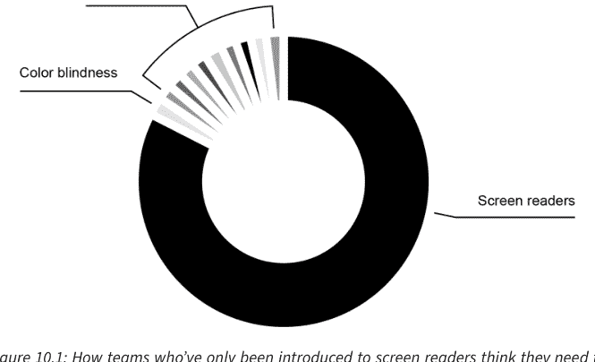

图10.1：仅接触过屏幕阅读器的团队认为他们需要付出的努力

但是，当然，除了失明人士之外，还有其他残障人士需要我们消除障碍，而他们甚至没有使用屏幕阅读器之类的辅助技术，也没有依赖键盘之类的设备：

-   那些自称甚至没有残疾的人，也会在文字过小难以阅读、或文字与背景对比度太低时每天都遇到障碍，尤其是在增大默认字号却毫无效果的情况下
-   色觉缺陷的人会在仅凭颜色（如红色和绿色）传达含义时遇到障碍
-   全屏视频接管可能导致前庭障碍患者出现晕动症状
-   失聪或重听的人可能更愿意阅读视频的文字记录，而不是看完整个视频并观看同步字幕
-   不流利掌握另一种语言的人可能难以完成复杂的表单
-   有言语障碍的人可能会寻找在线聊天功能，而不是打电话给客服

要真正创建一个无障碍设计系统，它必须为所有人消除障碍，为使用屏幕阅读器的人和患有交叉性残疾的人奠定更广泛、更周到的用户体验基础。

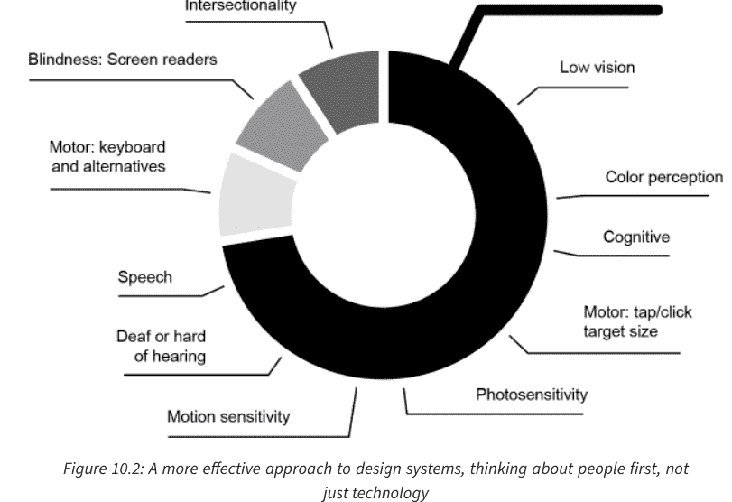

图10.2：一种更有效的设计系统方法，以人为本，而不只是以技术为先

本章从以人为本的视角，剖析日常设计模式和组件中的无障碍挑战。它涵盖了如何构建设计系统的实用指南，促使使用方团队默认以无障碍方式设计和构建，而不必事后修补无障碍问题。

首先，我们将思考如何为不使用辅助设备、仅使用设备无障碍设置的人们进行设计：

-   低视力
-   色觉
-   失聪或重听
-   认知障碍
-   运动障碍：为不精确的动作而设计
-   运动敏感
-   光敏性
-   言语障碍

然后，在完成这些考虑后，我们将探讨为使用辅助技术的人们进行设计：

-   运动障碍：为辅助设备和软件设计
-   极低视力或失明
-   残疾的交叉性

到本章结束时，你将认识到残障人士面临的潜在障碍，掌握一个评估人们需求以及规划稳健设计系统的框架——所有这些都按正确的顺序进行，以最大限度地提高包容性。

##### 低视力

如果把所有人都考虑在内，从低视力开始，就会发现我们实际上是在为超过一半的人口消除无障碍障碍。

根据视觉委员会的数据，63.7%的美国成年人佩戴处方眼镜，2018年，92.4%的65岁及以上美国联邦医疗保险受益人表示他们使用眼镜。这些人不会说自己有残疾或需要无障碍帮助，因为他们的眼镜或隐形眼镜（辅助技术的一种形式）矫正了他们的视力。

随着年龄增长，我们的视力也会变化。大约一半的人使用动态字体（Dynamic Type）来增大移动设备上的文字大小。这些人可能不使用老花镜，当然也不会认为自己有残疾。

荷兰Appt基金会的一项调查（https://appt.org/en/stats）发现以下情况：

-   45%接受调查的荷兰iOS用户在其手机上启用了至少一项无障碍设置（如放大文字大小）
-   15%在iOS上使用两种或更多无障碍功能
-   61%接受调查的荷兰Android用户在其手机上启用了至少一项无障碍设置，25%使用两种或更多无障碍功能

通过首先适应低视力，有价值的可供性会级联到设计系统的其余部分，惠及有其他残疾的人。设计系统必须足够健壮，能够应对动态调整大小的排版，定义颜色和排版资产的用途，足够灵活以根据浏览器设置重新排版，并认识到人们体验界面的替代方式。

###### 规划动态排版

人们必须能够在网页上将文本的默认大小最多更改为200%，或者按特定平台、浏览器或操作系统上的设置所允许的方式更改。请注意，这不同于使用Cmd+或Ctrl+键在浏览器中放大。

如果字体无法增大或布局无法容纳更大的文字，那么界面不仅会变得难以阅读甚至看似损坏，而且任何将界面翻译成另一种语言的人也会遇到布局损坏的问题（例如从英语翻译成法语）。

文字必须能够增大而不破坏其容器，也不会被部分或完全隐藏，且不依赖于任意特定的布局高度或宽度是否可用。系统中的所有对象都必须适应多种多样的排版条件（包括更改默认字体族本身）。在创建设计模式时，应演示该功能将如何适应更大的文字。

###### 支持网页浏览器缩放

低视力人群通常依赖浏览器缩放（使用Cmd+或Ctrl+等键盘快捷键）来放大页面上的所有内容。

适应这一需求的最佳方式是记录并指导使用设计系统的团队采用响应式移动优先的设计和开发实践。与其将缩放视为一个独立功能，不如理解为：缩放实质上会调整整个视口的大小，就像在更小的屏幕上查看内容一样。

具体来说，WCAG SC 1.4.10：重排指南通常要求界面在320 CSS px视口（对于垂直滚动页面）或256 CSS px高度（对于水平滚动内容）下无需双向滚动即可正常工作。例如，这意味着当你的响应式移动优先设计以320 px作为最小视口时，你的界面无需任何额外努力即可符合要求。

###### 交付有意图的排版模式，而不仅仅是资产

虽然设计系统应尽可能为使用方团队提供创作自由度，但如果不加以约束，同样的自由度也会造成不可访问的模式。没有比排版的用法更重要的指导了，而且由于其细微性和技术性，设计系统必须对其预期用途做出规定。

###### 字体缩放与字号：理解二者的区别

在规划排版模式时，理解字体缩放和字号的区别至关重要——以及这对无障碍为何重要：

-   **字号**指的是分配给文字的数值，例如16 px或1 rem。它是一种代码层面的指令，告诉浏览器或设备文字应该有多大。
-   另一方面，**字体缩放**指的是字体本身在该字号下的视觉渲染效果。x字高、笔画粗细和字母比例等因素会影响字体在屏幕上的实际大小。因这些特性，两种被赋予相同字号的字体可能在视觉尺寸上差异显著。

设计系统必须同时考虑字号和字体缩放，以确保文字保持可读并符合无障碍标准。如果品牌字体在相同字号下比标准字体渲染得更小，则可能需要分配更大的字号来补偿其视觉比例。

例如，常见的Arial字体按其指定的像素行高真实渲染。16 px的Arial从最高字母顶部到最低下行字母底部的光学高度正好为16像素。（这可能因浏览器的渲染引擎不同而略有差异。）然而，另一种字体尽管被赋予相同的字号，渲染出来可能会在光学上显得更小。在以下示例中，即使代码规定了16 px的字号，比例调整不佳的自定义品牌字体渲染出来也明显更小。

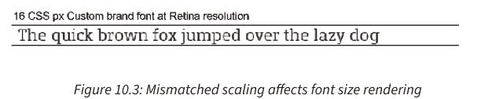

图10.3：缩放比例不匹配会影响字号渲染

###### 文字对比度

所有使用手持设备的人都会遇到可见度差的情况。例如，在明亮的阳光下使用智能手机时，屏幕相对昏暗且难以阅读。同样，当屏幕为省电而变暗时，低对比度的文字和图形也会成为每个人的障碍。

下表列出了普遍接受的文字颜色对比度要求。如前所述，由于不同字体可以按不同比例渲染，CSS像素必须通过光学角度来解读，而不是仅仅依据其定义的像素大小。

| 光学 CSS 像素 | 粗细 | 比率 |
|---|---|---|
| <24 px | 常规 | 4.5:1 |
| >=18 px | 粗体 | 3:1 |
| >=24 px | 常规 | 3:1 |

*图 10.4：通用文本尺寸和对比度指导*

对于视力低下的人来说，文本与其背景之间足够的对比度对于消除获取内容的障碍至关重要。在一种情境下满足对比度要求的文本在其他情境下仍可能构成障碍，如本例所示：

此 18px 深灰色 [#222222] 文本与纯白色 [#ffffff] 对比度为 16:1，轻松满足对比度要求。

此 18px 中灰色 [#767676] 文本与纯白色 [#ffffff] 对比度为 4.5:1，勉强满足对比度要求。

此 18px 中灰色 [#767676] 文本与浅灰色 [#eeeeee] 对比度为 3.9:1，未满足小文本的对比度要求。

此 18px 粗体中灰色 [#767676] 文本与浅灰色 [#eeeeee] 对比度为 3.9:1，满足粗体文本的对比度要求。

此 24px 中灰色 [#767676] 文本与浅灰色 [#eeeeee] 对比度为 3.9:1，满足大文本的对比度要求。

*图 10.5：对比度和尺寸示例*

##### 信息图形对比度与笔画宽度

信息图形，例如用于标识 UI 组件名称、角色或状态的图标或控件状态指示器，在标识时也必须兼顾视力低下用户。实心厚形状，例如警告图标，仅需满足 3:1 的对比度比率，但使用 1 px 笔画的极简汉堡菜单图标必须满足 4.5:1 的对比度比率：

| 笔画宽度 | 比率 |
|---|---|
| 1 px | 4.5:1 |
| >=2 px | 3:1 |

*图 10.6：通用图形笔画宽度和对比度比率*

##### 指导色彩选择，而不仅仅是提供调色板

为其产品设计和开发消费设计系统的团队应提供满足对比度标准的文本颜色和背景配对。虽然存在多种工具可对色彩配对进行数学分析并生成可接受组合表，但并非每种组合在视觉上都是理想的。提供可接受模式和[content]

| 光学 CSS 像素 | 粗细 | 比率 |
|---|---|---|
| <24 px | 常规 | 4.5:1 |
| >=18 px | 粗体 | 3:1 |
| >=24 px | 常规 | 3:1 |

*图 10.4：通用文本尺寸和对比度指导*

对于视力低下的人来说，文本与其背景之间足够的对比度对于消除获取内容的障碍至关重要。在一种情境下满足对比度要求的文本在其他情境下仍可能构成障碍，如本例所示：

此 18px 深灰色 [#222222] 文本与纯白色 [#ffffff] 对比度为 16:1，轻松满足对比度要求。

此 18px 中灰色 [#767676] 文本与纯白色 [#ffffff] 对比度为 4.5:1，勉强满足对比度要求。

此 18px 中灰色 [#767676] 文本与浅灰色 [#eeeeee] 对比度为 3.9:1，未满足小文本的对比度要求。

此 18px 粗体中灰色 [#767676] 文本与浅灰色 [#eeeeee] 对比度为 3.9:1，满足粗体文本的对比度要求。

此 24px 中灰色 [#767676] 文本与浅灰色 [#eeeeee] 对比度为 3.9:1，满足大文本的对比度要求。

*图 10.5：对比度和尺寸示例*

##### 信息图形对比度与笔画宽度

信息图形，例如用于标识 UI 组件名称、角色或状态的图标或控件状态指示器，在标识时也必须兼顾视力低下用户。实心厚形状，例如警告图标，仅需满足 3:1 的对比度比率，但使用 1 px 笔画的极简汉堡菜单图标必须满足 4.5:1 的对比度比率：

| 笔画宽度 | 比率 |
|---|---|
| 1 px | 4.5:1 |
| >=2 px | 3:1 |

*图 10.6：通用图形笔画宽度和对比度比率*

##### 指导色彩选择，而不仅仅是提供调色板

为其产品设计和开发消费设计系统的团队应提供满足对比度标准的文本颜色和背景配对。虽然存在多种工具可对色彩配对进行数学分析并生成可接受组合表，但并非每种组合在视觉上都是理想的。提供可接受模式和精致使用的示例，以便消费团队做出良好的选择。

##### 可访问的色彩组合

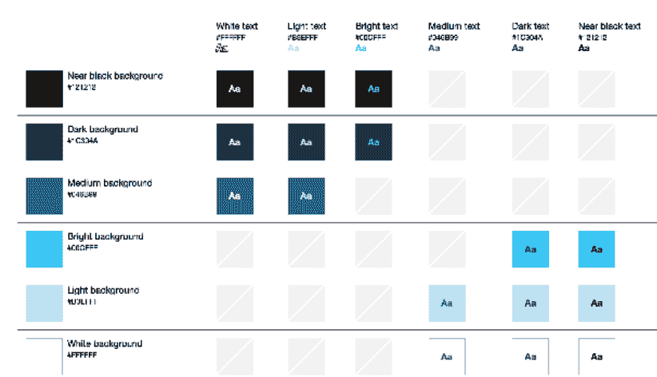

*图 10.7：可使用诸如 toolness.github.io/accessible-color-matrix 之类的自动化工具来识别可访问的色彩配对表。*

我们必须避免 100% 白色与 100% 黑色搭配。对于患有散光的人来说，这种强烈对比会使文本显得不舒服地鲜艳，尤其是在黑色背景上的白色文本。

##### 放大工具的可用性

视力极低的人也可能使用放大软件，允许他们放大屏幕的很小部分。在手持设备上，这通常意味着捏合/缩放。

一次只能看到屏幕的一小部分，这意味着视力低下的人在查找页面上随意散布的内容和控件时会遇到困难。

虽然某些控件无疑与其标签分组，例如复选框或单选按钮，但切换开关和展开器通常被分隔到内容的相对两侧，为视力低下的人造成障碍。

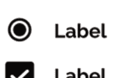

图 10.8：复选框和单选按钮几乎普遍安排为控件和标签彼此靠近

与此同时，这些切换开关和展开器已被允许填满可用空间，无疑令设计经理满意，但对视力低下的人来说是问题：

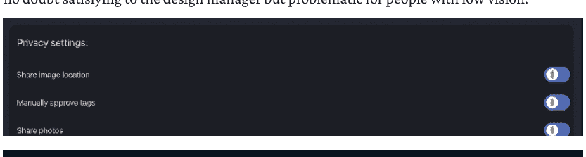

图 10.9：这些切换开关和展开器都为视力低下的人造成了障碍

使用放大功能查看屏幕的人将难以理解这些标签和控件之间的关系。

将所有控件和指示器直接放置在文本标签附近有助于每个人。如果必须将控件指示器放置在标签右侧的对面，请为组件设置最大宽度。

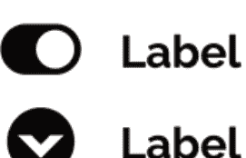

图 10.10：将切换开关和展开器控件指示器放置在其标签附近有助于每个人

随着这些障碍被移除，视力低下的人在使用放大、浏览器缩放或只是更改默认字体大小时，设计系统将成为为所有人创造更好体验的基础。

##### 色彩感知

色盲，也称为色觉缺陷，会导致人们难以区分或无法区分某些颜色。这影响了大约 12 名男性中的 1 人和 200 名女性中的 1 人（占人口的 8%），这意味着涉及色彩感知的任务，例如识别交通灯或分类衣服，可能会很麻烦。

就设计而言，使用绿色和红色来指示流程的成功或失败会成为无法感知这些颜色差异的人的障碍。

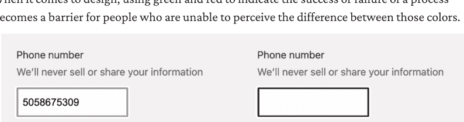

图 10.11：在没有颜色辅助的情况下，无法辨别这两个错误消息之间的差异

相反，包含文本来传达状态，例如成功、提醒或警告。花费在内容策略上的时间至少应与挑选完美警告图标所花费的时间一样多。虽然直观有意义的图标可以使用，但它们很少比实际文字更有用。

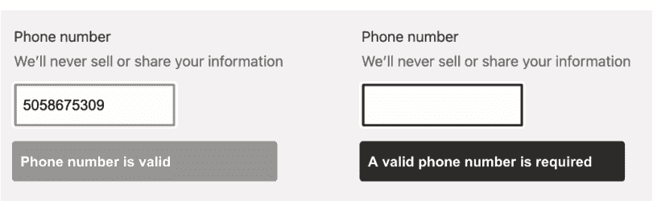

*图 10.12：这些成功和错误消息不依赖于图标或颜色来传达含义，而是使用实际文字来帮助辨别错误消息之间的差异*

再次，通过确保设计系统不依赖颜色而是使用文本来传达含义，它增加了将向下级联给认知障碍人士和屏幕阅读器用户的可用性。

##### 听力障碍或听力受损

设计系统音频和视频功能必须通过两个关键功能提供可访问性：

- 封闭式字幕
- 文字记录

这两个功能不仅有利于 D/聋和听力受损用户，也有利于具有其他生活经历的人，例如非母语使用者、神经多样性用户以及在嘈杂或安静环境中的人。

###### 封闭式字幕

封闭式字幕是视频中口语、声音和重要音频提示的同步文本表示。它们允许无法听到音频或在某些环境中难以处理音频的人跟上内容。封闭式字幕对 D/聋和听力受损用户至关重要，但在嘈杂空间（如机场）的人、非母语使用者甚至具有感官敏感性的人中也很常见。

设计系统应执行以下操作：

- 使字幕可切换。用户应能够在视频播放器内轻松打开和关闭字幕。
- 确保字幕同步。它们必须实时出现，准确表示口语内容和重要声音（例如笑声、门砰声等）。
- 使用易读的样式。高对比度文本、可调字体大小和良好的放置选项可提高跨设备和屏幕尺寸的可读性。

###### 文字记录

文字记录是音频或视频内容的全文版本。与字幕不同，它们不一定与媒体同步，但提供可独立阅读的完整文本。

文字记录有利于广泛的用户群体：

- 屏幕阅读器用户可以比拖动音频更快地浏览文字记录
- 非母语使用者可以参考文字记录以了解不熟悉的单词或短语
- 带宽较低的人可以在视频加载之前阅读内容

设计系统应执行以下操作：

- 提供清晰标记的链接或按钮以下载或查看文字记录
- 将文字记录放置在视频播放器附近或专用、易于找到的标签中（绝不隐藏在晦涩的菜单后面）
- 在文字记录中包含有意义的标题和结构以帮助扫描和理解

正如你所见，字幕和文字记录不仅仅是技术功能——它们是包容、联系和公平获取内容的桥梁。通过以深思熟虑的放置和直观的切换将这些可用性嵌入设计系统，团队可以创建满足现实需求的产品的产品。

##### 认知障碍

认知障碍是指影响个人处理、学习、记忆和解决问题的能力的一系列差异。

##### 在显眼处使用简明语言

首先，你应该认识到人们在消费、搜索、理解并有效使用你的产品时，并不总是拥有充足的时间、注意力和专注力。任何人都可能因繁忙的日程、嘈杂的环境或感冒药引起的嗜睡而受到影响。同样，具有认知差异的人可能需要额外的时间来完成任务或回忆信息。

如果人们找不到、无法消费和理解内容，他们就无法使用你的产品。通过风格指南和设计模式示例，鼓励团队避免使用行话、习语、营销术语和专业短语。

阻止消费团队将重要信息隐藏在工具提示、对话框或展开器后面。隐藏的信息不会像放置在关键 UI 功能视觉邻近处的有用信息那样容易被消费。

##### 文本输入的可用性

当所有文本字段大小相同 时，所有人的认知负荷都会增加。相反，应根据预期输入来定义文本字段大小的规则。

例如，如果某个字段要求输入出生年份，该字段应足够宽以容纳四个字符，但不要更多。这使所有人都能一目了然地推断控件和输入字段的功能，既提高了每个人填写表单数据的速度，同时也减少了错误。

##### 鼓励自动完成

人们发明计算机就是为了做重复性工作，而使用自动完成属性的输入也正是如此。当表单不使用或不允许自动完成时，所有人填写表单的摩擦都会增加。对于使用开关设备或替代导航的运动障碍人士来说，这可能是一个特别繁琐且令人沮丧的障碍。

##### 避免干扰

注意力不集中的人需要无干扰的界面。对他们来说，无法快速暂停的自动播放视频或背景动画可能意味着 UI 无法使用。与此同时，交易中途试图推销的弹出窗口会引起烦躁（即使是那些没有专注问题的人也会如此），并将用户推向别处。解决办法很简单：如果它令人烦恼，就不具可访问性。对对话框、模态框和警报的使用制定严格的指导。

通过优先使用简明语言、合理的输入设计和最少的干扰，设计系统可以培养更具包容性的体验，使认知障碍人士能够充分参与。

##### 运动障碍：为不精确的操作设计

设计可以适应那些只是难以精确与 UI 交互但并未使用其他辅助技术的运动障碍人士。

很容易理解，更大的按钮对每个人来说都更容易点击。难以使用鼠标或精确点击屏幕的人在按钮太小或过于紧密排列时会遇到障碍。

为此，鼓励采用移动优先设计并使用尺寸宽裕的控件。虽然消费团队常感到压力要制作功能密集的界面，但设计系统的示例和文档必须提供支持可访问目标尺寸的示例。

要满足最低 WCAG AA 目标尺寸要求，对象必须为 24x24 px 大小且有 4 px 边距。更宽裕的 44x44 px 大小符合 WCAG AAA 和 HIG 要求，而 Android Material Design 要求最小 48x48 dp 大小。

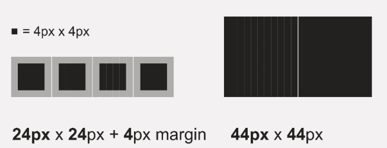

图 10.13：WCAG AA 最小目标尺寸和 AAA 目标尺寸

对于基于 HTML 的控件，如复选框、单选按钮、展开器和开关，整个标签也必须可点击，而不仅仅是控件本身。

图 10.14：基于网络的控件如开关必须在点击标签和控件本身时激活

通过设计宽裕的触控目标并确保整个标签可点击，团队可以消除运动障碍人士的障碍——创建对每个人来说都感觉直观且可用的界面。倡导这些可用性的设计系统不仅满足可访问性标准，还能提供更具包容性的体验。

##### 运动敏感性

患有前庭障碍的人可能会因 sweeping 动画或视频而生病。使用视差滚动或自动播放全屏视频的设计可能真的会让人头晕、恶心或迷失方向数小时。

###### 尊重减少动效设置

首先记录自动播放视频和动画必须如何尊重设备的 **Prefers Reduced Motion** 设置。此系统设置在大多数操作系统中均可用，可在浏览器和原生移动应用中检测到，表示用户偏好更少的动效或动画。例如，当用户启用此设置时，设计系统应禁用视差效果，减慢或移除过渡，并在非用户触发的情况下暂停自动动画。

###### 提前规划动效变化

设计系统必须记录视频或动画在关闭时会如何反应。例如，如果首屏横幅包含循环背景视频，请提供具有相似品牌或信息的静态备用图像。对于微动画，用微妙的淡入淡出或高亮效果替换它们，以传达相同的含义而不诱发运动病。

###### 提供易于找到的控件

任何自动播放视频都必须包含直观、易于找到的暂停或停止播放控件。避免将这些控件埋藏在嵌套菜单中——理想情况下，将其放置在视频附近，并使用清晰的标签，如 **Pause animation** 或 **Stop motion**。对于背景动画（例如移动渐变或背景效果），提供切换开关，以便用户在需要时轻松禁用它们。

尊重运动敏感性的设计系统通过优先考虑舒适和福祉来建立用户信任。通过提供灵活的动效设置、备用视觉效果和易于找到的控件，团队可以创建使患有前庭障碍的人能够安全、 confidently 参与的界面。

##### 光敏性

光敏性人群会谨慎管理其对数字环境的接触，以降低癫痫发作或疾病的风险。触发因素包括闪烁灯光（如频闪效果）或某些高对比度视觉图案，如条纹、网格和棋盘格。对某些人来说，即使是细微的闪烁也可能导致头晕、头痛或迷失方向。

###### 制定明确的指导方针

设计系统必须为所有动画和视频建立明确的指导方针，确保任何被归类为闪烁的内容每秒不超过三次闪烁。这符合 WCAG 2.2 成功标准 2.3.1，有助于保护光敏性癫痫用户。

###### 提供警告和选项

视频或动画功能必须考虑在界面中直观放置警告的位置，如果存在光敏内容。放置位置会根据平台——网页、智能手机、平板电脑或电视——而自然变化，但应始终一致且易于找到。

此外，你还应：

- 包含清晰、可读的标签，例如 **Warning: Flashing content may affect photosensitive users.**
- 提供切换选项以选择是否使用高动效效果。例如，允许用户禁用视差滚动、背景视频或动态渐变。

###### 测试安全性

设计系统应记录如何使用自动化工具进行内容测试，例如马里兰大学 Trace Center 的 **Photosensitive Epilepsy Analysis Tool (PEAT)** 软件（https://trace.umd.edu/peat/）。此外，考虑与可访问性专家或具有光敏性的用户研究参与者合作，以确保真实的、 lived experience 视角。与光敏性用户合作，了解他们的体验和需求，并验证解决方案。

###### 其他提示

除了上述信息外，请考虑以下提示：

- 避免明暗颜色之间的高对比度闪烁
- 不仅测试孤立功能，还要测试复杂的交互，例如结合多种视觉效果的过渡

- 在所有设计模式中保持一致的方法，包括营销、入职引导和交互功能

通过将这些实践融入设计系统，团队可以确保对光敏感的人能够安全、 confidently 地浏览数字体验——不会触发风险。

##### 语言障碍

当我们以包容的方式思考时，我们可以理解到，许多没有残疾的人也不喜欢语音通话。它需要时间，可能变得繁琐的社交互动，如果对话困难或不愉快，例如取消服务或涉及敏感个人问题，电话通话可能是一种令人不舒服且焦虑的想要避免的经历。

语音对话和使用语音识别的系统通常会为有语言障碍的人制造障碍。如果下订单或获得客户支持的唯一方式是通过语音渠道，这就构成了障碍。在设计过程早期就与有语言障碍的人互动，有助于识别这些障碍并共同创建替代解决方案。

虽然 WCAG 规则并未明确指出涵盖语言或语音障碍的具体成功标准，但我们可以推导出提供一致替代方案的方法：

- 如果团队正在使用设计系统添加产品功能，例如语音助手和支持语音的应用程序，或将依赖交互式语音应答（IVR）电话系统（例如，“说出您要联系的部门名称”），设计系统必须指导团队在每一步都提供非语音替代方案。

- 添加清晰的视觉和基于文本的替代方案——例如聊天界面、短信选项或电子邮件支持——以便用户可以选择自己偏好的沟通方式。

- 优先考虑异步选项，以免用户被迫进行可能导致压力或焦虑的实时互动。提供可访问的替代方案也有利于在嘈杂环境中、信号不佳或只是更喜欢打字的人。

- 提供一致、易于找到的选项以在语音和非语音渠道之间切换。例如，在 IVR 电话通话期间，允许用户按号码连接到基于文本的支持渠道或请求文字记录。

- 在语音启用产品中包含字幕或文字记录角色的明确指导。例如，语音助手应能够显示基于文本的确认和结果。这使有语言障碍的人能够理解和导航系统，而无需仅依赖语音。

至此，我们已为低视力、认知、运动和光敏感等不同残疾人士移除了障碍，我们的设计系统现在已准备好为使用辅助技术（如键盘、开关设备和屏幕阅读器）的人提供可用性支持。

##### 运动障碍：为辅助设备和软件设计

患有严重运动障碍的人使用从键盘到更复杂且通常定制的开关设备等辅助技术。设计系统必须鼓励使用团队考虑这些类型的辅助技术至关重要，因为这是屏幕阅读器可访问性的前提。

了解使用鼠标与使用键盘等辅助技术导航 UI 的根本区别很重要。使用鼠标的人处于控制之中，就像在城市中开车：可以自由地以任何顺序在屏幕上移动。使用键盘更像是坐火车，以线性引导的方式体验内容和控件。路线上的每个站点都是强制性的。

###### 单点激活

我们都会遇到因环境（如在繁忙街道上行走）或因干扰（如抱着爱闹的动物）而无法在触摸设备上执行复杂操作的情况。但使用键盘或开关设备的人也无法精确执行滑动或拖动等复杂手势。

在这些情况下，使用单次点击执行操作的能力会提高每个人完成任务的能力。为复合功能提供单点操作方法，例如导航可拖动控件或（如果无法从系统中省略）轮播。

###### 适应横向、纵向和倒置方向

每个人在手持设备上以多种方向消费内容时都会遇到需求。例如，您可能在飞机上使用座椅靠背弹出托盘浏览内容。然而，有运动障碍的人可能使用永久安装且无法旋转的手持设备。如果 UI 在所有方向上都不可用，这就成了障碍。

定义焦点样式包括放置焦点轮廓的位置。例如，遵循默认 HTML 焦点模式，此组复选框将焦点放在样式化的复选框本身上：

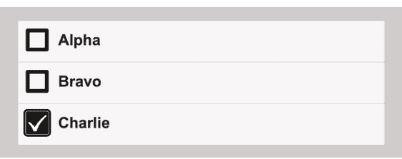

*Figure 10.16: These WCAG-compliant checkboxes add a focus outline around the styled checkbox*

此复选框组将焦点放在整个标签周围：

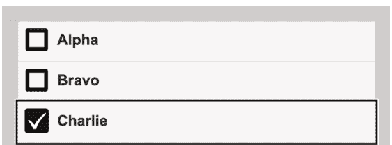

*Figure 10.17: These WCAG-compliant checkboxes add a focus outline around the checkbox label*

但不要过度。记住，焦点指示的目的是让用户知道哪个控件已准备好进行交互。例如，不要将文本输入、标签和帮助文本用焦点轮廓包裹。周围的文本不是控件，因此不得显示为可聚焦。

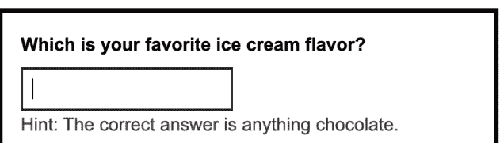

*Figure 10.18: Labels and descriptive text must not be outlined on focus*

简而言之，就让浏览器做它本就该做的事：对可交互的可聚焦元素指示焦点，而不是周围的文本、卡片或区块。

##### 适应替代导航

有些人依赖完全不同的方式来导航数字界面，例如语音控制、眼动追踪或开关扫描系统。这些替代方法被行动能力非常有限、语言障碍或只是更喜欢免提互动的人使用。

使用语音控制（如 *Dragon NaturallySpeaking* 或内置移动操作系统命令）的人需要能够以可预测、口头的方式引用他们在屏幕上看到的内容。

因此，UI 控件和文本必须清晰且唯一地标记。你可以把词语想象成由字母组成的、有意义的图片。例如，不要使用垃圾桶图标按钮来取消订单，可以使用单词 **Cancel**。不要使用纸飞机图标按钮发送消息，可以使用单词 **Send**。这两个示例都允许使用语音控制的人通过单一命令执行此操作。

因此，网站和应用程序的设计系统不能跳过键盘可访问性的支持，不仅仅是因为它显然是屏幕阅读器用户的先决条件，而且因为键盘用户可能存在屏幕阅读器用户不存在的障碍。接下来，让我们看看设计系统必须如何为盲人或视力极差的人消除障碍。

##### 视力极差或盲视

前面的章节已移除了为使用屏幕阅读器的人设计时遇到的许多挑战，他们将从已讨论的所有可用性支持中受益：

- 适应所有设备、方向和视口大小的灵活布局对使用屏幕阅读器的人很有用，因为他们可能使用手持设备或不知道其桌面屏幕的分辨率或浏览器窗口大小。事实上，他们可能根本没有桌面显示器——如果看不见，又何必费事？
- 有意义的标题结构允许屏幕阅读器浏览内容，呈现有用信息。
- 文字记录使消费音频内容变得更容易，音频描述使包含重要视觉信息的视频能够被消费。
- 不仅依赖颜色来传达意义的内容将使用文字来传达意义。
- 不依赖细微营销术语或行话的语言可以被屏幕阅读器正确发音。

- 自动完成功能有助于减少每个人的错误，同时加快表单填写速度。
- 具有有意义顺序的可聚焦控件，能引导使用屏幕阅读器的人沿着 UI 进行线性旅程。

这些考虑为创建设计系统奠定了基础，这些系统不仅符合无障碍要求，而且真正赋能盲人或视力极低的人群。接下来我们将探讨设计系统如何通过解决标题、焦点管理、替代文本和辅助技术考虑等方面，进一步支持这些用户。

###### 选择非语义的排版命名约定

设计系统必须采用一种命名约定，该约定不依赖于数字标识符来表示大小和粗细，而是专注于文本的预期用途和样式。这些简单示例允许任何样式应用于任何标题级别。以这种方式，h1 在视觉上可以是最小的字体，但仍保持其对使用屏幕阅读器的人的含义。

以下样式可以应用于任何标题，而不管其标题级别如何：

| CSS | HTML |
|---|---|
| `.text-normal { font-size: 1rem; }` | `<h1 class=text-normal>My coffee dashboard</h1>` |
| `.text-medium { font-size: 1.5rem; }` | `<h2 class=text-medium>My favorites</h2>` |
| `.text-large { font-size: 2rem; }` | `<h2 class=text-large>Featured roasts</h2>` |
| `.text-huge { font-size: 4rem; }` | `
Coffee jitters!
` |

Figure 10.19: Semantically agnostic styles

认识到注释在何处必要以及何处不必要。如果 UI 设计师直接嵌入跨职能工程团队，并每天直接与 Android、iOS 和网页开发人员沟通，则注释需求可能很小。另一方面，如果 UI 设计团队被孤立，仅仅将工件抛入瀑布式生产环境，则需要更详细的注释。

一个最小的注释库应包括以下选项：

- 地标（header/banner、navigation、main、footer/content info）
- 标题级别（h1、h2、h3 等）
- 图像的替代文本名称
- 控件角色（checkbox、radio button、switch 等）
- 自动完成属性（name、address-line1、address-level1 等）
- ARIA 标签（用于命名部分、表单或导航）

虽然注释很有用，但它们不应多余。例如，在设计工件中，小屏幕移动布局和大屏幕桌面布局并排放置时，可能只需对移动布局进行注释，仅在桌面布局中注明差异或额外功能。

###### 信息性与装饰性图像的替代文本

为了为使用屏幕阅读器的人提供良好的体验，设计系统必须鼓励使用团队为信息性图像添加替代文本描述，并阻止为装饰性图像添加替代文本描述。

使用团队需要明确的指导，了解什么构成装饰性或信息性图像以及如何描述它们。如果设计系统不为替代文本使用设定模式，使用团队要么会忽略替代文本，遗漏照片和图形中包含的关键视觉内容，要么会过度使用装饰性图标的替代文本，导致重复或无意义的体验。

默认情况下，设计系统提供的 UI 图标必须是名称无关的，并被视为装饰性，无需替代文本。设计系统通常提供几乎永远不需要描述的图标式 UI 图像。即使使用典型的 UI 图标集，也不可能为图像编写单一的替代文本描述以在所有情况下实现良好的用户体验。

##### 残疾的交叉性

出于实用性考虑，无障碍设计是在单一残疾或辅助技术的背景下讨论的，但当考虑有多重残疾的人时，残疾要复杂得多。

一个能够适应动态文本大小和一致焦点样式的设计系统，可以满足视力低下且有严重运动障碍的人的需求。发现动画或运动令人分心的人可能会使用放大工具来聚焦，框出令人分心的功能。有认知障碍的人可能会使用屏幕阅读器或字幕来帮助阅读理解或理解音频内容。现实世界的场景很少如此整齐地分离。让具有交叉需求的用户参与——例如同时使用屏幕阅读器并有运动敏感性的人——有助于团队理解并设计应对复杂、重叠挑战的方案。

当设计系统以灵活性、清晰度和替代交互方式构建时，它们可以在无需例外或额外定制的情况下更好地适应这种复杂性。重要的是要记住，许多人同时经历多种残疾，例如视力低下和运动损伤，或听力损失伴随认知挑战。设计系统如果能预见到这些重叠需求——例如确保高对比度排版、一致的焦点样式、清晰的标签和单点激活——就能为每个人创造更公平、更一致的体验。

##### 对所有残疾人应省略的功能

设计系统的无障碍不仅仅意味着让一切都可访问；它意味着决定省略哪些组件和模式。一些常见的 UI 组件可以从设计系统中排除，以鼓励使用团队寻求更好的解决方案。与用户合作以了解某些组件为何造成障碍至关重要——这有助于设计系统发展以支持包容性体验，而不仅仅是删除功能。

原生 HTML `select` 元素可以在其折叠状态下完全设置样式，而选项表面的样式由操作系统提供，无需重新设计，尽管未来的 CSS 提案可能会允许更多样式选项。

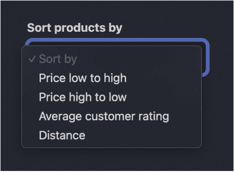

*Figure 10.23: The native HTML select surface in macOS*

##### 轮播

轮播幻灯片通常是利益相关者无法决定应突出什么内容的妥协，因此他们选择全部内容。这导致用户体验不友好，很少有人会参与到第一张幻灯片之外。

未来的浏览器功能可能包括对可访问轮播模式的原生支持，但这并不意味着这是传达内容的最佳方式。即使是可访问的轮播也会为所有必须学习如何导航其特殊复合 UI 并消费其独特内容的人增加额外的认知负担。它可以滑动吗？箭头键可以操作它吗？有多少张幻灯片？这些信息以及更多信息必须被用户传达和理解，并且人们必须有足够的动机去参与超出初始视图的内容。

如果轮播是设计系统不可避免的组件，请帮助团队明智地使用可访问轮播，以消除障碍、减少认知负担并为体验增添价值：

- 避免使用自动播放。这会为有认知障碍和前庭障碍的人造成障碍。如果突出显示，自动播放必须默认关闭且用户可控制。
- 指导团队偏好可预测的信息。轮播在人们可以猜到接下来内容时效果更好（例如，鞋子的颜色和产品变体）。避免在幻灯片之间出现惊喜或不连贯的内容。

### 11 Tools and Techniques for Accessibility Evaluation and Prioritization

By Kai Wong, CPACC, CHES®

无障碍是关于创建适合每个人的数字体验。即使设计看起来是无障碍的，许多无障碍问题也隐藏在代码之下。

无障碍测试弥合了设计意图与实际用户体验之间的差距。它是质量保证（QA）的重要组成部分。就像任何其他质量检查一样，评估产品无障碍涉及对其进行测试。

> Web 内容无障碍指南（WCAG）是一项被广泛接受的技术标准，可指导数字无障碍测试。您可以在万维网联盟（W3C）网站（www.w3.org）上找到指南的最新版本。

本章概述了数字无障碍测试工具和技术，重点关注网页和移动应用无障碍测试、其挑战以及常见问题。您将学习如何结合自动和手动测试方法、确定修复优先顺序，以及将无障碍纳入开发工作流程。目标是什么？帮助您和您的团队更智能地测试并构建更具包容性的产品。

在本章中，我们将涵盖以下主要主题：

- 选择合适的自动化测试工具
- 执行有效的手动无障碍审计
- 解释和优先处理无障碍测试结果
- 将无障碍测试集成到开发工作流程中

#### 选择合适的自动化测试工具

谁不爱一个好捷径呢？我知道我喜欢，所以让我们谈谈自动化测试工具。使用自动化工具是一种简单、快速的无障碍检查方式，比烤面包还要快地弹出结果。几秒钟内，它们就能发现无障碍问题，例如缺少替代文本、颜色对比度差、表单元素缺少可访问名称以及缺少文档语言。

目前市场上有多款自动化工具可供选择。在为无障碍选择自动化测试工具时，请考虑以下关键因素：

- **用户界面：** 工具是否直观且易于导航？它是否可访问？
- **可靠性：** 测试结果是否一致且可重复？
- **易用性：** 它是否需要培训，还是初学者也很容易使用？
- **浏览器和设备支持：** 它是否适用于你需要的浏览器和设备？
- **维护：** 工具是否定期更新？
- **成本：** 工具是免费的还是需要付费？如果发现需要订阅或付费的工具，请先用免费试用测试。探索你的选项。找到适合你需求和预算的工具。在大多数情况下，免费版本就足够了。
- **标准：** 工具是否对照你期望的符合性级别的标准进行检查，例如 WCAG 2.2 Level AA？

大多数自动化无障碍工具可直接在开发者工具中免费获得，作为移动应用程序或浏览器扩展。以下表格比较了免费、常用的自动化工具：

| 工具 | 平台 | 功能 | 缺点 |
|---|---|---|---|
| WAVE by WebAim (www.wave.webaim.org) | Web | - 一个浏览器扩展 - 在侧面板中打开。 - 在加载状态下扫描整个页面 - 显示页面结构，例如标题，并使用页面上的图标突出显示结果 | - 页面可能会因页面上的图标而变得杂乱 - 不指示发现问题的严重程度 |
| axe DevTools by Deque (www.deque.com/axe/devtools) | Web | - 一个浏览器扩展 - 在浏览器的开发者工具中打开 - 在加载状态下扫描整个页面 - 可以一次突出显示一个问题 - 为每个标记的问题列出相关要求和影响级别 - 高级升级选项包括部分页面扫描、用户流程扫描、报告导出和指导式手动测试功能 | - 初次使用该工具时学习曲线较小 - 许多功能需要升级到付费版本 |
| Lighthouse by Google Chrome | Web | - 无需下载，因为它内置于 Chrome 的开发者工具中 - 易于使用的用户界面 - 使用与 axe DevTools 相同的库，这是一个值得信赖的框架，也是无障碍测试的广受尊敬的资源 - 提供 100 分制的分数，快速、高层次地评估页面的整体无障碍状态 - 还可以检查性能、SEO 和最佳实践 | - 高分可能会误导人们认为网页完全可访问 - 有时它落后于 axe DevTools 最新版本一个版本。 |
| Accessibility Inspector by Apple | iOS and macOS mobile apps | - Xcode 中可用的开发者工具 - 提供有关移动应用中特定元素的原始无障碍信息 - 提供元素检查功能、VoiceOver 模拟和屏幕级审计 | - 由于它是 Xcode 的一部分，该工具主要由开发人员在开发阶段使用。对于不在 Xcode 中工作的非开发人员或测试人员来说不太方便。 - 涵盖的测试数量有限。 |
| Accessibility Scanner by Google | Android mobile apps | - 可从 Google Play Store 下载的应用 - 可以扫描单个屏幕或一系列屏幕 | - 涵盖的测试数量有限。 |

图 11.1：免费自动化测试工具选项

图 11.1 中的工具是根据估计的用户数量和个人经验选择的。还有许多其他选项（尤其是网页工具）。

W3C's Web Accessibility Evaluation Tools List (www.w3.org/WAI/test-evaluate/tools/list) 提供了超过 65 款自动化测试工具的信息。你可以根据用途、成本、操作系统、语言和标准筛选工具。

由于许多工具都是免费的，同时使用多个工具也无妨。像在冰淇淋店一样双重享受吧！想用多少就用多少。比较结果并交叉核对准确性。

它们是不是太好了而不真实？有点是的。自动化工具只能覆盖约 30–50% 的标准无障碍测试需求。以下是一些溜过了自动化工具但后来被手动测试人员或终端用户发现的例子：

- 表单元素，例如单选按钮，其可访问名称为 null 或 object，但可见按钮标签中没有
- 一个链接，除非运行屏幕阅读器，否则无法仅使用键盘激活
- 在将网站主页放大到 400% 时，几行重要的重叠文本

这意味着即使屏幕通过了所有自动化工具检查，无障碍问题仍可能存在。这就是手动测试和用户反馈发挥作用的地方。

许多数字无障碍问题取决于上下文，需要人工审查。自动化工具是一个坚实起点，但只是开始。务必用手动检查和真实用户（尤其是残障人士）的见解来补充。彻底的手动测试和多样化的用户反馈是创建可访问、用户友好体验的关键。让我们接下来看看有效的手动测试。

> 如需对自动化工具和手动测试进行更深入分析，请查看 Adrian Roselli 的博客文章，*Comparing Manual and Free Automated WCAG Reviews* (https://adrianroselli.com/2023/01/comparing-manual-and-free-automated-wcag-reviews.html)。

#### 执行有效的手动无障碍审计

当然，自动化测试工具可以帮助你快速发现无障碍错误，但如果你就此停止，你就跳过了最好的一部分：手动测试。对，就是时候卷起袖子进行手动测试了。

手动测试方法会发现自动化工具无法发现的问题。这有点像清理宠物毛发。一轮吸尘并不能清理一切；你可能需要用粘毛滚筒确保完全无毛。这就是为什么使用多种工具和多种测试方法对于确保无障碍至关重要。

在本章中，我们将“问题”和“错误”互换使用。此外，以下信息适用于网页和移动设备，除非另有具体说明。

虽然本章不会深入 WCAG 以保持易于理解，但所讨论的大多数测试策略都与 WCAG 标准相关。如需具体标准或深入了解每个测试领域，请参阅官方 WCAG 文档。

##### 键盘导航是关键

一些视力或行动障碍人士可能会使用键盘等替代输入方法来导航数字内容。网站和移动应用应无需触摸屏幕或点击鼠标即可完全使用。因此，焦点顺序——使用替代输入方法导航时接收焦点的元素的顺序——和键盘导航是必不可少的测试项目。

如果你有鼠标，就让你的猫在你完成手动测试时玩弄它。同时，你可以测试焦点顺序并确保所有元素都可以使用键盘单独到达。

你可以使用无线键盘，例如蓝牙键盘，在移动设备上测试键盘导航。

从网页顶部开始，使用 Tab 键在交互元素之间移动。交互元素的示例包括按钮、链接、下拉菜单、滑块、切换开关、复选框和文本字段。按 Tab 应该在页面上移动并在聚焦元素上显示可见的焦点指示器（即轮廓）。

确保焦点顺序是合乎逻辑的（通常意味着使用键盘向前移动与页面顺序和含义相匹配），并且相当可预测。它不应该像在热炉上烧焦的大蒜一样在页面上乱跳。在大多数情况下，焦点应从上到下、从左到右移动。如果你按 Tab，突然你的焦点消失了……恭喜，你发现了一个错误！

在你浏览的过程中，注意屏幕阅读器如何描述每个获得焦点的元素。屏幕阅读器的播报应该是有帮助的，而不是混乱或缺失；它们不应重复或指出任何不必要的垃圾。

> 如果这是你第一次来到屏幕阅读器之城，你可能会注意到它说话很快。别担心，你可以在屏幕阅读器的设置中调整速度。起初放慢速度并无不妥。大多数日常用户以全速使用屏幕阅读器，但如果你不常使用，放慢到更舒适的速度。

对于交互元素，例如按钮或链接，屏幕阅读器应先播报标签，然后播报元素的类型（称为其“角色”）。例如，文本标签为“添加到购物车”的按钮应被播报为“添加到购物车，按钮”。一个大忌是视觉标签写着“添加到购物车”，但屏幕阅读器却播报为“立即购买，复选框”，这会让用户感到困惑或被误导。

此外，如果可访问性名称与元素的文本标签不匹配，可能会给通过语音导航的用户带来问题。在通过语音导航时，人员通过说出可见标签来选择元素。如果可见标签与可访问性名称不同，辅助技术可能无法识别该元素或响应语音命令。技术进步可能会很快改善这一点，因此请遵循最新的操作系统和软件更新。

另外，注意其他常见的屏幕阅读器播报问题，例如以下内容：

- 缺少角色或元素类型（即没有说明按钮是按钮）。
- 装饰性图片未被忽略。
- 标题使用不当（即顺序不合逻辑或不具描述性）。
- 内联错误消息未被播报。
- 表单字段缺少必填或可选指示。
- 状态消息未被播报。例如，如果表单已提交，应有成功消息表明其已提交或已保存。
- 影响用户体验的焦点管理问题。

#### 移动设备专用屏幕阅读器提示

在设备的辅助功能设置中打开屏幕阅读器（或询问默认语音助手），然后使用手势测试移动应用程序。手势是使用屏幕阅读器导航移动设备的常见方式。

大多数设备在你首次打开屏幕阅读器时会提供常见手势的快速教程。一旦屏幕阅读器运行，你就可以使用这些手势。

常见手势包括以下内容：

- **向右滑动：** 将焦点向前移动
- **向左滑动：** 将焦点向后移动
- **单击：** 选择一个项目
- **双击：** 激活获得焦点的交互元素
- **三指滑动：** 按滑动方向滚动页面（仅限 iOS）
- **两指滑动：** 同上，但适用于 Android

使用屏幕阅读器和手势，检查焦点顺序、屏幕阅读器播报和核心功能是否按预期运行。

#### 检查图片描述

自动化工具在标记缺少图片描述方面很出色——通常称为**替代文本（alt 文本）**——但它们无法判断文本是否有帮助或准确。这就是手动测试发挥作用的地方。

辅助技术应以传达其目的的方式描述有意义的图片。测试 alt 文本的一种方法是导航到图片并观察屏幕阅读器或盲文输出。听听（或阅读）播报的内容并问自己：这有意义吗？它在不过于复杂的情况下增加了价值吗？

注意图片描述的长度——它应详细但简洁（没人需要一部小说）。如果图片包含重要文字，请确保该文字包含在 alt 描述中。如果图片只是装饰性的，屏幕阅读器甚至不应该提及它。

想 double-check 网站上的 alt 文本吗？打开浏览器的开发者工具，检查元素，并在 HTML 代码中查找 alt="" 属性。alt 文本就是引号之间的内容。如果图片纯粹是装饰性的，代码中仍应有 alt="" 但引号之间没有文字。这告诉辅助技术：“嘿朋友，你可以忽略我。我只是为了视觉氛围而存在——仅此而已！”

#### 测试页面在各种状态下

不要就此止步。还有更多内容可探索！错误消息、加载指示器以及内容变化（例如展开手风琴以显示文本）是否被播报？如果没有，体验就大有不足，可能会让许多终端用户感到迷失或沮丧。

手动检查动态内容的行为很重要，因为大多数自动化工具只在页面加载时的状态下测试页面。因此，例如，它可能不会在菜单或手风琴展开时、在存在内联错误消息时、或在选择预约时间后出现日期选择器时进行测试。

在使用屏幕阅读器和键盘导航时，探索这些额外状态。当你遇到菜单时，确认你可以在不使用鼠标的情况下到达菜单中的所有选项，并且屏幕阅读器准确播报所有选项。

#### 放大关注点：你的产品

视力低下或其他残疾的人可能会使用放大数字文本或内容的功能。因此，重要的是在各种缩放级别和文字大小下测试你的体验。在移动设备上捏合缩放或增加网页浏览器的缩放级别，以确保所有内容重新组织时不会重叠、被截断或功能下降。

然后，使用大文本进行测试。在设备或浏览器设置中调整文字大小，然后验证所有文字是否按比例调整大小，没有内容重叠，且没有功能丢失。

#### 颜色很重要

色觉缺陷很常见。因此，请确保不要仅使用颜色来给出指示或传达含义。例如，字段中的错误不应仅以红色标记；它们还应有屏幕阅读器播报的内联错误消息。这并不意味着你不能使用颜色，你只是不应该仅用颜色来表示含义。

此外，请确保你的数字体验使用足够的颜色对比度。大多数时候，自动化工具可以捕捉颜色对比度问题；然而，有些问题可能会溜过去。如果你能快速视觉扫描页面，寻找任何低对比度的文字和非文字元素。如果页面上的任何内容看起来像是洗过太多次（即褪色），就该与你的设计师聊聊了。

#### 更多必备检查

还有几件事需要手动检查：

- 简单且正确的标题结构
- 没有快速闪烁的内容
- 一致的导航
- 动画和视频有暂停和播放的方式
- 视频有字幕
- 音频附带文字记录
- 会话超时警告，让用户延长会话

让我们最后看看一些移动设备特定的注意事项：

- **方向支持：** 设备可以在纵向或横向模式下使用。这与可访问性相关，因为有些人可能将手机或平板电脑固定在某个位置，例如安装在轮椅上。测试你的数字产品在各种方向下的表现，以确保支持。当你将手机水平旋转时，你的应用程序或移动网站的视图应无缝切换到横向视图。同样，当你将移动设备改回垂直位置时，内容应切换回纵向视图。在两种位置下，内容不应重叠、被截断或丢失功能。
- **内置辅助功能：** 移动设备上有许多辅助功能，因此测试它们在你的应用程序或移动网站中的工作方式很重要。这些功能通常可在 **设备设置** 或 **辅助功能设置** 下找到。

某些功能在 iOS 和 Android 上的名称略有不同。请参考下表了解几个示例。

| 功能 | Android 名称 | iOS 名称 |
|---|---|---|
| 语音导航 | Voice Access | Voice Control |
| 文字转语音 | Select to Speak | Spoken Content |
| 屏幕阅读器 | TalkBack | VoiceOver |
| 增加文字大小 | Font Size | Larger Text |
| 高对比度 | High Contrast Text | Increase Contrast |
| 最小化动画 | Remove Animations | Reduce Motion |
| 替代输入 | Switch Access | Switch Control |
| 放大屏幕内容 | Magnification | Zoom |

*Figure 11.3: Names of iOS and Android features*

#### 中等问题

在解决阻断问题和严重问题之后，你可以继续处理中等问题。中等问题可能对终端用户造成不便或引起注意，但不会显著影响用户体验。

中等问题的示例包括以下内容：

- 一个或两个装饰性图片被屏幕阅读器播报
- 少数文本实例的颜色对比度中等偏低
- 一个简单、简短的页面缺少标题
- 在必填表单字段上，屏幕阅读器会两次播报“必填”

#### 其他需要考虑的因素

其他因素会影响问题需要解决的紧迫性。请考虑问题存在的更广泛的上下文：

- **频率：** 这个问题影响了多少页面？在同一页面上发生了多少次？例如，如果一个页面上播报了1个装饰性图片，影响就小于一个页面上播报了10个装饰性图片的情况。
- **用户反馈：** 客户是否因可访问性问题报告了糟糕的体验？问题的严重程度如何？低还是高？
- **位置：** 问题是否出现在访问量最大的页面之一？它是否影响了业务关键的用户流程？还是发生在过时的活动页面上，流量极少？
- **范围：** 问题是否出现在可复用的组件中，还是局限于某处？全局问题——即影响多个页面上相同组件的问题——应在修复工作中尽早优先处理。一个常见的例子是共享导航菜单中的可访问性问题。如果主页上的导航菜单没有焦点指示器，那么在所有使用该菜单的其他页面上很可能也会出现相同问题。解决全局问题有助于在数字产品中创造更一致、更可访问的体验。

没有可访问性经验的团队通常会选择先修复容易的、低垂的果实。这可能是由于以下几个因素：对处理更复杂问题缺乏信心、没有完全理解某些错误对用户的影响，或由于优先级设定不足而缺乏方向。

虽然这种方法可能有助于快速减少错误数量，但对终端用户的影响通常很小。然而，低成本的修复有时也能带来有意义的改变。虽然小幅度的修复有时能带来有意义的改变，但在权衡时应同时考虑潜在影响和工作量。你的优先级设定工作将有助于此。

通过优先解决更严重的问题，你可以通过消除障碍和改善用户体验，为终端用户带来实质性差异。它还可以帮助你避免因主要的可访问性缺陷而无法使用产品的沮丧客户，甚至更糟的情况，例如处理律师函和法律麻烦。

#### 仪表板

还记得那个庞大的可访问性错误集合吗？考虑创建一个仪表板来帮助理清一切。仪表板可以帮助你解读测试结果、跟踪修复进度并指导你的策略。仪表板中常见的跟踪变量可能包括以下内容：

- 问题类型/类别（即屏幕阅读器问题、颜色对比度或键盘导航）
- 优先级级别（通常是影响严重程度的函数）
- 受影响的用户群体
- 修复状态（即未开始、进行中或已解决）
- 用户流程
- WCAG 成功标准
- 辅助技术

规划修复工作需要时间和精力，但它能为你的公司、团队或业务提供巨大的指导。优先排序的待办清单和组织良好的仪表板可以帮助团队从“我们从哪里开始？”转变为“嘿，我们搞定了。”这也有助于你设定项目里程碑并首先交付最具影响力的变更。

深思熟虑地优先排序和战略性地修复问题不仅对业务有益；对残障人士来说也是一大胜利。

有了这些见解指导你的测试和修复工作，你正走在正确的道路上。现在，让我们从被动转向主动。是时候抢占先机，将可访问性测试融入你的开发工作流程中了。

#### 将可访问性测试集成到开发工作流程中

你知道什么比发现和修复可访问性错误更好吗？从一开始就防止它们出现！为此，你必须将可访问性融入你的 **软件开发生命周期 (SDLC)** 流程中，并使其成为文化的一部分。可持续地将可访问性集成到开发工作流程中需要深思熟虑的策略、工具，以及一些试错来找到适合团队的方法。

首先定义每个人都将努力达到的标准，例如 WCAG 2.2 AA。获得领导层的认可并记录你的决定。考虑制定一份政策，执行以下操作：

- 明确可访问性要求
- 分配责任
- 概述监控和执行的方法
- 识别相关工具和技术

政策和标准是坚实的基础，但它们本身不会改变行为。这就像有一本组装家具的说明书。说明很有帮助，但如果没有合适的工具、承诺和努力，最终结果可能不理想。你需要将可访问性集成到开发工作流程和团队文化的每个部分：

- **培训**：频繁、有针对性的培训可以提高意识，并为人们执行可访问性任务提供必要的技能。高度吸引人的有效培训计划也能推动文化变革。

> 你可以与学习和发展团队合作，将可访问性要点融入现有培训计划中。

- **工具和测试：** 如本章前面所述，开发人员和 QA 团队应在其他代码功能检查之外，同时使用自动化和手动测试方法。开发人员还可以使用可访问性 linter 在 QA 阶段之前捕获问题。

为了使其可操作，请具体说明。不要简单地说“需要 WCAG 2.2 AA”，而应说明使用哪些工具、测试什么内容以及常见的需要注意的问题。QA 工程师说他们“做了可访问性”但只运行了自动化工具的情况并不少见。他们通常没有意识到期望是什么。清晰的说明有助于弥合这一差距并确保彻底测试。

- **需求：** 将可访问性作为需求，例如将其添加到全局 **完成定义 (DoD)** 和/或作为 **验收标准 (AC)** 的一部分。DoD 是敏捷团队内部的共同协议，定义了产品增量必须满足的标准才能被视为完成。AC 概述了用户故事必须满足的标准，才能被视为完成并从终端用户角度按预期运行。与你的发布列车工程师、产品和工程领导以及 Scrum Master 合作来实现这一点。

- **文档：** 在测试计划和错误报告模板中记录可访问性工具选择、具体测试期望以及你的公司或团队的技术标准（即 WCAG 2.2 AA）。创建易于遵循的清单，帮助开发人员和 QA 工程师测试可访问性。指定工具名称、设计考虑或关键测试步骤的基于角色的可访问性清单很有帮助。将指南和清单存储在开发人员和 QA 经常访问的地方，例如内部错误跟踪系统、内联网或知识库。

一份设计良好的清单可以帮助人们独立学习并从一开始就构建更具包容性的产品。但在开始构建之前，请花点时间思考其目的和受众。

创建清单时请注意以下事项：

- 1. **定义受众和目的：** 这个清单是为谁准备的，他们需要完成什么？
- 2. **使其可操作：** 每个项目都应是一个具体任务（即 *确保所有表单字段都有关联的标签* 而不是 *检查表单可访问性*）。

3. **结构化呈现：** 将相关任务分组，使清单易于使用。
4. **包含有用的资源：** 链接到相关的工具、浏览器扩展或测试说明，帮助人们完成每个要求。
5. **迭代并更新：** 根据反馈随着时间的推移改进清单。随着最佳实践的演进做出更改，并使用版本控制来标明更新时间。

> 大多数人不是无障碍专家。用通俗的语言编写清单和资源，并在多种格式中演示测试方法（例如，截图、视频、书面说明）。帮助人们感到自信，而不是困惑。

然而，请记住，清单只是一个有用的起点。正如 *第 2 章* 中提到的，无障碍本身不仅仅是一份清单。它是对质量、可用性和人的承诺。毕竟，数字无障碍影响着构建技术的人和使用它的人。

如果你正在将无障碍整合到开发工作流程中，请记住改变并不容易。本章中的一切对组织和客户都有切实的影响。我们讨论了优先考虑客户反馈的重要性，但不要忽视你同事设计师、开发者和 QA 的声音。他们对工具、清单和流程的反馈可以带来量身定制的改进。此外，倾听他人可以建立关系、信任和更好的工作环境。

努力使期望具有可操作性和可管理性。你可以通过为开发者和 QA 工程师提供合适的工具和信息来实现这一点，以便他们在日常工作中执行无障碍任务。

将无障碍嵌入到现有的开发工作流程中，不仅能够促进更具包容性、更易于使用的产品的创建，而且有助于塑造无障碍优先的思维文化。最终的目标是防止新的无障碍障碍到达终端用户。找到适合你团队的方法，在过程中收集反馈，并进行迭代改进。

#### 总结

本章阐述了确保你的网站或移动应用对残障人士可用的基础，重点关注测试工具和技术。我们探讨了自动化和手动测试方法的动态组合、优先排序的重要性，以及如何将无障碍纳入开发工作流程。

这里涵盖的主题是建立成功的数字无障碍计划的基础，特别是在质量保证领域。有效的测试和修复确保包容性设计转化为高质量的用户体验。无障碍是一段需要持续监控、努力以及跨团队协作的旅程。无论是一行代码、一个测试用例还是一个 bug——每一个小行动都会累积。

在下一章也是最后一章中，你将了解如何将无障碍策略嵌入到组织中。

### 12 构建包容性设计文化：组织的策略

作者 Denis Boudreau，CPWA

我们到了最后一章。让我先重申一下贯穿本书的教训：当无障碍被嵌入组织的文化中，而不是被视为事后考虑或最后时刻的修复时，包容性设计才会蓬勃发展。将无障碍融入工作流程、跟踪有意义的进展并投资于持续学习的组织，更能满足所有用户的需求，包括生活在各种残障中的用户。将无障碍视为共同责任而非限制性义务的团队，最终会为每个人创造更强大、更具包容性的数字体验。句号。

作为对本书的收尾，本章将探讨使无障碍成为组织工作方式的持久组成部分的实用策略。这种转变始于通过沉浸式体验培养同理心，并帮助跨职能团队理解无障碍障碍对他们期望服务的受众产生的真实影响。

在本最后一章中，我们将重点关注构建包容性设计文化的四个主要策略：

- 通过沉浸式体验培养同理心
- 将无障碍整合到设计和开发工作流程中
- 衡量和报告无障碍进展
- 将持续学习融入包容性设计

无论你是领导一个组织、管理一个团队，还是直接参与数字产品或服务的设计和开发阶段，本章介绍的策略都将帮助你超越意识层面，直接进入行动。那些将无障碍嵌入日常决策的团队，才是成功创造适合所有人的体验的团队。

毕竟，正如已故的 John Slatin 常说的那样，“*好的设计就是无障碍设计。*”

#### 通过沉浸式体验培养同理心

我想先分享一些关于同理心的想法，因为同理心是包容性设计最强有力的驱动力之一。不是那种让人感觉良好的“让我们都互相友善”的版本，而是来自亲眼目睹真实的人挣扎的、原始的、平视的理解。

当设计团队目睹终端用户遇到无障碍障碍时，残障包容很快就会从一套限制性的理论要求转变为发人深省、有意义的共同责任。

大多数专家都会同意，积极拥抱包容性设计的组织，也是最终触达更多客户、降低法律风险并领先于不断变化的用户需求和期望的组织。这确实是我多年来观察到的情况。

虽然无障碍培训课程、治理政策和基于角色的清单确实有潜力大有裨益，但真正的变革性改变并非通过无障碍审计发生。它是通过直接与拥有相关生活经验并以不同方式消费世界的人们互动而发生的。

#### 亲身体验无障碍障碍

在设计、开发和领导岗位的大多数专业人士可能永远不会使用屏幕阅读器。很少有人甚至可能有一天会不用鼠标浏览网站或仅用声音填写表单。

如果没有这种对替代的、但同样有效的数字空间导航方式的亲身体验，就不足为奇了，对大多数人来说，无障碍感觉与设计脱节。

与残障人士相同方式互动数字产品的创意团队，可以更清晰地看到因明显缺乏数字包容而引入的差距和挑战。这种认识会带来更深思熟虑、更具包容性的设计决策，进而带来更具包容性的在线体验。

几年前，我指导了一家大型软件公司的 UX 团队，他们需要改进平台的无障碍性，但不知道从哪里开始。作为我们合作的一部分，我指导他们进行了一次工作坊，让他们只使用键盘和屏幕阅读器花费数小时浏览他们的平台，并在过程中记录观察结果。

作为一次实验，我们还为他们提供了眼罩，以便他们发现迄今为止从未引起注意的重大可用性问题。令人困惑的按钮标签、缺失的替代文本、键盘导航陷阱以及数十个其他无障碍问题突然变得痛苦地明显。

这些问题不仅仅是轻微的不便，它们是真实的障碍，阻止了真实的人独立使用该平台。虽然 UX 团队直到那时才注意到这些问题，但这些问题却困扰着残障人士的用户体验数月甚至数年。

这无疑是对团队来说令人震惊的体验，但我知道得更好，所以我为他们准备了另一个惊喜。当他们完成用替代方式浏览网站的实验后，我向他们介绍了我的盲人同事 Tim。

使用完全相同的工具（减去眼罩，我知道那是一个误导性的想法），我的同事随后发现了团队未能识别的一系列额外问题，例如 ARIA 地标的错误使用、动态交互缺乏反馈、过度使用模糊的链接文本、不明确的行动号召状态，以及缺少对纯视觉提示的文本替代。

最让每个人印象深刻的是 Tim 发现的问题与他们发现的问题的性质不同。虽然戴眼罩的团队发现了许多表层障碍，但 Tim 的见解深入得多。他注意到了系统性的导航问题、反馈差距和缺失的结构元素，只有拥有生活经验的人才会知道去寻找。他的肌肉记忆、心理映射和直觉期望，都由多年使用辅助技术的经验塑造，使他能够发现模拟根本无法复制的问题。

我知道团队只有亲身经历才会理解这个教训。模拟练习有时会提高意识，是的，但它们不会带来可持续的现实世界解决方案。它们可能开启对话，但无法取代来自生活经验的见解，因为真正的无障碍来自于倾听（并直接向）残障人士学习，这毫无疑问地证明了“假装成残障”只能走多远。

##### 为什么残障模拟会失败

出于推动残障包容的迫切愿望，怀着善意的品牌试图通过我们所说的“残障模拟”来建立意识和同理心，这并不罕见。正如我们刚才所观察到的，这很少是个好主意，因为虽然残障模拟练习在理论上听起来很棒，但在它们隐含地暗示了那些与这些残障共存的人的经历方面却有所欠缺。

一些团队会让员工戴上眼罩来体验盲视，就像我一样。其他团队会使用手套来模拟行动受限。我个人最反感的是当企业让人们坐轮椅到处移动，好像这能让某人理解行动受限的生活是什么样的。乍一看，这些善意的举措听起来像是绝妙的主意。但我早在多年以前就已经了解到它们并非如此，我知道这个团队要理解的唯一方法就是将他们戴眼罩的体验与 Tim 的体验进行比较。

事实上，所有这些练习通常达成的只是强化了“残障一定是多么可怕”的误解，而不是建立对残障人士使用网络时经历的真正理解。并不怎么有帮助。甚至是有害的。

我也曾与一个营销团队合作，他们组织实验室让员工佩戴降噪耳机和模糊眼镜来模拟失聪或失明。当被问及他们学到了什么时，回答是可以预见的：“那太令人沮丧和沮丧了。我只能想象失聪或失明是多么困难！”

这正是残障模拟完全搞错的地方：因为这些练习通常关注人们不能做什么，而不是关注他们如何与周围世界互动，所以它们让参与者产生怜悯之情，而不是对真正解决方案的更深入理解。

所有模拟所能做的只是触及残障人士现实的表面，而大多数盲人或聋人都会告诉你，这并不是他们体验世界的方式，无论是数字的还是其他的。聋人不仅仅是难以听见；他们使用字幕、文字记录或手语来交流。盲人不仅仅是视力受损；他们使用屏幕阅读技术、触觉标记和空间意识来导航。他们拥有工具并发展出应对机制。他们拥有技巧，这些技巧往往经过多年生活经验的磨练。

与其进行残障模拟，组织应专注于直接与那些生活在这些残障中并拥有相关生活经验的人进行互动。通过使用辅助技术的用户测试其产品和服务，并在设计和开发的每个阶段整合可访问性，品牌可以真正理解障碍是什么以及如何修复它们。

但仍然，是的，这确实始于同理心。

##### 通过真实互动建立同理心

团队培养同理心的最佳方式是倾听并向拥有相关残障生活经验的人学习。我记得几年前与一家金融科技公司的一次辅导会议，当时 UX 团队在移动应用的可访问性方面遇到困难。

尽管满足了大多数 W3C 网络内容可访问性指南（WCAG）要求，他们仍然收到可用性投诉。因此，他们的一些最关键的银行功能，例如转账和查看 PDF 账单，使用屏幕阅读技术时完全无法使用。他们的应用在技术上通过了大多数合规检查，但真实用户仍因 unforeseen 挑战在关键时刻卡住。

承认他们缺乏第一手的视角，而不是猜测可能还有什么问题，他们选择与盲人和低视力客户进行可用性测试会议。这是一个明智的决定。

他们通过该过程学到的东西比任何清单都更有价值。遵循关于章节标题的可访问性指南是一回事，但观察盲人使用屏幕阅读器在不同章节标题之间导航的不同方式，或神经多样性个体与我们的用户界面交互时认知负荷可能实际感觉如何，则是完全不同的事情。

在纳入这些可用性会议收集的反馈后，团队不仅修复了这些问题，还承诺在所有未来的产品测试中都涉及残障用户。这种思维转变最终导致了残障客户的更好体验。

这些变化也在过程中改善了每个人的体验，证明可访问性最佳实践不仅提高了残障用户的体验，也提高了受益于真正以终端用户为中心的包容性体验的人们的体验。

##### 植入同理心并推动全公司承诺

同理心是包容性设计的强大驱动力，但它不应局限于一次性研讨会或仅限于设计和开发团队。同理心必须是人们工作、协作和应对挑战的方式的一部分，如果我们要真正改变组织的文化。

开始建立这种同理心的最有效方法之一是通过诸如“可访问性沉浸周”等活动，让员工和高管仅使用键盘或基本辅助技术来导航他们自己的数字工具。这些体验并非旨在复制残障；它们旨在以无法忽视的方式暴露障碍。当高级领导者亲身体验这些障碍时，可访问性就不再是合规问题，而成为领导层优先事项。

但团队不必等待正式活动或举措才开始！即使是小的日常时刻，例如尝试在没有鼠标的情况下完成任务或以可访问性为出发点审阅设计，也能激发洞察并转变思维。关键是通过定期接触和对话来建立动力，而不仅仅是一次性活动。

认识的时刻往往就是改变开始的地方。理解无障碍设计真实后果的领导者更有可能支持有意义的行动并授权他人做同样的事情。这就是可访问性倡导者开始涌现的时候，包容性成为团队日复一日开展工作的方式。

将可访问性保持在首要位置并将其纳入设计评审的组织也会鼓励残障用户的反馈。他们认识到包容性的成功为持续进步创造了空间，停止将可访问性视为额外工作，并开始将其视为质量和创新的标志。

包容性不再是他们仅仅为了避免诉讼而做的事情；它成为他们想要做的事情，因为他们理解它为每个人带来的价值。

##### 将同理心转化为行动

同理心可以走很远，但有人会争辩说，它只有在导致真正的改变而不是怜悯之情时才有价值。最成功地将可访问性和包容性融入其文化的组织不会止步于提高意识；他们会采取具体且可衡量的步骤，以确保对客户群生活产生长期影响的差异。

多年来，我领导了无数成功的可访问性培训项目，让员工感到受启发成为残障包容解决方案的一部分。我毫不怀疑我已经让数百名设计师和开发者成为可访问性的信徒。但对于大多数参与者来说，一旦他们的日常工作 routine 恢复正常，培训课程的魔力消退后，他们的动力也会随之消失。为什么？因为如果可访问性从未真正成为优先事项，并且实践没有融入工作流程，那么其他考虑就会优先。

更糟糕的情况是，当一个资源不足的小型无障碍团队被要求“修复”那些在流程更早阶段就已决定的问题时。这些团队常常发现自己被困在设计、开发、业务和 QA 之间，一方面要倡导无障碍，另一方面又承受着在产品尚未准备好时就签字放行的压力。他们花费时间救火并为障碍的存在辩解，而组织的其他部分则指责他们拖慢进度或没有提供快速修复。

这是一个不可能的处境，几乎总是会导致倦怠、挫败感和进展停滞。问问任何经历过的人就知道了。

想象一家软件公司正 struggling 于这个 exact 问题。他们的无障碍修复总是姗姗来迟，拖慢发布进度，让开发者沮丧，并导致拼凑式的解决方案而非持久的改进。通过重构设计和开发工作流程，使无障碍不再被视为事后考虑，他们可以停止依赖指定的无障碍倡导者，转而将无障碍任务嵌入到每个角色中以获得更好的成功。

设计师随后可以负责确保颜色对比度符合 WCAG 标准，明显的焦点指示器被设计为支持键盘导航，并且图像包含相关的文本替代。如我们在第 10 章讨论包容性设计模式和组件时所见，开发人员如果从一开始就利用语义化 HTML、构建无缝的键盘导航系统，并使用自动化测试工具和辅助技术测试页面，确实可以大力推动无障碍发展。QA 测试人员可以将自动和手动无障碍检查纳入其标准测试计划，并建立清晰的反馈循环，以便及时解决问题的。

通过使无障碍成为共同责任，公司消除了困扰并拖慢其项目的来回修复和重大成本超支。几个月内，无障碍变得成为其流程中更自然的一部分，而非最后需要跨过的障碍。

##### Shifting left: building accessibility into the process from the start

左移的概念很简单：数字无障碍越早被视为流程的一部分，越容易整合到最终产品中。当团队从项目一开始就定义无障碍要求时，他们可以避免日后出现重大的无障碍障碍。

想象一家公司在产品中 struggling 于无障碍不一致的问题。一些团队优先考虑它，而另一些则将其视为事后考虑。为了解决这个问题，他们决定构建一个无障碍设计系统。不是要求每个团队重新发明轮子，他们创建了共享组件：无障碍小部件、可用的颜色调色板、可读的排版以及经过充分测试的交互元素。无障碍被融入系统后，团队不再需要猜测。对个人设计师和开发人员的负担降低了。无障碍成为默认。

另一个组织可能会选择不同路径。他们将无障碍评审纳入冲刺周期，每两周检查新功能，而不是等到最后。这样做有助于团队在问题仍易于修复时尽早发现问题。随着时间的推移，这减少了最后一刻的混乱，并带来更一致的无障碍产品。

采用任一方法的团队在成功时往往也会在每一步中加入测试。这意味着将自动化扫描分层到每个代码提交中，以便在出现时立即发现常见问题，例如缺少 alt 文本、未标记的表单字段或对比度问题。但他们并不止步于此。在主要发布之前，他们还会使用真实的辅助技术用户进行可用性测试，揭示自动化工具无法检测的更深层次问题，例如令人困惑的键盘焦点顺序或损坏的屏幕阅读器交互。

通过早期且频繁的测试，团队在上线前捕获更多障碍，并从长远来看节省时间和精力。这种测试方法有助于他们超越技术合规，从而成功为残疾人士创建包容性体验。

两种策略——无障碍设计系统和基于冲刺的无障碍评审——都是左移的有效方式。真正重要的是，无障碍实践是有意且持续地融入流程中。无论你是在基础阶段一次性构建，还是通过敏捷周期定期 revisiting，关键是将其作为工作方式的一部分，而不是事后手忙脚乱地修复。

##### Reducing accessibility debt

忽视无障碍问题如何影响终端用户也会为组织创造包容性债务。它不断增加一个问题积压，随着时间的推移，这些问题变得越来越难以修复且成本更高。就像技术债务一样，这些问题拖延得越久，解决起来就越昂贵、耗时。

尽管他从未参与过该学科，但美国建筑师、设计师、作家和教育家弗兰克·劳埃德·赖特仍然最准确地捕捉到了数字无障碍的精髓，他曾在谈论设计建筑时提前规划的好处时名言：“*You can use an eraser on the drafting table or a sledgehammer on the construction site. Your choice.*”

这让我想起一家我曾合作过的媒体公司，他们多年来一直在累积无障碍债务。每次新发布都会引入更多障碍，他们的无障碍修复积压不断增长。他们知道需要长期解决方案，但能想到的只有临时补丁。为了打破循环，他们组建了一个无障碍突击队：一个由设计师、开发人员和 QA 测试人员组成的专门团队，其职责是在功能发布前进行评审。一年内，他们将积压减少了近 60%，并最终从第一天起就发布了无障碍性更强的产品。

组建无障碍突击队只是组织保持领先于其无障碍债务的众多方法之一。其他选项包括在积压梳理中优先考虑无障碍修复，将其视为任何其他关键问题，而不是推迟到以后。其他团队可能会选择在设计评审中添加无障碍检查点，以便在开发甚至开始之前就发现潜在障碍。

最具前瞻性的团队甚至可能会投资培训其设计师和开发人员掌握无障碍编码和设计模式，以便减少无障碍问题首先被引入的可能性。在所有这些场景中，主动性是关键。

无论策略如何，最大的不同在于将可见性和问责制融入流程，以防止这些问题再次出现。如果不跟踪已修复的内容和仍需关注的内容，无障碍债务很容易再次堆积。而减轻这种风险的最佳方式是将无障碍问题视为任何其他业务优先事项：通过跟踪和报告它们。

##### Measuring and reporting on accessibility progress

现实是，如果你的组织无法跟踪其进展，你的无障碍工作就不会有意义。这是因为没有明确的基准和报告，无障碍往往仍然是一个抽象目标，而非可衡量的结果。取得真正进展的团队会将无障碍视为任何其他业务优先事项。他们设定目标，建立问责制，并定期审查结果。

尽管如此，到今天为止，大多数组织仍继续假设无障碍是“完成”或“未完成”。但正是这种心态阻碍了真正的进展……无障碍是一项持续的实践，涉及大量——我是指大量——的 moving parts。它可以在随着时间的推移得到改善，前提是团队拥有指导其决策的正确数据。有效衡量无障碍意味着理解 W3C 指南，是的。但更重要的是，意味着理解残疾用户的实际体验并跟踪贡献和反馈的长期影响。

##### Defining success beyond compliance

许多组织开始通过合规标准衡量无障碍，例如 WCAG、美国残疾人法案 ADA、加拿大无障碍法 ACA、欧洲无障碍法 EAA，或其他当地法律要求。虽然合规很重要，但它不是终点线。事实上，合规只不过是一个良好的起点。产品或服务完全可以在纸面上满足技术标准，但对残疾人士来说仍然令人沮丧，甚至无法使用。

此时，公平的提问是：如果满足 WCAG 不能保证可用体验，那么制定这些标准有什么意义呢？

现在，别误会。WCAG 仍然通过提供帮助团队协调工作并发现常见问题的技术基线发挥着关键作用，但它并不声称——也不曾设计为——捕捉用户体验或可用性的全部内容。WCAG 定义的是地板，而不是天花板。这就是为什么停留在无障碍合规的团队往往会失败。真正的无障碍需要超越清单，并积极倾听人们在现实世界中如何与你的产品互动。

在过去 25 年里，我与客户经历过无数次这种情况。正如我写这篇文章时，我想起了一家大型电子商务公司，他们亲身学到了这一点。他们有一个内部无障碍审计流程，并确信自己符合 WCAG 标准。但当他们请盲人客户使用各种屏幕阅读器测试其网站时，他们惊讶地发现许多用户难以完成购买。

他们的导航结构在技术上合规但在功能上不可用。虽然页面中使用的组件在孤立时符合无障碍指南，但整体界面在很大程度上依赖视觉线索将一切联系起来。由于许多这些线索没有正确传达给辅助技术，这造成了严重的理解差距。非视力用户无法跟上正在发生的事情，体验崩溃了。

有一点是肯定的：那些理解无障碍如何带来备受追捧的价值的组织，例如更好的客户体验、更广的覆盖范围和更强的品牌完整性，会非常自然地开始将无障碍视为一个人的问题多于法律问题。

你会听到许多专家说，无障碍与旅程一样重要，也与目的地一样重要。这意味着成功的组织不仅仅为自己设定一次性无障碍目标；他们将无障碍视为持续的承诺，并将其纳入持续的审查流程中，以便他们的团队能够年复一年地不断改进。

那些超越勾选式合规、追踪有意义的可用性指标，并将无障碍作为业务报告中可见的一部分的团队，才是真正实现文化转变的团队。他们优先考虑人，并因此提供更好的客户体验。而这，我的朋友们，对利润也是有利的。

因此，除了追踪进展或将其嵌入报告之外，持续无障碍的核心问题在于建立一种学习永不停止的文化。标准在演进。工具在变化。用户期望在增长。那些保持领先的组织是那些将无障碍视为一种需要发展的技能集、一种需要培养的心态，以及一种通过持续学习变得更强大的共同责任的组织。

##### 将持续学习融入包容性设计

这真的不言而喻。无障碍不是一次性修复，也不是有明确开始和结束日期的项目；它是一种持续不断的实践，会随着技术、用户需求、业务目标和行业标准一起演进。

事实胜于雄辩：致力于持续无障碍学习的组织，也是那些建立更强团队并开发更具包容性的产品和服务的组织。但无障碍教育只有在实用、有吸引力并融入每个利益相关者日常工作时才有效。

太多团队将无障碍培训视为单一事件或一次性会议，内容充满指南和合规要求。作为在过去 15 多年职业生涯中担任企业无障碍培训师的人，我可以向你保证，我是基于经验在这里发言。可悲的是，仅靠信息无法改变根深蒂固的行为。

最成功的组织始终是那些将无障碍作为其文化的一部分并确保学习永不停止的组织！

###### 让无障碍培训有意义

在我看来，组织犯的最大错误之一就是以一种与真实、可触及的工作脱节的方式提供无障碍培训。充满关于法规、技术规则和最佳实践的讲座的冗长演示往往难以留下印象，在产生参与度和保留率方面也做得很少。当无障碍以参与者能够产生共鸣的具体概念为锚点，并根据生命周期中的特定角色进行定制时，它的影响最大，从而让团队有多次机会立即应用所学内容。

尽管举办年度培训会议，但仍在无障碍问题上挣扎的公司比比皆是。员工，尤其是那些在公司待了很久的人，会理解无障碍的重要性，但在截止日期紧张时，无障碍就会被忽视。

要解决这个问题，组织最好用每月无障碍挑战来取代强制性的年度培训。团队可以放弃枯燥的讲座式会议，转而在项目中处理真实的无障碍障碍或问题，例如审查糟糕的颜色对比度、改进键盘导航或修复屏幕阅读器问题。

采用这种实践方法会加速改进，并在很大程度上减少新版本中的无障碍错误。它还促使利益相关者主动思考无障碍，而不是等待审计时才标记问题。从被动培训转向实践学习，将使无障碍成为他们工作流程的自然组成部分，而非偶尔的合规任务。

###### 鼓励同伴学习和知识共享

虽然正式培训非常有价值，但一些最好的学习机会是通过日常对话和共同经验发生的，而不是被动地在教室（虚拟或实体）中聆听理论讲座。当无障碍知识在团队成员之间平均分配，并且生命周期中的每个角色都有明确定义的职责时，每个人在提问、分享解决方案和应用所学方面都会更有信心。而所有这些都会带来成功。

一种策略的例子可以是启动内部无障碍导师计划。组织内部经验丰富的无障碍倡导者可以与希望在该领域提升技能的团队成员配对。导师的影响可以超越典型的设计和开发团队，扩大专业知识的覆盖范围。内部无障碍支持者可以自然地发展为品牌大使，促进无障碍最佳实践，并确保无障碍讨论在所有公司部门中成为常态。

其他团队可能会选择创建内部“安全空间”来进行无障碍对话，无论是通过专门的 Slack 频道、讨论组还是团队会议检查。 当所有参与者，从设计师、开发人员、测试人员到每个其他利益相关者，都有机会共同解决无障碍挑战时，他们建立的是对最佳实践的共同理解。他们可以从彼此的经验中学习，而所有这些，再次带来更多无障碍成功。

###### 跟上不断演进的标准和工具

无障碍始终在变化。 新技术、指南和行业趋势不断涌现。 无法保持了解的团队有落后风险。 最有效的组织将持续无障碍教育作为优先事项，以确保其团队保持最新。

我最近合作的一家客户很早就认识到这一挑战。 为了保持公司内部无障碍知识的时效性，我们启动了一份季度无障碍通讯，用以澄清晦涩的指南、突出行业更新、展示内部成功案例并介绍新工具。 通过以一致的方式分享无障碍见解，他们确保团队不会失去动力，不会回到过时的实践中，并使无障碍始终保持在首要位置。

其他组织可能会采取更结构化的方法，通过为员工追求无障碍认证提供激励，或鼓励参加无障碍会议和网络研讨会。 *AccessU*、*Inclusive Design 24*、*CSUN*、*a11yToronto* 和 *Axe-Con* 等活动提供了几乎零成本的宝贵学习机会，同时也让团队接触到该领域顶尖专家的新兴最佳实践和创新。

###### 将无障碍融入职业成长

维持无障碍工作的最佳方法之一是将无障碍技能与职业发展联系起来。 当无障碍被高层管理人员和领导层认可为宝贵的专业技能时，员工更有可能在工作中优先考虑它并培养技能。

设想一家组织决定启动“无障碍卓越”奖，以表彰在项目中对无障碍做出重大贡献的员工。你能看到庆祝这些努力将如何强化无障碍是公司内被认可的职业成长关键部分这一观念，而非清单上的一项勾选？

其他组织可能会选择将无障碍访问正式纳入职位描述，在此过程中确保新员工在加入团队时已重视包容性。一些公司甚至可能会有意将无障碍贡献纳入团队年度绩效评估的一部分，从而使无障碍从团队目标成长为个人责任。

当员工看到无障碍专业知识会带来进一步的认可、领导机会和职业成长时，他们长期投入开发和应用这些技能的可能性就会呈指数级增加。

##### 创建持续学习的文化

我所遇到的最具包容性的组织是那些从不停止学习并且总是渴望质疑他们对数字无障碍的认知的组织。它们是那些停止将无障碍视为项目或待完成的清单，而是将其作为其成长和创新的持续和不断的一部分的组织。

一次又一次，我看到专注于实践、角色特定的培训的团队比那些只专注于学习“规则”的团队建立了更深的无障碍知识。鼓励同伴学习和内部指导的领导者最终也会创造出更强大、更具包容性和更自信的团队。

主动让有残疾的终端用户参与其流程并努力跟上不断发展的标准的公司，在无障碍差距变成问题之前更容易防止这些差距的出现。很明显，当无障碍技能被认可为职业发展的重要组成部分时，员工可以看到对他们有什么好处。因此，他们也更有可能保持参与并致力于组织的长期无障碍成功。

目标始终应该是让无障碍教育具有实用性、吸引力和连续性，这样它就不再被视为又一个无意义的要求，而成为一种令人满意的共同责任，最终为所有相关人员推动更好、更具包容性的产品和服务。

##### 摘要

如果我希望你从本章带走的一个关键信息，那就是建立包容性设计文化不仅仅是勾选框或达到合规目标。没错，这些事情很重要，因为它们通常是你努力会被衡量的方式，但真正的价值远不止于此。它关乎将无障碍融入

packtpub.com

订阅我们的在线数字图书馆，全面访问超过 7,000 本书籍和视频，以及帮助您规划个人发展和推进职业生涯的行业领先工具。有关更多信息，请访问我们的网站。

##### 为什么订阅？

- 花更少的时间学习，花更多的时间编码，使用来自 4,000 多名行业专业人士的实用电子书和视频
- 使用专为您打造的技能计划改善学习
- 每月免费获得一本电子书或视频
- 完全可搜索，便于快速访问重要信息
- 复制、粘贴、打印和书签内容

在 www.packt.com，您还可以阅读一系列免费技术文章，订阅一系列免费新闻通讯，并获得 Packt 书籍和电子书的独家折扣和优惠。

##### 您可能感兴趣的其他书籍

如果您喜欢这本书，您可能对 Packt 的这些其他书籍感兴趣：

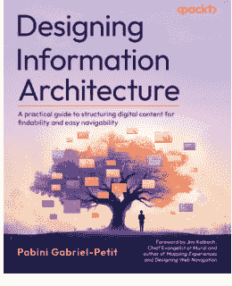

###### 设计信息架构

Pabini Gabriel-Petit

ISBN: 978-1-83882-390-0

- 信息寻求模型、策略、策略和行为
- 设计支持人类认知和视觉能力的 IA 的原则
- 用于场所营造、定向、导航、标签和搜索的寻路原则
- 有用的结构模式和信息组织方案
- 信息架构的 UX 研究方法和分析
- 内容分析、建模和映射方法
- 对内容进行分类并创建受控词汇表
- 设计和映射信息架构
- 利用人工智能（AI）提供最佳搜索结果

##### 电子信息类专业课
