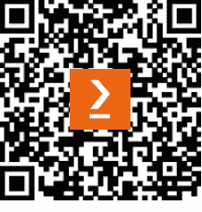

##### Index

###### A

- Acceptance Criteria (AC) 253
- accessibility
  - barriers 258, 259
  - building, into process from start 265
  - debt, reducing 265, 266
  - embedding, into reporting 269
  - integrating, into workflows 263
  - making, team responsibility 263, 264
  - progress, sustaining over time 270, 271
  - transparency and accountability, building 270
- accessibility progress
  - measuring 266
  - metrics, selecting 268, 269
  - reporting 266
  - success, defining beyond compliance 267
- Accessibility Roles and Responsibilities Model (ARRM) 143
- accessibility strike team 266
- accessibility testing
  - integrating, into development workflows 252-254
- accessibility test results
  - bugs, prioritizing 249
  - dashboards 251, 252
  - interpreting 249
  - prioritizing 249
- Accessible Canada Act (ACA) 267
- accessible design, ethical dimensions 52
- accessible design system patterns
  - for cognitive disabilities 220
  - for color perception 218
  - for deaf or hard of hearing 219
  - for low vision or blindness 229-232
  - for motion sensitivity 223
  - for motor disabilities 222-226
  - for photosensitivity 224
  - for speech disabilities 225
- Accessible Rich Internet Applications (ARIA)
  - applying, to enhance dynamic and custom components 160
  - aria-expanded attribute 158, 159
  - aria-labelledby 159
  - dynamics, enhancing with 156, 157
  - rules 158
- audio descriptions 30
- auditory disabilities 26
- Augmented Reality (AR) 192, 196
- automated solutions
  - role and limitations 51, 52
- automated testing tools
  - selecting 240-242

###### B

- bugs, prioritizing
  - blockers and serious issues 249
  - factor considerations 250, 251
  - moderate issues 250
- business case, for inclusivity
  - brand reputation, enhancing 19
  - innovation 19
  - legal compliance and risk mitigation 20
  - market reach, expanding 18
  - recognizing 17, 18

###### C

- captions 31
- card pattern 170, 171
- carousel slideshows 236
- Cascading Style Sheets (CSS)
  - used, for avoiding addition of important content 151, 152
  - used, for styling inclusive design 150
- case studies 136-138
- Cephable
  - reference link 108
- chunking 121
- code testing
  - for accessibility conformance 160-162
- cognitive disabilities 27
  - design system 220, 221
- color
  - used, for conveying errors 100, 101
  - used, for denoting action and interaction 101, 102
  - using, for time-sensitive decision-making and safety 96, 97
  - using, in charts and diagram 99, 100
  - using, in visual design 96
- color contrast
  - using 98, 99
- Color Contrast Checker 99
- color perception
  - design system 218, 219
- color vision deficiency 218
- company-wide commitment
  - driving 262
- continuous learning
  - accessibility, embedding into career growth 273
  - accessibility training, making meaningful 272
  - culture, creating 274
  - evolving standards and tools 273
  - knowledge sharing, encouraging 272
  - peer learning, encouraging 272
  - weaving, into inclusive design 271
- Convention on the Rights of Persons with Disabilities (CRPD) 45

###### D

- Definition of Done (DoD) 253
- designing, for accessibility 109
  - accessible design system, building 110
  - design considerations, for elements 110, 111
  - information architecture, for accessibility 112
  - personalization, empowering through user customization 111
- design solutions
  - gaps, bridging 41
  - gaps identification 41
  - iteration 40
  - user journey 36
  - user needs, mapping to 35, 36
- design system audio and video
  - closed captions 219
  - transcripts 220
- design system, for low vision 212
  - affordances, for magnification tools 217, 218
  - dynamic typography, planning for 213
  - typographic patterns, delivering 213-217
  - web browser zoom, enabling 213
- digital accessibility 48, 49
  - designing for disabilities, to human diversity 5
  - diverse spectrum of user needs and abilities 6
  - future legal trends, forecasting 54-58
  - historical context and evolution 4
  - legal foundation, establishing 47, 48
  - roadblocks, spotting 7
  - social model disability
- digital contexts
  - auditory disabilities 26
  - cognitive disabilities 27
  - disabilities types, categorizing 25
  - motor disabilities 27
  - visual disabilities 25
- digital services
  - reliance, increasing on 54
- disability simulations
  - reasoning, for falling short 260

###### E

- empathy
  - building, through real engagement 261
  - cultivating, through immersive experiences 258
  - embedding 261
  - turning, into action 262, 263
- ethical dimensions
  - of accessible design 52
- ethically driven design culture
  - cultivating 58-60
- European Accessibility Act (EAA) 48, 267
- explainable AI (XAI) 206

###### F

- FairFace 206
- floating action buttons 172, 173
  - best practices 173
  - layout 173
  - platform standards 173
  - user expectation 173
- focus order
  - in mobile accessibility 179
  - techniques 179, 180

###### G

- global accessibility legislation
  - challenges 50
  - legal foundation, establishing for digital accessibility 47, 48
  - navigating 46, 47
- global legal frameworks 48, 49
- Grammarly
  - URL 127

###### T

spectrum
  disability 24, 25

speech disabilities 226
  design system 225

speech-to-text (STT) 33

success criteria (SC) 143

Telecoil (T-coil) systems 31

text
  bulleted and numbered lists 122
  form field labels and instructions 123
  group related form inputs under headings 124
  headings 121
  labels, for buttons and interactive controls 123
  links 123
  making accessible 120
  making accessible, through scannability 120, 121
  navigation landmarks and menu links 122
  navigation menu and button labels 122
  paragraphs 121
  plain language principles 125-127

text-to-speech (TTS) 33

text version 136

tick-box exercise 53, 54

touchable area extension 174

touch targets
  card pattern 170, 171
  floating action buttons 172, 173
  optimizing 169, 170
  touchable area extension 174
  two-dimensional scrolling 171, 172
  workflows, utilizing 174, 175

transcripts 31

two-dimensional scrolling 171, 172

###### U

universal design
  principles 8, 9

user-centered design methodologies
  example, Microsoft’s Xbox Adaptive Controller 15, 16
  implementing 12
  inclusive user research and testing techniques 14
  iterative design processes 15
  user needs and experiences 12, 13

user interfaces, designing for cognitive disabilities 102
  consistency 102-104
  progressive disclosure 104
  reversal of actions 105
  unnecessary content abstraction 104, 105

###### V

video and audio 132
  closed captions 132, 133
  format combinations 134
  text transcripts 133, 134

Virtual Reality (VR) 192

visual design
  color, using 96

visual disabilities 25

voice interfaces, for accessibility
  designing 181-183
  identify controls 183
  nesting controls, avoiding 184

###### VR accessibility

- auditory accommodations 193
- cognitive accommodations 193
- considerations 194
- improving 193
- mobility accommodations 193
- motion sickness mitigation 194
- visual accommodations 193

###### VR experiences, for sensory abilities 192

- virtual escape room 194, 195
- VR accessibility, improving 193

###### W

###### WCAG standard principles

- operability 119
- perception 119
- robust 120
- understanding 119

###### Web Accessibility Initiative (WAI) 117

###### Web Content Accessibility Guidelines (WCAG) 48, 98, 117, 150, 261

###### web context 179

###### World Wide Web Consortium (W3C) 117, 156

##### Download a Free PDF Copy of This Book

Thanks for purchasing this book!

Do you like to read on the go but are unable to carry your print books everywhere?

Is your eBook purchase not compatible with the device of your choice?

Don’t worry, now with every Packt book you get a DRM-free PDF version of that book at no cost.

Read anywhere, any place, on any device. Search, copy, and paste code from your favorite technical books directly into your application.

The perks don’t stop there, you can get exclusive access to discounts, newsletters, and great free content in your inbox daily.

Follow these simple steps to get the benefits:

- 1. Scan the QR code or visit the link below:

https://packt.link/free-ebook/9781835888223

- 2. Submit your proof of purchase.

- 3. That’s it! We’ll send your free PDF and other benefits to your email directly.

