## 1 Revit 工作效率入门

我们生活在信息时代（也称为数字时代），数字化转型正在通过鼓励人们快速采用新技术和新流程来改变企业和个人。

Revit 是一种用于**建筑信息建模**（**BIM**）的创作软件工具；在这里，最有价值的资产是您添加到 Revit 模型中的信息。

信息为王；然而，管理信息和知识才是力量！

您可能已经熟悉 Revit，但信息管理原则与 Revit 最佳实践的结合可以形成强大的组合，从而提高您在 BIM 项目中的工作效率。

本章将为您提供如何提高 Revit 工作效率的知识，并提升您在处理从小型到大型 BIM 项目时的表现。

我们还将解释为需要执行的任务选择正确工具的重要性，介绍 BIM 实施的最佳实践，并提供如何为公司制定培训方案的策略。

在本章中，我们将涵盖以下主题：

- 您应该了解的 Revit 工作效率知识
- 选择正确的工具
- Revit 实施概述
- Revit 培训方案

### 您应该了解的 Revit 工作效率知识

在企业发展中，工作效率是衡量公司绩效的重要因素，而提高工作效率就是在预定的时间范围内更聪明地工作，以满足项目截止日期。

定义工作效率并更好地理解在日常多任务处理和使用 Autodesk Revit 时如何衡量它是至关重要的。

工作效率可以定义为一个流程，用于根据效率衡量产出，并将投入转化为产出。该流程适用于机器、工厂或个人，其结果可以帮助公司做出基于运营和投资的决策。

您可以使用多种方法来衡量工作效率；基本公式是产出除以投入，即工作效率：

产出 ÷ 投入 = 工作效率

用于衡量工作效率的方法取决于您公司所处的行业，下面我们列举了几个示例。

以下是一些工作效率衡量方法：

- 时间管理
- 员工完成的任务
- 个人绩效
- 产品制造比率

我们将探讨时间管理方法，以提高使用 Revit 时的工作效率和绩效。您可以将这些原则应用于任何涉及数字生产的任务中。

在提高工作效率方面，关键因素是在开始使用 Revit 之前，拥有高质量且精确的投入来生成您的模型和图纸。

您可能在使用 Revit 完成特定任务时速度很快，但如果没有高质量的投入，您可能会面临返工的风险，这将降低整体工作效率。

我们用于提高 Revit 工作效率的时间管理方法基于高质量的数字生产投入。该方法将使您在 Revit 中更加高效，并成为能赶上每一个项目截止日期的团队合作者。

该方法的第一步是研究高质量的投入。这些投入可以来自您的公司、同事、项目中的多家公司，以及最终的主要利益相关者——客户。

一旦您确定了高质量的投入，就可以开始在 Revit 中工作，生成您的模型和图纸。以下示例将帮助我们演示这一流程。

### 示例 1：设置 Revit 项目

在此示例中，**BIM 执行计划（BEP）** 定义了质量投入。然而，设置项目所需的信息往往并不完全可用，您需要研究高质量投入。

此示例的质量投入包括命名标准、项目标准、协作标准、测量策略、体量策略、软件版本、交换格式、信息需求等级、BIM 交付物、**通用数据环境（CDE）**、项目位置、坐标、标高和轴网。

项目编号的变更是许多项目中常见的问题，而使用此方法，您需要在设置 Revit 文件之前向项目负责人索取此信息，并获得客户的确认。项目编号应在 BEP 中明确规定并经客户批准，以避免在设计阶段和施工阶段发生任何变更。

管理信息以更聪明地工作是该方法的基本组成部分，如果您将其与 Revit 最佳实践相结合，它将把您带到工作效率的下一个层次。

项目编号的一个简单变更可能会影响多个不同领域同事的工作效率，例如文档管理员、信息经理以及商务和法律部门。

请注意，先前图纸的旧信息将受到影响；由于项目编号变更，它将与新图纸失去关联。

在此示例中，您可以看到在正确的时间拥有正确信息的重要性，并且这些信息需要由主要利益相关者或客户确认。

### 示例 2：定义房间编号系统

在此示例中，客户需要批准房间编号系统，该系统还需要与设施管理系统保持一致，以保证数据的持续流通。

通过使用此方法，您可以降低房间编号系统将来被更改的可能性，这最终会提高您和团队的工作效率。

如果您熟悉 Dynamo 这一 Revit 的可视化编程工具，您可能会建议使用 Dynamo 快速重命名项目中的所有房间。是的，Dynamo 可以快速重命名房间。我们的方法遵循“第一次就做对”的原则，因此您无需返工，也无需使用 Dynamo 重命名房间，因为这在流程开始时就已经达成一致。

在此示例中，您可以通过避免重复工作和浪费时间在那些项目初期就能轻松达成一致的任务上来提高工作效率。

### 示例 3：培训与工作效率

有些项目启动时，设计团队缺乏特定软件所需的知识，这会拖慢工作效率。

Revit 培训对于提高工作效率至关重要，但提供或接受培训的时间需要合理安排。

如果培训在项目开始前几天进行，设计师将受益匪浅，因为计算知识需要保持新鲜。否则，设计师在一段时间后只会记住要点。

培训师需要了解项目何时开始的质量信息，以便确定提供培训的最佳时间框架。

通过使用此流程，Revit 培训师会发现要求重新参加培训的请求减少，这将证明培训的有效性以及他们在提供培训方面的工作效率。

Revit 是一款直观的软件，设计师可以快速学习基本命令，这有利于公司切换平台或为新员工提供培训的战略。


以下图表显示了投资培训以实现快速项目实施的好处，并且它将反映实现**投资回报率 (ROI)** 所需时间量的减少。总体而言，这将导致 Revit 和 BIM 中团队生产力的提高：

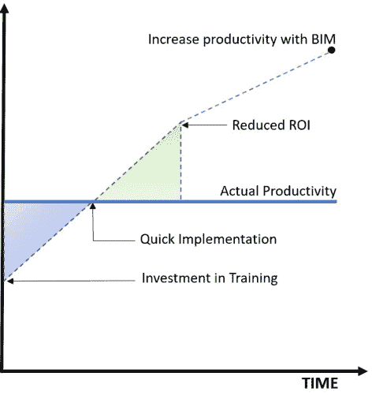

图 1.1 – 培训投资

另一个常见问题是团队成员没有时间参加 Revit 培训，或他们决定在实际项目中学习 Revit。此过程会让你产生这些团队成员已准备好在 Revit 中工作的错误感觉，并且达到最佳生产力水平所需的时间会更长。

在这种情况下，培训师需要提供短时段的培训，以提高他们的 Revit 知识并避免项目中的错误。

在此示例中，在正确的时间提供培训可提高生产力并减少达到 ROI 的时间。

## 示例 4：Revit 与 2D CAD – 生产力

BIM 在**建筑、工程、施工、业主运营商 (AECOO)** 行业中推动了变革，其中信息是提高生产力的方法核心，与传统的 2D CAD 流程相比可带来诸多益处。

Revit 以信息为中心，它与传统 2D CAD 相比具有多项优势，我们可以轻松衡量生产力的显著提升。

BIM 平台，例如 Revit，为我们提供了联合信息，这意味着可用于多种用途的高质量数据，这是我们使用高质量数据工作的方法的一部分。

当然，这一切都取决于设计师使用正确的输入信息并精确地进行 3D 建模以优化分析效益。

在此示例中，我们可以理解从 2D CAD 切换到 Revit 时生产力的提升，但高质量信息对于提高生产力至关重要。

## 示例 5：在 Revit 中规划你的工作

时间管理原则侧重于在开始任务之前规划工作的过程，无论你独自在 Revit 中工作还是在大型设计团队中工作，区别不大。

如果你在建模前规划任务并搜索高质量信息以避免任何返工，你的生产力将会提高。

在此过程中，你可以选择对任务影响大的活动，并考虑可以推迟的其他活动。

以下图表显示了优先处理对项目影响大的任务的过程：

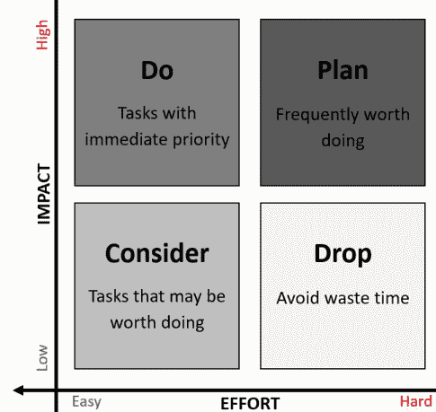

图 1.2 – 工作量与影响

对于此示例，我们将利用一个流程来创建门表，该表包含许多需要检查和收集高质量信息的活动。

### 高影响

执行以下操作：

- 使用已获客户批准的门编号系统。
- 列出防火门的等级。
- 决定门表中将包含哪些字段。
- 检查结构开口。
- 检查门参数是否报告正确的数据。

计划以下内容：

- 检查门框尺寸是否正确。
- 检查族名称是否与项目标准相同。

### 低影响

考虑以下内容：

- 根据项目阶段，门材料可以是通用的。
- 根据项目阶段，检查门公差。

放弃以下内容：

- 根据项目阶段和工作范围，团队成员可以推迟选择五金件套装。
- 检查门板与地板之间的间隙。

在此示例中，我们可以在 Revit 建模过程中使用时间管理原则来提高生产力并定义对项目影响大的优先级。

遵循我们的方法论，带有高质量信息的时间管理流程将提供工作效率的飞跃。

我们已完成示例，以定义研究的重要性并在执行任务前获取高质量信息。我们已学习如何避免仅基于即时可用数据进行操作，而这些数据可能不可靠或不完整。

Revit 中还有其他技术因素可以帮助你提高生产力并使工作更高效。让我们在下一节中探索它们。

## 计算机维护

为了获得最佳的 Revit 性能，进行一些维护工作是必不可少的。我们建议你每两周执行以下步骤。

### Revit 本地文件

在工作共享环境中工作时，Revit 会在用户的计算机上的 **Documents** 文件夹中自动创建本地文件。此过程会使 Revit 本地文件（即进行中的文件）成为 Revit 中央文件的副本，并在文件名中加上你的名字。

此过程的目标是删除本地文件，以便为 C:\ 驱动器提供更多空间，从而提高性能：

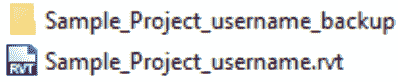

图 1.3 – Revit 本地文件

这些文件和文件夹位置在 Revit 选项下定义：

1. 在左上角，单击 File | Options：

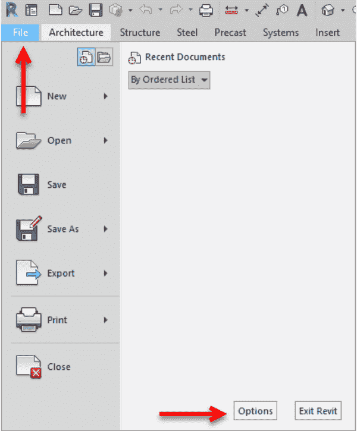

图 1.4 – Revit 选项

为了改进此过程，建议你创建一个名为 Revit_20XX_Local_Files 的文件夹（其中 20XX 为 Revit 版本），这样 Revit 文件就不会与 Documents 文件夹中位于的其他文件混合：

```
C:\Users\<username>\Documents\Revit_20XX_Local_Files\
```

用户文件的默认路径：

C:\Users\username\Documents\Revit_2021_Local_Files

图 1.6 – Revit 本地文件的路径

> **提示**
> 位置可能会根据你设置的 Revit 选项而有所不同。此信息将保存在 Revit.ini 文件中，并用于未来的 Revit 会话。

### 临时 Windows 文件

用户使用的应用程序通常会经常创建临时文件。因此，用户应定期删除它们。

在运行此过程之前，请确保所有 Revit 会话均已关闭。

要访问此文件夹，请执行以下步骤：

1. 打开 **Windows 资源管理器**。
2. 在顶部栏地址中，输入 `%temp%` 并按 Enter：
3. 选择所有文件并单击 **删除**。如果出现警告窗口，请忽略所有只读文件（这些文件正被应用程序使用，当前无法删除）。

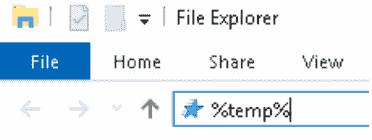

图 1.7 – 临时 Windows 文件位置

### 磁盘清理

用户还应运行的另一项任务是 **磁盘清理** 工具。此工具还会删除不再需要的文件。

要访问此工具，请执行以下步骤：

1. 在 Windows 搜索栏中，输入 `disk cleanup`。
2. 从列表中选择你需要的工具：

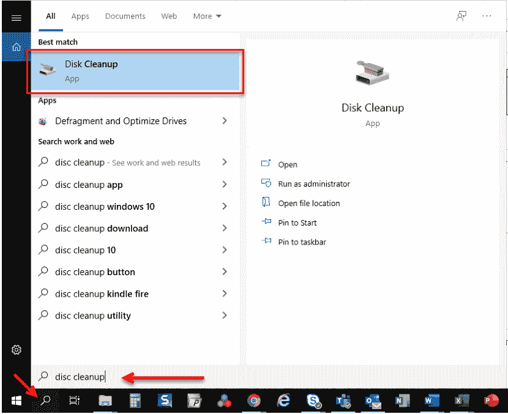

图 1.8 – 磁盘清理

3. 从列表中选择要删除的文件：

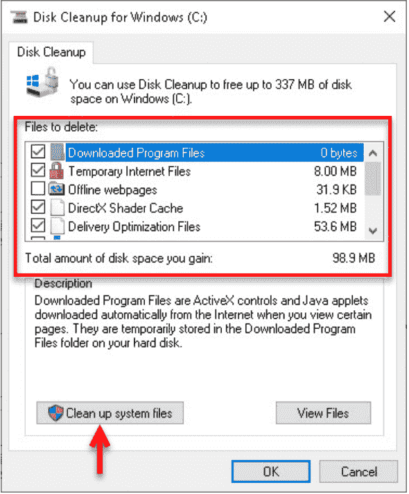

图 1.9 – 清理系统文件

4. 单击 **清理系统文件** 按钮开始删除过程。

5. 过程完成后，单击 **确定**。

### 重新启动 Revit

如果用户在执行高需求任务（例如导出、打印、渲染或升级模型）后遇到性能下降，Revit 应重新启动。

这将允许删除内存和硬盘上缓存的所有数据。

### 重新启动 Windows

继我们之前提到的重新启动 Revit 的内容之后，对 Windows 也应做同样的处理。此建议取决于用户处理了多少应用程序。

> 提示
> 我们建议用户每天重新启动计算机，或至少每隔一天重新启动一次，以便系统清理、清除临时文件并自行更新。

### 始终使用相同的 Revit 更新版本

Autodesk 经常部署带有新功能和错误修复的新更新版本。

确保在与其他团队成员一起进行项目工作时，每个人都使用相同的更新版本以避免任何潜在的软件问题，这一点至关重要。

> 提示
> 在同一 Revit 版本中 – 例如 Revit 2021 – 我们可以有不同的更新版本，例如以下：
> Revit 2021.1.1 – 发布日期：2020 年 9 月 18 日
> Revit 2021.1 – 发布日期：2020 年 7 月 22 日

要确认你安装了哪个 Revit 更新版本，请启动 Revit。

Revit 打开后，请按照以下分步指南操作：

1. 在右上角，单击靠近 Help 菜单的小深色箭头：


图 1.10 – 访问 Revit 帮助


你可以在以下位置找到并下载最新更新：

- Autodesk 管理账户门户：

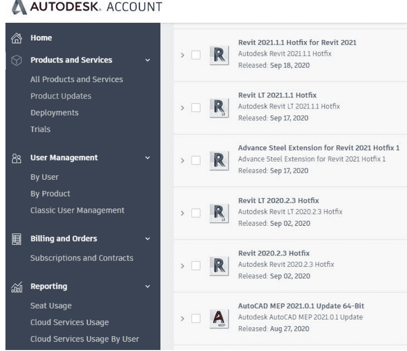

图 1.13 – Autodesk 管理账户门户

- Autodesk 桌面应用：


图 1.14 – Autodesk 桌面应用

> 提示
> 不建议在新版本发布后立即更新 Revit 版本。

## Revit 的推荐设置

Revit 在计算机资源使用方面要求很高。强烈建议将设置保持在尽可能低的需求水平。我们只会强调其中一些建议，但其他建议也可能适用，具体取决于所使用的专业领域，甚至取决于要执行的任务。

以下内容可通过 Revit **选项按钮**访问：

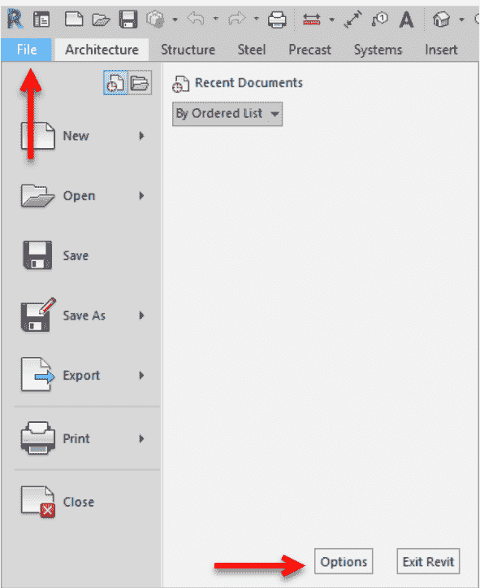

> 提示
> 在浏览视图时、用户遇到图形相关问题时，或此功能与显卡不兼容时，应禁用此 *硬件加速* 功能。

## 文件大小

Revit 文件大小不仅取决于项目大小，还取决于许多其他因素，例如几何复杂性、导入的文件格式、导入族的数量以及任何警告。

每周审核模型将有助于保持模型处于可工作且健康的状态，而不会影响或降低 Revit 性能。

作为参考，并且取决于您计算机的规格，Revit 模型不应大于 300 MB。

如果文件需要更大，用户必须决定是否应将其作为单个模型/卷保留，或是否应审查模型分离和模型卷分解。

对于联合模型（即包含多个链接的文件），推荐的最大文件大小约为 500 MB。

> 提示
> 作为良好实践，应清理项目和族文件，以通过删除任何不需要或未使用的元素和设置来减小文件大小。

## 族创建

族创建是性能方面的重要话题之一，因为我们开发得越复杂（例如，包含多个公式、过度建模、嵌套族、阵列、空体或参数过度约束），文件就越大。

创建族时，用户应注意以下几点：

- 应使用标准族而不是模型就地族（尤其是在重复使用时）。
- 嵌套族必须限制在一定层级 – 尽可能保持在一层嵌套。
- **排除元素选项：** 用户应使用排除成员功能进行少量排除。
- **设计选项：** 用户应避免在设计选项中使用组。
- **标高约束：** 用户不应将元素约束到标高（例如，墙体的顶部约束）。
- **系统族：** 用户应避免在组中使用系统族，因为它们被约束到特定标高。当复制到不同标高时，将保留第一个标高引用，任何进一步的编辑都会变得更加复杂（请记住，我们距离参考标高越远，性能就越低）。
- **工作集：** 在工作共享项目中，创建包含来自不同工作集元素的组时，Revit 将忽略现有工作集，并在创建组时将所有元素包含在当前工作集中 – 此工作集无法编辑。
- **链接：** 用户不应将 Revit 链接添加到组中，因为它将被复制，从而影响性能。

## 就地族

就地族是用户可以在项目上下文中创建的专用族。它们不应在项目中使用，因为它们会降低性能，而标准族（即可加载族）可以涵盖大多数情况：

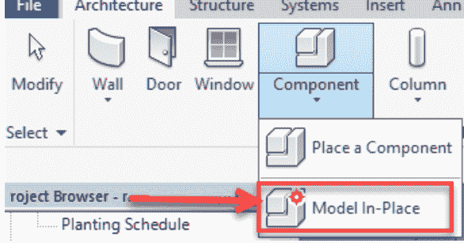

图 1.18 – 模型就地族

如果用户创建就地族以供多次使用，他们应使用标准族（可加载族）。这是因为如果就地族被复制，Revit 将把这些实例视为不同的族。这将多次重复族，从而影响性能：

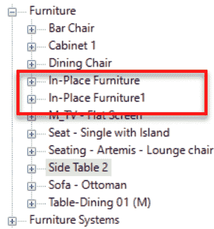

图 1.19 – 重复的就地族

## 阵列

使用阵列复制元素时，用户应决定元素是否应保持分组或不分组，因为这也会影响性能。组应保持关联尽可能少。否则，应取消分组：

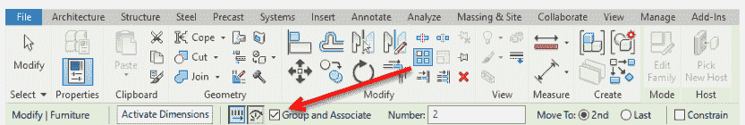

图 1.20 – 在阵列工具中创建组

## 约束

使用 **约束** 会影响模型性能。它们应在项目中谨慎使用。

约束可能包括以下内容：

- 几何连接约束
- 尺寸约束
- 锁定对齐约束

使用这些约束时，请记住几乎不可能看到它们的位置，因为它们可以在任何视图中放置。

Revit 在 **视图控制** 栏下方有 **显示约束** 工具，可让您通过在视图顶部添加一种“筛选器”来检查尺寸和锁定对齐约束。使用该工具时，Revit 会在视图周围应用石榴石边框，所有约束都将以相同颜色突出显示：

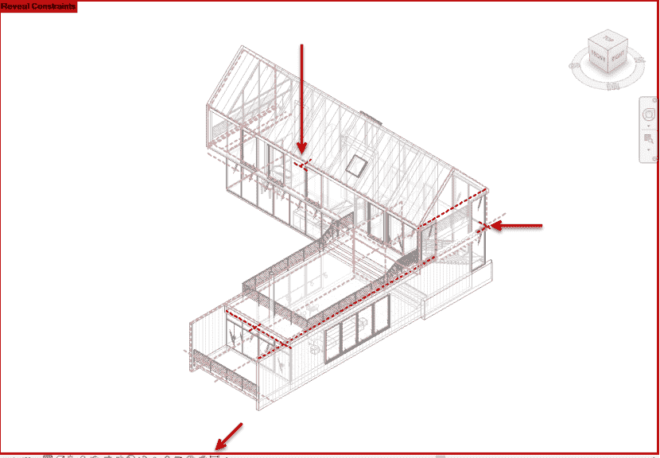

## 使用工作共享环境时

工作共享是 Revit 中的一种工作方法，允许团队成员同时在同一模型上工作：

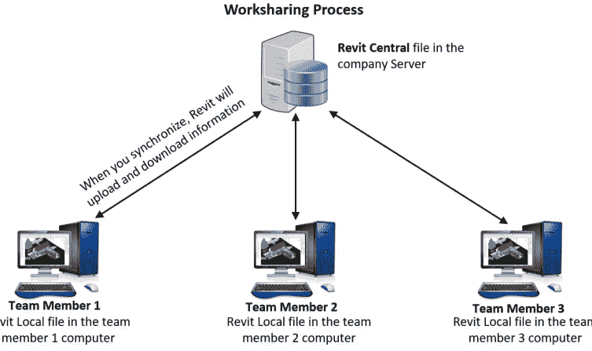

图 1.22 – 工作共享环境

在此工作方法中，Revit 需要使用工作集来适应此类环境。

Revit 中与工作共享方法相关的有几个原生工具，需要深入理解，我们将在本书的后续章节中介绍它们。

工作集在此工作方法中至关重要，因为用户可以保留对元素和/或视图的所有权。通常，用户将被分配到项目的特定区域，甚至是特定的功能区域进行工作。

基于此管理元素或项目部分的流程，Revit 允许用户不仅在打开文件时，还在视图中工作时打开/关闭工作集。因此，如果我们关闭工作集，Revit 会变得更快，因为它在模型中工作时不需要处理所有信息。

可以遵循建议，但我们认为沟通是成功的关键。重要的是让所有团队成员了解设计过程中发生的事情，以及它可能如何影响模型组织甚至工作集结构。

> 提示
> 有多种工具可用于增强团队协作和沟通，例如 Skype、Microsoft Teams、Microsoft OneNote、Microsoft Planner、Slack 等。

## 打开工作共享模型

打开工作共享模型时，Revit 允许用户选择应打开哪些工作集。如果关闭不需要的工作集，Revit 将更快地打开文件，从而提高性能。已关闭的工作集将不可见，因此您可以仅保留所需的信息处于打开状态。

要选择用户可以打开或关闭的工作集，请按照以下步骤操作：

1. 转到文件菜单，选择打开，然后单击项目。
2. 选择要打开的 Revit 中央模型。
3. 在 **打开** 按钮右侧，单击下拉箭头并选择 **指定…**：

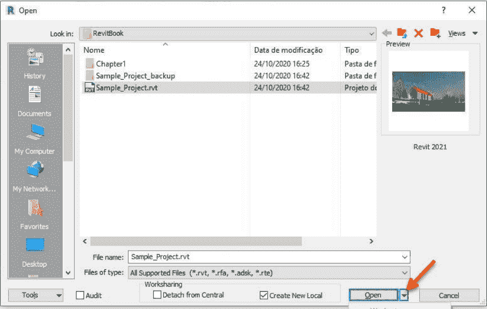

图 1.23 – 指定要打开的工作集

4. 弹出 **打开工作集** 窗口。通过选择特定工作集，可以通过单击 **打开** 和/或 **关闭** 按钮按需 **打开/关闭** 它们：


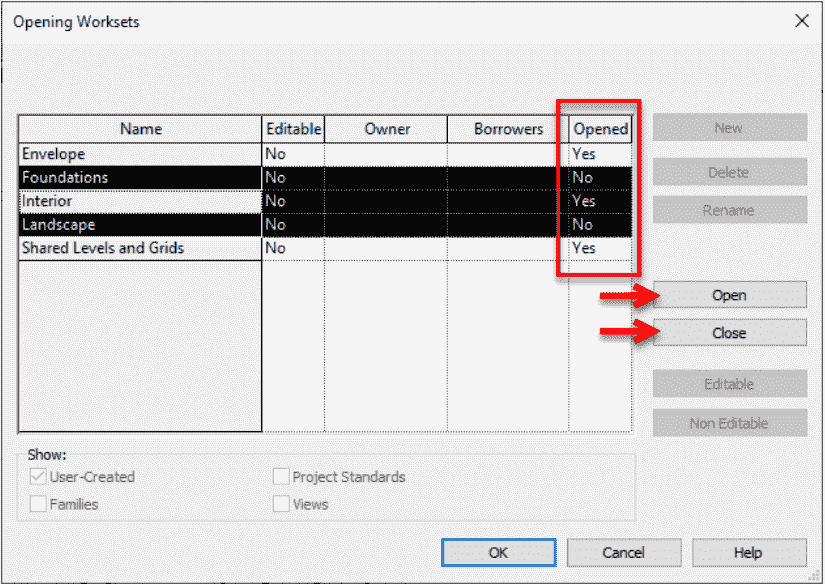

图 1.24 – 打开工作集窗口

5. 点击 **OK**，Revit 将仅打开工作集中元素的模型。

> **提示**
>
> 此过程可以在不关闭文件的情况下随时撤销，只需在打开和关闭的工作集之间切换即可。

不仅文件会打开得更快，而且在浏览模型、打开视图，甚至与中心模型同步时，一切都比加载所有模型和工作集时更快。

作为良好实践，每当设计团队在多学科项目上工作时，强烈建议为每个链接使用单独的工作集，无论是 Revit 链接还是 CAD 链接。通过此流程，在打开文件时更容易关闭任何不需要的链接。

> **提示**
>
> 在工作共享环境中工作时，用户**不应**双击文件打开。用户必须始终使用 **Open** 工具来创建本地文件。

## 使用已打开的工作集

如果在特定视图中不需要打开所有工作集，强烈建议将其关闭，因为这也会影响视图处理。工作集在模型中打开时，可以更改其可见性。

> **提示**
>
> 用户只有在工作集在 Revit 会话中打开时才能更改工作集的可见性。如果工作集未加载（即未打开），则需要将其切换为 **Open**。之后，可以在特定视图中编辑工作集可见性。

要选择用户可以在视图中更改可见性的工作集，请按照以下步骤操作：

1. 打开要更改工作集可见性的视图。
2. 在 **Properties** 下方，点击 **Visibility/Graphics Overrides**（也可简称为 **VV** 或 **VG**）：

   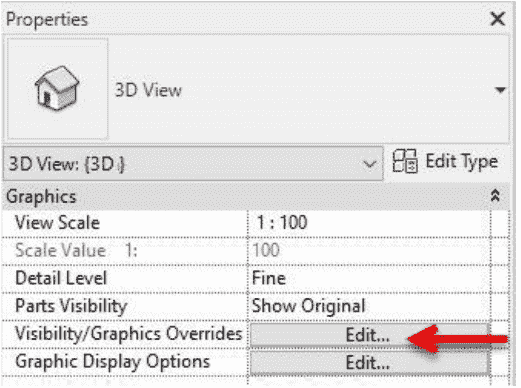

   图 1.25 – 可见性/图形覆盖

3. 在 **Worksets** 选项卡下，按需更改 **Visibility Setting**：

   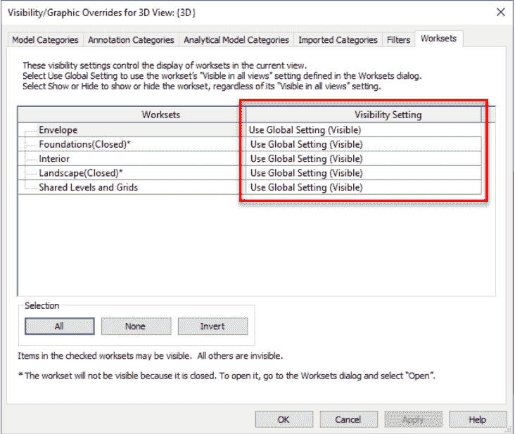

   图 1.26 – 在视图中控制工作集的可见性

   可用三个选项：

   - **Show**：此处工作集将在当前视图中可见。
   - **Hide**：此处工作集将在当前视图中不可见。
   - **Use Global Settings (Visible)**：此处工作集可见性取决于工作集是否被定义为在所有视图中可见。

4. 点击 **OK**。

如果某个工作集在所有模型中都已关闭，可以从 **Visibility/Graphics Overrides** 窗口中确认这一点。星号 (*) 告诉您如何将工作集切换为 **Open**：

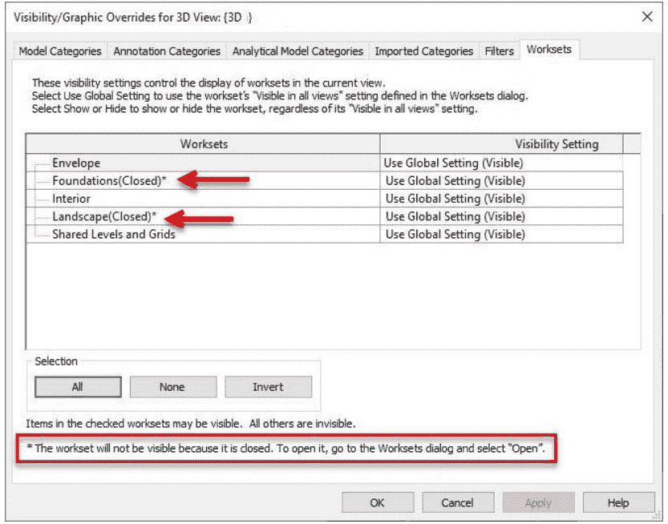

图 1.27 – 已关闭的工作集

## Worksharing Monitor

在工作共享环境中工作时，了解谁正在文件中工作至关重要。Worksharing Monitor 将告知您以下信息：

- **谁打开了模型**：取决于同时在同一文件中工作的团队成员数量，这会影响模型的性能。
- **谁正在同步**：这会告知您谁正在同步，您可以等待此人完成该过程。
- **谁直接在中心文件中工作**：如果有人直接在中心文件中工作，该人员需要立即关闭文件且不保存。

要访问 Worksharing Monitor 工具，请按照以下步骤操作：

1. 在 **Collaborate** 下，点击 **Worksharing Monitor** 工具：

   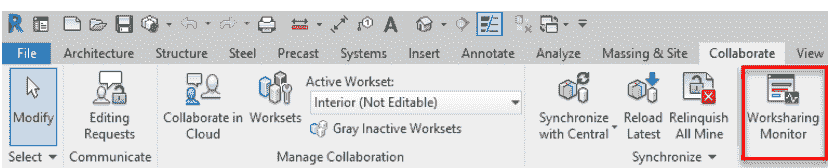

   图 1.28 – Worksharing Monitor 工具

2. 将打开一个新窗口，如以下屏幕截图所示：

   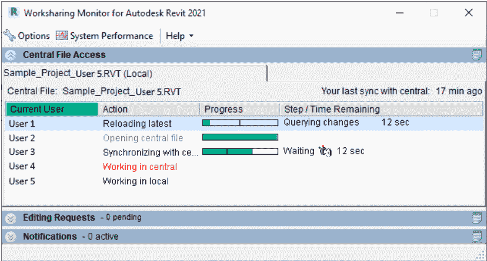

   图 1.29 – 使用 Worksharing Monitor 识别模型中的用户

## Splash screen

通过使用 2D 视图作为启动视图，您可以在打开模型时提高性能，因为 Revit 不需要重新生成整个项目。起始视图工具可在 Manage | Starting View 下定义：

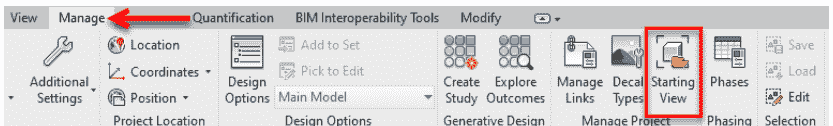

图 1.30 – 起始视图工具

> **提示**
>
> 在启动屏幕中，您可以获取项目信息、模型问题日期、模型坐标和免责声明说明。

总之，我们学习了 Revit 生产率和/或研究高质量信息的重要性。通过遵循 Revit 推荐的设置，您将提高项目的效率和生产率。

在下一节中，我们将学习如何选择正确的硬件规格以提高 Revit 的性能。

## 选择合适的工具

生产率的另一个令人兴奋的方面是选择合适的工具来执行特定任务的过程。

在概念、设计和施工阶段，设计团队有多种应用程序可供选择。在选择工具之前，我们必须考虑团队经验和培训策略。

必须强调的是，BIM 并不是 Revit，Revit 只是用于创建 BIM 模型的应用程序之一；BIM 流程中有多个应用程序。

以下图表显示了市场上用于管理数据和模型的某些 BIM 应用程序的复杂性：

- BIM Authoring

  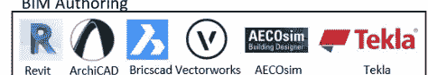

- 3D Visualisation & VR

  

- 3D Model Viewer - Mobile

  

- Clash Detection - Coordination

  

- Productivity

  

- Construction Sequencing

  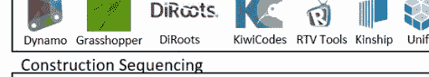

- Costing

  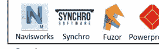

- Facilities Management

  

图 1.31 – 多个 BIM 应用程序

根据项目规模，Revit 将需要更多计算机资源来管理更大的模型，了解如何选择正确的硬件至关重要。

如果您没有正确的硬件或公司未为设计团队提供最佳基础设施，生产率会直接受到影响。

根据项目要求，用户需要能够理解硬件规格并为 Revit 选择最佳工作站。

### Revit 最佳工作站是什么？

市场上有很多工作站选项，选择 Autodesk Revit 的最佳工作站可能具有挑战性。

计算机要求需要根据用户需求定义，例如模型复杂性、渲染选项以及与多个文件协作的能力。

本指南将帮助您定义这些要求并为 Revit 选择最佳工作站。

在研究中定义 Revit 工作站时，必须考虑以下五个关键点：

- 桌面还是笔记本？
- 快速处理器
- 最佳显卡
- 计算机内存（RAM）
- 快速硬盘

### 桌面还是笔记本？

具有相似部件的台式机往往比笔记本更快，台式机的平均使用寿命更长。台式机部件的升级过程比笔记本更简单，可以延长多个组件的整体使用寿命。

台式机通常易于定制，其好处是可以添加高端组件，例如显卡以提高可视化效果。在笔记本电脑中，升级选项更有限。

另一方面，笔记本电脑具有便携性，非常适合会议和客户演示。

### 快速处理器

Revit 主要是一个单线程软件，这意味着更快的处理器对 Revit 性能更好。Revit 中有一些操作是多线程的，因此 Revit 可以在 Revit 2021 中使用多个处理器和多核处理器进行以下处理：

- 以矢量方式打印以及导出 DWG 和 DWF 文件
- 实时光线追踪


- 墙体连接在平面图和剖面图中的表示
- 将元素加载到内存中的过程以减少打开时间
- 在透视 3D 视图中导航时轮廓边缘的计算
- 打开视图或更新视图属性时的图形表示
- 保存和打开文件
- 点云数据的显示
- 将 DWF 导出为单张图纸
- 后台运行的 MEP 系统计算
- 材料用户界面
- 颜色填充计算
- 在另一个进程中后台运行的结构连接几何

目前，这些是最常见的处理器类型选项：

- Intel Xeon
- Intel (i) 系列 i5、i7、i9 和 i10
- AMD Ryzen

## 处理器 Intel Xeon

Intel Xeon 主要用于商务工作站或服务器，其 CPU 通常比 Intel (i) 系列拥有更多核心。此外，与 Intel (i) 系列如 i7 或 i9 相比，其时钟速度略低。

它具有良好的耐用性和韧性，这使得该处理器成为建筑和工程公司同时使用多个应用程序的良好选择。通常，Intel Xeon 比 Intel (i) 系列更昂贵。

## Intel (i) 系列 i3、i5、i7、i9 和 i10

Intel (i) 系列通常更受个人电脑青睐，与 Intel Xeon 相比，处理器成本更低。

Intel (i) 系列的优点在于处理器每核心的时钟速度通常比 Intel Xeon 更快，因此对 Revit 的性能带来优势。

Revit 的性能会随着每核心时钟速度高的处理器而提升，这意味着多核心处理器不一定会增强性能，因为 Revit 并非完全是多线程软件。

## AMD Ryzen Threadripper 处理器

AMD Ryzen Threadripper 处理器是一个降低成本的选择，它可以在 Revit 中提供良好的性能。按照之前的过程，您需要检查时钟速度和最高睿频速度。

## 最高睿频频率 (GHz)

目前，大多数公司在 Revit 工作站中使用 Intel 技术，选择 Revit 最佳处理器的过程基于最高频率 (GHz)，即处理器速度。

选择合适处理器时的关键点是检查最高频率 (GHz) 以最大化 Revit 的性能。您需要考虑以下两个方面：

- 处理器基础频率 (GHz)
- 处理器最高睿频频率 (GHz)

简单来说，处理器基础频率 (GHz) 是基础速度，而最高睿频频率 (GHz) 是处理器最高速度。

例如，我们将分析 Intel® Core™ i9-10900X X-series 处理器。

您可以在以下链接访问处理器规格。或者，您也可以使用手机摄像头扫描以下二维码。

以下是链接：`https://intel.ly/2HhqjAV`

以下是二维码：


Revit 插件，如 Enscape、Twinmotion、Lumion 和 V-Ray，利用了 **图形处理单元 (GPU)** 渲染技术，这需要来自 NVIDIA 或 AMD 的强大的显卡。

使用 GPU 可以降低渲染时间，插件如 Enscape 可以快速提供出色的渲染质量（例如，少于 1 分钟）。

您可以通过以下链接查看 Enscape 360° 图像示例：

`https://bit.ly/35T3FYr`

或者，您可以扫描此处的二维码：


许多 Revit 工作站使用 NVIDIA 显卡，这些显卡分为两种类型：

- NVIDIA Quadro 或 NVIDIA Quadro RTX
- NVIDIA GeForce GTX 或 RTX

通常，NVIDIA Quadro 系列基于韧性和耐用性，比 NVIDIA GeForce 系列更昂贵。

NVIDIA RTX 技术是最新发展，它改进了实时光线追踪，并将在您的渲染中提供详细的灯光效果和更好的性能。

在此网站上，您可以比较多张显卡并比较性价比：

`https://gpu.userbenchmark.com/`

为了获得最佳性能和效率，显卡应至少具有 4 GB 专用内存或 RAM。

> **提示**
> 
> 始终检查您是否使用显卡的最新可用驱动程序。

## 计算机内存 (RAM)

根据您的项目需求，我们建议轻度用户使用 16 GB 系统内存，普通用户使用 32 GB，大型项目和日常使用的用户使用 64 GB。

内存 (RAM) 的成本正在下降，如果您能负担 64 GB 内存 (RAM)，则建议使用。在中型和大型组织中，64 GB 是最低要求。

计算机内存 (RAM) 会提高 Revit 的性能，因为它在内存中维护模型数据。

> **提示**
> 
> 建议您经常重新启动计算机和 Revit；这将刷新内存 (RAM)。经常将 Revit 保持打开数天的用户会经历性能下降。

## 快速硬盘

**固态硬盘 (SSD)** 在 Revit 中提供更好的性能，并允许您的计算机启动、启动应用程序和加载文件比传统硬盘快得多。

设计师经常使用多个应用程序，如 Revit、AutoCAD、Rhino、Navisworks 或 Adobe Suite，以及各种插件，这些可能占用硬盘中大量空间。

推荐的 SSD 应至少为 500 GB。

如果没有足够的空间来缓存 Revit 进程，将会出现较慢的性能。

> **提示**
> 
> 始终在硬盘中保留至少 30 GB 的可用空间。

拥有正确的软件和硬件对于提高 Revit 中的性能至关重要，以上信息将使您能够选择最佳工作站以最大化 Revit 中的性能。

在下一节中，我们将学习 BIM 实施的成功策略。

## BIM 实施概述

BIM 是一种许多公司已经实施的过程，但对成功策略有一个概述是有价值的。

BIM 成熟度水平对于分析公司实施情况及其交付 BIM 项目的能力至关重要。

BIM 实施并不止于几个项目，而是一个需要定期维护和持续发展的过程。

持续发展将为提高组织的成熟度水平奠定基础，并涉及多个部门，如商业部门，它们将分析合同和任命。

> **提示**
> 
> 成功策略考虑到整体公司文化，并制定自上而下驱动的战略计划，并在实施 BIM 的决策中涉及董事。

成功的 BIM 实施共享以下 10 个关键步骤：

- 1. 让董事以言行参与 BIM 实施的决策。实施始于自上而下！
- 2. 创建一个人员小组来定义实施过程和整体 BIM 战略，该战略必须包括多个部门。
- 3. 记住最终目标是更好的信息管理。
- 4. 创建一个小型团队来开展第一个项目。
- 5. 创建或调整您的公司标准以符合当地 BIM 规范和 ISO 标准。
- 6. 定义您将使用的软件和支持。了解实施新技术所需的人力资源等投资。
- 7. 培训和发展您的团队。培养一些人成为“专家”以帮助公司其他人。
- 8. 随着时间的推移改进 BIM 流程，不要专注于技术。
- 9. 设定切合实际的目标，因为 BIM 的好处已得到充分记录；然而，您需要投入时间和精力来实现组织真正的潜力。
- 10. 始终记住信息管理是 BIM 流程最重要的方面。

在 BIM 实施期间，组织可以为未来发展创建特定领域并支持该过程以提高 BIM 成熟度水平。

持续发展的领域包括以下内容：

- 公司和行业标准、方法和程序
- 培训
- 数字资产管理 – Revit 族、AutoCAD 块和其他文件
- 生产力和数据分析

这四个领域应持续发展，以为您的组织带来创新并提高生产力。

许多中型和大型公司内部拥有编程能力的人员，以提高生产力并定制工具以创建新的工作流程。

如果您希望学习编程以应用于建筑和工程团队，我们推荐 Dynamo、Grasshopper、Python 和 C#。

编程技能可以开启职业生涯的大门并扩展您的设计能力，使您领先于竞争对手。

此外，在 BIM 实施过程中，您还需要关注另外七个要点：

1. 创建一个 BEP 模板，您将用它来响应客户对 BIM 的要求。


- 2. 根据所在地的框架（例如英国 BIM 框架）定义公司的 BIM 标准交付成果。

英国 BIM 框架的参考资料见：

```
https://ukbimframework.org/standards-guidance/
```

使用手机摄像头扫描二维码，即可访问上述链接：


- 3. 定义 BIM 项目的信息需求等级。

信息需求等级列出了 BIM 构件的几何和数据要求，以及项目的前提条件。应根据这些要求的用途进行定义，从而为项目创造价值。

在英国，PAS 1192-2:2013 中沿用的术语是模型定义等级/细节等级（LOD）/信息等级（LOI）。目前，英国采用的是 ISO 19650 系列中定义的信息需求等级。

在美国，BIMForum 发布了开发等级（LOD）。

BIMForum 网站链接如下：https://bimforum.org/LOD

使用手机摄像头扫描以下二维码，即可访问上述链接：


- 4. 定义将在多个项目中作为标准使用的典型 BIM 交付成果和模型用途。

- 5. 编写内容，以便在投标过程中回答**资格预审问卷（PQQ）**，从而明确贵公司的经验水平和交付 BIM 项目的能力。

- 6. BIM 会影响合同和委任，因此商务部门应了解项目的 BIM 要求。

- 7. 将风格和展示标准与 BIM 创作工具（例如 Revit）保持一致。

总而言之，BIM 实施是一个会影响 AECO 行业相关公司几乎所有部门的过程。

在下一节中，我们将学习如何为公司制定 Revit 培训方案。

## BIM 与 Revit 培训方案

公司会使用各种需要培训才能维持生产效率的应用程序和插件，因此制定战略性的培训方案至关重要。

培训方案的战略目标包括：

- 评估员工的知识水平。
- 了解现有培训流程。
- 确定培训障碍。
- 制定培训预算。
- 找出内部专家。
- 建立衡量进度的流程。
- 确定所需资源，例如计算机、培训室、培训材料、在线视频培训、公司标准等。

下面详细探讨这些战略目标。

## 评估员工知识水平

评估员工的知识水平并确定其经验程度，有助于制定培训计划。可以使用多种工具创建调查问卷，例如 SurveyMonkey、Google Forms、Microsoft Forms 等。

可以根据以下因素跟踪软件使用经验：

- 使用年限（少于 1 年、1 至 2 年、3 至 4 年，以及 5 年以上）。
- 经验水平（无经验、基本了解或具备基础知识、初学者或经验有限、中级、高级和专家）。
- 针对特定软件的问题。
- 基于任务的问题。
- 一对一面谈。

## 了解现有培训流程

我们需要了解当前的培训流程，以便检查其中的不足并寻找可能的改进方法。

在调研过程中，我们可能会发现更好的培训课程跟踪和组织方式。

## 确定培训障碍

培训能否成功，取决于你如何减少培训障碍并为员工提供有效培训。

以下列出了一些可能需要解决的障碍：

- 管理变更：包括技术、预算、人员以及其他方面的变化。
- 改变已形成的习惯：改变已经实施多年的流程可能会很有挑战性。
- 培养 BIM/Revit 骨干：需要 Revit 骨干支持实施工作并帮助员工。
- 造成当前工作流程中断：新工作流程应提高生产效率，并尽可能减少潜在干扰。
- 调动员工积极性：培训师必须说明培训的价值和生产效率方面的优势。
- 提供培训：语言障碍和地理限制可能会带来问题。
- 选择合适的培训时间：在项目开始前接受培训对用户很有帮助，但要安排合适的时间可能并不容易。
- 评估培训成效：跟踪培训效果并找出改进之处至关重要。

## 制定培训预算

向高级管理层说明培训的价值，以及需要投入资金的活动（例如在线视频培训和制作培训材料所需的时间）非常重要。

## 找出内部专家

内部专家会在实施过程中为员工提供支持并激励他们，是持续培训计划的重要组成部分。

## 建立衡量进度的流程

跟踪培训效果对于说明培训对组织的影响至关重要。培训后的技能评估有助于收集信息，而后续跟进则能帮助确定生产效率是否有所提升。

## 确定所需资源

确定所需资源有助于了解培训需要采购哪些资源，包括技术设备、培训室、培训材料、在线视频培训，以及制作或改进公司标准所需的时间。

开始培训前，需要明确以下要点：

**Revit 资料：**

- 符合公司标准的 Revit 样板。
- 公司 Revit 族。
- 共享参数。
- 培训中使用的 Revit 模型。
- Revit 重要插件的工作流程。
- 渲染材质库。

**培训计划：**

- 培训议程和材料。
- 每次培训的课程数量。
- 小组人数。
- 培训级别，即从基础到专家级。

## 培训形式

- 课堂培训或在线培训。
- 小组培训。
- 一对一培训。
- 按需培训。
- 视频培训。
- 持续支持。
- 指导。

## 定制培训

成功的培训策略会根据各项目角色进行定制，例如董事、项目经理、BIM 经理/BIM 协调员和信息编制人员。

请注意，项目角色与职位角色不同，因此建筑师可能会兼职承担建筑师和 BIM 协调员的工作。

培训方案可分为四个部分：

- **高级管理层和董事：** BIM 入门知识和核心原则应覆盖整个公司，包括高级管理层和董事。
- **项目经理：** 项目经理将了解 Revit 工作流程概况，并学习 BIM 文档，包括 BEP、**信息交换要求（EIR）**以及其他行业标准。
- **BIM 经理/BIM 协调员：** BIM 经理和 BIM 协调员将接受深入的 Revit 培训，以及多种软件应用程序的培训，以便管理碰撞检测流程、资产管理数据和其他基于项目的要求。
- **信息编制人员：** 信息编制人员包括将在 Revit 中进行建模的设计师、建筑师和工程师，因此需要接受深入的 Revit 培训。

培训接近尾声时，培训师可以针对具体项目定制培训内容，进一步调动员工的参与积极性。

项目专项培训非常实用，可以展示团队在项目启动后将面临的挑战，例如复杂的幕墙设计或精细复杂的项目计划。

总而言之，本节内容为你制定培训方案并根据不同项目角色进行定制提供了基础。

## 总结

本章介绍了 BIM 模型中的信息是我们最宝贵的资产，而信息管理是提高 Revit 生产效率的重要流程。

此外，我们现在了解了通过一种方法提升 Revit 生产效率的重要性：在开始任务前，先调研并获取高质量的信息。同时，相关的时间管理技巧也能提高你使用 Revit 的效率。

我们讲解了提升生产效率的 Revit 关键技术因素，以及如何为 Revit 选择合适的工作站。最后，我们学习了成功实施 BIM 和为公司制定培训方案的策略。

下一章将介绍项目数据管理，并学习启动 Revit 项目所需的关键数据、委任概述、BIM 文档、项目职能、资产管理，以及制定 BIM/Revit 项目启动行动计划。


