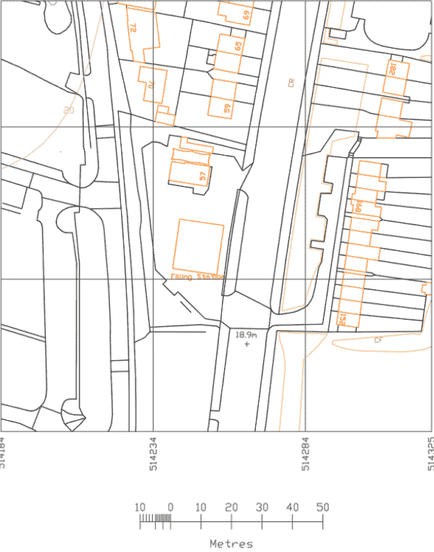
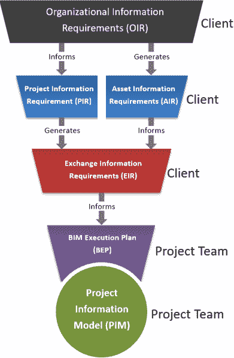
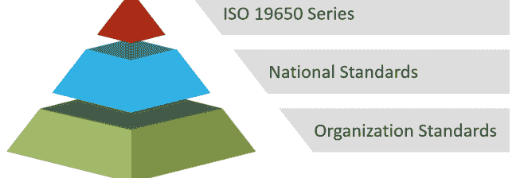
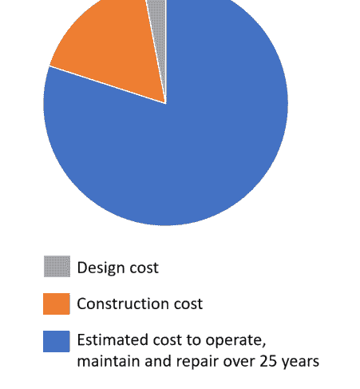
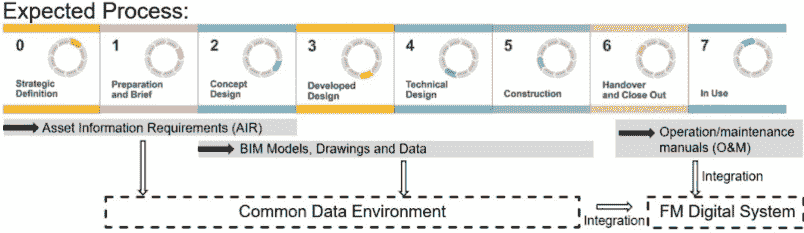
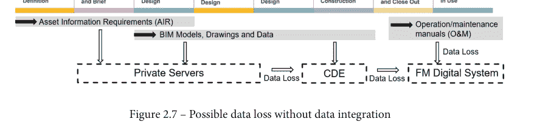
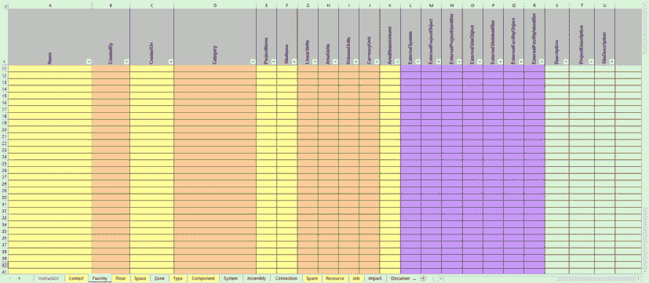
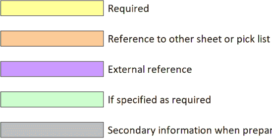

## 项目数据管理

项目数据管理是使用 **建筑信息模型 (BIM)** 时效率和生产力的重要方面，因为作者软件以数据为中心。

组织越来越多地使用基于数据分析的流程来推动其在多个领域的业务，以提高绩效和盈利能力。在使用 Revit 管理模型和数据时，数据管理的原则是相似的。

数据驱动的文化正在增长，越来越多的公司注意到分析数据对促进改进和在 **建筑、工程、施工、业主运营商 (AECOO)** 行业中产生变革的业务决策的价值。

公司使用 **数据管理计划 (DMP)** 来概述数据在项目完成期间和之后将如何使用。BIM 项目将通过创建类似的文件来支持项目开发，例如 **交换信息要求 (EIR)**、**BIM 执行计划 (BEP)** 等。

本章将提供与 BIM 项目相关的数据管理关键点的信息。我们将学习如何在考虑这些关键点的情况下成功启动 Revit 项目。

本章还将解释任命/合同的关键方面；BIM 项目中的项目职能；BIM 文档概述；**施工运营建筑信息交换 (COBie)** 的挑战；以及制定启动 BIM 项目的行动计划。

- **法律方面**：分析任命中的 BIM 要求并识别法律问题。
- **数据策展**：定义数据验证流程，通常在 **通用数据环境 (CDE)** 和数据互操作性中描述。
- **数据存储和使用**：识别组织的内部和云数据存储以实现业务连续性。这还包括数据使用、协作和运营的程序。

以下三个关键文件将提供启动 BIM 项目所需的关键数据：

- 任命或合同
- 交换信息要求 (EIR)
- BIM 执行计划 (BEP)

BIM 项目中还有其他可用文件，这些文件将在上述关键文件中引用。

要启动 BIM 项目，还需要数字数据，例如勘测文件或遗留数据。

## 任命或合同

任命或合同将定义工作范围，进一步的细节包含在 BIM 责任矩阵中。

检查任命时，识别可能增加项目风险或需要额外时间完成的特定 BIM 活动至关重要。这些活动需要与商业部门提出，以在必要时调整项目费用。

常见的是看到提及 BIM ISO 阶段 2 的投标和任命，但未提供项目应如何交付的任何细节，这将增加项目风险。在客户未提供信息的情况下，牵头被任命方应创建一份具有标准交付成果的 BEP。

> **提示**
> 
> 定义贵公司认为 BIM ISO 阶段 2 或根据当地框架（如英国 BIM 框架）的 BIM 最低交付成果。这对于未明确其 BIM 要求的投标和任命非常有用。

> **提示**
> 
> BEP 是指导项目成功实施 BIM 的路线图。公司需要协作工作来制作 BEP，并以最终用户为出发点创建它。这是成功实施的基本原则。

## BIM 执行计划 (BEP) – 合同前

合同前 BEP 在投标过程中使用，以证明公司有能力根据 EIR 要求交付项目。

合同前 BEP 应针对 EIR 要求作出回应，提供交付策略，并应包括协作流程、关键里程碑和 **项目实施计划 (PIP)**。

PIP 是 BEP 的一部分，每个竞标项目的公司都应提供此计划以证明其交付 BIM 项目的能力、经验和胜任力。

## BIM 执行计划 (BEP) – 合同后

合同授予后，将与所有被任命方协作创建合同后 BEP，以就项目中使用的标准、方法和程序达成一致，并响应客户的 BIM 要求。

BEP 通常分为四个领域，概述如下：

**管理和商业要求**

- BEP 简介和目的
- 项目信息
- 项目团队——职能和责任
- BIM 项目标准
- 对 EIR 映射和差异的响应
- BIM 战略目标
- 模型用途
- BIM 交付成果
- 协调会议
- 项目里程碑
- 主信息交付计划 (MIDP)
- 安全要求
- 健康与安全要求
- BEP 中使用的术语和定义

## 信息标准

- 项目放样和坐标
- 标高、网格和阶段
- 体量和联合策略
- 信息需求等级或 LOD
- 文件、图纸和模型的命名约定
- 修订约定
- 图纸标准
- 特定软件要求
- 最佳实践

## 信息生产、方法和程序

- 协作策略
- CDE 和交换流程
- 建模范围和排除项
- 审查和批准流程
- 模型检查/验证
- 碰撞检测流程和碰撞容差策略
- 资产信息要求和验证流程
- 勘测策略
- 现有遗留数据

## 附录

- 主信息交付计划 (MIDP)
- BIM 责任矩阵



# 图 2.1 – OS 地图

> **提示**
> 
> OS 地图上的网格交点提供了设置 Revit 文件的最佳坐标点。另一种选择是使用勘测文件中的勘测站点。

设计负责人通常会提供标高和网格以继续设置初始项目文件。

总体目标是创建 Revit 主文件以分发给所有顾问，以便他们获取坐标并在正确位置启动项目。

Revit 主文件包含项目坐标（包括真北和项目北）、标高和网格。该文件将与体量策略一起使用，以创建和设置所有后续 Revit 文件。

一旦初始 Revit 文件设置完成，项目坐标应与其他平台（如 AutoCAD 和 Rhino）一起使用，以确保导出和导入数据的流程顺畅。

在 *第 4 章，高效启动 Revit 项目* 中，我们将展示如何逐步设置 Revit 项目坐标并启动项目的指南。

总之，我们了解了启动 BIM 项目所需的关键数据，以及如何分析主要 BIM 文档以降低风险。

在下一节中，我们将介绍其他 BIM 文档并提供进一步的细节。

## BIM 文档概述

将 BIM 文档与项目策略保持一致对于提高效率至关重要，以便要求得到明确定义，从而提高生产力并降低成本。

公司必须了解他们应为设计和施工团队提供哪些信息，并定义他们期望为资产管理接收哪些信息以支持建筑维护。

我们理解客户在项目开始时很难有精确的 BIM 要求。但这必须改变，以改善 AECOO 行业并确保项目团队在项目生命周期中拥有明确的要求。

明确定义 BIM 文档具有明显的好处。其中一些在此概述：

- 更快的 **投资回报率 (ROI)**
- 满足客户和项目标准
- 确保客户和项目团队的 BIM 要求保持一致
- 更好地沟通以交付项目
- 改进 BIM 模型和数据的质量保证和质量控制

我们将概述 AECOO 行业目前最常用的 BIM 文档。


我们可以将BIM文档分为三类，如下所示：

- 客户文档
- 项目团队文档
- 标准文档

## 客户文档

至关重要的是，要确立委托书或合同是主要的合同文件，其中应包含关于BIM需求的高层级信息，同时还应包含贵组织可能认为必要的BIM细节。

客户和项目团队需要在项目基础上明确哪些BIM文档属于合同性文件，哪些属于非合同性文件。在项目中，BEP有时作为合同性文件，有时作为非合同性文件，这种情况很常见。

如果EIR未被引用到委托书或合同中，它很可能不构成合同要求。

公司BIM负责人、保险组织和商务部门应进行联络，以将这些文件定义为合同要求。

下面我们将概述客户方的BIM文档，这些文档包括但不限于下文所列的要求。

### 组织信息需求（OIR）

这确立了客户在**组织层面上的资产管理系统**的信息需求，其中包括资产管理方面的战略决策和专业知识。该文档将用于生成AIR，并为创建PIR提供信息。

### 资产信息需求（AIR）

AIR**定义了资产管理与运营的具体项目需求**，并传达了组织信息需求（OIR）的目标。它有助于为编制交换信息需求（EIR）提供信息，并明确**资产信息模型（AIM）**。

### 项目信息需求（PIR）

PIR传达组织信息需求（OIR）中的信息，以**定义既有资产项目**。该文档将支持EIR的编制。

### 交换信息需求（EIR）

EIR**定义了在设计和施工阶段需要交付和采用的信息、标准和流程**。它应明确规定为满足项目信息需求（PIR）所需的信息。我们在上一节中已对此进行了详细说明。

总而言之，客户部分列出的文档将支持项目团队编制BIM执行计划（BEP）并生成BIM模型。

下图更详细地展示了各文档之间的关联，以及如何为项目团队提供足够的信息来生成BIM模型：



图2.2 – BIM文档关系图

- 信息需求等级（用于定义详细程度和信息等级框架）
- 确定哪些模型元素需要交付COBie成果
- 项目阶段

## BIM和IT能力评估

BIM和IT能力评估用于评估交付BIM项目的能力、IT需求和网络安全需求等方面的问题。

## 项目执行计划（PIP）

PIP是Pre-BEP的一部分，每个参与项目投标的公司都应提供此计划，以展示其交付BIM项目的能力、经验和资质。

## BIM标准与指南

标准与指南对于数字化AECOO行业的发展至关重要，它们有助于企业和政府确保项目的一致性。

这种一致性可以提高AECOO行业多个领域的效率和生产力。它还有其他益处，例如降低成本、改善协作、协调以及数据交换。

2019年1月，**英国标准欧洲规范（BS EN）** *ISO 19650-1*和*ISO 19650-2*的最终版本发布，以取代*BS 1192:2007+A2:2016*和**公开可用规范（PAS）** *1192-2:2013*。

有关*BS EN ISO 19650*系列的更多信息，请访问此链接：

```
https://ukbimframework.org/standards-guidance/
```

这是对应的**快速响应（QR）**码：


我们无法详细介绍所有BIM标准，但可以将其分为三个层级，如下面的截图所示：



图2.3 – BIM标准层次

国家标准是针对特定国家的标准，例如英国标准、欧洲标准（**欧洲标准化委员会（CEN）/技术委员会（TC）442**）以及其他国家的标准。

组织标准是由组织创建的特定指南，用于定义软件和图面表达方式，例如线宽、图题等。

总而言之，我们了解了面向客户和项目团队的BIM文档，并对行业标准进行了概述。

在下一节中，我们将了解BIM项目中的项目职能。

## 项目职能

*ISO 19650*系列标准已将*角色*一词替换为*职能*，但其含义相同，即定义特定个人或群体的职责。

交换信息需求（EIR）和BIM执行计划（BEP）将定义项目职能以明确关键职责，这可以提高生产力，因为每个团队成员都会清楚需要执行的任务。

需要重点指出的是，项目职能并非职位头衔，一个人可以承担并履行多个职能。

编写EIR的委托方（客户）将主要定义信息管理职能。委托方可以提名本组织的人员或指定第三方公司来履行该职能。

项目团队将在BEP中定义以下职能：

- 任务团队经理
- 任务信息经理
- 信息作者
- 接口经理

在以下各节中，我们将介绍每个职能的主要职责。

### 委托方（客户）

委托方负有关键责任，即向设计团队提供高质量的信息，这包括：

- 组织信息需求（OIR）
- 资产信息需求（AIR）
- 项目信息需求（PIR）
- 交换信息需求（EIR）

> **重要提示**
> 
> 通用数据环境（CDE）和项目编号必须与委托方（客户）确认。

### 任务团队经理

任务团队经理将执行的活动包括但不限于以下内容：

- 编制任务信息交付计划（TIDP）
- 审查和批准其团队生成的信息
- 定义适当的信息状态
- 批准在通用数据环境（CDE）中发布的信息

### 任务信息经理

任务信息经理将执行的活动包括但不限于以下内容：

- 审查交换信息需求（EIR）
- 审查委托书并核查BIM要求
- 创建BIM执行计划（BEP）
- 确保任务团队能够依据项目标准、方法和程序生成信息
- 实施项目协议和技术标准
- 提供支持与培训
- 审查资产信息需求（AIR）

### 信息作者

信息作者将执行的活动包括但不限于以下内容：

- 使用BIM软件创建模型
- 按照项目BEP生成或修改信息
- 确保图形模型在空间上协调一致
- 根据碰撞检测流程更新模型
- 按照任务信息交付计划（TIDP）交付成果

### 接口经理

接口经理将执行的活动包括但不限于以下内容：

- 管理空间协调以避免和解决碰撞
- 生成碰撞报告
- 整合BIM模型


## 信息管理

委托方（客户）将在其组织内部指定一名人员或指定第三方公司来承担信息管理职能。

信息管理职能的活动清单在不同项目之间差异很大。

在 *BS EN ISO 19650-2* 标准中，有 *附录 A*，它是一个信息管理责任的矩阵模板。

## AEC UK BIM 协议

2015 年发布的 **自动曝光控制 (AEC)**（英国）BIM 协议对于解释 AEC 行业广泛使用的实践职能仍然相关。

本文件将活动分配给三个特定领域，概述如下：

- 战略
- 管理
- 生产

### 战略 – BIM 管理

该角色代表公司范围内的 BIM 管理员，负责定义 BIM 实施的战略决策并提供培训支持。

公司范围内的 BIM 管理员将执行包括但不限于以下活动：

- 与 BIM 相关的公司目标
- 技术和新流程的研究
- 开发流程和新工作流程
- 开发标准和协议
- 负责 BIM 实施
- 为技术和新流程提供培训
- 分析或创建 BIM 文档（BEP 及其他）

### 管理 – 协调

该角色代表 BIM 协调员，将执行包括但不限于以下活动：

- 为团队提供技术和新流程的培训
- 分析或创建 BIM 文档（BEP 及其他）
- 审核 BIM 模型
- 模型协调和冲突检测
- 内容创建

### 生产 – 建模/作者

该角色代表建筑师、工程师、设计师和 BIM 建模师，他们在 BIM 模型中生成信息。他们将执行包括但不限于以下活动：

- 项目特定内容创建
- 项目特定建模
- 项目特定图纸制作

AEC（英国）BIM 协议职能可在以下表格中看到：

| Strategic - BIM Management | Management - Coordination | Production - Modelling |
|---|---|---|
| Corporate objectives related to BIM | Provide team training for technology and new processes | Project-specific content creation |
| Research on technology and new processes | Analyze or create the BIM documentation (BEP and others) | Project-specific modelling |
| Develop processes and new workflows | Audit BIM models | |
| Develop standards and protocols | Model Coordination & clash detection | |
| Responsible for the BIM implementation | Content creation | |
| Training for technology and new processes | | |
| Analyze or create the BIM documentation (BEP and others) | | |

Figure 2.4 – AEC (UK) BIM Protocol functions

必须强调的是，这些不是职位头衔，同一个人可以执行多个职能。

总之，本节中的信息提供了 AEC 行业中常用的项目职能的详细信息，并在 BEP 中得到充分定义。

在下一节中，我们将了解资产管理以及它如何最大化建筑资产的价值。

## 资产管理

**资产管理** 是一种流程，旨在通过提供战略和运营服务来帮助建筑业主最大化其资产价值。

建筑物和公用设施的使用寿命有限，而建筑物在施工阶段后的生命周期代表了房地产业主的最高成本。如果我们考虑 25 年的周期，预计运营、维护和修复建筑物的成本约占总拥有成本的 80%。

这在以下图表中有所说明：



Figure 2.5 – Total cost of ownership

在建筑生命周期中资产管理的重要性很明显，但 AECOO 行业在提供可集成到资产管理和运营流程中的数字化和结构化数据方面仍有改进空间。

如果在设计和施工阶段创建的数据能够完美地转移到资产管理数字平台，效率和生产率将提高。

目前，我们在项目阶段之间以及 **运营/维护 (O&M)** 手册向设施管理数字系统的数据转移方面仍存在问题。主要问题是可用数据未结构化，部分信息以纸质或简单的 **便携式文档格式 (PDF)** 文件形式存在。

这种数据集成不足可能导致重大数据丢失，降低生产率并增加维护资产和管理数据的成本。

管理数据的预期流程包括 **通用数据环境 (CDE)** 并与设施管理数字系统完全集成，如以下图表所示：



Figure 2.6 – Expected process for data integration

通用数据环境将帮助在设计和施工阶段以 BIM 模型、图纸和产品数据的形式收集数据。此信息将与设施管理数字系统集成。

当运营/维护手册（O&M）为数字化和结构化时，这些将被集成到设施管理数字系统中，从而完成理想流程。

不幸的是，在许多项目中，数据集成仍然是碎片化的，导致数据丢失和效率低下。

在设计阶段使用私有服务器交换数据，仅在施工阶段使用 CDE 的项目仍然很常见，这可能导致数据丢失。

如果 CDE 与设施管理数字系统之间的集成未建立，也可能存在数据丢失的潜在风险，因为信息需要结构化以实现此过程。

当 O&M 手册不是数字化的或没有结构化数据组织时，也可能发生数据丢失，如以下图表所示：

### 可能的数据丢失



Figure 2.7 – Possible data loss without data integration

私人客户和英国政府共享类似的策略，通过利用 COBie 作为 BIM 要求来改善这一流程。

## COBie

**建设运营建筑信息交换 (COBie)** 是一项国际标准，用于支持包括空间和设备在内的资产管理流程。它在完工后提供所需信息和来自施工团队的产品数据给运营团队。

> Tip
>
> COBie 并未对典型的合同交付增加新的要求。它只是将现有交付物的格式更改为开放的国际标准格式。

COBie 是 **行业基础类 (IFC)** 的子集，最常见的表示形式是电子表格。根据设施管理系统，导入数据的流程可能不同。

## COBie 电子表格信息

COBie 电子表格包含有关设施的信息，例如楼层和空间；产品清单；保修的进一步细节；以及与资产管理流程相关的其他方面。

每个项目上的每个设施都应提供一个 COBie 文件。也就是说，如果有多个设施，应提供额外的 COBie 文件。所有交付物应符合设施管理移交要求。

典型的 COBie 电子表格如下截图所示：



Figure 2.8 – Typical COBie spreadsheet

COBie 的主要目标是在移交时向设施管理团队提供结构化数据，并提高管理建筑资产的效率。如果没有结构化数据，AECO 行业将无法在数据管理方面达到高效率，这可能会影响数字孪生技术的发展。

项目业主或客户有责任定义资产管理和 COBie 要求，并且需要与设施管理团队的要求和能力保持一致。

> **Tip**
>
> 在项目开始时与设施管理团队会面并参与其中，以核实资产管理和 COBie 要求至关重要。




Figure 2.9 – COBie color-coded cells

需要检查并填写的选项卡包括以下内容：

- **Instruction**
- **Contact**—提供相关联系数据

## Requirements and Constraints

这是在预期 **Royal Institute of British Architects (RIBA)** 第 2 或 3 阶段通常需要包含的数据。这些信息主要用于确保产生的设计和规范在功能和成本方面与委托方简报一致。

需要填写的选项卡包括以下内容：

- **Facility**—数据在 BIM 文件中手动填写
- **Floor**—数据从楼层导出（从模型中提取）
- **Space**—数据从空间导出（从模型中提取）
- **Zone**—数据从区域导出（从模型中提取）

## Outline Solution and lifecycle costs

这是在预期 *RIBA Stage 4* 通常需要包含的数据。这些信息可用于确保整个项目在功能、成本和碳性能方面与委托方简报保持一致。

在此阶段，模型可用于投标，因为我们可以通过计划表直接从模型中导出数据（门、窗、设备等）。

需要填写的选项卡包括以下内容：

- **Type**—数据从模型中提取
- **Component**—数据从模型中提取
- **System**—数据从模型中提取
- **Connection**—数据从模型中提取
- **Coordinate**—数据从模型中提取

**Construction Industry Council (CIC)** 工作组指出，在此阶段收集的信息可能准确度为 75%-80%，容差为 ± 20-25%。

## Construction information

这是在预期 *RIBA Stage 5* 通常需要包含的数据。检查是为了确保上一阶段的设计和规范在功能、成本和碳性能方面与委托方简报一致。

模型现已完全协调，可用于施工，并且可据此生成协调的技术施工图纸。

与上一阶段相比，模型现在代表可建造的技术解决方案，所有承包商的输入已纳入模型。

需要填写的选项卡包括以下内容：

- **Type**
- **Attribute**—类型、构件、系统、坐标、连接和文档属性的数据更新至施工级别（从模型中提取）

CIC 工作组指出，在此阶段收集的信息可能准确度为 85%-90%。

## Operations and Maintenance Information

这是在预期 *RIBA Stage 6* 通常需要包含的数据。所有这些数据都与运营和管理信息相关。它与制造商和安装调试系统 的分包商提供的运营和详细功能信息相关。

模型现在代表已建成的建筑，并包含所有分包商提供的信息。它包括有关已安装系统和设备的所有信息。

需要填写的选项卡包括以下内容：

- **Job**
- **Resource**
- **Spare**

收集信息的准确度预计为 100%。

## Post Occupancy Validation Information and Ongoing O&M

此后 occupancy 信息的概念是审查和检查资产实际使用情况。此阶段应用于在所有系统和程序稳定运行后，用最终且最更新的运营数据集更新后 occupancy 系统。

模型现在代表正在使用的建筑，并包含来自管理团队和已实施系统的所有信息。

## COBie concept

COBie 概念很简单，但交付 COBie 的流程并不总是直接的，因为它取决于 BIM 模型的质量。

组织通常使用 Solibri 或 Autodesk COBie Extension for Revit 来生成 COBie 交付成果。Solibri Model Checker 的标志可见于此：


Figure 2.10 – Solibri Model Checker

您可以在此地址访问 Solibri 网站：`https://www.solibri.com/`。

以下是此处的二维码：


Revit COBie 扩展为每个 Revit 版本提供下载，例如 Revit 2021、2020 等。示例文件和培训材料也可免费在网站上获取。

> **Note**
> Revit COBie 扩展在从 Revit 中的模型组导出 COBie 数据时存在问题。

为了增强关于资产管理的讨论，我们采访了 ActivePLAN 的 George Stevenson，他是资产管理流程方面的专家。

## Interview with George Stevenson, Managing Director at ActivePLAN

Hi George, thank you for the interview.

我们想听听您对资产管理以及该行业的未来的看法。

**您能否介绍一下您自己和您的公司？**

我是受 Xerox 培训的信息管理专家，于 1982 年进入建筑行业。最初，我参与为机电承包商开发估算和计划维护软件，随后发展到数据库驱动的 CAD 和面向对象的建筑建模（Sonata 和 Reflex，后来成为 Revit）。我创立了英国首个项目外联网/CDE，BIW，现为 Oracle Aconex。

现在，我是 ActivePLAN 的董事总经理，这是一家 20 人的软件和信息管理公司。我们是 Autodesk 开发商，但主要专注于创建基于网络的 BIM 应用，用于简报、信息需求，以及可在设计和施工过程中使用的应用，以为资产管理提供更好的信息。更多信息请参见 https://activeplan.co.uk/transforming-construction/。

我们的许多客户都是资产所有者和 FM 承包商，因此我们开发了解决方案，将移交信息转换为填充不同 FM 应用，并提供持久的数字 O&M/AIM。

我们还拥有解决方案，可将现有的 O&M 转换为符合 BIM 的数据模型——通常为 2D。但如果他们选择投资点云和 3D 模型（也许是设备房），我们会通过与 Forge/BIM 360 和 3D Repo 的 API 集成将其包含在内。

数据工程是我们工作的重要部分，我是现称 BuildingSmart 的创始成员之一，并担任 FM 工作组的英国主席。我们一直与 BRE 合作开发数据字典应用，以创建和管理标准化数据集作为可重用数据模板。这构成了免费平台的基础，该平台正被产品制造商使用——Lexicon。

多年来，我将 20% 的时间投入到改善行业的公益倡议中，目前有四个：

- BIM4Housing—主席
- BIM4HA/HACT Housing Asset Data Standards Working Group
- Golden Thread Initiative—资产信息工作组主席
- Constructing Excellence Collaborative Working Champions

### 建筑师和工程师在施工前和施工后阶段交付资产信息需求的挑战是什么？

资产信息需求很少以与其作者工具集成的形式提供（通常是 PDF 文档）。因此，这往往是手动流程。将需求作为元数据添加到 3D BIM 对象上并不理想，如果他们使用 IFC 导出数据，则会出现问题，因为他们倾向于使用 2x3，即协调 MVD，而这并非为资产信息而设计。当人们从 Revit 转换为 IFC，导入到联合 IFC 模型中，然后再转换回 COBie 时，问题会更加严重——可能出现什么问题？正确使用时，直接从 Revit 使用 COBie 扩展进行原生输出似乎更可靠。


在COBie中建立空间模型对于确保所有资产位置被自动记录至关重要。资产类型通常会在阶段3确定，即使之后发生更改，记录更改前的信息对于资产管理者而言也是宝贵的，因为他们可能需要用设计师最初推荐的产品来替换经过“价值工程”处理但已失效的产品。

## 标准化的客户需求和标准化的产品数据如何提高资产信息交付过程的效率？

这是基础性的。资产信息团队对水泵、风机盘管、门或外墙板的需求在不同行业（住宅、教育、零售、办公和医疗保健）中大体相同。显然，即使在这些行业内，关键程度也存在差异，客户需求需要反映每个项目中不同利益相关者群体的需求。

然而，如果从一套经过同行评审的标准库出发，进行这些修改所需的工作量是微不足道的。通过以机器可读的格式标准化性能要求，使用后评估可以反映设计的有效性，或许还能反映对需求的修改。

同样，制造商可以创建标准化的产品库，纳入客户要求的信息和性能水平，并使其产品更贴合客户需求。

运营效率和环境绩效的成本可以被建模，从而创造更具可持续性的建筑。

简而言之，即使在今天，也很少有建筑能够交付符合目的的资产信息，因为这仍然是一个人工过程，往往被留到时间和成本即将耗尽时才进行。通过从一开始就标准化信息，专职信息经理可以将时间投入到真正需要其技能的方面，而将资产信息的交付留给流程本身。

## 您如何看待COBie的现状和未来发展？COBie是一个长期目标，还是未来可能被以不同方式构建数据的先进技术所取代？

一切都可以改进，但当我们终于让人们理解数据在BIM中与几何体同等重要（甚至更重要）时，我对改变标准感到不安。

COBie是一种数据模式，其容纳能力远超目前的使用范围。它并不完美，但通过有效利用Attributes，我们可以实现95%的需求。

这里需要明确资产团队“需要”的信息是什么意思。

他们出于不同的原因使用不同的应用程序。例如：

- **CMMS**——计算机化维护管理应用程序，主要用于生成定期/计划维护的工作指令。这通常仅包括O&M中10%的资产。
- **服务台**——这些支持响应式维护，并且目前有使用CRM应用程序来实现此目的的趋势。
- **H&S/O&M**——通常是已安装设备的竣工记录及相关文档。虽然要求随着任何变更而保持更新，但很少做到这一点。ActivePLAN将其作为数字O&M或**资产信息模型（AIM）**交付，其中包含所有内容，包括CMMS中的资产类型。
- **调查与检查**——这些是需要非常聚焦的信息并能够将数据返回AIM的专业移动应用程序。
- **生命周期管理**——通常在电子表格中完成。
- **空间管理**——有时称为FM，包括房间预订，通常作为独立应用程序（或模块）与CMMS应用程序一起交付，例如IBM Maximo和IBM Tririga。
- **BMS/数字孪生**——我将它们联系在一起，因为它们都是使用/应用AIM中协调资产数据的方式。

完整的COBie数据模型或Excel工作簿应包含上述每个应用程序/用途所需的全部信息。然而，我们不应期望这些应用程序读取完整的COBie数据模型或工作簿——甚至确实开发一个IFC模块。

即使是那些已经开发出处理COBie方法的大型CMMS应用程序，也会将其转换后导入自己的数据库。因此，将移交的COBie数据放入像ActivePLAN这样的资产信息模型中更有意义，该模型可以保存和管理所有必需的信息，并为不同的CMMS应用程序以及上述所有类型的应用程序生成定制输出。

在“数据服务”的现代世界中，通过确保符合COBie数据模式，Web服务可以提供动态互操作性，使执行防火门检查/维护的承包商——例如——能够在其CMMS应用程序中记录故障，创建“工单”进行维修，并将该资产的状态变化反馈给AIM，以便在整个建筑的背景下评估相应的风险。

我们与BRE正在开展的工作让我们了解了本体的使用，以及如何利用本体为确定需要收集什么以及如何使用这些数据提供背景。与我们合作的数据科学家乐于使用COBie作为数据交换机制——关键是为正确的目的获取正确的数据。

一直有关于从模式中删除“Coordinates（坐标）”的讨论。这确实很可惜，因为资产信息需要“定位”，而不仅仅是引用到一个空间。如果在一个空间内有20个CCTV摄像头，在数据中保存*x/y/z*坐标（即不是单独的几何模型）至关重要。

## 在建筑行业中，整合运营维护（O&M）和资产管理（AM）面临哪些挑战？

我认为资产管理是整体流程，运营和维护是其子流程，同时还包括生命周期规划/更换、小型工程、空间管理、BMS。它们（现在和将来）都由许多应用程序支持，不同的利益相关者出于许多不同的原因使用这些应用程序。如果我们能够克服两个最大的障碍——数据质量（结构、内容、可靠性和时效性）和缺乏投资——这个问题就很容易解决。

后者影响前者。

当资金紧张时，FM通常是第一个被削减的对象。新开发项目的资金往往比安装新的供暖或空调系统的资金更容易获得。即使在PFI项目中，投资设施的重要性已得到充分认识，签订的合同也常常使FM几乎别无选择，只能偷工减料。

即使到今天，也很少有项目能提供关于防火阀和防火封堵位置的可靠信息，那么FM应该如何预算和规划它们的检查、维护和更换呢？

客户很少知道他们的建筑里有什么（在某些情况下，他们甚至不知道他们有多少栋建筑）。FM经常被要求对现有物业的维护进行招标，而关于他们将维护什么的数据却非常不完整。他们可能会委托进行调查（他们通常需要在全新的BIM交付建筑上这样做）。尽管如此，许多他们需要维护的项目对于调查人员来说并不容易看到和记录，因此不会被发现。

## 数字孪生是运营维护（O&M）和资产管理整合的未来吗？

数字孪生是一个被不同的人使用并具有不同含义的术语。我参加了2019年9月在伦敦ICE举行的数字孪生活动，一位来自一级方程式赛车的资深人士解释说，他们已经使用数字孪生20年了——他们过去称之为模拟。

我认为这就是我们应该区分3D模型（即使是带有IoT传感器的模型）和真正的数字孪生的方式，后者能够模拟活动和场景，为更好的资产管理提供信息。

BMS应用程序正变得越来越复杂，并且无疑是这个过程的一部分，人工智能也是如此。

自2018年以来，我们一直在试验AI，以了解如何训练智能体来响应问题或事件。我的商业伙伴Tim Aikin在他的房子里到处安装了传感器，使用ActivePLAN AIM作为平台，为自己的数字孪生提供数据。

我们还在试验图数据库，从住宅塔楼获取空间模型，将消防资产分配给系统和空间，并模拟单个资产故障对内部空间和人员的影响。我们的下一步是使用AI创建场景，模拟人们将如何响应事件，以及如何改善环境以使他们更安全。

事实是，所有这些过程都依赖于不断更新的更好的资产信息，并且越多的人出于不同目的连接和使用这些信息，效果就越好。

## Revit和BIM创作工具如何改进以促进资产管理交付过程？云端数据是BIM工具中资产管理的未来吗？

所有应用程序都可以改进以促进这一过程，但我们需要理解，BIM是关于信息的，而不是关于创建信息的应用程序。将资产数据保存在一个主要用于创建3D模型的应用程序中是不明智的。

数据最好在数据库中管理，而云端使这变得更加容易。

可以赋予不同的利益相关者使用和更新信息元素的权利，理想情况下是从他们日常任务中使用的应用程序中进行——不仅仅是3D建模应用程序。

Revit和其他创作应用程序支持API，因此无需将非几何数据添加到3D对象本身。与云服务的动态连接使用户在点击时感觉数据就在模型中。但实际上，它是在其他地方（通常是由对数据进行了质量保证的主题专家）进行管理（和创建）的。


George，非常感谢您接受采访。

在结束本节之前，我们了解了资产管理在建筑生命周期中的重要性，以及结构化数据对于跨多个设施管理平台集成数据的关键作用。COBie提供了结构化数据，这些数据被用于私人客户和英国政府的战略中，以支持资产管理流程。

在下一节中，我们将学习如何制定行动计划来启动BIM项目。

## 制定行动计划以启动BIM项目

行动计划帮助组织以既定的流程启动BIM项目，以管理项目数据并将目标变为现实，从而避免在设计、施工和建筑生命周期中出现问题。

行动计划将提供一份待完成的任务清单，以实现管理项目数据的初步目标，并且可以提高启动项目时工作流程的效率。

行动计划将包括以下任务，但不限于这些：

- 定义管理项目数据的初始BIM目标
- 列出为实现目标而需要完成的任务
- 结合项目截止日期确定关键任务的优先级
- 确定接收信息的初始项目截止日期
- 定义完成任务所需的资源
- 根据要求衡量和评估进度，并更新行动计划

有效的行动计划可以帮助您保持正轨，正确设置BIM项目，并提高管理BIM数据的生产力。

### 管理项目数据的行动计划

该行动计划的主要目标是分析BIM合同要求、降低风险，并收集启动BIM项目所需的全部必要信息。

有时，项目在BEP尚未完全定义的情况下启动，而且您的公司可能不是负责制定BEP的主导指定方。

当BEP完成后，所有指定方都将遵循它来交付项目。

### 列出任务以实现目标

以下任务将有助于确定项目目标，并为建立BIM项目的初始流程提供支持：

- 1. 分析BIM合同要求。
- 2. 如果客户没有BIM要求，您的公司应在合同中定义标准的BIM交付成果。
- 3. 与客户和资产管理团队沟通，澄清每一项BIM要求。
- 4. 向客户索取以下文件：
    - 组织信息要求（OIR）
    - 资产信息要求（AIR）
    - 交换信息要求（EIR）
- 5. 索取并分析任何遗留文件和测量文件，以及地形测量图（Ordnance Survey maps）。
- 6. 检查并验证收到的信息。
- 7. 索取或制定BEP，并与其他组织协作。
- 8. 索取或制定BIM责任矩阵。BIM责任矩阵需要根据设计/施工责任和委任书进行检查。
- 9. 检查BIM和IT能力评估。
- 10. 在项目开始时设置或索取主坐标文件，以定义正确的项目坐标。
- 11. 安排启动会议，详细说明交付项目的所有商定条款。

### 总结

在本章中，我们了解了项目数据管理对于提高效率和生产率的重要性。

我们解释了由客户明确BIM要求的好处，以及客户负责向项目团队提供哪些BIM文件。

我们概述了面向客户、项目团队和行业标准的BIM文档。

您还了解了BIM项目中涉及的项目职能、资产管理的重要性，以及如何制定行动计划来启动BIM项目。

在下一章中，我们将介绍良好的Revit模板和制图标准如何提高生产率。
