## Revit模板与标准

Revit中的生产率与项目中使用的**Revit模板**质量直接相关，包括行业和组织标准。

Revit模板有助于提高在Revit中工作的效率，您的公司将受益于跨项目的一致性。

这些模板通过预定义标准节省了大量时间，因此Revit用户无需为每个新项目重新创建或调整Revit设置。

随着行业标准的发展，Revit模板需要修订以纳入最新进展。

2019年1月，BS EN ISO 19650-1和BS EN ISO 19650-2发布，取代了BS 1192:2007+A2:2016和PAS 1192-2:2013。这意味着Revit模板需要做出与新的ISO 19650系列相一致的更改。

Revit模板可以针对多个专业创建，例如建筑、结构和MEP，也可以针对特定用途进行自定义，例如测量和其他用途。

在本章中，您将学习如何创建Revit模板并管理其图形设置，以改进在Revit中创建的图纸。这将包括关于视图模板以及如何自定义标题栏的信息。

在本章中，我们将介绍以下主题：

- 如何创建Revit模板

### 技术要求

在本章中，您需要访问Autodesk Revit。用于描述所有这些练习的版本是Revit 2021，但您也可以使用其他版本进行学习。需要考虑以下重要事项：

- 不同版本之间可能会略有差异。
- 较旧版本的Revit无法打开较新版本的文件。

本章使用的所有数据集都可以在本书的GitHub仓库中找到：https://github.com/PacktPublishing/-Increasing-Autodesk-Revit-Productivity-for-BIM-Projects。

### 如何创建Revit模板

Revit模板可确保项目的一致性并提高生产率。它们通过定义符合组织标准和行业标准的图形和技术设置来实现这一目标。

Revit模板并非一成不变；随着我们根据新标准和工作流程进行调整，它将为持续发展而不断改进。

您可能已经知道，Autodesk每年发布一个新Revit版本。然而，为多个版本更新Revit模板可能非常耗时。

为了避免在不同Revit版本中创建和更新多个Revit模板，我们建议您在相同的Revit版本中保留模板几年；这可能在3到4年之间变化。我们还建议您每5年从头重新创建模板。

为了解释这个过程，假设您的公司有一个Revit 2021版本的Revit模板。这个2021版本的Revit模板将使用3到4年，在此期间根据需要更新。

当Autodesk发布Revit 2025时，您的公司将从头重新创建Revit模板，其中将包含过去5年的所有重大变化。

在此工作流程中，您的公司将能够使用任何Revit版本（从Revit 2021起）。但是，当新项目启动时，Revit 2021模板将升级到特定的Revit版本。

在**Revit选项**中，您可以更改**Revit模板路径**并根据需要进行更新：

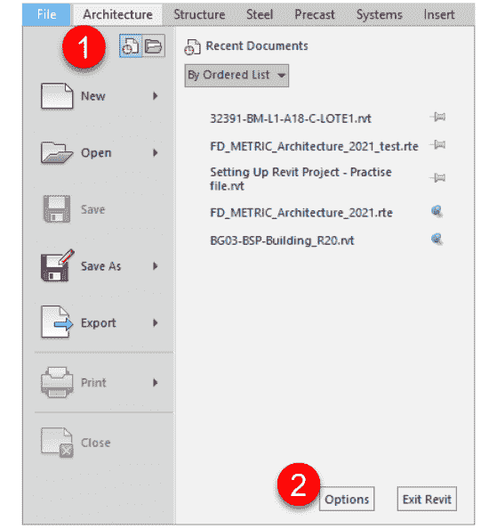

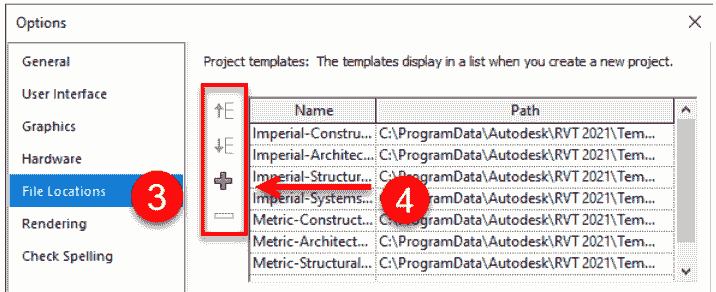

图3.1 - 更改Revit模板路径

在本书*第3章*的数据集中，您将找到一份需要在Revit模板上更新项的检查清单。该文件是`Revit_Template_Check_List.xlsx`：

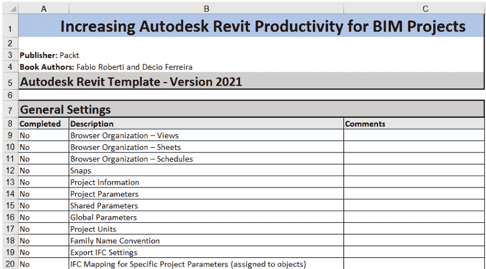

您可以使用以下链接下载本书数据集的ZIP文件：

```
https://github.com/PacktPublishing/-Increasing-Autodesk-Revit-Productivity-for-BIM-Projects/blob/main/Chapter%203/Revit_Template_Check_List.xlsx
```

在*技术要求*部分，您还可以找到本书的GitHub仓库链接，从中可以下载数据集。下载ZIP文件后，您需要解压该文件以访问本书的数据集文件。

我们将按照`Revit_Template_Check_List.xlsx`文件来解释自定义Revit模板所需进行的更改。

Revit模板检查清单分为以下领域：

- 启动Revit模板
- 常规设置
- 视图和图纸


## 开始 Revit 模板

我们将通过使用随 Revit 安装时保存的现有 `DefaultGBRENU.rte` 模板来开始一个新的 Revit 模板。模板有多种选项，我们接下来会进行说明。

多语言的模板可以在这里找到：

`C:\ProgramData\Autodesk\RVT 2021\Templates`

公制英文模板可以在这里找到：

`C:\ProgramData\Autodesk\RVT 2021\Templates\English`

英制英文模板可以在这里找到：

`C:\ProgramData\Autodesk\RVT 2021\Templates\English-Imperial`

我们需要通过选择现有模板（`DefaultGBRENU.rte`）并选择 **Save As** 来保存模板到不同文件夹并使用新名称，以此来开始一个 **New** 项目。这样我们就可以开始编辑文件了：

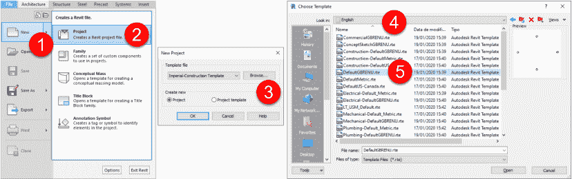

图 3.3 – 打开 Revit 模板

打开模板后，我们需要保存文件。要保存文件，请导航到 **File | Save As | Template** 并相应地重命名文件。

创建新模板后，我们需要将其添加为创建新项目时的选项。要添加创建的新模板，请遵循本章前面解释的过程。

我们的新模板将可用于开始新项目。现在，我们已准备好按要求开始配置模板文件。

## 通用设置

Revit 通用设置涵盖基本配置。它分为以下项目：

- Browser Organization
- Snaps
- Project Information
- Project parameters
- Shared parameters
- Global parameters
- Project units
- Family name conventions
- Exporting **Industry Foundation Classes (IFC)** settings
- IFC mapping for specific project parameters (assigned to objects)
- Keynote settings
- Worksets

## Browser Organization

Browser Organization 工具对于提高 Revit 中的生产力至关重要。这是因为您可以优化组织视图和图纸的方式以适应您公司的流程。

## 按视图类型组织视图

使用视图类型来组织项目浏览器时，重要的是相应地重命名视图类型。

要重命名视图，请从项目浏览器中选择一个视图并执行以下屏幕截图中的步骤来重命名视图类型：

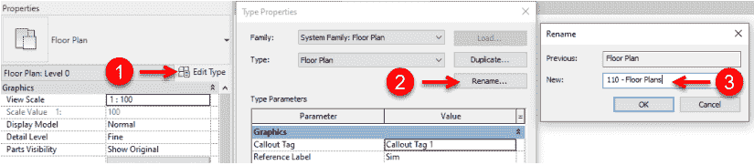

图 3.5 – 重命名视图类型

在创建视图并重命名视图类型的过程中，我们建议您创建一个新的 **Browser Organization method**。

为此，请按照以下步骤操作：

1. 将鼠标悬停在项目浏览器的 **Views (all)** 上。然后，右键单击并选择 **Browser Organization**：

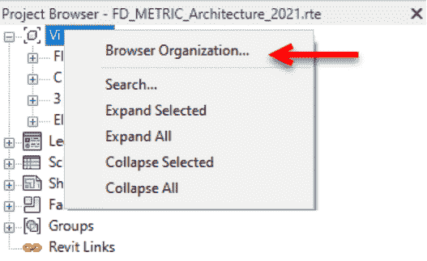

图 3.6 – Browser Organization

2. 点击 **New** 并输入新名称，例如 `FD_View_Type`：

图 3.7 – 为您的 Browser Organization 添加名称

3. 点击 OK。

点击 OK 后，会打开一个新窗口，要求您定义要使用的属性。这些属性分为两个不同的选项卡：

- **Filtering:** 这允许对视图进行筛选。

  Filter by: 在这里，选择 Sheet Name Equal to <None>。这将使视图在被放置到图纸中时不可见。

图 3.8 – Browser Organization Properties – Filtering

- **Grouping and Sorting:** 这允许根据您想要的属性对视图进行分组和排序。

  **Group by:** 在这里，选择 **Type**。这将按 **View Type** 对视图进行分组。

  **Sort by:** 在这里，选择 **Associated Level** 然后选择 **Descending**。这将根据楼层平面高度对平面视图进行排序：

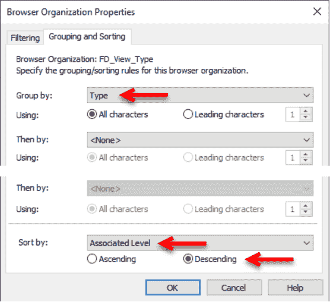

图 3.9 – Browser Organization Properties – Grouping and Sorting

4. 点击 **OK**。

5. 确保已勾选 **FD_View_Type** 然后点击 **OK**。

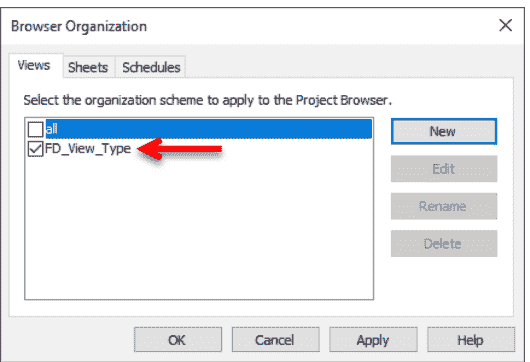

图 3.10 – 创建新的视图 Browser Organization

> **Tip**
>
> 建议您删除现有的 Browser Organization。任何其他组合都可根据需要创建。

在本示例中，我们使用了视图类型，这有助于您识别视图被放置的位置：

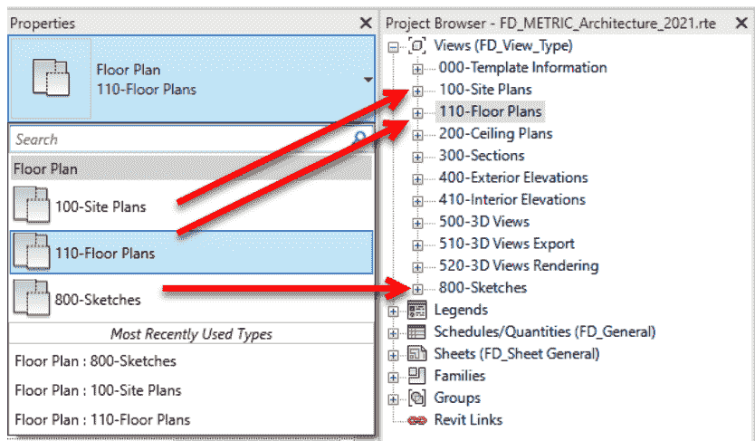

图 3.11 – 根据视图类型查看浏览器

## 按项目参数组织视图

在此过程中，我们需要创建一个新的 Browser Organization 类型，以便使用项目参数而不是视图类型来组织视图。

请按照我们已演示的过程创建新的 Browser Organization 类型并将其命名为 **FD_General**：

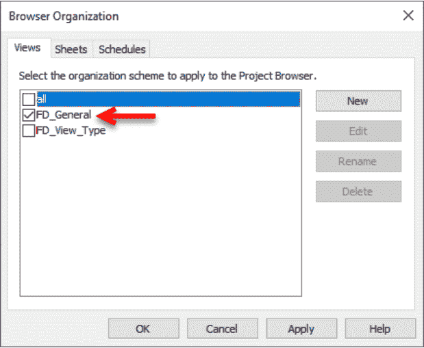

图 3.12 – 基于项目参数的 Browser Organization 类型

要使用项目参数组织项目浏览器，我们将开始为视图创建两个参数。

### View Parameters

- View Package
- View Sub-Code

1. 从功能区中，在 **Manage** 下，点击 **Project Parameters**：

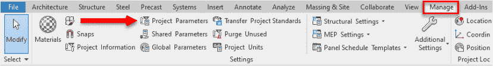

图 3.13 – 创建新的项目参数

2. 将弹出一个窗口，其中包含模板中已创建的所有参数：

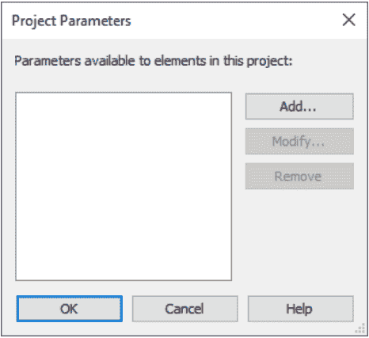

图 3.14 – 添加新的项目参数

3. 点击 **Add…** 以打开新窗口。

此窗口分为三个区域：

- **Parameter Type:** 用户可以在此处指定参数是项目参数还是共享参数。
- **Parameter Data:** 用户可以在此处指定将创建何种参数。
- **Categories:** 用户可以在此处将此新参数分配给特定的 Revit 类别。

4. 使用这些设置创建新的参数，View Package 和 View Sub-Code：

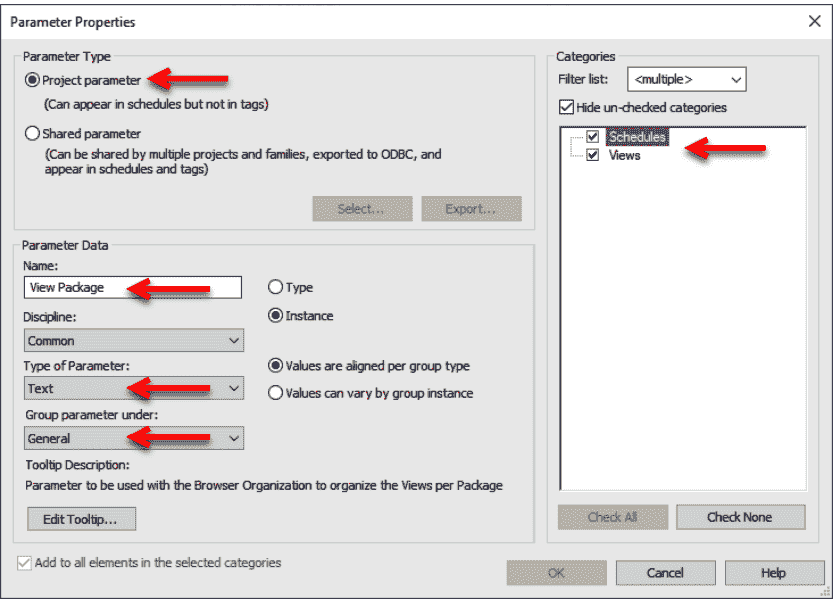

图 3.15 – 新的项目参数

5. 现在，重复该过程以创建 View Sub-Code 参数。对于此参数，无需选择 Schedules 类别。

> **Tip**
>
> 如果出于某种原因需要更改参数属性，请在项目参数窗口下选择参数名称并点击 Modify。请记住，在创建参数后无法更改某些属性；在这种情况下，需要删除参数并从头开始创建。如果已填写任何信息，它将从模板（或项目）中删除。

6. 创建两个新参数后，我们可以配置 FD_General Browser Organization。

在本示例中，我们将仅使用 Grouping and Sorting 选项卡：

- **Grouping and Sorting:** 这允许根据所需属性对视图进行分组和排序。

  **Group by:** 在这里，选择 View Package。这将根据在此参数下填写的内容对视图进行分组。

  **Then by:** 在这里，选择 View Sub-Code。这将根据在此参数下填写的内容对视图进行分组。

  **Sort by:** 在这里，选择 Associated Level 然后选择 Descending。这将根据楼层平面高度对平面视图进行排序：

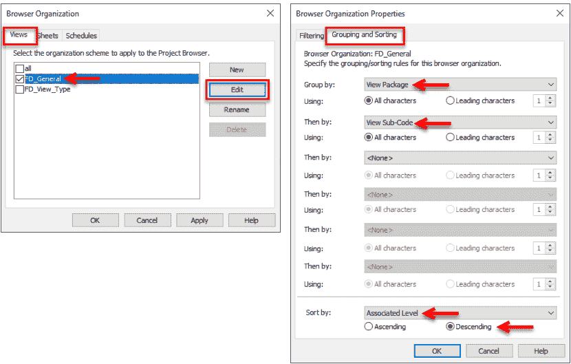

图 3.16 – 编辑视图组织 – FD_General

7. 点击 OK。

8. 确保已勾选 FD_General 然后点击 OK。

在本示例中，我们使用了 Browser Organization 将视图放置到由新参数 View Package 和 View Sub-Code 分组的组中。

我们建议在模板中设置五个 View Package 选项。这些和不同的文件夹可以通过在创建视图时填写这两个参数来创建。这些包组织如下：

- **00 – Administration Views:** 这些视图与模板定义相关。
- **01 – WIP Views:** 所有进行中的视图都应保存在此处。
- **02 – Views Export:** 这些是需要导出为不同格式和用于不同用途的视图。
- **03 – User Views:** 这些是由用户出于特定原因创建并保留的视图。
- **04 – Sheet Views:** 这些是将被放置到图纸中的视图。

项目浏览器将按以下屏幕截图进行组织：

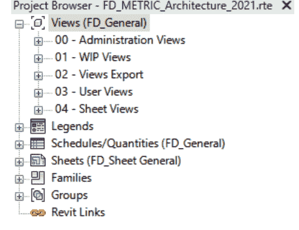

图 3.17 – 视图组织 – FD_General


## 浏览器组织 – 图纸

在图纸的浏览器组织中，我们需要创建两个新参数：

- 图纸包
- 图纸子代码

我们可以使用前面演示过的流程，通过以下设置创建新的项目参数：

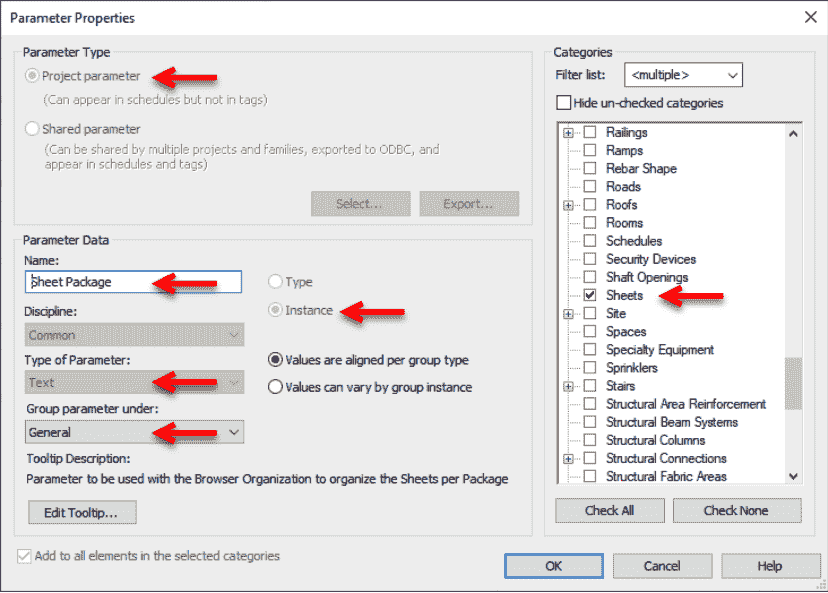

图3.19 – 视图组织 – FD_General

参数创建完成后，我们可以编辑图纸浏览器组织：

图3.20 – 编辑图纸浏览器组织

完成此设置后，我们可以将图纸移动到多个包中，如下所示：

图3.21 – 将图纸移动到不同包的参数

如前所述，理解项目浏览器的组织方式至关重要。这是因为每个项目和每家公司都有不同的浏览器组织。

## 浏览器组织 – 明细表

在明细表的浏览器组织中，我们将使用已为视图包创建的参数。

我们将能够将明细表移动到不同的包中，如下所示：

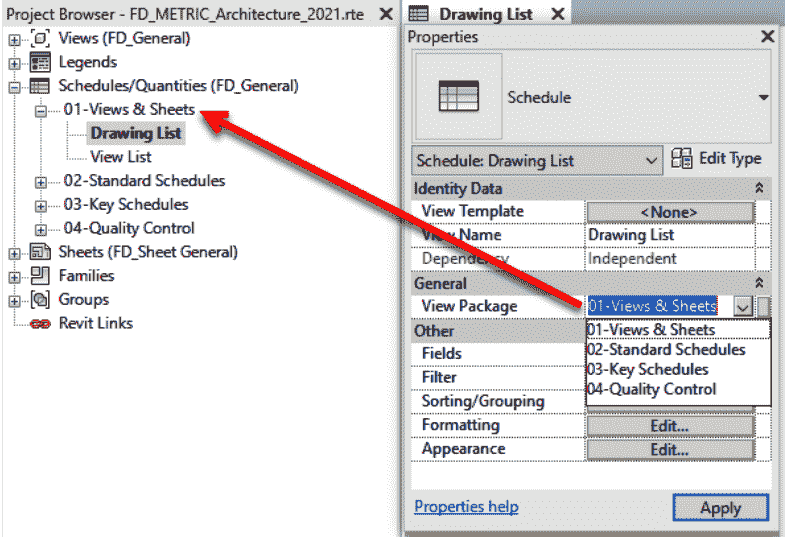

图3.22 – 将明细表移动到不同包的参数

总而言之，浏览器组织有助于组织视图、图纸和明细表；这既节省了时间，又提高了效率。

## 捕捉

在Revit中添加或编辑图元时，对象捕捉非常有用，因为它会显示捕捉点符号。

首先，让我们访问该功能。在**管理**下，单击**捕捉**：

图3.23 – 捕捉

将弹出一个新窗口，您可以根据特定工作流的要求更改设置：

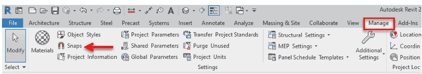

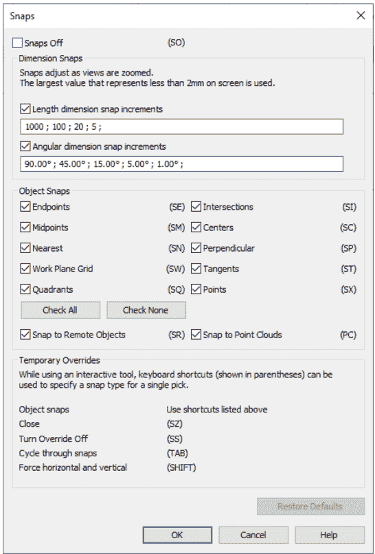

图3.24 – 编辑捕捉设置

**对象捕捉**设置允许用户启用和/或禁用特定的捕捉，以适应特定的工作流。此外，我们可以通过使用括号中的快捷键来提高工作效率，例如（**SE**）、（**SM**）、（**SC**）等。

## 项目信息

这些设置对于指定项目信息非常有用，例如：

- 组织名称
- 组织描述
- 建筑名称
- 作者
- 能量设置
- 路线分析设置
- 项目发布日期
- 项目状态
- 客户名称
- 项目地址
- 项目名称
- 项目编号

可以通过单击**管理**，然后**项目信息**来访问此信息：

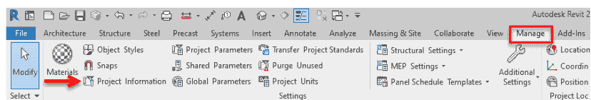

图3.25 – 项目信息

将打开一个新窗口，我们可以在其中根据需要添加和编辑所有信息：

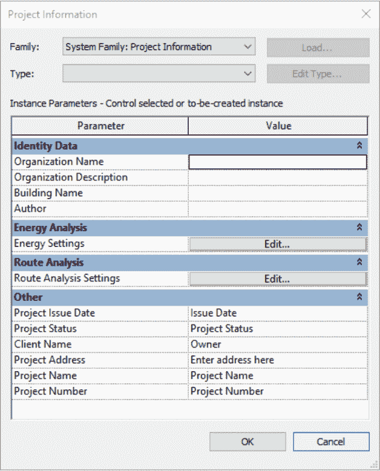

图3.26 – 项目信息参数

可以根据需要通过创建新项目或共享参数来添加更多项目信息。

在标题页、闪屏、标记等中需要包含附加参数。创建项目参数和共享参数的过程将在专门章节中说明：

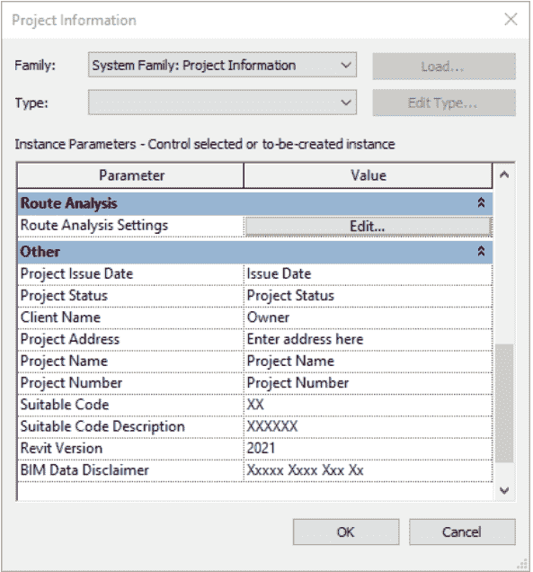

图3.27 – 附加项目信息参数

建议始终将项目相关信息保存在“项目信息”下。通过保持信息的一致性，可以轻松找到所需的信息。

## 项目参数

项目参数是允许用户向项目中的特定Revit类别添加信息的参数。这些参数在明细表中可见，但不能用于标记（因为它们不与外部文件共享）。

用户可以根据需要添加任意数量的项目参数，但应保持在最少数量。因为这会增加文件大小，并使得维护模型中的不必要数据变得更加困难。

## 共享参数

共享参数类似于项目参数。主要区别在于这些参数可用于多个族或项目。此外，它们可以被标记、列入明细表并作为ODBC导出。

使用共享参数时，必须有一个外部文件（*.TXT文件）来承载此信息。

每个项目都应有自己的共享参数文件（即*.TXT文件），可以在其中创建模板参数。这包括项目级别所需的任何附加共享参数。

如果我们为Revit族创建共享参数，则需要确保该项目中也创建了该参数，以便其正常工作。

创建共享参数的过程由三个不同的步骤组成：

- 创建新的共享参数文件。
- 在共享参数文件中创建参数组和参数。
- 将共享参数文件添加到Revit文件中。

## 创建新的共享参数文件和参数

要创建共享参数文件，请按照以下步骤操作：

- 1. 在“管理”选项卡中，单击“共享参数”：

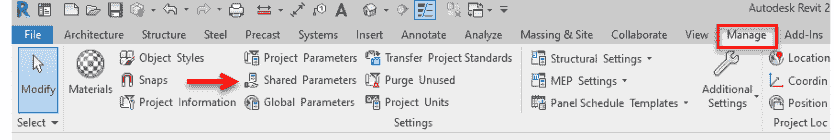

图3.28 – 创建共享参数文件

在创建参数之前，用户需要先创建一个**参数组**，参数将创建在该参数组中。参数组将帮助您组织所有共享参数。创建参数组后，就可以创建参数。如果参数组已存在，请确保新参数创建在相应的组中：

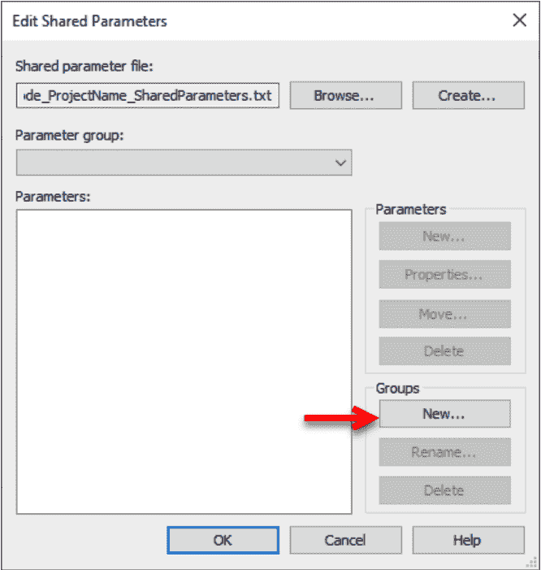

图3.30 – 为共享参数创建新参数组

3. 单击**新建**，输入参数**名称**，然后选择**规程**。选择**参数类型**，然后单击**确定**：

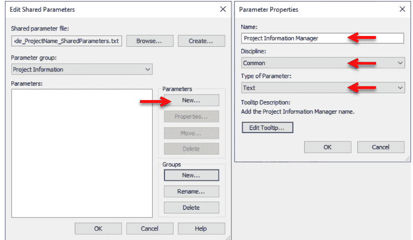

图3.31 – 创建共享参数

4. 添加新的共享参数需要多次单击，如下面的截图所示。导航到**管理 > 项目参数 > 添加 > 共享参数 > 选择**。然后，选择正确的类别，选择要添加的参数，并单击**确定**。按照下图中的编号操作：

> **提示**
> 您可以通过选择参数并单击“移动”将参数从一个组移动到另一个组。

现在，创建共享参数的过程就完成了。

## 全局参数

全局参数是一种不分配给特定类别，但可用于不同类别中的多个对象的参数。

例如，可以使用全局参数来控制所有窗台高度，使其保持一致。

要访问全局参数，请执行以下步骤：

- 1. 在功能区中，单击“管理”，然后再单击“全局参数”：

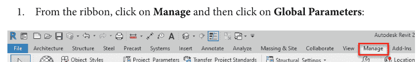

图3.33 – 全局参数

- 2. 在“全局参数”窗口底部，您可以根据需要创建、编辑和删除参数：

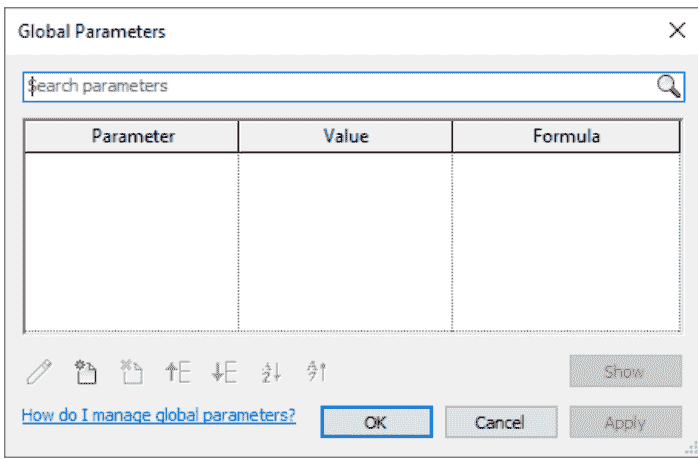

图3.34 – 创建全局参数

提示

请注意，可以使用另一个**公式**或**特定值**。

## 项目单位

在Revit中工作时，您可以随时定义所使用的单位。更改此设置时，Revit将使用新定义的单位自动调整所有项目，而无需用户进行任何其他输入。

项目单位按规程分组。更改规程后，将显示不同的单位类型。

## 族命名约定

关于命名约定，世界各地有许多可用的示例。我们建议族命名约定基于并符合*BS_8541-1_2012：建筑、工程和施工库对象——第1部分：标识与分类。操作规范。*

为了在搜索内容时获得一致的结果，作为最佳实践，应遵循以下规则：

- 命名应使用驼峰式大小写（即每个单词首字母大写）。
- 不要使用空格。
- 使用 _（下划线）作为字段之间的分隔符。
- 使用完整的单词（尽可能）。
- 不要使用特殊字符，例如 , . ! " £ $ % ^ & * ( ) { } [ ] + = < > ? | \ / @ ' ~ # ¬ ` '。

我们建议您按以下方式重命名族文件：

**<Discipline>_<Type>_<Subtype>_<Description>**

对于每个字段，我们有以下说明：

- **<Discipline>**：标识负责开发内容的设计规程代码：**A**。
- **<Type>**：指定有关对象用途的信息（不应与Revit族类别混淆）：**A_Annotation**。
- **<Subtype>**：指定第二层信息，帮助您将一个族与另一个族区分开来：**A_Annotation_TitleBlock**。
- **<Description>**：允许用户添加附加信息以区分子类型（可选）：**A_Annotation_TitleBlock_A1Metric**。

要重命名Revit内容，我们可以通过两种不同的方式进行：

- **通过插件（或Dynamo）**：这可以将所有现有Revit内容名称导出到Excel电子表格中。然后，我们可以在Excel中编辑它们，并将Excel电子表格导入回Revit（我们将在本书后面的章节中介绍一些可用于帮助完成此任务的插件）。


- **手动方式：**右键单击并选择**重命名**：

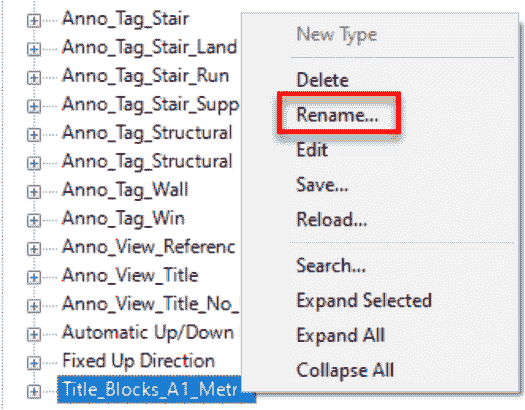

图 3.37 – 重命名族

## 导出 IFC 设置

IFC 文件格式是一种互操作文件格式，允许不同的 BIM 软件导入模型并用于协调。通过减少软件之间传输过程中的信息丢失，它可以在整个建筑生命周期中用于沟通、提高生产效率和保证质量。

为了实现这种互操作性，buildingSMART 制定并维护了一系列标准。

buildingSMART 网站地址为 `https://bit.ly/2JGIz8u`。

或者，您也可以参考以下二维码：


在以 IFC 文件格式导出模型之前，需要将所有 Revit 族映射到特定的 IFC 类别和 IFC 类型。这样可以更好地理解在不同软件类型中应如何识别元素类型。

要访问 IFC 导出映射配置，请执行以下步骤：

1. 在**文件**菜单中，转到**导出**。在**选项**中，单击**IFC 选项**：

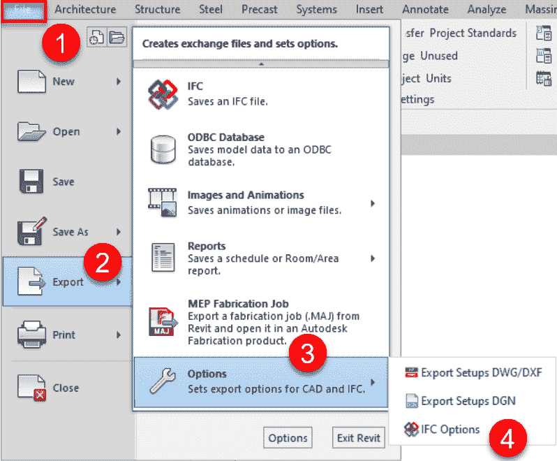

图 3.38 – IFC 类别映射选项

2. 在新窗口中，可以定义每个 Revit 类别将导出为哪些 IFC 类别：

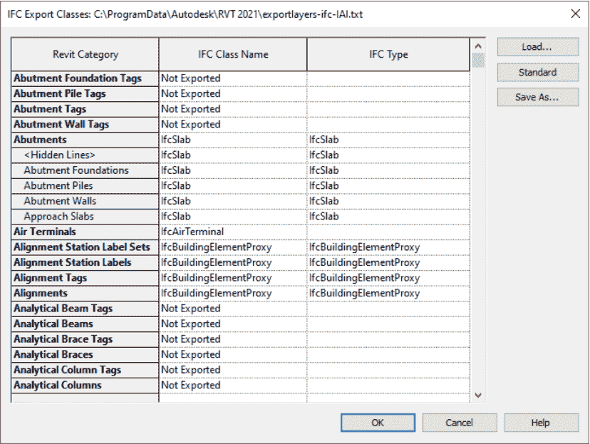

*图 3.39 – IFC 导出类别映射*

导出为 IFC 时，必须了解应使用哪个 IFC 版本（**模型视图定义或 MVD**）。

您可以通过 buildingSMART 网站了解更多关于 IFC 规范数据库的信息：`https://bit.ly/2XcdqNk`。

或者，您也可以使用以下二维码：


您可以通过 buildingSMART 网站了解更多关于 MVD 数据库的信息：`https://bit.ly/2I00PKO`。

或者，您也可以使用以下二维码：


您可以通过 buildingSMART 网站了解更多关于 IFC 实施指南的信息：`https://bit.ly/38edqrt`。

或者，您也可以使用以下二维码：


您可以通过 buildingSMART 网站了解更多关于软件实施的信息：`https://bit.ly/3oeoK7G`。

或者，您也可以使用以下二维码：


> **提示**  
> 使用 IFC 时，请确保使用最新版本的 IFC 导出器。

## Keynote 设置

Keynote 是一项功能，可根据分类系统对所有模型元素进行分类。该分类系统可以是内部分类系统（即由公司制定并基于内部标准），也可以是行业标准分类系统。您可以按照下图所示访问 Keynote：

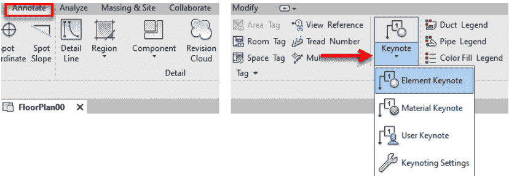

图 3.40 – Keynote

默认情况下，提供的 Keynote 分类系统基于 1995 年美国建筑规范学会（CSI）的 MasterFormat。

使用 Keynote 是将模型元素与项目规范关联起来的一种简单高效的方法。这是因为相关信息会添加到元素中，而标记将显示这些信息。

这些信息来源于外部 `.TXT` 文件，该文件包含一个键值和一段描述。默认情况下，该文件保存在 `%ALLUSERSPROFILE%\Autodesk\RVT 2021\Libraries\<local and language>`：

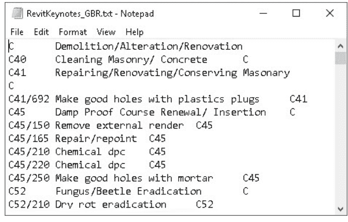

图 3.41 – Keynote 文件结构

通过**注释**选项卡中的**Keynoting 设置**，可以将新文件加载到项目中：

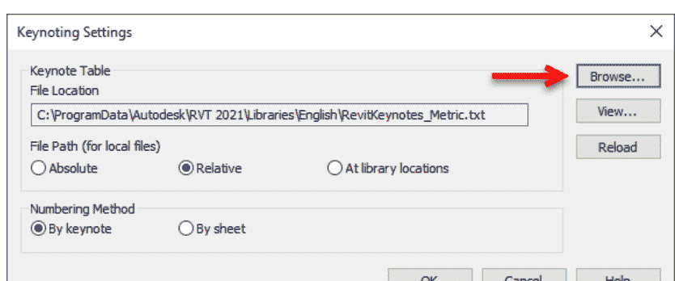

图 3.42 – Keynoting 设置

Keynote 有三种不同类型：

- **元素 Keynote：**分配给整个模型元素的 Keynote。
- **材质 Keynote：**分配给模型元素材质的 Keynote。
- **用户 Keynote：**按用户分配的 Keynote。

## 工作集

在处理工作共享项目时（这是一种允许多个用户同时处理同一模型的建模方法），工作集至关重要，因为它们可以作为元素的集合。

创建工作集后，可以打开或关闭工作集，以提高 Revit 的性能。

在 `Revit_Template_Check_List.xls` 文件中，可以找到项目中最常用的工作集列表：

| 工作集 | 描述 |
|---|---|
| Workset1 | 默认 Revit 工作集 |
| Shared Levels and Grids | 默认 Revit 工作集 |
| ABC_CAD_Links | 用于添加 CAD 链接 |
| ABC_Arch_Description_Link | 每个建筑文件都有一个单独的工作集 |
| ABC_MEP_Links | 用于添加 MEP 文件 |
| ABC_STR_Links | 用于添加结构文件 |
| ABC_Reference_Planes | 用于添加参照平面 |
| ABC_Cladding - Exterior | 用于建模外部构件 |
| ABC_Interiors | 用于建模内部构件 |
| ABC_Site | 用于建模场地构件 |
| ABC_FF&E | FF&E = 家具、固定装置和设备 |
| ABC_HVAC | MEP 工作集 |
| ABC_Plumbing | MEP 工作集 |
| ABC_Fire_Protection | MEP 工作集 |
| ABC_Electrical | MEP 工作集 |
| ABC_Steel | 结构工作集 |
| ABC_Concrete | 结构工作集 |
| ABC_Foundations | 结构工作集 |

图 3.43 – Revit 模板检查清单

只有在使用工作共享工具和环境时，才能在项目文件（RVT）中创建工作集；模板（RTE）中无法创建工作集。

> **提示**  
> 创建工作集应仅由负责项目的任务信息经理执行。

## 视图和图纸

关于视图命名规范，重要的是采用一种便于识别视图和图纸内容的命名规范。这将提高项目工作效率。

如需快速搜索，可以在浏览器组织名称下方右键单击并选择“搜索”：

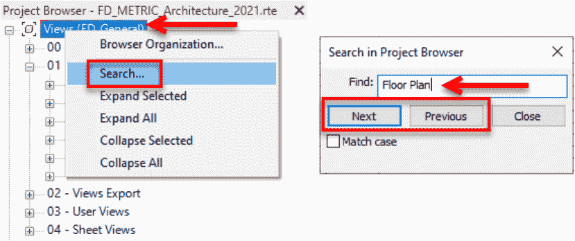

图 3.44 – 在项目中搜索族的视图和图纸

根据项目规模的不同，我们可能会拥有数百个视图，此时该选项就非常有用。

## 视图名称

视图重命名过程与前面提到的过程相同：

- 通过插件（或 Dynamo）：使用外部插件
- 手动方式：右键单击并选择“重命名”

> **提示**  
> 选择视图并按 F2，即可编辑视图名称（族名称和族类型名称也适用）。

根据您组织项目浏览器的方式（即按参数或按视图类型），应尽可能对所有视图进行组织：

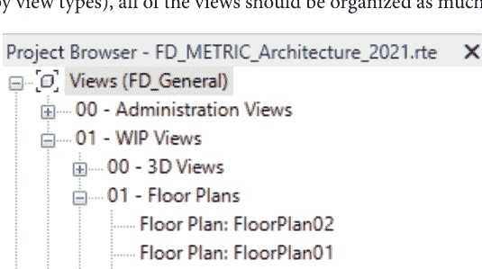

图 3.45 – 命名视图

如前所述，我们建议您为视图名称采用统一的命名规范。

## 图纸名称

与视图名称采用相同的策略，图纸名称应清晰说明其包含的内容。我们建议遵循适当的命名规范：

所有这些参数都应为共享参数，并按照*共享参数*部分中所述的相同方式添加：

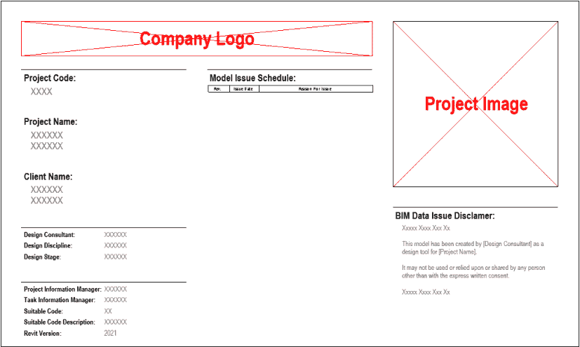

图 3.47 – 启动画面

## 定义起始视图

可以通过执行以下步骤定义起始视图：

1. 在功能区中，单击**管理**。
2. 单击**起始视图**：

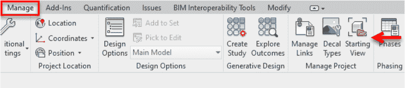

图 3.48 – 定义起始视图

3. 选择要使用的视图，然后单击“确定”：

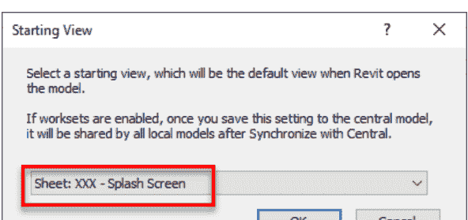

图 3.49 – 选择要用作起始视图的视图

将二维视图设置为起始视图是一种良好实践，因为起始视图可以提高模型打开速度。这是因为 Revit 不需要更新任何三维视图。

## 标题栏族

标题栏遵循与启动画面相同的原则：

- 需要包含与项目和图纸相关的重要信息。
- 应按照前面介绍的相同原则添加共享参数。
- 需要编辑一些特定于项目的信息。


要从零创建标题栏，Revit 需要使用专门为此的 Revit 族模板，称为 **Title Blocks**。要创建它，请按照以下步骤操作：

1. 转到 **File**，在 **New** 下方选择 **Title Block**：

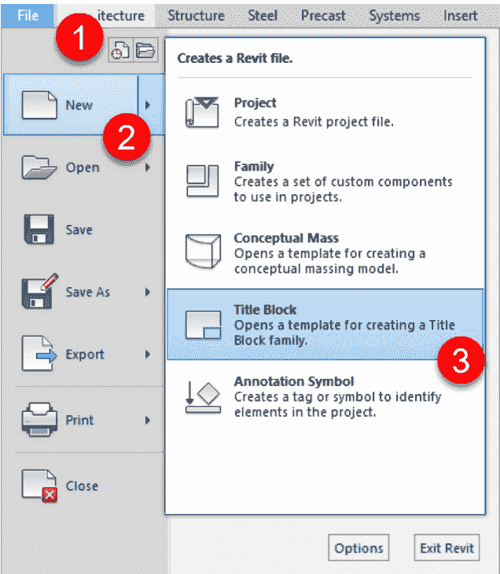

Figure 3.50 – Opening a title block family

2. 在 New Title Block 窗口中，选择要作为起点使用的尺寸，然后单击 **OK**：

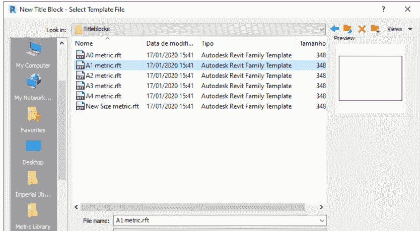

Figure 3.51 – Selecting a title block family template

现在你已打开族模板，请保存文件（遵循命名约定）并按需创建。你应该具有以下内容：

- **Lines**：用于绘制所需的所有线条。
- **Text**：用于编写每个区域的标题。
- **Labels**：用于添加所有参数和共享参数（这些需要在共享参数文件中创建，如本章前面所述）以在项目中填充。

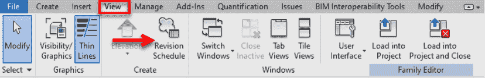

Figure 3.53 – Inserting a revision schedule into the title block

我们建议你设置项目中修订的使用方式。还建议你使用 ISO 19650 修订系统：**P01.01。**

要访问修订，请按照以下步骤操作：

1. 在功能区中，单击 **View**。
2. 单击 **Revisions**。

**Sheet Issues/Revisions** 窗口将打开。从这里，你可以更改项目中使用的设置：

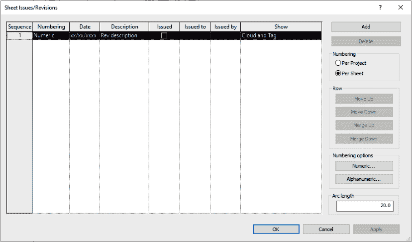

Figure 3.54 – Revision information settings

作为建议，修订编号应遵循 ISO 19650。

# Schedules

Revit 中的 Schedules 允许你创建模型中几乎所有实例类型的元素列表。这些 schedules 会根据模型中可以找到的信息自动更新。

可以提取不同类型的 schedules：

- **Quantity schedules**：允许用户从模型中提取建筑元素的列表。
- **Key schedules**：允许用户定义键，以便更一致地填充数量表。
- **Graphical column schedules**：允许用户通过相交网格线创建柱表，包括其顶部和底部约束及偏移。
- **Material takeoff**：允许用户从模型中导出分配给元素的材料信息。
- **Sheet lists**：允许用户列出项目中的图纸清单。
- **Note block schedules**：允许用户定义可使用 **Symbol** 工具添加到模型中的注释表。
- **View lists**：允许用户列出项目中的视图。
- **Revision schedules**：允许用户列出分配给图纸的修订。
- **Panel schedules**：允许用户创建包含电气配电箱信息、连接到配电箱的电路及其对应负载的配电箱表。

创建 schedules 的过程相当简单：

1. 将鼠标悬停在 **Schedules/Quantities** 上，右键单击，然后单击要创建的 schedule 类型：

Figure 3.55 – Creating new schedules

2. 创建 schedules 后，我们建议你根据 View Package 参数将其放入特定文件夹中：

Figure 3.56 – Schedules organized per package

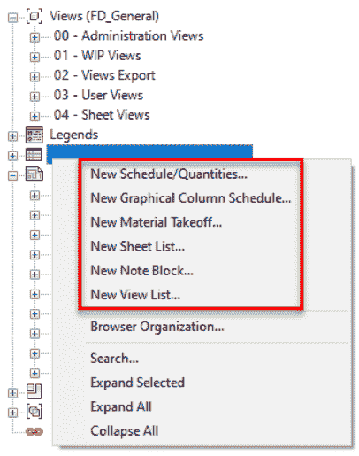

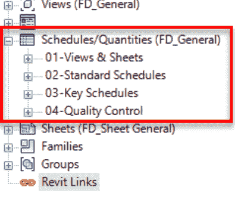

# Legends

> **Tip**
>
> 在使用 schedules 时，按住 **Control** 键并移动鼠标滚轮，将会 **Zoom In** 和 **Zoom Out**。

Legend 视图可以根据用户希望在项目中使用的不同方式具有多种用途。它们可用于列出模型组件或注释，或用作一般注释：

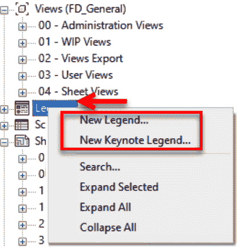

我们可以有以下不同类型的 legend：

- **Legend：** 允许用户创建典型图例，例如注释图例、线型图例和图案图例。
- **Keynote legend：** 允许用户创建包含分配给项目或视图中元素或材料的全部注释和注释说明的表。

Legends 可以放置到多个图纸中。

# Graphic standards

在本节中，我们将介绍可用于控制 Revit 中图形的主要设置。这是一个重要主题，因为它会影响所有施工图纸的生产率和一致性。

我们将介绍以下内容：

- Line patterns
- Line styles
- Line weights
- Object styles
- Fill patterns
- Material library
- View templates
- Filters
- Color fill legend schemes
- Phases
- Exporting to DWG
- Arrowheads

## Line patterns

在 Revit 中，你可以创建线型。这些线型是通过组合破折号和点以及它们之间的空白空间创建的。破折号和空格可以具有特定尺寸。

这些线型可以与颜色组合以定义线型（将在后面介绍）。

按照以下步骤创建线型：

1. 从功能区单击 **Manage**，在 **Additional Settings** 中单击 **Line Patterns**：

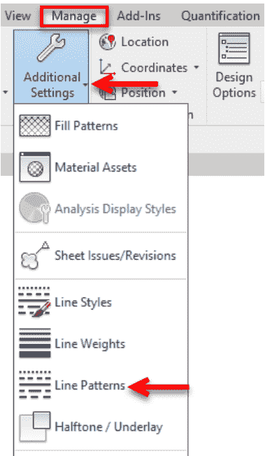

Figure 3.58 – The Line Patterns setting

2. 打开 **Line Patterns** 窗口后，你可以创建、编辑、删除和重命名线型。我们建议你使用命名约定并仅创建最常用的线型：

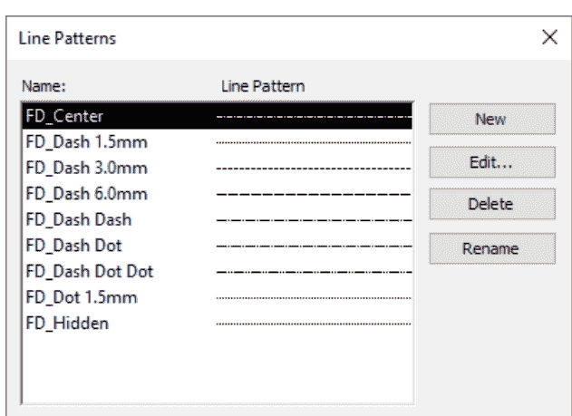

Figure 3.59 – Line patterns available in the project

线型只能使用破折号、空格和点创建。

# Line styles

线型是线型、线宽和颜色的组合。按照以下步骤创建线型：

1. 从功能区单击 **Manage**。然后在 **Additional Settings** 中单击 **Line Styles**：

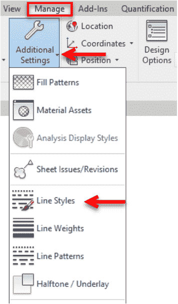

Figure 3.60 – The Line Styles setting

2. 打开 **Line Styles** 窗口后，你可以创建、编辑、删除和重命名线型。
3. 在 **Category** 列中，你可以看到项目中所有可用线型的列表。其中一些线型带有 <>，表示该线型是系统（硬编码）线型，不能删除或重命名。其他线型可以创建、重命名和删除：

Figure 3.61 – The line styles available in the project

线型可用于项目级别的模型线或详图线。

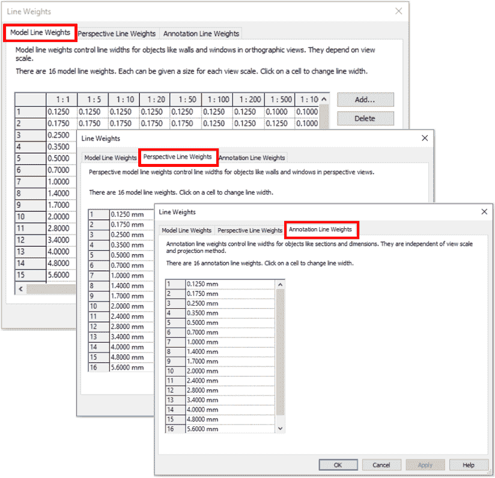

Figure 3.63 – Line Weights

- **Model Line Weights：** 可用于指定正交视图中 3D 元素的线宽；请注意，这取决于视图的比例。
- **Perspective Line Weights：** 可用于指定透视视图中 3D 元素的线宽；请注意，这不取决于视图的比例。
- **Annotation Line Weights：** 可用于指定正交视图中注释元素的线宽；请注意，这不取决于视图的比例。

# Object styles

如前所述，对象样式允许用户针对每个类别设置所有通用设置，关于线宽（剖切和投影）、线颜色、线型以及材料（如果元素未分配材料）：

1. 从功能区单击 **Manage**，然后单击 **Object Styles**：

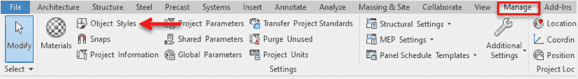

Figure 3.64 – Object Styles

2. 这些设置允许你控制 **Model Objects, Annotation Objects, Analytical Objects, and Imported Objects**：


Figure 3.65 – The Object Styles settings


- **模型对象：** 通过此功能，您可以配置项目中所有专业中的所有模型对象。
- **标注对象：** 通过此功能，您可以配置项目中的所有标注元素。
- **分析对象：** 通过此功能，您可以配置项目的全部分析元素（包括结构专业和区域）。
- **导入对象：** 通过此功能，您可以配置项目中所有导入元素（即直接导入到项目或族中的元素）。

## 填充图案

填充图案可在 Revit 中用于定义对象的表面外观。 对于 3D 元素，它不仅可以定义表面的外观，还可以定义剖切区域的外观。 按以下步骤创建填充图案：

- 1. 在功能区中，单击 **Manage**，然后单击 **Fill Patterns**：


图 3.66 – 填充图案

图案可以通过从 AutoCAD 导入图案文件（PAT 文件）创建，也可以在 Revit 中直接创建基础图案。

## 材料库

Revit 中的材料不仅仅用于渲染；它们还控制元素在视图中的显示方式，并添加有关其属性的特定数据。

从材料中，我们可以组合五种不同的资源：

- **Identity**：可用于添加材料的技术信息。
- **Graphical**：可用于控制在项目视图中查看的颜色和相应图案。
- **Appearance**：可用于渲染视图、真实视图或光线追踪视图。
- **Physical**：可用于结构分析。
- **Thermal**：可用于能源分析。

可以通过单击 **Manage**，在 **Materials** 下访问此信息：


图 3.68 – 材料库

将打开一个新窗口，我们可以在其中添加和编辑所需的所有信息：


图 3.69 – 材料浏览器

单击双箭头时，此窗口可以展开或折叠：


图 3.70 – 材料浏览器

作为良好实践，我们建议您执行以下操作：

- 使用适当的命名约定来标识材料。
- 在 **Identify** 资源下，使用适当的类别以便更轻松地筛选。
- 在可能的情况下，根据材料名称重命名 **Physical** 和 **Thermal** 资源。
- 为每个项目创建具有适当类别的材料库。

Tip
Revit 材料可以与 Autodesk Inventor 和 Autodesk Civil 3D 共享。

## 视图模板

您可以将视图模板定义为可控制并分配给特定视图的视图属性集合，确保分配的视图使用相同的视图设置，并在施工文档集中保持一致性。

在创建视图模板之前，我们建议您考虑视图在项目中的使用方式。 例如，它们可以按套件组织：

- 场地平面图
- 楼层平面图
- 反射天花板平面图
- 立面图

可以按如下方式访问视图模板：

- 1. 在功能区中，单击 **View**。 然后，单击 **View Templates** 和 **Manage View Templates**：


图 3.71 – 管理视图模板

您可以通过新窗口复制现有视图模板并重命名或删除现有模板。

> **Tip**
> 
> 创建视图模板的另一种工作流程是按要求配置视图。 然后，在项目浏览器中，将鼠标悬停在 **View Name** 上，右键单击，然后单击 **Create View Template from View…**

为了更好地控制和组织，我们建议您在模板中定义最少的视图模板，并在项目要求和需要时创建更多模板。

> Tip
> 让尽可能多的设置由视图模板控制，将在所有图纸中保持一致性，并且也是更改任何设置的更简单方法。

2. 下面的屏幕截图显示了模板中所有可用视图模板的列表：


图 3.72 – 视图模板设置

- 3. 创建视图模板后，您可以将其分配给视图或一组视图。 您可以通过选择并更改视图属性，在 **View Template** 参数下执行此操作：


图 3.73 – 将视图模板应用于视图

> **Tip**
> 
> 当视图模板分配给视图时，不可能更改由视图模板控制的视图属性。 在 **Visibility** 栏下，您可以使用 **Temporary View Properties** 选项临时更改设置，并通过重置为分配的视图模板来将其重新定义为原样。

## 筛选器

筛选器不仅可用于覆盖图形表示，还可用于元素的可见性。

可以通过执行以下步骤访问视图筛选器：

- 1. 在功能区中，单击 View，然后单击 Filters：


图 3.74 – 视图筛选器

- 2. 从新窗口中，您可以创建两种不同的视图筛选器，如下所示：

- Rule-based Filters：这些筛选器基于元素类别和参数。
- Selection Filters：这些筛选器基于选择：


图 3.75 – 视图筛选器设置

这些视图筛选器可以添加到视图模板中，以便更好地控制项目的可见性和图形。

## 颜色填充图例和方案

颜色填充图例是基于可用模型数据以不同图形方式将颜色应用于房间、区域和空间的不同方法。 它们可以与用于填充模型元素的颜色代码图例一起放置在楼层平面图的任何位置。

可以通过导航到 Annotate，在 Color Fill 面板下添加颜色填充图例：


图 3.76 – 添加颜色填充方案

Revit 将放置颜色填充图例并激活颜色方案本身。 图例可以随时删除，并且颜色方案可以在属性下移除或添加：


图 3.77 – 切换颜色方案可见性

可以根据添加到房间属性的不同数据添加颜色编码。

## 阶段

阶段功能允许您处理翻新项目。 这意味着项目将在不同的项目阶段表示：翻新前后。 使用此工具，Revit 将跟踪阶段元素，这些元素为 **New, Demolished, Existing, and Temporary。**

此功能只能应用于模型元素。 通过使用阶段筛选，我们可以对这四种状态的对象应用颜色编码：

- **Existing：** 在视图阶段存在的元素。
- **New：** 在视图阶段建模的元素。
- **Demolished：** 在视图阶段拆除的现有元素（即 Phase Created 和 Phase Demolished 不同时）。
- **Temporary：** 在同一阶段拆除的新元素（即 Phase Created 和 Phase Demolished 相同）。

要访问阶段功能，请按照以下步骤操作：

- 1. 在功能区中，单击 **Manage**，然后单击 **Phases：**


图 3.78 – 阶段设置

要访问导出过程，请按照以下步骤操作：

- 1. 从左上角单击 File。 然后单击 Export、CAD Formats 和 DWG：


图 3.83 – DWG 导出


+   2. 要设置导出设置，请点击 …，如下所示：


图 3.84 – DWG 导出设置

+   3. 通过创建新的导出设置，可以收集所有设置并按需使用。我们建议您将最常用的设置保存在模板中：


图 3.85 – 已保存的 DWG 导出设置

4. 在编辑设置时，您还可以在导出过程之前设置一些配置；这些配置将与导出设置一起保存：


图 3.86 – 已保存的 DWG 导出设置

务必浏览所有这些选项卡并了解可用的设置：

+   - **图层**：这允许用户将 Revit 类别映射到 CAD 图层（基于任何命名约定）。
+   - **线型**：这允许用户将 Revit 线型映射到 AutoCAD 线型。
+   - **图案**：这允许用户将 Revit 图案映射到 AutoCAD 填充。
+   - **文字与字体**：这允许用户将文字映射到特定的 DWG 文字样式。
+   - **颜色**：这允许用户选择想要使用的颜色映射系统。
+   - **实体**：这允许用户将 3D 元素导出为实体或曲面。
+   - **单位与坐标**：这允许用户选择将导出的单位以及导出时使用的坐标系统。
+   - **常规**：这允许用户在导出前选择常规设置。

就系统坐标而言，在导出图纸时，不可能基于任何系统坐标进行导出；也就是说，只有模型视图和 3D 模型用户才能选择使用的系统。

## 箭头

箭头可用于标注对象或使用引出线的对象，如标签、点高程、点坐标和文字。

要访问箭头设置，请按以下步骤操作：

+   1. 从功能区中点击 **管理**。然后，点击 **附加设置** 并点击 **箭头**：


图 3.87 – 箭头设置

2. 创建后，它们将可用于特定对象：


图 3.88 – 箭头设置

箭头可与标注和引出线一起使用，使用标签或甚至普通文字时均可。

## 标注标准

在本节中，我们将介绍 **标注标准**。正如我们在上一节提到的，这将影响所有施工图纸的生产率和一致性。

这些设置在配置方面相对简单，包括以下内容：

+   - 文字类型
+   - 标注类型
+   - 符号
+   - 视图标题
+   - 标签

## 文字类型

文字是一个必不可少的对象，因为它将在几乎所有图纸中使用。BS-ISO 3098-0:1998 定义了一系列文字高度，包括 1.8 mm、2.5 mm、3.5 mm、5 mm、7 mm、10 mm、14 mm 和 20 mm。

这些设置可通过在标注下点击文字类型访问：


图 3.89 – 文字类型设置

所有可用设置都与文字字体和颜色相关：


图 3.90 – 类型属性

请记住，无论视图中使用何种比例，文字高度在打印时都会保持不变。

## 标注类型

标注用于根据文字大小测量项目中的距离，并且如前所述，应遵循相同的标准尺寸。

这些设置可通过在标注下点击标注访问：


图 3.91 – 标注类型

根据每个标注类型，可以创建新的标注类型：


图 3.92 – 标注类型设置

正如在文字类型部分提到的，所有标注设置在打印时都会保持不变，无论视图中使用何种比例。

## 符号

符号是项目中使用的任何标注元素的图形表示：

### 标高符号

### 标高符号

### 标签符号


### 剖面符号

### 详图符号

图 3.93 – 符号

为了更好地了解项目中使用的符号，我们建议您提供一个包含所有使用符号的图例。

## 视图标题

视图标题用于提供从放置到图纸中的视图的标准信息。通常，这会提供视图名称、视图比例和详图编号：


图 3.94 – 符号

将视图放置到图纸中时，此标签将与视图名称和视图比例一起填充。

## 标签

标签是一个 2D 标注元素，用于在图纸中标识元素。这些标签是类别特定的，这意味着每个 Revit 类别都可以有一个标签来从宿主元素中提取信息。

这些元素可以从标注选项卡下的标签面板添加到项目中：


图 3.95 – 来自不同 Revit 类别的标签

添加标签时，您可以将其添加到 2D 视图和 3D 视图中。要将其添加到 3D 视图中，我们建议您先锁定 3D 视图。

## 模型内容

在开始项目之前，了解项目要求和项目 BIM 范围至关重要。所有这些信息对于使 BIM 生产与 BIM 范围以及绘图生产所需的图形结果保持一致至关重要。

所有团队成员都应了解为需要建模的元素所需的信息水平。这些信息不仅是图形信息，也是非图形信息，因为两者都会影响 Revit 性能。

一些团队成员倾向于开发复杂且过于详细的模型。这会对性能产生关键影响。

可能影响性能的主要方面如下：

+   - **链接文件：** 使用链接文件时，确保所有文件都已正确链接并且在极端需要时才使用。始终控制路径是否正确，因为当 Revit 丢失路径时，也会影响性能。
+   - **元素之间的多重约束和参数关系：** 在建模元素时使用约束是很常见的，例如锁定对齐、锁定尺寸和参数化阵列。所有这些操作都会影响性能，因为 Revit 在每次更新之前都会始终检查约束。
+   - **复杂几何体：** 在建模项目时，很常见的是过度建模元素或从不同软件导入元素（例如，从 Rhino 导入元素）将复杂几何体导入 Revit。在导入该几何体之前，请检查是否可以简化元素的形状。

质量保证工作流程应成为项目的一部分，以保持模型性能。作为参考，以下是需要执行的几个检查：

+   - 文件大小应低于 250 MB。
+   - 所有链接的正确文件路径
+   - 组的数量不过高（应避免使用系统族的组）。
+   - 族内族的数量应减少到最低限度（如果同一族有多个实例，族内族应转换为可加载族）。
+   - 如果模型是工作共享，请确保所有元素都在正确的作业集中（这将便于打开/关闭元素）。
+   - 警告应保持在最低限度。

## 系统族

除非它们托管了标准族（可加载族），否则系统族不会对 Revit 性能产生太大影响。

对于这些族，所有约束、公式和形状复杂性都不是很灵活，保持对象复杂度较低。

要创建不同族类型，Revit 仅允许用户编辑硬编码参数。因此，不可能创建复杂的公式或参数，这通常会影响模型性能。

## 标准族和可加载族

标准族（或可加载族）是对 Revit 性能影响最大的族。这是因为这些族高度可定制，即它们更复杂，并且在不同几何体部分之间的关系方面受到约束。

例如，在使用挤出建模族时，如果使用扫掠、混合、扫掠混合甚至旋转，族会变得更重、更复杂，因为 Revit 需要控制除尺寸之外的更多约束（形状始终恒定）。

影响性能的另一个例子是当族包含非 Revit 元素时，例如从 Rhino、SAT 或 DWG 导入的 3D 几何体。我们应避免使用非原生几何体，或者如果需要使用，应尽可能保持其简单。

作为参考，可加载族的平均大小应为 1 MB。如果更大，请确保它们是必要的并且需要使用。

## 总结

在本章中，我们学习了如何从头开始创建 Revit 模板，以及需要在模板中包含的主要设置，以提高项目级别的生产率。

我们解释了如何组织视图、图纸、明细表以及模型中的所有信息，以便更快、更轻松地管理可用信息。这些设置相对重要且优先级很高；然而，这并不意味着这些是唯一需要添加到模板中的设置。

您还学习了应建模的内容以及这对 Revit 性能和生产率的影响。


Revit 坐标系用于理解如何管理多个元素，例如项目北、真北、测量点、项目基点和内部原点。

本章还将解释在接收 Revit 测量模型和坐标系对齐的点云文件时需要考虑的重要方面。

在本章中，我们将介绍以下主题：

- Revit 坐标系概述
- 坐标系的挑战
- 启动 Revit 项目并设置项目坐标
- 体量策略与场地上的多栋建筑

## 技术要求

在本章中，你需要使用 Autodesk Revit。描述所有这些练习所用的版本是 Revit 2021，但你也可以使用其他版本。务必考虑以下几点：

- 不同版本之间可能略有差异。
- 旧版本的 Revit 无法打开新版本的文件。

本章使用的所有数据集都可以在本书的 GitHub 仓库中找到：https://github.com/PacktPublishing/-Increasing-Autodesk-Revit-Productivity-for-BIM-Projects。

## Revit 坐标系概述

理解 Revit 坐标系将帮助我们正确设置 Revit 项目，并避免将来返工。因此，它应该能提高我们的效率。

Revit 中有两个坐标系，如下所示：

- **测量坐标系**：

  测量坐标系使用一个称为**测量点**的 Revit 对象，以真实世界坐标系将项目定位在地球表面。我们可以从测量文件或**地形测量图（OS Maps）**中获取此信息：

  

  图 4.1 – 测量点

- **项目坐标系**：

  项目坐标系使用一个称为**项目基点**的 Revit 对象，用于定位建筑物或场地附近的特定坐标点：

  

  图 4.2 – 项目基点

让我们在 Revit 中找到测量点和项目基点：

1. 新建一个 Revit 项目或打开一个现有项目。
2. 在项目浏览器中打开**标高 1** 楼层平面。
3. 在“视图”选项卡下，单击**可见性/图形**，或使用快捷键。如果你想使用快捷键，可以输入 VG 或 VV：

   

   图 4.3 – 可见性/图形

4. 展开“场地”类别，选择“测量点”选项，然后单击“确定”：

   

   图 4.4 – 测量点和项目基点

   你应该会看到**测量点**，如下所示：

   

   图 4.5 – 测量点

5. 重复*步骤 4*，然后选择**项目基点**，得到以下结果：

   

   图 4.6 – 项目基点

**测量点**和**项目基点**将用于在 Revit 中设置坐标系。现在，让我们找到**Revit 内部原点**，它是这方面的重要参考点。

## Revit 内部原点

Revit 内部原点帮助你识别 Revit 内部坐标系的起点，该起点位于 X=0、Y=0 和 Z=0 坐标处。

我们应该将 Revit 模型放置在靠近 Revit 内部原点的位置，因为模型几何图形需要位于距 Revit 内部原点最大距离（即 16 公里（10 英里）半径）之内。

如果几何图形距离内部原点太远，Revit 的精度会降低，并会显示图形问题：


图 4.7 – Revit 内部原点

> **提示**
> Revit 模型几何图形需要相对靠近 Revit 内部原点。

从 Revit 2020.2 版本开始，我们可以轻松找到 Revit 内部原点并使其可见。为此，请执行以下步骤：

1. 在项目浏览器中打开**标高 1** 楼层平面。
2. 单击**可见性/图形**，或通过输入 **VG** 或 **VV** 来使用快捷键：

   

   图 4.8 – 可见性/图形

在 2020.2 之前的版本中，**Revit 内部原点**是隐藏的，你只能通过以下步骤找到它：

1. 打开**项目基点**。
2. 取消固定**项目基点**：

   

   图 4.11 – 取消固定项目基点

3. 右键单击**项目基点**，然后选择**移动到启动位置**选项：

   

   图 4.12 – 移动到启动位置

在*第 4 章*的数据集中，我们可以找到 OS MAP-Survey .dwg 文件：


图 4.13 – 带坐标的场地

以下截图显示了该场地的放大视图，其中显示了三个坐标：


图 4.14 – 具有三个典型坐标的场地

我们建议你始终将测量站点作为首选选项。

第二个选项是地形测量图网格交点。

我们不建议使用建筑坐标点和来自结构项目网格的坐标点。不建议使用这些点有两个原因：

- 建筑坐标点没有四舍五入的数字，这可能导致软件精度问题（X=5514291.6539，Y=181598.9381）。软件可能会显示四舍五入后的数字（X=5514291.7，Y=181599.0），也许公司会开始使用（X=5514291.7，Y=181599.0）而不是正确的坐标。
- 结构项目网格在开发过程中可能会更改这些位置。

> **提示**
> 设置 Revit 项目时，请优先选择测量站点或地形测量图网格交点。

在下一节中，我们将学习如何使用此 AutoCAD 文件设置 Revit 坐标。现在，让我们了解将文件链接和导入到 Revit 的过程。

我们可以在 Revit 中链接或导入多种文件类型，如下所示：


图 4.15 – 将文件插入到 Revit

1. 链接 Revit：链接 Revit 文件的扩展名为 *.RVT。
2. 链接 IFC：工业基础类（IFC）是一种组件包含数据的模型。目前，IFC 由 buildingSMART 开发，BIM 软件使用 IFC 格式交换模型和数据以实现互操作性。支持的文件扩展名为 *.IFC、*.ifcXML 和 *.ifcZIP。
3. 链接 CAD：我们可以链接以下扩展名的文件：*.DWG、*.DXF、*.DGN、*.SAT 和 *.SKP。
4. **点云**：点云是一种通常由测量公司提供的文件，用空间内的数千个点来表示现有建筑。我们可以链接 *.RCP 和 *.RCS 文件。
5. **协调模型**：在这里，我们可以通过 *.NWD 和 *.NWC 两种扩展名将 Navisworks 文件链接到 Revit。Navisworks 用于碰撞检测、算量、模拟和 5D 分析。
6. **管理链接**：在这里，我们可以管理文件，以执行**从...重新加载**、**重新加载**、**卸载**、**添加...** 和**移除**操作：

   

   图 4.16 – 管理链接

7. **导入 CAD**：我们可以导入多种文件格式，例如 *.DWG、*.DXF、*.DGN、*.SAT、*.SKP 和 *.3DM。请记住，导入文件会降低 Revit 性能，因此最佳做法是链接文件而不是导入它们。

> **提示**
> 在下一个 Revit 版本中，我们将能够链接 Rhino 文件，而不是导入它们。


Revit 中最常见的链接或导入文件格式如下：

- 原生 Revit 文件 (*.RVT)
- AutoCAD 文件 (*.DWG)
- IFC 文件 (*.IFC)
- Rhino 文件 (*.3DM)
- 点云文件 (*.RCP 和 *.RCS)

假设您的项目团队正在使用这些格式中的任何一种。在这种情况下，我们需要进行规划，确保每个公司都能以正确的坐标系导入和导出文件，从而提高生产力并节省多个公司之间的时间。

让我们概览一下每个应用程序的坐标系，以及将文件链接到 Revit 的最佳实践。

## 原生 Revit 文件 (*.RVT)

我们已经解释了 Revit 中的坐标系，因此现在将展示如何链接 Revit 文件的过程。您可以按照以下步骤操作：

- 1. 单击“插入”选项卡中的“链接 Revit”：


图 4.17 – 链接 Revit 文件

- 2. 选择用于放置链接的选项之一。最常用的选项是 **自动 - 通过共享坐标**、**自动 - 内部原点到内部原点** 和 **自动 - 项目基点到项目基点**：


图 4.18 – 链接 Revit 文件

应避免使用其他选项，例如 **自动 - 中心到中心**、**手动 - 内部原点**、**手动 - 基点** 和 **手动 - 中心**。

我们将在下一节中提供更多详细信息，重点介绍如何通过 **自动 - 通过共享坐标** 进行链接。

## AutoCAD 文件 (*.DWG)

在链接 AutoCAD 文件的工作流程中，我们有几个选项，如下所示：


图 4.19 – 链接 AutoCAD 文件

**手动 - 原点** 和 **手动 - 中心** 选项并不常用，因此我们将重点介绍另外三个选项：**自动 - 中心到中心**、**自动 - 原点到内部原点** 和 **自动 - 通过共享坐标**。

**自动 - 中心到中心** 选项意味着 AutoCAD 几何中心将与 Revit 模型中心链接。只有在希望通过工作流程获取坐标时，此选项才用于链接 DWG 文件。在下一节中，我们将更详细地解释获取坐标的工作流程。

**自动 - 原点到内部原点** 选项意味着位于 X=0、Y=0 和 Z=0 坐标处的 AutoCAD 原点将被定位到 Revit 内部原点。

**自动 - 通过共享坐标** 选项意味着 AutoCAD 文件已从 Revit 文件接收共享坐标系，并且该文件将被定位到正确的位置。

## IFC 文件 (*.IFC)

IFC 文件用于不同 BIM 软件之间的互操作性；Revit 只有一种导入 IFC 文件的选项，这代表一个限制。如果能提供链接选项，例如 **原点到内部原点** 和 **通过共享坐标**，将会很有帮助：


图 4.20 – 链接 IFC 文件

Autodesk 编写了 *Revit IFC 手册*，您可以在 https://bit.ly/38cqf0F 免费下载。

或者，您可以使用以下二维码：


如果您在将 IFC 文件链接到正确位置时遇到任何问题，我们建议您改用以下两个工作流程：

- 1. 尝试在创建 IFC 文件的软件中修正或更改项目位置。如果无法做到，请使用以下工作流程。
- 2. 创建 **Revit 容器文件** 并手动将 IFC 文件定位到正确的位置。一旦您使用 **通过共享坐标** 链接 Revit 容器文件，IFC 文件将显示在正确的位置：


图 4.21 – 使用 Revit 容器文件的过程

这两个工作流程将帮助我们在 Revit 中定位 IFC 文件时处理问题。

## Rhino 文件 (*.3DM)

许多公司使用 Rhino 设计复杂几何体，并且需要将 Rhino 设计插入 Revit 中，用于项目文档，并作为设计开发的一部分。

与拥有两个坐标系的 Revit 不同，Rhino 只有一个坐标系：软件在 X=0、Y=0 和 Z=0 处的内部原点。

这意味着位于 (X=0、Y=0 和 Z=0) 处的 Rhino 原点需要位于 Revit 内部原点，以确保 Rhino 模型处于正确的位置：


图 4.22 – 使用 Revit 容器文件的过程

另一种可能的方案是使用 Rhino 中的脚本，在将模型几何体插入 Revit 之前旋转模型。

需要记住的要点是，Rhino 几何体必须与 Revit 对齐，以避免手动移动文件。使用 Rhino 7 后，将 Rhino 几何体转换到 Revit 的过程得到了改进，而 Rhino.Inside 的工作流程也简化了这一过程。

还有一些插件可用于帮助将 Rhino 几何体传输到 Revit：

- BEAM: https://www.mksdtech.com/
- Conveyor: https://provingground.io/tools/conveyor/
- GeometryGym: https://geometrygym.wordpress.com/

## 点云文件 (*.RCP 和 *.RCS)

点云文件用于表示既有建筑，您可以对照点云文件验证 Revit 模型的现状。

当测量公司为既有建筑创建 Revit 文件时，我们需要要求他们包含点云坐标系。这将确保点云在 Revit 中以正确的位置链接，而无需手动移动它。

在将 Revit 几何体与点云进行比较时，此过程可以节省时间并提高准确性。

如果测量公司提供了带有特定点云坐标系的 Revit 文件，请按照以下过程操作：

- 1. 单击“管理”选项卡。
- 2. 单击“位置”。
- 3. 单击“场地”。
- 4. 选择测量公司提供的坐标系。
- 5. 单击“设为当前”。
- 6. 单击“确定”：


图 4.23 – 点云坐标系

此过程提高了生产力，因为我们将避免手动移动文件。

当用户牢记坐标系的挑战时，就能做出更明智、更有依据的决策。因此，这将节省时间并提高效率。提升性能不仅与您的公司有关，因为支持其他组织对于取得更好的成果至关重要。

总而言之，我们了解了 Revit 测量点、项目基点和 Revit 内部原点。我们还解释了从多个软件链接文件时坐标系的挑战。

在下一节中，我们将学习如何启动 Revit 项目并设置项目坐标系。

## 启动 Revit 项目并设置项目坐标

第 2 章“项目数据管理”描述了拥有精确的 BIM 需求对于管理项目数据和成功启动 BIM 项目的重要性。因此，第一个过程是通过分析以下文档来启动 Revit 项目：

- 委托或合同
- 信息交换需求 (EIR)
- 资产信息需求 (AIR)
- BIM 执行计划 (BEP)
- BIM 责任矩阵

我们承认，并非所有项目都会在项目开始时甚至项目期间提供上述文档。尽管如此，如果出现此问题，我们建议使用可用信息创建一个简单的 BEP，并让客户和项目团队达成一致。

第二个过程是使用正确的 Revit 模板来启动项目设置过程。您可以使用公司模板、第 3 章“Revit 模板和标准”中提供的模板，或 Revit 自带的模板。


2. 使用以下设置链接 OS Map - Survey.dwg AutoCAD 文件，并单击“打开”：

    - **颜色：黑白。**
    - **导入单位：米。** AutoCAD 文件以米为单位，我们应始终选择**导入单位**以匹配 AutoCAD 单位。如果不确定 AutoCAD 文件单位，请在导入前打开文件并检查。
    - **定位：自动 – 中心到中心：**

    

    图 4.30 – 链接 CAD 文件

> **提示**
> 在此过程中，我们始终可以使用**定位：自动 - 中心到中心**，因为我们将在下一步中移动 AutoCAD 文件。

4. 在“管理”选项卡中，选择“坐标”并单击“获取坐标”。之后，单击 Revit 中链接的 AutoCAD 文件：

    

    图 4.33 – 从 AutoCAD 文件获取坐标

您应该会看到此消息以及对测量点和项目基准点所做的任何更改：


图 4.34 – 获取坐标成功

> **提示**
> 将 Revit 测量点保持在坐标 0,0,0，以支持其他工作流。

7. 现在我们可以隐藏测量点，如下所示：

    

    图 4.37 – 隐藏测量点

8. 让我们使用“缩放匹配”来查看项目场地（或使用快捷键 ZF）。

9. 单击“保存”。

设置 Revit 坐标系的过程现已完成。

作为一种良好实践，我们可以重命名场地坐标系。该名称应在所有顾问的所有 Revit 文件中使用：


图 4.38 – 重命名场地坐标系

我们建议使用此过程来设置所有 Revit 项目；链接 Revit 文件的方法将是**通过共享坐标**。

有多种链接 Revit 文件的选项，但如果您始终使用**自动 - 通过共享坐标**，则所有项目都将以相同的方式设置。这将提高您的效率并减少潜在错误。

## 真北和项目北

现在，我们需要设置 Revit 的**真北**和**项目北**。

- 真北是从测量文件或 OS 地图中获取的真实世界北方位置。
- 项目北是我们希望旋转项目以方便在 90 度轴上使用墙体进行建模并最好地适合图纸的位置。

我们可以在测量文件或 OS 地图中找到真北，如下面的屏幕截图所示：


图 4.39 – 来自测量文件的真北

现在，让我们学习如何选择最佳位置来旋转项目北。

在此过程中，我们需要在测量文件中选择一条我们希望水平或垂直的线。我们将选择南立面中的线作为水平线。请参考下图中“要水平的线”：


图 4.40 – 选择一条线作为水平的测量文件

现在，我们可以开始旋转项目北的过程，如下所示：

1. 在**管理**选项卡中，选择**位置**，然后单击**旋转项目北**：

    

    图 4.41 – 旋转项目北

2. 我们应该看到以下选项。选择“对齐选定的线或平面”选项：

    

    图 4.42 – “对齐选定的线或平面”选项

3. 选择下图所示的线：

    

    图 4.43 – 在测量文件中选择线

在 Revit 平面视图中，在**属性**中，我们可以选择以下两个选项之一：


图 4.46 – 在项目北和真北之间切换

我们可以看到项目在这两个选项之间旋转。这两个选项仅出现在平面图、天花板平面图和面积平面图中。

现在，让我们假设需要将**项目北**旋转到不同的位置。

我们可以使用顺时针旋转 90° 或逆时针旋转 90° 的选项：


图 4.47 – 顺时针旋转 90° 或逆时针旋转 90° 的选项

我们可以根据需要使用这两个选项来旋转项目北，直到设置正确的位置。

## AutoCAD 文件位置

旋转项目北后尝试保存 Revit 文件时，您应该会收到以下消息：


图 4.48 – AutoCAD 位置已更改

单击**保存**。它会将新位置保存回链接并关闭 Revit 文件。此选项将更改 DWG 位置。

当您重新打开 Revit 文件时，将不再看到此消息。

## 以正确的方向导出到 AutoCAD

根据项目阶段的不同，公司可能采用混合流程，同时使用 Revit 和 AutoCAD。

在这种情况下，我们需要从 Revit 导出包含正确方向项目的 DWG 文件。

本节的主要目的是演示拥有正确坐标系文件的重要性，以提高项目中所有涉及公司的效率和生产力。

我们可以按照以下步骤从 Revit 导出 DWG 文件：

1. 单击**导出**以导出 DWG 文件：

    

    图 4.49 – 导出 DWG 文件

2. 我们需要在导出前检查 DWG 设置，然后为您的项目选择最佳选项：

    - 选择 DWG 单位。
    - 选择 DWG 坐标：

    

    图 4.50 – 导出前的 DWG 选项

> **提示**
> 如果使用**内部原点**设置导出 DWG 文件，则 DWG 原点（X=0，Y=0，Z=0）坐标将位于 *Revit 内部原点*的相同位置。

我们将开始在 Revit 文件中添加标高和轴网，以完成项目设置。

## 添加标高和轴网

由于我们现在已经定义了项目坐标，下一步是向项目添加标高和轴网。

在**建筑**选项卡中，我们可以找到添加**标高**和**轴网**的工具：


图 4.51 – 添加标高和轴网

1. 创建与场地平行的 Revit 剖面，并创建更多标高：

    > **提示**
    > 确保拉伸标高和轴网以覆盖整个建筑场地。

    

    图 4.52 – 拉伸标高的区域

2. 添加项目轴网，确保它们贯穿所有标高和建筑场地。

现在，启动 Revit 项目并设置项目坐标、标高和轴网的过程已完成。因此，您可以使用“另存为”选项并附带“标高和轴网”描述来保存此文件。在项目环境中，此文件应与所有顾问共享，以便他们从中获取坐标来设置来自不同专业的其他 Revit 模型。

此过程将确保所有顾问在项目中都拥有具有正确坐标系统的文件。

根据您的项目要求，我们需要了解制定体量策略并确保每个模型都链接到正确的位置。

## 体量策略

体量策略是将项目拆分为多个 3D 模型的过程，以方便多人同时工作并提高文件性能：


图 4.53 – 典型的体量策略

> **提示**
> 请记住，Revit 文件的大小应保持在 300 MB 以下。如果您怀疑文件可能会变得更大，则需要考虑拆分模型。

设置多个 Revit 模型的过程很简单，我们需要对之前创建的标高和轴网文件使用“另存为”选项，并将其用于其他建筑模型。

通常，结构和机电团队需要链接最初由建筑师创建的标高和轴网文件。他们应使用以下选项链接该文件：


图 4.54 – 使用“自动 - 内部原点到内部原点”链接


在此过程之后，结构和MEP团队需要从标高和轴网文件中获取坐标：


图4.55 – 获取坐标

完成后，结构和MEP团队将使其 Revit 模型与建筑师的坐标系对齐。

现在，我们需要了解另一种项目变体，即场地上有多个建筑物，且它们具有不同的项目北和旋转点。

## 场地上多个具有不同项目北的建筑物

我们的场地上可能有多个具有不同项目北的建筑物，因此我们需要确保所有建筑物都与同一坐标系对齐。

如果新建筑物靠近项目基点所在的主场地，我们可以按照以下步骤操作：

- 1. 复制标高和轴网文件，或为项目团队索取场地文件。
- 2. 确定新建筑物所需的项目位置。

- 3. 按住并拖动链接到另一个位置：


图4.59 – 按住并拖动链接到另一个位置

假设这是新建筑物所需的位置。

- 4. 现在，让我们在该建筑物中发布正确的坐标系。单击“发布坐标”，然后选择新建筑物：


图4.60 – 发布坐标

- 5. 您将看到以下对话框。单击“确定”：


图4.61 – 发布坐标

- 6. 单击**保存**，我们应该会看到一条新消息。在新消息中，单击**保存**：

**将新位置保存回链接：**

## 放大和缩小明细表

在最新的 Revit 版本中，我们可以对明细表进行放大和缩小。

如果打开任意 Revit 明细表，您可以使用 Ctrl + "+" 放大，使用 Ctrl + "-" 缩小明细表。不过，最实用的操作是按住 Ctrl 键并滚动鼠标滚轮来放大明细表。

> 提示
> 要恢复为 100% 缩放，只需按 Ctrl + 0。

## 使用不同颜色高亮显示行

在此工作流中，我们可以使用不同颜色高亮显示交替行。按照下图所示步骤操作：


图5.4 – 使用不同颜色高亮显示行

在这里，我们可以看到带有交替颜色的行，这便于阅读明细表：


图5.5 – 具有不同颜色的明细表行

我们还可以通过单击**带状行**来开启此功能：


图5.6 – 明细表 – 带状行

## 在模型中高亮显示

此工具可用于在模型中高亮显示特定的门、房间或其他 Revit 构件。我们需要选择一行，然后点击**在模型中高亮显示**：


图5.7 – 在模型中高亮显示

## 将图像添加到族并在明细表中显示

我们可以添加与 Revit 族关联的对象图像，并在明细表中显示它们。请按照以下步骤操作：

- 1. 在项目中选择一个家具椅族，然后点击**编辑族**。
- 2. 点击该框以选择图像文件（`*.JPG`）。我们必须使用**类型图像**参数：

图5.8 – 类型图像参数

- 3. 点击...，选择图像，然后点击确定。将该族重新载入项目。
- 4. 将类型图像参数添加到明细表中：


图5.9 – 明细表中的类型图像参数

- 5. 将家具明细表添加到图纸中；您将看到产品图像：


图5.10 – 带有产品图像的家具明细表

我们还可以使用**图像**参数来添加要在明细表中显示的图像：


图5.11 – 使用图像参数

这样，我们就可以控制 Revit 项目内部的图像，而不是 Revit 族内部的图像。

## 明细表中的设计选项

在此工作流中，我们可以在明细表中显示来自 Revit**设计选项**的对象数量。要使用此工作流，您的项目中必须具有**设计选项**，并选择要在明细表中显示的选项。

打开 Revit 明细表，并按照以下步骤更改指定的**设计选项**：


图5.12 – Revit 明细表中的设计选项

## 用于现有和新阶段的明细表

我们还可以为特定的 Revit 阶段创建明细表，例如**现有**或**新建**。

我们可以打开明细表，并在属性中选择所需的 Revit 阶段：


图5.13 – 明细表中的 Revit 阶段

## 计算总计

我们可以计算明细表中的总计，以查找建筑的总内部面积、特定楼层或总数量。

要计算总计，请按照以下步骤操作：

- 1. 让我们编辑房间明细表，并在**格式**选项卡中选择**面积**参数以计算总计：


图5.14 – 计算总计

- 2. 在**排序/分组**选项卡中，选择**排序方式：楼层**，并勾选**页脚**和**总计**选项：

请按照以下步骤使用条件格式：

- 1. 打开包含**面积**参数的房间明细表。
- 2. 在**格式**选项卡中，选择**面积**参数，然后点击**条件格式…**：


图5.16 – 条件格式…

- 3. 选择**大于**选项，输入 100，选择**背景颜色**，然后点击**确定**。


图5.17 – 条件格式选项

我们将看到所有面积大于 100 m² 的区域以红色高亮显示：

| A | B | C | D | E |
|---|---|---|---|---|
| 计数 | 楼层 | 名称 | 编号 | 面积 |
| 1 | 01 - 入口层 | 前厅 | 101 | 39 m² |
| 1 | 01 - 入口层 | 大堂 | 102 | **324 m²** |
| 1 | 01 - 入口层 | 自助餐厅 | 121 | **144 m²** |
| 1 | 01 - 入口层 | 备餐/洗碗间 | 122 | 22 m² |

图5.18 – 使用条件格式高亮显示的区域

## 计算字段

我们可以在明细表中使用公式创建新参数，并计算百分比。

请按照以下步骤计算总面积百分比：

- 1. 创建一个包含以下字段的房间明细表：**计数、楼层、名称、编号**和**面积**。
- 2. 点击**字段**旁边的**编辑...**，然后在下图中点击标记为**添加计算参数**的 **fx**：
- 3. 在参数名称中输入“面积百分比”，选择**百分比**，然后点击**确定**：


图5.19 – 添加计算参数


图5.20 – 计算出的面积百分比

4. 现在，让我们格式化“面积百分比”的单位，使其包含两位小数。在“格式”选项卡中，选择“字段格式”，将“舍入”更改为 2 位小数，然后点击“确定”：


图5.21 – 带有 2 位小数的字段格式

我们将看到明细表中计算出的“面积百分比”：


图5.22 – 以两位小数计算的面积百分比

我们还可以使用计算字段添加公式并计算多个值，例如：

- 每面积成本或计算总成本。
- 将您的设计面积与客户对面积的要求进行比较。
- 使用公式添加施工公差。
- 计算每平方米的重量及其他功能。


点击**关键注释设置**以查找文本文件（`*.txt`）的位置：


图5.24 – Revit关键注释文本文件（`*.txt`）

文件路径位于 `C:\ProgramData\Autodesk\RVT2021\Libraries\UK\RevitKeynotes_GBR.txt`。

在**关键注释设置**中，我们还可以点击**浏览**来定位文本文件。

关键注释文本文件需要复制到项目文件夹中，并根据需要重命名。通常，文件名描述中会包含*项目代码 + 项目名称 + 关键注释*。

我们可以通过点击**视图**来可视化规范代码：


图5.25 – 可视化关键注释文本文件（`*.txt`）

当项目过程中关键注释文件更新时，我们需要点击**重新加载**来重新加载关键注释文件。

## 关键注释类型

我们可以通过三种方式添加关键注释：


图5.26 – 关键注释选项

让我们详细了解一下这些选项：

-   **元素关键注释**

我们可以将**元素关键注释**应用于构件族和系统族，包括墙体、楼板、屋顶以及其他Revit族。

元素关键注释将使用**关键注释**类型参数，将规范代码作为关键注释文本添加：

## 类型属性

族：系统族：基本墙

类型：外部 – 砌体上的保温层

## 类型参数

| 参数 | 值 |
|---|---|
| 传热系数 (U) | |
| 热阻 (R) | |
| 热质量 | |
| 吸收率 | 0.100000 |
| 粗糙度 | 1 |
| 标识数据 | |
| 类型图像 | |
| 关键注释 | |
| 型号 | |
| 制造商 | |

这些属性有什么作用？

在框中单击

图5.27 – 关键注释类型参数

我们可以从关键注释列表中选择关键注释规范代码：


图5.28 – 关键注释类型参数

## 材质关键注释

在材质关键注释中，我们可以像之前的方法一样，为材质而不是整个族添加规范：

## 图5.29 – 材质关键注释

当我们想要为砖、石膏板、玻璃等单个材质添加规范时，此方法很有用。

-   用户关键注释

由于关键注释规范未与Revit构件关联，用户关键注释方法不经常使用。

我们仍然可以使用关键注释规范列表向图纸添加注释，但它将失去与Revit构件的智能关联和连接。

## 使用关键注释标注图纸

Revit关键注释流程将提高我们标注图纸的效率，因为规范将与对象关联。如果我们更改关键注释文本，它将在所有视图和图纸中自动更新。在制作和标注图纸时，关键注释的智能性对于提高生产力至关重要。

添加关键注释的过程很简单——我们可以采用上述三种方法之一，并选择一个Revit构件。按照以下步骤添加关键注释：

-   1. 让我们点击**元素关键注释**，然后在平面视图中选择一面墙。
-   2. 我们将看到一个问号符号。第二次点击以放置注释时，我们将能够选择规范的注释文本：


图5.30 – 选择关键注释文本
-   3. 点击**确定**后，我们将看到分配给墙体的关键注释：


图5.31 – 分配给墙体的关键注释

总之，我们学习了如何使用关键注释提高标注图纸的生产力和效率。在下一节中，我们将学习Revit设计选项的最佳实践。

## 设计选项

Revit的设计选项让您可以在同一个Revit文件中拥有多个设计方案。我们可以在设计选项之间切换，这有助于我们进行设计会议和客户演示。

创建设计选项的过程相对简单，我们将重点介绍管理设计选项的最佳实践，以提高生产力和效率。我们可以在“管理”选项卡 | “设计选项”中找到设计选项工具：


图5.32 – 设计选项

> 提示
> 使用设计选项时，最好将“主体”和“被托管元素”放在同一个设计选项中；例如，墙（主体）和门（被托管元素）。

让我们来了解在Revit中管理设计选项的最佳实践。

## 命名设计选项

Revit设计选项应根据公司标准进行命名，并避免使用“选项1”、“选项2”等默认命名约定。

当我们为设计选项提供有意义的描述时，我们可以改善团队沟通，并帮助团队成员节省时间来确定需要选择或更新哪个设计选项。我们可以重命名**选项集**以及各个选项：


图5.33 – 重命名 – 设计选项

## 设计选项可见性

当我们想要在Revit视图中显示特定的设计选项时，我们可以覆盖*主要选项*并显示另一个设计选项。此过程有助于我们打印或展示多个设计方案。

通过使用Enscape Revit插件，我们可以非常快速地实时显示多个设计选项的渲染效果。

要选择在视图中更改哪些设计选项的可见性，请按照以下步骤操作：

-   1. 打开要更改其设计选项的视图。
-   2. 在“属性”下，单击“可见性/图形覆盖”（我们可以使用VV或VG快捷键来执行此操作）：
-   3. 在“设计选项”选项卡下，选择所需的设计选项：


图5.34 – 覆盖主要设计选项


图5.35 – 覆盖主要设计选项

此过程将允许我们将**主要选项**更改为另一个**设计选项**，例如**扩展厨房区域**或**开放空间**，如上面的截图所示。

值得一提的是，**<自动>**选项将显示主要选项。

现在，让我们学习如何在处理**链接文件**时执行相同的操作。如果您有多个**链接文件**，并且想要更改设计选项，请按照以下步骤操作：

-   1. 在**属性**下，单击**可见性/图形覆盖**（或键入VV或VG作为快捷方式）。
-   2. 我们将看到一个名为**Revit链接**的新选项卡。单击**Revit链接**，然后选择**按宿主视图**：


图5.36 – 选择按宿主视图
-   3. 在**基本**选项卡中，选择**自定义**：

图5.37 – 选择自定义以启用此过程
-   4. 在“设计选项”选项卡中，从下拉菜单中选择**<自定义>**，然后选择**<自动>**以更改链接文件中的所需设计选项：

图5.38 – 更改链接文件中的设计选项

## 明细表设计选项

我们可以创建Revit明细表来显示设计选项中提供的数量。如果我们不更改这些设置，Revit将始终显示主要选项中的数量。

要创建明细表并显示不同的设计选项，请打开Revit明细表，然后按照下图突出显示的步骤操作：


图5.39 – 更改Revit明细表的设计选项

## 空设计选项

当我们不需要在主要选项中显示新几何图形时，可能需要创建一个空设计选项。在这种情况下，主要选项将为空，但其他设计选项将包含几何图形。

## 使用设计选项提高性能

Revit文件中的多个设计选项可能会降低性能，因此经常删除未使用的设计选项和视图至关重要。

我们需要明智地考虑设计选项中包含的内容，以确保Revit获得良好的性能。如果设计选项是建筑的一大部分，我们可以考虑创建新的Revit文件来链接，而不是创建设计选项。

在删除设计选项之前，我们建议您备份包含所有设计选项的Revit文件，以防项目团队将来需要恢复某个特定的设计选项。


移除未使用的设计选项后，我们建议运行 *Purge* 命令以删除未使用的族。这可以减小文件大小并提高性能。

## 向顾问发布 Revit 模型

当您向顾问发布 Revit 文件时，所有设计选项都需要被移除，以保持 Revit 文件的优化性能。

如果需要，我们可以根据项目团队的同意保留特定的设计选项。

在本节中，我们学习了关于设计选项的最佳实践以提高生产力。在下一节中，我们将学习 Revit 阶段。

## Revit 阶段

Revit 阶段是处理现有建筑的优秀功能，因为它允许我们区分来自不同阶段和阶段状态的元素，例如 **Existing**、**New**、**Demolished** 等。它也有助于我们控制其可见性。

在 *Chapter 3, Revit Templates and Standards* 中，我们向您展示了如何为 Revit 模板实现 Revit 阶段。在本节中，我们将介绍使用 Revit 阶段的最佳实践。

根据项目规模，我们建议为 **Existing Phase** 创建一个 Revit 文件，为 **New Phase** 创建另一个 Revit 文件。虽然对于独栋住宅项目我们可能只使用一个包含两个阶段的 Revit 文件，但在中型和大型项目中，使用单独的文件为每个阶段可以提高生产力。

## 仅包含现有阶段的 Revit 文件

此 Revit 文件将仅包含现有建筑的测绘模型，并且仅用于 **demolish objects**。

我们可以使用 **Modify** 选项卡中的 **Demolish** 工具并按需选择对象：


图 5.40 – The Demolish tool


图 5.42 – Revit Phase Filters to be deleted

我们可以通过根据项目需要重新创建新的阶段筛选器来提高生产力，从而促进易用性。阶段筛选器描述对于保持简单至关重要。

我们建议以下命名约定：

Sequential number + description + graphic overrides description

一些示例如下：

- 01-Existing-By Category
- 02-New-By Category
- 03-Demolition-By Category
- 04-Existing and New-By Category
- 05-Existing and New-Overridden
- 06-Existing and Demo-Overridden
- 07-New and Demo-Overridden

在阶段筛选器中，我们可以创建多种组合并控制阶段筛选器覆盖。

图 5.43 – Revit Phase Filters with new naming conventions

在阶段筛选器中，我们可以选择三个选项：By Category、Overridden 和 Not Displayed。

当我们选择特定的阶段筛选器时，它将显示其 Graphic Overrides。

图 5.44 – Phase Filters and Graphic Overrides tabs

我们可以在 **Properties** 部分根据 **View** 的需要更改 **Phase Filter** 和 **Phase**。这是一种快速更新任何未显示正确信息的视图的方法：


图 5.45 – Changing the Phase Filters and Phase by View properties

## 阶段 – 图形覆盖

图形覆盖可以根据贵公司的标准进行更新，我们可以选择不同的颜色来表示每个阶段状态。以下阶段状态可用：

- **Existing**
- **Demolished**
- **New**
- **Temporary**

以下屏幕截图显示了更改 **Graphic Overrides** 选项的选项：


图 5.46 – Revit Phases – Graphic Overrides settings

> **Tip**
>
> "Demolished" 是对象的阶段状态，而不是 Revit 项目阶段。

在使用阶段和图形覆盖时，我们可能会注意到组件不在正确的阶段。为了解决这些问题，我们可以选择组件并在属性部分更改其阶段：


图 5.47 – Changing a Revit Phase

## 从链接文件中显示多个阶段

让我们学习如何在同一视图中显示来自链接文件的多个阶段。如果我们有多个链接文件并且想要显示各种阶段，则必须遵循以下步骤：

- 1. 在 Properties 下，点击 Visibility/Graphics Overrides（我们可以在此处使用 VV 或 VG 快捷键）：

  

  图 5.48 – Changing a Revit Phase

- 2. 我们将看到一个名为 Revit Links 的新选项卡。点击 Revit Links，然后选择 By Host View：

  

  图 5.49 – Changing a Revit Phase By Host View

3. 在 Basic 选项卡中，选择 Custom 并从下拉菜单中选择所需的阶段或阶段筛选器：


图 5.50 – Changing the linked Revit Phase or Phase Filter

在本节中，我们学习了如何管理 Revit 阶段以提高生产力。在下一节中，我们将学习范围框，它有助于控制多个视图的裁剪区域。

## 使用范围框

范围框可以通过将特定的裁剪区域应用于多个视图并控制楼层和网格的延伸来提高效率。

范围框是在楼层或天花板平面视图中创建的，但在多个视图中可见，并且可以根据需要进行调整。

要创建范围框，请从 View 选项卡中选择范围框工具：


图 5.51 – Drafting the Scope Box in a plan view

创建范围框后，我们可以从 **Properties** 中选择它以裁剪其视图：


图 5.53 – Selecting and applying the Scope Box to a view

现在，我们可以从 **Project Browser** 菜单中选择多个视图并应用相同的范围框：


图 5.54 – Selecting and applying the Scope Box to multiple views

如果我们需要编辑范围框区域，我们需要选择 **None** 选项以使视图裁剪区域可编辑：

> **Tip**
>
> 勾选 **Annotation Crop** 选项以隐藏范围框外的注释。


图 5.55 – Ticking the Annotation Crop option to hide annotations outside the Scope Box

## 旋转范围框

如果我们正在处理非水平或垂直的建筑翼，旋转范围框可以提高我们的生产力。旋转范围框后，我们可以使用水平和垂直轴在 Revit 中绘图，这比绘制角度更容易。请按照以下步骤操作：

- 1. 选择范围框。我们将看到范围框旋转符号，它位于右上角：

  

  图 5.58 – Scope Box rotation symbol

2. 使用 *Rotate* 工具按需旋转范围框。在以下图像中，我们可以看到范围框旋转符号在我们将范围框分配给视图之前位于 **bottom left**。一旦我们将范围框分配给视图，视图将被旋转，使旋转符号位于 **top right**：


图 5.59 – Before and after rotating the Scope Box

在此工作流程中，我们可以看到在将范围框分配给视图后，视图将旋转以将旋转符号放置在 **top right**。

在本节中，我们学习了如何使用范围框来提高生产力。在下一节中，我们将学习 Revit 中的工作共享。

2. 在 **Collaborate** 选项卡中，点击 **Collaborate**：


图 5.61 – Collaborate tool

3. 假设我们正在您自己的私有网络中工作，而不是使用 Autodesk BIM 360 云平台。选择 **Within your network** 选项并点击 **OK**：


图 5.62 – Collaborating within your network


+   4. 在快速访问栏中单击“保存”：


图 5.63 – 保存

+   5. 将出现一个新窗口。单击“是”：


图 5.64 – 启用工作共享

6. 单击以下选项进行同步：


图 5.65 – 与中心同步

7. 勾选“用户创建的工作集”选项并单击“确定”：


图 5.66 – 与中心同步

现在我们已创建 Revit 中心文件，应将其关闭。

提示

> 我们绝不应在中心文件中工作，因为这会导致工作共享出现问题，并且本地文件将停止工作。

现在 Revit 本地文件已创建，我们可以在文件名中看到我们的用户名或 **Autodesk ID**：


图 5.68 – Revit 用户名

我们应重复此过程，每次想要在启用工作共享并使用中心文件的情况下处理项目时，都创建一个新的本地文件。

创建本地文件后，我们可以在 Revit 文件中工作，但需要根据需要 **同步** 以将工作保存回中心文件。同步有两种选项，如下图所示：


图 5.69 – 同步到中心文件

我们应每 30 分钟或每次对模型进行重大更改时 **同步** 一次。这将“放弃”您控制的对象，使其返回到中心文件，以便其他用户可以访问这些对象。

## 工作共享的最佳实践

以下工作共享最佳实践将帮助您避免问题并保持良好的 Revit 性能。

创建工作集的过程很简单。请按照以下屏幕截图中显示的步骤操作：


图 5.71 – 创建工作集

+   - 当您创建本地文件时，通过选择“指定...”选项来选择要关闭的工作集，将使 Revit 更快地打开文件：


图 5.73 – 创建本地文件时关闭工作集

我们可以通过使用“另存为”选项重新创建中心文件，使“指定...”选项成为默认选项：


图 5.74 – 将“指定”选项设为默认

+   - Revit 组件必须添加到正确的工作集中，这将提高生产力并有助于控制可见性和性能。

+   - 为工作集保持良好的命名约定。

+   - 标高和网格应位于“共享标高和网格”工作集上。

+   - **工作共享显示设置** 选项使我们能够对工作集进行颜色编码：


图 5.79 – 对工作集进行颜色编码

+   - 管理来自链接文件的工作集。在 **管理链接** 中，选择链接并单击 **管理工作集**：


图 5.80 – 管理来自链接文件的工作集

### 提示

访问“管理工作集”的最快方法是进入项目浏览器，右键单击并选择“管理工作集”：


选择链接并右键单击

图 5.81 – 选择管理工作集

### 本地文件保存路径

本地文件应保存在您本地计算机的本地硬盘上，而不是公司网络驱动器上：

图 5.82 – Revit 本地文件路径

我们建议创建一个专用文件夹来保存本地文件，例如 Revit_20XX_Local_Files（其中 20XX 为 Revit 版本），以便 Revit 文件不会与“文档”文件夹中位于的其他文件混在一起。

用户文件的默认路径为 C:\Users\<username>\Documents\ Revit_20XX_Local_Files\。

### 用户名

Revit **用户名** 用于标识您的本地文件。使用 **单点登录 (SSO)** 的 Autodesk 许可证会自动根据您的 Autodesk 配置文件定义此 **用户名**：


图 5.83 – 用户名

### 工作共享监控

**工作共享监控** 用于识别模型中的用户并选择最佳同步时间。这有助于节省时间，如果我们在等待其他用户完成此过程：

+   我们可以在 **显示历史记录** 选项下找到我们的同步历史记录，这有助于我们识别上次同步模型的人及其评论：


图 5.88 – 显示历史记录

+   重新创建中心文件需要所有用户退出项目。这也可以应用于其他维护任务。

+   要打开中心模型进行维护，请取消勾选 **创建新的本地** 选项：


图 5.89 – 打开中心文件

+   发布 Revit 模型有两种选项：单击 **打开** 并选择 **从中心分离** 或从 **加载项** 选项卡中选择 **传输模型(s)** 工具：


图 5.90 – 发布中心文件

### 本地文件

以下几点对于管理本地文件至关重要：

+   - 每次想要打开 Revit 文件时，我们都应创建一个新的本地文件。
+   - 始终从本地文件工作。
+   - 切勿打开旧的本地文件或使用 Revit 启动屏幕上的图标：


图 5.91 – 最近文件 – Revit 启动屏幕

+   - 频繁同步。我们建议每 30 分钟或每次对模型进行重大更改时进行一次。
+   - 避免长时间保持本地文件打开且处于非活动状态。这可能会减慢团队的本地文件速度，并且同步时间会更长。如果您要去开会、午餐或晚上离开公司，请关闭本地文件。

关闭本地文件前请同步本地文件。我们也可以先选择“放弃我的所有”然后再选择同步来节省时间：


图 5.92 – 放弃我的所有

如果我们想在不保存的情况下关闭文件，请选择“放弃所有元素和工作集”选项：


图 5.93 – 放弃所有元素和工作集

请遵循第 1 章《Revit 生产力简介》中的 Revit 推荐设置选项，以经济地建模并保持文件大小较小。

+   用新版本替换顾问模型，新版本必须 **保持 Revit 文件名称相同** 以避免丢失覆盖设置。当您收到新文件时，文件名必须完全相同，且不能带有问题日期。文件名不得被修订。

您可能会想，我们如何识别链接到我们模型的模型修订版？

我们为每个修订版创建文件夹（P01、P02 等），并且当我们从这些文件夹链接 Revit 文件时，我们可以通过转到“管理链接”来检查文件路径中的修订版：

### 文件夹

P02 将出现在“已保存路径”中


图 5.94 – 识别顾问模型

### 升级中心文件

在将 Revit 文件升级到新 Revit 版本之前，我们需要考虑以下几个因素：

+   如果项目处于后期阶段或施工阶段，请考虑在同一版本中工作，不要升级。话虽如此，如果在 Autodesk 门户中无法下载所需版本，您可能需要向 Autodesk 申请许可以使用旧版本的 Revit。

+   在升级之前，必须获得整个团队的同意。

+   确保项目中可以使用的 Revit 插件可以在新 Revit 版本中工作。

+   升级 Revit 分离副本以运行测试。如果测试运行没有问题，我们就可以升级主中心文件。选择“从中心分离”和“审核”选项：


当我们有一份图纸清单时，项目团队或 BIM 协调员可以快速创建所有图纸，并赋予其正确的名称、编号、状态和其他信息。**这一过程对于提高交付图纸的生产率至关重要。** 我们可以自动化此过程，直接在 Revit 中创建多张图纸，或使用 Dynamo 和 Revit 插件来加快此过程。

关键点在于明确将向设计团队交付的成果物，并为图纸制作分配团队成员的职责。

一旦图纸已创建，项目团队或 BIM 协调员就可以使用 Revit 视图填充大部分图纸，即使这些视图尚未完成或非常基础。随着项目的推进，图纸将开始成形，项目经理可以打印图纸集以验证进度。

这套初始图纸称为 **Cartoon Set**，它有助于规划项目交付物。Cartoon Set 提高了效率，因为我们可以确保图纸集包含交付所需的所有必要信息。

随着项目的推进，Cartoon Set 将成为一套完整的图纸，这有助于我们顺利高效地满足截止日期。

> **Tip**
> 在截止日期前最后一刻创建多张图纸是个坏主意！

## Work with a Good Revit Template

图纸的生产效率将取决于 Revit 模板的质量，该模板将包括线宽、视图模板、标题图纸和其他 Revit 设置。

在 *Chapter 3, Revit Templates and Standards* 中，我们学习了如何创建和改进 Revit 模板。

模板中包含的行业和组织标准将促进项目之间的统一，并使其与图形和技术标准保持一致。

## Control Drawing Visibility

我们可以通过多种方式控制图纸可见性，例如使用 **View Templates** 和其他技术，但一些流程可以帮助提高生产率，以便我们可以以 PDF 和 DWG 格式创建图纸。

- 阴影会增加创建 PDF 文件所需的时间。如果不需要，请关闭阴影。
- 检查链接文件是否对特定视图是必要的。如果我们卸载不必要的链接，Revit 的性能将提高。
- 确保已安装最新的打印机驱动程序或插件以打印 PDF 文件。在 *Chapter 9, Enhancing Productivity with Plugins* 中，我们将了解更多关于 Revit 插件的信息。

在本节中，我们了解了在 Revit 中制作图纸时可能影响生产率的三个因素。

## Summary

在本章中，我们学习了 Revit 的核心功能和最佳实践，以提高使用施工规范的明细表和注释的工作效率。明细表工作流程分为基础和高级，以帮助涵盖管理明细表的必要流程。

在 Revit 中，注释用于将施工规范分配给 Revit 组件，从而在注释图纸时提高生产率和一致性。

我们随后解释了设计选项、阶段和范围框的最佳实践和工作流程，这有助于我们在使用 Revit 进行日常活动时提高效率。我们还学习了工作共享的工作流程，以便我们可以与多个同时在同一文件中工作的用户协作。

之后，我们介绍了在图纸制作期间提高生产率的三个主要因素，包括定义图纸清单、使用良好的 Revit 模板以及控制图纸的可见性。

在下一章中，我们将介绍 Dynamo 的视觉编程，并学习如何自动化 Revit 中的特定任务。
