## 6
Visual Programming with Dynamo

视觉编程使用户能够通过更改图形元素而不是文本编程来创建脚本，而文本编程是开发代码的典型过程。基本上，我们是在不编写代码的情况下创建算法：

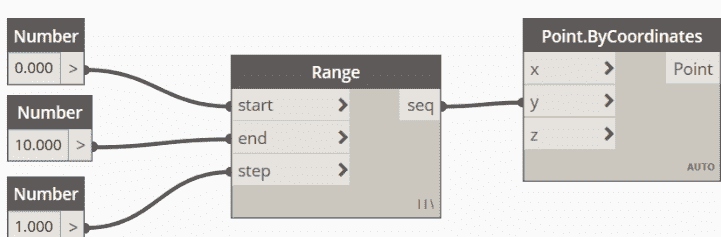

Figure 6.1 – Dynamo graphical elements

用户无需任何编程经验即可开始使用 Dynamo 等视觉编程应用程序并自动化 Revit 任务，但这需要投入学习和掌握新流程。

Dynamo 是一款开源软件，可为 Revit、Civil 3D 和其他软件提供视觉编程。

Dynamo 的原理遵循三个基本流程：

**INPUT + FUNCTIONS AND OPERATIONS + OUTPUT**

我们将能够通过使用 Dynamo 自动化多个工作流程并快速完成重复性任务，从而提高 Revit 中的生产率。

本章将为您提供 Dynamo 的基本知识，并展示掌握该应用程序以提高 Revit 效率的重要性。

本章还将为您介绍 Dynamo，展示最常用的 Dynamo 包，并解释如何使用 Dynamo 进行某些工作流程。

本章将涵盖以下主题：

- Dynamo
- Expanding Dynamo
- Best practices

## Technical requirements

在本章中，您需要访问 Autodesk Revit。用于描述所有这些练习的版本是 Revit 2021，但您可以使用其他版本进行跟进。需要注意以下几点：

- 不同版本之间可能略有不同。
- Revit 的旧版本无法打开较早版本的 文件。

本章使用的所有数据集都可以在本书的 GitHub 仓库中找到，地址为
`https://github.com/PacktPublishing/-Increasing-Autodesk-Revit-Productivity-for-BIM-Projects`。

## Introducing Dynamo

业务中的生产率是公司绩效的重要因素。提高生产率是在预定义的时间范围内更智能地工作以满足项目截止日期的过程。

生产率方法如下：

- 时间管理
- 劳动力完成的任务
- 个人绩效
- 制造产品的比率

Dynamo 将通过提高您完成重复性任务的绩效以及处理复杂几何的能力来提高生产率。

Dynamo 是一个开源应用程序，可以作为独立的 *Sandbox* 使用，也可以与 Revit、Maya、Civil3D 或任何其他具有 **API**（**Application Programming Interface** 的缩写）可用的应用程序连接。

它旨在通过自动化流程和工作流程来扩展 Revit 的功能。它不会为 Revit 添加新工具，但它将帮助自动化现有工具，以实现几乎无限的任务和建模流程。

让我们开始从 Revit 访问 Dynamo：

1. 打开一个新的 Revit 项目。
2. 从 **Manage** 选项卡，前往 **Visual Programming** 面板。

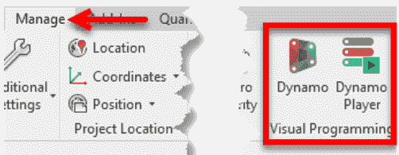

Figure 6.2 – Visual Programming panel

3. 点击 **Dynamo.**

点击后，**Dynamo** 窗口将出现：

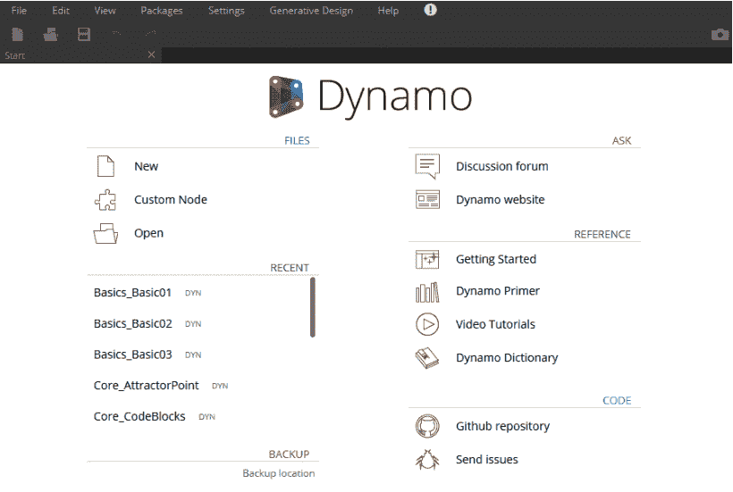

Figure 6.3 – Dynamo canvas

有关 Dynamo 的更多信息，请参阅以下链接：

```
https://bit.ly/3b9vxxa
```

QR code:


# 使用Dynamo进行可视化编程

> **提示**
> 
> 可以通过从Dynamo启动页面单击**讨论论坛**来访问。

还有一个字典，我们可以在其中找到与Dynamo相关的信息。随着社区不时更新，这个字典也在不断发展：

```
https://bit.ly/3cPuBgJ
```

二维码：


> **提示**
> 
> 可以通过从Dynamo启动页面单击**Dynamo字典**来访问。

## 什么是可视化编程工具？

可视化编程工具允许所有用户（程序员和非程序员）以更具交互性的方式使用该工具。这样，它通过制作图形（可视化脚本）来简化他们使用软件的方式。

## 使用Dynamo

Dynamo与Revit软件协同工作，通常可以分三个阶段进行渐进式学习：

- **专家：** 开发参数化和复杂模型。
- **中级用户：** 执行QA/QC检查。
- **初学者：** 管理Revit模型中的数据以导入和导出信息。

Dynamo中所有可用的节点按以下方式组织：

- 库
- 类别
- 子类别

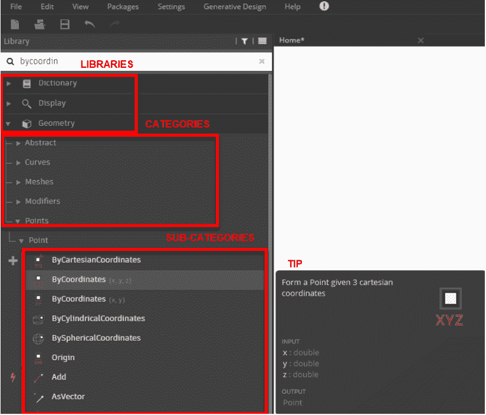

图6.5 – Dynamo库结构

> 提示
> 将鼠标悬停在子类别上时，Dynamo会弹出一个提示，其中包含该工具的说明。

当用户想要将节点添加到画布时，他们通常使用搜索区域并输入与节点相关的名称：


图6.6 – 搜索节点

当任何用户需要添加新节点时，可以（并且更快地）在画布上右键单击，然后在搜索区域中输入节点名称。

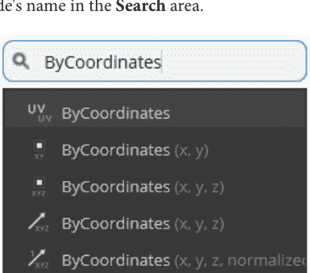

图6.7 – 通过上下文菜单搜索节点

单击子类别后，节点将被添加到画布中。每个节点都有类似于以下的结构：

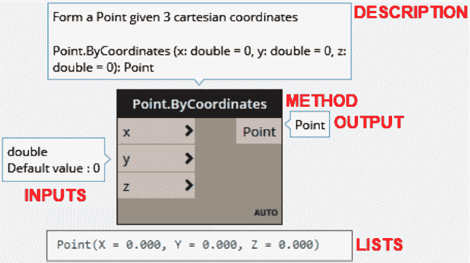

图6.8 – 节点结构

在开始使用Dynamo时，理解所有这些区域至关重要，因为它们将提供来自节点本身的重要信息。

## 创建简单图形

要在Dynamo中创建图形，我们需要通过从一个节点的输出端单击到下一个节点的输入端来从一个节点连接到另一个节点。在开发图形时，应该从左到右阅读。当我们执行它时，Dynamo也将遵循相同的顺序。

要开始创建新图形，请执行以下步骤：

1. 在Dynamo启动屏幕中，单击**新建**。
2. 在画布中右键单击并搜索以下内容：
   - **数字**
   - **点**
   - **监视**

3. 对于每个搜索结果，单击以下项：
   - 数字滑块
   - 按坐标
   - 监视

4. 从数字滑块节点，单击右侧箭头输出，然后再次单击任何点坐标的输入（X、Y或Z）：

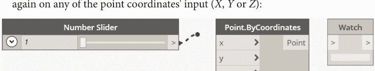

图6.9 – 连接节点

5. 从Point.ByCoordinates节点到监视节点执行相同操作。

默认情况下，Dynamo设置为在发生任何更改后自动运行，因此您将能够看到结果：

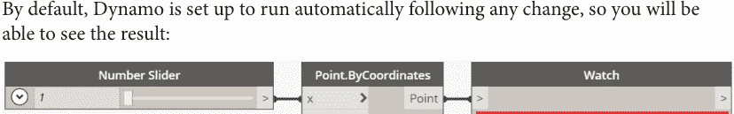

图6.10 – 连接节点

通过更改要使用的坐标，或者添加更多滑块并将它们分配到不同的输入，结果将自动更新：

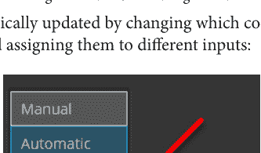

图6.11 – 更改脚本的运行方式

作为良好实践，我们建议*始终*将其设置为手动。否则，每次更改时脚本都会自动运行。通过更改设置，只有当用户单击**运行**时，Dynamo才会执行脚本。

总之，我们已经学习了如何知道安装了哪个Dynamo版本，以及如何使用安装软件时可用的节点开始创建简单图形。

在下一节中，我们将学习如何安装和管理已安装的Dynamo包，并添加或识别现有的Python脚本。我们还将介绍如何使用Dynamo和Dynamo Player运行脚本。

## 扩展Dynamo

在使用Dynamo时，某些脚本需要使用**Python**计算语言进行进一步开发。使用Python是成为Dynamo专家的基本技能。

由于Dynamo社区基于*开源*环境，许多用户将这些图形分享给所有其他用户，并且可以随时安装。这些包是特定于Dynamo版本的，这就是为什么务必始终跟踪所有可用和已安装的版本。

不建议在项目中途更新它们，但如果确实有必要，只有在设计团队同意的情况下才更新。如果不进行这种控制，项目期间开发和使用的脚本可能会因为这些更新而不再工作。

请记住，如果这是一个*开源*社区，则无法保证以前共享的这些包会为未来版本维护。

高级用户会开发自己的脚本，因为这将消除对由第三方个人或公司开发的包的依赖。

## Dynamo包

需要做的最重要的活动之一就是安装和管理Dynamo包。

使用Dynamo时，有大量的可用包列表。几乎不可能知道所有可用的包，即使知道，每天都有新的脚本和包被分享。

要访问所有可用包的列表，请执行以下步骤：

1. 打开Revit，在“管理”选项卡中，单击Dynamo：
2. 从顶部菜单中，单击“包”，然后选择“管理包...”：
3. 在新窗口中，单击“包管理器网站”按钮：

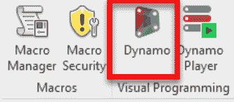

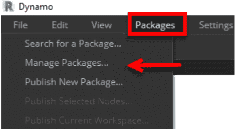

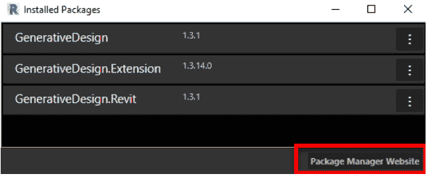

这将允许用户访问Dynamo包管理器。此网页显示所有可用的包、已执行的安装次数，以及有多少注册作者开发了脚本：

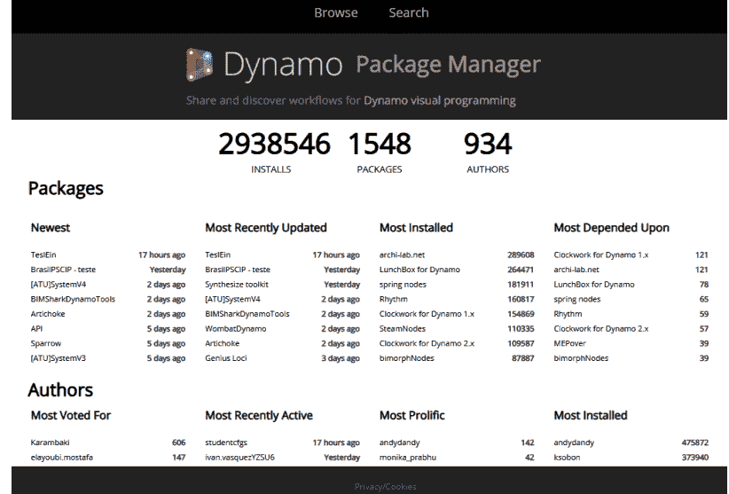

图6.15 – Dynamo包管理器网页

除了这些信息之外，还可以看到哪些是分享给社区的最新包、哪些包最近更新过、哪些包安装次数最多，以及哪些包被依赖得最多。

这些包由社区成员分享，应该放心地在社区中消费和安装。有一个作者列表，我们可以从中看到谁获得最多投票、谁最活跃，以及谁安装了最多的包。

您可以通过以下链接访问此信息：

```
https://bit.ly/3rUP1cm
```

二维码：


## 安装包

分享Dynamo脚本时，确保所有用户都安装了运行该脚本所需的相同包至关重要。这非常重要，因为任何用户都可以直接从Dynamo访问并安装可用的包。

要安装包，请执行以下步骤：

1. 打开Revit，在“管理”选项卡中，单击Dynamo。
2. 从顶部菜单中，单击“包”，然后选择“搜索包...”：

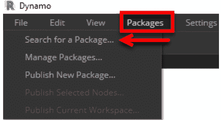

图6.16 – 安装包

3. 在新窗口中，在“搜索”下，单击要搜索的包名称 – Rhythm。当输入包名称时，Dynamo会过滤可用的结果：

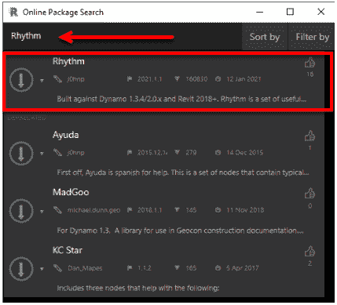

图6.17 – 可用的在线包

4. 要安装包，请单击左侧的箭头：

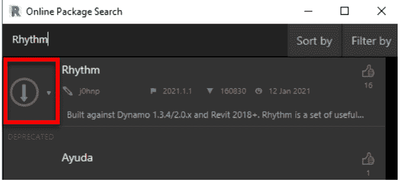

图6.18 – 包安装


提示

单击软件包的描述即可访问软件包的历史记录，并在可用的情况下安装特定版本。

5. 将弹出一个窗口以确认安装：

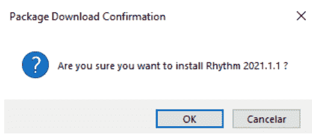

图 6.19 – 软件包安装

如果已安装的软件包包含依赖项，例如 Python 脚本或二进制文件，则会弹出警告，确认是否可以安装该软件包。

重要说明

由于 Python 脚本可能会影响您的计算机，请确保下载脚本的来源可信。

根据所使用的 Dynamo 版本，用户尝试安装的软件包可能与当前的 Dynamo 版本不兼容：

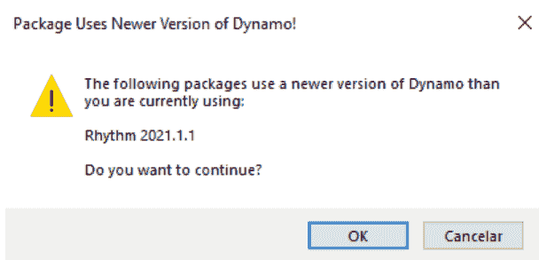

图 6.20 – 确认软件包安装

软件包安装完成后，Dynamo 将显示相关信息：

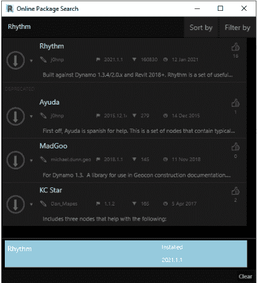

图 6.21 – 软件包已安装

虽然可以安装任意数量的软件包，但建议将软件包数量保持在最低必要水平。请确保只安装可信的软件包，因为执行这些软件包时可能会损坏模型。

以下是我们建议安装的一些优秀软件包：

- Archilab.net
- Clockwork
- Lunchbox
- Rhythm
- Spring Nodes

安装后，这些软件包将显示在“附加功能”库中：

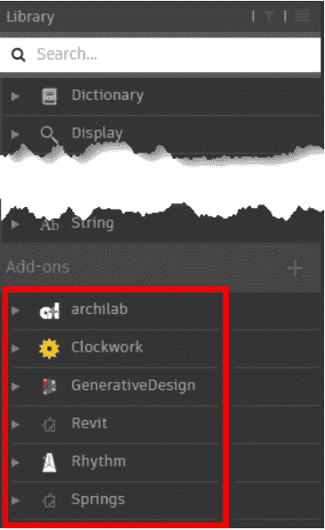

图 6.22 – 已安装并可用的新软件包

使用 Dynamo 论坛可以帮助您了解更多可用的有趣软件包。

## 管理已安装的软件包

要管理所有已安装软件包的列表，请执行以下步骤：

1. 打开 Revit，然后在**管理**选项卡中单击**Dynamo**：

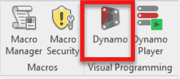

图 6.23 – 从 Revit 中打开 Dynamo

2. 在顶部菜单中单击**软件包**，然后选择**管理软件包…**：

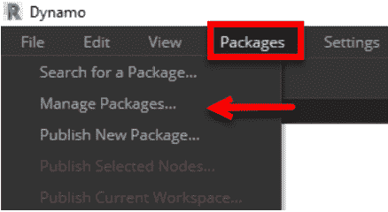

图 6.24 – 管理已安装的软件包

3. 要卸载软件包，请单击右侧的图标，然后选择**卸载…**：

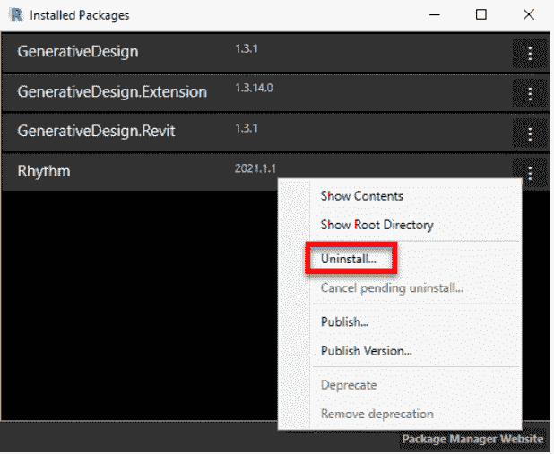

图 6.25 – 卸载软件包

系统会弹出警告，提示卸载后需要关闭并重新启动 Dynamo：

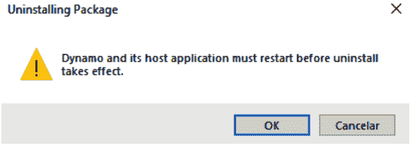

图 6.26 – 执行卸载前要求重新启动的消息

系统还会显示另一条警告，要求用户确认是否应卸载该软件包。单击“是”后，该软件包将被卸载：

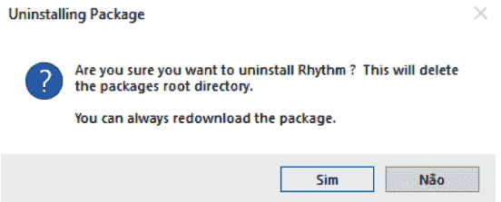

图 6.27 – 确认卸载

卸载软件包后，一些依赖已安装软件包的脚本将无法运行。

## 使用 Python 扩展 Dynamo

Python 是最流行的编程语言之一。由于它易于使用和学习，因此可以用于开发 Dynamo 脚本。

如前所述，通过开发 Python 脚本，我们可以避免外部依赖项（无需软件包），并且脚本在项目中的执行速度更快、优化程度更高。

建议根据项目对自动化的需求开发定制脚本。Python 可以连接到 Revit API——一组用于在软件的各个组件之间进行通信的方法——从而与 Revit 图元进行交互，因此这是可行的。

总而言之，使用 Python 具有以下优势：

- 不依赖其他 Dynamo 依赖项。
- 在节点使用方面可以实现更好的结构化。
- 对于要开发的任务，执行速度更快，目标也更加明确。

Dynamo 内置了 Python 编辑器。要访问该编辑器，请执行以下步骤：

1. 搜索 Python 节点：

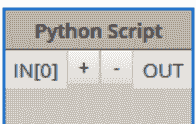

图 6.28 – Python Script 节点

2. 双击浅灰色区域以访问编辑器：

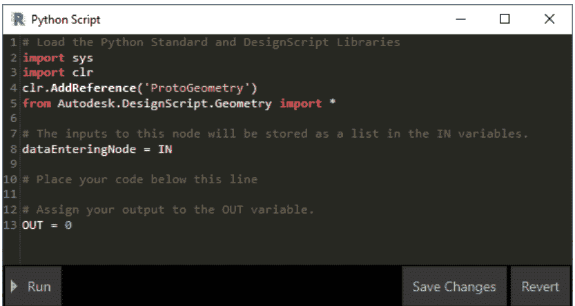

图 6.29 – Python 编辑器

添加所有脚本行后，单击“保存更改”，节点将自动记录并保存在 Dynamo 中：

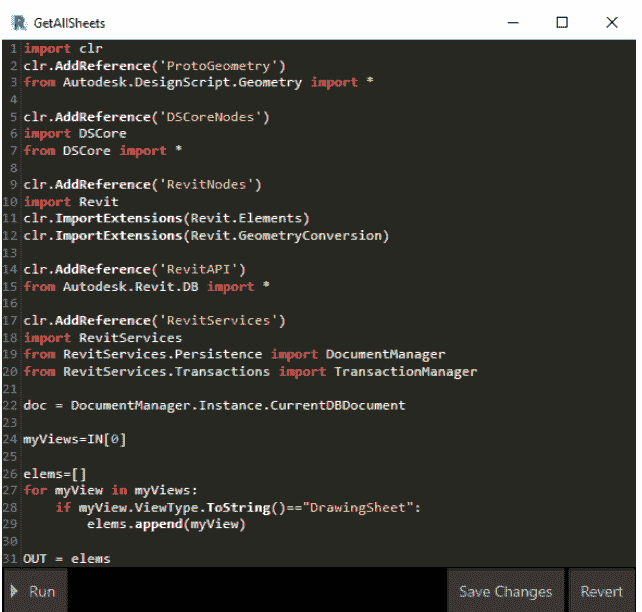

图 6.30 – Python 节点

如需了解有关 Python 的更多信息，请参阅以下链接：

https://bit.ly/3d9Bo5d

二维码：


如需了解有关 Revit API 的更多信息，请参阅以下链接：

```text
https://bit.ly/20x8EZL
```

二维码：


## Dynamo 工作流

开发图形需要一定的经验，但随着时间的推移，您可以逐步提升技能并提高使用 Dynamo 的生产力。运行图形之前，请确保运行的是正确的图形，并且已按要求安装所有软件包。

运行脚本之前，请确认您了解所需的输入。这可能需要具备编辑图形的能力，以便根据所选输入添加必要内容。

## 自动创建图纸

在此分步过程中，我们将从 Excel 文件导入一些数据，并使用这些数据创建图纸占位符。通过添加其他列并使用参数名称作为表头（区分大小写），可以添加所需的任何信息。

要在 Revit 项目中使用 Dynamo 执行此工作流，请执行以下步骤：

1. 打开 Revit，然后打开 `Project_Sample-Dynamo.rvt` 文件。
2. 在“管理”选项卡下，单击 Dynamo。
3. 在 Dynamo 窗口中，单击“文件”，然后选择“打开”。选择脚本 `AutomateSheetCreation-Dynamo.dyn`：

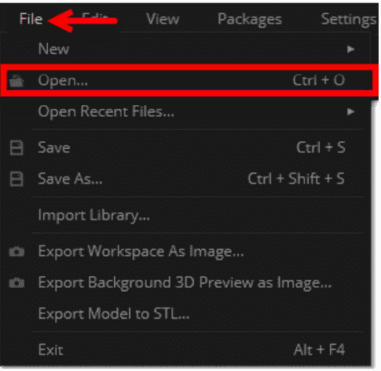

图 6.31 – 打开脚本

打开后，确认脚本应以“手动”模式运行。

如前所述，运行脚本时，可能需要先提供一些输入。在本练习中，我们将选择 Excel 文件。

必须考虑以下事项：

- 必须选择 Excel 文件，并且图纸编号应具有唯一性。
- 必须注意图纸名称。
- 需要忽略 Excel 文件的前几行，因为这些行是 Excel 表头（数据的第一行）。

4. 单击“浏览”，然后选择 Excel 文件 `DrawingList.xlsx`。
5. 确保图纸名称与节点中的名称一致。

创建图纸时，所有信息都会相应填充：

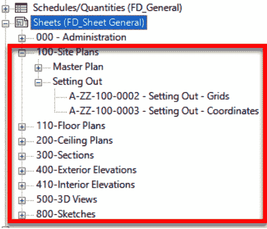

图 6.34 – 在 Revit 中创建的图纸

## 如何使用 Dynamo Player

Dynamo Player 是一项便捷功能，允许用户无需打开 Dynamo 即可更简单地运行 Dynamo 脚本。它可以配置为指定一个文件夹，其中包含供组织内所有用户使用的脚本列表。

保持文件夹更新非常简单，并且可以确保所有用户使用相同的脚本。

## 设置 Dynamo Player

需要从 Revit 中打开 Dynamo Player，无需打开任何 Dynamo 实例。如有必要，可以从 Dynamo Player 中打开脚本。下面让我们完成此练习：

1. 打开 Revit，然后打开 `Project_Sample-DynamoPlayer.rvt` 文件。

2. 在“管理”选项卡下，单击 Dynamo Player：

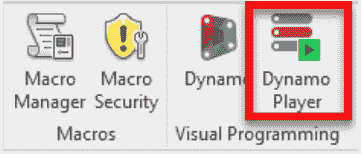

图 6.35 – 打开 Dynamo Player

随后将打开一个新窗口，您可以在其中配置访问所有脚本的位置：

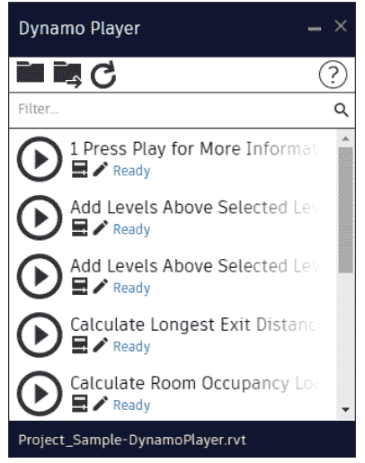

图 6.36 – Dynamo Player

在浮动窗口顶部，有三个图标，用户可以使用它们执行以下操作：

- **浏览到文件夹**：此选项允许用户选择用于访问脚本的文件夹。
- **查看当前文件夹**：此选项允许用户打开保存脚本的文件夹。


- **刷新：** 此选项允许用户刷新文件夹中可用脚本的列表，这些脚本都会列在这里。

我们可以访问文件夹中的所有可用脚本，该文件夹被定义为所有脚本应保存的中心文件夹：

- **脚本列表：** 此选项允许用户通过单击**播放**图标来选择需要运行的脚本。

单击**播放**图标后，脚本将被执行。如果脚本需要用户输入，Dynamo Player 会发出请求：

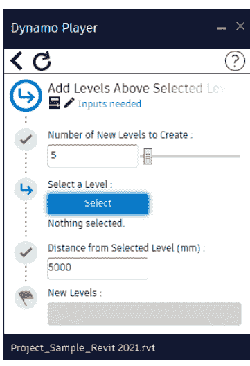

图 6.37 – 使用 Dynamo Player 的用户输入

我们建议将 Dynamo Player 作为运行脚本的主要工具，但要注意，有些脚本更适合高级用户，因为它们可能要求更高。

在下一节中，我们将介绍创建图形时应遵循的最佳实践。

### 最佳实践

在构建图形时，将节点随意添加到各处是很常见的：

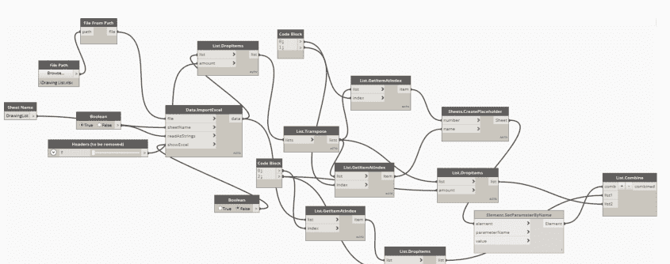

图 6.41 – 混乱的 Dynamo 图形

当图形变得更加复杂时，将难以阅读甚至难以维护。因此，用户在开发脚本时必须尽可能保持其条理性。当脚本在多个团队之间分发时，这一点就变得至关重要。

作为最佳实践，我们建议如下：

- 合理组织图形：
  - a. 尽可能将图形按不同功能进行分组。
  - b. 按从左到右的顺序排列脚本。
  - c. 当同时存在并行进程时，按垂直方向排列脚本：

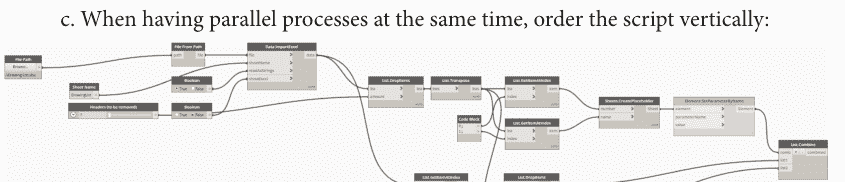

图 6.42 – 结构合理的 Dynamo 脚本

- 为所有内容合理命名：
  - a. 所有组都应使用清晰的标题命名，以表明该组的整体功能（使用较大字号，以便缩小时清晰可见）。
  - b. 所有代码块、自定义节点、Python 节点及其他有用对象都应采用具有信息量的适当命名，以帮助用户更好地理解整个图形。
  - c. 为参数/代码块变量命名：

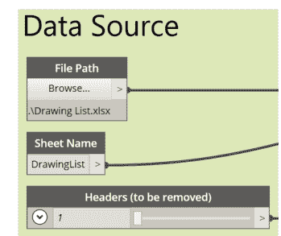

图 6.43 – 正确命名的组和节点

- 根据所使用的类别对组使用颜色代码：
  - a. 输入
  - b. 控制
  - c. 功能
  - d. 输出

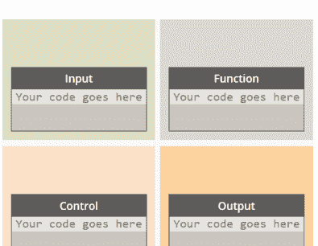

图 6.44 – 组的颜色代码

- 添加注释，按需添加所需数量：
  - a. 如有必要，以面板或注释的形式添加。
  - b. 需要时添加附加信息：

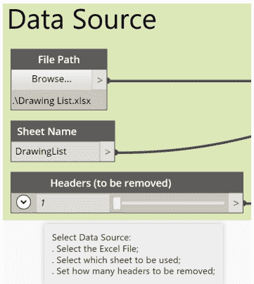

图 6.45 – 添加到图形中的注释

所有这些额外信息将使脚本更易于阅读，因为它会标明哪些内容应当使用，以及哪些内容需要在使用脚本前理解。

由于此脚本可能会被大量团队成员使用，并可能在项目和团队之间共享，因此添加一些有价值的信息至关重要，包括以下内容：

- **标题**：这是脚本的总体功能。
- **作者姓名**：如果出于某种原因脚本出现问题，需要修改或解释，你知道该找谁。
- **描述**：此选项说明脚本将做什么。
- **日期**：脚本的开发时间。
- **依赖项**：此选项指示使用脚本需要哪些程序包，以及每个程序包的版本。

```
TITLE: Automate Sheet Creation
AUTHOR'S NAME: Decio + Fabio
DESCRIPTION: Graph will create sheet placeholders from an excel sheet
DATE: Jan 2021
DEPENDENCIES: Archilab 2021.25.21
```

图 6.46 – 添加包含脚本重要信息的页眉

图形完成后，应清晰且易于理解。制定这一标准将有助于在所有脚本中保持一致性：

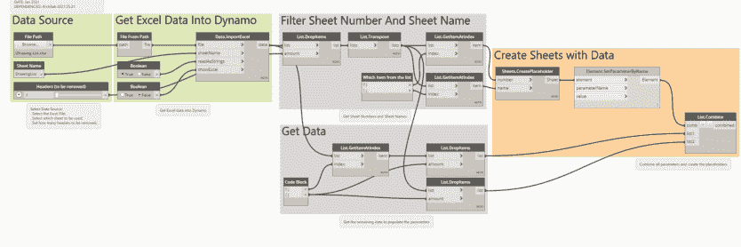

图 6.47 – 遵循标准的 Dynamo 脚本

此外，当需要升级或进行任何维护时，也更易于找到需要更改和更新的内容。

### 总结

在本章中，我们了解了什么是 Dynamo，以及用户如何使用 Dynamo 来提高性能和工作效率。

我们了解到，Python 是最常见的编程语言之一，它可以与 Revit API 一起在 Dynamo 中使用。这种结合可以增强在 Revit 中可修改内容的范围。

我们学习了如何使用 Dynamo Player 这一功能在项目中运行脚本。我们还探讨了如何设置一个可跨组织使用的文件夹，以共享可在多个项目中使用的常用脚本。

我们还分享了开发 Dynamo 脚本时应遵循的最佳实践（这些实践可以扩展到所有需要特定可视化编程的软件，例如 *Grasshopper*）。

在下一章中，我们将介绍如何使用 Power BI 或其他软件（如 Excel）获取和管理仪表板。
