## 7 使用 Power BI 进行仪表板分析

建筑行业的数据科学是一个新兴领域，在多个方面具有改善业务的巨大潜力，例如预测设计或施工问题、风险分析和优化建筑资产。

公司正在使用数据驱动的工作流来理解数据并提高业务决策的确定性。仪表板分析可以帮助我们以图形方式理解数据，并支持公司在项目环境中做出更好的决策。它提供了一种高效分析建筑数据的方法，而 BIM 软件是一种可用于多种分析的数据资源。

有许多应用程序可用于生成仪表板，但在本书中我们将使用 Microsoft Power BI。本章将介绍用于 Revit 的 Power BI，使您能够使用 Power BI 进入更高级的工作流。

本章还将解释从 Revit 导出和导入数据到 Power BI 以及使用 Power BI 分析数据的过程。

本章将涵盖以下主题：

- 用于 Revit 的 Power BI 简介
- 从 Revit 到 Power BI 的数据导出与导入
- 使用 Power BI 分析 Revit 数据

### 技术要求

在本章中，您需要能够访问 Autodesk Revit。用于描述所有这些练习的版本是 Revit 2021，但您也可以使用其他版本。需要注意的是：

- 不同版本之间可能存在细微差异。
- 较旧版本的 Revit 无法打开来自较新版本的文件。

本章使用的所有数据集都可以在本书的 GitHub 存储库中找到：
`https://github.com/PacktPublishing/Increasing-Autodesk-Revit-Productivity-for-BIM-Projects`.

### 用于 Revit 的 Power BI 简介

Power BI 是由 Microsoft 开发的一款软件，拥有大量协同工作的软件服务、应用和连接器，可确保收集的数据能够通过不同的仪表板以一致、可视化且交互的方式展示。数据可以通过不同方式、从各种来源引入，并以不同方式进行分析。

由于 Microsoft Power BI 有不同的版本、工具和应用，我们将使用**免费版本**：*Microsoft Power BI Desktop*。

Microsoft Power BI 的所有不同版本都可以在以下链接中找到：

`https://bit.ly/3qVvi7U`

二维码：


### 安装 Microsoft Power BI Desktop

获取该应用程序的过程非常简单直接。访问 Microsoft Power BI 网页，即可获取用户想要获取或订阅的软件和版本。

如前所述，我们建议获取 *Microsoft Power BI Desktop*：

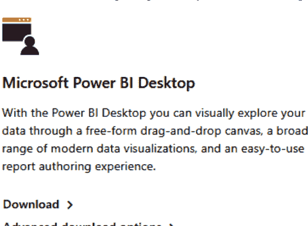

可以通过以下两个链接进行下载：

- **下载**：此选项将允许 Microsoft Power BI Desktop 通过 Microsoft Store 在后台自动安装。
- **高级下载选项**：此选项允许用户选择想要使用的语言后，下载 Microsoft Power BI Desktop 安装程序。

使用第二个选项（下载安装程序）时，下载完成后，双击文件开始安装过程，并按步骤操作直至完成。

### 启动 Microsoft Power BI

安装完成后，可以通过桌面上的快捷方式访问该软件，或者通过“开始”菜单并输入“Power BI Desktop”访问。


几秒钟后，Power BI Desktop 即可使用。启动屏幕上会显示一些选项和超链接，可用于访问上次使用的仪表板、通过从数据源导入数据来创建新的仪表板，甚至可访问一些网页来了解如何使用 Microsoft Power BI：

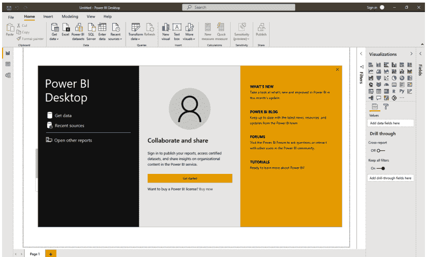

图7.2 – Microsoft Power BI 启动屏幕

从启动屏幕可以很容易看出，最重要的事情之一就是获取数据。通过单击“获取数据”，Power BI 将允许用户选择它将使用的数据类型：

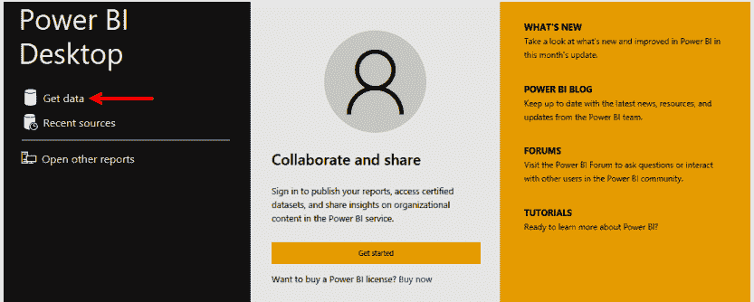

图7.3 – 获取要分析的数据

## 使用 Microsoft Power BI

让我们从整体上概览一下 Microsoft Power BI 界面，从中可以找到使用该软件时的主要功能。

本小节的目的不是详细解释 Microsoft Power BI Desktop，而是了解其主要界面。我们将进行一个总体概览，并在练习过程中定义一些工具和工作流。

在功能区中，我们有以下选项卡：

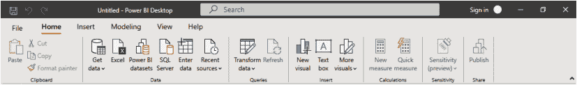

图7.5 – “开始”选项卡

- **文件**：此选项允许访问主要的文件管理命令（**打开、保存、导入、导出**等）。
- **开始**：此选项允许访问一些主要工具，尤其是从不同的文件类型或数据源中导入数据。它还包括其他允许对信息进行格式设置的工具。
- **插入**：此选项允许访问一些工具，使用户能够插入新的视觉对象、按钮、自定义形状，甚至文本和一些图像，这将有助于安排布局并使仪表板更易于理解。
- **建模**：此选项允许访问一些工具，使用户能够处理包含多个表的复杂数据集，因为这些表需要以某种方式关联。
- **视图**：此选项允许访问与视觉对象相关的工具，我们可以在其中找到一些预定义主题并直接在仪表板中使用。在这里，可以打开或关闭某些面板。
- **帮助**：此选项允许访问指向教程、培训和 Power BI 社区页面的一些有用链接。

在左侧，我们还有三个重要且有用的选项卡：

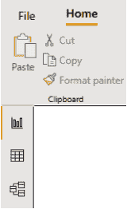

图7.6 – “报表”、“数据”和“模型”选项卡

- **报表：** 此选项允许访问报表和仪表板区域。
- **数据：** 此选项允许访问已导入到 Power BI 中的表。
- **模型：** 此选项允许访问可在数据之间关联不同表的区域。

在右侧，我们有以下内容：

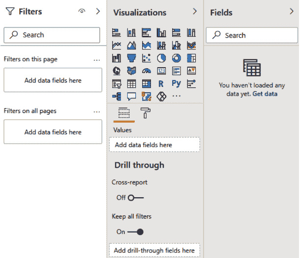

图7.7 – “筛选器”、“可视化效果”和“字段”选项卡

在下一节中，我们将学习如何从 Revit 模型导出数据、将数据导入 Microsoft Power BI，并快速创建漂亮的仪表板。

## 从 Revit 导出数据并导入到 Power BI

本章旨在从 BIM 模型中导出数据，将其导入回 Microsoft Power BI，并生成一个仪表板，以便我们可以根据提取的数据进行适当的分析。

为了完成这个主题，我们将使用 *第 7 章* 提供的数据集。

### 将 Revit 连接到 Power BI：模型数据可视化简介

在 Revit 中，无需使用任何插件甚至 Dynamo 图形即可从模型导出数据，这非常简单。直接从 Revit 导出，基本上可以通过两个步骤完成：

1. 创建包含所有需要导出数据的明细表。
2. 将明细表导出为 TXT 文件。

如果使用 Dynamo 图形，也可以分两步完成：

1. 创建/打开一个 Dynamo 图形。
2. 将数据导出为 Excel 文件。

导出此数据后，可以使用 Excel 打开或导入到 Microsoft Power BI 中。

### 在 Revit 中创建明细表

在 Revit 中创建明细表很简单，由于明细表可用作数据源，我们可以提取与要列入明细表的对象相关的数据。几乎所有对象都可以提取，由于它们仍与模型连接，因此如果在模型中实施了任何设计更改，则在打开文件时，或者在 Microsoft Power BI 报表打开并刷新数据时，明细表都会更新。

为了解释这个过程，我们将创建一个房间明细表，并包含一些要提取的参数：

1. 打开 Revit，然后打开 `Project_Sample-Export Data.rvt` 文件。
2. 在**项目浏览器**下，右键单击并选择**新建明细表/数量**：

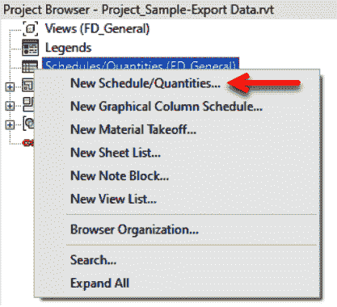

图7.9 – 在 Revit 中创建房间明细表

3. 在**类别**中，选择**房间**，然后单击**确定**：

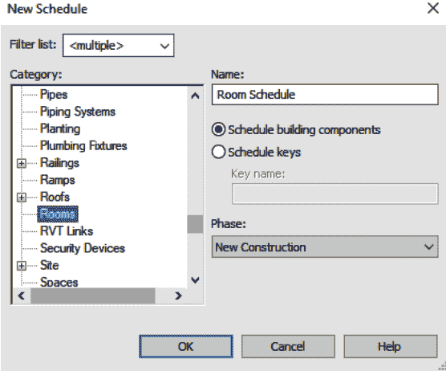

图7.10 – 要提取的房间类别

4. 在“可用字段”下列出的参数中，选择并添加以下参数以包含在明细表中：标高、编号、名称、面积、体积、周长、注释和用途：

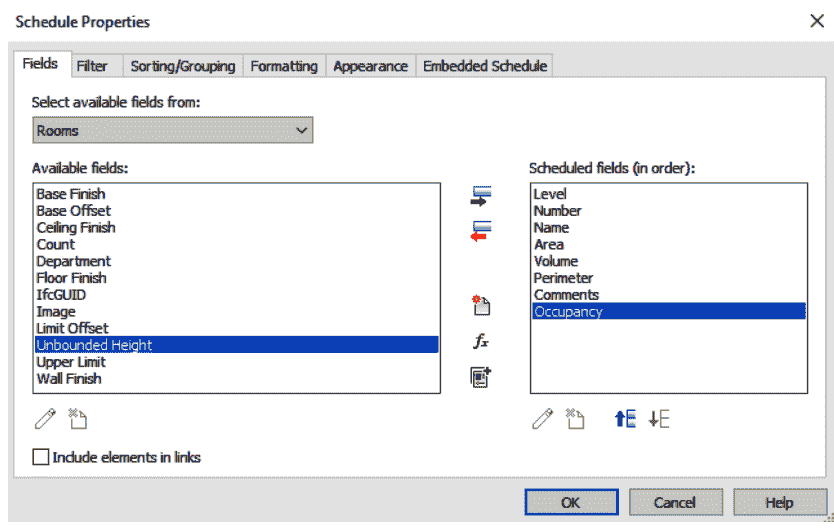

图7.11 – 要导出的房间参数

由于我们将处理数字，因此确保**面积**、**体积**和**周长**参数不在明细表中列出单位非常重要。要从中删除它们，请执行以下步骤：

1. 在**格式**选项卡中，选择**面积**参数，然后单击**字段格式…**。

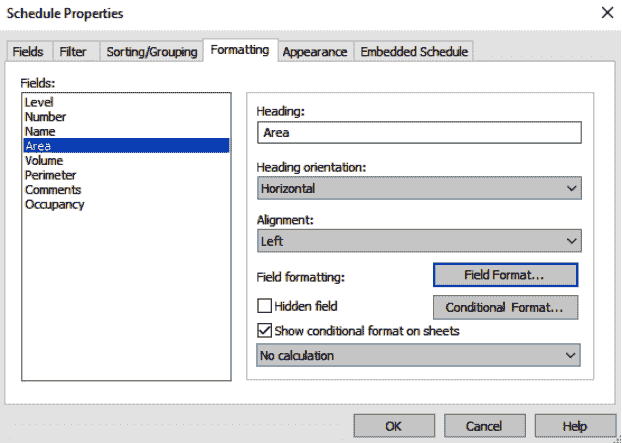

图7.12 – 格式化“面积”参数

2. 在**格式**窗口中，取消选中**使用项目设置**选项，然后在**单位符号**下，选择**无**：

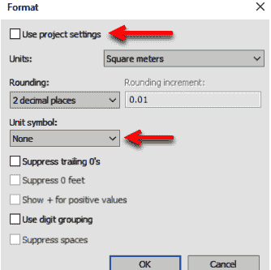

图7.13 – 面积单位

3. 对**体积**和**周长**参数执行相同的过程。

4. 在**外观**选项卡上，取消选中**数据前空行**选项，然后单击**确定**：

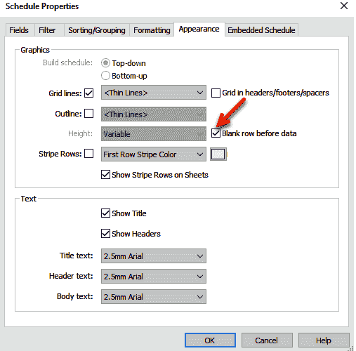

图7.14 – 从明细表中删除空行

Revit 将创建一个包含项目中所有信息的明细表：

<房间明细表>

| A | B | C | D | E | F | G | H |
|---|---|---|---|---|---|---|---|
| 标高 | 编号 | 名称 | 面积 | 体积 | 周长 | 注释 | 用途 |
| 标高 0 | 00.01 | 厨房 | 54.68 | 164.03 | 33590 | 别墅 | 社交区域 |
| 标高 0 | 00.02 | 外部区域 1 | 31.14 | 124.58 | 25904 | 阳台 | 阳台区域 |
| 标高 0 | 00.03 | 外部区域 2 | 28.04 | 112.18 | 24450 | 阳台 | 阳台区域 |
| 标高 0 | 00.04 | 餐厅 | 23.50 | 73.96 | 20313 |  | 社交区域 |
| 标高 0 | 00.05 | 门厅 | 71.92 | 228.25 | 45033 | 别墅 | 社交区域 |
| 标高 0 | 00.06 | 卫生间 1 | 14.45 | 43.82 | 16028 | 别墅 | 湿区 |
| 标高 0 | 00.07 | 露台区域 | 150.52 | 602.08 | 57559 | 外部 | 外部 |
| 标高 0 | 00.08 | 电视房 | 75.48 | 226.32 | 36047 | 别墅 | 社交区域 |
| 标高 0 | 00.09 | 客厅 | 97.71 | 365.15 | 50753 | 别墅 | 社交区域 |
| 标高 0 | 00.10 | 走廊 | 17.92 | 53.77 | 22076 | 别墅 | 社交区域 |
| 标高 0 | 00.11 | 储藏室 | 5.46 | 17.43 | 9657 | 别墅 | 社交区域 |
| 标高 0 | 00.12 | 游泳池 | 53.50 | 214.00 | 31400 | 外部 | 外部 |
| 标高 0 | 00.13 | 草坪区域 | 661.80 | 2626.45 | 272042 | 外部 | 外部 |
| 标高 0 | 00.14 | 车库 | 61.05 | 244.20 | 33100 | 外部 | 外部 |
| 标高 1 | 01.01 | 主卧室 | 33.41 | 106.90 | 30081 | 别墅 | 私人区域 |
| 标高 1 | 01.02 | 卫生间 3 | 21.19 | 63.56 | 19599 | 别墅 | 湿区 |
| 标高 1 | 01.03 | 卫生间 2 | 14.40 | 43.19 | 16455 | 别墅 | 湿区 |
| 标高 1 | 01.04 | 卧室 1 | 67.08 | 201.64 | 32497 | 别墅 | 私人区域 |
| 标高 1 | 01.05 | 卧室 2 | 41.27 | 123.80 | 25511 | 别墅 | 私人区域 |
| 标高 1 | 01.06 | 阅读室 | 20.91 | 66.90 | 19223 | 别墅 | 私人区域 |
| 标高 1 | 01.07 | 办公室 | 48.17 | 144.50 | 30173 | 别墅 | 私人区域 |
| 标高 1 | 01.08 | 走廊 | 48.01 | 153.63 | 42609 | 别墅 | 私人区域 |

图7.15 – 包含 BIM 模型中所有房间的 Revit 明细表


> 提示
> 如果“面积”、“体积”和“周长”参数仍显示单位，请在“格式”属性下单击“编辑”，然后按前述步骤删除面积单位。

现在我们已经提取了数据，下面将该数据导出到 TXT 文件。

## 从 Revit 导出数据

从 Revit 导出数据简单明了。我们将使用内置功能来完成此操作，但如前所述，也可以使用 Dynamo 或任何其他可用插件来提取数据（其中一些将在第 9 章中列出）。与 Power BI 一样，可以从 TXT 文件导入数据。我们将使用以下选项：

- 1. 在“文件”菜单下，单击“导出|报告|明细表”：

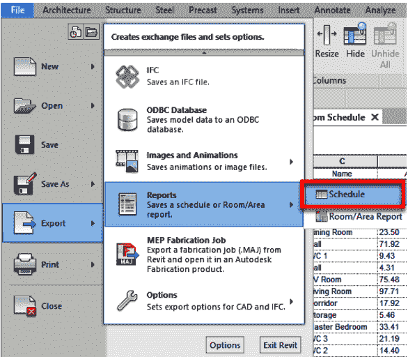

图 7.16 – 从 Revit 导出明细表

- 2. 根据需要重命名文件，然后单击“保存”。

导出文件时，了解一些选项非常重要：

- 不应包含标题，因为 Microsoft Power BI 中不需要标题。
- 表头应保持未分组。
- 导入 Microsoft Power BI 时应记住输出分隔符：

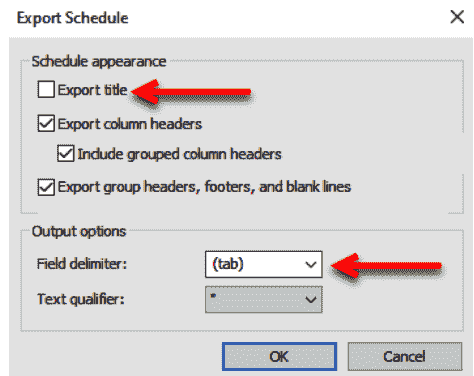

图 7.17 – 导出明细表选项

- 3. 单击“确定”。

如果打开 TXT 文件，可以看到所有已导出的数据，并准备好导入 Microsoft Power BI：

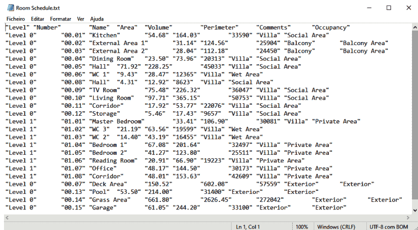

图 7.18 – 从 BIM 模型导出的数据

让我们切换到 Microsoft Power BI，开始导入导出的数据。

## 将数据导入 Microsoft Power BI

导出所有所需数据后，我们将把它导入 Microsoft Power BI。该过程非常简单。

如果您因某种原因无法执行导出过程，我们提供了一个可用的共享文件：07.01_Room Schedule.txt：

- 1. 首先打开 Microsoft Power BI。

- 2. 在“主页”选项卡中，单击“获取数据”图标下方的箭头，然后选择“文本/CSV”：

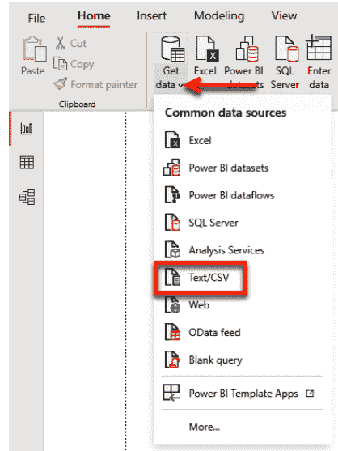

图 7.19 – 导入到 Microsoft Power BI 的数据

- 3. 选择 07.01_Room Schedule.txt 文件，然后单击“打开”。

- 4. 在新窗口中，单击 **加载** 以导入所有数据：

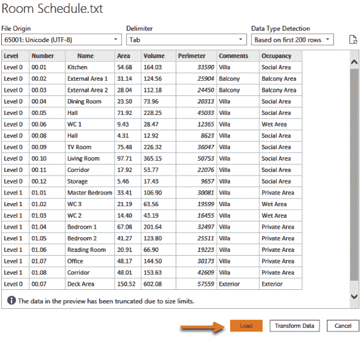

*图 7.20 – 正在将数据加载到 Microsoft Power BI*

几秒钟后，所有数据将可用并准备好使用。可以通过访问右侧的 **字段** 面板来确认：

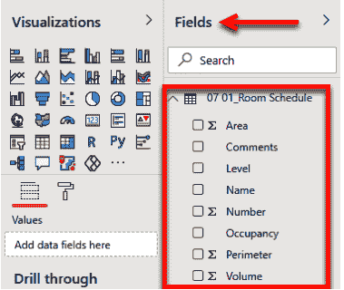

*图 7.21 – Microsoft Power BI 中可用的字段*

- 6. 确保 Number 为“文本”类型，因为我们不需要对此列执行求和：

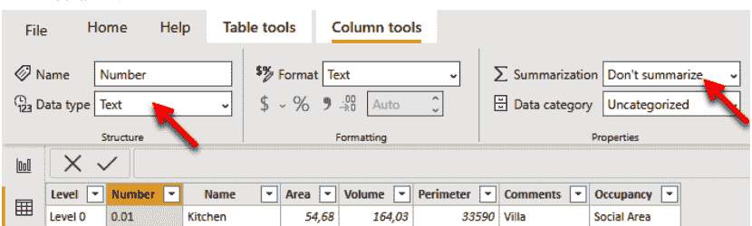

图 7.24 – 将数据类型切换为文本

更改此属性并返回“报表”选项卡后，可以确认 Number 不再带有 Σ 符号：

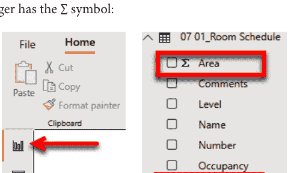

图 7.25 – 对字段下的 Σ 符号求和

现在我们可以开始创建仪表板了。

## 使用从 Revit 导入的数据创建快速仪表板

创建仪表板时，可能需要添加一些图像、形状甚至文本，以便更好地传达仪表板信息。这些选项与 Microsoft 软件（如 Word、Excel 和 PowerPoint）中的其他选项类似。这些选项位于 **插入** 选项卡下：

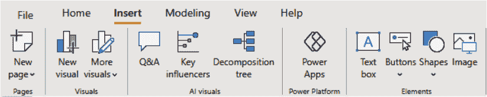

图 7.26 – 插入选项卡

我们可以在页面顶部添加一个文本框并插入图像，使仪表板更具吸引力：

**豪华别墅**

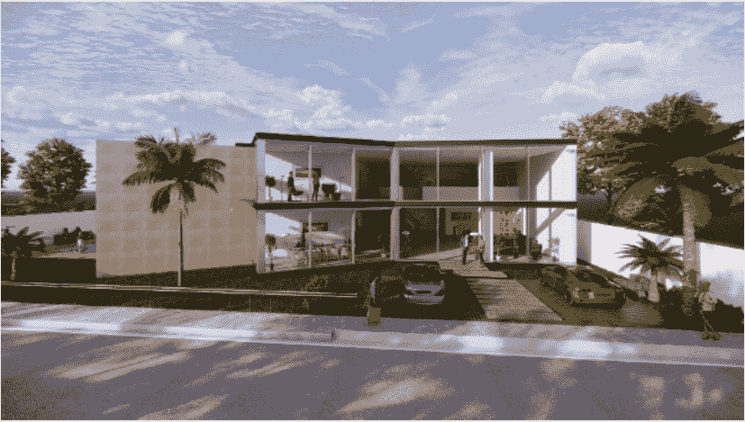

图 7.27 – 插入仪表板的文本和图像

另一个重要设置是页面大小，我们将在其中创建仪表板。通过访问 **可视化** 选项卡，在 **格式** 选项下，可以访问 **页面大小**：

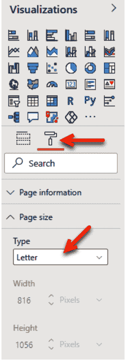

图 7.28 – 更改页面大小

> **提示**
> *页面大小很重要，必须根据仪表板是用于打印还是仅通过 Power BI 访问来定义。如果要进行演示，我们建议使用 **自定义** 选项，并根据屏幕分辨率定义像素数。*

如果您因某种原因无法按照前面的步骤操作，我们提供了一个可用的共享文件：`07.02_Data Imported.pbix`：

- 1. 打开 `07.02_Data Imported.pbix` 文件。

- 2. 在 **可视化** 选项卡中，单击 **表**：

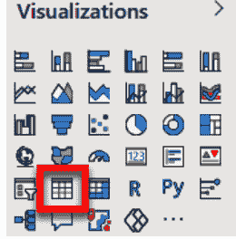

图 7.29 – 向报表添加表

- 3. 要向表中添加数据，请选择该表，然后在 **字段** 下勾选 **Number**、**Name**、**Area**、**Volume**、**Perimeter**、**Occupancy** 和 **Comments**。

向表中添加数据时，可能需要调整 **表头** 和 **数据** 的大小和/或字体类型。

- 4. 保持选中 **表**，然后在 **格式** 下展开 **列标题**，并将文本大小更改为 14pt。

- 5. 展开“值”，并将文本大小更改为 12pt：

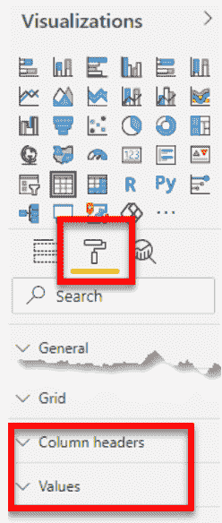

图 7.30 – 设置列标题和数据值的文本大小和字体格式

我们已完成整个页面，由于其中包含项目的所有值，我们可以将此表重命名为 Overall。

- 6. 双击页面名称，并将其重命名为 Overall：

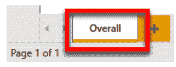

图 7.31 – 重命名后的页面

由于此页面包含总体信息，让我们为项目的每个楼层创建一个页面，并根据相应楼层筛选数据。

## 为每个楼层创建新页面

如果您因某种原因无法按照前面的步骤操作，我们提供了一个可用的共享文件：07.03_Overall Table.pbix。

要创建新页面，请执行以下步骤：

- 1. 打开 07.03_Overall Table.pbix 文件。
- 2. 按下 + 图标。
- 3. 双击页面名称并将其重命名为 Level 0。
- 4. 在“格式”选项下，将页面大小更改为 Letter：

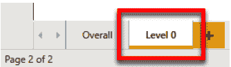

图 7.32 – 创建的新页面：Level 0

- 5. 在 Overall 页面中，按住 Ctrl 键的同时选择标题和表，然后按 Ctrl+C。
- 6. 在新的 Level 0 页面上，单击 Ctrl+V。
- 7. 重命名标题以添加楼层名称：豪华别墅 - Level 0。

现在我们有包含总体信息的同一张表，需要筛选这些数据，仅获取对应 Level 0 的数据。

- 8. 若要从“字段”中按楼层筛选此页面，请选择 Level 并将其拖到“此页面上的筛选器”下的“筛选器”选项卡中。
- 9. 勾选 Level 0：

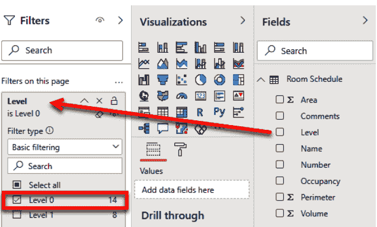

图 7.33 – 筛选 Level 0 的数据

在完成此页面筛选后，我们建议添加更多可视化效果，并尝试了解信息的呈现方式：树状图和饼图：

**豪华别墅 - Level 0**

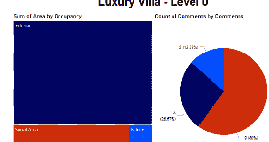

| Number | Name | Area | Volume | Perimeter | Occupancy | Comments |
|---|---|---|---|---|---|---|
| 00.08 | 大厅 | 4,31 | 12,92 | 86,23 | 社交区域 | 别墅 |
| 00.12 | 储藏室 | 5,46 | 17,43 | 96,57 | 社交区域 | 别墅 |
| 00.06 | 卫生间 1 | 9,43 | 28,47 | 123,65 | 潮湿区域 | 别墅 |
| 00.11 | 走廊 | 17,92 | 53,77 | 220,76 | 社交区域 | 别墅 |
| 00.04 | 餐厅 | 23,50 | 73,96 | 203,13 | 社交区域 | 别墅 |
| 00.03 | 外部区域 2 | 28,04 | 112,18 | 244,50 | 阳台区域 | 阳台 |
| 00.02 | 外部区域 1 | 31,14 | 124,56 | 259,04 | 阳台区域 | 阳台 |
| 00.13 | 游泳池 | 53,50 | 214,00 | 314,00 | 外部 | 外部 |
| 00.01 | 厨房 | 54,68 | 164,03 | 335,90 | 社交区域 | 别墅 |
| 00.15 | 车库 | 61,05 | 244,20 | 331,00 | 外部 | 外部 |
| 00.05 | 大厅 | 71,92 | 228,25 | 450,33 | 社交区域 | 别墅 |
| 00.09 | 电视室 | 75,48 | 226,32 | 360,47 | 社交区域 | 别墅 |
| 00.10 | 起居室 | 97,71 | 365,15 | 507,53 | 社交区域 | 别墅 |
| 00.07 | 露台区域 | 150,52 | 602,08 | 57,59 | 外部 | 外部 |
| 00.14 | 草地 | 661,80 | 2.626,45 | 2.720,42 | 外部 | 外部 |
| 总计 |  | 1.346,46 | 5.093,77 | 6.829,12 |  |  |

图 7.34 – Level 0 分析数据


为了完成我们的仪表板，我们应该对 Level 1 也做同样的操作：

### Luxury Villa - Level 1

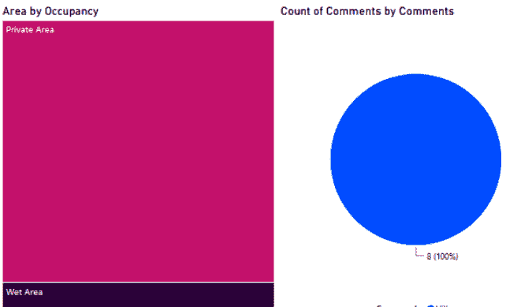

| Number | Name | Area | Volume | Perimeter | Occupancy | Comments |
|---|---|---|---|---|---|---|
| 01.01 | Master Bedroom | 33,41 | 106,90 | 30081 | Private Area | Villa |
| 01.02 | WC 3 | 21,19 | 63,56 | 19599 | Wet Area | Villa |
| 01.03 | WC 2 | 14,40 | 43,19 | 16455 | Wet Area | Villa |
| 01.04 | Bedroom 1 | 67,08 | 201,64 | 32497 | Private Area | Villa |
| 01.05 | Bedroom 2 | 41,27 | 123,80 | 25511 | Private Area | Villa |
| 01.06 | Reading Room | 20,91 | 66,90 | 19223 | Private Area | Villa |
| 01.07 | Office | 48,17 | 144,50 | 30173 | Private Area | Villa |
| 01.08 | Corridor | 48,01 | 153,63 | 42609 | Private Area | Villa |
| Total |  | 294,44 | 904,12 | 216148 |  |  |

Figure 7.35 – Level 1 analytics data

现在我们已经结束了本节，我们学习了如何从 Revit 项目中创建和导出数据，以及如何将数据导入 Microsoft Power BI。我们还解释了如何轻松创建报告。

在下一节中，我们将学习如何在 Microsoft Power BI 中分析数据。

## Analyzing Revit data with Power BI

在从 BIM 模型导出的数据导入并创建可视化后，可以根据需要检查的内容分析所有数据。这种分析可以扩展到包括其他方面，例如相关材料、整体面积，甚至监控 Revit 模型的性能。为此，可能需要使用 Dynamo 图表将所需信息导出到 Excel 文件。

我们现在将通过一些使用 Microsoft Power BI 的工作流程，并了解这些分析如何进行。

### Analyzing Revit data with useful workflows in Power BI

使用 Microsoft Power BI 分析 BIM 项目的数据没有限制。我们将为您提供一些进行此类分析的思路。

### Normal analyses

Microsoft Power BI 允许通过点击数据的任何部分进行交互式分析。这将使 Microsoft Power BI 突出显示与所选内容相关的所有数据。

由于是交互式的，可以直接选择数据，所有仪表板都将更新。

我们将使用共享文件：07.04_Both Levels.pbix。

要创建新页面，请执行以下步骤：

1. 打开 07.04_Both Levels.pbix 文件。
2. 进入 Level 0 页面。
3. 在 Area by Occupancy 仪表板中，点击 Wet Area：

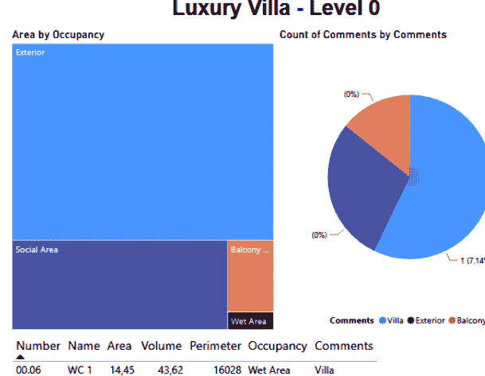

Figure 7.36 – Wet Area data selected

4. 要重置之前的分析，请点击仪表板或表格的同一区域。
5. 要选择多个区域或行，请按住 Ctrl 键并选择需要选择的数据：

### Luxury Villa - Level 0

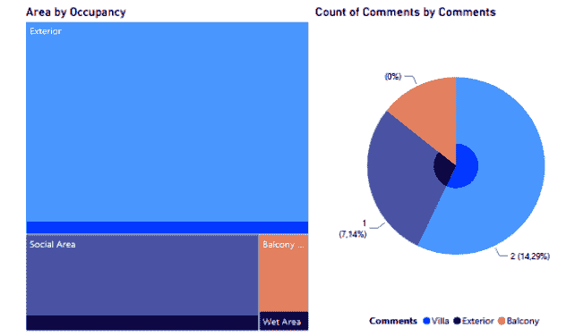

| Number | Name | Area | Volume | Perimeter | Occupancy | Comments |
|---|---|---|---|---|---|---|
| 00.01 | Kitchen | 54,68 | 164,03 | 33590 | Social Area | Villa |
| 00.02 | External Area 1 | 31,14 | 124,56 | 25904 | Balcony Area | Balcony |
| 00.03 | External Area 2 | 28,04 | 112,18 | 24450 | Balcony Area | Balcony |
| 00.04 | Dining Room | 23,50 | 73,96 | 20313 | Social Area | Villa |
| 00.05 | Hall | 71,02 | 228,25 | 45033 | Social Area | Villa |
| 00.06 | WC 1 | 14,45 | 43,62 | 16028 | Wet Area | Villa |
| 00.07 | Deck Area | 150,52 | 602,08 | 57559 | Exterior | Exterior |
| 00.08 | TV Room | 75,48 | 226,32 | 36047 | Social Area | Villa |
| 00.09 | Living Room | 97,71 | 365,15 | 50753 | Social Area | Villa |
| 00.10 | Corridor | 17,92 | 53,77 | 22076 | Social Area | Villa |
| 00.11 | Storage | 5,46 | 17,43 | 9657 | Social Area | Villa |
| 00.12 | Pool | 53,50 | 214,00 | 31400 | Exterior | Exterior |
| 00.13 | Grass Area | 661,80 | 2.626,45 | 272042 | Exterior | Exterior |
| 00.14 | Garage | 61,05 | 244,20 | 33100 | Exterior | Exterior |
| Total |  | 1.347,17 | 5.096,00 | 677952 |  |  |

Figure 7.37 – Multi-data selected

根据我们使用的可视化类型，结果会有所不同。我们强烈建议浏览所有不同的可视化类型。如果需要，可以安装不同的工具包，正如我们在下一个子主题中将要演示的那样。

### Different visuals

在 Microsoft Power BI 中工作时，可以使用和组合不同类型的可视化。然而，通过安装不同的可视化，可以进一步扩展这种能力。

有一些工具包可以获取，它将简化 Revit 模型与 Microsoft Power BI 连接的过程。其中之一是 Tracer，它基本上是一个插件，允许数据信息直接从 Revit 导出到 Microsoft Power BI。

如需了解更多信息，请访问以下链接：

```
https://bit.ly/3r2ruWX
```

QR code:


**Synoptic Panel** 是一种不同的可视化，可以使用，并且是免费的。可以通过以下链接访问：`https://bit.ly/2O7bGE0`

QR code:


下载后，我们可以通过 Microsoft Power BI 中的 **Visualization** 面板访问它：

### Tip

安装程序未共享，因为该工具可能随时更新。最新版本始终可以通过遵循之前的链接并按照获取安装程序的步骤来访问。

1. 打开 Microsoft Power BI。
2. 从 **Visualizations** 面板中，点击省略号，然后点击 **Import a visual from a file**：

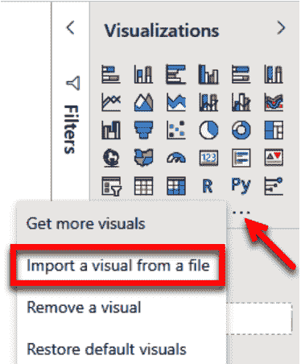

Figure 7.38 – Adding more visuals to Microsoft Power BI

3. 导入之前下载的文件后，您将收到一条消息，告知可视化已导入：

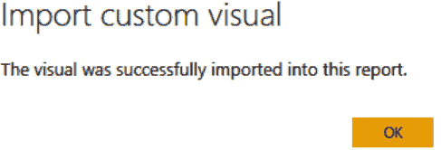

Figure 7.39 – Confirmation of an imported custom visual

导入过程完成后，新的可视化可以通过 **Visualizations** 面板访问：

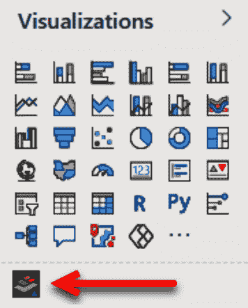

Figure 7.40 – Synoptic visual imported

要使用示意可视化，您需要为每个需要使用的视图类型创建一个视图（平面图、立面图、剖面图等）。当选择其中一个可用数据项时，它将突出显示在与其链接的相应视图中。
要创建每个视图，我们首先需要创建一个图像，并在通过以下链接定义区域后：

```
https://bit.ly/3bMMIBJ
```

QR code:


### Microsoft Power BI gallery

通过访问 Microsoft Power BI 库，可以更好地了解使用该软件可以做什么以及如何改进这些分析。

按照此链接前往画廊：

```
https://bit.ly/3svmevq
```

QR code:

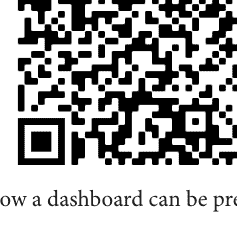

作为示例，这里是如何使用 BIM 数据呈现仪表板的示例：

```
https://bit.ly/3kvX6Sk
```

QR code:


为了结束本节，我们学习了如何分析和创建不同类型的仪表板，这将帮助我们更好地理解我们需要分析的数据。我们还分享了一些不同可视化的示例，可作为参考。
