# 8

# 与顾问合作

与顾问合作是信息管理和BIM工作流的重要组成部分，但我们需要确保有效协作，从而在多个组织间提升绩效。

那些提倡协作的公司会共享知识和最佳实践，以实现项目目标。成功的协作建立在信任、尊重以及清晰沟通和明确信息交换流程之上的积极参与。

在前面的章节中，我们已经完成了协作的某些方面。

第2章《项目数据管理》解释了项目数据管理和BIM文档，这涉及公司间的协作。

第4章《高效启动Revit项目》讨论了让顾问提供的模型采用相同坐标系，以便在正确位置导入和导出模型，从而提升效率和生产力。

第5章《Revit核心功能》介绍了工作共享的最佳实践，以实现Revit协作，以及管理来自团队和顾问文件的工作集的过程。

本章将概述协作策略，并提供有关增强Revit协作的Revit工具信息，例如“复制/监视”、“协调审查”和“共享视图”。

我们想听听您对与顾问协作策略的看法。

能否请你介绍一下你自己和你的公司？

**Ricardo:**

自2013年以来，我担任芬兰Sweco公司的技术总监。Sweco规划并设计未来的可持续城市和社区。Sweco拥有约17,500名员工，主要在欧洲市场运营。

**Marzia:**

我是Marzia Bolpagni，MACE国际BIM主管兼副总监。MACE是一家全球性公司，我们的宗旨是拓展雄心的边界，因此我们开发、咨询、建造、运营，这就是MACE的四大引擎。具体来说，我在MACE的咨询部门以及数字-BIM小组工作。

**May:**

我是国际工程公司Buro Happold的商业与法律主管：城市与数字。在这个职位上，我领导商业与法律团队，为Buro Happold全球的城市与数字业务提供支持。在数字方面，这包括与业务部门紧密合作，为Buro Happold内部的团队提供法律支持和建议，提供数字和BIM服务，并协助开发新的建筑技术和数字数据产品、服务及全球业务产品。每天都不一样，我喜欢利用自己的知识和经验帮助公司改进流程，并处理由建筑技术和数字化引发的法律和商业问题——无论是BIM、模块化建筑、软件还是其他方面。

在日常工作之外，我多年来一直深度参与BIM文档的开发并撰写相关论文。我定期在全球会议上就BIM和建筑技术的法律与合同问题发表演讲，并撰写相关论文和文章。我是BIM4Legal的主席，稍后我会进一步说明。我还是国际4D施工组的核心团队成员，是ISO19650过渡指南、ISO19650指南、英国数字建设中心的国家数字孪生路线图和数字孪生工具包工作组的成员。我也是英国BIM联盟的大使。我曾带领团队编写了2018年JCT《BIM实践指南》和符合ISO19650的信息协议，并参与咨询/评论了多份其他BIM指导文件。

Buro Happold是一家由工程师、顾问和咨询师组成的全球性实践机构。通过整合思维和一个真正跨学科、相互关联、充满热情专家的社区，我们为客户和社区创造变革性的成果。Buro Happold致力于提供优雅的解决方案，为我们所处的社区和环境留下积极、持久的遗产（例如，参见 *《2020年全球可持续发展报告》* – Buro Happold – https://bit.ly/2RZNGV4）。我们重视人类福祉，拥抱共同责任，并理解可持续的未来是我们工作经济和社会影响的内在组成部分。Buro Happold以其前瞻性和技术先进的理念而闻名，例如，多年来在所有项目内部实施BIM，并完全符合ISO19650新的信息管理要求。我们理解，技术正在为客户的利益革新建筑业，这需要敏捷的思维来提供最相关的服务和交付成果。Buro Happold的数字思想领袖之一Alain Waha曾表示，Buro Happold正与客户一起“创造未来”，例如通过与建筑创新中心的合作；我们的计算工程方法使我们能够将设计流程与构成施工过程或最终资产的技术相集成，甚至可以优化场外施工的设计。重要的是，我们与供应链合作，走向完全数字化施工，因为协作是成功数字化和BIM的关键部分。为了进一步扩大在这一关键数字领域的参与，Buro Happold最近发布了其首个数字产品“工作场所分析”，并继续推进其开源的协作模型平台BHOM（https://bit.ly/3sXDZDF），该平台使顾问能够在模型协作中克服互操作性的实际问题。

# 您对与顾问建立牢固合作关系有什么建议？

**Ricardo:**

我认为牢固的关系源于信任。我注意到，如果我们清楚需要做什么，并了解完成事情需要付出什么，我们就能在所有项目利益相关者之间建立信任。

我与客户使用敏捷方法论合作，这对我们的业务流程帮助很大，因为客户始终充分参与项目的决策。

客户和其他利益相关者参与项目的这种包容性在他们之间建立了更紧密的联系，并创造了一个信任的环境，使得与该团队完成的多个项目都非常成功。

**Marzia:**

要建立牢固的协作关系，我们需要考虑培养软技能，这些技能有助于沟通、创造协作环境、使人们有信心创新和犯错，并让他们参与支持领导层所定义战略的具体任务。

当我们谈论协作时，合同协议是促进项目相关团队协作环境的重要因素。

我正在写一本关于工业4.0的书，它不仅涉及技术层面，还讨论了培养软技能、数字领导力以及确保人们感受到自己是团队一员的方法论。这本书名为 *《面向建筑环境的工业4.0：方法论、技术与技能》*，计划于2021年由Springer出版。

**May:**

首先，必须有正确的心态。建筑行业传统上具有很强的对抗性和风险规避性，合同往往试图将风险和责任转嫁给对方。Latham和Egan报告指出了向更具协作性文化转变的迫切需要，正如标题恰如其分的Farmer报告《现代化，还是死亡》一样。实现这种协作心态绝对需要组织内部正确的风气和原则。然而，要实现这种协作心态并真正建立合作关系，以下关键步骤也可能有所帮助：

-   合同文件应具有协作意图，并包含各方必须遵守的协作程序，例如定期讨论和信息交换（有义务协作将使各方在遵守这些步骤时意识到，这确实是一种更高效、更好的互动方式）。
-   在各方之间实施和执行确保定期、公开的信息交换、讨论和互助的流程，以支持和建立牢固的协作关系。
-   与其他参与方发展牢固、定期或重复的工作关系也会有所帮助，因为与刚刚认识的人相比，与那些反复合作过的人更容易建立起密切、协作的关系。
-   使用技术和数字化流程，使协作更容易、更有效。例如，BIM建模、通过云平台交换信息，以及以易于所有人查看和理解的格式交换数据。

## 你如何看待在供应链分段且技能多样化时协作中的困难？

## Ricardo：

在这种分段供应链环境中，沟通和知识共享存在问题。它降低了项目的成功率，并经常导致项目延期和超预算。提供培训方案以提高技术和协作技能至关重要。

## Marzia：

这是个好问题。即使在英国多年前就有了数字化 mandate，我们的行业仍在数字化之旅中，因此行业在全球的成熟度水平差异很大。

在选择合作伙伴时，检查其能力至关重要，而不仅仅依赖他们的简历和承诺。有时，无法选择合作伙伴，但检查他们的能力、他们的工作方式以及他们在特定情况下的行为，是选择团队的一种方式。另一点是提供培训并了解他们的局限性和需求，因为每个公司都有不同的流程。定义清晰的信息需求和供应链中每个参与者的不同信息需求等级也很重要，以促进协作。在这种情况下，很清楚需要什么来满足他们的需求并能够运行多个分析和流程。可使用标准 EN 17412-1 来定义信息需求等级框架。

## May：

可以说，技能的多样性本应促进协作，因为各方需要依赖他人的技能或知识并共同工作以实现完整的设计或完成的项目。然而，行业确实非常分散，而且如前所述，传统上相当对立。然而，已经出现了明显的转变和向更协作的工作方式的推进，这得益于政府的 mandate 和出版物——例如，英国政府《2011年建筑战略》中的 mandate 以及英国政府《2020年建筑游戏规则手册》中的明确理念和原则。我们仍有很长的路要走，因为行业内有些人可能不愿拥抱与过去几十年的惯常工作方式相比似乎激进的协作转变，而且促进和加速协作所需的数字工具也未被行业内一些人所采用。虽然因此协作要真正成为常规业务还需要时间，但它需要行业内人员的承诺和支持来推广和鼓励协作方式的工作，并采取积极措施来实现这一点。

由于保险政策的性质，完全协作也变得困难，因为当问题出现时，各方可能因担心使保单失效而不愿完全坦诚。**综合项目保险 (IPI)** 正被英国政府尝试，以期克服此类协作的困难和障碍。

## 公司如何促进有效的协作？

## Ricardo：

推广任何事情最好的方式是通过展示成功案例。这是我在 Sweco 引入多种工作方式的方式，即使它们听起来对我展示的人来说很陌生。通过展示过去的例子来说服人总是更容易。

## Marzia：

协作合同将是促进有效协作的第一步，但从公司中挑选合适的团队成员也很重要。这个过程不仅关乎技术技能，还关乎行为和软技能，这一点非常重要。在 MACE，我们有名为“成功行为”的指标，因为我们评估的不仅是我们技术上的表现，还包括我们的行为、互动以及与他人的合作方式。从战略和领导力的角度来看，将这些行为纳入公司的专业评估中进行评估也很重要。

在项目中，定义清晰的信息需求很重要，特别是定义 ISO 19650 系列中所述的信息需求等级。我是关于信息需求等级框架的标准 EN 17412-1 的主要作者，该框架取代了“LOD”概念。在项目早期阶段就明确定义需求并自动将交付成果与初始需求进行比较，效果非常好。

此外，使用数字工具可以帮助公司协作。但定期进行跟进和会议以了解人们的感受也很重要。非正式的谈话可以营造一个协作的环境，让人们不害怕犯错或在问题出现时发声；相反，他们会感到得到支持，能够借助正确的技术工具和培训完成工作。

## May：

它必须嵌入组织的文化和理念中。我非常自豪 Buro Happold 认真对待协作，无论是与客户、合作者和分包顾问的外部协作，还是团队和办公室之间的内部协作。流程、工具和文档提供了良好的框架，使这种协作能够以简单和统一的方式进行。组织在思想和行动上的明确承诺，反过来会鼓励组织内部的人采用这种方法。

## 你对增强协作工作的合同类型的看法是什么？

## Ricardo：

这里在芬兰（可能在其他国家），我们有一些不同类型的合同：联盟合同。这些合同有时用于大型项目，其背后的想法是增强项目中的协作。在此过程中，所有利益相关者共同承担项目的风险和收益。

## Marzia：

对我来说，这是增强协作工作的首要原因，也是我 2012 年硕士论文的主题，关于使用建筑信息模型的公共采购。我分析了不同国家的不同采购方法，包括传统和协作方法。在美国，有 **综合项目交付 (IPD)**；在澳大利亚，有更多项目联盟合同；在英国，政府战略定义了三种增强协作的采购方法：**成本主导采购 (CLP)**、**综合项目保险 (IPI)** 和两阶段开放账簿。此外，Prof. David Mosey 领导的工作也非常相关，FAC-1 框架可用于联盟合同以促进协作方法。不幸的是，我必须说，我们并没有像我们希望的那样多使用它们，因为改变合同采购流程存在许多障碍。如果我们想充分利用数字流程的好处，我们需要在这方面改进。

## May：

合同的设立有助于并重要地鼓励和要求协作，包括包含要求各方之间实施协作的流程，以及以促进协作的方式规定各方的权利和义务。寻求将所有风险和责任转移给另一方，或包含鼓励保护性或对抗性行为的条款的合同，将对建立协作氛围的尝试产生不利影响。要求各方以“相互信任和合作”或类似方式工作的条款可确保各方从一开始就怀有正确的意图，并有望从此积极进展。具有协作工作方式的合同，例如 BIM，通常会包含或纳入对协作流程或技术文档的引用，例如 BIM 执行计划，该计划由所有各方共同商定并持续共同更新。这些文档反过来导致各方密切合作，朝着比传统孤岛更协作的工作方式发展。

## 定义协作战略的关键点是什么？

## Ricardo：

我认为你需要为任何战略制定愿景和使命。然后你需要定义短期和长期目标，并在它们之间设定里程碑，以衡量你是否朝着正确的方向前进。如果没有，你就知道在哪里改进。衡量过程是成功实施的关键。

## Marzia：

定义协作战略的关键点是选择正确的合同类型，因为最终，协作合同将支持承包商和多个参与者的早期参与，以及职责的明确定义。从保险角度来看，公司将共享优势和劣势，因为它们在同一条“船”上，因此合同对于促进协作方法至关重要，在这种方法中，交付团队和客户共享相同的目标。

除此之外，选择具有正确态度的合适人员，定义信息需求，并经常检查人们履行其职能所需的内容，有助于协作。数字工具可以促进协作，但我们需要良好的基础和领导者来推动项目协作。人的因素是关键。

## May：

关键点可能因组织和项目而异，以适合具体情况和要求；然而，一些关键点包括：

- 在合同文件中具有协作条款和要求
- 内部和外部实施和执行协作流程
- 使用数字和其他工具以促进更轻松、更安全的协作

Ricardo、Marzia 和 May，感谢你们的访谈。

现在，让我们了解实现内部团队和顾问之间协作的 enabling 技术。

## 使用 Revit 进行协作的技术

协作技术使员工能够在云端或本地协作处理多种文件类型，这在使用大型团队和各种顾问时至关重要。

你的公司 IT 基础设施必须定义你将如何与内部团队和顾问协作。 有多种选择可用，网络安全应是首要优先事项。

*在第 5 章《Revit 核心功能》中* 我们学习了 **Revit 工作共享** 以及如何在你的内部场所和 IT 网络中为协作创建中心文件和本地文件：

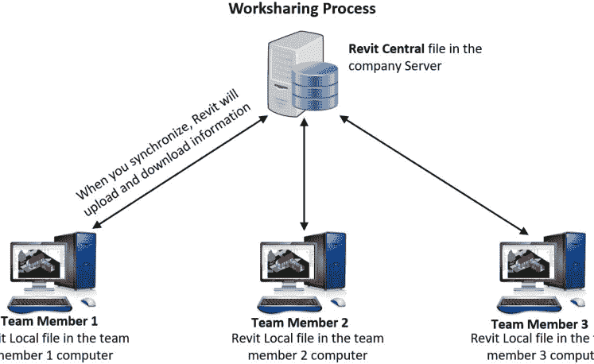

图 8.1 – 在你的 IT 网络内部的工作共享流程

当你需要在公司 IT 网络 *之外* 协作时，例如在家工作或与顾问在 Revit 中协作时，你需要不同的解决方案来启用 Revit 同步流程。

目前，启用此流程主要有三个选项：

- Virtual Desktop Infrastructure (VDI)
- Autodesk BIM 360 and Autodesk Construction Cloud
- Revit Server

## Virtual Desktop Infrastructure (VDI)

VDI 使用户能够连接到虚拟机（虚拟桌面实例），所有处理都在主机服务器上进行。 用户可以从任何位置或设备访问这些虚拟机。

虚拟化图形应用程序，例如 Revit、AutoCAD、Rhino 和 Enscape 具有挑战性，因为它们依赖于处理能力和良好的显卡性能。 你还需要检查你的插件是否在 VDI 环境中工作。

此解决方案可能代表大量的投资，因为它可能涉及购买硬件和软件来实现 VDI，但它将支持多个应用程序，而不仅仅是 Revit。

VDI 解决方案变得越来越受欢迎，并且对公司来说更易于访问。 下图显示了简化的 VDI 系统，用户可以访问虚拟机以在 Revit 和其他软件中工作：

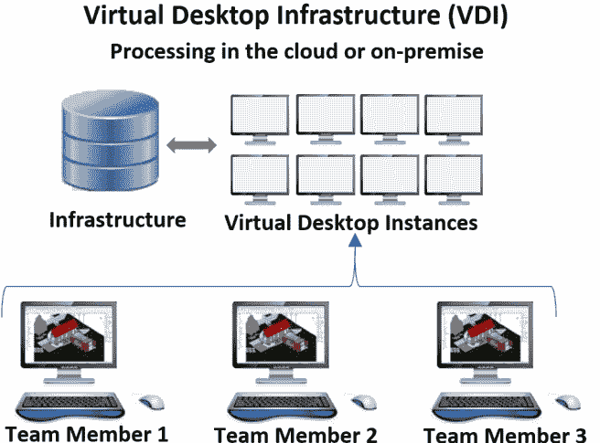

图 8.2 – VDI 系统

## Autodesk BIM 360 and Autodesk Construction Cloud

Autodesk 提供了一个云平台，具有多种服务来增强内部团队和顾问之间的协作。

Autodesk BIM 360 和 Autodesk Construction Cloud 使用户能够在云中工作和协作，并能够同步 Revit 模型。

Autodesk 为设计创作、协作、协调、量化、项目管理、设施管理和其他服务提供云服务。

## Copy/Monitor and Coordination Review

**Copy/Monitor** 命令使 Revit 能够从链接文件中复制元素并监控这些元素是否发生变化。

我们可以使用 Copy/Monitor 用于以下 Revit 类别：

- Levels
- Grids
- Columns
- Walls
- Floors
- Openings
- Multiple MEP fixtures categories

使用 Copy/Monitor 的主要 Revit 类别是 levels 和 grids。 其他类别不常使用，因为我们预计设计会发生变化；因此，不建议监控这些元素。

Copy/Monitor 有三个主要功能：

- 识别 levels 和 grids 被不当更改时出现的错误
- 确保 levels 和 grids 的项目协调更好
- 增加创建/复制 levels 和 grids 的生产力

我们通常通过创建 levels 和 grids 开始一个 Revit 项目，并且通常此任务分配给设计负责人或项目 BIM 负责人。 一旦 Revit 文件使用正确的坐标、levels 和 grids 创建，它就会发送给其他公司或顾问以复制 levels 和 grids 并开始他们的文件。

假设你是设计负责人，并且你的项目有多个 Revit 模型，例如幕墙、室内和场地模型。 在这种情况下，你可以在各个模型中复制/监控 levels 和 grids。

让我们在以下步骤中学习如何对 levels 和 grids 使用 Copy/Monitor（假设我们是顾问，并且我们已从设计负责人或 BIM 顾问处收到带有 levels 和 grids 的 Revit 文件以进行复制和协调）：

1. 在本章的数据集中，我们可以找到以下文件。 打开 Consultant File.rvt Revit 文件：

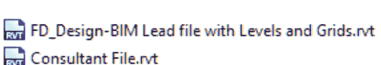

图 8.5 – 本章的数据集

2. 打开 Floor Plan – Level 0。

3. 在 Insert 选项卡中，单击 Link Revit 以链接 FD_Design-BIM Lead file with Levels and Grids.rvt 文件：

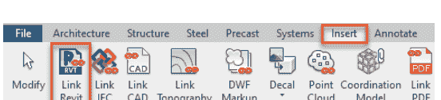

图 8.6 – Link Revit

4. 选择 FD_Design-BIM Lead file with Levels and Grids.rvt 文件并使用 Auto - Internal Origin to Internal Origin 定位：

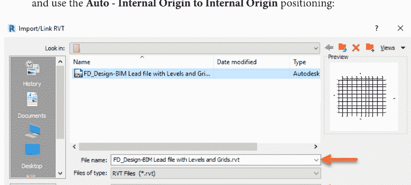

图 8.7 – 链接 Revit 文件的流程

9. 在选项栏中，勾选 **Multiple** 选项：

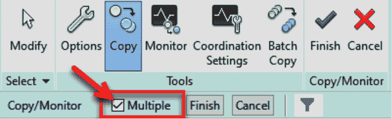

图 8.11 – Copy/Monitor 工具 – 选择 Multiple

10. 打开一个选择框以选择所有 levels：

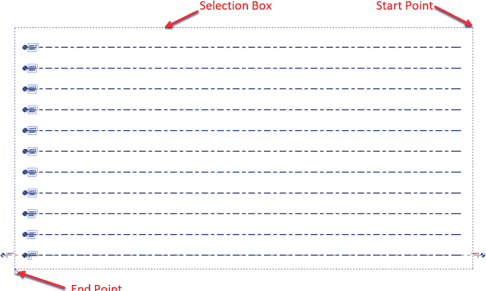

图 8.12 – 选择框以选择所有 levels

11. 在选项栏中单击 **Finish**：

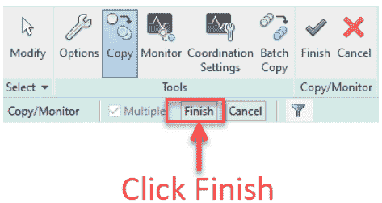

图 8.13 – 在选项栏中单击 Finish

12. 在 **Copy/Monitor** 选项卡中，单击 **Finish**：

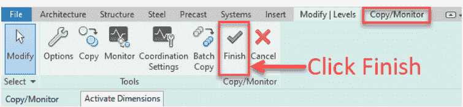

图 8.14 – 在 Copy/Monitor 选项卡中单击 Finish

我们会看到所有 levels 已在我们的模型中创建。

流程已完成，但让我们学习此工作流程的另外两个细节：

- 在 **Options** 中，我们可以定义 Revit 在复制 levels 和 grids 时的行为。 我们可以更改偏移 level、添加后缀/前缀，并选择不同的族类型：

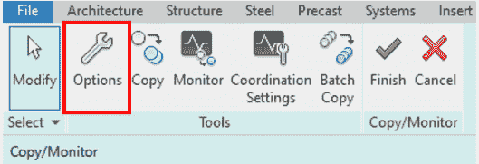

图 8.15 – Copy/Monitor 命令的选项

当你选择一个已启用 Copy/Monitor 的对象时，你会看到一个符号以指示该对象已被监控，并且有一个 Stop Monitoring 选项：

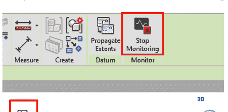

图 8.16 – Stop Monitoring 选项

现在，让我们重复相同的流程，使用以下步骤复制/监控 grids：

1. 打开 Floor Plan – Level 0。

2. 重复上一个任务中的步骤 6 到 9。

3. 打开一个选择框以选择所有 grids：

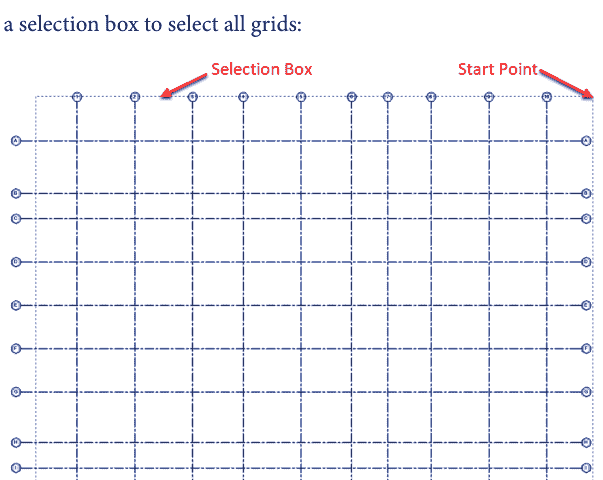

图 8.17 – 选择所有 grids

4. 在选项栏中单击 Finish：

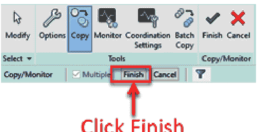

图 8.18 – 单击 Finish

5. 在 Copy/Monitor 选项卡中，单击 Finish：

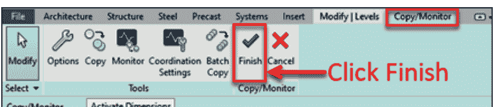

图 8.19 – 单击 Finish

所有 grids 现在已在我们的模型中创建。

现在，我们可能想要为我们刚刚创建的那些 levels 创建楼层平面图。 按照以下步骤为所有 levels 制作楼层平面图：

图 8.20 – 为 levels 创建楼层平面图

我们可以看到所有楼层平面图已创建：

图 8.21 – 已创建的楼层平面图

5. 在打开 Revit 文件的过程中，我们会看到以下消息，指示我们需要检查 Coordination Review。 单击 OK，文件将继续打开：

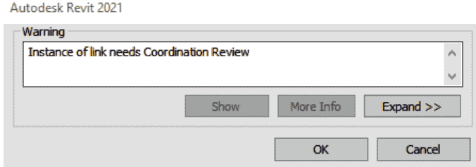

图 8.23 – 链接实例需要 Coordination Review

6. 在 Collaborate 选项卡中，单击 Coordination Review 并单击 Select Link：

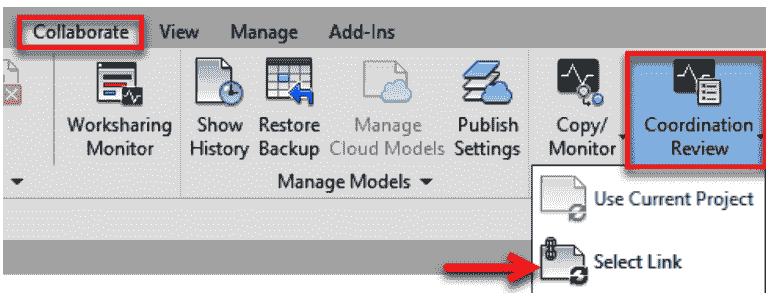

图 8.24 – Coordination Review – 问题描述

Coordination Review 工具使我们能够轻松跟踪 level 和 grid 更改，并提高生产力以控制来自链接文件的元素。 在下一节中，我们将学习关于共享视图的内容。

## Shared Views

Shared Views 是 Revit 2021.1 的新功能，你可以使用它与设计团队和顾问共享 3D 视图以供审阅和评论。

Shared Views 工具仅适用于拥有 Revit 订阅许可证的用户，并且不适用于维护许可证和 Revit 试用版。 此工具非常适合与非 Revit 用户例如项目经理和总监一起使用，以便通过网络浏览器快速可视化模型。

按照以下步骤学习有关共享视图的内容：

1. 打开一个 Revit 文件并进入 3D 视图。 此工具仅在 3D 视图中工作，并且你必须登录到你的 Autodesk 帐户才能使用此工具。

2. 在 Collaborate 选项卡中，选择 Shared Views：

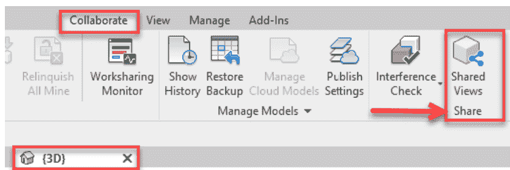

图 8.27 – Coordination Review

3. 一个新窗口将会出现，我们可以点击 New Shared View：

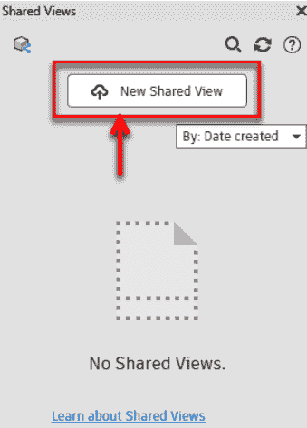

图 8.28 – New Shared View

4. 输入共享视图名称并点击 Share：

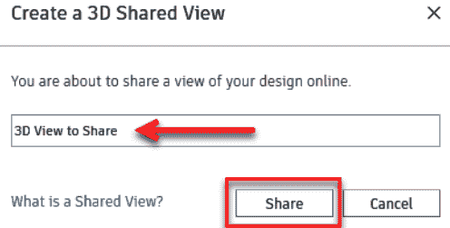

图 8.29 – Shared view name

5. Revit 将模型上传到 Autodesk Viewer，处理完成后，我们可以选择以下两种选项：

- View in the Browser
- **Copy the link:** 你可以将此链接与顾问分享：

图 8.30 – Option to share the view with consultants

6. 点击 **View in the Browser.**

7. 模型在浏览器中打开后，我们有多项工具可以导航模型并添加注释。点击 **Comments** 来添加你视图的描述：

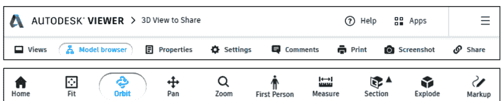

图 8.31 – Multiple tools to manage shared views

8. 在 Revit 中，点击高亮的图标将注释加载回 Revit。你将能够在 Revit 内部看到注释：

Click to load comments

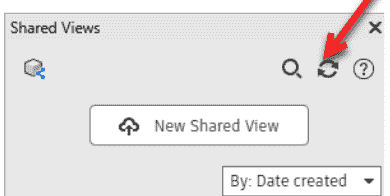

图 8.32 – Loading comments from shared views

总之，我们学习了共享视图以及与顾问协作的能力。在下一节中，我们将学习设计协调和冲突管理。

## Design coordination and clash management

设计协调和冲突管理是顾问协作中解决设计和模型问题的关键方面。BEP 将定义冲突检测流程和公差，以根据项目设计阶段优化结果。运行冲突检测流程的主要工具是 Autodesk 的 **Navisworks** 和 Nemetschek 的 **Solibri**。

Autodesk 拥有一个用于运行冲突检测流程和解决模型问题的云平台。它是 Autodesk Construction Cloud 的一部分，目前称为 BIM 360 Coordinate。

冲突检测流程可分为两种类型：

- Clash avoidance
- Clash detection

让我们详细了解它们。

## Clash avoidance

Clash avoidance 是识别为建筑、结构和 MEP 专业分配的空间区域之间冲突的过程。下面的图表显示了为定义 MEP 区域而创建的体积，并在冲突避免流程中使用它。

我们也可以在冲突避免流程中使用较大的冲突公差。

这种主动流程可以从设计的早期阶段运行，并确保每个专业在特定区域内创建元素。当设计团队进入冲突检测流程时，它将减少冲突数量：

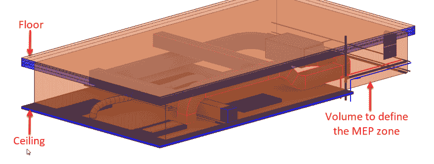

图 8.33 – Volume to define the MEP zone

## Clash detection

Clash detection 是在施工前阶段识别两个或多个元素之间冲突的过程。我们比较建筑类别来运行冲突检测流程，例如结构梁与风管和管道。

此流程并不能防止冲突，但它是一个纠正性流程：

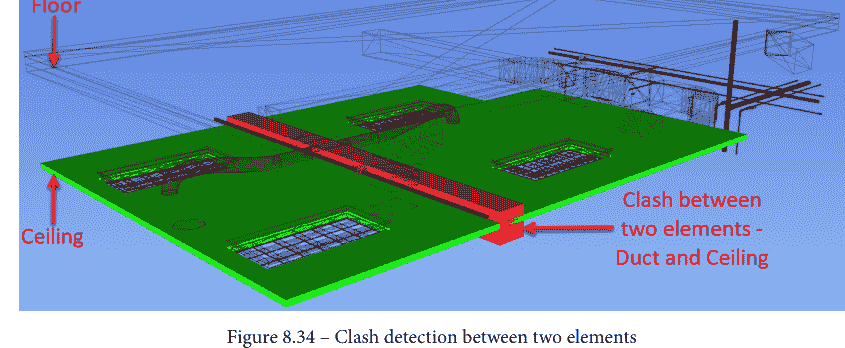

图 8.34 – Clash detection between two elements

## Clash management

Clash management 是一个协作流程，设计团队和顾问交换模型以协调和解决多个设计问题。顾问之间的沟通对于理解建模和解决设计问题的优先级至关重要。

### Good communication will reduce the number of clashes

首先，让我们确定项目协调的常见挑战。以下是典型问题：

- 通过电子邮件沟通冲突和问题是无组织的。
- 沟通不畅，缺乏透明度来解决设计问题。
- 问题解决方案没有可追踪的历史记录。
- 在冲突检测软件中识别模型问题可能耗时。
- 没有明确的责任来解决模型问题。
- 与设计问题相关的风险管理不足。
- 非协作团队在解决模型问题方面更困难。

出于这些原因，许多公司使用具有高级功能的其他软件来管理冲突和设计问题。

如前所述，运行冲突检测流程的主要工具是 Autodesk 的 Navisworks 和 Nemetschek 的 Solibri。识别冲突后，我们可以将冲突上传到冲突管理软件。

以下列表并非详尽无遗，但此软件可与 Navisworks 和 Solibri 配合用于冲突管理：

- **Revizto:** https://revizto.com/en/
- **BIM Track:** https://bimtrack.co/
- **BIMcollab:** https://www.bimcollab.com/en
- **Autodesk BIM 360 Coordinate:** https://bit.ly/3u24Os0
- **Fuzor:** https://www.kallotech.com

此冲突管理软件有助于 *提高管理冲突的效率* 并 *增强团队沟通* 以解决设计问题。

此软件不仅可以管理两个模型元素之间的冲突，还可以管理多种类型的设计问题。以下列表显示了可通过使用此软件跟踪的典型问题：

- 添加并交换关于设计的评论。
- 为设计问题添加解决方案。
- 添加变更请求。
- 检查数据验证。
- 可视化并对模型元素之间典型的冲突问题进行评论。
- 识别需要更换的构件。
- 识别施工中的缺陷。
- 识别建模错误。
- 添加关于设计和财务问题的一般性问题。

使用冲突管理软件时，我们需要意识到潜在的商业和法律问题。以下问题需要得到解答，以确保我们做出正确的决策：

- 谁提供许可证？
- 设计团队需要多少许可证？
- 谁管理用户和角色的软件权限？
- 谁负责实施和培训设计团队？
- 我们是否有合同协议以保证在施工期间和施工后完全访问上传到冲突管理软件的数据？
- 我们能否从此云软件下载数据以在我们的私有服务器上保留副本？

在使用冲突管理软件之前，这些问题是必须提出的重要要点。

总之，冲突管理软件对于提高管理冲突和设计问题的生产力至关重要。它还将跟踪项目历史并提高责任性。
