## 9

## Enhancing Productivity with Plugins

Revit 插件可以通过提供新功能来提高生产力，并扩展当前的 Revit 工具。第三方插件可在完整版 Revit 中运行，但不幸的是，Revit LT 版本不支持它们。

插件实施简单，无需编程技能即可开发或使用特定应用程序。安装过程很直接，我们将学习如何管理 Revit 插件以避免潜在冲突和 Revit 性能下降。

我们将学习如何启用和禁用 Revit 插件以测试性能或插件导致 Revit 项目崩溃时。 我们可以在 Revit Autodesk App Store 找到许多令人兴奋的插件，以从多个领域和专业提高生产力。我们也可以直接从开发商网站找到插件，本章将介绍这些插件。

有许多免费插件可用，但一些付费插件也能提供极佳的性价比。

本章将提供有关最常用的 Revit 插件的信息，以提高项目中的生产力。插件分为类别，包括生产力和可视化。

本章将涵盖以下主题：

- Managing Revit plugins
- Revit plugins

## Managing Revit plugins

Autodesk 努力每年通过新版本改进 Revit，但第三方插件对于提高生产力和运行基本功能（如批量打印 PDF 文件）是必要的。

我们可以从 Revit Autodesk App Store 下载插件，或直接从开发商网站下载。

Revit Autodesk App Store 可在 https://bit.ly/3uleRbQ 找到。

二维码如下：


在 Revit Autodesk 应用商店中，我们可以找到一个按特定功能组织插件的菜单：

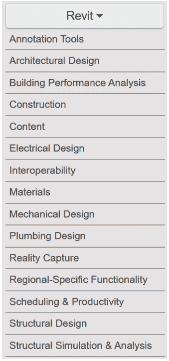

*图 9.2 – Revit Autodesk 应用商店菜单*

我们也可以通过点击 Revit 屏幕右上角的图标来访问 Revit Autodesk 应用商店：


*图 9.3 – 访问 Revit Autodesk 应用商店的图标*

在 Revit Autodesk 应用商店中，我们可以找到免费和付费插件。

在安装插件之前，请与 IT 部门和您的技术负责人确认该插件是否适合您的工作流程，以及您是否可以下载或请求将其安装到您的系统上。

在将项目从一个版本升级到另一个版本之前，我们也需要检查以确保使用的所有插件在新版本中都已可用，以避免对当前工作流程产生任何影响。

您还需要检查插件是否与您当前使用的 Revit 版本兼容，并查看其是否最近已更新。点击 Revit 插件即可找到有关发布日期、上次更新日期和兼容 Revit 版本的信息：

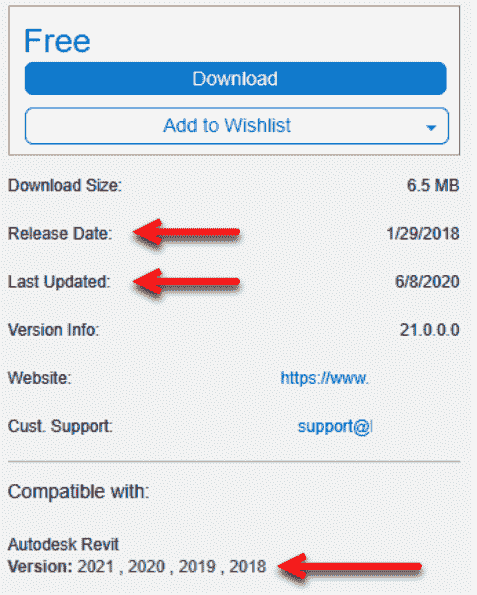

*图 9.4 – 有关 Revit 插件的信息*

> **提示**
> 建议在安装插件之前关闭 Revit。

当我们安装插件后打开 Revit 时，会出现以下消息。必须选择 **始终加载** 选项以避免出现问题：

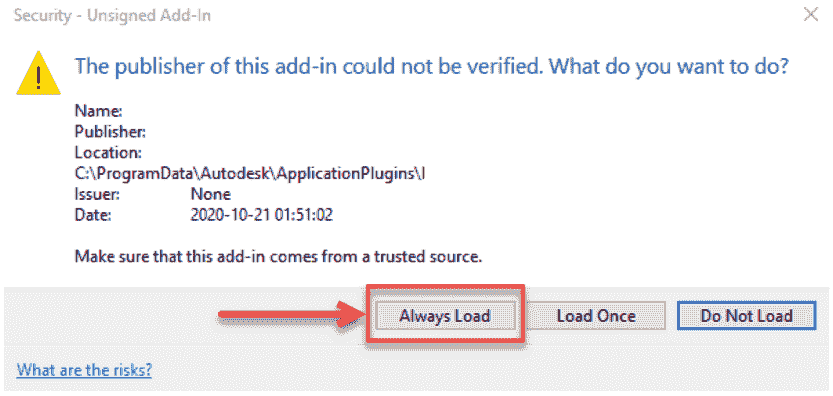

*图 9.5 – 始终加载 Revit 插件的选项*

如果我们选择 **不加载**，将会产生两个问题：

- 该应用仍会安装在您的 PC 上，占用硬盘上的宝贵空间。
- 如果我们决定使用该插件，则首先需要卸载然后重新安装该插件。

## 让我们学习有关安全性的知识！

就安全性而言，我们应优先考虑使用微软提供的证书签名且来自受信任发布者的应用。

在下图中，我们可以看到未签名和已签名插件之间的比较。我们可以识别插件是否已使用证书签名。

启动 Revit 时，安装后会出现以下窗口。请参考指向差异的箭头：

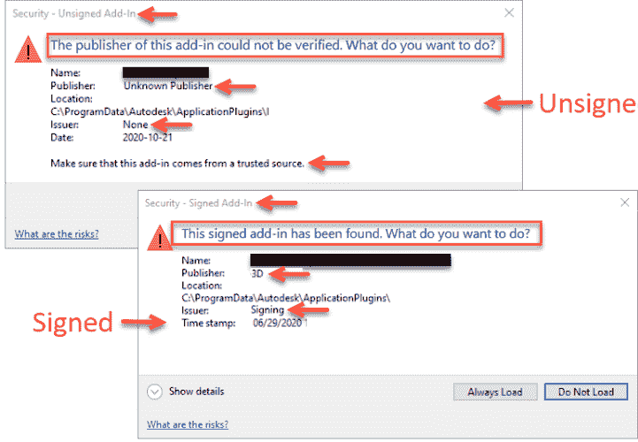

*图 9.6 – 未签名和已签名插件*

如果插件未签名，我们应检查开发商是否是一家受信任的公司。

## 删除 Revit 插件

插件会减慢 Revit 的启动速度，但这种减慢是微不足道的，因此我们无需担心。

另一方面，插件可能会与其他插件冲突或影响 Revit 中的特定功能，从而减慢速度并可能导致项目崩溃。

如果您遇到问题，可以从 Windows | 控制面板 中删除插件并在没有该插件的情况下测试 Revit：

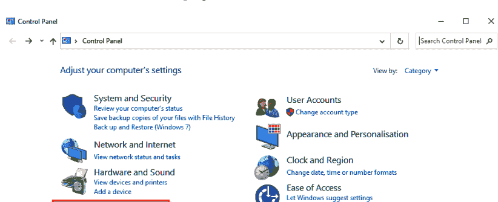

*图 9.7 – Windows 控制面板中删除插件的选项*

如果插件删除不成功，或插件未出现在待删除列表中，我们需要手动卸载插件。

手动删除插件可能具有挑战性，因为您需要在 C:\ 硬盘的多个位置找到它们。

我们可以在以下路径找到已安装的 Revit 插件：

- C:\ProgramData\Autodesk\Revit\Addins\
- C:\Users\%Username%\AppData\Roaming\Autodesk\Revit\Addins\
- C:\ProgramData\Autodesk\ApplicationPlugins
- C:\Program Files\Autodesk\Revit 2021\AddIns

> **注意**
> 您可能需要根据 Revit 版本选择文件夹。

一旦找到所需的插件，我们可以选择并删除文件以从 Revit 中移除。

如果您希望在没有插件的情况下测试 Revit，可以将插件文件移动到另一个文件夹并重新启动 Revit。测试后，您可以将插件移回同一文件夹。

> **提示**
> 使用 Stantec 提供的免费插件来禁用 Revit 插件。

Stantec 提供了一个 *很棒的、免费的应用*，可快速启用和禁用 Revit 插件。

我们可以在以下链接找到下载和说明：

```
https://bit.ly/3qDb9Ii
```

二维码如下：


该应用将允许您选择多个插件以启用或禁用它们：

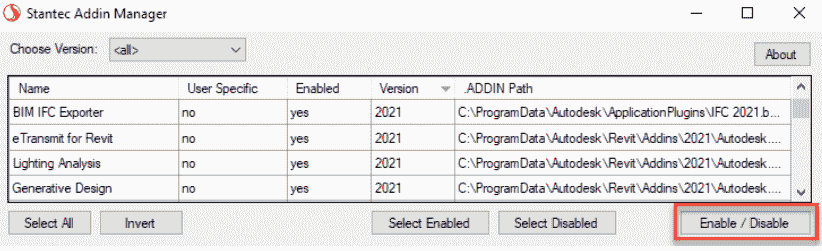

*图 9.8 – Stantec 免费应用以启用和禁用插件*

## 创建 Revit 插件

Autodesk 允许用户创建 Revit 插件。如果您的组织中有精通 C# 和 VB.NET 编程的人员，他们可以访问 Revit 应用程序编程接口 (API) 来根据您的需求创建 Revit 插件。

我们可以在网上找到多个资源，但以下链接是 Autodesk 关于如何创建第一个 Revit 插件的教程：

```
https://autode.sk/3aqYcvC
```

二维码如下：


总之，我们已经学习了管理 Revit 插件的流程。在下一节中，我们将学习提高生产力、可视化和分析的最佳 Revit 插件。

## Revit 插件

Autodesk 应用商店中有许多 Revit 插件，我们将重点介绍一些最佳插件，以提高在 Revit 中工作时的生产力并创建新的工作流程。

我们将插件分为两个类别：

- 生产力
- 可视化

## 生产力插件

我们将对每个插件进行简短描述，以解释它如何使您在 Revit 中的日常活动受益。插件来自 Autodesk 应用商店和开发商。我们建议您下载插件进行测试和进一步学习：

- **DiRoots 插件：** DiRoots 提供了一系列优秀的免费 Revit 插件，并且可以根据您的需求创建自定义插件。*ProSheets* 插件可以按正确的命名约定批量打印 PDF 文件。

  插件链接如下： https://bit.ly/3pB88Xp：

  

  ProSheets

  免费 🎁 新更新

  轻松将视图/图纸导出为 PDF、DWG、DGN、DWF、NWC、IFC 和 IMG（JPEG、PNG、TIFF 等）。

  *图 9.9 – 来自 DiRoots 的 Revit 插件*

- **RTV Tools**：RTV Tools 有一个名为 *RTV Xporter* 的插件，可按正确的命名约定批量打印 PDF 文件。此工具在使用 Adobe Acrobat DC 和 PDF Creator 的 PDF 驱动程序时效果更好。

  插件链接如下： https://bit.ly/3dsI1jb。

- **Xrev Transmit**：Xrev Transmit 可以同时打印和导出多种格式，包括 DWF、DWG、DGN、DXF 和 PDF。

  插件链接如下： https://bit.ly/2MbCFxB。

- **Bonus Tools**：Bonus Tools 是同一产品中超过 140 个 Revit 插件的集合，对于在 Revit 中节省日常活动时间非常有用。我们可以复制带视图的图纸、列出就地族、在发布文件前删除视图和图纸等等。

  产品链接如下： https://bit.ly/2M7kU2g。

  各插件描述链接如下： https://bit.ly/3brnrwL。

- **pyRevit**：pyRevit 是一个出色的 Revit 插件集合，我们可以在其中制作图案、创建多张图纸、管理注释、跨项目复制图纸并使用许多其他功能。它还使您能够创建 Revit 插件并在组织内共享它们。

  下载链接如下： https://bit.ly/3bo6vYe。

  核心插件的 YouTube 链接如下： https://bit.ly/2NsLd3z。

- **RushForth Tools：** RushForth Tools 是项目设置、控制参数、将 Excel 表导入 Revit 等功能的插件集合。

  插件链接如下： `https://bit.ly/2NMWOdy`。

- **AGACAD：** AGACAD 提供多个免费和付费插件，以提高预制设计、木材和金属建筑设计的生产力。

  BIM 解决方案链接如下： `https://bit.ly/2NQE3pW`。

  Revit 工具链接如下： `https://bit.ly/37C1HgR`。

- **Ideate BIMLink：** Ideate BIMLink 使 Revit 用户能够以速度和准确性从 BIM 模型导出和导入大量数据到 Excel。Ideate 网站还提供其他插件以提高生产力。

  网站链接如下： `https://bit.ly/2MdsZCI`。

- **ArchSmarter Toolbox：** ArchSmarter Toolbox 是一个免费的 Revit 插件，具有多种功能，例如删除视图、对齐视图、替换字体、批量重命名和制作图纸。

  插件链接如下： `https://bit.ly/2M9SXXE`。

- **COINS Auto-Section Box：** COINS Auto-Section Box 工具使您能够在所选元素周围创建 Revit 剖面框，并并排比较平面和 3D 视图。它是一款免费工具，在设计 MEP 服务时提供出色的流程。

  工具链接如下： `https://bit.ly/3ujG66w`。

- **CAD Link Opener：** CAD Link Opener 是一个免费插件，可在从 Revit 打开 DWG 链接时节省时间。用户选择 DWG 链接，它将使用 AutoCAD 打开。

  插件链接如下： `https://bit.ly/3bvf4AF`。

- **Isolate Warnings：** Isolate Warnings 是一个免费插件，用于创建 3D 视图以隔离并突出显示具有警告的模型元素。

  工具链接如下： `https://bit.ly/3k9W3Y7`。

- **Layers Manager：** Layers Manager 是一个免费插件，可自动创建系统族的共享参数，我们可以使用它来标记并显示有关材料和厚度的信息。

  插件链接如下： `https://bit.ly/2NhCxgB`。

  如何使用 Layers Manager 的链接如下： `https://bit.ly/2ZyqnSU`。


- **Align：**Align 是一款免费插件，可通过对齐和整理模型元素（包括注释、标签和文本）来节省时间。它对于 MEP 模型元素和注释非常有用：

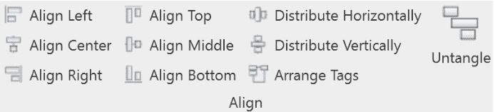

图 9.10 – Align Revit 插件

插件链接如下：`https://bit.ly/37BXGTj`。

- **Room Finishing：**Room Finishing 是一款免费插件，可自动沿任意建筑房间的四周创建踢脚线或完成地面。

插件链接如下：`https://bit.ly/3aFd4Xh`。

- **Guardian：**Guardian 采用了一种有趣的理念：在将 Revit 数据问题引入模型之前，尝试先解决这些问题。它是一款主动式工具，用于识别传入的属性；之后，我们可以将任意属性映射到现有项目属性中，或将其移除。

工具链接如下：`https://bit.ly/3dzUaTh`。

- **Master Purger：**Master Purger 是一款免费插件，可移除未放置的视图、图例、明细表、未放置的房间、未放置的空间、未使用的裁剪框以及导入或链接的 CAD 文件。

插件链接如下：`https://bit.ly/2NhFkGB`。

- **Kinship：**Kinship 是一款出色的 Revit 族管理插件。它可以轻松维护族库，并能自动将 Revit 族上传到云端，从而快速、便捷地在多个项目之间共享族。

插件链接如下：`https://kinship.io`。

- **Autodesk Navisworks NWC Export Utility：**Autodesk Navisworks NWC Export Utility 是一款免费插件，可将 NWC 文件从 Revit 导出，以便在 Navisworks 中进行碰撞检测。

插件链接如下：`https://bit.ly/3yhLKIg`。

- **IFC Exporter：**Revit 原生支持导出 IFC 文件，但 IFC Exporter 插件提供了更多功能。每个 Revit 版本都有对应的 IFC Exporter 版本，您可以在 Revit Autodesk App Store 中搜索这些版本。

- **Autodesk BIM Interoperability Tools：**Autodesk BIM Interoperability Tools 是一组免费的插件，可帮助设计师为模型元素应用分类（例如 Uniclass 2015）、从 Revit 导出 COBie，以及执行其他操作：

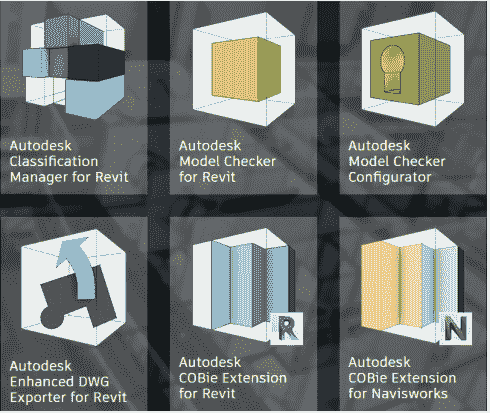

图 9.11 – Autodesk BIM Interoperability Tools

工具链接如下：`https://bit.ly/2MdR6Be.`

- **BEAM：**BEAM 是一款支持 Rhino 与 Revit 互操作的插件。无需掌握大量编程知识，我们就可以在两个平台之间移动几何图形：

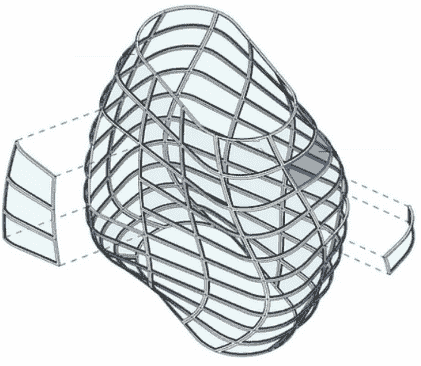

图 9.12 – 用于实现 Rhino 与 Revit 互操作的 BEAM 插件

插件链接如下：https://bit.ly/3umSEtJ。

- **iSync**：iSync 是一款可自动放弃借用、保存和同步 Revit 模型的插件。对于使用 Revit 的大型团队而言，这一过程非常有益，因为它支持自动放弃借用，而无需执行同步操作。

插件链接如下：https://bit.ly/3skZKgN。

- **Family Editor Interface：**Family Editor Interface 是一款免费插件，可通过交互方式创建或编辑族内容。

插件链接如下：https://bit.ly/2NQtD9t。

- **Scan Terrain：**Scan Terrain 可根据激光扫描的点云创建 Revit 地形表面。

插件链接如下：https://bit.ly/37Cupy9。

- **Export Schedule：**Export Schedule 是一款免费插件，可将 Revit 明细表导出为 Excel 文件，并保留正确的字体样式、列宽、合并的列标题和背景颜色。

插件链接如下：https://bit.ly/3shIlFM。

- **TransferSingle：**TransferSingle 是一款支持在多个项目之间为选定对象传递标准的插件。我们可以复制选定的图元、视图、打印设置、剖面框、工作集和图例。

插件链接如下：https://bit.ly/3bpGpUB。

- **External Access Links Manager：**External Access Links Manager 是一款免费插件，用户无需打开项目文件并重新设置链接路径，即可查看其中的 Revit 链接。

插件链接如下：https://bit.ly/3dAKLeu。

- **Unhide Elements in View：**Unhide Elements in View 是一款免费插件，可快速识别当前视图中所有隐藏的图元并取消隐藏。

插件链接如下：https://bit.ly/3aEnnup。

- **Twinmotion：**Twinmotion 是一款出色的软件，可用于制作高质量图像、漫游视频、全景图和 360° VR 体验。Revit 插件会将模型导出到 Twinmotion 中，在那里我们可以应用材质并改进渲染效果。

插件链接如下：`https://bit.ly/2OX26UB`。

Twinmotion 由 Unreal Engine 提供支持。对于高级用户而言，Unreal Engine 提供了开发尖端体验的多种可能性。

- **Lumion：**Lumion 可以更快地渲染视频和全景图。它易于使用，Revit 插件会将模型导出到 Lumion 中，在那里我们可以应用材质、添加人物并增强可视化效果。

插件链接如下：`https://lumion.com`。

- **V-Ray for Revit：**V-Ray for Revit 提供实时可视化功能，并与 Revit 实现无缝集成。V-Ray 支持使用两种渲染引擎，我们可以选择 GPU、CPU 或混合渲染流程。我们可以使用多种自然光和人工照明类型来模拟准确的照明效果。

工具链接如下：`https://bit.ly/2ZDk0xu`。

- **VIM：**VIM 采用了令人兴奋的技术，可在非常大型的 BIM 模型中快速导航，例如体育场馆和复杂的建筑塔楼，并查看其中的所有结构和 MEP 服务。它还提供云端多用户协作功能。

工具链接如下：`https://www.vimaec.com`。

- **AUGmentecture：**AUGmentecture 是一款插件，可在移动设备上以**增强现实（AR）**格式查看 3D 模型。

插件链接如下：`https://bit.ly/2NQAkIA`。

- **Shapespark：**Shapespark 采用创新的在线漫游流程，有助于进行设计审批。它是一款出色的沟通和营销工具，可创建交互式应用程序，客户还可以通过 Web 浏览器更改材质。

它还提供了在 Web 浏览器中进行**3D 会议**的功能，主要包括：

1. 共享屏幕，并在墙面屏幕上播放视频。
2. 更改地板材质或访问 Web 链接。
3. 用户之间通过视频和音频进行互动。
4. 显示您的摄像头画面：

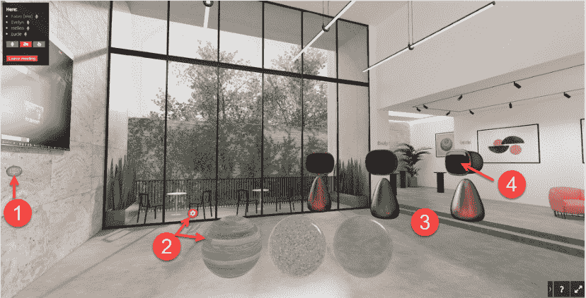

图 9.14 – Shapespark 3D 会议

Shapespark 还可以创建交互式在线应用程序，用户或客户可以轻松浏览房间，以进行设计审查或审批，也可以将其用作营销工具。

我们可以通过以下链接，在 Web 浏览器或手机上查看用于设计审批的交互式演示：

```
https://bit.ly/3dUBNss
```

二维码如下：


右上方有一个菜单，可用于选择不同区域；我们可以使用鼠标或手机上的手指在房间中导航：

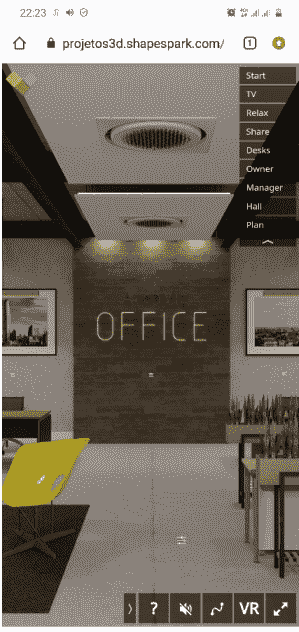

图 9.15 – Shapespark 在移动手机上的交互式选项

单击相应符号即可更改场景材质：

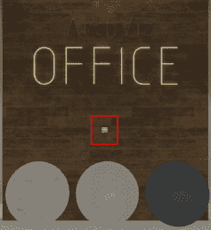

图 9.16 – 在 Shapespark 中更改材质

演示文稿署名如下：www.vazproducoes.com。

如需进一步了解 Shapespark，请参阅公司网站：

https://www.shapespark.com

总而言之，我们了解了多种管理 Revit 插件的流程，以避免出现问题并提升性能。我们还列出了一些最实用的 Revit 插件，用于提高日常任务和可视化工作的生产效率。

## 总结

在本章中，我们了解到 Revit 插件仅适用于完整版本的 Revit，并且易于在日常任务中实施和使用。

我们介绍了如何管理 Revit 插件，以完成以下任务：

- 通过 Revit Autodesk App Store 访问插件
- 安装流程
- 检查插件的安全性
- 移除插件
- 为 Revit 测试启用和禁用插件
- 了解插件的创建方式

插件通过新增功能增强了 Revit 的能力，可以节省大量时间。

我们还了解了一些出色的插件，它们被广泛用于提高生产效率和性能、实现 BIM 模型可视化，或创建精彩的渲染图和视频。我们可以从 Revit Autodesk App Store 和开发者网站下载大量免费和付费插件。

下一章将进一步介绍如何提升 Revit 的性能。


