## 10 提升性能

承接自 *第1章 Revit 生产力简介* 以来我们所描述的内容，我们希望以同样的主题结束这段旅程：通过分享在 BIM 项目中使用 Revit 工作时的最佳实践，来提升生产力和性能。

在所有章节提供的综合知识基础上，我们现在完成了我们的目标——改变你在 Revit 中执行日常任务时的生产力。

本章将提供额外的最佳实践，以提升 Revit 的性能并提高你在执行日常任务时的生产力。

我们将解释管理 CAD 导入以及视图和图纸的最佳实践，以及其他提升生产力的任务。

本章还将提供有关 Revit 内容管理的信息以及优化 Revit 性能的额外任务，包括检查警告和审核 Revit 文件。

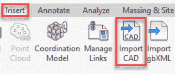

**Tip**

我们可能需要 Revit 插件或 Dynamo 脚本来查找导入的 CAD 文件。

应使用以下建议以避免降低 Revit 中的性能：

- 在工作共享环境中工作时，确保所有导入/链接的 CAD 文件都放置在正确的 workset 中。
- 应避免导入 CAD 文件。
- 链接 CAD 文件应限制在最低限度。
- 在导入或链接 CAD 文件之前，确保其已清理并清除，并且仅显示项目所需的內容。
- 不建议使用大于 10 MB 的 CAD 文件。
- 确保你保留真正需要的链接 CAD 文件。
- 确保所有文件都有正确的链接（找不到的链接会使打开、保存和同步文件花费更长时间）。在“管理链接”中，我们可以找到链接状态。
- 在使用导入和/或链接的 CAD 文件时，务必在 AutoCAD 中使用 Zoom Extents，以确保我们没有模型远处的元素（如果发生这种情况，应编辑 CAD 文件以删除不必要的元素）。
- 在导入和/或链接 CAD 文件之前，请确保文件中的所有对象都使用 Linetype 和 Colour 作为 ByLayer，这样可以从 Revit 编辑这些属性。
- 根据项目情况，我们建议创建一个 Revit 模型来链接所有需要的 CAD 文件。
- 我们绝不应在 Revit 项目中炸开 DWG 文件。
- 当在 CAD 软件中以 **Index Colours** 设置 CAD 元素时，在导入过程中定义线宽是可能的。**Line Weight** 设置应在导入和/或链接之前通过点击 **Import Line Weights** 选项进行定义：

  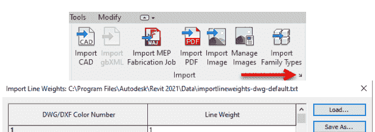

- 链接 DWG 时，尽可能使用 **Current view only**。将 DWG 导入 Revit 时，可以将其作为 3D 元素（在 3D 中可见）或 2D 元素（导入或链接时仅在当前视图中可见）。通过选择此选项，链接文件将被展平到当前视图，并且对整体模型的影响会更小：

  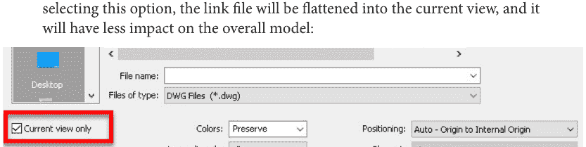

- CAD 导入用于创建构件细节的 Detail Components。当创建 **Detail Items** 族时，不可能链接 CAD 文件，我们只能导入 CAD 文件。如前所述，我们可以在导入 DWG 文件之前控制线宽：

  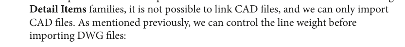

### 关闭隐藏窗口

打开太多视图会影响性能。建议保持打开的视图数量最少。可以通过访问视图选项卡并点击 **Close Inactive** 来关闭视图：

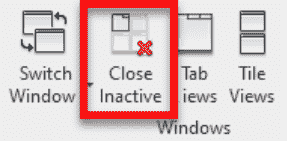

### 删除不必要的视图和图纸

通过删除不必要的视图和图纸，将改善文件大小和性能。

如果 Revit 文件有太多图纸且整体文件大小无法减小，我们可能需要将模型拆分为两个卷，并将模型上的图纸数量分开以减小文件大小。

### 远裁剪剖面和立面

在处理剖面或立面时，**Far Clipping** 区域应根据需要最小化。这将提高性能，因为视图中被其他元素隐藏的几何图形在重新生成视图时不会受到影响。

此选项可以通过两种不同的方式控制：

- 在楼层平面图上进行剖面或立面时，通过控制剖面或立面符号被选中时的深度：

  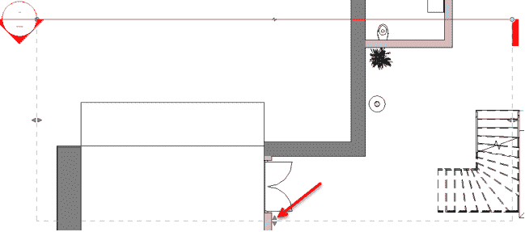

- 在剖面视图中，我们可以访问属性，更改 Far Clipping 设置，并定义精确的 Far Clip Offset 值：

  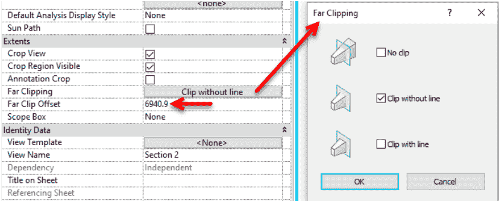

### 在楼层平面图上查看范围

与 Far Clipping 类似，在楼层平面图上有一个参数可以控制视图深度：View Range。

View Range 控制视图深度，影响将显示多少元素，从而影响性能：

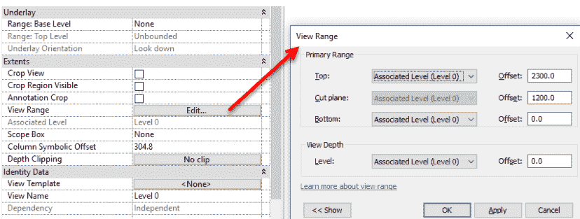

通过点击 << Show 按钮，可以查看所有可配置的参数：

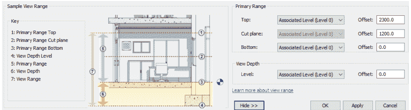

### 3D 视图中的剖面框

在 3D 视图中工作时，剖面框将减少显示区域，从而提高性能。

要激活它，在属性调色板中勾选 Section Box 参数，剖面框将变得可见：

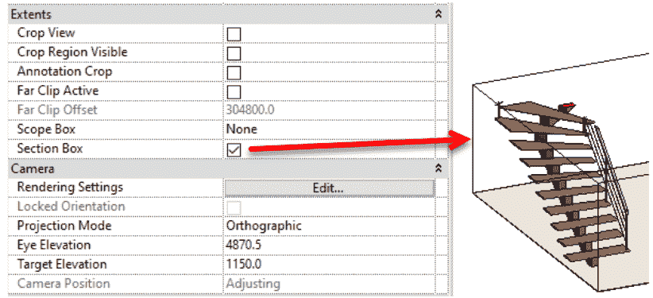

选择后，可以使用箭头更改剖面框形状以裁剪不需要的部分：

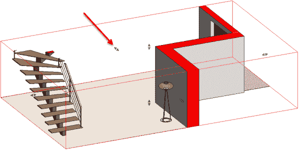

> **Tip**
>
> 如果 **Section Box** 不可见，请确保该类别是可见的。

一种快速创建与特定视图对齐的剖面框的方法是右键单击视图立方体，并在 **Orient to View** 下选择要对齐的视图并制作 3D 视图：

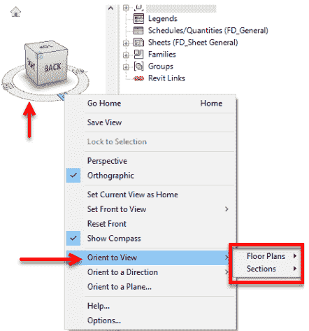

选择特定视图后，我们需要旋转 3D 视图以可视化剖面框。

另一种快速在特定区域或对象上创建剖面框的方法是使用 **Selection Box** 工具：

1. 进入一个视图并选择要在 3D 视图中看到的元素。
2. 在 **Modify** 选项卡中，点击 **Selection Box**（快捷键 BX）：

   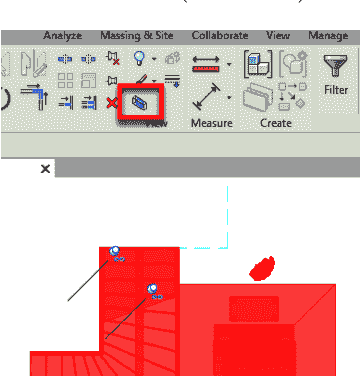

3. Revit 创建一个 3D 视图，其中选中的元素位于剖面框中：

   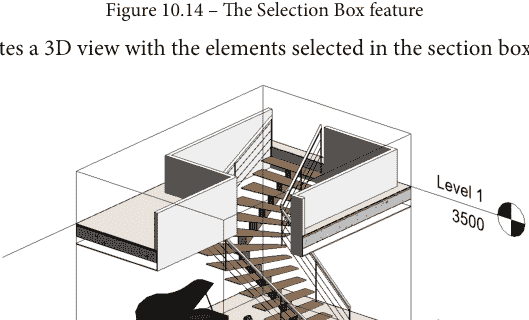

### 开启/关闭不需要的类别

在特定视图中关闭不需要的类别将提高在打开或进行任何更新时重新生成视图的速度。建议访问 **Visibility/Graphics Overrides** 参数（快捷键 VV 或 VG）并将其切换为关闭：

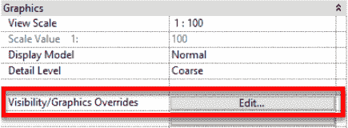

当我们需要控制多个视图的相同可见性和图形时，建议使用视图模板。

视图模板可以通过访问 **Properties** 调色板并更改 **View Template** 设置来分配给特定视图：

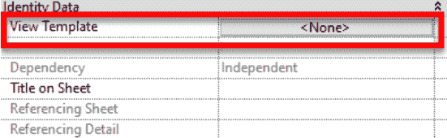

> **Tip**
>
> 视图模板可以通过访问 **View** 选项卡 | **View Templates** 来控制。

不建议在视图中隐藏单个元素。通过这种方式进行操作将很难找到这些元素。用户应始终在视图模板中使用筛选器来隐藏它们，如果可能的话。

当我们分配了视图模板时，可以使用 **Temporary View Properties** 选项，因为这将允许用户在不移除已分配的视图模板的情况下更改可见性/图形设置，然后将其恢复到之前定义的状态。

让我们按以下步骤来更好地理解其工作原理：

- 1. 打开一个已指定视图模板的视图。
- 2. 在“视图控制”栏中，单击“临时视图属性”，然后选择“启用临时视图属性”：
- 3. 视图周围将出现一个紫色矩形框，表示“临时视图属性”已启用：
- 4. 根据需要访问所有视图属性。
- 5. 如需恢复原状，请在“临时视图属性”选项下，单击“恢复视图属性”。

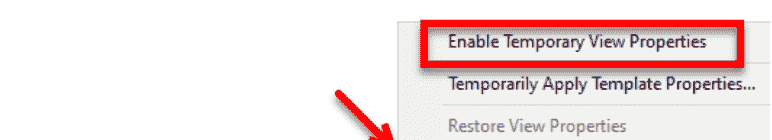

图 10.18 – 启用临时视图属性

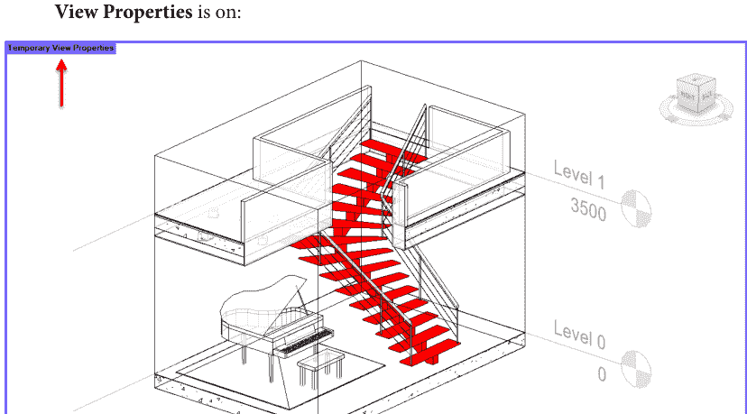

图 10.19 – 临时视图属性已启用

## 图形显示选项

建模时，为视图指定的详细程度会影响性能，因为 Revit 可能需要显示/隐藏更多细节以呈现视图，从而需要更多资源来重新生成任何更改或更新：

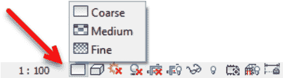

图 10.20 – 指定给视图的详细程度

建议在建模时使用“粗略”视图。

提示
此设置可能已指定给某个视图模板，在这种情况下，更改选项将被禁用。

阴影设置也应考虑同样的原则；如果不需要，应将其关闭：

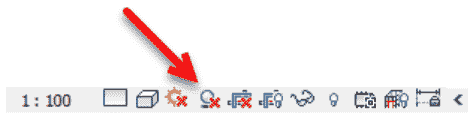

图 10.21 – 打开/关闭阴影

与“视图显示设置”相关的另一个重要设置是指定的视觉样式，越简单越好：

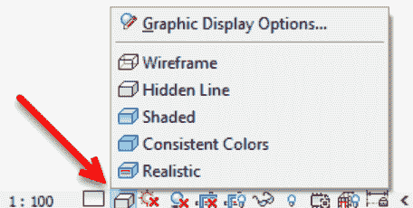

图 10.22 – 视觉样式定义

## 光栅图像

光栅图像会影响 Revit 的性能，我们可以通过两种方式找到它们：

- - 在“插入”选项卡中，使用“链接图像”或“导入图像”选项：

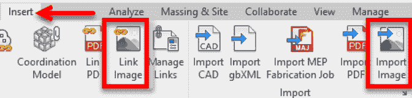

图 10.23 – 插入或链接光栅图像

- - 在 Revit 中渲染视图并将视图保存到浏览器中时：

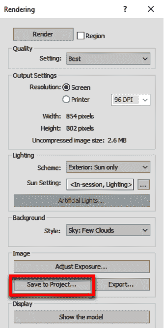

图 10.24 – 将渲染结果以图像形式保存到项目浏览器

无论使用上述哪种方式导入光栅图像，都应考虑以下建议：

- - 只保留所需的图像，删除其他图像。
- - 确保图像具有适中的分辨率（应考虑使用更小、更简化的图像）。

通过访问“插入”选项卡下的“管理链接”，可以控制链接的内容：

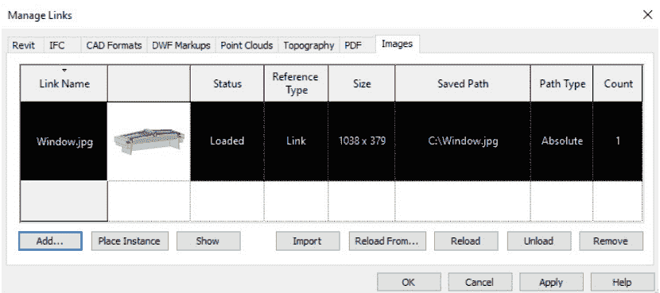

图 10.25 – 管理链接 – 图像

## 将启动视图设置为二维视图

打开模型时，建议将较简单的视图定义为启动画面，这样可以使打开过程更轻松、更快速。

启动视图可以在“管理”选项卡的“管理项目”下定义；单击“启动视图”：

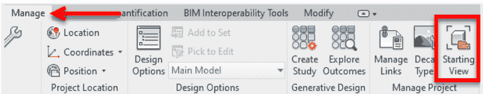

图 10.26 – 定义启动视图

Revit 将显示模型中所有可用视图的列表。选择为启动画面创建的二维视图，该视图包含有关项目的信息：

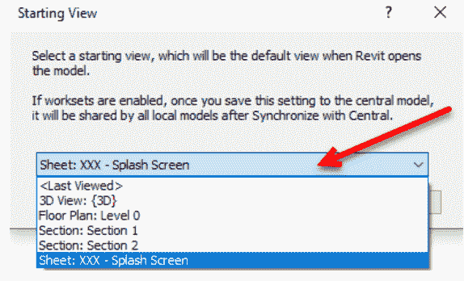

图 10.27 – 选择启动视图

建议使用一个可以显示相关项目信息的视图，例如：

- - 项目名称
- - 客户名称
- - 设计顾问名称
- - 设计专业
- - 项目信息管理员
- - 任务信息管理员
- - 合适的代码与说明

这将使所有用户都能了解项目的概况。

## 建模

在前几章中，我们已经了解了在 Revit 中提高工作效率和性能的许多方面。建模时，用户需要注意许多因素，我们重点强调了以下几个对性能和生产力影响最大的因素。

## 删除未使用的设计选项

在设计过程中，开发多个*设计选项*是相当常见的。这些设计选项可以位于特定区域、整个幕墙或其他重要的项目区域。

许多设计选项会影响 Revit 的性能，并使文件变慢。我们建议采取以下任务来避免性能下降：

- - 考虑使用单独的文件来设计不同的设计选项；如果该选项代表项目中的大片区域，这一点尤为重要。
- - 不同的设计选项可以放置在不同的工作集中。
- - 如果设计选项在项目中仍处于活动状态，请保留它们。
- - 与顾问交换模型时，请确保删除设计选项，或仅保留所需的选项。
- - 删除设计选项时，确保删除与该选项相关的所有视图。

作为良好实践，需要检查和管控设计选项。

## 清理

清理模型对于将文件大小降至最低至关重要。作为参考，单个模型的最大体积应约为 250 MB/300 MB。

运行清理命令后，Revit 将删除未使用的内容。要访问该命令，请执行以下步骤。

- 1. 在**管理**下，单击**清理未使用项**：

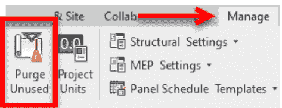

图 10.28 – 清理未使用项

- 2. 单击**全部不勾选**。

3. 在清理列表中，展开需要清理的类别，勾选需要删除的族和/或实例：

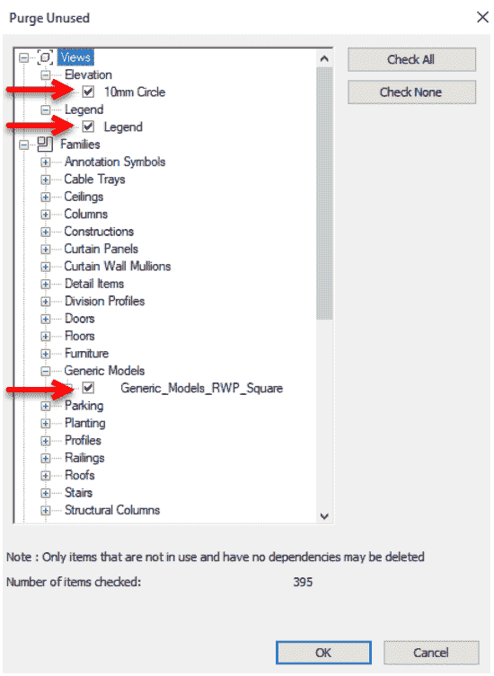

图 10.29 – 要删除的图元

4. 单击“确定”开始清理项目中的这些项目。

此命令可能需要执行多次才能完全清理项目。

## 模型线

模型线是出现在三维空间中的线，在所有视图中都可见。应避免使用这些线，因为它们可能被误用在图纸上。当需要这些线时，建议使用详图线（仅在当前视图中可见）。

如果模型线需要转换为详图线（反之亦然），Revit 提供了相应的工具。选择**模型线**后，在**修改**工具下，您会看到一个名为**转换线**的功能：

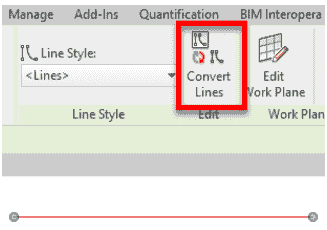

图 10.30 – 转换线

根据您选择的线，Revit 将在**模型线**和**详图线**之间切换。

总而言之，我们学习了 CAD 导入、视图和图纸管理的最佳实践，以及建模过程中提高性能的其他流程。

在下一节中，我们将学习与 Revit 内容创建相关的最佳实践。

## Revit 内容管理

在开发或使用族时，应考虑若干建议，以保持 Revit 模型体积较小并提高性能。

在*第 1 章“Revit 中的生产力简介”*中，我们提供了族创建的建议，但这里还有其他的建议需要强调。

虽然我们应该遵循这些建议，但在项目过程中有时我们并不能 100% 遵循。如果不是，我们应该以适度的方式使用它们。

## 第三方族

供应商提供的 Revit 族可能包含大量公式和许多几何细节。

较大的族文件以及项目中放置的多个实例将影响性能，并导致 Revit 变慢。

以下截图显示了一个包含许多公式和参数的 Revit 族：

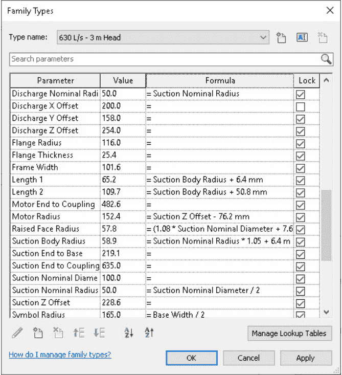

图 10.31 – 族中使用的公式

除了这个问题，它可能还导入了不同 CAD 格式且包含过多细节的内容，这些细节在特定项目阶段是不必要的，其中一些细节甚至在图纸中都不可见。

## 过度建模的族

这是一个普遍存在的问题，因为供应商开发的族带有过多的大多数设计阶段都用不到的细节，例如螺钉和螺栓。

以下截图显示了一个对大多数设计阶段来说包含不必要细节的族：

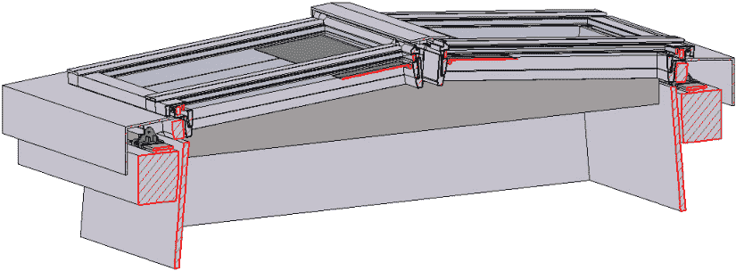

图 10.32 – 过度建模的天窗

通常，它们被过度建模，需要简化族，因为单个文件可能达到 5 MB、10 MB 甚至 50 MB（取决于公式、CAD 导入、详图绘制和嵌套族）。

回顾*第 1 章“Revit 中的生产力简介”*，Revit 族应遵循以下文件大小：

- - Revit 族文件大小为 250 KB 到 500 KB，表示文件大小合适。
- - Revit 族文件大小超过 1 MB（1,000 KB），应审查是否可能减小大小。
- - Revit 族文件大小超过 2 MB（2,000 KB），绝对应审查。
- - 嵌套族文件的大小往往更大，因此我们需要检查较大的族文件。不建议超过两级的嵌套族。

## 导入到族中的 CAD 格式

所有导入内容都应减少到最少，因为它们会直接影响性能。其中一些几何体可以使用网格或制造软件（如 **Inventor** 或 **SolidWorks**）创建（这些模型通常过度详细，因为它们包含制造所需的所有信息）。

## 避免复杂的形体建模

由“融合”“扫掠”和“融合扫掠”命令创建的复杂几何图形可能会影响项目性能和族文件大小。如有可能，请适度使用它们。

## 定义图元可见性设置

创建族时，始终建议在几何图形上定义可见性设置，避免族在特定视图中被过度建模。这可以通过指定“粗略”“中等”和“精细”三级细节来实现：

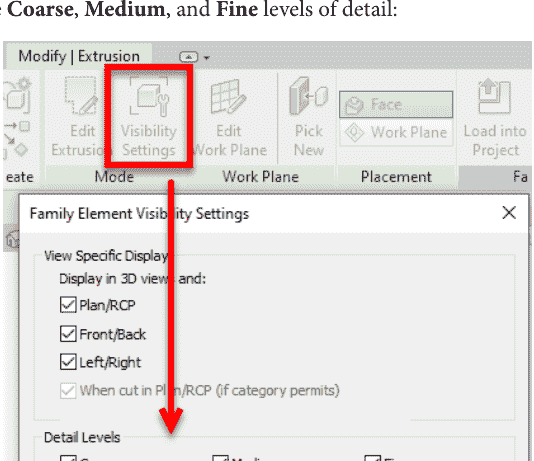

在此窗口中，还可以在任意三维视图类型上设置所有这些细节级别：平面视图、RCP（天花板反射平面）、立面视图、剖面视图和三维视图。

## 族的弯曲测试

在开发 Revit 族时，强烈建议在将族载入项目之前始终进行弯曲测试。通过这种方式，用户将确保添加到几何图形中的所有参数都能按预期行为运行，并且不会导致族破坏：

完成族的弯曲测试后，用户可以将预览可见性设置为关闭，或者直接保存并关闭族。

总而言之，我们了解了 Revit 内容管理的最佳实践，以及通过保持文件较小来维持 Revit 性能的基本要点。

在下一节中，我们将学习自定义 Revit 快捷键以及其他优化 Revit 性能的主题。

## 优化 Revit 性能

尽管项目变得越来越复杂，但技术的进步速度并未同步跟上，因此我们必须采取相应措施来提升性能。

在本节中，我们将学习优化 Revit 性能的其他方面，包括以下内容：

- 键盘快捷键
- 警告
- 压缩 Revit 文件
- 审计 Revit 文件
- 禁用 Revit 插件

## 键盘快捷键

使用键盘快捷键可以加快用户的工作效率，因为可以为最常用的命令自定义特定的快捷键。同一个工具可以有多个快捷键。

## 添加快捷键

让我们通过以下步骤了解如何创建新快捷键：

1. 在“视图”选项卡的“用户界面”下，单击“键盘快捷键”：

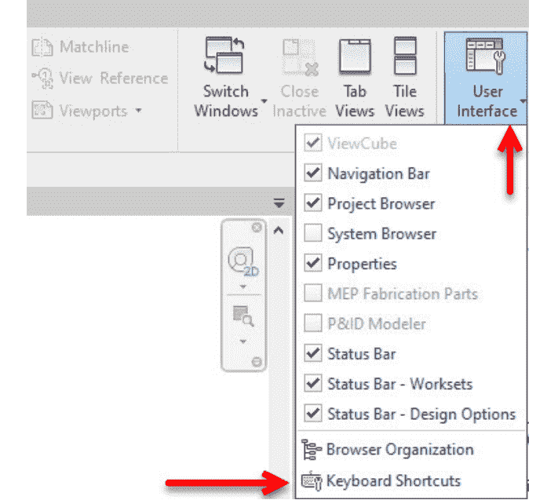

> **提示**
> 
> 可以通过输入 KS 来访问**键盘快捷键**窗口。

2. 使用**搜索**栏和**过滤器**下拉菜单，选择要为其指定新快捷键的命令。

3. 在“按新键”下，添加快捷键并单击“指定”：

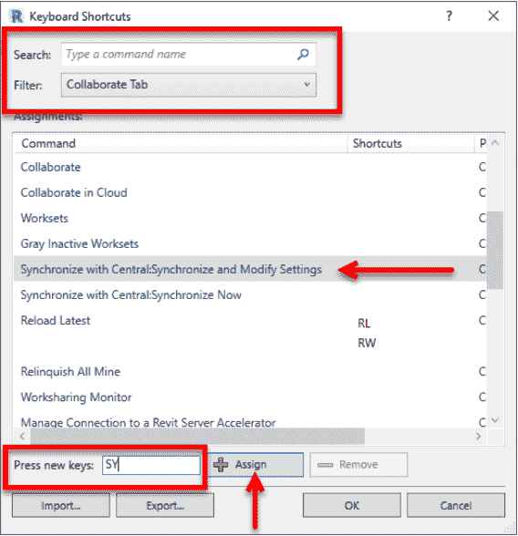

图 10.37 – 键盘快捷键指定

4. 指定完所有需要的快捷键后，单击“确定”。

当为特定工具指定快捷键后，将鼠标悬停在功能区的每个工具上时，会弹出一个工具提示，显示已指定的快捷键：

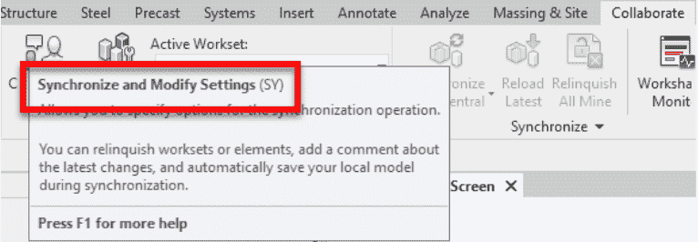

图 10.38 – 键盘快捷键工具提示

## 移除快捷键

移除快捷键的过程与此前介绍的类似。要移除任何快捷键，请执行以下步骤：

1. 选择要移除的快捷键。
2. 选择**移除**：

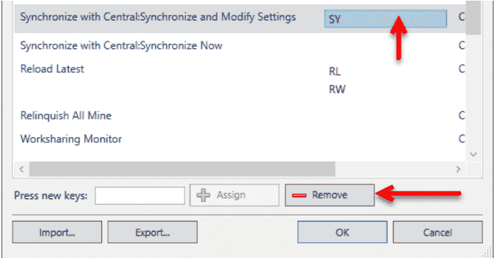

图 10.39 – 移除键盘快捷键

## 导入/导出快捷键

当为工具指定不同的快捷键时，建议导出这些设置，以确保它们可以在任何其他计算机上使用，甚至可以在未来版本的 Revit 中导入。

在上一个截图中，我们可以单击**导入...**或**导出...**按钮，导入或导出包含所有快捷键的 .xml 文件。

创建快捷键后，.xml 文件将保存在 C:\ProgramData\Autodesk\RVT 2021\UserDataCache 文件夹下。

## 警告

在 Revit 中工作时，常见的现象是出现多种类型的 Revit 警告。其中一些可以忽略，但另一些更可能导致性能问题，应尽可能修复。

一个好的策略是按优先级对 Revit 警告进行分类，并确定应首先解决哪些警告。

我们可以按以下术语对 Revit 警告进行分类：

- 高优先级
- 中优先级
- 低优先级

## 高优先级

这将包括以下警告：

- 在同一位置存在相同实例，这意味着我们有族相互重叠。
- 一个或多个梯段的实际梯段宽度小于楼梯类型中指定的最小梯段宽度。
- 楼梯的实际踏板深度小于楼梯类型中指定的最小踏板深度。
- 多个房间位于同一封闭区域内。
- 图元具有重复的类型标记值。
- 导入的几何图形延伸超过 20 英里（33 公里）。

## 中优先级

这将包括以下警告：

- 高亮显示的墙相互重叠。当 Revit 查找房间边界时，其中一堵墙可能会被忽略。
- 插入与连接的墙冲突。
- 房间未处于正确封闭的区域中。
- 房间标记位于其房间之外。

## 低优先级

这将包括以下警告：

- 墙和房间分隔线重叠。
- 房间分隔线相互重叠。
- 草图线略微偏离轴线，可能会导致不精确。
- 线略微偏离轴线，可能会导致不精确。
- 高亮显示的图元已连接但未相交。

警告与模型开发过程中可能发生的某些操作或建模问题相关。例如，如果在现有房间分隔线上方再建模一条，Revit 会弹出警告通知用户：

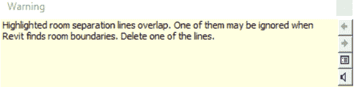

图 10.40 – Revit 警告

要访问模型中的所有警告，请按照以下步骤操作：

1. 在**管理**选项卡上，单击**警告**：

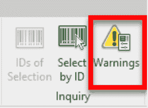

图 10.41 – 保存在模型中的警告

2. 展开警告，可以确认模型中有多少警告：

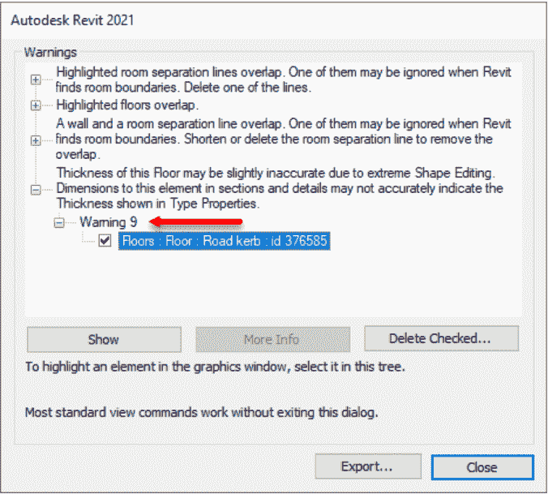

图 10.42 – 保存在模型中的警告数量

3. 选择警告后，可以选择以下选项：

- **显示**：允许 Revit 打开视图以显示与警告相关的问题
- **更多信息**：允许用户获取有关警告的更多信息
- **删除已勾选项...**：允许用户删除与问题相关的所选图元
- **导出...**：使用户能够将所有警告列表导出到 Excel 电子表格

通过访问“警告”窗口，除了删除其中一个警告图元外，无法自动修复警告。为此，用户需要关闭窗口，然后根据要求手动解决警告。

4. 单击“关闭”关闭窗口。

在警告对话框中，我们可以找到可用于查找警告的对象 ID：

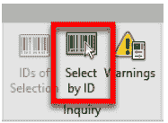

图 10.43 – 按 ID 选择图元

应定期检查并修复警告。

## 压缩 Revit 文件

保存 Revit 模型时，可以压缩文件以减小大小，因为这会重新写入整个文件。它会尝试删除旧的过时部分，从而减小文件大小。

请按照以下步骤压缩文件：

1. 转到“文件”并选择“另存为”。
2. 在“另存为”下，单击“项目”：

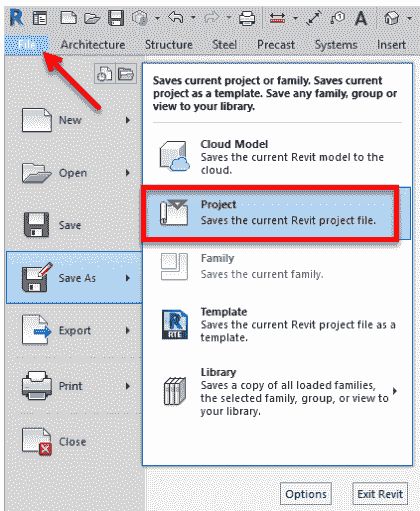

图 10.44 – 保存 Revit 项目

3. 单击**选项...**。
4. 在**文件保存选项**下，勾选**压缩文件**：

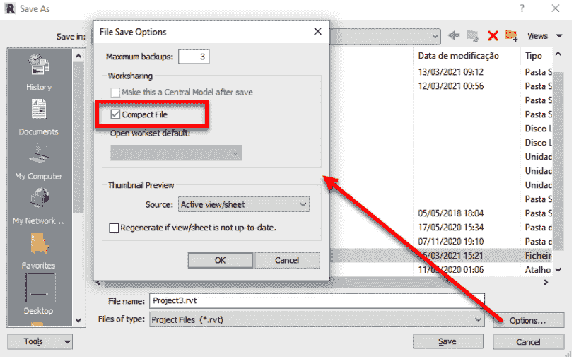

图 10.45 – 压缩文件选项

5. 单击**确定**。
6. 单击**保存**。

如果我们在工作共享环境中（中心文件和本地文件）处理 Revit 文件，也可以压缩 Revit 文件。在同步过程中，我们可以压缩文件：

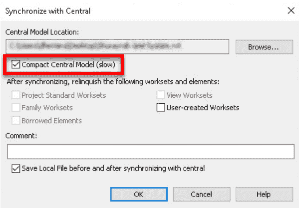

图 10.46 – 压缩文件选项

## 审计 Revit 文件

审计功能可以维护 Revit 模型的健康状况，因为它会尝试修复模型中的某些问题。它将扫描、检测并修复模型中损坏的图元或信息。此审计过程也可用于族。

我们建议每周对模型进行一次审计。如果我们将 Revit 模型升级到新版本的 Revit，则应运行审计过程。

审计过程是静默的，用户不会获得有关已执行操作的任何反馈或报告。要启动该过程，请按照以下步骤操作：

1. 确保需要审计的模型已关闭。

> **提示**
> 如果模型位于工作共享环境中，建议指示所有用户关闭该模型。

2. 转到“文件”并单击“打开”：

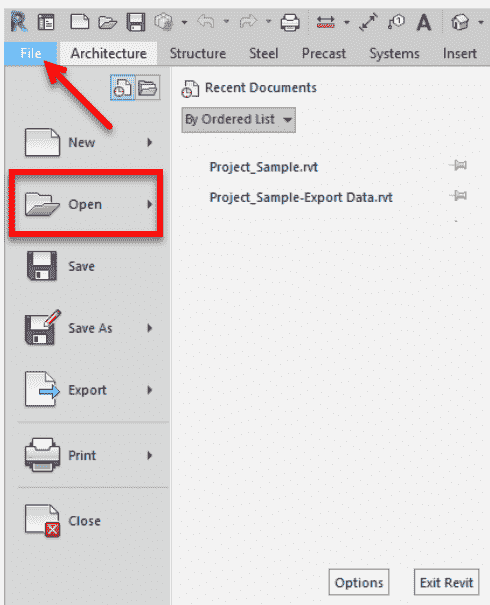

图 10.47 – 打开 Revit 模型

3. 选择要打开的文件。

4. 勾选“审核”选项。系统会弹出一条审核警告，提示我们该操作可能需要很长时间：

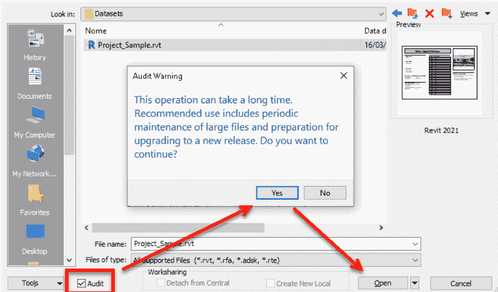

图 10.48 – 审核 Revit 模型

5. 单击**“是”**以确认并继续。
6. 单击**“打开”**。

Revit 开始打开模型，根据文件的大小和复杂程度，此过程可能需要一些时间。

## 在 Revit 中禁用插件

在完成所有用于提升性能的操作后，值得检查一下 Revit 插件是否影响了性能。

在第 9 章*使用插件提高工作效率*中，我们解释了如何管理 Revit 插件，以便出于测试目的安装和卸载它们。

如果需要禁用插件，请参阅第 9 章*使用插件提高工作效率*，我们在该章中介绍了手动或使用插件停用它们的过程。

建议只使用由 Autodesk 认证的公司开发的插件。

## BIM 360 最佳实践

BIM 360 是由 Autodesk 开发的基于云的设计协作平台，允许项目团队和所有利益相关者使用通用平台开发项目。

BIM 360 是 Autodesk Construction Cloud 的一部分，包含多个具有不同功能的模块。Autodesk Construction Cloud 是一系列应用程序的集合，可在所有设计、施工和运营阶段实现卓越的协作与协调。

它集成了以下七个不同的模块：

- **文档管理**：允许在实时且可访问的平台上共享、查看和管理所有施工图纸、文档和模型，确保所有文档始终可供所有设计团队访问并保持更新。
- **施工管理**：允许捕获和共享施工现场的情况，并与项目中的所有利益相关者一起查看和管理这些情况。
- **协作**：允许用户使用集成的问题管理工作流自动执行冲突检测流程，并与所有团队成员共享所有问题。
- **协作专业版**（以前称为**设计**）：允许用户直接使用存储在云端（*文档管理*）中的 Revit（云协作）、Civil 3D 和 Plant 3D 模型，并通过创建可供项目中任何利益相关者接受的交换包来自动共享这些模型。
- **布局**：允许用户共享可在施工现场使用的项目信息，从而提高准确性、节省时间、加快执行速度、提高质量并减少错误。
- **运维**：允许用户将 BIM 资产数据与模型连接，以实现更好、更全面的设施管理。
- **计划**：允许用户使用精益施工原则制定并共享生产计划。

用户应考虑以下一些最佳实践：

- **互联网连接**应至少具有 5 Mbps（最低）至 15 Mbps（性能）的带宽，用于上传和下载。
- 针对特定目的（查看、协调、图纸修订等），在 BIM 360 中设置要共享的适当视图，并在**“发布设置”**下定义要发布的视图。只需选择应发布的视图和图纸（如果视图过多，发布模型时会花费更多时间，因为 BIM 360 需要创建视图）。
- 正确设置项目中心对于建立清晰易懂的工作流程至关重要。强烈建议按照 ISO 19650 进行设置，定义 WIP 区域、共享区域、已发布区域和归档区域。
- 应使用 Autodesk Desktop Connector 来链接非云端共享模型。（请注意，发布模型时，BIM 360 会将来自 Desktop Connector 或任何本地服务器的所有链接推送到云端。）
- 发布模型之前，请确保没有不必要的链接。
- 交换包时，请确保采用适当的命名约定来重命名该包。它应包含 ISO 19650 中引用的合适代码。

总而言之，我们学习了如何管理快捷键、控制 Revit 警告、压缩 Revit 文件、审核模型文件以及禁用 Revit 插件以提高性能。

我们还解释了 BIM 360 平台是什么，并分享了使用 BIM 360 时的一系列最佳实践。

## 总结

在本章中，你学习了 Revit 建模最佳实践，包括管理 CAD 导入、管理视图和图纸，以及通过其他任务来提高工作效率，并学习了管理设计选项、清理过程和模型线。

我们解释了如何管理 Revit 内容并执行其他任务以提高工作效率。我们还学习了额外的技巧，通过查看警告、压缩 Revit 文件以及审核 Revit 文件来优化 Revit 性能。

你了解了 Autodesk BIM 360 服务，它是 Autodesk Construction Cloud 的一部分，后者包含多个应用程序，用于在所有设计、施工和运营阶段进行协作与协调。

在最后一章中，我们为使用 Revit 提高 BIM 项目生产力和效率的工作流程主题画上了句号。我们希望你现在都更好地理解了在 Revit 中应该做什么、检查什么和修复什么，以优化日常工作，从而在更短的时间内完成更多工作。

这个主题并未就此结束。你的学习还将继续，这取决于你的项目经验，以及 Revit 和 BIM 技术在未来几年的发展。

Packt.com

订阅我们的在线数字图书馆，即可全面访问超过 7,000 本图书和视频，以及行业领先的工具，帮助你规划个人发展并推动职业发展。如需更多信息，请访问我们的网站。

## 为什么要订阅？

- 通过来自 4,000 多位行业专业人士的实用电子书和视频，减少学习时间，增加编码时间。
- 通过专为你打造的技能计划提升学习效果。
- 每月获得一本免费电子书或一个免费视频。
- 内容完全可搜索，便于快速访问关键信息。
- 可复制粘贴、打印和收藏内容。

你是否知道，Packt 为每本已出版的图书提供电子书版本，包含 PDF 和 ePub 文件？你可以在 packt.com 升级到电子书版本，作为纸质书客户，你有权享受电子书折扣。请通过 customercare@packtpub.com 与我们联系以了解更多详情。

在 www.packt.com，你还可以阅读一系列免费技术文章、订阅各种免费新闻通讯，并获得 Packt 纸质书和电子书的专属折扣和优惠。

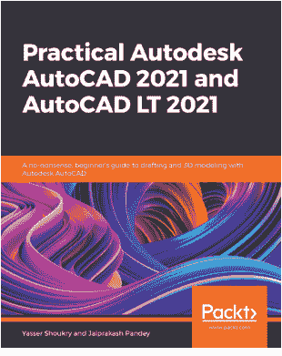

## Autodesk AutoCAD 2021 和 AutoCAD LT 2021 实用指南

Yasser Shoukry、Jaiprakash Pandey

ISBN: 978-1-78980-915-2

- 使用 AutoCAD 的基本功能、导航和组件理解 CAD 基础知识。
- 使用实体编辑工具从基本形状开始创建复杂的 3D 实体对象。
- 使用块等可重用对象进行工作，并通过 xRef 进行协作。
- 探索外部参照和动态块等高级功能。
- 探索外部参照和动态块等高级功能。
- 在 AutoCAD 中使用图纸空间布局，为 2D 和 3D 模型创建专业的出图。
- 将你的 2D 图纸转换为 3D 模型。

## Packt 正在寻找像你一样的作者

如果你有兴趣成为 Packt 的作者，请访问 authors.packtpub.com 并立即申请。我们与成千上万像你一样的开发人员和技术专业人士合作，帮助他们与全球技术社区分享见解。你可以进行一般申请，申请我们正在招募作者的特定热门主题，或者提交你自己的创意。

## 留下评论 – 让其他读者了解你的想法

请在你购买本书的网站上留下评论，与其他人分享你对本书的看法。如果你从亚马逊购买了这本书，请在这本书的亚马逊页面上给我们留下诚实的评论。这一点至关重要，这样其他潜在读者在做出购买决定时可以看到并参考你公正的意见，我们也能了解客户对我们产品的看法，我们的作者也能看到你对他们与 Packt 合作创作的这本书的反馈。这只需要你几分钟的时间，但对其他潜在客户、我们的作者和 Packt 来说都很有价值。谢谢！

