## 第 1 部分：学习入门所需的概念和技能

这是入门部分，您将在其中了解工业自动化的全部内容。您将了解传感器和执行器，并能够识别电气控制元件并学习如何为基本的工业控制操作进行接线。您还将能够使用 CAD 软件绘制原理图/接线图。

本部分包含以下章节：

- *第 1 章*，工业自动化简介
- *第 2 章*，开关和传感器 – 工作原理、应用和接线
- *第 3 章*，执行器及其在工业自动化中的应用
- *第 4 章*，交流和直流电机的概述
- *第 5 章*，变频器 VFD 简介
- *第 6 章*，使用 CAD 软件绘制原理图/接线图

## 工业自动化简介

制造涉及使用原材料或零件来创建将出售给客户的商品或产品。制造产品可以由人类操作的手工工具或由人类操作的机器如电机、泵和钻头来完成。在机器之前，物品/产品由手工使用工具制作，花费大量时间和精力生产单个物品。制造业的发展导致手工工具被人类操作的机器所取代，从而以最小的努力加快了生产。如今，人类在制造中操作机器的参与度正在通过**工业自动化**减少或被取代。

完成本章后，您应该能够理解什么是工业自动化并识别存在的各种工业自动化类型。您还将能够描述工业自动化的基本层级并识别工业自动化在行业中的好处。最后，您将能够识别工业自动化在社会中的弊端。

在本章中，我们将涵盖以下主题：

- 介绍工业自动化
- 探索工业自动化的类型
- 理解工业自动化的层级
- 发现工业自动化的优势和劣势

### 介绍工业自动化

工业自动化是指使用计算机、机器人和其他控制设备在制造或加工厂中以极少的人为干预来操作机器和设备。

在工厂中建立了一系列顺序操作，其中组件被组装成产品或材料经过精炼过程以生产适合消费的最终产品（即**生产线**或**装配线**）。这通常由需要操作以获得*成品*的机器和工具组成。在工业自动化之前，物品（如马克杯、勺子、锅等）由个人工匠手工制作，制造单个物品可能需要数小时或数天。

18 世纪出现了发展，物品不再手工生产，而是发明了允许机器生产物品的过程。这些机器/工具由人类操作。因此，我们可以将通过此过程生产的物品称为人机制造。该过程与手工方法相比大幅减少了生产时间和成本。制造业的进一步转变是 19 世纪引入装配线/生产线，这进一步减少了生产时间和成本，因为不同工人可以在生产线或装配线的不同部分操作不同的机器，从而实现大规模生产。如今，许多工厂的生产线上的机器/工具由设备和控制系统自动操作。重复性任务如填充、封盖和冲压现在已实现自动化。

工厂装配线上的工人用眼睛看、用耳朵听、用大脑思考、用手移动物品或在装配线上执行所需操作。通过工业自动化，工人通常执行的活动/操作可以被控制系统取代，其中传感器执行眼睛和耳朵的工作，控制器执行大脑的工作，而执行器执行手的工作。因此，**传感器**、**控制器**和**执行器**，我们将在本书后续章节中更详细地介绍，可以取代工厂装配线上的工人。在某些制造过程中，需要一百名员工的装配线最终可能只需要一

two people doing that through industrial automation. With the introduction of **artificial intelligence (AI)**, machines that can even think like humans are being developed to handle human operations that we could not previously even imagine being handled by a machine.

Industrial automation can also be defined as being able to control machinery and equipment in an industry by using **personal computers (PC)**, **programmable logic controllers (PLCs)**, sensors, actuators, and other control devices to minimize the human involvement in the manufacturing or production processes. PCs, PLCs, and other forms of controllers replace human decision-making; the sensors replace the eyes and ears, while the actuators replace the hands, as explained previously. PCs, PLCs and other forms of controllers have programs (a set of instructions) written into them that enable them to make decisions based on the state of the sensors. The results of these decisions are used by the actuator to perform the action that the worker would have done.

The following figure shows an example of industrial automation using a KUKA industrial robot. Jobs, which are typically done by humans, are being carried out by robots (programmed machines):

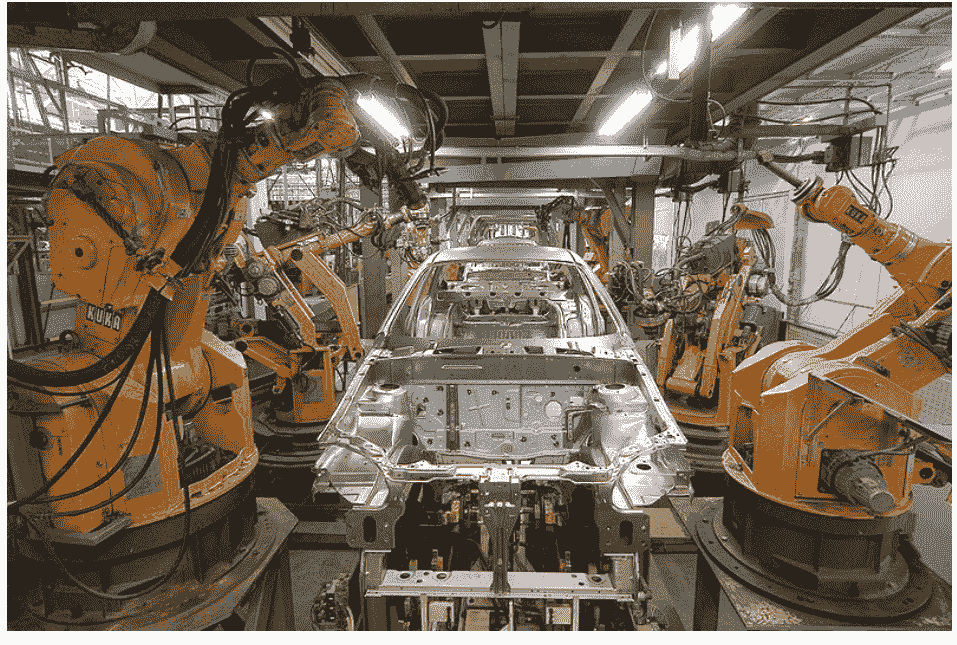

Figure 1.1 – Industrial automation in a vehicle manufacturing assembly line using a KUKA industrial robot

This image is licensed under Wikimedia Commons:
https://creativecommons.org/licenses/by-sa/4.0/deed.en.

Besides manufacturing, the transportation industry is another area where industrial automation can be applied, where self-operating vehicles are used for both private and commercial purposes – autopilot control in commercial jets enables jets to travel without human pilots. Warehouses, buildings, and other industries also benefit from industrial automation.

With that, you have learned that industrial automation involves using devices that operate machines automatically with little human involvement, which has significantly improved manufacturing and other industries. The knowledge you have acquired in this section will help you understand the various forms of automation we will look at in the next section.

### Exploring the types of industrial automation

Various types of industrial automation are applied in the world today. Industrial automation solutions can fall into any of the following four categories:

- Fixed automation system
- Programmable automation system
- Flexible automation system
- Integrated automation system

In the next few sections, you will discover what these categories are in detail. Let's have a look.

### Fixed automation system

In a fixed automation system, the series of operations that must be performed on the raw material are fixed. This type of automation is used to perform fixed and repetitive operations to achieve high production rates. The machines involved are programmed or configured to produce a specific design for a product. Once adopted, it is relatively difficult to change the design or style of the product. Fixed automation systems are used when the same style of product is to be manufactured or assembled. The series of operations that are involved in the production or manufacturing process are designed or programmed based on the product. This type of automation system is characterized by a high production rate, high efficiency, and high initial cost and is suitable for manufacturing a large volume of products that will have a low cost per product.

Examples of fixed automation systems are as follows:

- Paint and coating automation process
- Automatic assembly machines
- Bread production lines
- Steel rolling mills
- Papermills
- Metal pressing/stamping machines in a vehicle assembly line in the automobile industry

Let's have a look at programmable automation systems.

### Programmable automation system

In a programmable automation system, the machines involved can be used to manufacture different styles of products. However, this requires reprogramming and changeover for each new style of product, which takes time to accomplish and creates downtime in production.

This type of automation is suitable for manufacturing where identical or similar styles of products are produced within a certain time frame. This is usually referred to as **batch production**. A long setup time is required to modify the program or reconfigure the sequence of operations for the new product design or batch to be manufactured.

Examples of programmable automation systems are as follows:

- **Industrial robot**: This is a type of robot (programmed machine) that's used in the manufacturing industry. It consists of a power supply, a controller, and a mechanical arm that can move in three or more axes. It can be programmed and configured for different kinds of tasks.

The following figure shows a robot designed to be able to do any work that can be programmed (within its limits and work envelope) simply by changing the program. Here, the robot was programmed for writing:

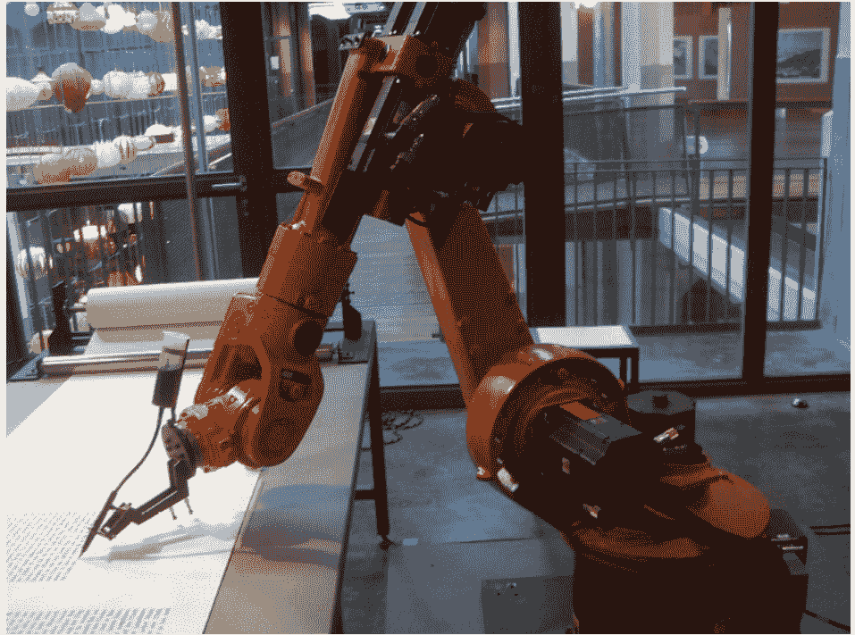

Figure 1.2 – KUKA industrial robot

This image is licensed under Wikimedia Commons:
https://creativecommons.org/licenses/by-sa/4.0/deed.en.

- **Computer Numerical Control (CNC) machine**: This is a type of automated machine in which geometric code (G-code) and miscellaneous code (M-code), which are alphanumeric, form the basic program instructions for different kinds of tasks. This type of machine can automate drilling, milling, or 3D printing using a computer or controller.

The following figure shows a CNC machine (KVR-4020A). This can be used for practically any type of application, including manufacturing or production, die-molding, heavy and hard milling, and more:

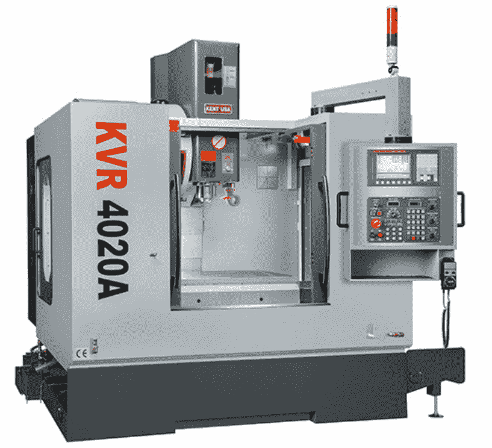

Figure 1.3 – CNC vertical machining center (Kent CNC KVR 4020A)

This image is licensed under Wikimedia Commons:
https://creativecommons.org/licenses/by-sa/4.0/deed.en

Let's proceed to learn about flexible automation systems.

### Flexible automation system

Flexible automation systems are an advanced form of programmable automation systems. They also require reprogramming and changeover for each new style of product, but this does not take time to accomplish as it is done in a programmable automation system. Hence, a flexible automation system reduces the downtime that's experienced in a programmable automation system. The product styles that a flexible automation system can produce are sufficiently limited so that the changeover can be accomplished very quickly and automatically. A flexible automation system allows a different range of products to flow through the line with little downtime.

Examples of flexible automation systems are as follows:

- **Automated guided vehicles (AGVs):** AGVs are vehicles without an onboard driver that are used mostly to transport materials/goods in a factory or warehouse. They can navigate along a pre-defined path using several guidance technologies, which makes it easy for them to change routes and expand the operation of the system in response to changes to a scalable and flexible material handling solution. AGVs can be used alongside an industrial robot to provide a very cost-effective material handling solution in a factory or warehouse. The AGV can transport pallets, cartons, and products that have been loaded onto it using an industrial robot, and then send them to various areas of the manufacturing facility or warehouse.

The following figure shows an example of an AGV:

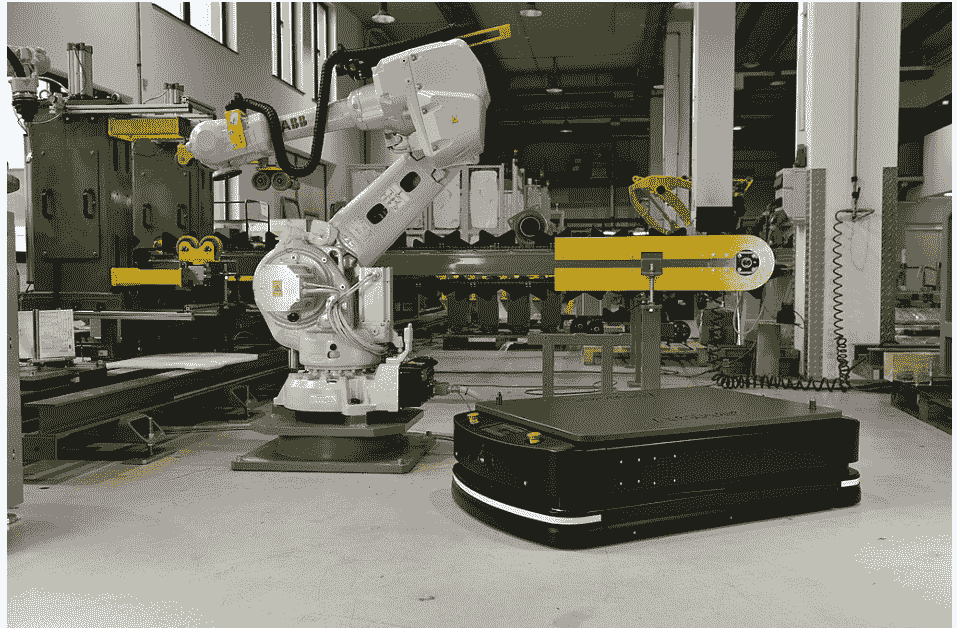

Figure 1.4 – Automated guided vehicle by AIUT

This image is licensed under Wikimedia Commons:
https://creativecommons.org/licenses/by-sa/4.0/deed.en.

- **Flexible Assembly System (FAS)**: A FAS is an assembly system that can produce a variety of products in small to medium batches with rapid changeover and reprogramming for a new set of product designs or styles.

Let's now have a look at integrated automation systems.

### Integrated automation system

As the name implies, an integrated automation system integrates various machines and tools such as CAD, robots, cranes, conveyors and other automated machineries to work under a single control system to execute an

生产过程的自动化系统。在此，单独的机器、数据和流程被整合在一起并由单一控制系统控制。它允许整个制造工厂由计算机自动化并控制，减少人工干预。

集成自动化系统用于**计算机集成制造 (CIM)**，其中计算机在很少人工干预的情况下控制整个生产过程。它也用于各种先进的过程自动化系统。集成自动化系统为实施各种先进技术提供了空间，例如自动化物料搬运系统、**射频识别 (RFID)**、条形码跟踪系统、**制造执行系统 (MES)**、**计算机辅助工艺规划 (CAPP)**、自动化输送机和起重机，以及许多其他技术。

在本节中，您在查看相关示例的同时了解了可用的各种工业自动化类型。这些知识将帮助您更好地理解下一节以及本书中将涵盖的其他主题。

### 理解工业自动化的层级

工业自动化是一个复杂的系统，其中多个设备相互通信和协作以提供所需的结果。描述工业自动化层级/层次结构的最简单方法是使用*三层*表示，如下所示：

- 现场级
- 控制级
- 监督和生产级

我们将在下一节中描述这些层级中的每一个，并提供相关示例以便于理解。

#### 现场级

这是工业自动化层次结构中最低的层级。它由现场设备组成，例如传感器和执行器，用于工业自动化。传感器将物理特性转换为电信号（数字或模拟）。它们是输入设备，可以被称为自动化的眼睛和耳朵。传感器的示例包括**接近传感器**、**温度传感器**、**压力传感器**、**液位传感器**、**流量传感器**和**限位开关**。另一方面，执行器将电信号（数字或模拟输出信号）转换为物理特性，可以表现为运动。示例包括**交流/直流电机**、**伺服电机**、**步进电机**、**泵**、**控制阀**、**电磁阀**、**接触器**和**继电器**。现场设备（传感器和执行器）的工作是将机器和过程数据传输到下一级（控制级）以进行*监控*和*分析*。

该层级可以称为工业自动化系统的眼睛和手臂（手）。传感器充当眼睛，而执行器充当手臂。实时过程参数如温度、压力、液位和流量由传感器转换为电信号。从传感器收集的数据被传输到控制器以进行进一步监控和分析。执行器通过来自控制器的信号控制过程参数。

#### 控制级

该层级由**可编程逻辑控制器 (PLC)** 或其他形式的控制器组成。PLC 是现代工业自动化的大脑。它们用于在工业中执行控制功能。它们从不同类型的传感器获取数据，使用写入其中的程序做出决策，并输出执行器将用于执行所需任务的控制信号。它们可以根据从传感器接收到的信号编程以提供自动控制功能。有关 PLC 的更多详细信息将在*第 7 章，理解 PLC 硬件和布线*，以及*第 8 章，理解 PLC 软件和 TIA Portal 编程*中提供。

#### 监督和生产级

该层级由**监控控制与数据采集 (SCADA)** 和**人机界面 (HMI)** 等组成，用于监控和控制各种参数并设定生产目标。*第 10 章，理解人机界面 (HMI)* 解释了 HMI，而*第 11 章，探索监控控制与数据采集 (SCADA)* 解释了 SCADA。

为了帮助您更好地理解 HMI 和 SCADA，本书安排在深入 HMI 和 SCADA 之前先介绍一些工业自动化的基础知识。

下图表示工业自动化的基本层级：

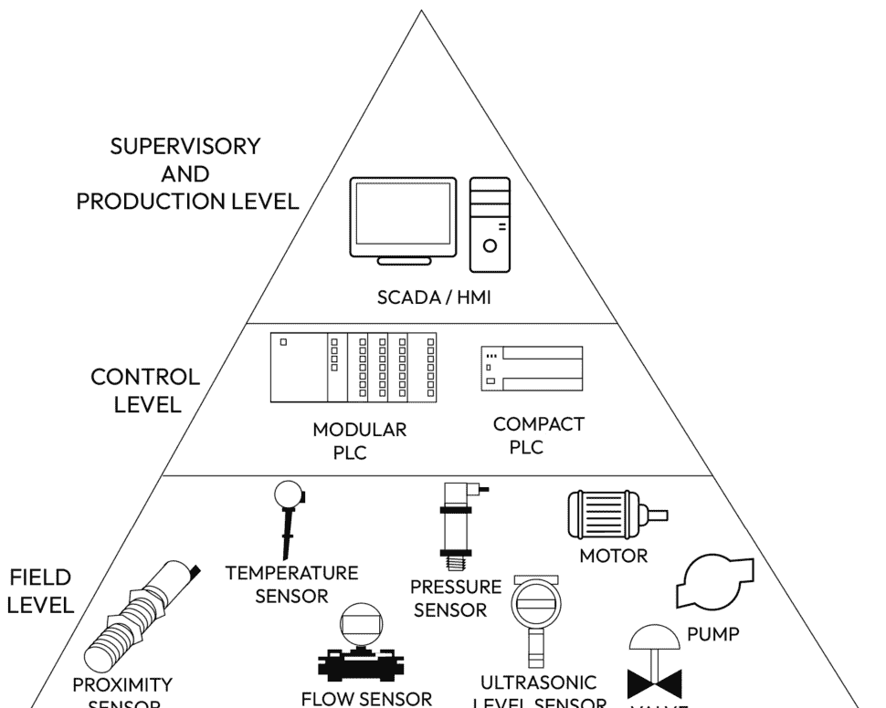

图 1.5 – 工业自动化的层级/层次结构

在本节中，您了解了工业自动化的基本层级，包括现场级、控制级和监督与生产级。第 2 章，开关和传感器 – 工作原理、应用和布线，以及第 3 章，执行器及其在工业自动化中的应用，将对现场级进行更详细的解释。第 7 章，理解 PLC 硬件和布线，第 8 章，使用 TIA Portal 理解 PLC 软件和编程，以及第 9 章，使用 TIA Portal 深入 PLC 编程，将以实践方法对控制级进行详细解释，而第 11 章，探索监控控制与数据采集 (SCADA)，将进一步解释监督和生产级，并包括一个动手项目/实践项目（使用 mySCADA 软件将 SCADA 与 S7-1200 PLC 接口），这将为您提供实践经验和对该概念的理解。

### 发现工业自动化的优势和劣势

毫无疑问，工业自动化通过使事情更快、更好完成而改变了制造业和其他行业。任何行业要保持竞争力都需要工业自动化。虽然自动化在制造业和其他行业带来了巨大改进，但工业自动化的一些负面影响需要被关注，以便您做好准备并具备克服它们的能力。

在以下各节中，我们将发现这些优势和劣势是什么。

#### 工业自动化的优势

让我们看看人们如何（或确实）从工业自动化中受益：

- 它减少了从开始到完成一个过程所需的时间。
- 它改善了工人的安全。自动化使工人免于暴露于工厂的有害环境中。
- 工业自动化中使用机器人提高了生产产量。机器人可以 24/7 以恒定速度工作。
- 工业自动化降低了运营成本。将自动化机器添加到操作中意味着更少的人力（即完成工作所需的员工更少）。此外，由于机器人在执行任务时的准确性，材料浪费也会减少。
- 工业自动化由于处理时间减少、运营成本降低、生产产量增加等原因提供了更快的**投资回报率 (ROI)**。
- 使用**自动导引车 (AGV)** 和其他自动化机械在制造业中减少了本应由人为错误造成的事故。
- 工业自动化使管理人员能够更专注于工作的其他方面，因为机器人/自动化系统需要较少的监督。
- 自动化系统/机器人工作时不会分心、疲惫或感到无聊，因此消除了延误，可以预期一致的性能。

#### 工业自动化的劣势

通过工业自动化使人类摆脱某些活动是一件好事；然而，这威胁到人类劳动力。

以下是工业自动化的一些劣势：

+   12. CNC 是 ________________ 的缩写。
+   13. PLC 是 ________________ 的缩写。
+   14. SCADA 是 ________________ 的缩写。
+   15. HMI 是 ________________ 的缩写。

### 开关与传感器 – 工作原理、应用与接线

了解人体的运作方式有助于理解自动化。人只有大脑是不够的，还需要视觉、听觉、触觉和嗅觉来提供环境信息，供大脑处理。类似地，**开关与传感器**为控制器提供环境信息以供其处理。处理的结果决定了*执行器*将要采取的行动，这将在下一章中讨论。本章专门讨论开关与传感器，以便我们深入探讨执行器。正如视觉、听觉、触觉和嗅觉对人类运作至关重要一样，开关和传感器是工业过程自动化所必需的重要组件。

在本章中，我们将介绍以下主要主题：

- 介绍开关与传感器
- 描述手动操作开关
- 描述机械操作开关
- 了解接近传感器（电容式、电感式和光电式）

#### 介绍开关与传感器

**开关**是一种电气元件，用于连接或断开电路中的信号路径。它用于接通或断开电路。开关有两种状态：ON（开）状态和OFF（关）状态。在电路中，当开关处于ON状态时，电流会流过；当处于OFF状态时，电流不会流过。因此，ON状态会连接信号路径，而OFF状态会断开信号路径。开关可以被视为用于打开或关闭设备的装置。

开关可分为以下几类：

- 手动操作开关
- 机械操作开关

**传感器**是检测或感知物体存在或不存在的装置。传感器可以被视为自动开关。它们从环境中收集信息，并将其转换为观察者或设备可以读取和/或看到的信号形式。在人体中，眼睛检测光能，鼻子可以检测化学物质或各种气味，耳朵可以检测声音，皮肤可以检测温度或压力。同样，在自动化领域，各种类型的传感器检测各种物理量，如光、声音、温度等。这些物理量将被转换为数字或模拟信号，供观察者或设备（控制器）读取和/或查看。传感器有各种类型，但我们将在本章后面介绍接近传感器。

在本节中，我们了解了开关，可以将它们总结为用于打开或关闭设备的装置。我们还了解到，传感器可以被视为自动开关，它们不是由人操作的。了解开关和传感器将有助于你更好地理解下一节中将要解释的开关类型，也有助于你理解本章后面将要解释的接近传感器。

#### 描述手动操作开关

在制造业中，操作员通常需要启动或停止机器，并且除了启动和停止之外，还可能需要手动执行其他形式的控制。这通常需要可以手动操作的开关。用手操作的开关被称为**手动操作开关**。一些示例如下：

- 按钮开关
- 摇杆开关（船型开关）
- 拨动开关
- 选择开关
- 闸刀开关

我们将在以下各节中逐一介绍这些开关。

##### 按钮开关

**按钮开关**是一种在按下按钮时接通或断开电路的开关。该按钮设计为以两种状态（即ON或OFF）工作。当处于ON位置时，内部金属弹簧接触开关的两个端子，允许电流流过。当处于OFF位置时，内部开关缩回，电流停止流动。

按钮开关分为常*开*或常*闭*两种。

常开或常闭按钮可用于控制单一电路。

对于常开按钮开关，当按钮未被按下时，触点断开，连接中断（即开关处于OFF状态）。当按钮被按下时，触点闭合，连接建立（即开关处于ON状态）。

对于常闭按钮开关，当按钮未被按下时，触点闭合，连接建立（即开关处于ON状态）。当按钮被按下时，触点断开，连接中断（即开关处于OFF状态）。

下图显示了**常开（NO）**和**常闭（NC）**按钮开关的符号：

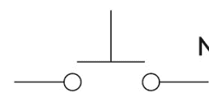

常开（NO）按钮开关

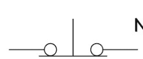

常闭（NC）按钮开关

图2.1 – 常开（NO）和常闭（NC）按钮开关的符号

下图显示了一个NO按钮开关的正面和背面。端子3和端子4用于将开关连接到电路：

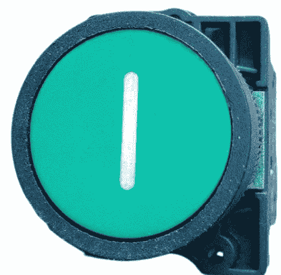

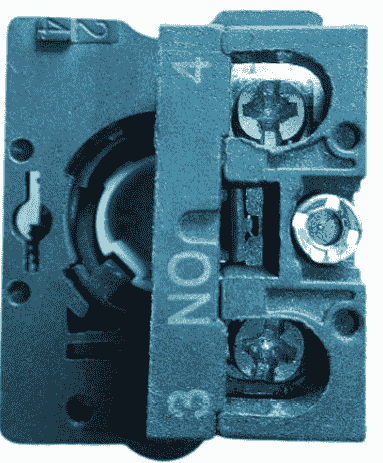

图2.2 – NO按钮开关的正面和背面

该图片由*Showlight Technologies LTD*提供 [www.showlight.com.ng](http://www.showlight.com.ng)。

下面的接线图显示了使用NO按钮开关点亮一盏灯。按下按钮开关时灯亮，松开时灯灭：

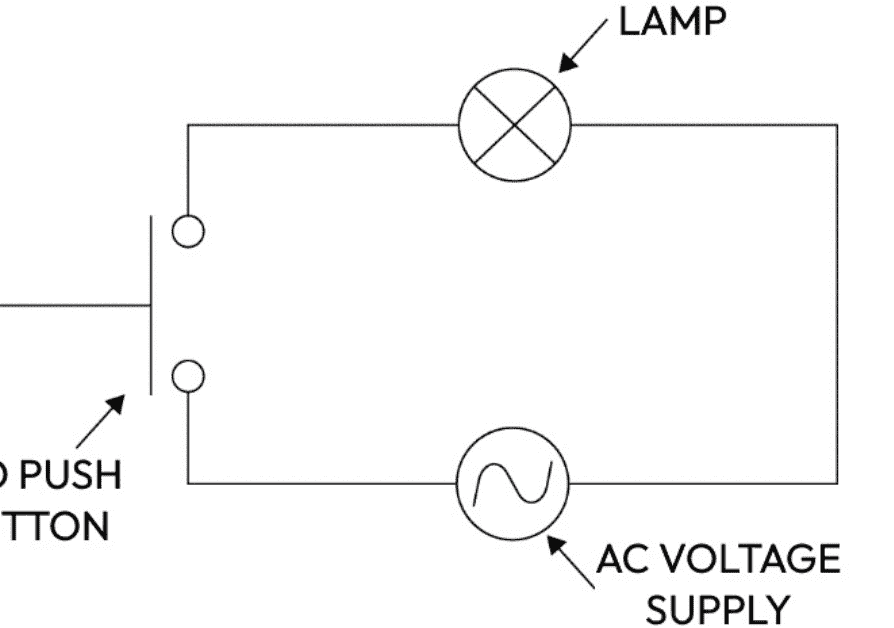

图2.3 – 使用NO按钮开关点亮一盏灯

下图显示了一个NC按钮开关的正面和背面。端子1和端子2用于将开关连接到电路：

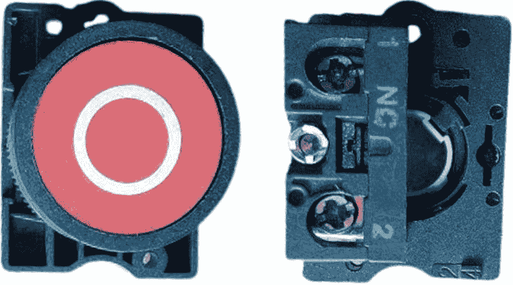

图2.4 – NC按钮开关的正面和背面

该图片由*Showlight Technologies LTD*提供 [www.showlight.com.ng](http://www.showlight.com.ng)。

##### 摇杆开关（船型开关）

**摇杆开关**是一种开关，按下时一侧抬起，另一侧压下。它像摇马一样来回摇动。下图显示了它的正面和背面视图：

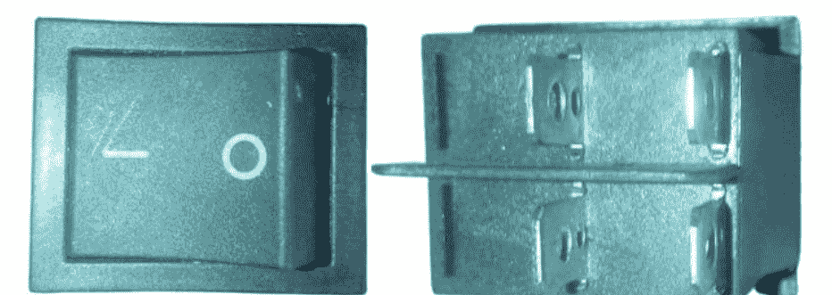

图2.5 – DPST摇杆开关的正面和背面

该图片由*Showlight Technologies LTD*提供 [www.showlight.com.ng](http://www.showlight.com.ng)。

摇杆开关有各种形式：

- SPST
- SPDT
- DPST
- DPDT

让我们逐一介绍它们。

**单刀单掷（SPST）**只能切换（打开或关闭）一条电路。它是开关的最简单形式，只能有一个输入，并且只能连接到一个输出。

下图显示了SPST开关的符号：

图2.6 – SPST的符号

下面的接线图显示了SPST开关点亮一盏灯的简单接线：

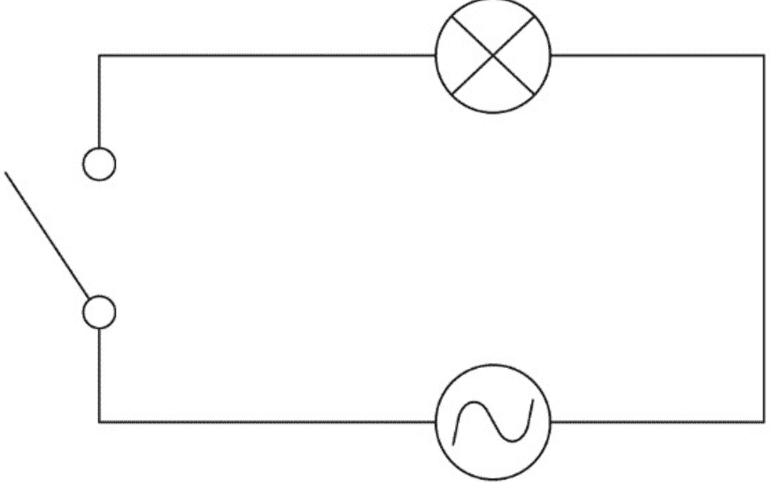

图2.7 – 使用SPST开关点亮一盏灯的简单接线图

**单刀双掷（SPDT）**是一种只有一个输入（通常称为公共端）的开关，它可以连接到两个不同的输出并在它们之间切换。默认情况下，一个触点通常连接到输入，这被称为常闭触点。另一个触点在工作时连接到输入，被称为常开触点。

下图显示了SPDT开关的符号：

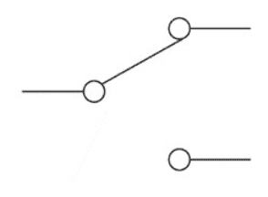

单刀双掷（SPDT）

图2.8 – SPDT开关的符号

下面是一个SPDT开关用于点亮两盏灯（一次一盏）的简单接线图：

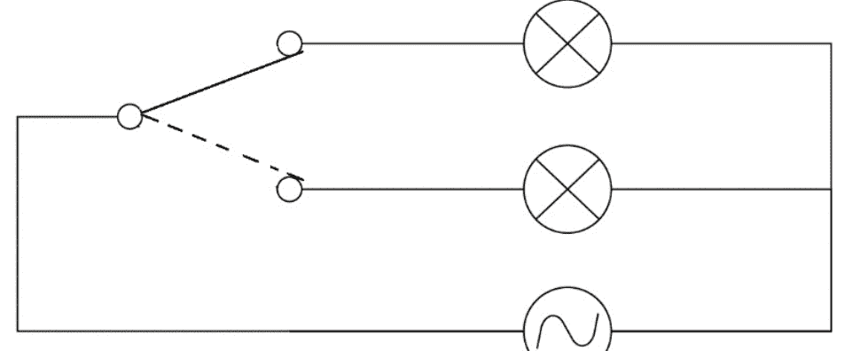

图2.9 – 使用SPDT开关点亮两盏灯

**双刀单掷（DPST）**是一种具有两个输入（通常称为公共端）的开关，每个输入可以连接到对应的一个输出并在其之间切换。它由两个在同一封装中同时操作的SPST开关组成。

下图显示了DPST开关的符号：

##### 双刀单掷开关（DPST）

图 2.10 – DPST 开关的符号

下面是一个简单的接线图，展示 DPST 开关如何同时开关一盏灯和一台感应电动机：

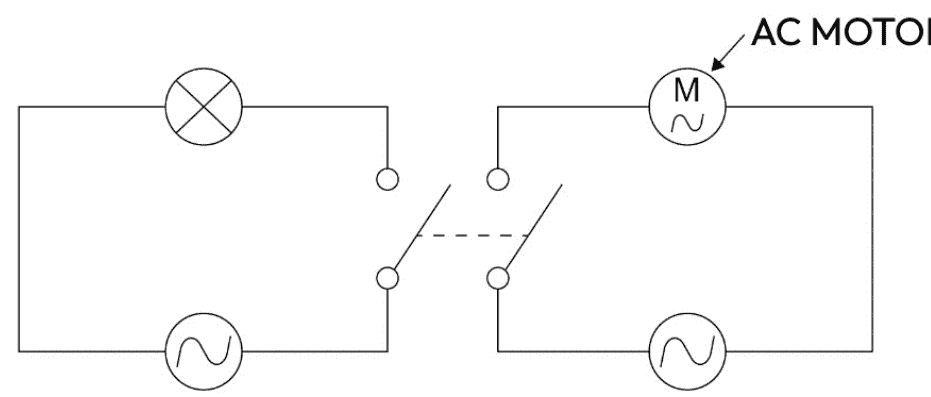

交流电动机

图 2.11 – 简单的 DPST 开关接线，用于同时开关一盏灯和一台感应电动机

双刀双掷开关（DPDT）是一种具有两个输入（通常称为公共端）的开关，每个输入都可以连接并在两个相应的输出之间切换。它由两个同时在同一封装中操作的 SPDT 开关组成。

下图显示了 DPDT 开关的符号：

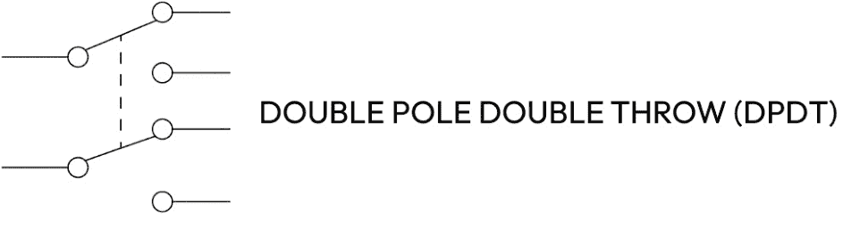

图 2.12 – DPDT 开关的符号

下面的接线图显示了使用 DPDT 开关使 **直流电动机** 正反转：

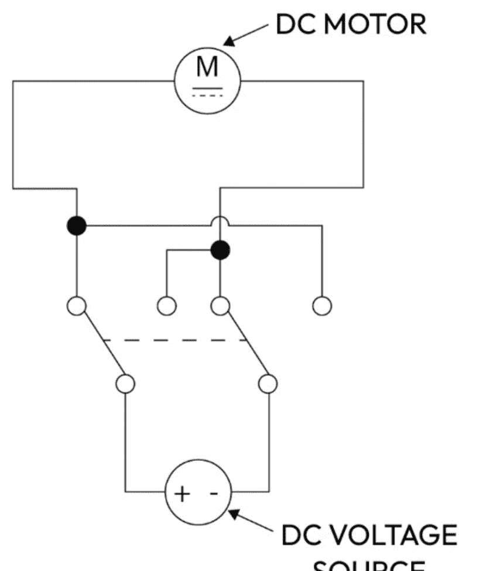

图 2.13 – 使用 DPDT 开关驱动直流电动机

接下来，让我们来看一下拨动开关。

##### 拨动开关

拨动开关是一种由杠杆来回移动以打开或关闭电气电路的开关。它们可以有多个杠杆位置。

拨动开关也存在 SPST、SPDT、DPST 和 DPDT 开关。 下图显示了拨动开关的外观：

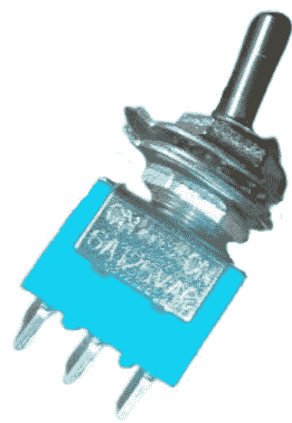

图 2.14 – 一个拨动开关

此图像的版权归 *Showlight Technologies LTD* 所有 [www.showlight.com.ng](http://www.showlight.com.ng)。

##### 滑动开关

**滑动开关** 使用滑动动作产生与拨动开关相同的连接。滑动开关也可以作为 SPST、SPDT、DPST 或 DPDT 开关存在。 下图显示了滑动开关的外观：

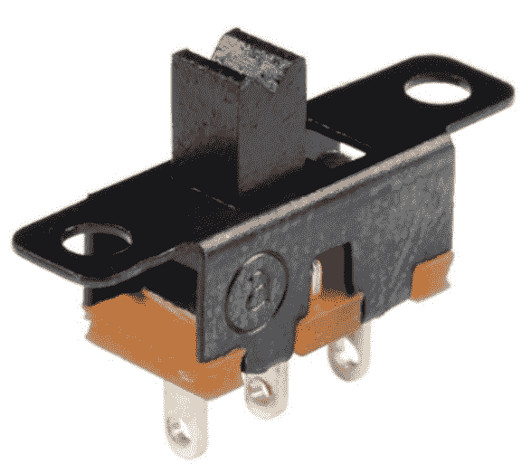

图 2.15 – 可安装滑动开关

此图像的版权归 *Wikimedia Commons* 所有，可在 https://creativecommons.org/licenses/by-sa/4.0/deed.en 找到。

##### 选择开关

**选择开关** 可能有两个或多个选择位置。它可以通过旋转手柄控制不同电路的开或关状态。它用于需要一个以上控制选项的地方。

下图显示了选择开关的旋转手柄及其连接端子：

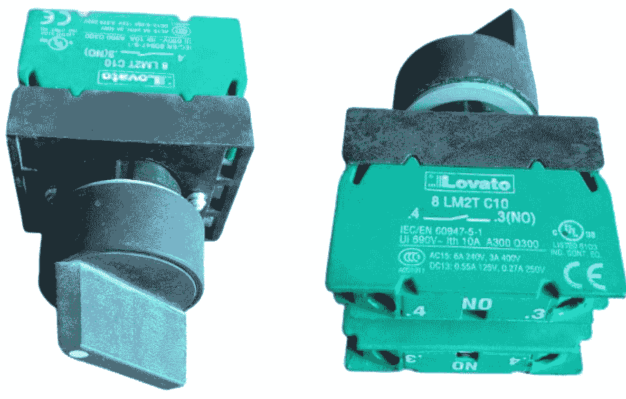

图 2.16 – 选择开关

此图像的版权归 *Showlight Technologies LTD* 所有  
[www.showlight.com.ng](http://www.showlight.com.ng)。

##### 刀开关

**刀开关** 是一种使、断或改变电流路径的开关装置。它由一个或多个铰接的可移动铜刀片组成，通过被迫置于其间而与固定的分叉触点钳接触。

下图显示了刀开关的外观：

操作开关，由人工或人工操作员操作。它们用于需要自动控制的情况。开关通过开关内的机构自动通过压力、温度或位置操作。它们也可以被称为传感器。

机械操作开关取代了 *人工操作员*。这种类型开关的一些例子如下：

- 限位开关
- 液位开关
- 压力开关
- 温度开关

让我们逐一查看。

## 限位开关

这是一种由机器部件运动操作的开关。它在达到预定极限时操作。标准限位开关是一种机械装置，使用物理接触来检测物体的存在或不存在。它由开关本体、执行器和操作头组成。

下图显示了限位开关及其部件：

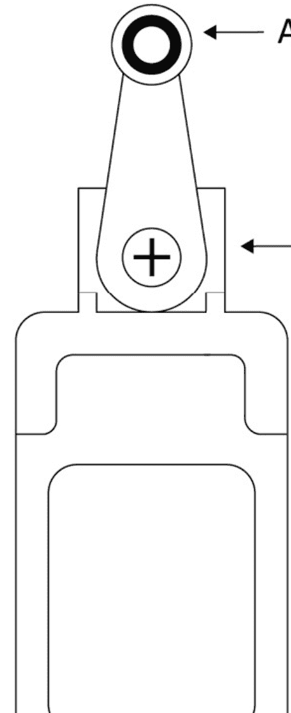

执行器

操作头

开关本体

图 2.18 – 限位开关及其部件

**开关本体** 包含电气触点。**执行器** 是限位开关与目标接触并移动以导致电气触点连接或断开的部分。**操作头** 是旋转发生的地方，它由一个连接或断开电气触点的机构组成。

限位开关有两种基本的电气触点配置 – **单刀双掷（SPDT）** 和 **双刀双掷（DPDT）**。SPDT 由一个常开触点和一个常闭触点组成，而 DPDT 由两个常开触点和两个常闭触点组成。

下图说明了限位开关的基本触点配置：

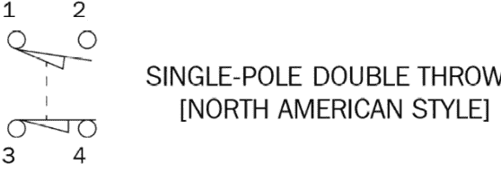

##### 单刀双掷
[北美式]

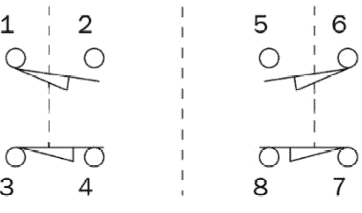

##### 双刀双掷
[北美式]

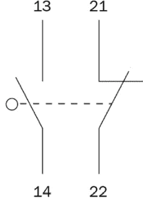

##### 单刀双掷
[国际式]

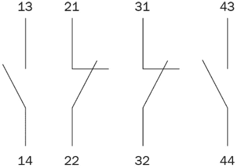

##### 双刀双掷
[国际式]

图 2.19 – 限位开关的说明

限位开关可以使用的一种执行器是 **瞬时操作**。对于这种类型的执行器，当不施加力时，装置处于自由位置，触点处于正常状态。

当施加力时，装置将处于操作位置 – 在这种情况下，电气触点将从正常状态改变为操作状态。当力被移除时，装置将返回自由位置，电气触点将返回正常状态。

下图显示了瞬时操作类型限位开关的操作：

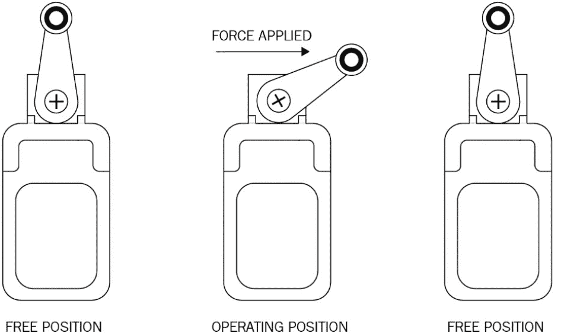

图 2.20 – 瞬时操作类型限位开关的操作

另一种类型的执行器是 **保持操作**。对于这种类型的执行器，即使执行器不再与目标接触，执行器杠杆和电气触点仍保持在操作状态。当施加相反方向的力时，执行器杠杆和电气触点返回到自由位置。

下图显示了限位开关的接线，其中端子 1 和端子 2 用于控制单相感应电动机的启动和停止：

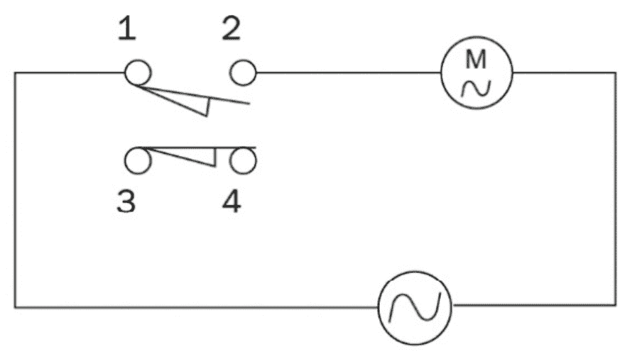

图 2.21 – 限位开关的接线，其中端子 1 和端子 2 用于控制单相感应电动机的启动和停止

##### 重要说明

在前面的图中，限位开关的端子 1 和端子 2 被用于电路中。当未达到极限时，电动机不会运行，因为端子 1 和端子 2 是断开的。当达到极限时，打开的端子（1 和 2）将闭合，电动机将开始运行。

下图显示了限位开关的接线，其中端子 3 和端子 4 用于控制单相感应电动机的启动和停止：

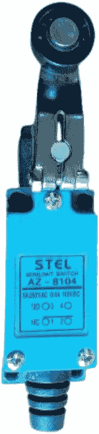

图 2.23 – 限位开关

此图像的版权归 *Showlight Technologies LTD* 所有 (www.showlight.com.ng)。

下图显示了取下前面板后的限位开关：

外部配重。固定点或外部配重将被放置在容器或水箱内的固定位置，以便浮体内的内部机械开关随着水位上升或下降而在开和关之间切换。开关的开闭可以使水泵自动停止或启动以控制水箱中的水位：

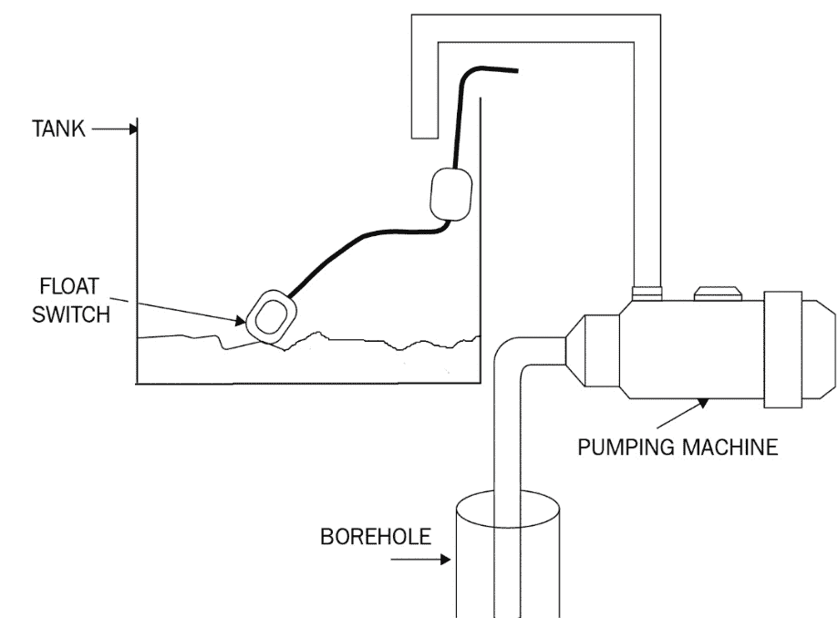

图 2.25 – 浮球开关和水泵

下图显示了浮球开关的外观：

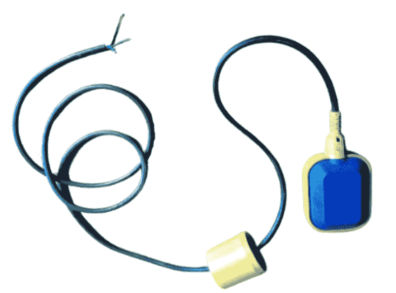

Fig. 2.26 – A float switch

The credit for this image goes to *Showlight Technologies LTD* [www.showlight.com.ng](http://www.showlight.com.ng).

The most basic float switch is a **two-wire, single-pole, single-throw (SPST)** float switch, which can exist as normally closed or normally open. An SPDT float switch, which has three wires, also exists. The following diagram shows the symbols for various forms of float switches that are available:

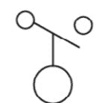

NORMALLY OPEN (NO) FLOAT SWITCH

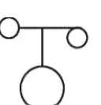

NORMALLY CLOSED (NC) FLOAT SWITCH

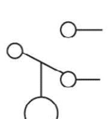

SINGLE POLE DOUBLE THROW FLOAT SWITCH

Figure 2.27 – Symbols for various forms of float switches

Next, we will look at each float switch mentioned in this section.

#### Normally closed float switch

In a normally closed float switch, the electrical circuit is closed in a downward position and opened in an upward position. So, with gravity pulling it down, it is closed; as the liquid level rises to the preset level, it will open, as shown in the following diagram:

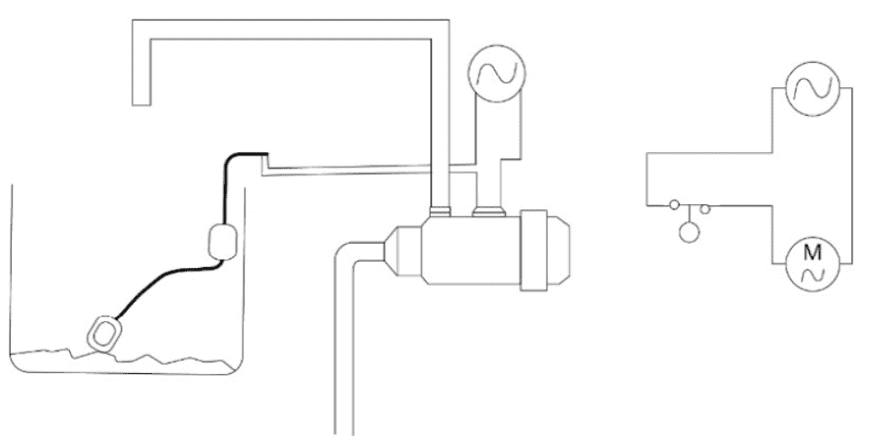

Figure 2.28 – A normally closed float switch being used to turn off a pump that fills a tank

In the preceding diagram, when the water level is low, the float switch will close, and the power will flow to the pump and the pump will begin to fill the tank. As the water level rises, the float switch will become open at a preset point, and the pump will stop.

#### Normally open float switch

In a normally open float switch, the electrical circuit is open in the downward position and closed in the upward position. So, with gravity pulling it down, it is open, and as the liquid level rises to the preset level, it will close:

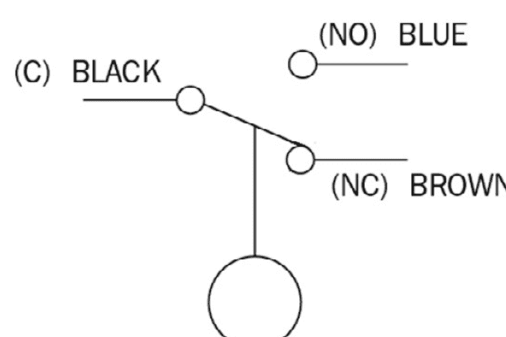

Figure 2.30 – SPDT float switch

This switch can be used to either fill a tank automatically when empty or empty a filled tank automatically.

We'll look at these two scenarios in the following sections.

##### Filling a tank

Here, the black and blue wires are used to turn the pump on or off. When the water level is low, the black wire gets connected to the blue wire and the pump starts to operate. When the tank is full, the black wire gets disconnected from the blue wire and the pump stops.

The following diagram shows an SPDT float switch when the water level is low:

BLACK AND BLUE WILL CONNECT IN THIS POSITION

Figure 2.31 – SPDT float switch when the water level is low

##### Emptying a tank

Here, the black and brown wires of the float switch are used to turn the pump on or off. When the water level is high, the black wire gets connected to the brown wire and the pump starts to operate. When the water level is low, the black wire disconnects from the brown wire and the pump stops.

The following diagram shows an SPDT float switch when the tank is full:

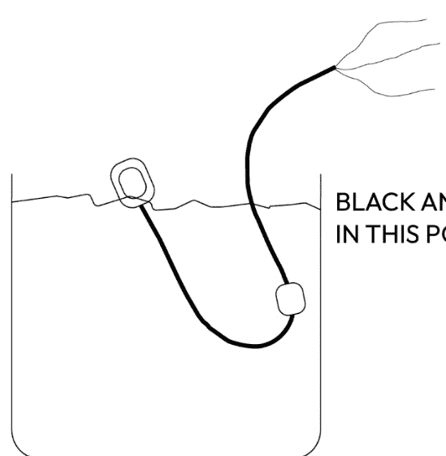

BLACK AND BROWN WILL CONNECT IN THIS POSITION

Figure 2.32 – SPDT float switch when the tank is full

In the next section, we will explore another mechanically operated switch.

#### Pressure switch

A pressure switch is a form of sensor that closes or opens an electrical contact when a certain pressure is obtained through an increase or decrease in pressure.

A mechanical pressure switch consists of a process connection, measuring element, switch contacts, electrical connection, and a setpoint adjustment screw.

The core part of a mechanical pressure switch is its measuring element. Elastic diaphragms or stainless-steel pistons are usually used for this purpose. The diaphragm is designed for vacuum or low pressure ranges up to 16 bars, while the piston is suitable for higher pressure ranges up to 350 bars. The process connection and case are usually made of galvanized steel or brass. The process connection is the part that connects to the air supply or for the process to control. The switch contacts are the internal contacts that open or close as pressure increases or decreases. The electrical connection connects to the internal electrical contact, which opens or closes as pressure rises or falls. The setpoint adjustment screw can be used to calibrate or adjust the switch (that is, set the pressure at which the switch opens or closes).

The following diagram shows the cross-section of a pressure switch:

ELECTRICAL CONNECTION SETPOINT ADJUSTMENT SCREW SWITCH CONTACTS MEASURING ELEMENTS PROCESS CONNECTION

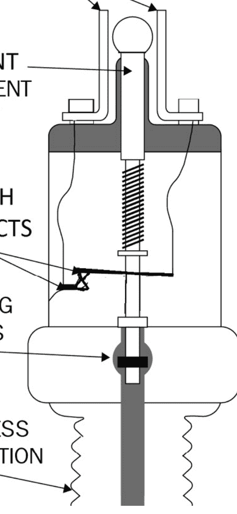

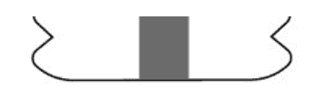

Figure 2.33 – Cross-section of a pressure switch

The *single pole single throw* form of a pressure switch can exist as NO and NC.

In an *NO* type, the switch contacts are open (not connected) when no pressure is applied, and they close when the applied pressure is equal to the setpoint.

In an NC type, the switch contacts are closed (connected) when no pressure is applied, and they open when the applied pressure is equal to the setpoint.

Your choice of switch depends on the type of circuit you intend to drive with the switch.

The following diagram shows the symbols of a pressure switch:

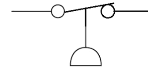

NORMALLY CLOSED (NC) PRESSURE SWITCH

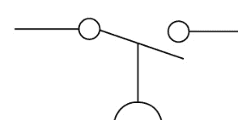

NORMALLY OPEN (NO) PRESSURE SWITCH

Figure 2.34 – Symbols of a pressure switch

The following diagram shows the wiring of a pressure switch being used to switch off a lamp when a setpoint has been reached:

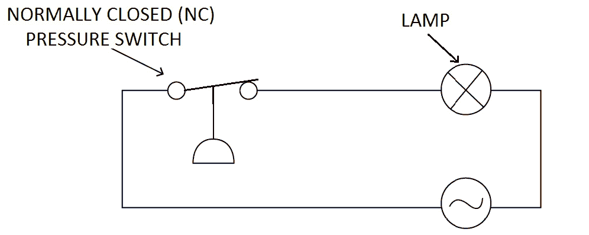

Figure 2.35 – A pressure switch (NC) being used to switch off a lamp when a setpoint has been reached

The following diagram shows the wiring of a pressure switch being used to switch on a buzzer when a setpoint has been reached:

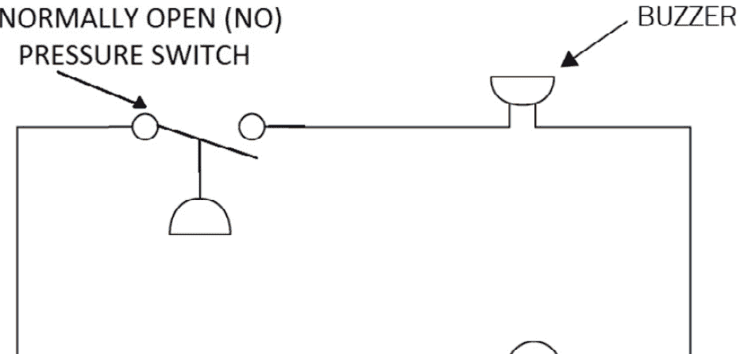

Figure 2.36 – A pressure switch (NO) being used to switch on a buzzer when a setpoint has been reached

Lastly, we will look at what a temperature switch is.

#### Temperature switch

A **temperature switch** is a switch that opens or closes when the temperature reaches a setpoint or falls below a setpoint. The design of a temperature switch consists of two parts:

- **Sensor**: This can be a sensing bulb filled with a fluid – liquid, gas, or a bimetallic strip. It's usually immersed in the process whose temperature is to be controlled.
- **Snap-action contacts**: These switch the electrical power of the device controlling the temperature of the process on or off.

There are various types of temperature switches, including bimetallic strip temperature switches and liquid-filled temperature switches.

A **bimetallic strip temperature switch** is one of the most common temperature switches. It consists of a thin rectangular strip formed of two dissimilar metals that are bonded back to back. The two dissimilar metals experience dissimilar thermal expansion rates. Hence, when the temperature increases, one metal will expand faster than the other. This causes the strip to bend. The bending strip is used to activate a snap action switch that opens or closes a circuit.

The following diagram shows a simple bimetallic strip temperature switch:

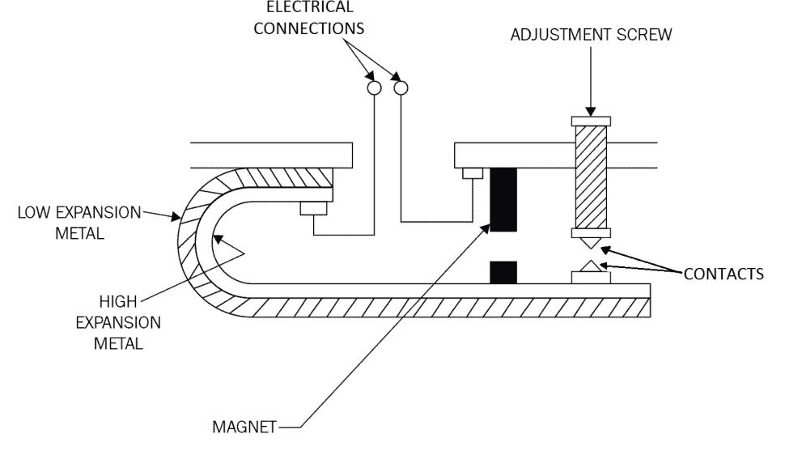

Figure 2.37 – A bimetallic strip temperature switch

A liquid-filled temperature switch (capillary thermostat) consists of a fluid encapsulated in a metal tube (bulb and capillary). The fluid expands or contracts when the temperature changes. The change in fluid moves the head, which triggers a snap action switch, either opening or closing the circuit.

The following diagram shows a capillary thermostat (a liquid-filled temperature switch):

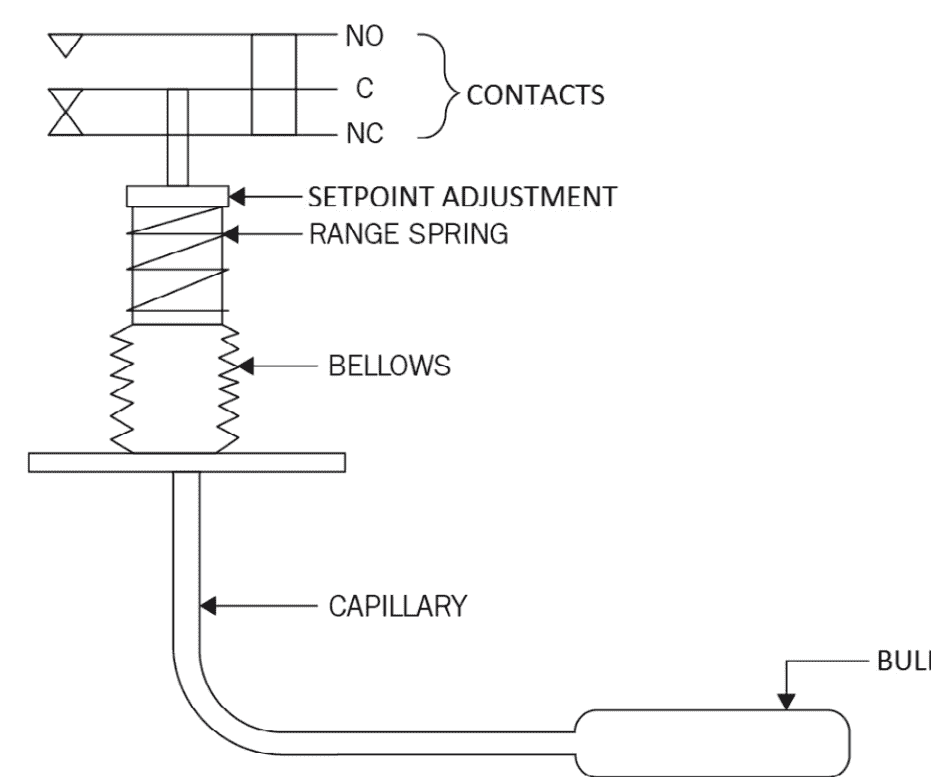

图 2.38 – 毛细管式温度开关

下图展示了温度开关的符号：

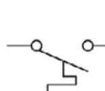

常开（NO）温度开关

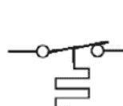

常闭（NC）温度开关

图 2.39 – 温度开关的符号

在本节中，你了解了一些可用于工业自动化流程的各种机械操作开关，还看到了不同开关使用的各种符号。这些符号对于阅读原理图非常重要。了解如何接线这些开关也很有帮助。你从本节获得的知识将帮助你更好地理解下一节。

#### 理解接近传感器（电容式、电感式和光电式）

**接近传感器**常用于工业应用。了解接近传感器有助于你理解其他类型的传感器。

接近传感器利用电磁场、光或声音来检测物体的存在与否。有多种类型，每种都适用于特定环境或应用。

可用的接近传感器类型如下：

- 电感式接近传感器
- 电容式接近传感器
- 光电式接近传感器

在接下来的几个小节中，我们将逐一探究这些接近传感器。

##### 电感式接近传感器

这是一种*非接触式传感器*，用于检测铁磁性金属，如*碳钢、不锈钢和铸铁*。

电感式接近传感器由**线圈、振荡器、检测电路**和**输出电路**组成。振荡器提供一个*振荡磁场*，该磁场辐射在线圈绕组周围，线圈位于传感器表面。当铁磁性金属靠近磁场时，金属表面会感应出微小电流（涡流）。该微小电流会改变磁路的固有频率，从而降低振荡幅度。检测电路监测振荡幅度，并在振荡降低到足够水平时触发*输出电路*产生输出。

如果传感器采用*NO*配置，当金属进入感应区域时，它将产生*ON*信号。对于*NC*配置，当金属进入感应区域时，其输出为*OFF*信号。该输出可由可编程逻辑控制器（PLC）或其他形式的控制器读取，将*ON*或*OFF*状态转换为可用信息。

下图展示了电感式接近传感器的主要电路：

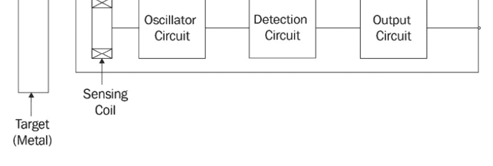

图 2.40 – 电感式接近传感器

既然我们已经探究了什么是电感式接近传感器，接下来将研究电容式接近传感器的定义。凭借你从本节获得的知识，你应该能轻松理解。让我们直接开始。

##### 电容式接近传感器

这是一种*非接触式传感器*，可检测粉末、颗粒、液体和固体形式的金属和非金属物体。

电容式传感器的作用类似于电容器。它们利用电容的电气特性，以及基于传感器活性面周围电场变化引起的电容变化。

传感器感应面上的金属板充当电容器的第一个极板，并与内部振荡器电路电气连接。待检测物体充当电容器的第二个极板。

目标与内部传感器极板之间的外部电容构成振荡器电路中反馈电容的一部分。随着目标靠近传感器表面，振荡增加，直到达到阈值电平并激活输出。

下图展示了电容式接近传感器的主要电路：

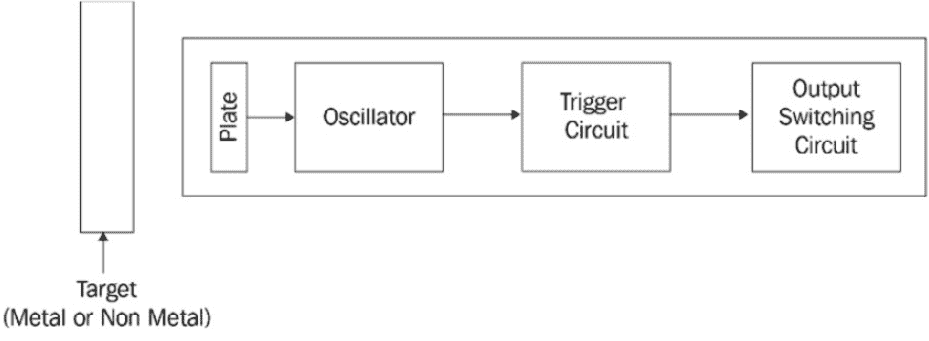

图 2.41 – 电容式接近传感器

下图显示了一个三线电容式传感器。这三根线如下：

- **BN**（棕色）
- **BK**（黑色）
- **BU**（蓝色）

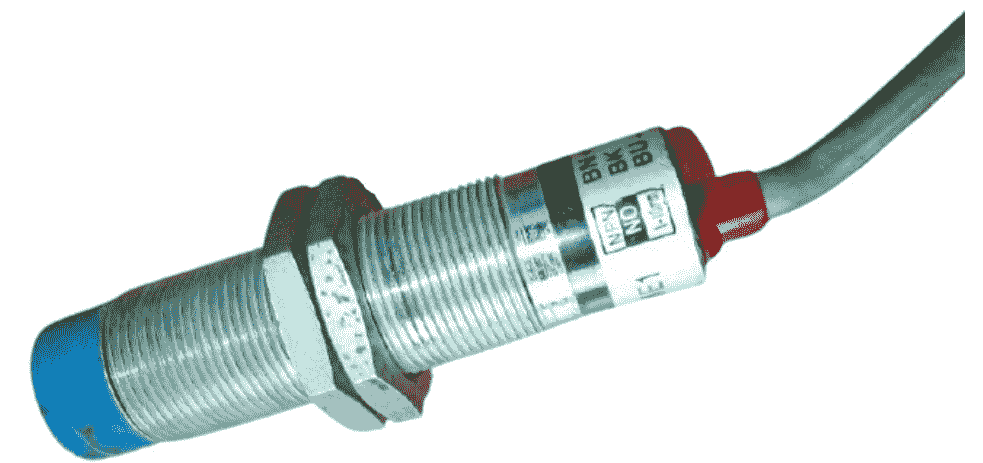

图 2.42 – 电容式接近传感器（欧姆龙 E2K-X8ME1）

此图片由 *Showlight Technologies LTD* www.showlight.com.ng 提供。

以下接线图通常出现在三线接近传感器本体上，可能为*NPN*或*PNP*型。对于NPN，电源连接至**BN**和**BU**，负载连接在**BN**和**BK**之间。对于PNP，电源连接至**BN**和**BU**，负载连接在BN和BK之间：

图 2.43 – 接近传感器接线图（NPN和PNP）

下图展示了一个简单的接线图，说明如何使用三线接近传感器（NPN）来打开或关闭直流灯：

图 2.44 – 使用三线接近传感器（NPN）开关直流灯

另一方面，这里展示了一个简单的接线图，说明如何使用三线接近传感器（PNP）来打开或关闭直流灯：

图 2.45 – 使用三线接近传感器（PNP）开关直流灯

现在，让我们看看下一种接近传感器。

##### 光电式

**光电式**传感器由光发射器（*发送器*）、光接收器和支持电路组成。它们通过使用光发射器和接收器来检测物体的存在与否。

发射器将可见或不可见的光束发射到检测接收器。

光电式传感器有三种类型，如下所示：

1. **对射式**：这种传感器中，发射器（发送器）和接收器分别置于独立的外壳中，并相对放置。发送器提供恒定光束；当物体在发送器和接收器之间通过时，遮挡光束即发生检测。下图说明了这一点：

图 2.47 – 回归反射式光电传感器

3. **漫反射式**：这种传感器中，发射器和接收器位于同一外壳中，且朝向相同方向。发射器发出恒定光束，向所有方向漫射，填充检测区域。当目标物体进入该区域时，会将部分光束反射回接收器。目标充当反射器。当光被扰动（或目标）物体反射时，即发生检测。让我们看一下：

图 2.48 – 漫反射式光电传感器

下图显示了回归反射式光电传感器的接线。回归反射式接近传感器如今在工业中很常见，适用于远距离检测：

图 2.49 – 回归反射式光电传感器接线图

在此接线图中，传感器有五根线，如下：

- BN（棕色）
- BU（蓝色）
- WH（白色）
- BK（黑色）
- GY（灰色）

BN和BU线连接电源。WH为公共线，将根据传感器输出端子（BK和GY）的需求连接到正极或负极。

当WH连接到正极时，GY处已有正极，当有遮挡物时，BK处会有正极。

当WH连接到负极时，GY处已有负极，当有遮挡物时，BK处会有负极。

以下图示说明了如何通过将公共端（WH）连接到正极，使用传感器自动打开或关闭直流灯：

图2.50 – 使用回归反射式光电传感器自动打开或关闭直流灯（WH接正极）

在本节中，你了解了工业中使用的各种接近传感器。你在本节学到的操作原理、符号和简单接线方法将帮助你更好地理解工业自动化。

#### 总结

恭喜你完成本章！现在你应该能够解释开关和传感器，描述手动操作开关及其各种类型，描述机械操作开关及其各种类型，以及描述接近传感器及其各种类型。你还应该能够识别各种开关的符号，并理解它们如何接线以实现控制功能。

本章涵盖的主题与自动化工程师相关，并将帮助你理解下一章。

#### 问题

以下问题用于测试你对第二章的理解。在回答问题之前，请确保你已经阅读并理解本章中的主题。

- 1. ______________ 为控制器提供有关环境的信息以供处理。
- 2. 检测物体存在或不存在的设备被称为 _____________
- 3. 在人类中，眼睛、鼻子、耳朵、舌头和皮肤可以被称作 _____________
- 4. 用手操作的开关被称为 _____________
- 5. 一个 ______________ 开关由压力、位置或温度等因素自动控制。
- 6. ________________ 是一种只有单个输入（通常称为公共端）的开关，可以连接到两个不同的输出并在它们之间切换。
- 7. ________________ 可以检测容器中液体、粉末或颗粒材料的存在。
- 8. 一种检测铁质金属（如碳钢、不锈钢和铸铁）的非接触式传感器被称为 ________________
- 9. ________________ 是一种当温度达到设定点或低于设定点时打开或关闭的开关。
- 10. 由机器部件的运动操作的开关被称为 ________________
- 11. 图2.51中的符号表示 ________________

图2.51

12. 图2.52中的符号表示 ________________

图2.52

### 执行器及其在工业自动化中的应用

在上一章中，我们将人类的功能与自动化联系起来。眼睛、触觉和嗅觉被比作开关和传感器，而控制器被比作大脑。在本章中，我们将讨论执行器，它可以被比作手。在我们的人体系统中，手执行大脑指令。类似地，在自动化中，执行器执行控制器指令。执行器本质上是一个移动器。它可以像手一样移动、携带或执行其他类似功能。它需要来自控制器的控制信号来执行其动作。控制信号是控制器通过写入其中的程序（一组指令）进行处理的结果。没有执行器，工业自动化是不完整的。

本章将解释工业自动化中使用的各种执行器。你将学习它们的基本工作原理及其在工业中的应用。执行器是工业自动化中需要足够重视的关键组件之一。本章将提供自动化工程师需要了解的有关执行器的相关信息。

在本章中，我们将介绍以下主要主题：

- 介绍执行器
- 了解电动执行器
- 探索气动执行器
- 认识液压执行器

#### 介绍执行器

**执行器**是产生动作或运动的设备或组件。它可以被称为**移动器**，因为它移动以控制系统。它通常需要来自控制器的控制信号和能源，可以是**电**、**气动**（空气）或**液压**（液体）。当它接收到控制信号时，它将自己的能量（电、气动或液压）转换为能够执行所需动作的能量或运动形式。

执行器在工业中的一个主要应用是**阀门**的打开和关闭。

手动操作的阀门使用手轮、手动齿轮箱、旋钮等作为其操作执行器。人可以顺时针或逆时针转动手轮或旋钮来打开或关闭阀门。

在手动操作阀门打开或关闭不现实的情况下，例如在偏远位置或阀门非常大时，需要使用气动、电动或液压执行器。

执行器（气动、电动或液压）在接收到控制器的控制信号时，通过将其自身能量转换为机械力（或运动），提供打开或关闭阀门所需的动力或运动。图3.16左侧显示了一个可以手动操作的手轮阀门，右侧显示了一个带有气动执行器的阀门，可以通过控制信号自动操作。

图3.1显示了执行器的功能框图：

图3.1 – 执行器的功能框图

执行器产生的运动可以是直线运动或旋转运动。有多种类型的执行器，其产生的运动可以是直线或旋转的。

执行器基本上有三种类型：

- 电动执行器
- 气动执行器
- 液压执行器

我们将在本章接下来的主题中了解这三种类型的执行器。我们将学习它们的基本结构以及它们在工业中的应用。掌握这些知识将有助于你为工业自动化需求选择合适的执行器。

#### 了解电动执行器

**电动执行器**在工业中用于将电能转换为动能，以引起负载运动或执行需要运动或力的动作。大多数电动执行器的操作基于磁场与载流导体之间的相互作用，以产生*旋转力*。工业风扇、鼓风机、泵、风门等是这类电动执行器的常见应用。它们利用电动机来执行必要的动作。电动执行器因其精度、灵活性和低运行成本而用于机器人和其他装配应用。它们用于需要圆周运动的工业机器。它们还用于夹紧、压制、切割、冲压以及其他需要直线运动的应用。电动执行器可以被视为将电能转换为直线或圆周运动的设备。因此，电动执行器有两种类型：

- **电动直线执行器：** 这是一种沿直线方向移动的执行器。在这种执行器中，首先由电动机高速产生旋转运动。然后通过齿轮箱减速以增加扭矩，这将使丝杠旋转运动，进而使驱动螺母直线移动。使用限位开关来确保驱动螺母不会在正向或反向移动超过某个点。

*图3.2显示了线性执行器的部件：*

图3.2 – 电动直线执行器的部件

电动旋转执行器：电动旋转执行器常用于自动化系统。示例包括直流（DC）电机、交流（AC）电机、步进电机和伺服电机。

我们将在接下来的章节中了解电动旋转执行器的示例。

#### 直流电机

直流（DC）电机将电能（通过DC）转换为机械能（运动）。直流电机由定子、电枢、裂环换向器和电刷组成。定子是固定部分，通常由永磁体组成；电枢是旋转部分，由线圈组成。线圈的绕组连接到裂环

The split-ring commutators ensure the direction of the current in the coil is reversed each half turn.

When a current is passed to the coil through the brushes and split-ring commutators, a rotating magnetic field is created that interacts with the differing fields of the magnets in the stator to create a turning force (torque), which causes the armature (coil) to rotate.

Figure 3.3 shows the internal structure of a simple DC motor.

Figure 3.3 – Internal structure of a simple DC motor

We will go into further details of a DC motor in Chapter 4, Overview of AC and DC Motors.

##### Alternating current motors

**Alternating current** (AC) motors convert electrical energy (through AC) to mechanical energy (motion). Unlike a DC motor, which makes use of DC as its energy source, an AC motor uses AC as its energy source. AC motors generally consist of two main parts, which are the stator and rotor.

The stator is a stationary part with coils supplied with AC. The flow of the AC in the stator coil creates a rotating magnetic field. The rotor is the rotating part and is attached to an output shaft. The rotor also produces its own rotating magnetic field through the induced current from the stator or other means. The interaction between the rotating magnetic field of the stator and the field of the rotor creates a turning force that causes rotation. An AC motor can be single-phase or three-phase. A single-phase AC motor uses a single-phase supply (live and neutral) while a three-phase AC motor uses a three-phase supply (L1, L2, and L3). *Chapter 4, Overview of AC and DC Motors*, contains more information on AC motors.

The following figure shows an **AC induction motor**:

Figure 3.4 – AC induction motor

The credit for this image goes to *Wikimedia Commons* and can be found at the following link: https://creativecommons.org/licenses/by-sa/4.0/deed.en

##### Stepper motor

A **stepper motor** is a type of DC motor that rotates in steps. It does not turn arbitrarily when its terminal is connected to a source, rather it turns in steps. It also consists of a stator and a rotor. The stator consists of windings (coils) while the rotor is usually made of a permanent magnet. Activating the windings of the stator step by step in a particular order will create a turning force as the electromagnetic poles of the stator winding react with the poles of the permanent magnet of the rotor.

The following figure shows a stepper motor:

Figure 3.5 – Stepper motor

The credit for this image goes to *Wikimedia Commons* and can be found at the following link: https://creativecommons.org/licenses/by-sa/4.0/deed.en

##### Servo motor

A **servo motor** is a rotary actuator that can rotate with high efficiency and great precision. It is good for rotating objects at some specific angle or distance. They are commonly used in robotics and automation technology. They consist of a control circuit that provides feedback on the current position of the shaft. The feedback signal from the control circuit enables the motor to control the rotational or linear speed and position. Servo motor types include DC servo motors and AC servo motors, amongst other types. A **DC servo motor** is powered by a DC supply. Common DC servo motors used in toys and other robotics-related products consist of a DC motor, gears, a potentiometer, and a control circuit that ensures it turns at a specific angle via a control signal.

The following diagram shows the main parts of a common DC servo motor:

Figure 3.6 – Internal parts of a DC servo motor

An AC servo motor is powered by an AC supply. It has an encoder and is used with controllers to provide feedback and closed-loop control. The following diagram shows some of the parts of an AC servo motor:

Figure 3.7 – AC servo motor parts

Other forms of electrical actuators include solenoid, electro-mechanical relay, and contactor, among others. Let's have a look at what each of them is in the next sections.

A **solenoid** can be referred to as a device that converts electrical energy into mechanical energy (motion). It consists of a coil of wire, plunger, and spring. The coil is formed in such a way that the plunger can move in and out of the coil's body. When a current passes through the coil, a magnetic field is created and is used to create a linear or angular motion depending on the type. The spring returns the plunger back to its original position when power is removed. In *Figure 3.8*, when current flows through the coil, an electromagnetic field is generated, which pulls the plunger inward. The spring pushes it to its original position when power is removed.

Figure 3.8 – Parts of solenoid

A solenoid is used in an automated system to create *motion*. The system can be applied to open or close a valve as shown in the solenoid valve in the following diagram:

Figure 3.9 – Solenoid valve

In *Figure 3.9*, when current flows through the coil, the magnetic field of the energized coil pulls the plunger to open the valve. When the power is removed, the coil becomes de-energized and the spring forces the plunger to close the valve. Solenoid valves are useful for controlling the flow of compressed air into a *pneumatic cylinder* or the flow of hydraulic fluid into a *hydraulic cylinder*. Other applications of solenoid valves include a door locking system that offers secure door closure and a pusher on a conveyor belt diverting an object or package to a specific location.

#### Electro-mechanical relay

An **electro-mechanical relay** is an electrically operated switch that can open or close a circuit with the physical movement of a contact. It can be referred to as a switch that is operated electrically, unlike the manual or mechanically operated switch explained in *Chapter 2*, *Switches and Sensors – Working Principles, Applications, and Wiring*. The following diagram shows the internal structure of a relay:

Figure 3.10 – Internal structure of a relay

It consists of a **coil** (electromagnet), a **moveable contact**, **stationary contacts**, and a **spring**.

When the relay coil is energized by allowing a current to flow through the terminal, the moveable **contact (C)** will be attracted towards the **normally open (NO)** of the stationary contact, making them contact each other. When the power is removed, the moveable contact returns to the **normally closed (NC)** position. The moveable contact and the fixed contact can act as a switch for equipment that needs power, as shown in the following diagram:

Figure 3.11 – Relay acting as a switch

In *Figure 3.11*, when there is a supply to the coil from a control circuit, the coil becomes energized, the moveable contact gets connected to the **NO** of the stationary contact, and the load turns on. When there is no more supply from the control circuit, the coil becomes de-energized, the moveable contact returns to the **NC** contact of the stationary contacts, and the load turns off.

Relays are of various configurations, just like a switch. The various types include SPST, SPDT, DPST, and DPDT. The relay that I explained is a **single pole double throw** relay. Refer to *Chapter 2, Switches and Sensors – Working Principles, Applications, and Wiring*, to have a good understanding of *SPST, SPDT, DPST, and DPDT*.

The following diagram shows the symbols of various relay configurations:

Figure 3.12 – Relay configuration

The following figure shows a single pole double throw relay with the cover removed:

Figure 3.13 – 去掉外壳的单刀双掷继电器

此图像的署名归于 *Wikimedia Commons*，可在以下链接找到：

[https://creativecommons.org/licenses/by-sa/4.0/deed.en](https://creativecommons.org/licenses/by-sa/4.0/deed.en)

C 可在 NO 与 NC 之间移动。当线圈未通电时，C 与 NC 触点连接；当线圈通电时，C 返回到 NO 触点。

在自动化系统中需要大功率和大电流时使用机电继电器。

#### 接触器

**接触器** 是一种电操作的开关，就像继电器一样。它是一种可以电操作的开关，不像手动和机械操作的开关。它通常至少包含一个线圈，最多三个常开触点。在某些情况下，还包括一个随主触点动作的辅助触点。线圈的端子通常标记为 A1 和 A2。当电流通过端子 A1 和 A2 供给线圈时，线圈通电，磁场迫使触点同时闭合。断电后，触点打开。

继电器和接触器的基本操作和功能相似。主要区别在于其电流承载能力。继电器可切换约 20 A 或更大的较小电流负载，而接触器可处理高达 12,500 A 的较大电流负载。

下图显示了接触器的符号：

Figure 3.14 – 接触器的符号

如果你好奇的话，下图显示了接触器的外观：

Figure 3.15 – 接触器

此图像的署名归于 *Wikimedia Commons*，可在以下链接找到： https://creativecommons.org/licenses/by-sa/4.0/deed.en

在本节中，你已了解执行器是什么以及工业自动化中执行器的各种类别，包括电气、气动和液压执行器。本节涵盖了电气执行器，你将对该主题有全面的理解。下一节将重点介绍什么是 *气动执行器*。

#### 探索气动执行器

**气动执行器** 使用压缩空气或气体作为能量或动力源来产生旋转或线性运动。它们非常可靠、高效且安全，可用于可能因电引起火灾危险的环境中。它们有各种工业应用，包括阀门的常规开闭、拾放处理装置等。气动执行器也可称为 **气动缸** 或 **气缸**。

在气动执行器中，压缩空气或加压气体进入一个腔室，气体在与外界大气压相对的情况下在腔室内积聚压力，从而导致装置的运动，该装置可能是活塞或齿轮。气动执行器产生的运动可以是 *线性* 或 *圆形*。因此，气动执行器只是将压缩空气中的能量转换为线性或圆形运动。

*Figure 3.16* 显示了图左侧可手动操作的阀门和图右侧带气动执行器的阀门，该阀门可通过 *控制信号* 自动操作。气动执行器将其自身的能量转换为运动，通过控制信号自动打开或关闭阀门。

Figure 3.16 – 带手轮的闸阀（左）和线性气动执行器（右）

此图像的署名归于 *Wikimedia Commons*，可在以下链接找到： [https://creativecommons.org/licenses/by-sa/4.0/deed.en](https://creativecommons.org/licenses/by-sa/4.0/deed.en)

气动执行器基本上分为两种类型：

- 气动线性执行器
- 气动旋转执行器

在下一节中，我们将了解它们是什么。

#### 气动线性执行器

在 **气动线性执行器** 中，进入腔室或气缸的压缩空气积聚压力，当腔室内积聚的压力与外界大气压相对时，可使活塞向前或向后做线性运动。

气动线性执行器有两种类型：

- 单作用气缸
- 双作用气缸

在 **单作用气缸** 中，气缸只有一个供空气流入的端口。当空气通过该端口进入时，压力升高并推动活塞向前（推式）或向后（拉式）。位于气缸内或外的弹簧将活塞复位到原始位置，使其准备好接受下一次压力冲击。

下图显示了单作用气缸的符号：

Figure 3.17 – 带弹簧复位的单作用气缸符号

Figure 3.18 显示了单作用气缸的实际应用（也称为 **气动锤** 或 **冲击钻**）。它是一种将锤子和凿子结合在一起的气动工具，用于破碎岩石、沥青和混凝土。

Figure 3.18 – 气动钻或冲击锤

在 **双作用气缸** 中，有两个端口，分别位于气缸的两端。通过其中一个端口施加空气可推动活塞向前，而通过另一个端口施加空气可将活塞推回原始位置。这不需要弹簧，因为可在两端施加空气使活塞前后移动。

下图显示了双作用气缸的符号：

Figure 3.19 – 双作用气缸符号

下图显示了一个双作用气缸：

Figure 3.20 – 双作用气缸

此图像的署名归于 Wikimedia Commons，可在以下链接找到： https://creativecommons.org/licenses/by-sa/4.0/deed.en

现在让我们继续下一个类型的气动执行器。

#### 气动旋转执行器

**气动旋转执行器** 是旋转而不是直线移动。因此得名 *旋转*。它们可以设计为安装在需要旋转其阀杆以远程或通过 *控制信号* 自动打开或关闭阀门的阀门上。

它由活塞或 *膜片* 一侧或两侧的气室组成。空气压力的增加推动活塞产生线性或 *圆形* 运动。如果产生的运动是线性的，则使用齿轮或凸轮（一种用于将旋转运动转换为线性运动或反之的机器部件）将线性运动在内部转换为圆形运动。

下图让你了解如果你好奇的话气动旋转执行器的外观：

Figure 3.21 – 气动旋转执行器

气动旋转执行器有三种类型。让我们在下一节中探索它们。

#### 苏格兰轭

在 **苏格兰轭** 执行器中，活塞连接到旋转轴。空气压力的增加使活塞线性移动，通过凸轮旋转旋转轴。双作用类型需要在另一侧施加空气压力以使旋转方向相反。

下图显示了苏格兰轭气动旋转执行器的部件：

Figure 3.22 – 苏格兰轭气动旋转执行器

#### 叶片

**叶片** 是一种旋转执行器，不使用会先线性移动然后在内部转换为圆形运动的活塞。它产生圆形

motion directly from compressed air through a movable vane in the air chamber.

（译文）直接通过压缩空气作用于气室中的可移动叶片产生运动。

下面的图展示了气动叶片执行器的部件：

图 3.23 – 叶片式气动旋转执行器

#### 齿轮齿条式

在**齿轮齿条式**执行器中，活塞带动齿条穿过齿轮（小齿轮）。该动作使小齿轮旋转，从而在输出轴上产生圆周运动。下图展示了齿轮齿条式气动旋转执行器的部件：

图 3.24 – 齿轮齿条式气动旋转执行器

在图 3.24 中，当加压空气通过 A 口进入中间腔室时，两个活塞被分开并移动到气缸的两端。两端气室中的空气通过 B 口排出。两个活塞的齿条同时驱动轴并使其逆时针旋转。当加压空气通过 B 口进入活塞两端的气室时，两个活塞向内移动。两个活塞的齿条同时驱动轴并使其顺时针旋转。

在本节中，您已经了解了如何利用压缩空气通过气动执行器产生运动。您还学习了气动执行器的类型及其在工业中的应用。掌握气动执行器的知识将帮助您快速理解液压执行器，这将在下一节中介绍。

#### 了解液压执行器

**液压执行器**使用加压液压油（即油）作为能量源，为需要高力和坚固性的应用产生旋转或直线运动。液压执行器也可以称为*液压缸*。它将液压能（即流体能量）转换为运动。它还包含一个气缸，其中与活塞杆相连的活塞通过将液压油泵入活塞一端或另一端的端口而往复运动。

与气动执行器类似，液压执行器有两种类型：

- 液压直线执行器
- 液压旋转执行器

每种类型的工作原理与本章前一节中介绍的气动执行器类似，只是液压执行器使用液压油（即油），而不是气动系统中使用的压缩空气或气体。

下图展示了一个单作用液压直线执行器：

图 3.25 – 液压直线执行器

图 3.25 展示了单作用液压执行器的各个部件。它包含气缸、活塞、活塞杆、弹簧等。它只有一个用于流体（液压油供应）流入气缸的端口。当液压油通过该端口进入时，压力增加并推动活塞向前（推式）或向后（拉式）。位于气缸内部或外部的弹簧将活塞恢复到其原始位置，使其为下一次压力冲击做好准备。

液压执行器也可以用于打开或关闭阀门，如下所示：

图 3.26 – 液压阀

在本节中，您学习了利用加压流体产生运动的概念。您还发现液压执行器的操作方式类似于气动执行器。主要区别在于所用流体的种类。气动执行器使用压缩空气或气体，而液压执行器使用液压油，并且用于高力和坚固的应用。

#### 总结

您已成功完成本章。干得漂亮！到达本章末尾后，您现在应该能够解释执行器及其可用的基本类型（电动执行器、气动执行器和液压执行器）。

电动执行器使用电能，气动执行器使用压缩空气，而液压执行器使用加压流体（油）。它们都通过运动执行动作，运动可以是直线运动或旋转运动。某些执行器比其他执行器更适合特定应用。例如，液压执行器适用于需要高力的任务。了解本书中提到的所有三种类型是很有好处的。当您作为自动化工程师在行业工作时，您可能会遇到其中任何一种类型。

本章涉及的主题与自动化工程师相关，并将帮助您更好地理解本书的下一章。

#### 问题

以下问题用于测试您对本章的理解。在尝试回答问题之前，请确保您已阅读并理解本章中的主题。

1. 将电能转换为直线运动或圆周运动的设备称为 ____________。

2. 分步旋转的直流电机称为 ____________。

3. ____________ 利用加压空气或气体作为能量或动力源来产生旋转或直线运动。

4. 交流电机的两个主要部分是 ____________ 和 ____________。

5. ____________ 使用加压液压油（油）作为能量源，为高力和坚固的应用产生旋转或直线运动。

6. 图 3.27 中的符号表示 ____________。

图 3.27

7. 图 3.28 中的符号表示 ________________。

图 3.28

8. 图 3.29 中的符号表示 ________________。

图 3.29

### 交流和直流电机概述

电动机通常用于将电能转换为机械能。机械能可用于移动电动汽车、旋转风扇等。电动机可以被称为将电能转换为运动的执行器。因此，它是一种电动执行器。电动机在我们家中非常常见。您会在大多数电器中找到它们，例如吊扇、落地扇、洗衣机、微波炉、电动搅拌机、电动开罐器、玩具等。

在工业中，它们广泛用于泵、鼓风机、混合器、搅拌器、输送机等。电动机在各种家用和工业设备和机器中的使用已证明它们是有史以来最重要的电气发明之一。电动机可以按电源、构造方法、应用以及它们产生的运动类型进行分类。以下框图显示了电动机的简单分类：

图 4.1 – 显示电动机基本类型的框图

本章将解释工业自动化中使用的各种电动机，例如交流电机、直流电机、伺服电机和步进电机。您将学习电动机的基本类型、同步电机和异步电机之间的区别，以及异步（感应）电机在星形或三角形连接中的接线方式。本章还介绍了星形和三角形连接之间的区别以及直接在线启动器，包括断路器、接触器和过载继电器等组件。电动机在工业中发挥着重要作用。因此，自动化工程师有必要对它们有很好的了解。

在本章中，我们将涵盖以下主要主题：

- 了解交流电机
- 了解直流电机
- 了解步进电机和伺服电机

#### 了解交流电机

交流电机是一种由电网或其他交流电源提供的**交流电（AC）**供电的电动机。请参阅*第 3 章“执行器及其在工业自动化中的应用”*，了解交流电机的基本构造。在这里，我们将介绍交流电机的各种类型，包括以下内容：

- 同步交流电机
- 异步交流电机（感应电机）

让我们从了解同步交流电机开始。

##### 同步交流电机

在同步电机中，定子绕组（安装在定子中的绕组）通常连接到三相交流电源。提供给定子的交流电在定子中建立旋转磁场，并以同步速度旋转。转子由**直流电（DC）**供电以使其

它起到永磁体的作用。有时，转子可以由永磁体制成。向转子提供直流电或将其制成永磁体，会使其磁场保持固定（即北极和南极是固定的）。

随着定子的磁场旋转，其磁极吸引转子的相反磁极，从而产生转动力，使转子以与旋转磁场相同的速度（同步速度）旋转。术语“同步电机”是指电机转子的速度与定子旋转磁场的速度相同。

交流电机的同步速度就是旋转磁场的速度。它由电压源的频率和磁极数决定，如下公式所示：

同步速度 = 120f/P

其中 f = 频率（Hz），P = 磁极数。

同步电机可用于从空载到满载保持恒定速度。它们适用于工业中的高精度应用，也非常适合机器人执行器。

下图展示了一台同步电机：

图 4.2 – 同步电机

接下来，我们来看看异步电机是如何工作的。

##### 异步交流电机（感应电机）

在异步电机中，定子绕组通常连接到三相交流电源。供给定子的交流电在定子中建立旋转磁场，并以同步速度旋转。转子不直接连接到电源（即转子没有电气连接）。产生转动力所需的转子电流，是根据法拉第电磁感应定律，通过定子磁场的电磁感应获得的；该定律指出，置于变化磁场中的导体会感应出电流。

感应电机可以简单地指根据电磁感应原理工作的电机。电磁感应是法拉第所描述的现象，即置于变化磁场中的导体会感应出电流。下图显示了由于线圈 1 中的交流电源产生的变化磁场而在线圈 2 中感应出的电流。线圈 2 置于变化磁场中，因此根据法拉第定律，线圈（线圈 2）中会感应出电流：

图 4.3 – 由线圈 1 中交流电源产生的变化磁场在线圈 2 中感应出的电流

定子旋转磁场与转子磁场之间的相互作用产生转动力，使转子旋转，但转子永远不会以与定子旋转磁场相同的速度运行。感应电机通常比同步速度（定子旋转磁场的速度）运行得慢，因为以同步速度旋转会导致转子中没有感应电流。

转子速度与定子旋转磁场速度之间的差值称为转差。关于感应电机的一个重要事实是，转子电流是通过感应产生的，而不是像同步电机那样他励，也不是使用永磁体自励磁。

下图展示了一台三相异步（感应）电机：

图 4.4 – 三相异步（感应）电机

根据电源输入的不同，感应电机基本上有两种类型：单相和三相。三相感应电机在制造业和其他工业中更为常用。它们具有启动转矩大、成本低、维护成本低且耐用的特点。它们可用于输送机、泵、鼓风机、搅拌机、升降机、破碎机等。

现在，我们来看一下三相电机的定子绕组及其端子。

三相电机有六个端子和一个接地端，可以连接成星形或三角形。六个端子如下：

- U1（首端 1）
- U2（末端 1）
- V1（首端 2）
- V2（末端 2）
- W1（首端 3）
- W2（末端 3）

下图显示了定子绕组的内部接线和六个端子：

图 4.5 – 定子绕组与六个端子的内部接线

下图显示了一个带有六个端子的电机接线端子排：

图 4.6 – 显示六个端子的三相电机接线端子排

下图显示了星形连接（左）和三角形连接（右）的三相电机接线：

图 4.7 – 三相电机的星形连接（左）和三角形连接（右）接线

下图显示了在星形连接（左）和三角形连接（右）中带有接线端子排和连接片的三相电机接线：

图 4.8 – 显示星形连接（左）和三角形连接（右）中接线端子排和连接片的三相电机接线

下图展示了一台星形连接的三相电机：

图 4.9 – 三相电机的星形连接

此照片的版权归 Showlight Technologies Ltd 所有：
www.showlight.com.ng

在上图中，可以看到 W2、U2 和 V2 通过连接片连接在一起，三相线（L1、L2 和 L3）分别连接到 U1、V1 和 W1，从而形成星形连接。

可以重新排列连接片，将 W2 与 U1、U2 与 V1、V2 与 W1 连接起来，同时仍将三相线（L1、L2 和 L3）分别连接到 U1、V1 和 W1，从而形成三角形连接。

#### 星形连接与三角形连接的区别

在本节中，我们来看一下星形连接与三角形连接的区别：

- 在星形连接中，三个线圈的同类端点（首端或末端），即 U1、V1、W1 或 U2、V2、W2，连接在一起形成一个中性点，三条导线从其余三个端子引出。在三角形连接中，每个线圈的末端与另一个线圈的首端相连，形成一个闭合回路，三条导线从线圈连接点引出。
- 星形连接有中性点，而三角形连接没有中性点。
- 在星形连接中，相电压为线电压的 1/√3。在三角形连接中，相电压等于线电压。
- 星形连接电机的转速较慢，因为它接收到的电压是线电压的 1/√3；而三角形连接电机的转速较快，因为每相获得完整的线电压。
- 星形连接常用于电力传输，而三角形连接常见于电力分配和工业领域。

我们来看一下**直接在线（DOL）**启动器。

#### 直接在线（DOL）启动器

DOL 启动器是启动三相感应电机的一种方法，也可称为全压启动器。它是最简单的启动器类型，通过接触器将三相电机直接连接到电源。DOL 启动器由断路器、接触器、过载继电器和按钮（常开（NO）和常闭（NC）按钮）组成。下面我们详细看看其中的一些部件。

#### 断路器

这是一种开关设备，可在发生故障时自动中断电流。它保护电路免受因过流/过载或短路造成的损坏。它也可以手动操作，以接通或断开电路的电源。在直接在线启动器中，它将电源从电源端连接到下一个设备（接触器）。

下图展示了一张安装在 **德国标准化协会（DIN）** 导轨上的两极断路器照片，该协会是德国的标准化机构。用于三相电机的 DOL 启动器将使用三极断路器：

图 4.10 – 安装在 DIN 导轨上的两极断路器图片

此照片的版权归 *Wikimedia Commons* 所有，可在以下链接找到：https://creativecommons.org/licenses/by-sa/4.0/deed.en。

#### 接触器

这是一种电气开关设备，由主触点、辅助触点和线圈（A1 和 A2）组成。当线圈端子（A1 和 A2）通电时，它通过主触点为负载提供工作电源。接触器主要用于控制电动机。下图展示了一个接触器：

图 4.11 – 一个接触器

此照片的版权归 Showlight Technologies Ltd 所有：
www.showlight.com.ng.

#### 过载继电器

这是一种当负载电流超过预设值时断开电路的继电器。过载继电器上设有预设值的调节装置。过载继电器不会瞬间断开，因为电机启动时可吸取高达额定满载电流 800% 的电流。过载继电器设定在电机电流超过电机满载电流的 115% 至 125% 时跳闸。过载继电器的设定取决于所要保护的电机的特性。

下图显示了一个过载继电器：

图 4.12 – 一个过载继电器

此照片的版权归 Showlight Technologies Ltd 所有： www.showlight.com.ng.

跳闸控制（95-96）是一个常闭触点。当电机电流超过预设值时它会打开。

跳闸指示灯（97-98）是一个常开触点。当电机电流超过预设值时它会闭合。

电流限制设定可用于设定电流。如果电流在一定时间内超过设定值（限制），过载继电器将跳闸，并且辅助触点（95-96）会打开。DOL 接线方式使得常闭辅助触点中断电机控制电路，使接触器线圈失电。

过载继电器通常与接触器连接，如下图所示：

图 4.13 – 过载继电器和接触器

此照片的版权归 *Showlight Technologies Ltd* 所有： www.showlight.com.ng.

下图显示了 DOL 启动器的接线图：

图 4.14 – DOL 启动器的接线图

DOL 接线图可分为两部分：电源电路（左侧）和控制电路（右侧）。

在电源电路（左侧），断路器连接到三相电源（L1、L2 和 L3）。断路器的另一端连接到接触器的端子 1、3 和 5。接触器的端子 2、4 和 6 然后连接到过载继电器，而过载继电器的另一端（T1、T2 和 T3）连接到三相电机，如图所示。

在控制电路（右侧），来自电源的 L1 连接到紧急停止按钮的一端。另一端连接到过载继电器辅助触点的 95，而过载继电器辅助触点的 96 连接到常闭按钮的一端。常闭按钮的另一端连接到常开按钮的一端，而常开按钮的另一端连接到接触器线圈的 A1。接触器线圈的 A2 连接到中性线（N）。接触器的辅助触点（13 和 14）并联连接到常开按钮。控制电路使用单相电源（L1 和 N）。

当按下启动按钮（常开按钮）时，电流流向线圈并使其通电。接触器的主触点和辅助触点闭合，电机开始运转。当松开启动按钮时，电流通过接触器辅助触点（13 和 14）形成的替代路径继续流过，保持线圈通电，电机继续运转。当按下停止按钮或紧急停止按钮，以及发生过载时，常闭辅助触点（95-96）打开，电机将停止运转。

本书的 *第 5 章，变频驱动器（VFD）简介* 将介绍使用交流变频驱动器启动、停止、反转或改变感应电机的转速。

在本节中，您已了解交流电机，可分为同步电机和异步电机。法拉第电磁感应定律指出，将导体置于变化的磁场中会在其中感应出电流，该定律被用来解释异步（感应）电机的运行原理。本节还解释了三相感应电机的两种连接方法，即星形和三角形连接。本节以 DOL 启动器接线结束，这对所有自动化工程师都至关重要。

让我们现在来学习直流电机。

#### 了解直流电机

直流电机是一种由电池或直流电源供电的电动机。请阅读 *第 3 章，工业自动化中的执行器及其应用*，以了解直流电机的基本结构。在这里，我们将介绍两种类型的直流电机：

- 有刷直流电机
- 无刷直流电机

让我们先从有刷直流电机开始。

#### 有刷直流电机

有刷直流电机用于简单的控制系统。它们由定子、转子、换向器、电刷等组成，电刷通常由碳制成。通过向换向器和连接到转子的电刷通电产生磁场。有刷电机的缺点之一是电刷的磨损和老化。有刷直流电机的类型包括以下几种：

- 永磁式
- 串励式
- 并励式
- 复励式

让我们在以下各节中详细了解每一种。

#### 永磁直流电机

这种电机定子上没有励磁绕组，而是使用永磁体来产生定子的磁场，转子磁场与之相互作用产生使电机旋转的转动力。

下图显示了永磁直流电机的简化电路图：

图 4.15 – 永磁直流电机的简化电路图

让我们现在来看串励直流电机。

#### 串励直流电机

这种电机将励磁绕组（位于定子内）与电枢绕组串联。励磁绕组由直流电源供电，如下图所示。由于它们串联，相同的电流流经励磁绕组和电枢绕组。随着电流流经励磁绕组和电枢绕组，会产生强磁场。励磁绕组中的磁场与电枢绕组之间的相互作用产生使电机旋转的转动力（转矩）。

下图显示了串励直流电机的简化电路图：

图 4.16 – 串励直流电机的简化电路图

让我们现在来看并励直流电机。

#### 并励直流电机

这种电机将励磁绕组（位于定子内）与电枢绕组并联。它由直流供电，总电流分成两条并联路径分别供给励磁绕组和电枢绕组。随着电流流经定子和电枢绕组，会产生磁场。定子和转子磁场之间的相互作用产生使电机旋转的转动力。

下图显示了并励直流电机的简化电路图：

图 4.17 – 并励直流电机的简化电路图

让我们来看复励直流电机。

#### 复励直流电机

这种电机将励磁绕组（位于定子内）与电枢绕组串联，并具有单独励磁的并励磁场。并励磁场绕组跨接在励磁电源上，而串励磁场绕组与电枢串联。当供给直流电时，并励磁场绕组和串励磁场绕组都会产生所需的磁场，该磁场与电枢相互作用产生使电机旋转所需的转动力。复励直流电机具有串励和并励两种直流电机的特性。

下图显示了复励直流电机的简化电路图：

图 4.18 – 复励绕线式直流电机的简化电路图

现在我们已经了解了各种有刷直流电机，让我们来了解一下无刷直流电机。

#### 无刷直流电机

这种设计不包含电刷。因此，不会出现有刷直流电机中常见的电刷磨损。定子（电枢）由线圈绕组组成，通过其中通过电流以产生磁场。转子由永磁体构成，与有刷类型不同。

当直流电加到定子上时，它会变成电磁铁。转子中永磁体与定子中产生的电磁铁之间的作用力和反作用力产生所需的旋转。无刷直流电机的常见例子是用于计算机电源风扇的类型，如下图所示：

图 4.19 – 无刷直流电机。左图为带永磁体和叶片的转子。右图为显示线圈绕组的定子

这张照片的[content]

图 4.18 – 复励绕线式直流电机的简化电路图

现在我们已经了解了各种有刷直流电机，让我们来了解一下无刷直流电机。

#### 无刷直流电机

这种设计不包含电刷。因此，不会出现有刷直流电机中常见的电刷磨损。定子（电枢）由线圈绕组组成，通过其中通过电流以产生磁场。转子由永磁体构成，与有刷类型不同。

当直流电加到定子上时，它会变成电磁铁。转子中永磁体与定子中产生的电磁铁之间的作用力和反作用力产生所需的旋转。无刷直流电机的常见例子是用于计算机电源风扇的类型，如下图所示：

图 4.19 – 无刷直流电机。左图为带永磁体和叶片的转子。右图为显示线圈绕组的定子

这张照片的署名归于 *Wikimedia Commons*，可在以下链接找到：https://creativecommons.org/licenses/by-sa/4.0/deed.en。

在本节中，我们学习了直流电机。我们讨论了两种常见的直流电机类型，即有刷和无刷类型。有刷直流电机进一步分为永磁式、串励式、分励式和复励式。直流电机也用于工业自动化。因此，任何自动化工程师都应了解其基本结构是明智的。

让我们现在学习步进电机和伺服电机。

#### 了解步进电机和伺服电机

步进电机可以被视为一种无刷直流电机，它将全旋转分为若干相等步距并按步进旋转。

它们有多相组织的线圈。电机将一次一步旋转，因为每个相按顺序通电。

基本上，步进电机有两种类型：

- 单极性
- 双极性

让我们在以下各节中详细了解它们。

##### 单极性步进电机

这种电机通常有六根线，有时也有五根，如下图所示。它们每个相有一个带中心抽头的绕组：

图 4.20 – 单极性步进电机

让我们看一下双极性步进电机。

##### 双极性步进电机

这些通常有四根线。它们每个相也有一个绕组，但没有中心抽头。它们的扭矩更大，比单极性步进电机更高效：

图 4.21 – 双极性步进电机

让我们现在学习如何驱动步进电机。

##### 驱动步进电机

与可以直接连接到直流电源的普通有刷直流电机不同，驱动步进电机更为复杂。它通常需要步进电机驱动器或步进电机控制器来按时序对各相通电以使其转动。

下图显示了一个可用于双极性步进电机的简单步进电机驱动器：

图 4.22 – 步进电机驱动器

步进电机的四个引线或导线连接到端子 A+、A-、B+ 和 B-，电源连接到 VCC 和 GND。

DIR +、DIR -、PUL + 和 PUL - 可以连接到 PLC 以发送脉冲和方向信号，如图 4.23 所示：

伺服电机也并非像直流电机那样简单控制，可以直接连接到直流电源。基本的直流伺服电机可以用微控制器控制。工业中使用的交流伺服电机通常需要 PLC 和伺服放大器（驱动器），如下图所示：

图 4.24 – PLC、伺服电机驱动器和伺服电机的简化接线

在本节中，我们学习了步进电机和伺服电机。它们是工业自动化中使用的特殊类型的电机。与只需连接到直流电源即可运行的基本直流电机不同，步进电机和伺服电机需要驱动器才能运行。它们在机器人技术和工业自动化领域非常有用。因此，对于工业自动化工程师而言，了解步进电机和伺服电机的重要性不言而喻。

#### 总结

恭喜！你已成功完成本书的另一章。做得好。本章将电动机解释为将电能转换为机械能的机器。根据其使用的电源类型对电动机进行分类，我们有交流电机和直流电机。交流电机可进一步分为同步电机和异步电机，而直流电机可进一步分为有刷和无刷。

你现在应该了解异步电机，并能够以星形或三角形连接进行连接。此外，你还应该能够使用 DOL 启动器方法对异步电机进行接线以启动和停止它。

本章还讨论了步进电机和伺服电机。你现在应该了解步进电机以及如何驱动它们。最后，你现在应该对如何将伺服电机连接到 PLC 有所了解。

本章获得的知识将有助于理解下一章中的 **变频驱动器 (VFD)**。

#### 问题

以下是测试你对本章理解的问题。在尝试这些问题之前，请确保你已阅读并理解本章的主题：

- 1. 按其电源来源分类时，两种类型的电动机是 __________ 和 __________。
- 2. 转子转速与定子旋转磁场转速相同的电动机称为 __________。
- 3. __________ 是在变化的磁场中放置的导体中感应出电流的现象。
- 4. 在交流感应电动机中，定子旋转磁场的转速与转子转速之差称为 __________。
- 5. 励磁绕组（位于定子中）与电枢绕组串联的一种直流电机称为 __________。
- 6. 一种将全旋转分为若干相等步距并按步进旋转的无刷直流电机称为

### 变频驱动器 (VFD) 简介

在上一章中，我们学习了各种类型的电动机。其中，异步（感应）电机是工业中最常用的电机。然而，工业中利用感应电机的机器，如输送机、混合机、搅拌机、水泵、压缩机等，需要变速，而单独的感应电机无法提供，因为感应电机设计为以恒定速度运行（即其速度在各种负载范围内几乎保持不变）。

变速驱动器是一种电子设备，用于实现异步或同步电机在各种应用中所需的变速。

本章介绍变频驱动器 (VFD)、其工作原理、优点、接线和编程。我们还将介绍一些实际应用，包括感应电机的正转、反转和速度控制。

在本章中，我们将涵盖以下主要主题：

- 变频驱动器的概述
- 变频驱动器的接线
- 了解基本的变频驱动器参数设置
- 接线和编程变频驱动器以启动/停止三相电机并使用键盘设置频率（速度）
- 接线和编程变频驱动器（VAT20）以使用按钮或开关使三相电机正/反转运行并使用键盘设置频率（速度）

接线并编程一个VFD（VAT20），使用按钮或开关来控制三相电机正转/反转，并使用电位器设定频率（速度）

#### VFD概述

VFD是一种通过改变供电频率和电压来调节异步或同步（交流）电机速度的设备。VFD也可以称为可调速驱动器（ASD）或逆变器。它是控制感应电机转速最有效的方式。VFD的工作原理基于这样一个事实：感应电机的转速与供给电机的电压频率成正比。当频率增加时，转速也增加；当频率降低时，转速也会降低。同步电机以同步转速（定子旋转磁场的速度）运行，而异步（感应）电机的转速略低于同步转速。在上一章中提到，同步转速由电压源的频率和极数决定，如下公式所示：

同步转速 = 120f/P

其中，f = 频率（Hz），P = 极数。

从前面的公式可以看出，频率的变化会引起转速的变化。如果应用需要变速，VFD可以通过改变频率和电压来增大或减小电机的转速。VFD行业中的一些公司包括西门子、罗克韦尔自动化、安川电机公司和通用电气。本书重点介绍通用电气的VFD。

下图展示了一台由通用电气（VAT 20-U20N0K4S）制造的VFD：

图5.1 – 通用电气的VFD（VAT 20-U20N0K4S）

此照片由*Showlight Technologies Limited*提供，网址为www.showlight.com.ng。

现在你应该已经了解了VFD的功能、感应电机转速与频率之间的关系，以及VFD行业中的各家公司。这些知识将有助于你理解本章的其他部分。下一节让我们学习VFD的工作原理。

#### 了解VFD的工作原理

VFD的工作原理可以通过构成它的三个基本阶段来解释，如下面的框图所示：

图5.2 – VFD的框图

让我们来看这三个阶段，以理解VFD的工作原理：

- **转换器：** 这是VFD的第一级。它将交流输入电源转换为直流电源。这一级也可以称为整流级。它可能由二极管或一组快速开关组成。

下面的电路图展示了由二极管构成的VFD转换器/整流级：

图5.3 – 转换器/整流级

- **直流母线：** 来自整流器的电源被送入直流母线级。直流母线级对来自转换器/整流级的直流电进行平滑处理。它由一个电容器组成，也可能包含一个电感器，用于去除整流信号中的纹波，为下一级提供干净的直流电源。

下面的电路图展示了VFD的直流母线级：

图5.4 – VFD的直流母线级

- **逆变器：** 这是第三级，它将来自直流母线的直流电转换为三相交流输出。这一级包括一个功率开关器件，如**金属氧化物半导体场效应晶体管（MOSFET）**、**绝缘栅双极型晶体管（IGBT）**或晶闸管。逆变器的输出不是纯正弦波，而是基于脉宽调制（PWM）原理的近似波形，PWM是主要的逆变器技术。

下面的电路图展示了VFD的逆变器级：

图5.5 – VFD的逆变器级

了解了VFD的工作原理后，让我们在下一节看看它的优点。

#### VFD的优点

VFD具有许多优点，这也是它在许多行业中得到广泛应用的原因。VFD的一些优点包括：

- VFD延长了电机寿命并降低了维护成本，因为它以逐渐升速的方式启动电机至运行速度，而不是像直接在线启动器那样突然启动。这种启动方式减少了原本会缩短电机寿命或增加电机及被驱动设备维护成本的机械和电气应力。

- VFD降低了能耗。让电机以全速运行会消耗大量能量，从而增加能源成本。有些应用并不需要电机全速运行。在这种情况下可以使用VFD，使电机转速与工艺要求相匹配。这将大大降低电费。

- VFD具有内置的安全功能，可为电机和VFD本身提供保护。发生故障时，VFD可以自动停止运行。内置的安全功能免去了额外安全组件的成本。

- VFD提供了对交流电机的灵活控制。借助VFD，可以使用多种选项来控制电机。它可以利用按钮、选择开关和电位器，甚至可以通过**可编程逻辑控制器（PLC）**或其他形式的工业控制器进行操作。

- VFD减少了对电力线路的干扰。当交流电机直接启动时，根据电机容量，它们可能要求高达满载电流600%的电流。这会对所连接的电力系统造成显著干扰或短时电压降低（电压暂降）。连接到同一配电系统的敏感设备可能因干扰导致的低电压而中断运行。VFD从0V开始启动并逐渐升速到所需速度，因此消除了电压暂降或电力线路干扰。

让我们也讨论一下VFD的一些缺点。

#### VFD的缺点

尽管VFD具有许多优点，使其在工业的许多应用中非常有用，但它们也存在一些需要了解、理解并加以缓解的缺点。其中一些缺点包括：

- **谐波：** 谐波是使用VFD时必须处理的最常见问题。它们是叠加在基波波形上的高频信号，从而产生畸变的波形。它们可能导致电机和变压器过热、断路器过早失效、电子仪器误动作以及其他问题。解决VFD引起的谐波可以采用交流线路电抗器（扼流圈）或滤波器。

- **初期成本高：** 根据系统的大小，购买VFD的初期成本可能是一个缺点。然而，内置安全功能所带来的节能和保护效果可以弥补成本问题。

本节解释了VFD的一些缺点以及应对每个挑战的方法。让我们进入下一节，学习如何选择VFD。

#### 选择VFD

在深入选择VFD之前，首先必须了解并掌握基本的电机信息，这些信息可以在电机铭牌上找到。以下是铭牌上可以找到的一些电机信息：

- **马力：** 这是电机输出功率的一种度量。电机的输出功率有时以瓦特为单位，1HP = 746瓦。10HP的电机为7.46KW。

- **满载电流（FLA）：** 这是电机在最大扭矩和马力下运行时预期消耗的最大电流。

- **电压：** 这是电机获得最佳性能运行所需的电压。在额定电压以下或以上运行电机都会影响其性能。

+   • **每分钟转数（RPM）**：这是指电机在额定频率、额定负载和额定电压下的轴转速。它是转子轴在1分钟内完成的完整旋转圈数。
+   • **频率（Frequency）**：这是电机设计运行所需的电源频率。

下面的示意图有助于更好地理解电机铭牌：

图5.6 – 显示基本信息的电机铭牌

现在我们已经了解了电机铭牌上的基本信息，接下来看看为电机选择VFD时需要考虑的一些必要事项：

+   • **输入电压**：这是为VFD供电所需的电压。某些VFD需要三相380–400V输入，而另一些则需要单相220–230V输入。您选择的类型取决于现场可用的电源（是单相还是三相）。
+   • **输出电压**：输出电压是VFD可为驱动电机提供的电压。输出通常为三相，电压有200V、220V、380V、400V等。请查看铭牌上为电机供电所需的电压，并选择能够产生该电压的VFD。

● 负载容量：这指的是VFD在不损坏的情况下所能承受的负载量。您所选择的VFD的负载容量取决于电机的尺寸。小型电机需要较小负载容量的VFD，而大型电机则需要较大负载容量的VFD。它通常以HP或安培为单位。了解电机的HP有助于寻找合适的VFD，并通过FLA和电压等其他参数进一步缩小范围。确保VFD能够承受电机的电流需求非常重要。为电机选择合适的VFD的正确方法是使用电机的FLA，而不是仅仅使用HP。请查看电机铭牌上的FLA，并确保VFD的额定电流至少达到该数值。

如果驱动器采用单相电源供电，请确保使用为单相设计的驱动器。VFD在单相运行时会有显著的降额。单相输入/三相输出的VFD功率最高可达3或5HP；例如，如果三相电机大于5HP，并且使用单相电源为VFD供电，则必须将三相VFD降额以适配单相电源。将三相VFD降额用于单相输入，只需将电机的FLA乘以2，然后选择相应安培数的三相VFD即可。例如，如果一台10HP、FLA为26.6A的电机要与VFD配合使用，而现场只有230V的单相电源线电压，则必须对VFD进行降额以使用单相电源；这可以通过将26.6乘以2得到53.2A来实现。因此，可以使用53.2A或更高的三相230V VFD，其功率约为20HP，并可在单相电源上运行10HP/230V的电机。

我们刚刚完成了对VFD的概述，包括了解VFD的工作原理、VFD的优点、VFD的缺点以及VFD的选择。在对VFD进行任何实际操作之前，这些知识非常重要。接下来的部分将介绍VFD的实际操作，前面部分（VFD概述）中的理论将大有裨益。

#### VFD接线

在VFD接线之前，请确保您已使用上一部分（*选择VFD*）中的信息为电机正确选择了VFD。

接下来，最好仔细阅读VFD的手册，以了解VFD本身及其接线。

下图显示了设备制造商手册中VAT 20的接线：

图5.7 – GE VFD（VAT 20）的接线图

现在让我们来看看VFD中可用的一些端子以及如何连接它们：

- **电源输入（L1、L2和L3）**：这是为驱动器供电的交流输入。对于单相输入类型，来自电源的交流电应连接到电源输入端子L1和L2；对于三相输入类型，则连接到L1、L2和L3。建议在电源和VFD电源输入之间使用适当规格的断路器和交流线路电抗器。断路器可用于接通或断开VFD，同时起到保护作用，而线路电抗器则改善功率因数。根据其手册，如果电源容量高于600KVA，则该VFD必须使用交流线路电抗器。请始终查看您要使用的驱动器的手册，以了解可能需要的额外附加设备。
- **三相交流输出端子（U、V和W）**：这是VFD的交流电源输出端子，应连接到三相电机的三相线（U、V和W）。
- **端子1和2（跳闸继电器）**：这是一个继电器，可以连接到指示器以指示故障。
- **端子3和4（正转和反转）**：这些端子用于控制VFD的运行。可连接按钮、选择开关或PLC信号来控制VFD的运行。它可以实现让电机正转或反转。
- **端子5（+12）**：这是端子3、4、6和7的公共点。VFD在该端子提供+12V电压。因此，按钮或选择开关可以连接在端子5与3、4、6和7之间，如前面的接线图所示，以向VFD发送控制信号，从而控制VFD执行各种操作。
- **端子6和7**：这些同样可用于控制VFD的运行。参数设置将提供有关其用途的更多详细信息。接线方式与端子3和4类似。
- **端子8**：这是电位器的电源端子。应连接到电位器的第三引脚。
- **端子9**：这是模拟输入点。应连接到电位器的第二（中间）引脚。
- **端子10：** 这是模拟公共点（0V）。应连接到电位器的第一引脚。
- **端子11：** 这是模拟输出正极连接点。可在端子11和10之间连接电压表或电流表，以读取VFD的模拟输出。

下图显示了VFD的端子，以便更好地理解：

图5.8 – GE VFD（VAT 20）的按键视图

此照片由*Showlight Technologies Limited*提供，网址为[www.showlight.com.ng](http://www.showlight.com.ng)。

现在让我们利用目前所学的一些知识，为这个VFD进行一些基本接线：

图5.9 – VFD的接线

此图由www.showlight.com.ng的Showlight Technologies Limited提供。

我们刚刚完成了VFD接线方法的学习。图5.9中的接线（图示图）是常见且基本的。您可以使用按钮以正向或反向运行交流感应电机，也可以使用电位器来调节速度。现在让我们进入下一部分，学习如何更改参数设置，使VFD按要求运行。

#### 理解基本的VFD参数设置

如果不知道如何更改参数设置，仅仅知道如何接线是不够的。如图5.9所示，正确接线的VFD如果没有使用所需功能的参数设置，也无法按要求运行。

VFD参数是与VFD运行相关的变量，可以调整或更改以使VFD按特定方式运行。调整或更改VFD的参数值以使其按特定方式运行，可称为**VFD编程**。每个VFD制造商和型号都有各自特有的参数设置。务必查阅您要使用的VFD制造商和型号的手册，以便能够更改参数设置。在本书中，我们将使用通用电气VFD（VAT 20）的参数设置来说明VFD参数设置。

下表显示了GE VFD（VAT 20）手册中的一些参数（https://inverterdrive.com/file/GE-VAT20-Manual-200401）：

| 参数列表 |
|---|---|---|---|---|---|
| 功能 | FN_ | 功能说明 | 单位 | 范围 | 出厂设置 |
|  | 0 | 出厂调整 |  |  | 0 |
| 加速/减速时间 | 1 | 加速时间 | 0.1s | 0.1–999s | 5s |
|  | 2 | 减速时间 | 0.1s | 0.1–999s | 5s |
| 运行模式 | 3 | 0: 正转/停止，反转/停止
1: 运行/停止，正转/反转 | 1 | 0 -- 1 | 0 |
| 电机方向 | 4 | 0: 正转   1: 反转 | 1 | 0 -- 1 | 0 |
| 点动频率 | 9 | 点动频率 | 0.1Hz | 1.0–120Hz | 6Hz |
| 运行控制 | 10 | 0: 键盘   1: 外部端子 | 1 | 0 -- 1 | 0 |
| 频率控制 | 11 | 0: 键盘
1: 外部端子（0–10V）/（0–20mA）
2: 外部端子（4–20mA） | 1 | 0 --2 | 0 |
| 停止方式 | 14 | 0: 减速停止
1: 自由运行停止 | 1 | 0 -- 1 | 0 |

表5.1 – GE VFD（VAT 20）手册中的参数

现在我们将讨论其中一些参数。

- **操作模式（F03）：** 该参数用于指定连接到端子3和端子4的两个按钮所实现的功能方式。可选的两个选项如下：
  - **正转/停止与反转/停止：** 值 = 0
  - **运行/停止与正转/反转：** 值 = 1

将参数F03的值设为0，则连接到端子3的按钮或开关将实现正转/停止功能，连接到端子4的按钮或开关将实现反转/停止功能。将参数值设为1，则连接到端子3的按钮或开关将实现运行/停止功能，连接到端子4的按钮或开关将实现正转/反转功能。

- **操作控制（F10）：** 该参数用于指定您对变频器的操作方式。可选的两个选项如下：
  - **键盘：** 值 = 0
  - **外部端子：** 值 = 1

将参数F10的值设为0，您可以使用变频器上的键盘或操作面板来操作变频器（运行/停止）。将参数值设为1，您可以通过按钮、开关或外部设备（PLC或控制器）发出的信号来操作变频器。

- **频率控制（F11）：** 该参数用于指定频率源。可选的三个选项如下：
  - **键盘：** 值 = 0
  - **外部端子（0–10V或0–20mA）：** 值 = 1
  - **外部端子（4–20mA）：** 值 = 2

将参数F11的值设为0，您可以使用键盘（操作面板）设定变频器的频率。将参数值设为1，您可以使用连接到端子8、9和10的电位器来设定频率，如图5.9的接线图（实物接线图）所示，也可以从外部设备发送0–10V或0–20mA的信号。将参数值设为2，您可以通过从外部设备发送4–20mA的信号来设定频率。

建议您仔细阅读所使用的变频器的说明书。我们已了解了通用电气变频器（VAT 20）的部分参数设置。您可以从中了解更多内容。接下来让我们通过一个实际示例动手实践。我们将学习如何对通用电气变频器（VAT 20）进行接线和编程，以便通过键盘启动/停止三相电机，并使用键盘设定频率（速度）。

#### 接线和编程变频器，通过键盘启动/停止三相电机并设定频率（速度）

在开始编程之前，我们按照下面的连接图对系统进行接线：

图5.11 – 通用电气变频器（VAT20）的键盘和显示屏

该照片由*Showlight Technologies Limited*提供，网址为www.showlight.com.ng。

合上断路器为变频器供电，然后按照以下步骤开始编程：

- 1. 按下**DSP/FUN**键进入参数设置界面，使用上/下箭头滚动至**F10**参数（操作控制）。
- 2. 按**DATA/ENT**查看参数值，使用上/下箭头滚动至**0**（键盘）。
- 3. 按**DATA/ENT**确认该值。显示屏将显示**END**并返回到**F10**。
- 4. 使用上/下箭头滚动至**F11**参数（频率控制）。
- 5. 按**DATA/ENT**查看参数值，使用上/下箭头滚动至0（键盘）。
- 6. 按**DATA/ENT**确认该值。显示屏将显示**END**并返回到**F11**。
- 7. 按**DSP/FUN**键退出参数设置。

您刚刚完成了编程，显示屏上的频率值将闪烁。使用上或下箭头键设定频率，然后按**RUN/STOP**启动或停止电机。

我们现在已经学会了如何使用键盘启动或停止三相电机。接下来再看一个实际示例，以进一步拓展知识。

#### 接线和编程变频器（VAT20），使用按钮或开关以正转/反转方向运行三相电机，并使用键盘设定频率（速度）

在开始编程之前，我们按照下面的接线图对系统进行接线：

图5.12 – 使用按钮或开关以正转/反转方向运行三相电机，并使用键盘设定频率（速度）所需的接线

该图由*Showlight Technologies Limited*提供，网址为www.showlight.com.ng。

合上断路器为变频器供电，然后按照以下步骤开始编程：

- 1. 按下**DSP/FUN**键进入参数设置界面，使用上/下箭头滚动至**F03**参数（操作模式）。
- 2. 按**DATA/ENT**查看参数值，使用上/下箭头滚动至**0**（正转/停止与反转/停止）。
- 3. 按**DATA/ENT**确认该值。显示屏将显示**END**并返回到**F03**。
- 4. 使用上/下箭头滚动至**F10**参数（操作控制）。
- 5. 按**DATA/ENT**查看参数值，使用上/下箭头滚动至**1**（外部端子）。
- 6. 按**DATA/ENT**确认该值。显示屏将显示**END**并返回到**F10**。
- 7. 使用上/下箭头滚动至**F11**参数（频率控制）。
- 8. 按**DATA/ENT**查看参数值，使用上/下箭头滚动至**0**（键盘）。
- 9. 按**DATA/ENT**确认该值。显示屏将显示**END**并返回到**F11**。
- 10. 按**DSP/FUN**键退出参数设置。

您刚刚完成了编程，显示屏上的频率值将闪烁。使用上或下箭头键设定频率，并使用连接到端子3的按钮或开关以正转方向运行电机或停止电机。使用连接到端子4的按钮或开关以反转方向运行电机或停止电机。

我们现在已经学会了如何使用按钮或开关以正转/反转方向运行三相电机，并使用键盘设定频率（速度）。接下来，我们再加一个电位器来设定频率（速度），进一步拓展知识。

#### 接线和编程变频器（VAT20），使用按钮或开关以正转/反转方向运行三相电机，并使用电位器设定频率（速度）

在开始编程之前，我们按照下面的接线图对系统进行接线：

图5.13 – 使用按钮或开关以正转/反转方向运行三相电机，并使用电位器设定频率（速度）所需的接线

该图由*Showlight Technologies Limited*提供，网址为[www.showlight.com.ng](http://www.showlight.com.ng)。

合上断路器为变频器供电，然后按照以下步骤开始编程：

- 1. 按下**DSP/FUN**键进入参数设置界面，使用上/下箭头滚动至**F03**参数（操作模式）。
- 2. 按**DATA/ENT**查看参数值，使用上/下箭头滚动至**0**（正转/停止与反转/停止）。
- 3. 按**DATA/ENT**确认该值。显示屏将显示**END**并返回到**F03**。
- 4. 使用上/下箭头滚动至**F10**参数（操作控制）。
- 5. 按**DATA/ENT**查看参数值，使用上/下箭头滚动至**1**（外部端子）。
- 6. 按**DATA/ENT**确认该值。显示屏将显示**END**并返回到**F10**。
- 7. 使用上/下箭头滚动至**F11**参数（频率控制）。
- 8. 按**DATA/ENT**查看参数值，使用上/下箭头滚动至**1**（外部端子）。
- 9. 按**DATA/ENT**确认该值。显示屏将显示**END**并返回到**F11**。
- 10. 按**DSP/FUN**键退出参数设置。

您刚刚完成了编程，显示屏上的频率值将闪烁。使用电位器设定频率，并使用连接到端子3的按钮或开关以正转方向运行电机或停止电机。使用连接到端子4的按钮或开关以反转方向运行电机或停止电机。

#### 总结

本章介绍了变频器，它是一种通过改变频率和电压来改变交流电机转速的设备。我们还了解了变频器在各个行业中广受欢迎的优势，也了解了需要认识、理解并加以规避的缺点。我们还学习了如何选择变频器，最后学习了如何针对一些常见应用对变频器（VAT 20）进行接线和编程。

在下一章中，我们将学习如何使用**计算机辅助设计（CAD）**软件绘制电气图，这对于工业自动化工程师之间进行沟通交流非常重要。

#### 习题

以下是本章理解的测试问题。在尝试回答问题之前，请确保您已阅读并理解本章的主题：

+   1. 同步速度由 ________________ 和 ________________ 决定。
+   2. ________________ 是一种用于通过改变供电频率和电压来改变交流电动机（异步或同步电动机）速度的设备。
+   3. 构成变频驱动器的三个基本阶段是 ___________, ___________, 和 ___________。
+   4. ________________ 使来自转换器/整流器级的直流得以平滑。
+   5. 叠加在基波波形上形成失真波形的 高频信号可以被称为 ________________。
+   6. 转子轴在 1 分钟内完成的完整旋转次数称为 ________________。
+   7. ________________ 是与变频驱动器的运行相关的一个可调整或改变的参数，可使变频驱动器以特定方式运行。

使用推按钮或开关对变频驱动器（VAT20）进行布线和编程，以正/反方向驱动三相电动机，并使用电位器设置频率（速度）

### 使用 CAD 软件绘制原理图/接线图

**计算机辅助设计（CAD）** 软件是帮助创建、修改、分析和优化设计的计算机应用程序。CAD 软件通常由工程师（机械、电气和计算机工程师等）以及其他涉及绘图领域的人员使用。CAD 在工业自动化中需求不容忽视，因为设计或控制系统需要在计算机上创建、修改、分析和优化以实现预期结果。CAD 软件的示例包括 **AutoCAD、ProfiCAD、PCSCHEMATIC Automation、Automation Studio、SmartDraw** 等。在工程或工业自动化相关绘图中，CAD 软件节省了时间，并且绘图比手工方法更准确。

本章解释了使用 PCSCHEMATIC Automation 软件绘制与工业自动化相关的原理图/接线图。我们将学习如何使用该软件创建控制系统绘图。

在本章中，我们将涵盖以下主要主题：

- 理解电气图/图纸
- PCSCHEMATIC Automation 软件概述
- 下载和安装 PCSCHEMATIC Automation
- 启动 PCSCHEMATIC Automation 并探索屏幕元素
- 在 PCSCHEMATIC Automation 中创建和保存项目
- 使用符号、线条、文本、弧/圆和区域工具
- 使用 PCSCHEMATIC 绘制 DOL 启动器的动力和控制原理图

#### 技术要求

本章的重点是使用 CAD 软件（PCSCHEMATIC Automation）绘制电路/原理图。

虽然已尽力使本章对没有阅读前几章知识的读者也全面，但了解第 4 章《交流和直流电动机概述》将有所帮助。

本章将提供安装 CAD 软件（PCSCHEMATIC Automation）的步骤。您需要一台具有以下最低系统要求的计算机系统或笔记本电脑：

- **操作系统**：Windows XP/Vista/7/8.1/10
- **内存（RAM）**：1 GB RAM
- **硬盘空间**：400 MB 可用空间
- **处理器**：Intel Pentium 4 或更高版本

#### 理解电气图/图纸

在开始学习如何使用 CAD 绘制原理图之前，让我们先了解您在工业自动化和控制中可能遇到的各种类型的电气图纸/图表。

工业自动化和控制中常见的电气图纸/图表包括以下内容：

- **原理图** 可被视为使用标准符号显示电路中组件以及它们如何相互连接的电气图，但不包括组件和导线在实际系统或设备中的位置：

图 6.1 – 直接在线（DOL）启动器的原理图

**接线图** 是显示电路中涉及的组件、组件之间的物理连接以及组件和导线在实际系统或设备中的位置的电气图，与不显示组件和导线实际位置的原理图不同：

图 6.2 – DOL 启动器的接线图

 pictorial diagrams 是显示物理组件的图片或详细绘图以及组件之间的布线的电气图。它们供没有扎实电气绘图技能的人使用。pictorial diagram 不适合用于故障排除电路。第 5 章《变频驱动器（VFD）简介》中的图 5.9、5.10、5.12 和 5.13 显示了基本变频驱动器（VFD）的布线 pictorial diagrams。

梯形图由两条垂直线（电源）和代表控制电路的水平线组成。它们被称为梯形图，因为它们看起来像梯子。该图也不包括组件和导线在实际系统或设备中的位置，但它们显示了组件如何相互连接。梯形图使复杂电路易于阅读和理解。它们适合用于故障排除电路：

图 6.3 – DOL 启动器的梯形图

本节解释了电气图和可用的各种类型。您现在应该能够区分原理图、pictorial diagrams、梯形图和接线图，这是大多数人难以区分的。许多人认为它们的意思都一样，但实际上它们有不同的含义。

在下一节中，我们将讨论一种可用于创建电气图/图纸的软件（PCSCHEMATIC Automation）。

#### PCSCHEMATIC Automation 软件概述

PCSCHEMATIC Automation 是用于创建自动化、电气、液压和气动相关安装的专业和复杂绘图的 CAD 软件。PCSCHEMATIC Automation 包含简化复杂电气绘图创建的工具。它是创建电气绘图的强大而高效的应用程序。

PCSCHEMATIC Automation 的一些功能包括以下内容：

- 整洁有序的电路开发环境
- 完善的电气和机械组件数据库
- 所有电气电路绘图的完整解决方案
- 支持气动和液压电路绘图
- 报告生成
- 复杂设计支持

您现在已经了解了 PCSCHEMATIC Automation 及其功能。您现在应该对该软件的功能有良好的了解。

在下一节中，我们将学习如何下载和安装 PCSCHEMATIC Automation 软件。拥有下载并安装在您 PC 上的软件将使您在阅读书籍时能够亲身体验该软件。您可以在自己的 PC 上练习步骤。

#### 下载和安装 PCSCHEMATIC Automation

PCSCHEMATIC Automation 具有可用于 CAD 需求的免费软件版本。免费版本包含 25 个电气符号，您的绘图最多可有 10 页和 200 个连接点。如果您需要更多可用符号，或如果您需要更多

#### 政治局势

柬埔寨实行君主立宪制，国家稳定，政府推行对外开放政策，近年来政局持续稳定。

柬埔寨是东南亚地区政治局势最稳定的国家之一，为外商投资提供了良好的政治保障。

#### 经济自由指数

根据美国传统基金会发布的经济自由指数排名，柬埔寨得分逐年提升。2024年经济自由指数得分达到57.45分，在184个国家和地区中排名第89位。

近年来柬埔寨经济保持高速增长，年均GDP增速保持在7%左右，位居东南亚国家前列。

#### table

| 指标 | 数值 |
| --- | --- |
| 经济自由指数得分 | 57.45 |
| 全球排名 | 89 |
| GDP年均增速 | 7% |
| 东南亚排名 | 前列 |

#### 外商投资优势

- 地理位置优越，位于东南亚中心
- 劳动力资源丰富，成本低廉
- 享受多国关税优惠待遇
- 外资企业可100%控股

柬埔寨政府出台了一系列外商投资优惠政策，包括税收减免、土地租赁等激励措施，吸引大量外资企业入驻。

#### 主要投资领域分布

制衣业占比最大，达到总投资的35%，是柬埔寨最大的产业之一。

制衣业 35%

建筑业 20%

农业 15%

旅游业 15%

其他 15%

柬埔寨投资环境良好，具有巨大的发展潜力。随着东盟经济共同体的建设，柬埔寨正成为越来越多投资者的首选目的地。

数字经济发展迅速，移动支付普及率持续提升，为科技企业提供了新的投资机遇。

#### 投资建议

- 建议关注制衣、建筑、旅游等传统优势产业
- 积极布局数字经济、新能源等新兴产业
- 充分利用柬埔寨的关税优惠政策
- 注意了解当地法律法规和文化习俗

> 柬埔寨投资热力图显示，金边及西哈努克港地区是投资最密集的区域，展现出强劲的经济活力。

金边作为首都，拥有最完善的基础设施和商业配套，是外商投资的首选之地。

西哈努克港凭借深水港优势，正在发展成为区域物流中心和制造业基地。

#### 总结

柬埔寨政治稳定、经济快速增长、投资政策优惠，是一个具有广阔前景的新兴市场。建议投资者抓住机遇，积极布局柬埔寨市场。

#### 下载 PC | 自动化演示

填写表单，点击“提交”按钮，我们会发送一封包含下载链接的电子邮件给您。

姓名 *  
名字  
姓氏  

电子邮件 *  
发送下载链接至此电子邮件  

电话  

公司 *  

地址 *  
街道地址  
地址第二行  
城市  
州 / 省  
邮编 / 邮政编码  

选择国家  

发送 Get started 视频、教程等链接给我  

我接受指定的隐私政策和最终用户许可协议，并同意订阅 PCSCHEMATIC 资讯通讯 *  

我不是机器人  

提交  

图 6.5 – 下载 PCSCHEMATIC Automation 所需的表单

4. 检查您的电子邮件并打开来自 PCSCHEMATIC 的消息，其中包含下载链接，如以下屏幕截图所示：

   

   图 6.6 – 来自 PCSCHEMATIC 的消息

5. 点击 Download PC | Automation Demo。

下载完成后，您将在 PC 的下载文件夹中获得 PCSCHEMATIC Automation。我们将在下一节学习如何安装您刚刚下载的应用程序。

#### 安装 PCSCHEMATIC Automation

按照以下步骤在您的 PC 上安装 PCSCHEMATIC Automation 软件：

1. 双击您下载的 PCSCHEMATIC Automation 软件的应用程序文件（`PCSCHEMATIC_Automation40_UK_V23`）并点击 **Run**。

   如下所示的安装屏幕将会出现：

   

   图 6.7 – PCSCHEMATIC Automation Demo Ver 23.0 安装屏幕

2. 点击 **Next** 继续安装。按照屏幕上的说明完成安装：

   如下屏幕截图所示，将会出现包含许可协议的屏幕：

   

   图 6.8 – 最终安装屏幕

3. 在最终屏幕上点击 **OK** 并开始使用免费的 CAD 软件。

本节介绍了如何下载和安装免费版的 PCSCHEMATIC Automation 软件。理解本书其他部分非常重要。拥有软件后，您将能够自行遵循逐步指南。本章剩余部分使用的版本低于本节中下载和安装的版本 23.0，但剩余部分中旧版本解释的程序仍可用于较新版本（23.0）。在下一节中，我们将学习如何启动 PCSCHEMATIC Automation 并探索屏幕元素。

#### 启动 PCSCHEMATIC Automation 并探索屏幕元素

在本节中，我们将学习如何启动 PCSCHEMATIC Automation 并探索屏幕元素。让我们先学习如何启动应用程序。

##### 启动应用程序

按照以下步骤启动 PCSCHEMATIC Automation：

1. 从 **Start** 菜单中找到 **PCSCHEMATIC Automation**。
2. 点击 **PCSCHEMATIC Automation** 启动应用程序。

##### 探索屏幕元素

以下屏幕截图显示了 PCSCHEMATIC Automation 界面，展示了一些重要元素：

- **Explorer window:** 资源管理器窗口可直接访问 `Symbol Menu`，您可以在其中选择绘图所需的符号。您还可以直接访问元件数据库，在其中访问数据库中的所有元件。资源管理器窗口还包含 **Project** 选项卡，您可以在其中获取所有打开项目的相关信息。
- **Work area:** 可视为绘图的纸张。绘图在工作区进行。您可以在 **Settings | Page setup** 中指定尺寸。
- **Left toolbar:** 左侧工具栏包含用于放大工作区的 **Zoom** 工具，以及用于将工作区向左、右、上或下移动的 **Pan** 工具。它还包括其他工具，如 **Snap**、**Zoom to page** 等。
- **Survey window:** 这是显示您当前在屏幕上查看的页面部分的黑色框。
- **Page tab:** 显示页面的名称，可用于在页面之间切换。

在本节中，您已学习如何启动 PCSCHEMATIC Automation，并已探索了屏幕元素，包括标题栏、菜单栏、程序栏、命令栏、拾取菜单、资源管理器窗口、工作区、左侧工具栏、概览窗口和页面选项卡。您需要熟悉屏幕元素才能理解本章的其他部分。在下一节中，我们将学习如何在 PCSCHEMATIC Automation 中创建和保存项目。

#### 在 PCSCHEMATIC Automation 中创建和保存项目

按照以下步骤创建新项目：

1. 点击 **File | New:**

   

   图 6.10 – 新建对话框

2. 选择 Blank Project 并点击 OK 从头开始创建新项目。设置对话框将会出现：

   

   图 6.11 – 设置对话框 – 项目数据

3. 点击 **Project data** 选项卡并填写 **Project title**、**Customer name** 和其他字段。

4. 点击 **Page data** 选项卡并在 **Primary header** 选项卡上勾选 **With drawing header**，以在页面上添加标题栏。您还可以进行进一步更改并填写必要详细信息：

   

   图 6.12 – 设置对话框 – 页面数据

5. 点击 **OK**。如果您正确遵循了步骤，您应该会看到如下屏幕截图所示的内容：

图 6.14 – 保存为对话框

2. 选择位置，例如 Documents。
3. 输入项目名称，例如 Water treatment plant。
4. 选择保存类型，例如 project file (.pro)、Acad file (.dwg)、PDF file (.pdf) 或 DXF file (.dxf)。
5. 点击 Save。

本节介绍了如何从头开始创建项目以及如何保存它。了解如何创建绘图原理图的绘图环境以及如何将其保存以便将来检索非常重要。在下一节中，我们将学习如何使用符号、线条、文本、圆弧/圆和区域工具。了解这些工具对于在 PCSCHEMATIC Automation 中创建电气图/绘图是必需的。

#### 使用符号、线条、文本、圆弧/圆和区域工具

符号、线条、文本、圆弧/圆和区域按钮可在程序栏上获得，如以下屏幕截图所示。它们在处理对象和创建原理图时非常有用：

图 6.15 – 线条、符号、文本、圆弧/圆和区域按钮

让我们在下一节学习如何使用每个工具。

##### 使用符号

符号是原理图的关键部分。电气绘图/图表由相互连接的元件符号组成。

按照以下步骤在工作区放置符号：

1. 点击程序栏上的 symbols。

   Symbol Menu 对话框将出现在屏幕上：

   图 6.16 – Symbol Menu 对话框

2. 在 Symbol Menu 对话框中查找并选择所需的符号，然后点击 OK。

   符号将与十字光标一起出现在工作区中，如以下屏幕截图所示：

   图 6.17 – 带十字光标的符号

3. 点击您想要放置符号的位置。

   组件数据对话框将会出现：

   图 6.18 – 组件数据对话框

4. 在 Name 框中输入元件名称。您只需点击问号即可在 Name 框中的字母后添加下一个可用数字。

5. 点击 **OK**。

   符号将出现在工作区中。您可以通过重复步骤 3 到 5 继续添加更多相同符号。以下屏幕截图显示了在工作区中放置的两个相同符号：

   

   图 6.19 – 在工作区中放置更多符号

6. 按 *Esc* 结束命令。

现在让我们学习如何使用线条工具。

##### 使用线条

lines 按钮可用于绘制线条（直线、斜线、折线等）。

按照以下步骤绘制线条：

1. 点击程序栏上的 lines 按钮。
2. 点击程序栏上的 draw 图标。
3. 在 **command bar** 上，选择直线、斜线、折线、曲线等。还选择线型、线宽并从其他选项中选择。

Figure 6.20 – Command bar showing lines related to tools

+   4. Click the start corner of the line.

A dialogue box may appear depending on what you have selected on the command bar:

Figure 6.21 – Signals dialogue box

+   5. Type a signal name, for example, L1. You can type a letter (for example, L) and click the question mark to add the next free number to the letter and click Ok.

+   6. Click other points on the line.

+   7. Type a signal name, for example, L1, and click Ok.

+   8. Press Esc to end the line command.

You can start another line with the signal name L2, L3, and so on, as shown in the following screenshot:

Figure 6.22 – Three lines with signal names L1, L2, and L3

+   9. You can also use the same line command to join a component’s contact to a line, as shown in the following screenshot, or join a component’s contact to another component’s contact:

Figure 6.23 – Joining a component’s contact to a line

The preceding figure shows how to join a component’s contact to a line. Let’s now learn how to use the texts tool in the next section.

##### Using texts

The **texts** button is used to activate the **texts** command for typing text. There is always the need to have text on a schematic diagram to describe things. We are going to learn how to add text (**contactor**) beside the contactor symbol.

Follow these steps to add text to your work area:

+   1. Click on the **texts** tool on the program bar.
+   2. On the command bar (*Figure 6.24*), click the **Text properties** button:
+   3. Make the necessary changes in the **Text properties** dialogue box and click **Ok**:

Figure 6.24 – Command bar with text-related tools

Figure 6.25 – Text properties dialogue box

+   4. Click inside the textbox on the command bar, type some text (for example, `Contactor`), and press *Enter*.
+   
+   5. The crosshair appears with the text attached to it, as shown in the following screenshot:

Figure 6.26 – Crosshair with the text attached to it

+   6. Move to the point you want to place the text and click on that point.
+   
+   7. The text will appear in the position, as shown in the following screenshot. You can press *Esc* to end the command:

3. Click on the arcs/circles button on the program bar.

The crosshair will show a circle attached to it as, shown in the following screenshot:

Figure 6.29 – Crosshair with a circle attached to it

4. Move to the position you want to place the circle and click on that point.

5. Press Esc to end the command.

##### Note

You can make an arc by setting V1 (arc start angle) to 0 and V2 (arc end angle) to a value below 360. For example, when V1 is 0 and V2 is 180, you will have a semi-circle.

In the next section, we will learn how to use the area tool.

##### Using area

The area button can be used to select the same or different types of objects in a region.

Follow these steps to select the same or different types of objects in an area or region:

+   1. Click on the area button on the program bar.

+   2. Drag a marquee rectangle around the objects to select the objects, as shown in Figure 6.30:

Figure 6.30 – Different objects selected using the area tool

The preceding figure shows that the objects are selected. You can click Delete, Copy, or any other button on the program toolbar depending on the action you want to carry out on the selected objects.

You have now learned how to use the line, symbol, text, arc/circle, and area tools. They are useful when drawing schematics. The knowledge in this section will help in understanding a simple schematic drawing of a DOL starter power and control circuit, explained in the next section.

#### Drawing a power and control schematic of a DOL starter using PCSCHEMATIC Automation

In this section, we will apply the knowledge we have so far gathered to draw a simple power and control schematic of a DOL starter using PCSCHEMATIC Automation. Let’s get started:

+   1. Create a new project and save it with the filename `DOL Starter` using the method explained in the previous section.

You should have what is shown in the following screenshot:

Figure 6.31 – New project page in PCSCHEMATIC Automation

2. Draw three phase lines (L1, L2, and L3) and a neutral line (N) using the line tool explained in the previous section. You should have something like the following:

Figure 6.32 – Three phase lines (L1, L2, and L3) and a neutral line (N) drawn in the work area using the line tool

3. Insert the symbols for the breaker, contactor, overload relay, and three-phase motor using the steps in the previous section.

Figure 6.33 shows the Symbol Menu dialogue box with a circuit breaker and contactor symbol.

Figure 6.33 – Symbol Menu with circuit breaker and contactor symbol

*Figure 6.34* shows the **Symbol Menu** dialogue box with the overload relay symbol.

Figure 6.34 – Symbol Menu with the overload relay symbol

Figure 6.35 shows the Symbol Menu dialogue box with a 3-phase AC induction motor symbol:

Figure 6.35 – Symbol Menu with a 3-phase AC induction motor symbol

4. After placing all the required components in the work area, you should have something like what’s shown in the following screenshot:

Figure 6.37 – Contactor’s contacts joined to L1, L2, and L3

6. Use the same line tool to join each component’s contact to the others. You should have something like what’s shown in the following screenshot if you get it right:

Figure 6.38 – Component contacts joined to each other

The preceding screenshot shows the power circuit of a DOL starter. Let’s try to draw the control circuit on page two.

+   7. Click on Insert and click Insert Page as shown in Figure 6.39:

Figure 6.41 – New dialogue box

You should have a new page (page 2) as shown in the following screenshot:

Figure 6.42 – New page (page 2) inserted

10. Right-click on the work area and click Page data:

Figure 6.43 – Selecting the Page data option

11. Check With drawing header which is under Primary header tab in the Settings dialogue box and click Ok:

##### Figure 6.44 – Settings dialogue box

You should have something like what is shown in the following screenshot if everything is right:

##### Figure 6.45 – Primary header included on page 2

+   12. Start by drawing line 1 (L1) and a neutral line (N) using the line tool.
+   You should have what is shown in Figure 6.46 if you get it right:

Figure 6.46 – Line 1 (L1) and a neutral line (N) drawn in the work area using the line tool

13. Place the necessary symbols, such as emergency stop, OL contact (NC), stop push button (NC), start push button (NO), auxiliary contact of contactor, and contactor coil in the work area and arrange them as shown in the following screenshot. The symbols are all available in the Symbol Menu. You just need to locate them:

Figure 6.47 – 工作区域中放置的所需符号

14. 使用线条工具将紧急停止开关的一端连接到线 L1，并将接触器线圈的一端连接到 N，如图 6.48 所示：

Figure 6.48 – 紧急停止开关的一端连接至 L1，接触器线圈的一端连接至 N

15. 最后，使用相同的 **Line** 工具按 *Figure 6.49* 所示连接其他触点。

Figure 6.49 – DOL 启动器的控制电路

我们刚刚完成了学习如何绘制 DOL 启动器的原理图。你可以使用这里的技术来绘制其他原理图。

#### Summary

太好了！你刚刚完成了本书的第六章。你已学习了 **Computer Aided Design (CAD)** 软件，包括功能强大且专业的 CAD 软件（PCSCHEMATIC Automation）的实际使用。本章涵盖了符号、线条、弧/圆、文本和区域工具的使用，以及创建常见工业控制原理图（DOL 启动器）的逐步指南。步骤中包含屏幕截图以进一步帮助理解。

在下一章中，我们将开始了解 **Programmable Logic Controllers (PLCs)**，即各种行业中机器的大脑。

#### Questions

以下问题用于测试你对本章的理解。在尝试这些问题之前，请确保你已阅读并理解本章的主题：

+   1. CAD 是 ________________ 的缩写。
+   2. _____________ 是一种使复杂电路易于故障排除的电气图类型。
+   3. 显示物理组件及其之间布线的图片或详细 drawings 的电气图被称为 ________________。
+   4. 在 PCSCHEMATIC Automation 中，显示你当前在屏幕上查看的页面部分的黑色框称为 ________________。
+   5. 在 PCSCHEMATIC Automation 中，图 6.50 是 ________________。

Figure 6.50 – 显示 PCSCHEMATIC Automation 屏幕一部分的屏幕截图

### Understanding PLC Hardware and Wiring

工业自动化早在 **programmable logic controller (PLC)** 于 20 世纪 60 年代末开发之前就已存在。在 PLC 引入之前，继电器和定时器用于自动化制造过程，但它们存在诸多挑战。其中一些挑战包括继电器和定时器占用的大空间，排除系统故障所需的时间，以及由于许多继电器以特定顺序硬连线以使机器运行，因此对系统进行更改非常困难。PLC 通过占用空间更少、易于故障排除，并且使用 PLC 的控制系统可以轻松更改来解决所有这些挑战。以下照片显示了一个继电器室，其中有许多继电器占用了大量空间，不易于故障排除，并且控制系统更改也不易进行：

Figure 7.1 – 继电器室中的继电器（Sergeev Pavel，CC BY-SA 3.0 https://creativecommons.org/licenses/by-sa/3.0，via Wikimedia Commons）

本章重点关注 PLC 的硬件方面。我们将了解 PLC 到底是什么、构成 PLC 的各个部分、PLC 的操作、PLC 的类型、PLC 制造商/供应商，以及如何将上一章学到的传感器和执行器连接到 PLC。

我们将在本章中涵盖以下主要主题：

+   - 介绍 PLC
+   - 探索 PLC 模块
+   - 探索 PLC 类型
+   - 了解 PLC 扫描周期
+   - 了解 PLC 供应商
+   - PLC 布线（1）– 将开关、灯和执行器连接到 PLC 的布线
+   - PLC 布线（2）– 接近传感器（3 线）的布线
+   - PLC 布线（3）– 光电传感器（反光）的布线
+   - 西门子 S7-1200 PLC（CPU 1211C AC/DC/Relay）的布线

#### Technical requirements

虽然本书的每个部分都很宝贵，但第 2 章《开关和传感器 – 工作原理、应用和布线》以及第 3 章《执行器及其在工业自动化中的应用》对于更好地理解本章非常重要。

#### Introducing a PLC

PLC 是一种工业计算机，由硬件和软件组成，用于自动化工业过程。它们主要用于制造业，也可用于交通运输、制造、仓储、石油和天然气、建筑等其他行业。PLC 也可以被视为一种电子设备，它从传感器和开关接收输入，对其进行处理，并输出信号来控制执行器。PLC 通过开关和传感器从工厂车间获取数据，然后执行写入其中的程序逻辑，并根据程序逻辑的结果输出信号来控制连接到它们的执行器或机器。PLC 是几乎所有现代工业自动化机器的大脑。

让我们现在来看看构成 PLC 的各个部分。

#### Exploring PLC modules

PLC 的硬件部分由各种模块组成。构成 PLC 的基本模块包括以下内容：

+   - 电源
+   - CPU
+   - 输入模块
+   - 输出模块

下图显示了 PLC 的框图：

Figure 7.2 – PLC 的框图

在下一节中，我们将查看每个模块。

#### The power supply

PLC 的电源部分为 PLC 的其他部分/模块提供适当的电压和电流。大多数 PLC 使用 24V DC，而电网的供电通常为 110V 或 220V AC，具体取决于国家/地区。电源将 220V 或 110V AC 作为输入，并向 PLC 的其他部分提供所需的电压（通常为 24V DC）和电流作为输出。电源的电流额定值可从 2 安培到约 50 安培不等，具体取决于 PLC 的尺寸。下图显示了一个西门子电源模块：

Figure 7.3 – 西门子电源

此照片的版权归 Showlight Technologies Ltd.（www.showlight.com.ng）所有。

PLC 的电源模块为 PLC 的运行提供所需的能量。没有电源的 PLC 就像没有燃料的车辆一样。电源通过变压器的帮助将通常为 110V 或 220V AC 的线路电压降至较低的交流电压。整流器随后将较低电压的交流电转换为直流电。电容器平滑或滤波直流电，单元内的稳压器电路提供通常为 24V DC 的稳压直流输出。

让我们现在来看看我们列表中的下一个模块，即 CPU 模块。

#### The CPU module

**central processing unit (CPU)** 可以被视为 PLC 系统的大脑。它由处理器、内存和其他集成电路组成，处理程序执行、存储以及与其他外部设备（包括编程设备或 **personal computer (PC)**、**Human-Machine Interface (HMI)**、**variable frequency drive (VFD)** 等）的通信。CPU 控制并协调 PLC 的整个操作。下图显示了西门子 PLC（S7-300 CPU 313）的 CPU：

##### SIEMENS

CPU 313

+   - SF
+   - BATF
+   - DC5V
+   - FRCE
+   - RUN
+   - STOP

+   - RUN-P
+   - RUN
+   - STOP
+   - MRES

##### SIMATIC
S7-300

Figure 7.4 – 西门子 PLC 的 CPU（S7-300 CPU 313）

此图的版权归 *Showlight Technologies Ltd.*（[www.showlight.com](http://www.showlight.com)）所有。

PLC 的 CPU 就像人类的大脑一样。人类活动（包括行走、坐下、站立等）的整个范围都由大脑控制。同样，PLC 的整个操作都由 CPU 控制。PLC 的 CPU 也可以链接到 PC 的 CPU，后者控制计算机的所有活动。没有 CPU 的计算机无法运行，同样，没有 CPU 的 PLC 也无法运行。CPU 执行写入 PLC 的程序并做出 PLC 所需的决策，以自动化或操作机械并与其他设备通信。

让我们来看看我们列表中的下一个模块，即输入模块。

#### The input module

输入模块是连接所有输入设备（开关和传感器）到 PLC 的部分。它允许 PLC 监控开关和传感器的当前状态，这些开关和传感器在执行程序时执行必要的控制功能。输入模块基本上可分为数字和模拟。数字输入模块用于要连接的输入设备产生离散信号（开或关）时，而模拟输入模块用于要连接的输入设备产生模拟信号（即 0-5V、0-10V、0-20mA 或 4-20mA）时。

下图显示了西门子 PLC（SM321，DI 16X DC24V）的数字输入模块：

**图 7.5 – 西门子数字量输入模块（SM321，DI 16x DC24V）**

该图的版权归 *Showlight Technologies Ltd.*（[www.showlight.com.ng](http://www.showlight.com.ng)）所有。

输入模块接收来自开关和传感器的信号，并将其发送至 CPU 进行处理。

接下来，让我们看一下输出模块。

#### 输出模块

输出模块是连接 PLC 与输出设备或执行器的部分。输出设备可以是灯、继电器、接触器、电磁阀、控制阀等。PLC 输出模块根据输入状态及 CPU 中已编写程序的运行结果来操作或控制输出设备。输出模块也可分为两类，即数字量输出模块和模拟量输出模块。数字量输出模块能够控制处于“接通”或“断开”状态的输出设备或负载。此类负载或设备的示例包括灯、继电器、接触器、电磁阀等。

数字量输出模块产生二进制输出（1 或 0），这意味着对于“接通”或“断开”的负载，它控制其“接通”或“断开”。另一方面，模拟量输出模块产生可变的或变化的信号，其范围可为 0-5V、0-10V、0-20mA 或 4-20mA。它们用于控制需要“完全接通”和“完全断开”之间控制信号的输出设备。

此类负载或设备的示例包括模拟电压表、模拟电流表、控制阀、变频器（VFD）等。例如，可以将输出模块连接到控制阀，以在“完全接通”和“完全断开”之间缓慢改变控制阀的开启或关闭程度。您可以根据需要决定将控制阀打开到其全容量的二分之一或三分之一。

PLC 的输出模块可以是晶体管型、双向可控硅（TRIAC）型或继电器型，具体取决于输出电路中使用哪种元器件来接通或断开负载。

在晶体管输出类型中，输出电路采用晶体管来接通或断开负载。晶体管类型的输出只能切换直流负载。晶体管类型的输出速度快、使用寿命长，且可切换较小的电流。

在双向可控硅（TRIAC）输出类型中，输出电路使用 TRIAC 来接通或断开负载。它只能切换交流负载（即不能用于直流负载）。与继电器输出类型相比，它同样具有更长的使用寿命和更快的速度。

在继电器类型中，输出电路使用继电器来切换负载。它既可用于交流负载，也可用于直流负载。这是最常见的 PLC 输出类型。

下图展示了西门子数字量输出模块：

**图 7.6 – 西门子数字量输出模块（SM322，DO 16x DC24V/0.5A）**

该图的版权归 *Showlight Technologies Ltd.*（[www.showlight.com](http://www.showlight.com)）所有。

输出模块接收来自 CPU 的处理后信号，以控制灯、继电器、接触器等输出设备。

接下来，我们来看一下 PLC 的其他模块。

#### 其他 PLC 模块

除了上述 PLC 模块之外，在 PLC 中您还会发现其他模块。这些模块包括：

- **通信模块**：该模块允许 PLC 与工厂内部或远距离的其他 PLC、PC 及其他设备进行通信。PLC 的通信模块通常具有支持特定通信或协议（例如 PROFIBUS、PROFINET、DeviceNet、Modbus、AS-i 或以太网）的接口或通信端口。您可以在 *[第 13 章 “工业网络与通信协议基础”](#)* 中了解网络协议的相关知识。S7-1200 PLC 系统的通信模块包括 CM 1241 RS232、CM 1241 RS485、CM 1243-2 AS-i 主站、CM 1242-5 PROFIBUS DP 从站、CM 1243-5 PROFIBUS DP 主站、CP 1242-7 GPRS，具体取决于您计划使用的通信方式或协议。
- **定位模块**：该模块允许在运动控制系统中执行各种位置控制、速度控制、扭矩控制等。三菱 Q 系列 PLC 的定位模块示例包括 QD77/GF4、QD77/GF8、QD77/MS16 等。

**注意**

感性负载可能会产生反向电流，从而损坏输出继电器。应使用二极管、压敏电阻或其他缓冲电路来保护 PLC 输出免受反向电流的损坏。

在本节中，您已了解了电源模块、CPU 模块、输入模块和输出模块。它们是 PLC 系统的主要组成部分。深入理解本节所述部件将有助于更好地理解后续章节。

#### 探索 PLC 的类型

根据硬件规格，PLC 有两种基本类型：

- 紧凑型
- 模块化型

让我们逐一了解这些类型。

##### 紧凑型 PLC

在这种类型中，CPU、输入模块、输出模块以及有时还包括电源，都被集成到一个单一模块中。

其默认具有固定/有限数量的 I/O，但某些型号设计为支持扩展模块，可以通过添加扩展模块来增加输入和输出的数量。紧凑型 PLC 也可以称为固定式或一体式 PLC。S7-200 和 S7-1200 是西门子紧凑型 PLC 的示例，而 FX1N、FX2N 等是三菱紧凑型 PLC 的示例。其他 PLC 制造商也有自己的紧凑型 PLC 系列/型号。

下图展示了一款来自西门子的紧凑型 PLC（S7-1200，CPU 1211C，AC/DC/Rly）：

**图 7.7 – 来自西门子的紧凑型 PLC**

该图的版权归 *Showlight Technologies Ltd.*（[www.showlight.com.ng](http://www.showlight.com.ng)）所有。

##### 模块化 PLC

在这种类型中，CPU、输入模块、输出模块和电源是分开的，即它们不是集成在一起的。每个模块都插入到一个共用的机架/机箱或总线上。根据系统要求，可以通过插入额外的输入和输出模块来增加输入和输出的数量。机架/机箱作为 PLC 系统的骨干，将所有模块（电源、CPU、输入、输出及其他模块）连接在一起。下图展示了一款来自西门子的模块化 PLC（S7-300）：

#### PLC 扫描周期

输出。这是一个重复的过程。PLC 完成一个扫描周期所需的时间称为扫描时间，以毫秒为单位进行测量。

以下是 PLC 扫描周期：

**图 7.9 – PLC 扫描周期**

PLC 扫描周期可能因所使用的 PLC 不同而略有差异。基本上，PLC 首先开始读取输入，即检查所连接的开关和传感器的状态，以确定哪个是“接通”或“断开”，如果是模拟量，则读取其当前值。然后，它根据输入的状态执行用户程序。接下来，PLC 执行通信任务，包括向控制网络（如 Profibus、Modbus、Ethernet IP 等）传递必要的信息。它还执行诊断任务，以确保整个 PLC 系统正常运行。在开始新的扫描之前，它会更新输出。

了解 PLC 扫描周期非常重要，本节已对此进行了说明。现在让我们进入下一节，了解一些 PLC 制造商。

#### 了解 PLC 制造商

了解 PLC 的主要制造商非常重要。我们将在此讨论一些主要的 PLC 制造商：

- **西门子（Siemens）**：西门子是工业自动化行业最大的品牌。其 PLC 系列和自动化系统被称为 **SIMATIC**，代表 **Siemens Automatic**。因此，西门子 PLC 的品牌名称是 SIMATIC。西门子提供各种系列的产品，包括 SIMATIC LOGO! PLC、SIMATIC S7-200 系列 PLC、SIMATIC S7-300 系列 PLC、SIMATIC S7-400 系列 PLC、SIMATIC S7-1200 系列和 SIMATIC S7-1500 系列 PLC。
- **罗克韦尔自动化（Rockwell Automation）**：罗克韦尔自动化是一家美国公司，总部位于美国密尔沃基。罗克韦尔自动化 PLC 产品的品牌名称是 Allen Bradley。其 PLC 产品系列包括 Allen Bradley MicroLogix PLC 系统、Allen Bradley CompactLogix 小型 PLC 系统、Allen Bradley ControlLogix 大型 PLC 系统等。
- **三菱电机（Mitsubishi Electric）**：三菱电机是一家日本公司，总部位于日本东京。他们也是顶级的 PLC 制造商之一。三菱 PLC 产品的品牌名称是 MELSEC，其产品系列包括 MELSEC-Q 系列、MELSEC-FX 系列、MELSEC-A 系列等。

在此部分，我们将探讨输入设备（开关）和输出设备（灯和执行器）与PLC的连接（接线）。**漏型（sinking）**和**源型（sourcing）**是PLC接线中的两个重要术语。它们用于描述两个电路或设备之间常规电流的流动方向。常规电流总是从正电位（+）流向负电位（-）。任何时候，只要有电流在两个设备之间流动，一个就是源型，另一个就是漏型。

源型设备是提供电流（正极）的设备，而漏型设备是吸收电流的设备（即连接到负极或接地的设备）。

在PLC接线中，所涉及的两个设备分别是输入设备与输入模块，或输出设备与输出模块。PLC制造商通常生产的输入/输出模块可以是漏型或源型。有些PLC的输入/输出模块只能是漏型，有些则可选择漏型或源型。这完全取决于制造商的设计。无论你在本书中获取了什么信息，都建议在接线前查阅输入或输出模块的手册。

许多PLC制造商通常在PLC的输入或输出模块上设置一个公共端子，该端子必须连接到正极（例如，如果模块是源型）或连接到负极（例如，如果模块是漏型）。当输入/输出模块的公共端子连接到电源的正极（+24V）时，我们说该输入/输出模块是源型；当公共端子连接到电源的负极（-或0V）时，我们说该输入/输出模块是漏型。

我们将在本书中遵循一些简单的PLC接线规则：

- 源型输入设备（开关和传感器）必须连接到漏型输入模块。下图显示了将源型输入设备（**常开（NO）**按钮、**常闭（NC）**按钮以及限位开关和浮球开关）连接到漏型输入模块的情况：

图7.11 – 漏型输入设备连接到源型输入模块

源型输出设备（灯和执行器）必须连接到漏型输出模块。以下电路图显示了将源型输出设备（指示灯、继电器、接触器和电磁阀）连接到漏型输出模块的情况：

#### 图7.12 – 源型输出设备连接到漏型输出模块

• 漏型输出设备（灯和执行器）必须连接到源型输出模块。以下电路图显示了将漏型输出设备（指示灯、继电器、接触器和电磁阀）连接到源型输出模块的情况：

#### 图7.13 – 漏型输出设备连接到源型输出模块

前面的规则和接线图适用于输入或输出模块为直流的PLC。对于输入或输出模块为交流的PLC，同样的概念也适用，只是不会使用*漏型*和*源型*这两个术语。可以使用**火线（L）**和**零线（N）**来描述设备的连接。例如，当输入设备连接到L时，输入模块必须连接到N，反之亦然。同样，当输出设备连接到L时，输出模块必须连接到N，反之亦然。

以下电路图显示了输入设备（NO按钮和NC按钮）连接到L，而输入模块连接到N：

图7.14 – 输入设备连接到火线（L），而输入模块连接到零线（N）

以下电路图显示了输入设备（NO按钮和NC按钮）连接到N，而输入模块连接到L：

图7.16 – 输出设备连接到火线（L），而输出模块连接到零线（N）

以下电路图显示了输出设备（指示灯、继电器、接触器和电磁阀）连接到N，而输出模块连接到L：

该图显示了直流输出模块的接线，该模块连接到220V交流接触器，还连接到一个三相交流电机：

图7.18 – 直流输出模块的接线，该模块连接到220V交流接触器，还连接到三相交流电机

在本节中，我们讨论了可以在PLC上进行的各种连接（接线）。术语漏型和源型已得到详细说明。现在，你应该能够将源型输入设备连接到漏型输入模块，将漏型输入设备连接到源型输入模块，将源型输出设备连接到漏型输出模块，以及将漏型输出设备连接到源型输出模块。本节还解释了如何将输入/输出设备连接到使用交流电的输入/输出模块，最后我们还提供了一张图，帮助理解如何将直流输出模块连接到交流负载（*图7.20*）。

现在让我们进入下一节，以进一步加深对PLC接线的理解。

#### PLC接线（2） – 接近传感器（3线）与PLC的接线

在*第2章《开关与传感器——工作原理、应用与接线》*中，我们学习了接近传感器（电容式和电感式）。在本节中，我们将学习如何将它们连接到PLC。

电容式和电感式接近传感器可以是PNP或NPN型。NPN或PNP型都可以是NO或NC型。

以下电路图显示了3线PNP（NO）和NPN（NO）接近传感器的接线图：

图7.19 – 3线PNP（NO）和NPN（NO）接近传感器接线图

现在，让我们区分PNP和NPN传感器。

图7.20 – PNP传感器（NO）与PLC的连接

下面来看NPN传感器。

#### NPN传感器

另一方面，NPN传感器可以称为漏型传感器。回顾一下，漏型输入设备吸收电流，因此NPN传感器在检测到物体时切换为负。它与源型输入模块（即连接到正极的模块）一起使用。以下电路图显示了NPN传感器（NO）与PLC的连接：

图7.21 – NPN传感器（NO）与PLC的连接

我们现在已经能够区分PNP和NPN接近传感器，以及如何为它们接线。为了更好地理解，让我们看一下NPN传感器连接到数字输入模块的实物接线图：

图7.22 – NPN传感器连接到数字输入模块的实物接线图

此图来源为Industrial Design Simulation Automation Services Ltd.和Showlight Technologies Ltd.

在本节中，你学习了接近传感器（3线）与PLC的基本连接（接线）。现在你应该能够将PNP或NPN接近传感器连接到PLC了。

现在，我们将进入下一节，学习光电传感器与PLC的连接（接线）。

#### PLC接线（3） – 光电传感器（回归反射式）的接线

我们在*第2章*《*开关与传感器——工作原理、应用与接线*》中也讨论过光电传感器；在本节中，我们将学习如何将光电传感器连接到输入模块。

*第2章*中的*图2.49*显示了回归反射式光电传感器的接线图。

*第2章*中描述的回归反射式光电传感器可以切换为正或负，具体取决于与之配合使用的输入模块是漏型还是源型。如果**白色（WH）**线连接到正极，则**黑色（BK）**线在检测到物体时会有输出（+ve）；如果WH线连接到负极，则BK线在检测到物体时会有负输出。

以下电路图显示了光电传感器连接到漏型输入模块的接线：

Figure 7.23 – Photoelectric sensor connection to a sinking input module

The following circuit diagram shows a photoelectric sensor connection to a sourcing input module:

Figure 7.24 – Photoelectric sensor connection to a sourcing input module

In this section, you have learned about the basic connection of a photoelectric sensor to a PLC. You should now be able to connect a photoelectric sensor to a sinking or sourcing input module of a PLC.

Let’s proceed to the next section to learn how to wire a PLC from one of the top PLC manufacturers.

#### Wiring of the Siemens S7-1200 PLC (CPU 1211C AC/DC/Relay)

The PLC wiring explained in this chapter provides the basic skill needed to get PLCs wired to sensors, lights, and actuators. It is advisable to consult the manual of any PLC you want to wire and follow the wiring/guides provided in the manual. The following diagram shows the wiring of the Siemens S7-1200 PLC (CPU 1211C AC/DC/Relay) in the manual:

Figure 7.25 – Siemens S7 1200 PLC wiring (CPU 1211C AC/DC/Relay)

When the NC push button connected to I0.1 is pressed, the corresponding indicator light (I0.1) will be OFF, and when the button is released, the corresponding indicator light (I0.1) will be ON.

The operation of the connected output devices (contactor and lamp) is a function of the program written into the PLC, which is covered in *Chapter 8*, *Understanding PLC Software and Programming with TIA Portal*.

When the written program is executed and the result of the logic energizes or activates Q0.0, the corresponding indicator light on the PLC (Q0.0) will be ON and the contactor will be energized. Similarly, when the result of the logic energizes or activates Q0.1, the corresponding indicator light on the PLC (Q0.1) will be ON and the lamp will be ON.

PLC wiring and programming work together. You need to understand the PLC wiring covered in this chapter to have a better understanding of the programming covered in *Chapter 8*.

You have just completed the PLC wiring part of this book. You should now be able to connect push buttons, limit switches, proximity sensors, lights, relays, contactors, solenoid valves, and other input or output devices to a PLC.

#### Summary

Congratulations! You have successfully completed *Chapter 7* of this book. Good job! The chapter gives a good explanation of what you need to know about PLCs starting from the basic to the more advanced part involving wiring. You should now have a good understanding of what a PLC really is, the basic types available, PLC modules, and various wiring that you may need to carry out on PLCs as an industrial automation engineer. This chapter focuses on the hardware part of PLC.

The next chapter focuses on the software part, where you will learn how to program PLCs to perform automated tasks.

#### Questions

The following are questions to test your understanding of this chapter. Ensure you have read and understood the topics in this chapter before attempting the questions:

- 1. ______________ is an industrial computer that consists of both hardware and software used for automating industrial processes.
- 2. PLC is an acronym for ________________________.
- 3. The basic modules that make up a PLC are: ________________________, ________________________, and ________________________.
- 4. ________________________ can be regarded as the brain of the PLC system.
- 5. The module or part that connects all the input devices (switches and sensors) to the PLC is called ________________.
- 6. The module or part that connects the PLC to the output devices or actuators is called ________________.
- 7. ________________ is the cycle in which the PLC reads the inputs, runs the PLC programs, performs diagnostic and communication tasks, and updates the output.
- 8. The time taken by the PLC to complete one scan cycle is referred to as ________________.
- 9. ________________ and ________________ are terms used to describe the direction of conventional current flow between two circuits or devices.
