### Understanding PLC Software and Programming with TIA Portal

In the previous chapter, we learned about the hardware part of the **Programmable Logic Controller (PLC)**, which includes wiring the PLC to sensors and actuators. A PLC wired to switches, sensors, and actuators will do nothing unless there is a program written into it. A program (a set of instructions written using a programming language) is required for the CPU of the PLC to make decisions based on the inputs and carry out the required control function. It is important for an industrial automation engineer to have knowledge of both the hardware part of the PLC, including the wiring, and the software part, which includes programming.

This chapter focuses on the software aspect of the PLC. You will learn the basic things you need to start programming PLCs with the most common PLC programming language, **Ladder Diagram (LD)**. You will learn how to download, install, and use **Totally Integrated Automation Portal (TIA Portal)**, powerful software for programming Siemens PLCs.

We are going to cover the following main topics in this chapter:

- Understanding software/program in PLCs
- Introducing PLC programming languages
- Introducing PLC programming devices
- Understanding the basics of LD
- Downloading and installing TIA Portal V13 Professional and PLCSIM
- Creating a project and writing a program with Siemens programming software (TIA Portal)

#### Technical requirements

While every part of this book is valuable, *[Chapter 2, Switches and Sensors – Working Principles, Applications, and Wiring](#)*, *[Chapter 3, Actuators and Their Applications in Industrial Automation](#)*, and *[Chapter 7, Understanding PLC Hardware and Wiring](#)*, are very important to have a better understanding of this chapter.

#### Understanding software/program in PLCs

Before looking into PLC programming languages, let's get some knowledge of the software/program in PLCs.

In computing, generally, software is a set of instructions written in a language the computer understands to perform a task. Software can also be referred to as a program.

A PLC requires two types of software that must be executed by the CPU for the PLC to function. They are as follows:

- The operating system (firmware)
- User program

The operating system is the program written by the PLC manufacturers and designed to run automatically in the PLC once powered. It is responsible for executing the user program, establishing communication between devices, memory management, and updating the output.

A PLC user program is a set of instructions in either textual or graphical form that represents the control function that will be carried out for a specific industrial task or application. It is the program that the user or PLC programmer writes to dictate the required automation or control task to the PLC.

A programming language is usually used to convey instructions to a PLC or any other computing device to perform a specific task. Let's have a look at

PLC programming languages in the next section.

#### Introducing PLC programming languages

According to **International Electrotechnical Commission (IEC)** standards, there are five programming languages, stated in part 3 of IEC 61131, for writing a program for PLCs to control and automate a task. These programming languages are the following:

- Ladder Diagram (LD)
- Function Block Diagram (FBD)
- Sequential Function Chart (SFC)
- Instruction List (IL)
- Structured Text (ST)

IEC 61131-3 can be purchased at their web store at the following link. However, there is an abstract you can read and also a preview that can be downloaded for free:

https://webstore.iec.ch/publication/4552

Note

IEC is an international standards organization responsible for preparing and publishing international standards for all electrical, electronics, and other related technologies.

Let's discuss each of these programming languages in detail.

#### Ladder Diagram (LD)


这在几种 PLC 编程语言中最为常见。这是一种图形化编程语言，大多数现场技术人员很容易理解，因为它与他们熟悉的继电器图相似。**常开 (NO)** 或 **常闭 (NC)** 触点用作输入。根据对输入执行的逻辑，特定的输出将被激活。

下图显示了使用 LD 的简单与逻辑程序。仅当输入 1 和输入 2 都为真（ON）时，输出 1 才会激活：

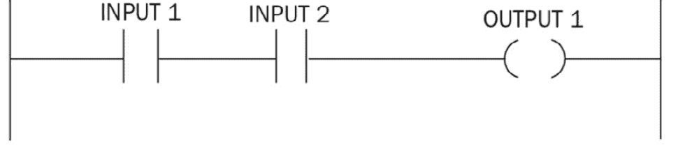

图 8.1 – 使用 LD 的简单与逻辑程序

下图显示了使用 LD 的简单或逻辑程序。当输入 1 或输入 2 或输入 1 和输入 2 都为真（ON）时，输出 1 才会激活：

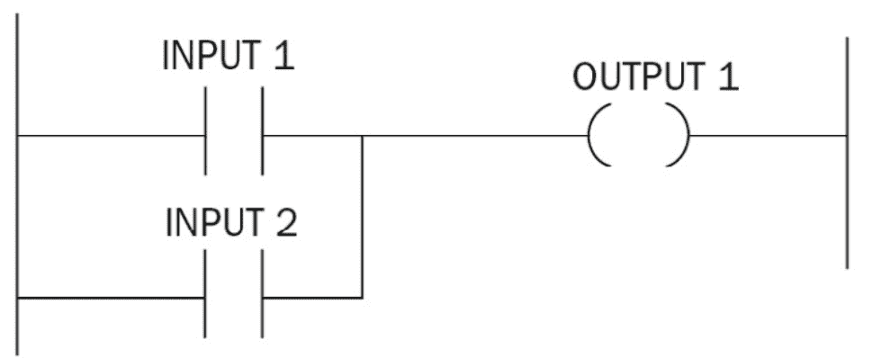

图 8.2 – 使用 LD 的简单或逻辑程序

下图显示了一个结合了与逻辑和或逻辑的程序。如果输入 1 或输入 2 为真且输入 3 为真（ON），则输出 1 将被激活：

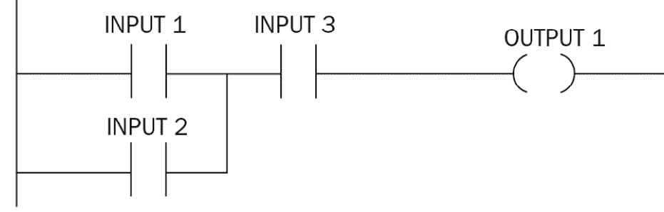

图 8.3 – 一个结合了与逻辑和或逻辑的程序

让我们了解一下 FBD 的样子。

#### 功能块图 (FBD)

这是一种图形化语言，其中程序元素以块的形式表示并连接在一起。包含多行代码的函数被表示为一个块，多个块可以在程序中连接在一起。

下图显示了使用 FBD 的简单与逻辑程序。仅当输入 1 和输入 2 都为真（ON）时，输出 1 才会激活：

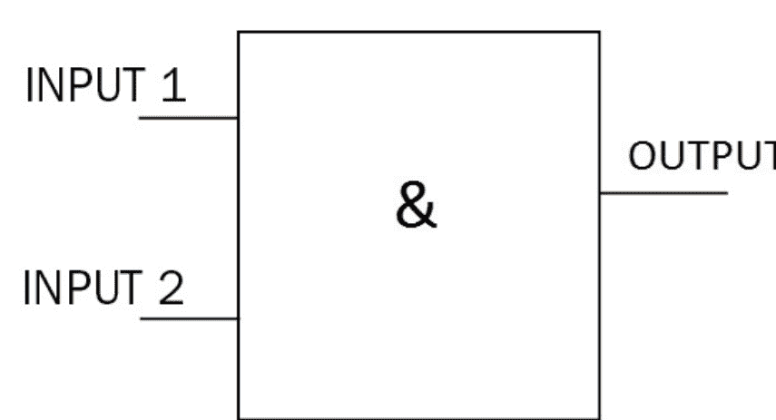

图 8.4 – 使用 FBD 的简单与逻辑程序

下图显示了使用 FBD 的简单或逻辑程序。当输入 1 或输入 2 或输入 1 和输入 2 都为真（ON）时，输出 1 才会激活：

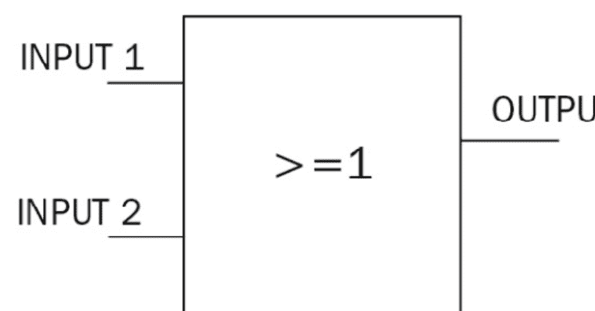

图 8.5 – 使用 FBD 的简单或逻辑程序

下图显示了一个结合了与逻辑和或逻辑的程序。如果输入 1 或输入 2 为真且输入 3 为真（ON），则输出 1 将被激活：

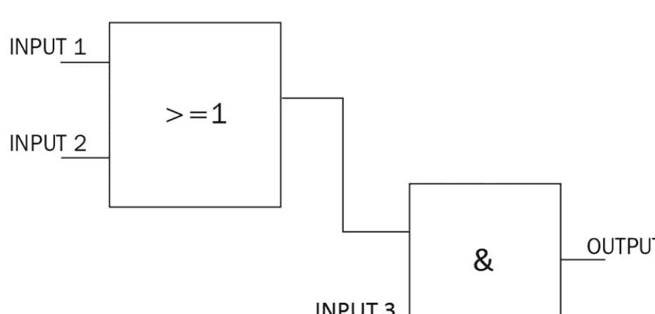

图 8.6 – 一个结合了与逻辑和或逻辑的程序

我们现在将简要讨论我们列表中的下一个编程语言。

#### 指令表 (IL)

这是一种基于文本的语言，类似于汇编语言。指令系列就像汇编语言一样列出。使用 IL 编写的程序比 IEC 为 PLC 编程定义的其它编程语言处理得更快。这种编程语言的一个缺点是调试大型或复杂程序很困难。

以下是使用 IL 编写的示例程序。如果输入 A 或输入 B 为真（ON）且输入 C 为真（ON），则输出 Y 将被激活：

```
LD  A
OR  B
AND C
OUT Y
END
```

让我们现在继续下一个语言。

#### 结构化文本 (ST)

ST 也是一种基于文本的语言，其结构类似于传统的编程语言，如 C、C++、Python 和 Java。它提供了使用 `if`、`while` 和 `for` 等语句处理输入和输出的可能性，这些语句在传统编程语言中很常见。与 LD 或其它一些编程语言相比，复杂算法在 ST 中更容易实现。ST 的一个缺点是程序员在调试时可能遇到的困难。以下代码块显示了使用 ST 编写的简单程序：

```
```st
VAR
        PushButton1: BOOL;
        PilotLamp1: BOOL;
END_VAR
IF PushButton1 = TRUE THEN
        PilotLamp1 := TRUE
        ELSE
                PilotLamp1;
        END_IF
END_IF
```
```

最后，从我们列出的编程语言中，我们将查看 SFC。

#### 顺序功能图 (SFC)

这也是一种图形化编程语言，类似于计算机科学中使用的常规流程图。使用了步骤/状态和转换。单独的步骤（矩形框）描述要执行的操作或动作，并通过垂直线按顺序连接。每个步骤之间都存在转换条件（必须为真才能继续的逻辑语句），如下图所示。使用 SFC 可以轻松地可视化和设计复杂的顺序任务：

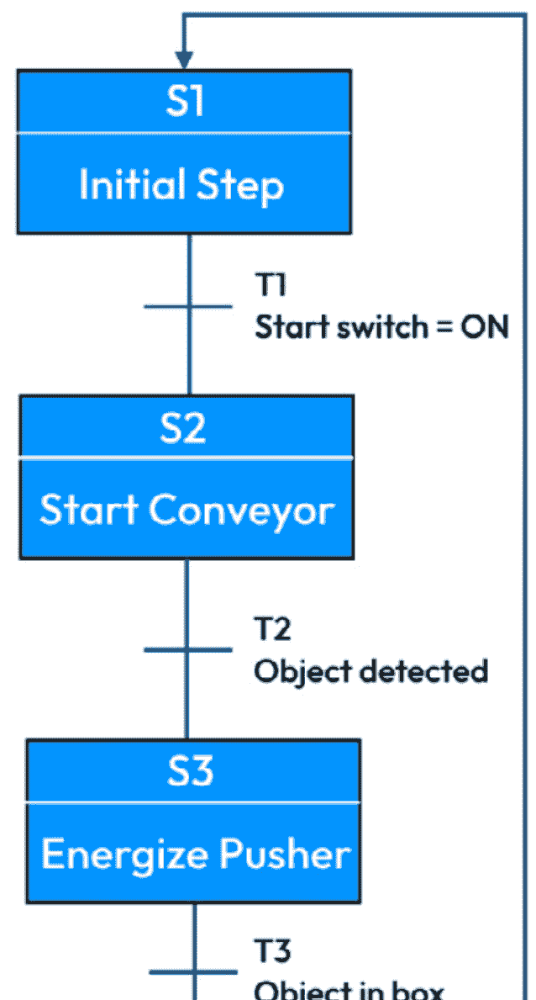

图 8.7 – 使用 SFC 的示例程序

在前面的图中，S1、S2 和 S3 表示步骤，而 T1、T2 和 T3 表示转换。

我们现在应该能够区分 PLC 编程语言（LD、FBD、ST、IL 和 SFC）。刚刚结束的部分，即 *介绍 PLC 编程语言*，并不是要让你成为使用全部五种语言的 PLC 程序员；其目的只是让你对编程语言有一个简要的了解，并能够区分它们。如本章前面所述，我们将重点关注 LD，这将在后续章节中介绍。我们将在下一节中先快速了解一下 PLC 编程设备。

#### 介绍 PLC 编程设备

这些是用于编写、编辑和将程序传输到 PLC 的设备或工具。它们也可以用于从 PLC 读取程序。因此，编程设备可用于下载（写入）或上传（读取）程序。术语下载或写入是指将程序从编程设备传输到 PLC，而术语上传或读取是指将程序从 PLC 传输到编程设备。编程设备还可以帮助排除 PLC 故障。有两种常见的编程设备：

- 手持设备
- 个人计算机（PC）

**手持设备**通常通过电缆连接到 PLC。它们由用于输入程序、编辑程序、将程序下载到 PLC 或从 PLC 上传程序的按键组成。它们还包括用于查看指令的小显示屏。它们体积小，功能有限。

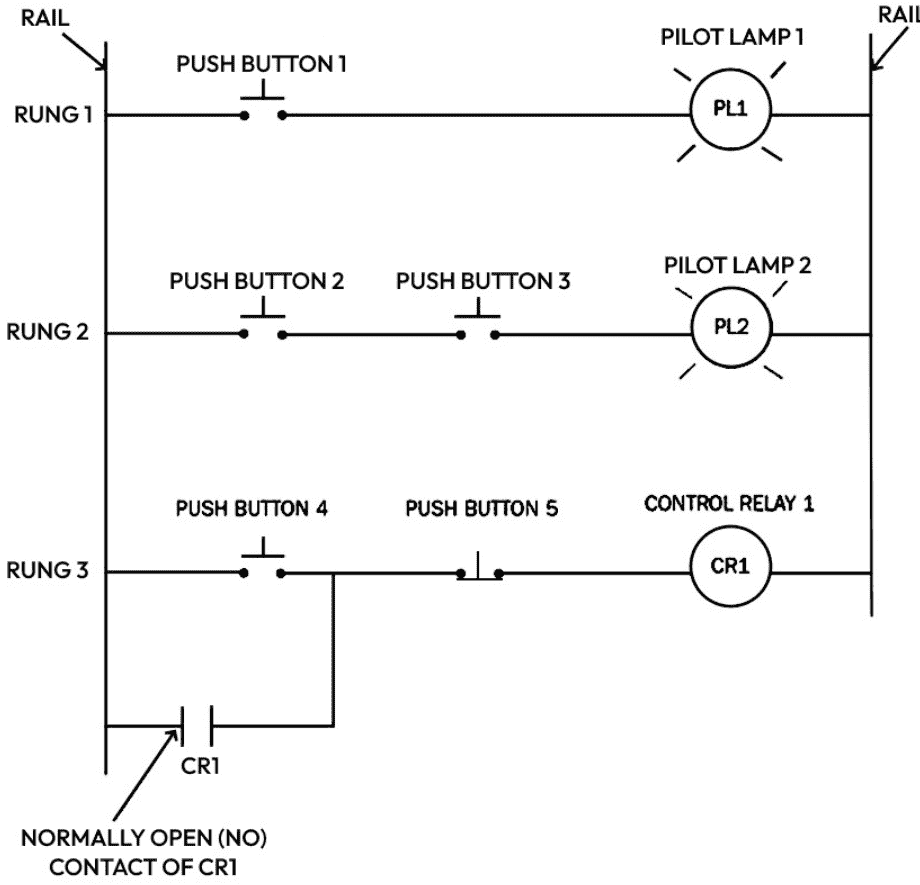

图 8.8 — 一个继电器逻辑电路

在第一级，当按下按钮 1 时，灯 1 将亮起，当释放按钮 1 时，灯 1 将熄灭。

在第二级，必须同时按下按钮 2 和按钮 3 才能使灯 2 亮起。当任一按钮释放时，灯将熄灭。

第三级是一个自锁电路，当按下按钮 4 时会使继电器线圈（CR1）通电。即使按钮释放，线圈仍保持通电。线圈保持通电的原因是继电器线圈（CR1）的常开触点与按钮 4 并联。因此，当按钮被按下时，线圈（CR1）被通电，其触点闭合。CR1 的闭合触点（与按钮 4 并联）为电流流向线圈提供了替代路径。因此，线圈保持通电。按钮 5 是一个停止按钮（常闭），按下时会切断流向线圈的电流，线圈将被断电，直到按下按钮 4。

LD，我们将在本节和后续章节中学习，与继电器逻辑电路相似。这就是为什么大多数技术人员发现它很容易理解和操作的原因。但与使用如前图所示的组件符号的继电器逻辑电路不同，LD 使用符号表示法来表达逻辑操作。以下屏幕截图显示了使用西门子编程软件的前述电路的 LD：

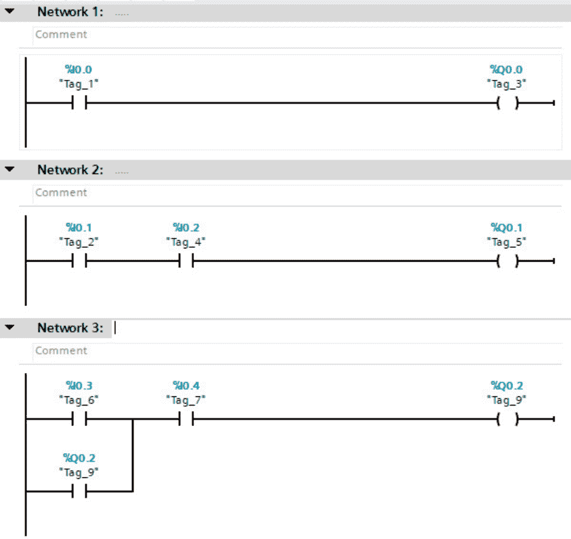

图 8.9 – 使用西门子编程软件的 LD

下图显示了如何将按钮连接到 PLC 以使程序按要求运行。实际上，使用 PLC 和 LD 来实现 *图 8.8* 中的继电器逻辑电路并不经济。这里使用 PLC 和 LD 实现这种简单逻辑的原因是为了帮助理解并让你看到继电器逻辑电路与 LD 编程语言之间的关系：


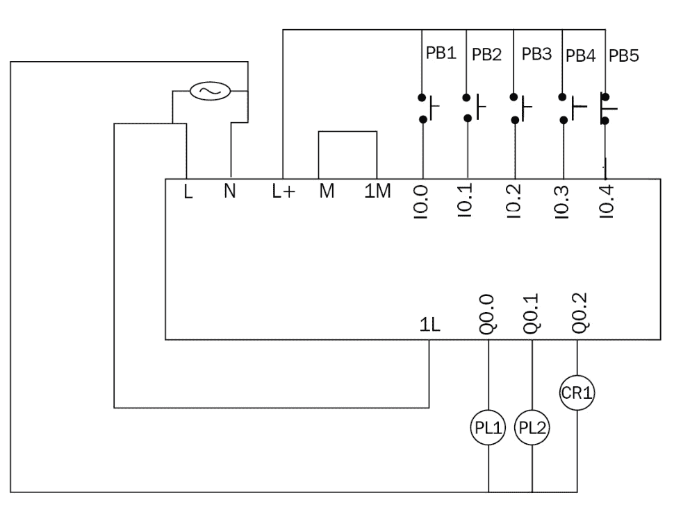

Figure 8.10 – Push buttons, pilot lamps, and control relay wired to a PLC (S7-1200, CPU1211C, AC/DC/Rly)

我们现在应该已经对 LD 有了基本了解。后续章节将提供进一步的知识，帮助你开始使用 LD 编程 PLC。

#### Exploring the elements of LD (ladder logic) program

要使用 LD 编写程序。你需要了解构成梯形图程序的元素。以下元素构成 LD（梯形逻辑）程序：

- Rails: 这是两条垂直线，一条在最左侧（热轨），另一条在最右侧。最左侧的垂直线称为热轨，而最右侧的可以称为中性线。
- Rungs: 这些是连接两条导轨以完成电路的水平线。电功率从热轨流向中性轨。它将导轨连接到逻辑表达式。
- Inputs: 输入是表示连接到 PLC 的输入设备的常开和常闭触点符号，例如按钮、选择开关、限位开关或浮球开关。连接到 PLC 的输入设备的状态决定了程序中常开或常闭触点符号是打开还是关闭。
- Output: 输出是表示连接到 PLC 的输出设备的线圈符号，例如指示灯、继电器、接触器或电磁阀。
- Logic expression: 这是输入和输出符号的组合，用于形成所需的控制功能。
- Address notation and tag names: PLC 使用地址来标识每个输入和输出点，其中外部设备（输入和输出设备）连接到 PLC。你连接每个输入设备或输出设备的点都有一个地址，PLC 用它来识别它。PLC 还使用地址来标识内部/软件创建的设备，例如继电器、定时器和计数器。每个制造商用于标识其 PLC 中的输入/输出（输入/输出点）和软件创建设备的地址使用不同。在编程特定 PLC 制造商或 PLC 型号之前，程序员需要知道其使用的寻址或地址表示法。

例如，西门子使用 I 表示输入，Q 表示输出。我们基本上可以将输入作为 I0.0、I0.1、I0.2 等，输出作为 Q0.0、Q0.1、Q0.2、Q0.3 等。西门子中的软件创建继电器/辅助继电器为 M0.0、M0.1、M0.2 等。三菱使用 X 表示输入，Y 表示输出。我们基本上可以将输入作为 X000、X001、X002 等，输出作为 Y000、Y001、Y002 等。三菱 PLC 中的软件创建继电器/辅助继电器为 M0、M1、M2 等。然而，本书的重点将是西门子 PLC（S7 1200 CPU 1211C AC/DC/RLY）。地址表示法只是对每个输入/输出（输入或输出点）和软件创建设备，例如继电器、定时器和计数器，而标签名称是对地址的描述。

S7 1200（CPU 1211C AC/DC/RLY）有六个数字输入和四个数字输出，可以在程序中如下寻址：

- Inputs: `I0.0, I0.1, I0.2, I0.3, I0.4, I0.5`
- Outputs: `Q0.0, Q0.1, Q0.2, Q0.3`

你可以在 PLC 或 PLC 型号的手册中找到其输入/输出寻址。务必阅读你想要编程的任何 PLC 的文档/手册。

- Comments: 注释用于描述 LD 中某一横档或一组横档将执行的逻辑操作。它们通常显示在每个横档的开头。它们使程序易于理解。

下图显示了带标签的示例 LD：

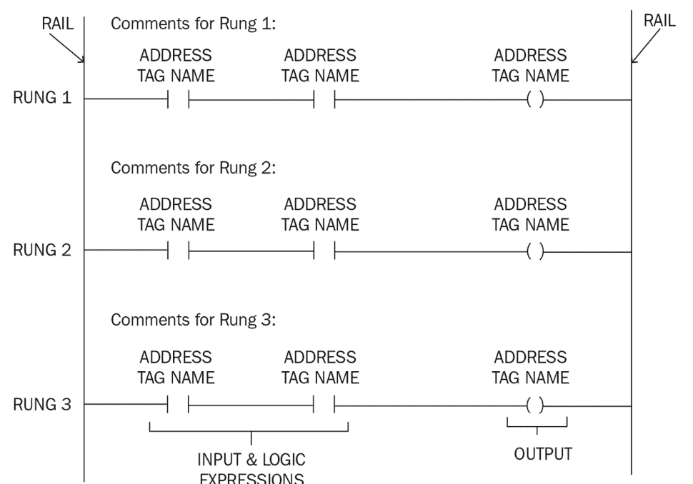

Figure 8.11 – LD with labels

我们现在将学习使用 LD 编程 PLC 的规则。

#### Rules for LD programming

以下规则将有助于使用 LD 编写良好的程序：

- Inputs (NO contact and NC contact) can be connected in parallel or series in LD:

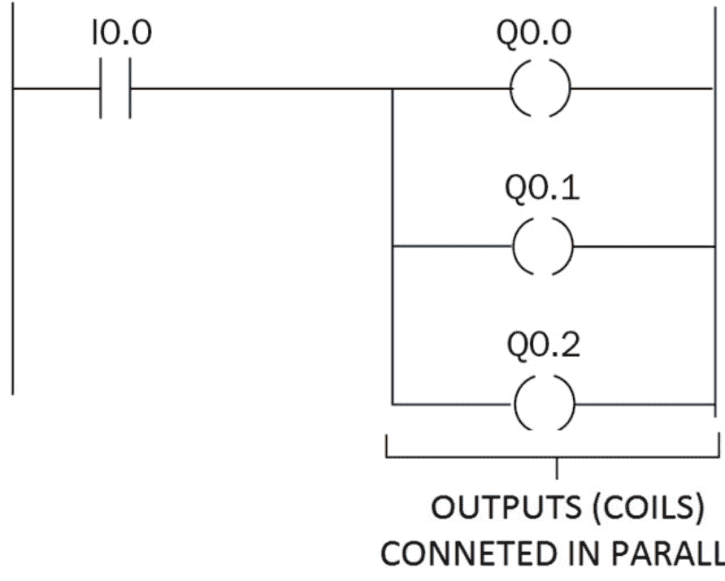

Figure 8.13 – Outputs (coils) connected in parallel

- One input can be used several times in one program; that is, a single input can be used in a different rung:

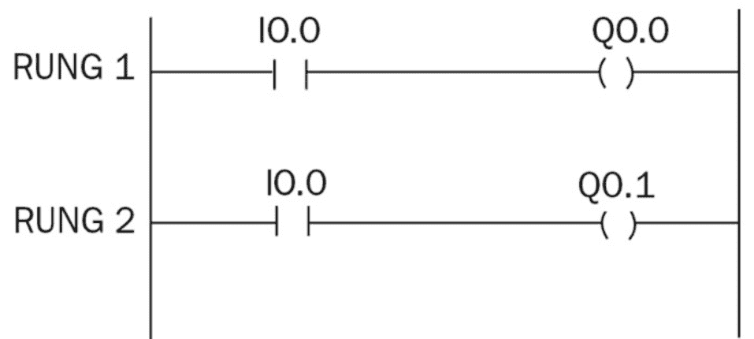

Figure 8.14 – Same input is used in rung 1 and rung 2

一个输出不能在一个程序中被多次使用，除非在置位/复位和锁存/解锁程序中：

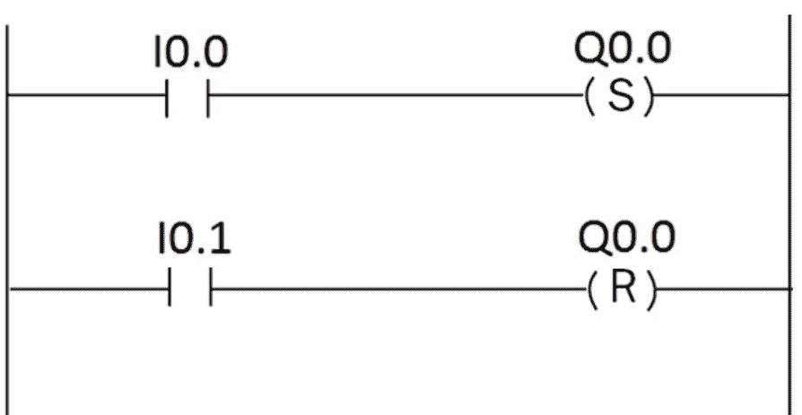

Figure 8.15 – One output used twice for set/reset in a Siemens PLC program

下图显示了 Allen-Bradley PLC 程序中的一个简单的锁存和解锁程序：

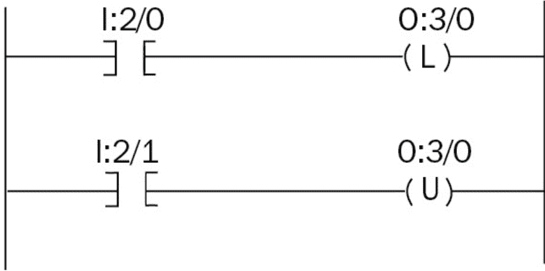

Figure 8.16 – One output used twice for latch/unlatch in an Allen-Bradley PLC program

- The address of an output (coil) can be used for input (NC or NO contact). You can use the address of an output (coil) for an input (NC or NO contact), which makes the input have the same logic state (1 or 0) as the output; that is, if the output is ON (1), the input will be HIGH (1), and if the output is OFF, the input will be LOW (0).

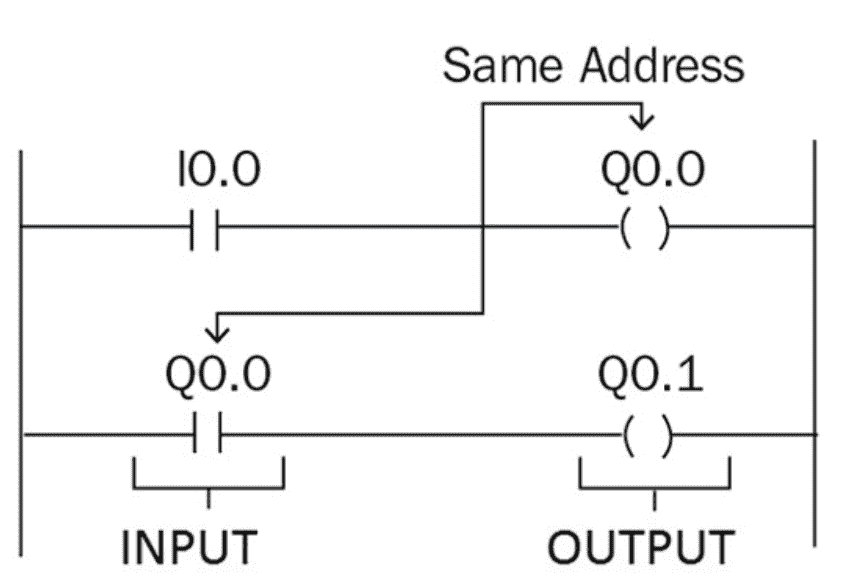

Figure 8.17 – Sample program showing output address used as input address

> The address of an input cannot be used for output. Don't make the mistake of using an input address for output (coil).

我们现在应该知道 LD 编程的规则。这些规则将在后续章节中使用 LD 编写程序时应用。我们将继续下一节学习如何下载和安装编程软件以及模拟器。

#### Downloading and installing TIA Portal V13 Professional and PLCSIM

西门子提供其编程软件（TIA Portal）的 21 天免费试用。还有一个模拟器，允许你模拟程序。

因此，即使你没有真正的 PLC，你也可以编写程序并通过使用模拟器（PLCSIM）查看其运行情况。你可以免费在线下载 TIA Portal V13 Professional 和 PLCSIM 以学习 PLC 编程，或购买 TIA Portal 许可证以避免任何限制。

#### Downloading TIA Portal V13 and PLCSIM

下载 TIA Portal V13 和 PLCSIM 应遵循以下步骤：

- 1. 第一步是访问下载页面。以下链接应带你到下载页面：

https://support.industry.siemens.com/cs/document/109745155/simatic-step-7-including-plcsim-v13-sp2-trial-download?dti=0&lc=en-WW

以下屏幕截图显示了前述链接的页面：

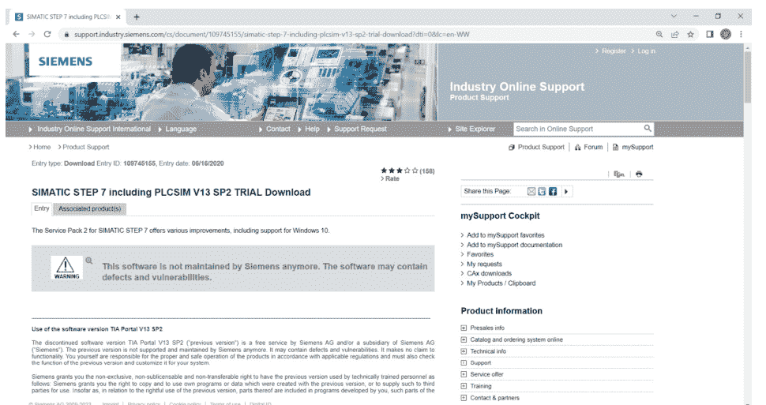

##### Figure 8.18 – Download page of Siemens TIA Portal V13 Professional and PLCSIM (1)

- 2. 滚动到 **STEP 7 Professional V13 SP2** 部分，如以下屏幕截图所示，并下载同一文件夹中指示的所有文件：

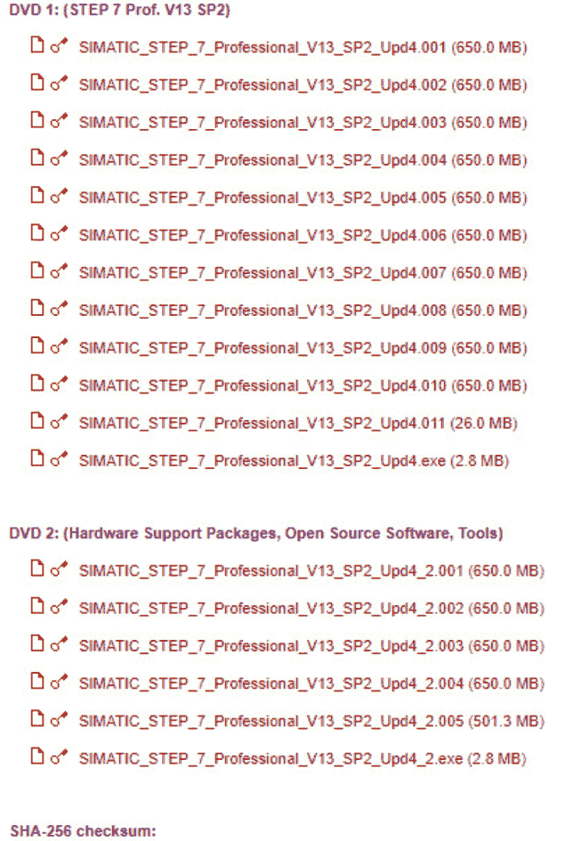

##### Figure 8.19 – Download page of Siemens TIA Portal V13 Professional and PLCSIM (2)

##### Note

一旦你点击任何文件进行下载，就会弹出登录屏幕。如果你已有用户名和密码，则需要使用你的西门子工业在线支持用户名和密码登录；如果没有，你将必须点击 **Yes, I would like to register now**，按照说明完成注册，然后登录下载文件。

3. 此外，滚动到 **SIMATIC STEP 7 PLCSIM V13 SP2 for STEP 7 Basic and STEP 7 Professional** 并下载同一文件夹中指示的所有文件，如以下屏幕截图所示：

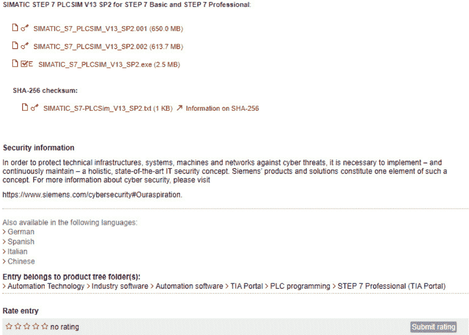

Figure 8.20 – Download page of Siemens TIA Portal V13 Professional and PLCSIM (3)

让我们在下一节学习如何安装 TIA Portal V13。


#### 安装 TIA Portal V13

按照以下步骤安装 TIA Portal V13：

- 1. 打开你已下载 TIA Portal V13 文件的文件夹，并双击安装文件（`SIMATIC_STEP_7_Professional_V13_SP2_Upd4.exe`）。

如果操作正确，你应该会看到以下屏幕：

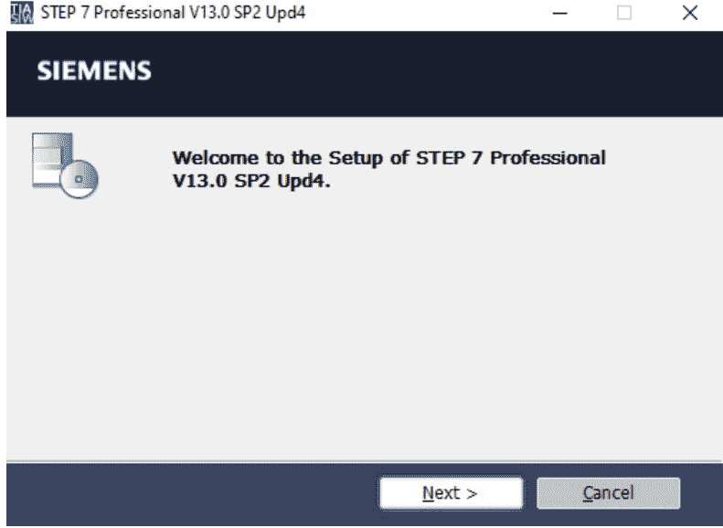

Figure 8.21 – Installing TIA Portal V13

- 2. 点击 **Next** 继续安装。在 **License Transfer** 屏幕上，点击 **Skip license transfer**。按照屏幕上的说明完成安装，并在提示时重启电脑或笔记本。

让我们在下一节学习如何安装 PLCSIM。

#### 安装 PLCSIM

需要按照以下步骤安装 PLCSIM：

- 1. 打开你已下载 PLCSIM 文件的文件夹，并双击安装文件（SIMATIC_S7_PLCSIM_V13_SP2.exe）。

如果操作正确，你应该会看到以下屏幕：

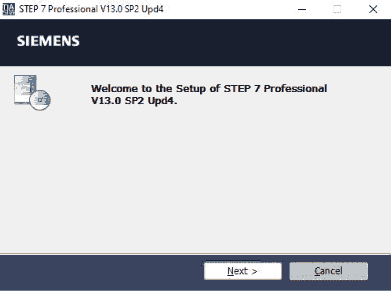

Figure 8.22 – Installing PLCSIM

- 2. 按照屏幕上的说明完成安装，并在提示时重启电脑或笔记本。

我们现在已经成功下载并在电脑上安装了 TIA Portal V13 和 PLCSIM。我们将在本章后续部分以及下一章中使用此软件进行练习。我们将通过创建项目并在下一节学习如何使用软件开始。

Figure 8.24 – Configuring a device in TIA Portal V13 (1)

3. 点击 Devices & networks。

Figure 8.25 – Configuring a device in TIA Portal V13 (2)

4. 点击 Add new device 并选择 Controllers。

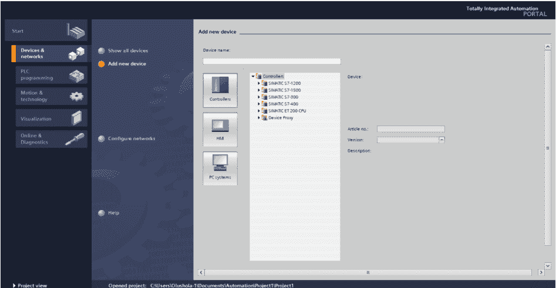

##### Figure 8.26 – Configuring a device in TIA Portal V13 (3)

5. 展开 SIMATIC S7 1200 | CPU | CPU1211C AC/DC/Rly 并在 Automation License Management - STEP 7 Basic 对话框中点击 STEP 7 Professional，如以下屏幕截图所示：

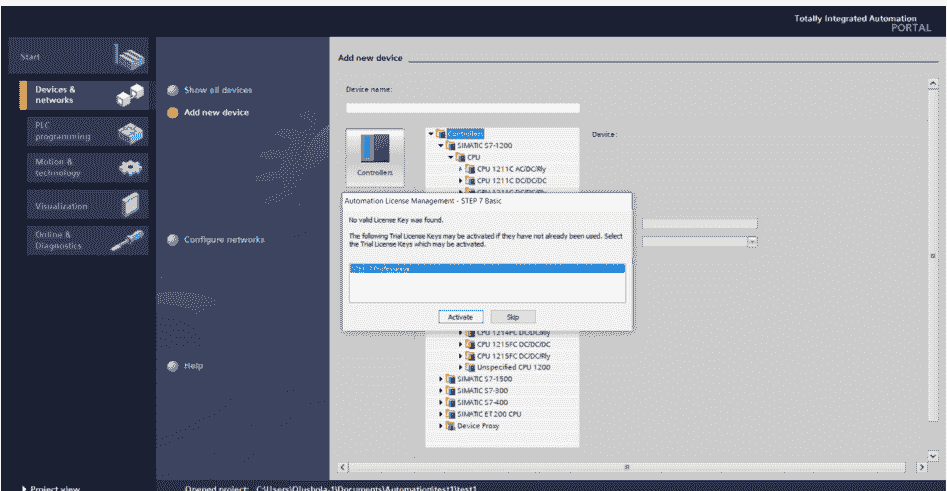

##### Figure 8.27 – Configuring a device in TIA Portal V13 (4)

6. 点击 Activate 以激活 21 天试用许可证，并从列表中选择 PLC 的物料编号，例如 6ES7 211-1BE40-0XB0，如图所示：

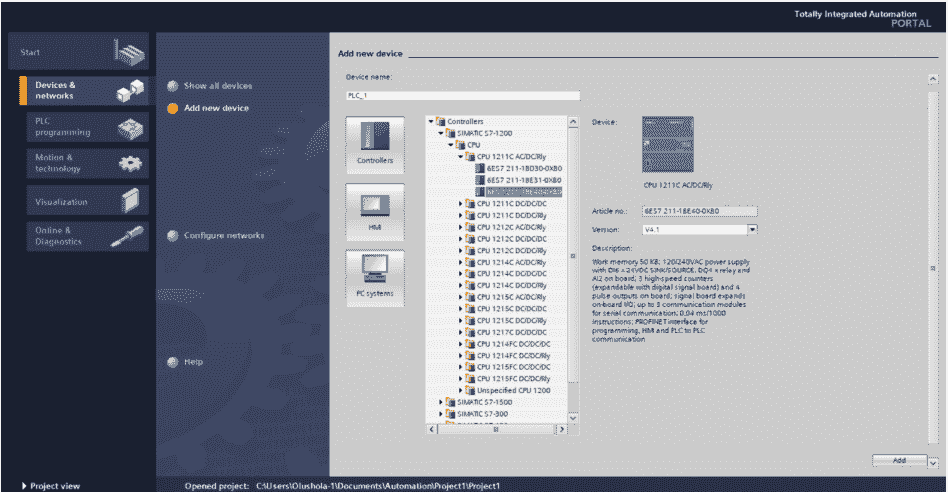

Figure 8.28 – Configuring a device in TIA Portal V13 (4)

7. 在前面的屏幕截图中点击 Add。你应该会看到以下屏幕：

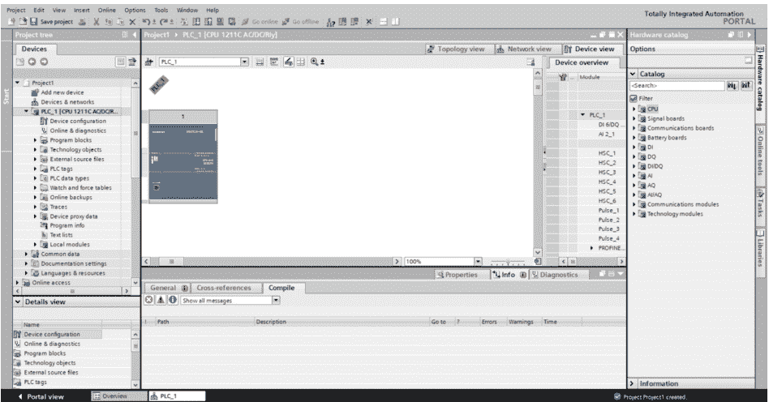

##### Figure 8.29 – Writing a program in Siemens TIA Portal (1)

8. 在屏幕左侧的项目树中，展开 Programming blocks 并双击 Main [OB1] 进入编程环境：

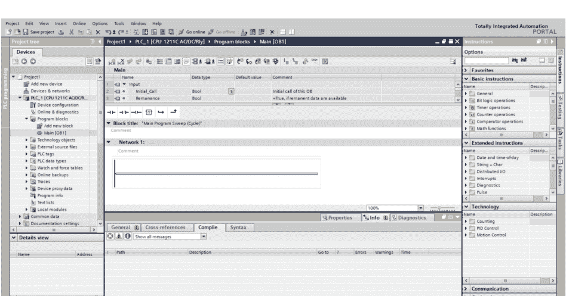

##### Figure 8.30 – Writing a program in Siemens TIA Portal (2)

恭喜，你现在已到达编写、编辑和下载程序到 PLC 的界面。

我们现在将编写一个简单的程序。我们的第一个梯级将是简单的逻辑，用于在按下按钮时点亮灯。第二个梯级将是简单的与逻辑，其中两个常开触点必须都为 ON 才能使输出被激励，而第三个梯级将是简单的或逻辑，其中任一触点为 ON 即可使输出被激励。

让我们在编写上述程序之前先简要了解一些需要注意的基本指令：

Figure 8.32 – Using NO contact instruction (1)

- 2. 双击问号（?? .?）并输入开关、按钮或传感器物理连接的输入通道地址，例如 I0.0。

- 3. 按 Enter 两次以显示以下屏幕截图中的内容：

Figure 8.33 – Using NO contact instruction (2)

让我们学习如何使用常闭触点。

##### NC contact

Figure 8.35 – Using NC contact instruction (2)

让我们继续学习线圈/赋值。

##### Coil/assignment

这代表一个继电器，当有电通过时会被激励。当没有电通过时会被去激励。物理连接到其通道的负载（灯或其他执行器）会在其被激励时打开。

在 TIA Portal 中使用线圈/赋值的步骤如下：

- 1. 将线圈/赋值拖到网络中的线路上，如以下屏幕截图中箭头所示：

Figure 8.36 – Using coil/assignment instruction (1)

- 2. 双击问号（??.) 并输入灯或执行器物理连接的输出通道地址，例如 Q0.0。

- 3. 按 Enter 以显示以下屏幕截图中的内容：

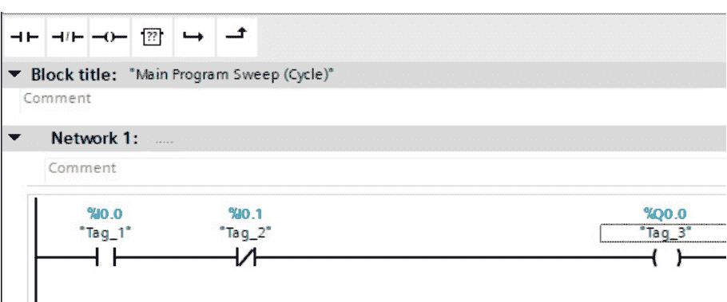

Figure 8.37 – Using coil/assignment instruction (2)

让我们现在讨论上述程序的工作原理。

##### Explanation of the program

PLC 中的接线和编程协同工作。让我们考虑图 8.38 中的接线来解释程序。常开按钮（PB1 和 PB2）分别连接到 I0.0 和 I0.1，而指示灯（PL1）连接到 Q0.0。

当连接到 I0.0 的常开按钮（PB1）被按下时，程序中地址为 I0.0 的常开触点将闭合以允许信号流过。由于程序中地址为 I0.1 的第二个输入为常闭，并且常开按钮（PB2）连接到 I0.1，因此输出（Q0.0）将被激励，灯将保持打开，只要 PB2 未被按下。如果 PB2 被按下，程序中地址为 I0.1 的常闭触点将打开，输出（Q0.0）将被去激励：

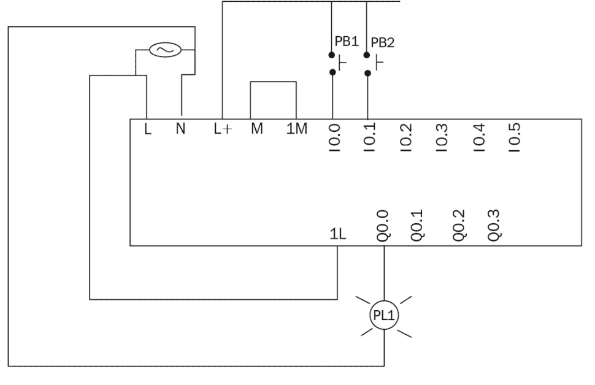

Figure 8.38 – Wiring two push buttons and a pilot lamp to S71200 CPU 1211C AC/DC/RLY

让我们学习空方框。

##### Empty box

空方框允许你选择所需的指令，例如，常开触点、常闭触点、线圈/赋值（=）、延时接通定时器（TON）或计数器向上（CTU）。

让我们在以下步骤中学习如何使用空方框选择所需的指令：

- 1. 将空方框拖到网络 2 中的线路上，如图所示：

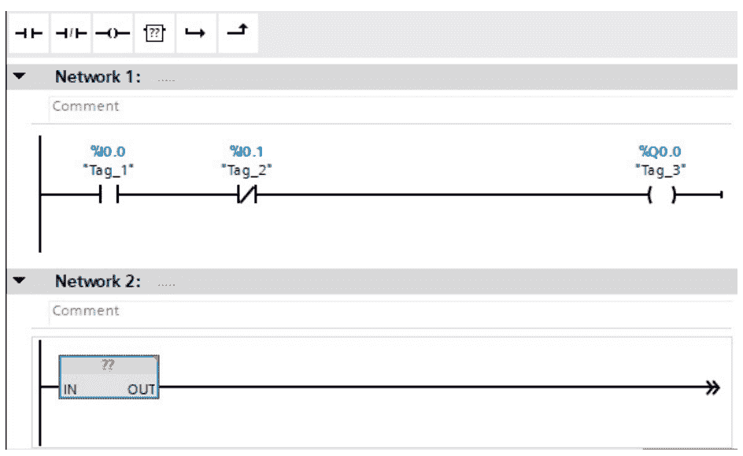

Figure 8.39 – Using empty box (1)

- 2. 双击两个问号（??）并点击方框右侧的图标以查看可选择的指令列表，如以下屏幕截图所示：

##### Figure 8.40 – Using empty box (2)

3. 选择 NO 指令，例如，然后按 Enter 两次。你应该会看到以下屏幕截图中的内容：

##### Figure 8.41 – Using empty box (3)

4. 双击问号（?? .?）并输入按钮、开关或传感器物理连接的输入通道地址，例如 I0.2。

- 5. 按 Enter 以显示以下屏幕截图中的内容：

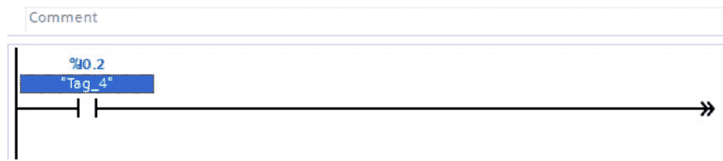

Figure 8.42 – Using empty box (4)

- 6. 重复步骤 1-5 以添加一个线圈/赋值（=）指令并为其指定地址 Q0.1，该地址指的是灯或执行器物理连接的输出通道地址。你应该会看到以下屏幕截图中的内容：

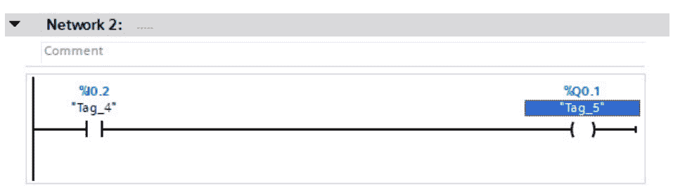

Figure 8.43 – Adding coil/assignment to the rung

让我们讨论上述程序的工作原理。

##### Explanation of the program

假设常开按钮（PB3）连接到 I0.2，而指示灯（PL2）连接到 Q0.1，如图 8.44 所示。当 PB3 被按下时，程序中 NO 触点 I0.2 将闭合，信号将流动，地址为 Q0.1 的线圈将被激励。连接到 Q0.1 的指示灯 PL2 将打开。当 PB3 被释放时，地址为 I0.2 的 NO 触点将打开，地址为 Q0.1 的线圈将被去激励，使连接到 Q0.1 的指示灯（PL2）关闭：

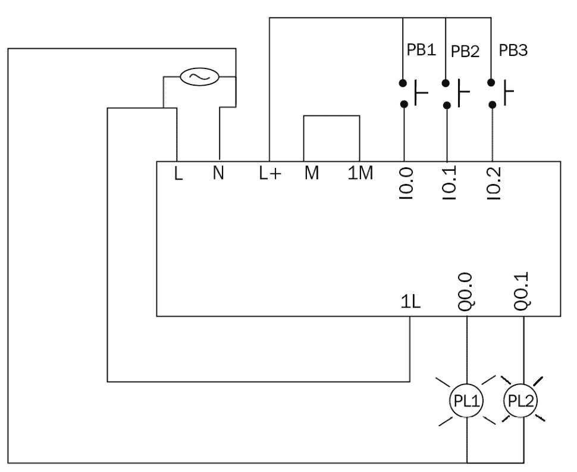

Figure 8.44 – Wiring three push buttons and two pilot lamps to S71200 CPU 1211C AC/DC/RLY

让我们继续学习如何使用开分支。

##### Open branch

顾名思义，它打开一个分支。当指令需要并联连接时使用。


图 8.46 – 向分支添加指令（1）

- 3. 双击问号（???），然后输入输入通道的地址，该通道物理上连接了开关、按钮或传感器，例如 I0.3。

- 4. 按两次 Enter 键，即可得到以下截图所示的内容：

恭喜！你已经成功完成了本书的第 8 章。本章讲解了 PLC 的软件部分。现在你应该能够区分各种编程语言了。你还应该能够解释编程设备、编程软件、LD 的基础知识等。工业自动化工程师需要了解 LD 的要素和 LD 编程规则，本章对此进行了详细讲解。现在你应该熟悉西门子编程软件（TIA Portal），并能够使用它通过最常用的 PLC 编程语言（LD）编写一些基本的 PLC 程序。

下一章将进一步讨论 PLC 编程。你将学习如何模拟程序、如何将程序下载到实际的 PLC 中，以及如何编写比本章学到的更高级的程序。

#### 问题

以下问题用于测试你对本章内容的理解。在尝试回答这些问题之前，请确保你已经阅读并理解了本章的主题：

- 1. ______________ 是一组用计算机能理解的语言编写的指令，用于执行任务。
- 2. ______________ 是一组文本或图形形式的指令，表示将针对特定工业任务或应用执行的控制功能。
- 3. 根据 IEC 标准，IEC 61131 第 3 部分中规定的五种用于编写 PLC 程序以控制和自动化任务的编程语言分别是 ______________、______________、______________、______________ 和 ______________。
- 4. ______________ 是几种 PLC 编程语言中最常用的一种。它是一种图形化编程语言，大多数工厂技术人员很容易理解，因为它类似于他们所熟悉的继电器图。
- 5. IEC 是 ________________________ 的首字母缩写。
- 6. ________________________ 是一种图形化语言，其中程序元素以块的形式表示并连接在一起。
- 7. ________________________ 是一种类似于汇编语言的基于文本的语言。
- 8. 两种常见的编程设备是 ________________ 和 ________________。
- 9. ________________________ 是连接两条导轨以构成完整回路的水平线。
