### 使用 TIA Portal 深入探讨 PLC 编程

在上一章中，我们学习了 PLC 编程的基础知识，包括 PLC 编程语言、PLC 编程设备、PLC 编程软件、梯形图基础知识、梯形图（梯形逻辑程序）的要素、梯形图编程规则、下载并安装 TIA Portal V13 Professional 和 PLCSIM，以及如何使用编程软件（TIA Portal）创建项目并编写一些程序。

在本章中，你将通过练习使用在上一章中下载和安装的编程软件来更深入地学习。本章还包括程序模拟，即使你没有真实的 PLC 来测试或练习，也能在 PC 或笔记本电脑上直接看到所编写程序的结果。

我们将在本章中介绍以下主要主题：

- 打开已保存的程序
- 使用 PLCSIM 在西门子 TIA Portal 中模拟程序
- PLC 编程中的置位和复位
- 在程序中使用输出地址作为输入
- 使用 SET 和 RESET 指令
- 使用定时器指令
- 使用计数器指令
- 使用移动指令
- 使用比较指令
- 使用 PLC 进行液位控制

图 9.1 – 打开已保存的程序 – 最近使用的项目

- 3. 单击“打开”后，你应该会看到以下屏幕。单击“打开项目视图”：

图 9.2 – 打开已保存的程序 – 打开项目视图

程序将打开并显示梯形图，如下面的截图所示：

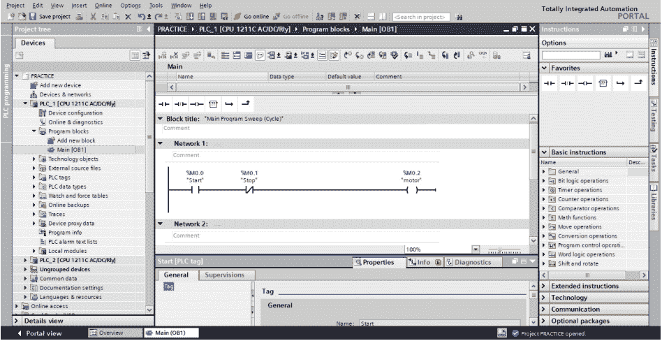

图 9.5 – 程序已打开并显示梯形图

我们刚刚学习了如何在 TIA Portal 中打开已保存的程序。接下来，我们将在下一节中学习如何模拟程序。

#### 使用 PLCSIM 在西门子 TIA Portal 中模拟程序

现在我们将学习如何使用西门子 TIA Portal 模拟程序。我们将使用上一章编写的程序作为示例：

- 1. 使用上一节中的步骤打开项目/程序。你应该会看到如下截图所示的内容。单击“编译”图标，并确保程序中没有错误。

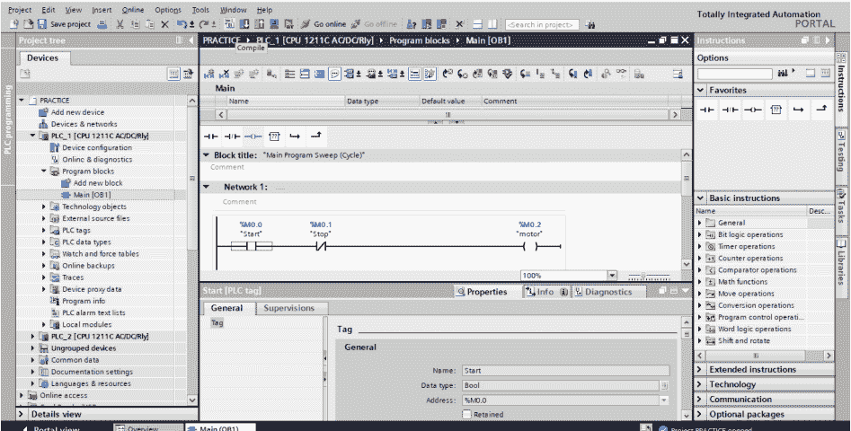

图 9.6 – 已打开的项目，显示“编译”按钮（红色箭头）

- 2. 单击“开始仿真”图标，如下面的截图所示：

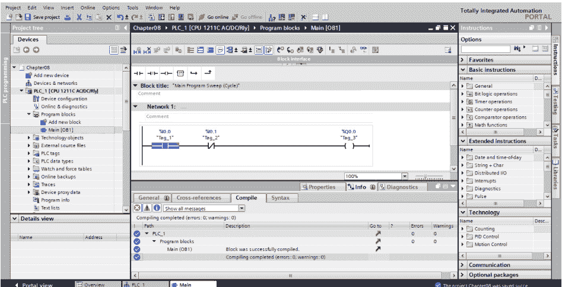

图 9.7 – 已编译的程序显示没有错误，即 0 个错误

- 3. 将出现如下所示的警告消息。单击“确定”：

图 9.8 – 仿真 – 警告消息

你应该会看到类似于以下截图的内容：

图 9.9 – 仿真 – “扩展下载到设备”对话框

- 4. 在 PG/PC 接口列表中选择 PLCSIM S7-1200/S7-1500，然后点击“开始搜索”。选择地址为 192.168.0.1 的 CPUcommon，然后点击“加载”：

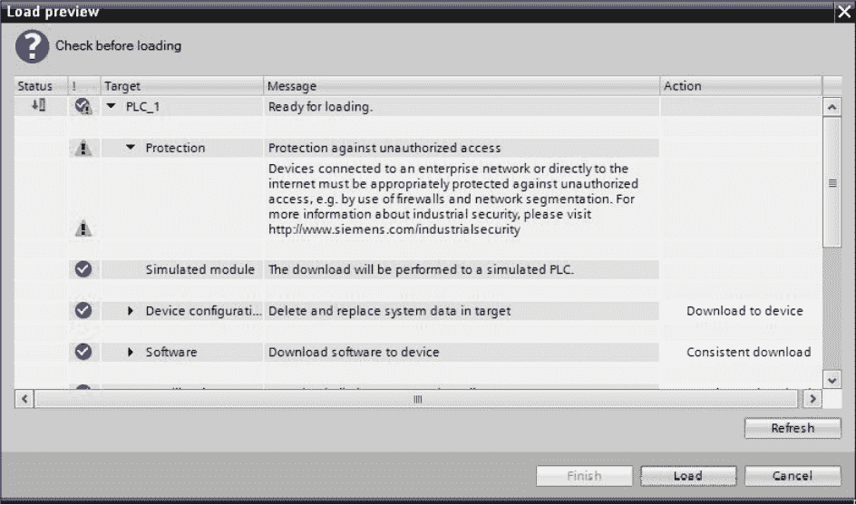

图 9.12 – 仿真 – 摘要屏幕

- 7. 勾选**全部启动**，然后点击**完成**：

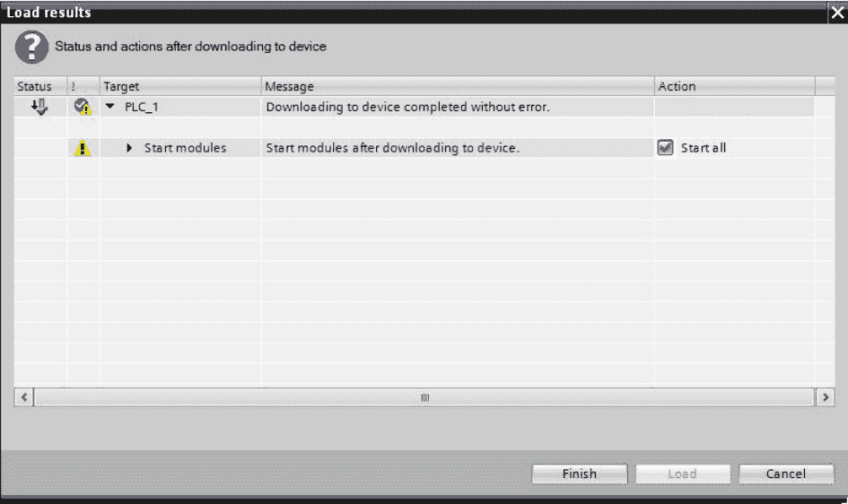

图 9.13 – 仿真 – 加载结果

你应该会看到类似于以下截图的内容：

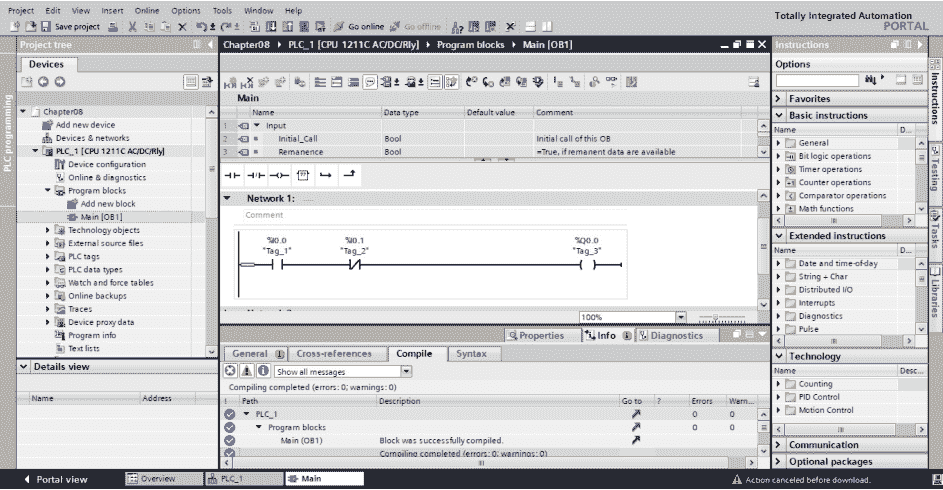

图 9.14 – 仿真 – 程序已准备好进行仿真；PLCSIM 位于任务栏上

- 8. 单击任务栏上的 **PLCSIM**，将仿真器显示在屏幕上，如下面的截图所示。单击**切换到项目视图**图标：

图 9.15 – 仿真 – 仿真器位于屏幕左上角

你的屏幕应该类似于下面的截图：

图 9.16 – 仿真 – 仿真器的项目视图

- 9. 展开左侧窗格，使其看起来像下面的截图：

图 9.17 – 仿真 – 展开的左侧窗格

- 10. 展开“SIM 表”：

图 9.18 – 仿真 – SIM 表

- 11. 双击“SIM 表_1”：

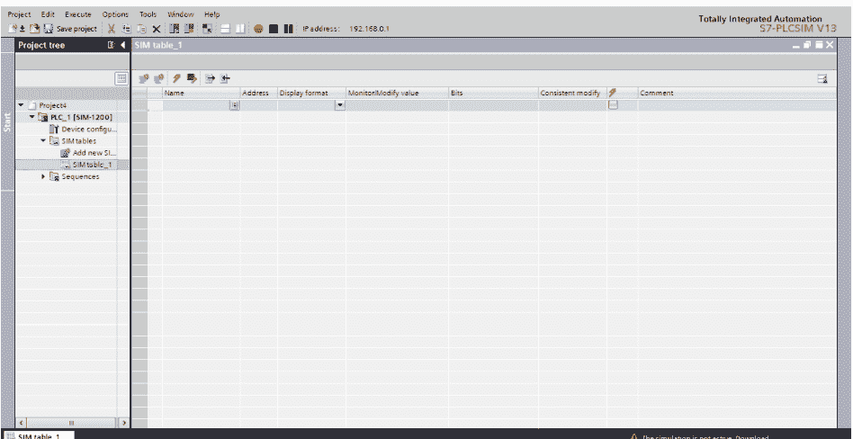

图 9.19 – 仿真 – SIM 表_1

- 12. 在“地址”列中添加你使用的所有 I/O 地址，如下面的截图所示：

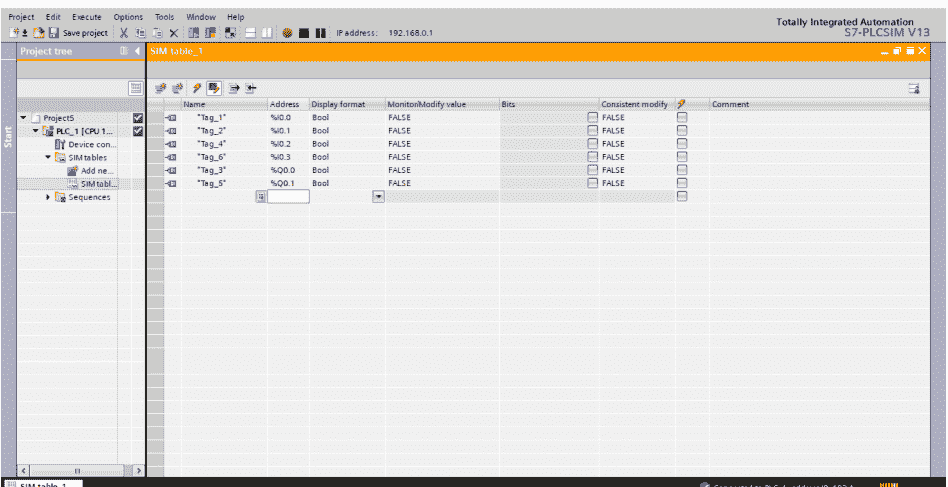

图 9.20 – 仿真 – 添加了 I/O 地址的仿真器项目视图

图 9.22 – 仿真 – 重新排列屏幕，以同时显示程序和仿真器的项目视图（已添加 I/O 地址）

现在，让我们模拟网络 1。在上面的截图中，可以看到 I0.0 的位未被标记，而输出 Q0.0 保持关闭，因为信号无法流向它。

标记 I0.0 的位。地址为 Q0.0 的线圈将变为打开状态，如下面的截图所示：

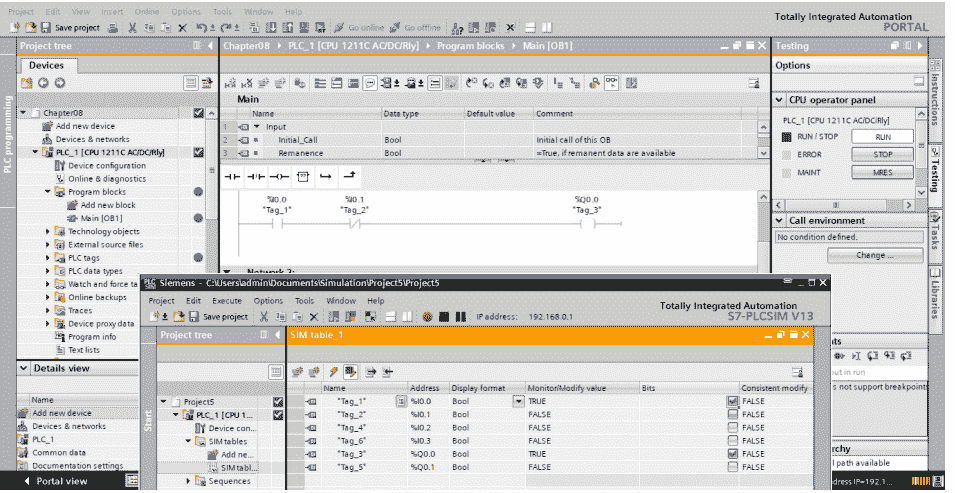

图 9.23 – 仿真 – 网络 1 的仿真结果

你可以在仿真器中标记或取消标记任何输入地址的位，以将其打开或关闭，并观察输出如何响应输入。

现在让我们模拟网络 2。标记 I0.2 的位。Q0.1 将变为打开状态，如下面的截图所示：

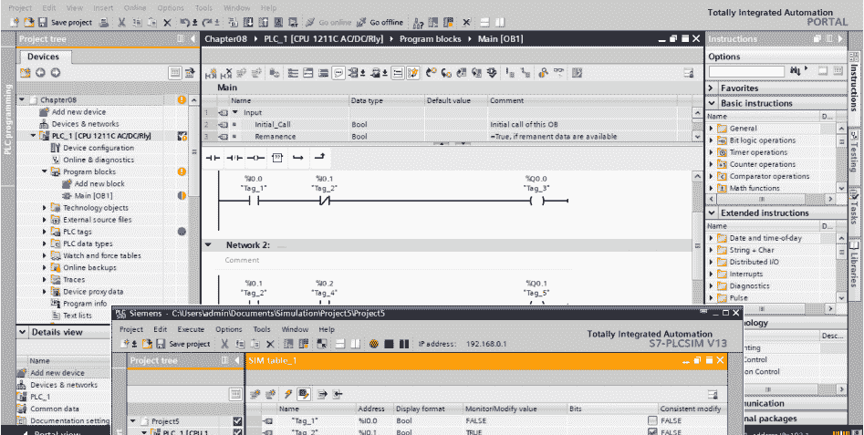

图 9.24 – 仿真 – 当 I0.2 被置位（ON）时网络 2 的仿真结果

取消置位 I0.2 的位，并置位 I0.3 的位。Q0.1 仍会变为 ON，如下面的截图所示：

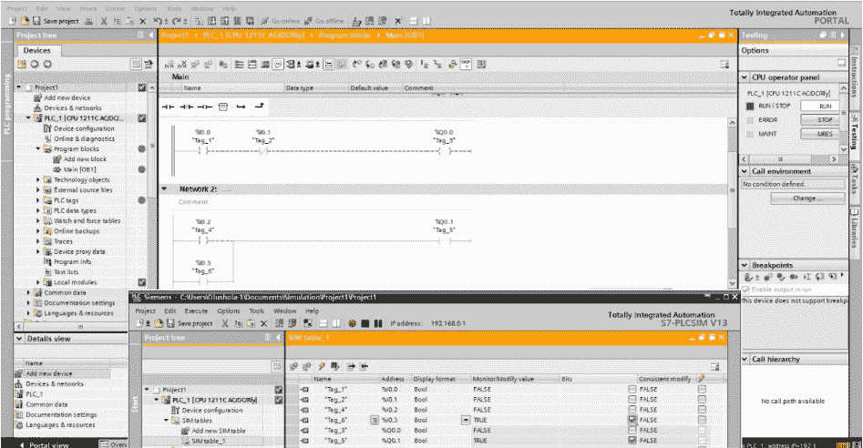

图 9.25 – 仿真 – 当 I0.2 未被置位且 I0.3 被置位时网络 2 的仿真结果

观察信号（绿色）如何从左向右流动，在您接通输入时使线圈（输出）变为 ON。

要结束仿真并继续编写程序，请单击“监视开/关”图标以关闭监视模式。单击“是”：

图 9.26 – 用于离线切换的确认消息

您可以使用上一节中介绍的指令（常开触点、常闭触点和赋值/线圈）继续编写或编辑程序。

执行以下步骤来仿真您对程序所做的其他更改：
- 1. 单击“编译”，然后单击“下载到设备”。
- 2. 单击“加载”，然后单击“监视开/关”以打开监视模式。
- 3. 在仿真器的项目视图中，像我们之前所做的那样，添加您在程序中使用的输入或输出地址。
- 4. 通过置位或取消置位您要打开或关闭的输入地址的位来测试您的程序。

我们已经了解了如何使用西门子 TIA Portal 进行程序仿真。接下来，我们将了解 PLC 编程中的置位（锁存）和复位（解锁）技术。

#### PLC 编程中的置位（锁存）和复位（解锁）

置位（锁存）是一种用于在输入停止后仍保持输出通电或被激活的技术。锁存使瞬时按钮起到保持开关的作用；换句话说，在按下按钮后，输出被打开并保持通电（ON），即使在按钮释放后也是如此。

复位（解锁）只是一种用于使已锁存的输出断电的方法或技术。

#### 使用常开启动按钮和常开停止按钮的置位与复位程序

在网络 3 中编写以下简单程序，以了解使用常开启动按钮和常开停止按钮时置位与复位的工作原理：

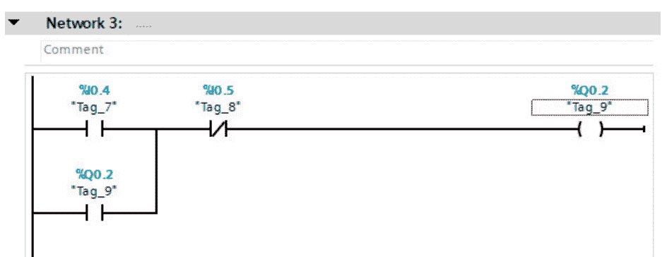

图 9.27 – 使用常开启动按钮和常开停止按钮的置位与复位程序

该程序的 PLC 接线如下：

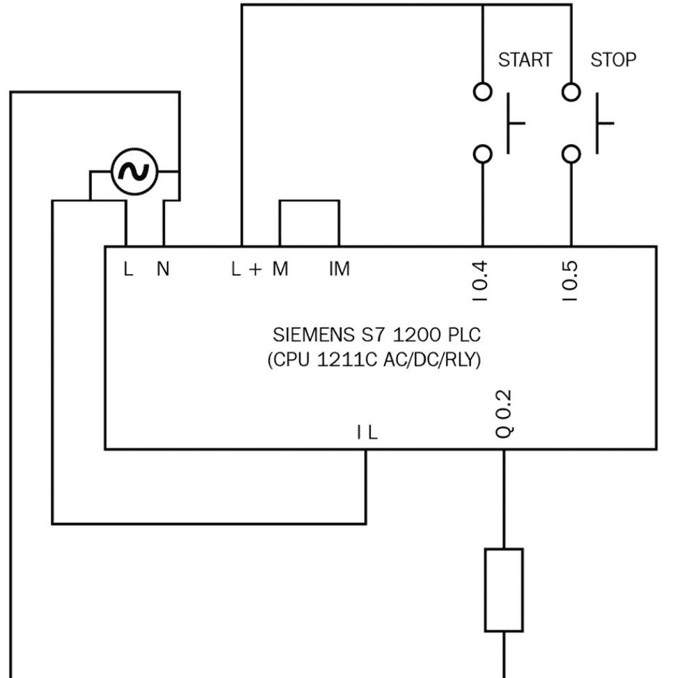

图 9.28 – 使用常开启动按钮和常开停止按钮实现置位与复位程序的接线

上述接线图显示了启动按钮（常开）连接到 I0.4，停止按钮（常开）连接到 I0.5。一个负载（可以是接触器的线圈）连接到 Q0.2。

当启动按钮被按下时，程序中地址为 I0.4 的常开触点将闭合。由于程序中 I0.5 是常闭触点，电源将流过以使地址为 Q0.2 的线圈通电。当启动按钮被释放时，程序中地址为 I0.4 的常开触点断开，但由于与 I0.4 并联的、地址与输出（Q0.2）相同的常开触点，地址为 Q0.2 的输出仍保持通电。通电（ON）的线圈 Q0.2 会闭合程序中与 I0.4 并联的、地址为 Q0.2 的常开触点。这为信号流向 Q0.2 创建了一条替代路径。因此，即使按钮被释放，地址为 Q0.2 的输出线圈也保持 ON。这称为置位（锁存）。

当停止按钮被按下时，程序中地址为 I0.5 的常闭触点断开。电源将不再流向线圈。地址为 Q0.2 的输出线圈将断电（OFF）。这称为复位（解锁）。

此处使用的停止按钮不安全，因为当按钮发生故障时，输出将保持通电，机器将继续运行。这对于工业使用来说是不希望的，也是不安全的。

#### 使用常开启动按钮和常闭停止按钮的置位与复位程序

编辑网络 3 中的程序，使 I0.5 使用的常闭触点变为常开触点，如以下截图所示：

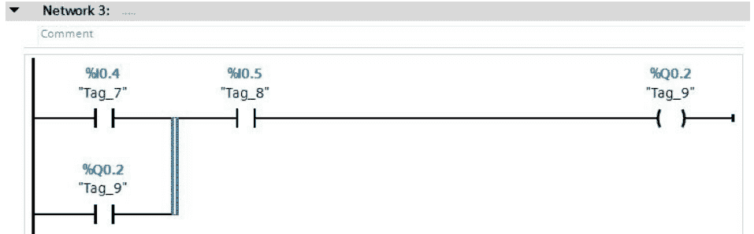

图 9.29 – 使用常开启动按钮和常闭停止按钮的置位与复位程序

该程序的 PLC 接线如下：

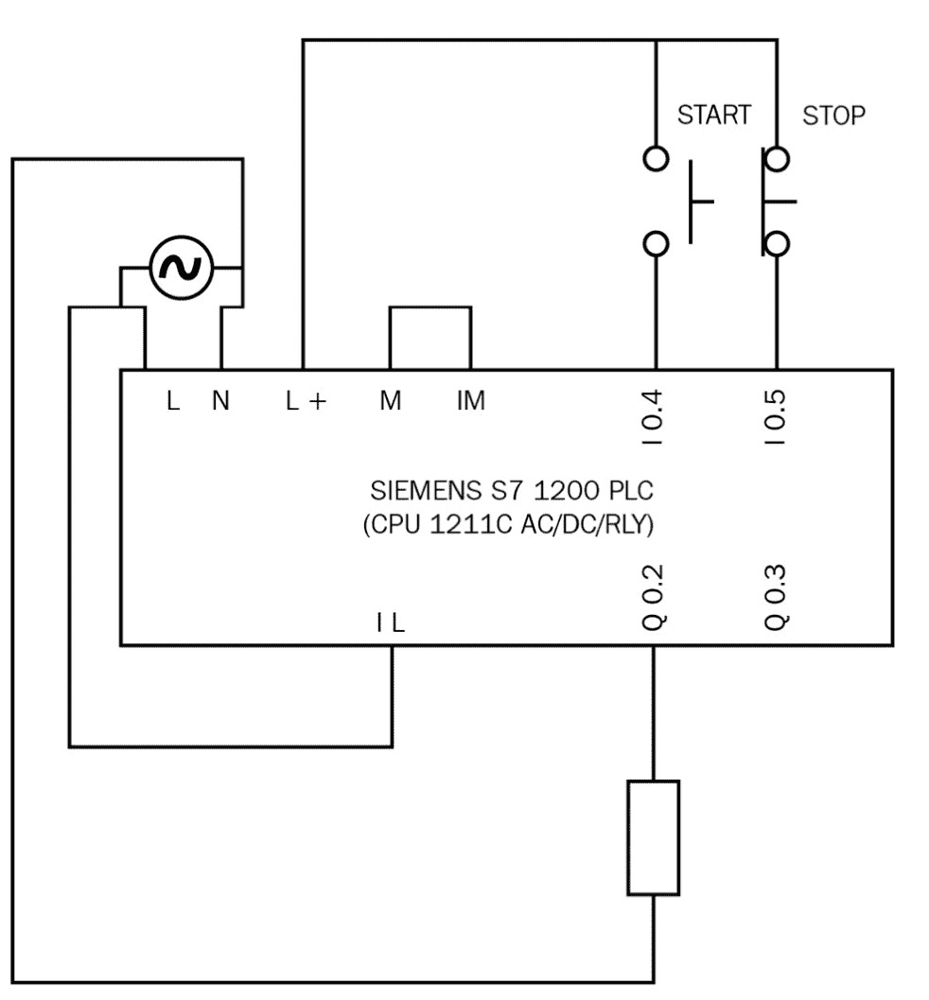

图 9.30 – 使用常开启动按钮和常闭停止按钮实现置位与复位程序的接线

上述接线图显示了启动按钮（常开）连接到 I0.4，停止按钮（常闭）连接到 I0.5。一个负载（可以是接触器的线圈）连接到 Q0.2。

当启动按钮被按下时，程序中地址为 I0.4 的常开触点将闭合。停止按钮（常闭按钮）将闭合程序中地址为 I0.5 的常开触点。由于接线中使用了常闭按钮，程序中地址 I0.5 是闭合的，因此电源将流过以使地址为 Q0.2 的线圈通电。当启动按钮被释放时，程序中地址为 I0.4 的常开触点断开，但由于程序中与 I0.4 并联的、地址与输出（Q0.2）相同的常开触点，地址为 Q0.2 的输出仍保持通电。通电（ON）的线圈 Q0.2 会闭合程序中与 I0.4 并联的、地址为 Q0.2 的常开触点。这为信号流向 Q0.2 创建了一条替代路径。因此，即使按钮被释放，地址为 Q0.2 的输出线圈也保持 ON。这称为置位（锁存）。

当停止按钮被按下时，程序中地址为 I0.5 的常闭触点断开。电源将不再流向线圈。地址为 Q0.2 的输出线圈将断电（OFF）。这称为复位（解锁）。

此处使用的停止按钮是安全的，因为当按钮发生故障时，输出将断电，连接到该停止按钮的机器将不会运行。这对于工业使用来说是理想的，也是安全的。

###### 注意

如果输出（Q0.2）将用于为感应电动机通电，则必须在接触器和电动机之间安装过载继电器，以确保发生过载时电动机会停止。在这种情况下，常闭触点（95-96）将作为输入接入 PLC，并且在程序中为其使用常开触点（与停止的常开触点串联），这样当发生过载时，常开触点（95-96）打开，电动机将停止。这个想法用于使用 PLC 启动和停止感应电动机。

我们现在已经了解了置位和复位。这两个术语在 PLC 编程中非常重要。在下一节中，我们将继续学习如何在程序中将输出地址用作输入。

#### 在程序中将输出地址用作输入

在上一章中，我们了解到在梯形图编程规则中，输出地址可以用作输入地址（NC 或 NO 触点）。

以下示例展示了输出地址（Q0.2）被用作输入。您可以在网络 4 中编写该程序并仿真，以查看其工作方式。

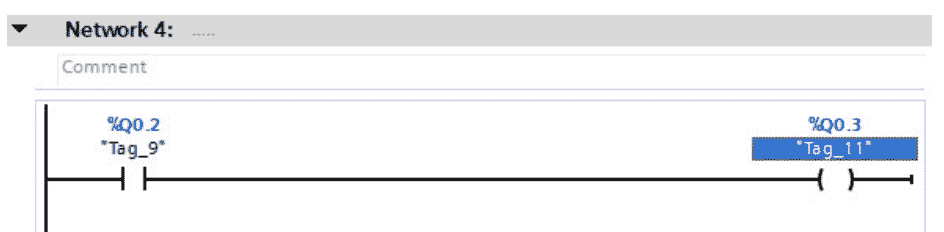

图 9.31 – 输出地址（Q0.2）用于输入端的常开（NO）触点

该程序的接线图如下：

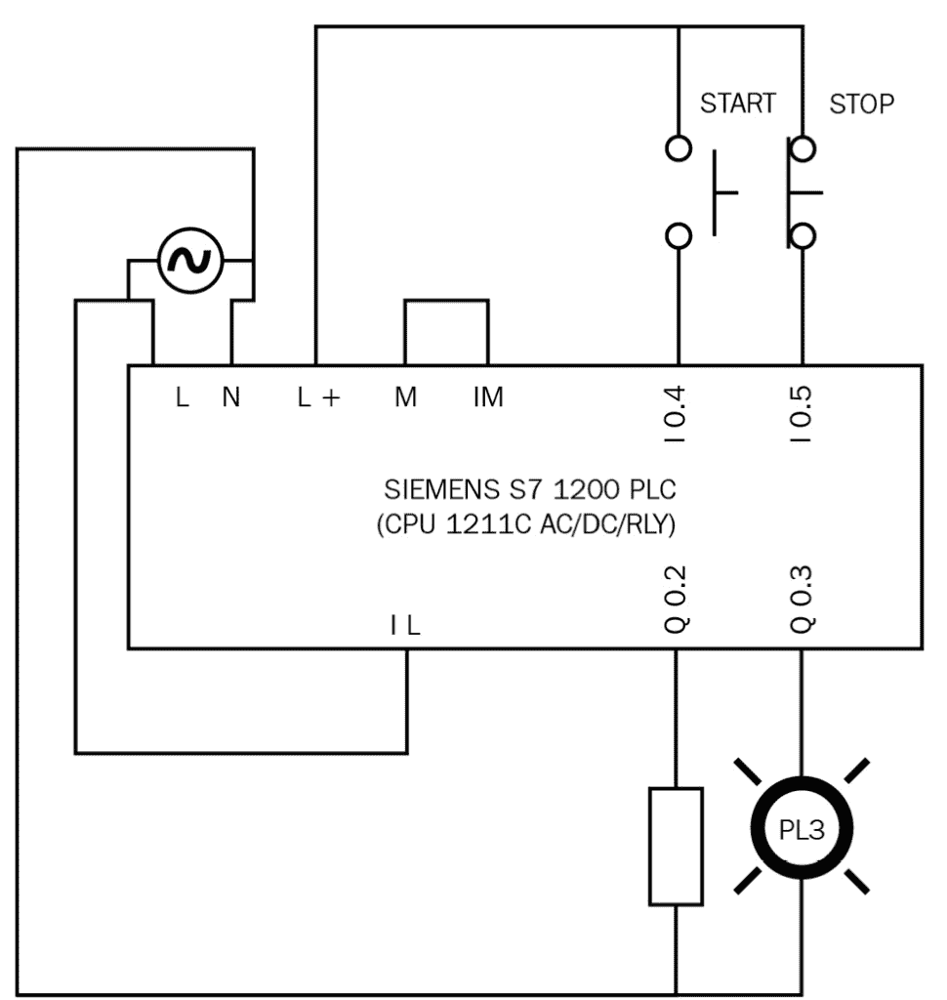

图 9.32 – 使用输出地址作为输入的程序的接线图

假设一个指示灯（PL3）连接到 Q0.3，如上面的接线图所示。

只要 Q0.2 为 ON，地址为 Q0.2 的常开触点就会闭合，因为地址为 Q0.2 的线圈已通电，且 PL3

连接到 Q0.3 的 PL3 将会 ON。

如果我们通过将地址为 Q0.2 的常开触点替换为常闭触点（NC），如以下截图所示来编辑程序，程序的行为将会不同，如下所述。

只要 Q0.2 为 ON，具有地址 Q0.2 的常闭触点就会打开，因为地址为 Q0.2 的线圈被通电，并且连接到 Q0.3 的 PL3 将会 OFF。

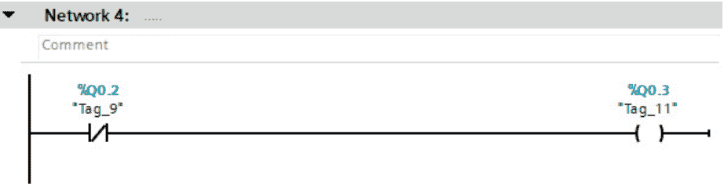

图 9.33 – 用于常闭（NC）触点的输入输出地址（Q0.2）

我们刚刚学习了如何将输出地址用作输入。这是 PLC 编程中的另一个重要技术。让我们在下一节继续学习 SET 和 RESET 指令。

#### 使用 SET 和 RESET 指令

SET 和 RESET 指令是梯形图编程中使用的两个重要指令。它们都是输出（线圈/赋值）指令。

当通过输入（开关、传感器或按钮）向其供电时，SET 线圈会被通电，并且即使为其供电的开关、传感器或按钮已 OFF，它仍保持 SET（ON）状态，直到被复位。

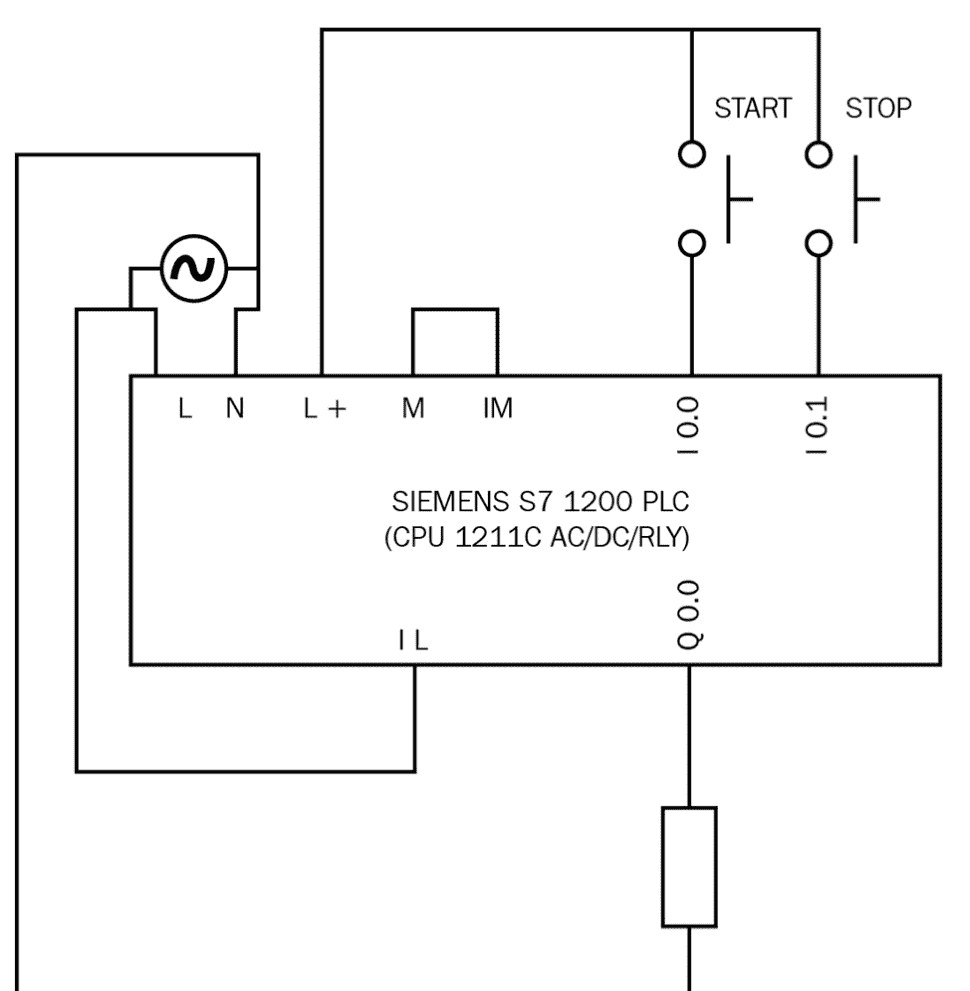

图 9.35 – 实现 SET 和 RESET 指令的 PLC 接线

考虑到接线图，当连接到 I0.0 的按钮被按下时，输出 Q0.0 将被通电（ON），并且即使按钮被释放后仍保持 ON。

当连接到 I0.1 的按钮被按下时，输出 Q0.0 将被断电（OFF），并且即使按钮被释放后仍保持 OFF。

你现在应该能够在 PLC 程序中使用 SET 和 RESET 指令。我们将在下一节继续学习定时器指令。

#### 使用定时器指令

定时器指令是一种延时指令。可用于延时操作。存在多种定时器；常见的有 ON 延时定时器（TON）和 OFF 延时定时器（TOF）。

**ON 延时定时器（TON）** 在输入为 ON 持续指定时间后激活输出。

让我们按照以下步骤编写一个简单的程序来演示 ON 延时定时器：

- 1. 在新网络中，添加一个常开指令并指定地址，例如 I0.0。
- 2. 在编程环境右侧，点击 **Instructions | Timer operation**，将 **TON**（ON 延时定时器）指令拖到梯级/网络中，并输入名称，例如 `timer1`，如下图所示。点击 **OK**：

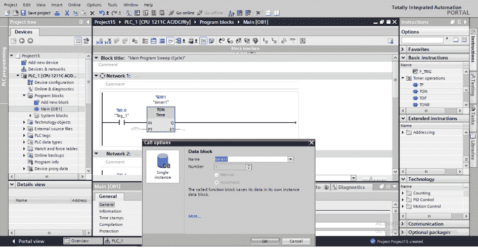

图 9.36 – 如何使用定时器指令 – 调用选项对话框

- 3. 双击 **PT**（设定时间）处的问号（**???**）并输入你希望 **Q**（输出）被通电的时间，例如 25s 或 **T#25s**。
- 4. 按两次 *Enter*。
- 5. 将线圈/赋值指令拖到梯级/网络的输出侧并输入输出地址（**Q0.0**），如下所示：

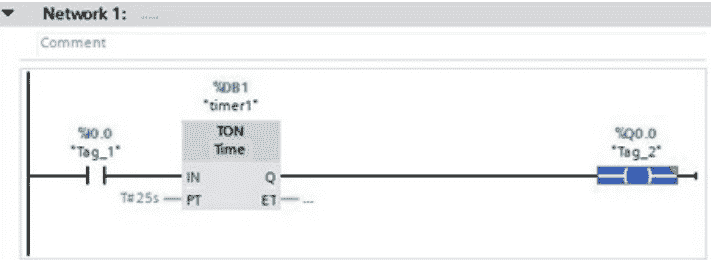

图 9.37 – 如何使用定时器指令 – 完整的定时器程序

该程序的接线图如下：

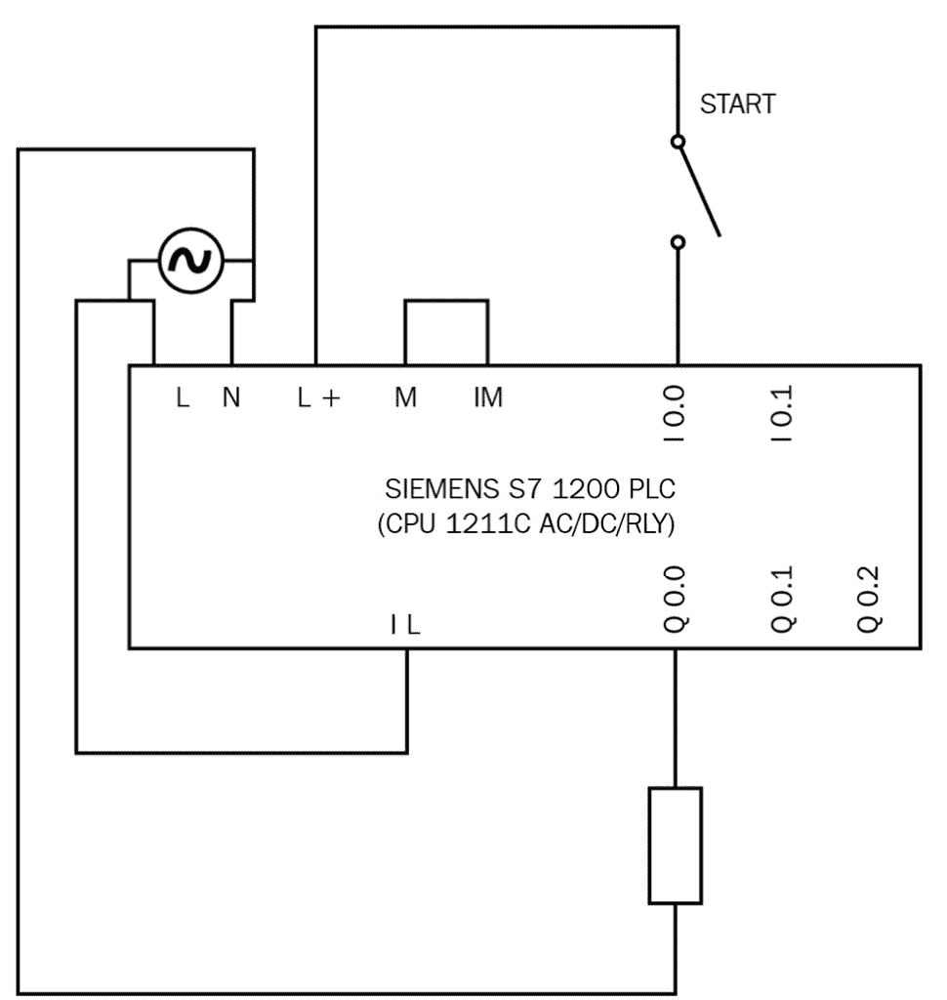

图 9.38 – 实现该程序的 PLC 接线

考虑到接线图，当连接到 I0.0 的开关被按下（ON）时，程序中的 I0.0 将闭合，并且根据程序，Q0.0 将在 25s 后被通电（ON）。输入必须保持 ON 直到定时器完成计时并通电输出。因此，使用按下后会保持 ON 的开关来测试前述程序比使用按钮更合适。

定时器的输出可用于激活或停用程序中的任何其他输出。在网络 2 中，添加一个常闭触点，输入 "timer1".Q，并添加另一个输出（线圈/赋值），地址为 Q0.1，如下图所示：

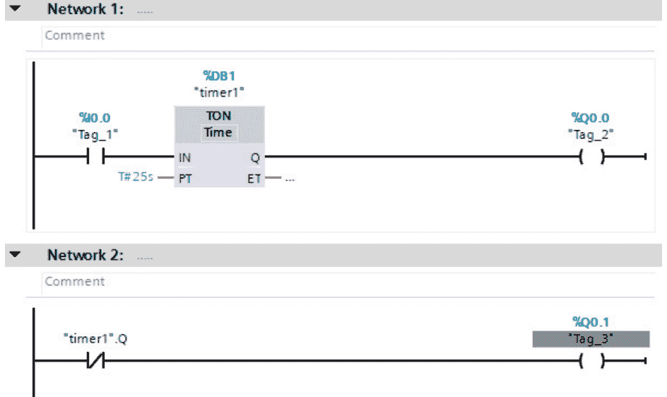

图 9.39 – 如何使用定时器指令 – 定时器的输出用于激活或停用另一个输出

另外，在图 9.38 所示的接线中，将一个输出（负载）连接到通道（Q0.1）。

当接线中 I0.0 的开关未 ON 时，通道 I0.0 不为 ON，定时器不会启动，并且 Q0.1 将被通电（ON），因为在程序的网络（网络 2）输入侧使用了常闭触点。当 I0.0 为 ON 时，定时器将启动，并在 25 秒后 Q0.0 将为 ON，而 Q0.1 将为 OFF，因为定时器的输出被通电（高电平），这将打开网络 2 中使用的常闭触点。

OFF 延时定时器（TOF）在输入为 OFF 持续指定时间后激活输出。在此，当输入为 ON 时，输出将被通电，但定时器不会启动。计时功能在输入变为 OFF 后立即开始。与 ON 延时定时器不同，输出将在计时结束后被断电。

在程序的网络 3 中编写程序（如下图所示）以演示 TOF。

使用 OFF 延时定时器（TOF）代替上一节中使用的 ON 延时定时器（TON）。

另外，在图 9.38 的接线中，将一个开关连接到通道 I0.1，并将一个输出（负载）连接到通道（Q0.2）以演示该程序。

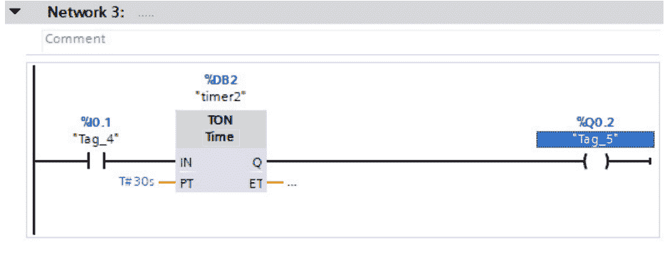

图 9.40 – OFF 延时定时器程序

当连接到 I0.1 的开关被按下（ON）时，输出 Q 将被通电，但定时器不会启动。定时器将在输入（I0.1）变为 OFF 后立即开始计数，而输出将保持通电直到时间耗尽。尝试编写并仿真该程序以获得更好的理解。

我们刚刚学习了定时器指令以及如何使用它来激活或停用另一个输出。现在让我们继续在下一节学习计数器指令。

#### 使用计数器指令

这是一种指令，可以在输入被触发时向上或向下计数，并在达到设定值时激活输出。它可用于确定过程中事件发生的次数。在本节中，我们将介绍常见的计数器指令，包括向上计数和向下计数。

##### 向上计数（CTU）

向上计数指令每次其输入被触发（0 到 1）时就会向上计数或增加 1；例如，当按钮被按下并释放或传感器被激活时。当输入被触发的次数（计数器的当前值）等于或大于预设值（PV）时，计数器的输出将被通电。

在此示例中，指示灯（PL1）连接到 Q0.0。PNP 接近传感器（NO）连接到 I0.0，普通常开按钮连接到 I0.1，如下接线图所示：

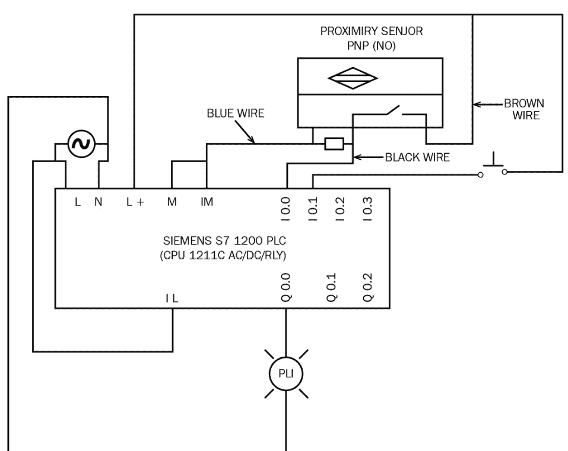

图 9.41 – 使用接近传感器使用计数器指令的 PLC 接线

执行以下步骤编写一个简单的程序以学习如何使用计数器指令。

- 1. 在新网络中，添加一个常开指令并指定地址，例如 I0.0。
- 2. 在编程环境右侧，点击 Instructions | Counter operation，将 CTU（向上计数计数器）指令拖到梯级中，并输入名称，例如 counter1，如下图所示。点击 OK：

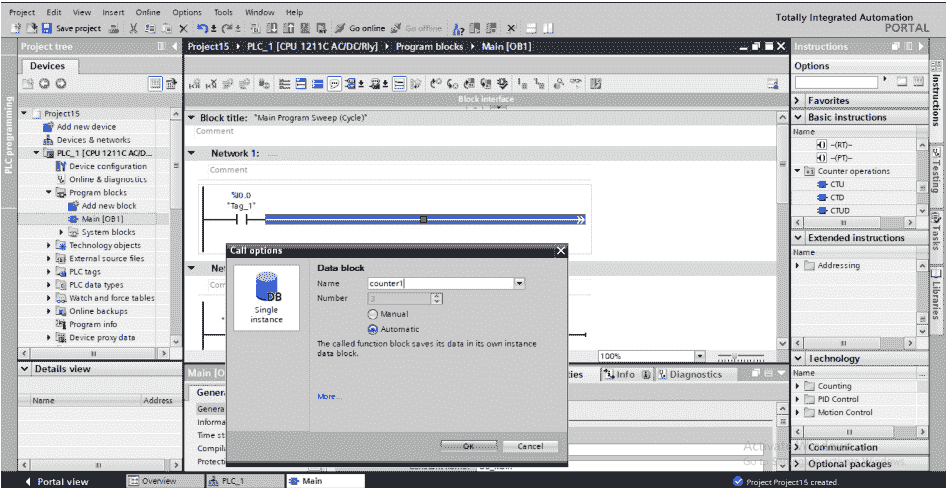

###### 图 9.42 – 使用计数器指令 – 调用选项对话框

- 3. 双击 PV（预设值）处的问号（???）并输入输入被触发的次数以使 Q（输出）通电，例如 5。
- 4. 按两次 Enter。
- 5. 将常开触点拖到 R（复位）并输入地址 I0.1。
- 6. 将线圈/赋值指令拖到网络的输出侧并输入输出地址 Q0.0，如下图所示：

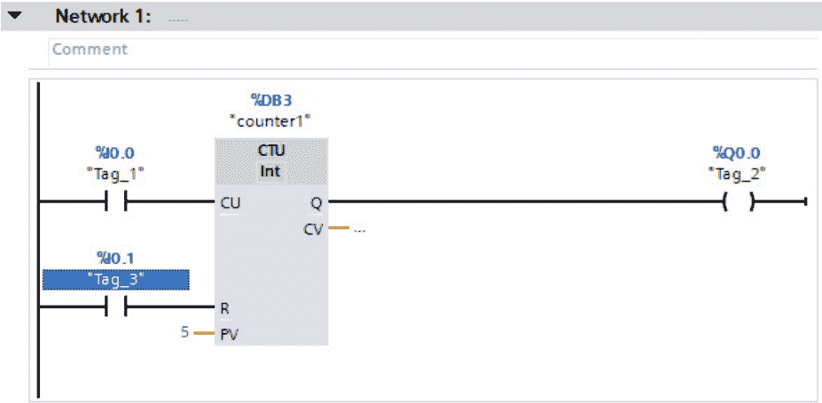

**图 9.43 – 使用计数器指令 – 完整计数器程序**

根据图 9.41 中的接线图，当接近传感器检测到物体时，I0.0 将为高电平（ON）。当物体不再被检测到时，它将为低电平（OFF）。

在图 9.43 的程序中，当输入 I0.0 在 ON 和 OFF 之间切换五次时，Q0.0 将被通电。当连接到 I0.1 的按钮被按下并释放时，计数器将复位。

与定时器类似，计数器的输出可用于激活或停用程序中的任何其他输出。

通过执行以下步骤尝试网络 2 中的程序：

- 1. 在网络 2 中添加一个常闭（NC）触点，类型为 `"counter1".QU` 在 ??? 处，并按两次 *Enter*。
- 2. 添加一个输出（线圈/赋值）并指定地址 `Q0.1`，如下图所示：

图 9.44 – 使用计数器指令 – 计数器的输出用于激活或停用另一个输出

此外，在图 9.41 的接线中向通道 Q0.1 添加一个负载（输出）以演示该程序。

在前述程序（图 9.44）中，当 I0.0 未被触发时，计数器不会计数。Q0.0 将断电而 Q0.1 将通电（ON），因为在网络（网络 2）的输入侧使用了常闭触点。当 I0.0 被触发五次时，Q0.0 将为 ON，而 Q0.1 将为 OFF，因为计数器的输出被通电（高电平）并且这将打开网络 2 中使用的常闭触点。

##### 倒计数（CTD）

倒计数指令将在其输入被触发时（0 到 1）每次倒计数或减少 1；例如，当按钮被按下并释放或当传感器被激活和停用时。计数器的输出

将在计数器的当前值等于零时被通电（从预设值倒计数）。

在以下示例中，使用了倒计数（CTD）指令。使用的预设值为 7。

在 *图 9.41* 的接线中向通道 Q0.2 添加一个负载（输出），向通道 I0.2 添加一个按钮，向通道 I0.3 添加另一个按钮以演示后续程序（*图 9.45*）。I0.2 用于触发输入，而 I0.3 用于 LD（装载）输入。Q0.2 用作输出。

当连接到 I0.3 的按钮被按下并释放时，将装载 7。随着连接到 I0.2 的按钮被按下并释放，值将开始减少 1。当计数达到零时，输出 Q 将打开并且 Q0.2 将被通电。

尝试编写并模拟程序以进一步理解。

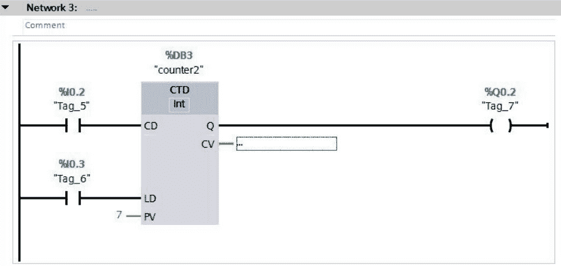

图 9.45 – 使用倒计数计数器

现在我们已经学习了如何使用计数器指令，我们将进入下一节学习如何使用移位指令。

当连接到 I0.0 的按钮被按下时，程序中的常开触点 I0.0 将闭合并且值 20 将在寄存器 MW0 中可用。

###### 注意

MW0 是西门子 PLC 中字数据类型（16 位）的内存地址。

我们刚刚学习了移位指令。现在，我们将在下一节学习比较指令。

#### 使用比较指令

比较指令用于测试来自两个源的两个值之间的关系。

下表显示了 S7 1200 中可用的比较指令：

| 比较指令 | 含义 |
|---|---|
| CMP == | 等于 |
| CMP <> | 不等于 |
| CMP >= | 大于或等于 |
| CMP <= | 小于或等于 |
| CMP < | 小于 |
| CMP > | 大于 |

表 9.1 – 比较指令及其含义

我们将在本书中学习如何使用 CMP >。对其他比较指令也适用相同的概念。

执行以下步骤编写一个简单的程序来比较寄存器 MW0 中的值和 5。我们将继续使用上一节的程序：

- 1. 在编程环境的右侧，单击 Instructions | Comparator operation，并将 CMP >（大于）指令拖到梯级（网络 2）。
- 2. 双击顶部 ??? 并输入 MW0
- 3. 双击底部 ??? 并输入 5。
- 4. 将线圈/赋值指令拖到梯级的输出侧并指定输出地址（Q0.0）。

如果一切正确，您应该看到如下所示的屏幕截图：

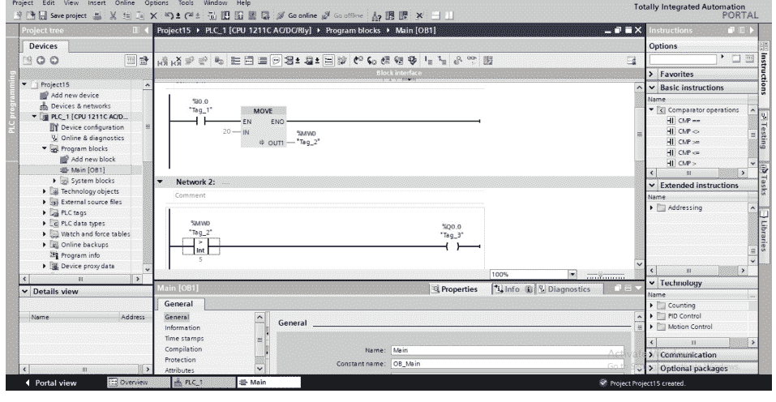

图 9.47 – 使用比较指令

当连接到 I0.0 的按钮未被按下时，MW0 为 0，并且由于 0 小于 5，输出 Q0.0 将断电。当按钮被按下时，MW0 将为 20，并且由于 20 大于 5，输出 Q0.0 将被通电。

当您模拟程序时，您会发现当 I0.0 未标记（低电平）时，MW0 的值为 0，并且由于 0 小于 5，输出 Q0.0 断电。当 I0.0 标记（高电平）时，MW0 变为 20，并且由于 20 大于 5，输出 Q0.0 被通电。

以下屏幕截图显示了 I0.0 标记（高电平）时输出（Q0.0）通电的仿真结果：

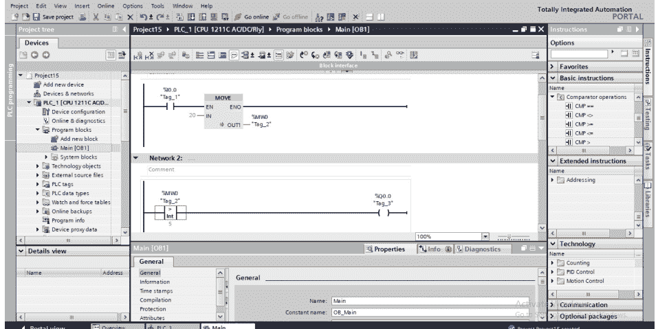

图 9.48 – 比较程序的仿真结果

我们现在已经学习了如何在西门子 TIA Portal 中使用比较指令。现在我们了解了各种 PLC 编程指令，在后续章节中，我们将研究 PLC 在工业中的一些实际应用，使用我们学过的一些指令。

#### 使用 PLC 进行液位控制

下图显示了可在工业中使用的液位控制：

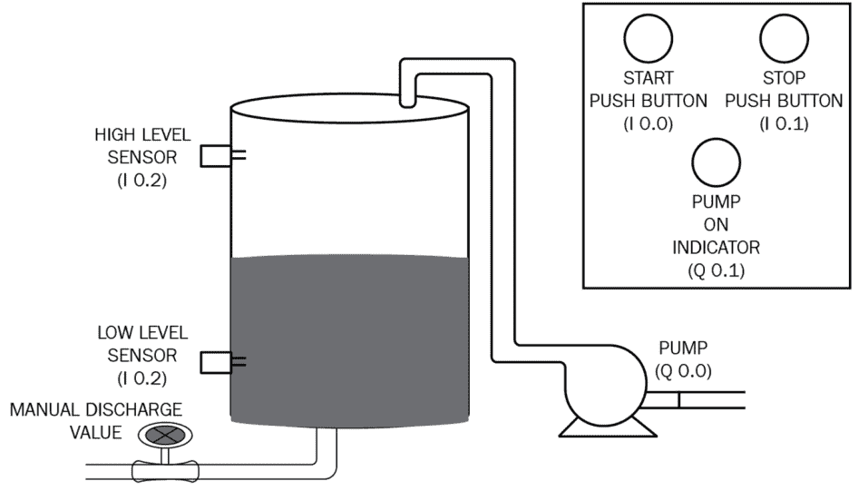

图 9.49 – 液位控制

该罐有两个液位传感器（高液位传感器和低液位传感器）。低液位传感器连接到 I0.2，而高液位传感器连接到 I0.3。连接到 Q0.0 的泵通过接触器向罐供应液体。启动按钮（常开）连接到 I0.0，而停止按钮（常闭）连接到 I0.1。泵 ON 指示灯连接到 Q0.1。手动排放阀用于在需要时排放液体。

当启动按钮被按下并释放并且罐中没有液体时，也就是说低液位传感器无法检测到液体，泵应开始运行直到液体充满罐，也就是说高液位传感器检测到液体。

当手动排放阀打开并且液体低于高液位传感器时，泵不应启动直到液体低于低液位传感器。

无论何时按下停止按钮，泵都应停止运行。指示灯应指示泵是否正在运行。

###### 注意

此处使用的液位传感器是振动叉式液位传感器。它是一种液位传感器类型，其中调谐叉在未接触材料（液体、自由流动固体、颗粒或粉末）时以其固有频率振动或振荡，当接触材料时其频率发生变化并给出可馈送到 PLC 作为输入的输出信号。

程序可以按如下方式编写：

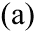

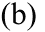

图 9.50 – 使用梯形图进行液位控制程序

不同网络的解释如下：

- **网络 1：** 当连接到 I0.0 的启动按钮被按下时，程序中的 I0.0 将闭合，并且由于连接到 I0.1 的停止按钮是常闭的，程序中的 I0.1 将闭合，从而使线圈 M0.0 通电。当启动按钮释放时，线圈 M0.0 将保持通电，因为与 I0.0 并联的具有相同地址 M0.0 的常开按钮。当停止按钮被按下时，程序中地址为 I0.1 的常闭触点将被打开并且地址为 M0.0 的线圈将被断电。
- **网络 2：** 当 M0.0 被通电（由于启动按钮被按下并释放）并且低液位传感器未检测到任何液体时，地址为 I0.2 的常闭触点闭合，并且由于 M0.1 是常闭触点，Q0.0 将被通电并且泵将开始运行以向罐供应水。与常闭触点并联的地址为 I0.2 的常开触点

地址为 I0.2 的触点会为信号流向线圈（Q0.0）创建一条替代路径，从而即使低液位传感器已检测到液体而高液位传感器尚未检测到液体，也能保持泵继续运行。

- **网络3：** 当 M0.0 得电（因按下并松开启动按钮）且低液位和高液位传感器均未检测到液体时，程序中地址为 I0.2 和 I0.3 的常开触点将断开，M0.1 将失电，泵继续运行。M0.1 在第2梯级（网络2）中用于在得电时使泵停止。当第3梯级（网络3）中的地址 M0.1 得电时，第2梯级（网络2）中地址为 M0.1 的常开触点将断开，这将使泵停止运行。这将在水箱满时发生。

与 I0.3 并联的地址为 M0.1 的常开触点用于在手动排放阀打开且水箱水位逐渐下降时为信号流向 M0.1 创建一条替代路径。随着水位下降，当水位低于高液位传感器时，地址为 I0.3 的常开触点（在水满时曾闭合）将断开。由于我们不希望 M0.1 失电而导致泵立即启动（换句话说，我们希望当液位低于高液位和低液位传感器时再启动），因此使用地址 M0.1 保持线圈 M0.1 得电，以便泵保持关闭，直到液位低于地址为 I0.2 的低液位传感器。回想操作过程：当手动排放阀打开且液位低于高液位传感器时，泵不应启动，直到液位低于低液位传感器。

- **网络4：** 该梯级负责泵运行指示灯。使用与泵线圈地址相同的常开触点（即 Q0.0）作为输入，而地址为 Q0.1 的线圈用于梯级的输出部分。只要 Q0.0 得电（泵要运行必须满足此条件），地址为 Q0.0 的常开触点将闭合，Q0.1 将得电。

> 因此，只要泵在运行，连接到 Q0.1 的指示灯就会亮起。

我们刚刚学习了工业中可用的简单液位控制。这些知识有助于开发更高级的液位控制。下一节我们将看到一个使用 PLC 的自动灌装、压盖和包装系统。

#### 使用 PLC 的自动灌装、压盖和包装系统

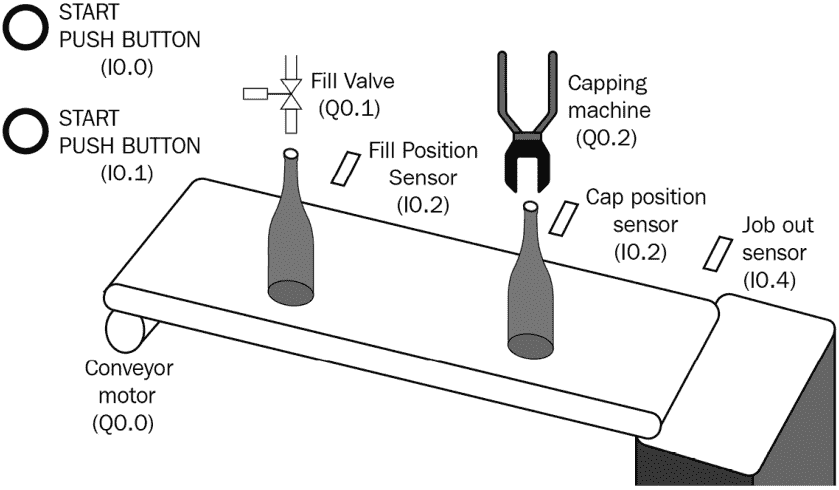

图9.51 – 灌装、压盖和包装

启动按钮（常开）连接到 I0.0，停止按钮（常闭）连接到 I0.1。输送电机连接到 Q0.0，灌装阀连接到 Q0.1，压盖机连接到 Q0.2，包装机连接到 Q0.3。灌装位置传感器连接到 I0.2，瓶盖位置传感器连接到 I0.3，而出料传感器连接到 I0.4，如前面的图所示。

当启动按钮被按下并松开时，输送电机应开始运行，直到瓶子到达灌装位置传感器；换句话说，灌装位置传感器检测到瓶子后，输送电机停止。

输送电机在灌装传感器处停止后，灌装阀应立即打开 10 秒以灌装瓶子。10 秒后，阀门应关闭，输送电机应继续运行，直到瓶子到达瓶盖位置传感器；换句话说，瓶盖位置传感器检测到瓶子后，输送电机停止。

输送电机在瓶盖传感器处停止后，压盖机应立即启动 4 秒以压盖。4 秒后，压盖机应停止，输送电机继续运行。

当瓶子到达出料传感器时，计数器应加 1，瓶子应掉落到包装机中。当出料传感器检测到的瓶子数量达到 6，即计数器递增到 6 时，包装机应开始包装这 6 个瓶子，并在 5 秒后停止。

程序可编写如下：

图9.52a – 灌装、压盖和包装程序

(a)

图9.52b – 灌装、压盖和包装程序

(b)

图9.52 – 灌装、压盖和包装程序

各网络说明如下：

- **网络1：** 这是一个用于启动和停止系统的简单启动/停止程序。请参阅上一节中关于网络1的说明以了解其工作原理。当启动按钮被按下并松开时，M0.0 将得电，并保持得电状态，直到按下 I0.1 处的停止按钮。
- **网络2：** 当启动按钮被按下并松开时，网络1中的 M0.0 将得电，这将使地址为 M0.0 的常开触点闭合；由于 I0.2（灌装位置传感器的地址）和 I0.2（瓶盖位置传感器的地址）均为常闭，Q0.0（输送电机的地址）将得电，输送电机开始运行。当灌装位置传感器检测到瓶子时，它将导通，这会使 I0.2 断开，并使电机在该位置停止，直到 timer1（灌装时间）超时并闭合与 I0.2 并联的常开触点（timer1），为信号流向线圈 Q0.0 创建替代路径，以保持输送机运行。当瓶盖位置传感器检测到瓶子时，它将导通，这会使 I0.3 断开，并使电机在该位置停止，直到 timer2（压盖时间）超时并闭合与 I0.3 并联的常开触点（timer2），为信号流向线圈 Q0.0 创建替代路径，以保持输送机运行。
- **网络3：** 当地址为 M0.0 的常开触点因启动按钮被按下并松开而闭合，并且地址为 I0.2 的常开触点因灌装位置传感器检测到瓶子而闭合时，10 秒定时器（timer1）将启动，同时地址为 Q0.1 的输出将得电。因此，连接到 Q0.1 的阀门将打开以灌装瓶子。10 秒后，由于与地址为 Q0.1 的线圈串联的常闭触点（timer1）在 timer1 10 秒后得电时断开，阀门将关闭。
- **网络4：** 当地址为 M0.0 的常开触点因启动按钮被按下并松开而闭合，并且地址为 I0.3 的常开触点因瓶盖位置传感器检测到瓶子而闭合时，4 秒定时器（timer2）将启动，同时地址为 Q0.2 的输出将得电。因此，连接到 Q0.2 的压盖机将开始给瓶子压盖。4 秒后，由于与地址为 Q0.2 的线圈串联的常闭触点（timer2）在 timer2 4 秒后得电时断开，压盖机将停止。
- **网络5：** 当地址为 M0.0 的常开触点因启动按钮被按下并松开而闭合，并且地址为 I0.4 的常开触点因出料传感器检测到瓶子而闭合时，计数器（counter1）将启动。每次有瓶子通过时，计数器都会加 1。
- **网络6：** 当地址为 M0.0 的常开触点因启动按钮被按下并松开而闭合，且网络5中的计数器已递增到 6 时，常开触点（counter1）将闭合；由于 timer3 是常闭触点，地址为 Q0.3 的线圈将得电，连接到 Q0.3 的包装机将开始包装这 6 个瓶子。当 counter1 递增到 6 时，5 秒定时器（timer3）也会启动。

5 秒后，常闭触点（timer3）将断开，连接到 Q0.3 的包装机将停止。网络5中的计数器（counter1）也会在 timer3 的 5 秒计时结束后复位，以便下一个瓶子从 1 开始计数并继续递增到 6，届时包装机将再次开始包装。

本节所学的自动灌装、压盖和包装系统程序几乎涵盖了本书迄今学过的所有指令。请自行编写并模拟该程序，以更深入地了解上一章和本章所学的梯形图编程语言编写 PLC 程序时这些指令的实际应用。

#### 总结

恭喜！你已成功完成本书的又一章。干得好！PLC 是大多数现代自动化机器背后的大脑，编程是用 PLC 实现机器自动化的关键。现在你应该了解锁存和解锁，知道如何使用输出。

