### 探索监控与数据采集（SCADA）

在上一章中，我们学习了如何通过人机界面（HMI）来监控和控制一台机器。HMI 总是靠近机器或可编程逻辑控制器（PLC）——也就是说，HMI 始终位于机器本地，其主要目的是控制单台机器/PLC。在本章中，我们将学习监控与数据采集（SCADA），它同样提供监控和控制手段，同时还具备报警、趋势和日志记录等其他功能。然而，用于监控、控制或其他功能的屏幕或 PC 可以位于远程位置——即远离机器——并且与 HMI 不同，我们可以为一个位于不同远程位置的多台机器配置一个 SCADA。SCADA 是工业自动化中一个有趣且高级的方面。

本章我们将涵盖以下主要主题：

- 介绍 SCADA
- 理解 SCADA 的功能
- 探索 SCADA 的应用
- 概述 SCADA 硬件
- 概述 SCADA 软件
- 下载并安装 mySCADA
- 使用 mySCADA 软件将 SCADA 与 S7-1200 PLC 接口连接（一个实践项目）

#### 介绍 SCADA

SCADA 是一个由多种硬件和软件组成的系统，这些硬件和软件协同工作，用于监控和控制工业过程中的机器。

监控控制是指对多个独立 PLC 或多个控制回路进行高层次的总体控制。

数据采集是指从过程中收集信息和数据，并进行实时分析。实时数据收集有助于降低运营成本、监控整个流程并提高效率。

SCADA 系统有助于收集、分析和可视化来自设备或机器的数据，并提供从中央位置（可以是本地或远程，即靠近机器或远离机器）控制设备或机器的手段。

SCADA 通常用于监控和控制地理上分散的机器或设备。下图显示了一个简单的 SCADA 系统：

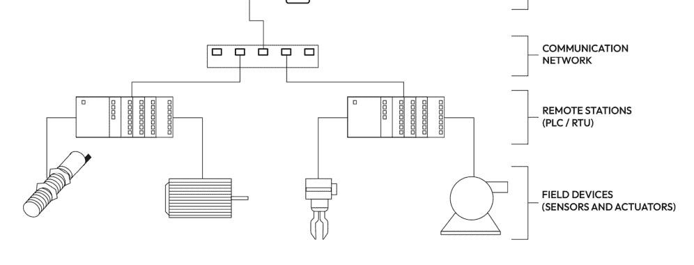

图 11.1 – 一个显示 SCADA 硬件的简单 SCADA 系统

一台生产机器可以位于一个地理区域（位置 A），而另一台机器可以位于不同的地理区域（位置 B）。如果为这两台生产机器部署了 SCADA 系统，我们就可以从一个中心位置监控两台机器的状态，并控制其中任意一台。SCADA 基本上通过获取系统或机器的数据来实现对其的控制。您想要监控和控制的系统或机器可以是水处理厂、发电厂、配电系统或任何其他设施。

#### 理解 SCADA 的功能

SCADA 的含义本身已经暗示了其主要功能。下面详细说明 SCADA 系统的作用：

- 它可以在本地或远程控制工业过程。开机或关机、增大或减小设定点等是 SCADA 系统可以编程执行的控制功能。
- 它从现场或机器收集数据（获取实时数据），为操作员或工艺工程师提供状态指示器以进行监控。
- 它使工艺工程师能够鸟瞰整个工厂，该工厂可能包含位于不同地理位置的各种机器/设备。
- 当过程中出现异常情况时，它会生成报警。当过程出现问题时，它可以触发报警，形式可以是声音、灯光、电子邮件、短信或其他形式。
- 它记录事件（数据日志）。

接下来，让我们来看看 SCADA 的应用。

#### 探索 SCADA 的应用

以下是 SCADA 的一些应用：

- **水处理厂**：SCADA 有助于监控水库水位、泵运行、水流量等多项指标，并有助于控制工厂中的泵和其他设备。
- **发电与配电**：SCADA 系统有助于监控和控制发电与配电网络。SCADA 可以监控变电站中的各种设备，还可以向远程位置的设备发送信号，以开启或关闭断路器。
- **制造业**：SCADA 控制用于制造各种商品的工业自动化设备，同时监控制造过程。
- **楼宇与设施管理**：设施管理人员使用 SCADA 来监控和控制照明、**暖通空调（HVAC）**等。
- **交通信号灯**：SCADA 用于监控交通信号灯，例如故障检测、错误信号等，还可用于控制交通流量。

在下一节中，我们将讨论 SCADA 的硬件组件。

#### 概述 SCADA 硬件

SCADA 系统的硬件组件包括以下内容：

- **现场设备**：这些是直接连接到机器或工厂的传感器、变送器和执行器，它们生成用于监控的数字或模拟信号。传感器或变送器用于监控机器状态或参数，而执行器用于对设备或机器执行控制操作。
- **远程站**：可以是 PLC 或**远程终端单元（RTU）**。它安装在被监控或控制的机器或设备所在的远程站点。现场设备（传感器、变送器和执行器）连接到远程站（PLC 或 RTU），以便通过网络在远程站点的主机上进行监控和控制。它通过与其连接的传感器收集数据，并通过网络将数据传输到主机。它还将来自主机的电控信号传输到与其连接的执行器，以执行所需的控制操作。

通信网络：SCADA 中通信网络的主要目的是将远程站（PLC 或 RTU）连接到主机（主站）。它允许信息在 SCADA 系统中流动。SCADA 系统的通信介质可以是有线的或无线的。常见的有线介质是以太网。SCADA 系统可以使用各种网络拓扑（星型、总线型、环型等），也可以使用各种网络协议（Profinet、Modbus、Profibus 等）。有关网络拓扑和网络协议的更多细节将在第 13 章《工业网络与通信协议基础》中介绍。

主站：也可以称为监控站。它是运行 SCADA 软件的主计算机，提供系统的图形化展示。它运行 HMI 应用程序，提供开关、传感器、变送器、泵等的图形化视图，用于监控和控制。报警可以设置为在不同的预设值处激活。通过主站上的 GUI，可以监控和控制各个工厂站点的整个控制系统。单台计算机可以配置为主站，也可以联网到工作站或多台服务器。在将多台服务器用作主站的 SCADA 系统中，其中一台服务器可以专用于报警管理系统（AMS），这可以称为 AMS 控制台。AMS 控制台由 AMS 软件组成，该软件提供工厂各个区域报警的概览，使工厂出现异常情况时能够快速响应等。

基本上，主站从远程站（PLC 或 RTU）收集信息，将这些信息显示在 GUI 上以便于解读，生成报警，并为可在远程站点执行的各种控制操作提供接口。

图 11.1 说明了一个简单的 SCADA 系统，展示了本节中解释的各种 SCADA 硬件组件。接下来，我们将了解可用于创建 SCADA GUI 的不同软件。

#### SCADA 软件

这是可用于创建所需界面（GUI）的软件，以监控和控制工业设备并执行所有必要的配置。它通常安装在中央主机计算机上，在该计算机上进行监控和控制操作。

常见的 SCADA 软件包括以下内容：

- WinCC by Siemens
- FactoryTalk View by Rockwell Automation
- InTouch by Wonderware
- iFix by General Electric
- Citect SCADA by Schneider
- mySCADA

我们将在本章中使用上述其中一种 SCADA 软件（mySCADA）来学习 SCADA 的工作原理，并了解其基本配置和简单系统的接线。

**mySCADA** 是一款功能强大的 SCADA 软件，可在 Microsoft Windows、macOS 和 Linux 上运行。它支持各种 PLC，包括 S7-1200、S7-1500、S7-300、S7-400、ControlLogix、CompactLogix、Micrologix 1200、Micrologix 1400、Micrologix 1500、SLC 500、PLC 5、Omron PLCs 和 Melsec-Q。

它基本上由两部分软件组成（myDESIGNER 和 myPRO）。myDESIGNER 是一个开发平台，可用于创建屏幕/可视化并执行适合您应用的所有必要配置，而 myPRO 允许可视化。您可以通过 myPRO 查看您的 SCADA 以控制和监控您的设备。它可在常见浏览器上运行，包括 Microsoft Internet Explorer IE（版本 9 及以上）、Microsoft Edge、Chrome、Firefox 和 Safari。

在下一节中，我们将了解如何在系统上下载和安装 mySCADA 软件。

#### 下载和安装 mySCADA 软件

让我们先学习如何下载软件，因为它将在本书的 *使用 mySCADA 软件将 SCADA 与 S7-1200 PLC 接口* 部分的 SCADA 项目中使用。

##### 下载 mySCADA

我们将执行以下步骤将两个软件（myDESIGNER 和 myPRO）下载到我们的 PC：

1. 访问 www.myscada.org 并点击 **RESOURCES**：

图 11.2 – mySCADA.org 的主页

2. 点击 Downloads：

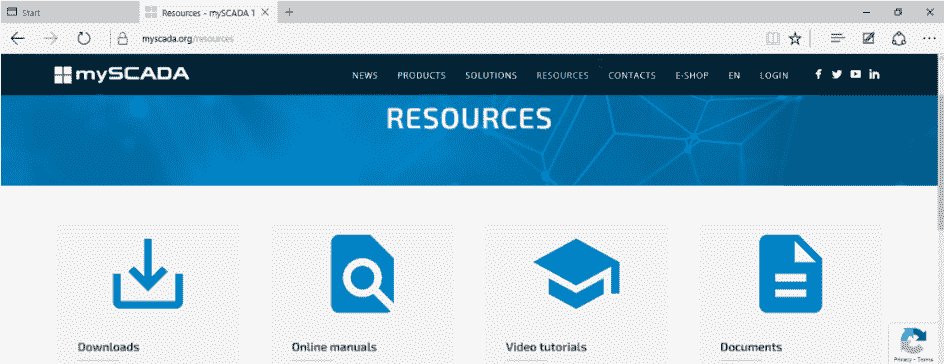

图 11.3 – RESOURCES 页面

3. 点击 register or log in here，填写必要信息，然后点击 Register：

##### 图 11.4 – DOWNLOADS 页面

4. 如果一切正常，您应该看到以下屏幕：

##### 图 11.5 – 欢迎信息

5. 检查您的电子邮件，查找来自 mySCADA 的消息，其中包含访问您的帐户或设置新密码的链接。

6. 您可以随时登录以下载所需的 mySCADA 软件。点击 **Resources | Downloads** 以到达以下屏幕截图中显示的页面：

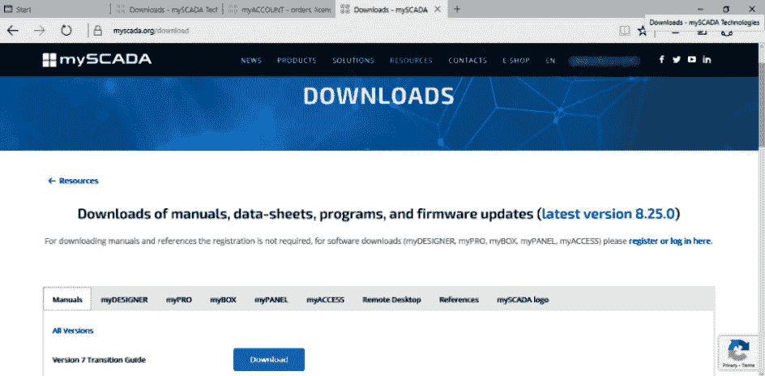

图 11.6 – 登录后的 DOWNLOADS 页面

7. 点击 **myDESIGNER | Download**（适用于 Windows）：

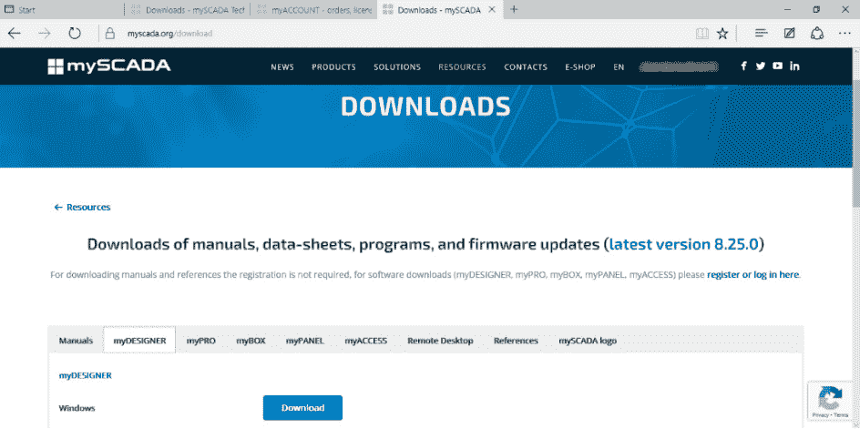

图 11.7 – myDESIGNER DOWNLOADS 页面

8. 点击 **myPRO | Download**（适用于 Windows）：

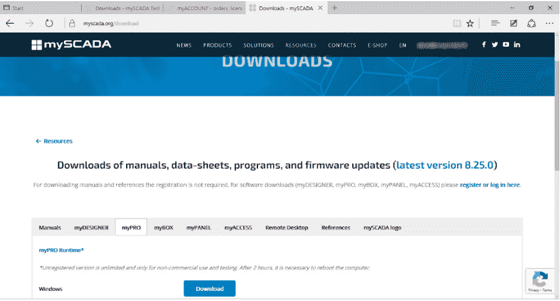

图 11.8 – myPRO DOWNLOADS 页面

我们现在已将两个安装文件（myDESIGNER 和 myPRO）下载到我们的 PC。

##### 安装 mySCADA 软件（myDESIGNER 和 myPRO）

执行以下步骤在您的 PC 上安装 myDESIGNER 和 myPRO：

1. 双击 myDESIGNER 的安装程序并按照屏幕上的说明进行操作。
2. 取消选中 **Launch myDESIGNER** 并点击 **Finish**。
3. 接下来，双击 myPRO 的安装文件并按照屏幕上的说明进行操作。
4. 在提示时重新启动您的 PC。

我们已成功学习如何下载和安装 mySCADA 软件。请按照步骤在您的笔记本电脑或 PC 上安装 mySCADA，因为它将在下一节中需要。

#### 使用 mySCADA 软件将 SCADA 与 S7-1200 PLC 接口

我们将在本实践项目中学习如何配置一个简单的 SCADA。您将对如何使用 SCADA 监控和控制机器有一个基本的了解。

我们将使用西门子 S7-1200 作为远程站。因此，TIA Portal 将用于 PLC（S7-1200）的配置和编程。

让我们开始：

1. 启动 TIA Portal，点击 **Create new project**，并输入项目名称（例如，`SCADA-PRACTICE`），如下图所示。点击 **Create**：

图 11.9 – 创建新项目

2. 点击 Configure a device：

图 11.10 – PORTAL 视图中创建的新项目

3. 点击 Add new device 并从设备列表中选择 Controllers。展开 SIMATIC S7-1200 | CPU | CPU 1211C AC/DC/RLy 并选择您的 PLC 的订货号 – 例如，6ES7 211-1BE40-0XB0 – 取决于您打算使用的 PLC：

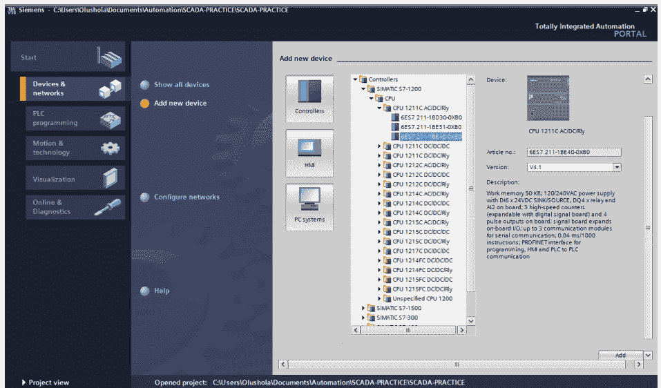

图 11.11 – 选择您的控制器（PLC）

4. 点击 Add，您应该会看到以下屏幕：

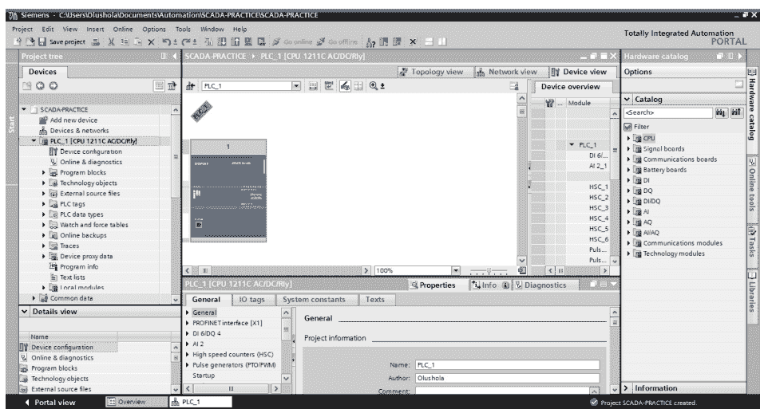

##### 图 11.12 – PLC 已添加到您的项目中

5. 展开 Program blocks 并双击 Main [OB1] 以获得编写程序的环境，如下图所示：

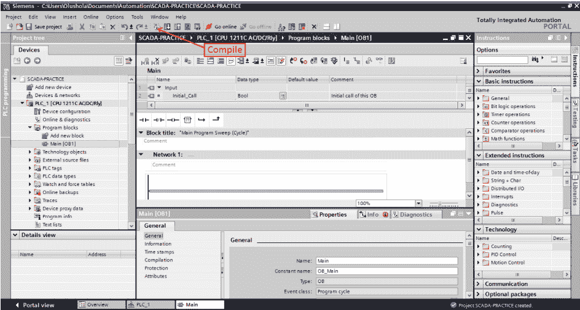

##### 图 11.13 – 梯形逻辑编程环境

6. 编写您的程序并重命名所有标签，如下图所示（图 11.14）。我们使用一个简单的程序来了解 SCADA 的操作。点击 Compile 图标（图 11.13 中指出的图标）：

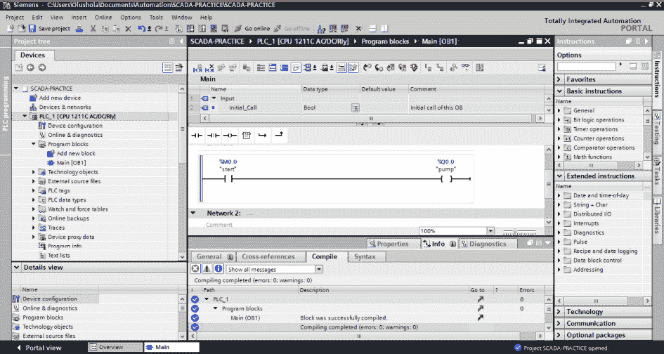

图 11.14 — 编写的程序和重命名的所有标签

7. 右键单击左侧的 PLC（项目树）。点击 **Properties**：

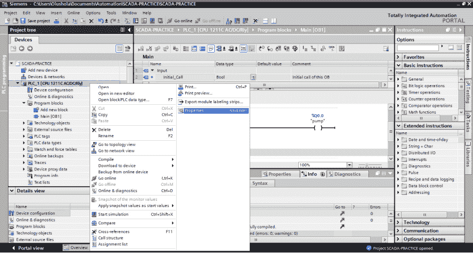

图 11.15 — 属性选项

8. 选择 **Protection**，选中 **Permit access with PUT/GET communication from remote partner (PLC, HMI, OPC, …)** 复选框，然后点击 **OK**：

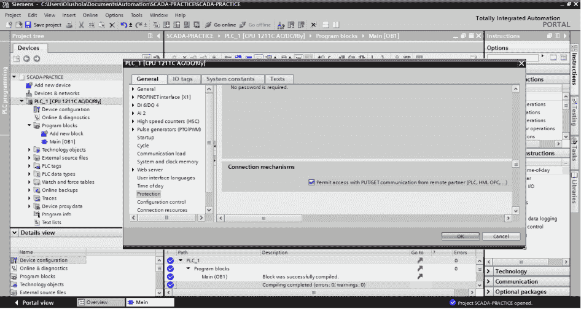

图 11.16 — 属性对话框

让我们现在继续将程序加载到 PLC 上。

9. 为 PLC 接通电源，并使用以太网电缆将 PLC 连接到您的 PC。

10. 双击 **Device configuration**。然后，点击 **Properties** | **General** 选项卡 | **PROFINET interface [X1]**：

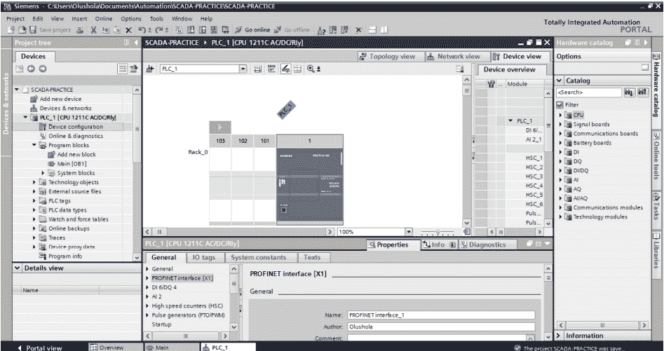

图 11.17 – 设备配置屏幕

11. 向下滚动并输入 IP 地址和子网掩码，然后点击图像上的 PLC_1 以选择 PLC，如下图所示：

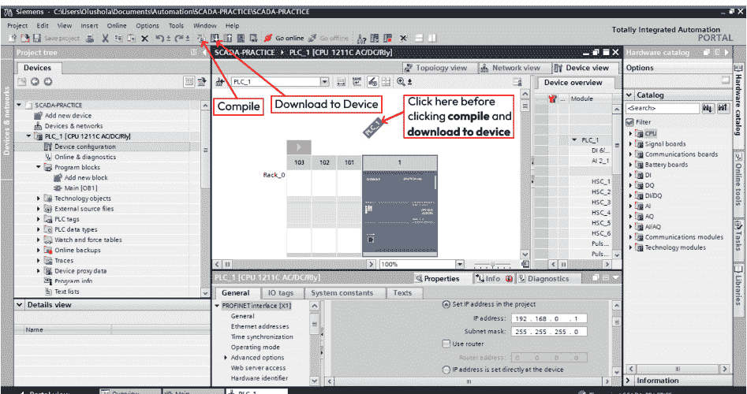

图 11.18 – PLC_1 的 IP 地址和子网掩码框

12. 点击 **Save project**，选择 **PLC_1**，点击 **Compile**，然后点击 **Download to device**，如前图所示。

##### 重要说明

在点击 **Download to device** 之前，请确保 PLCSIM 未在运行。

13. 在 **Type of the PG/PC interface** 下拉列表中，选择 PN/IE。在 **PG/PC interface** 下拉列表中，选择您的以太网卡：

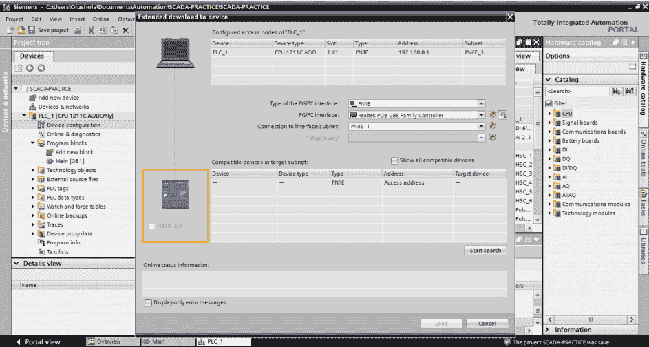

图 11.19 – 扩展下载到设备对话框

14. 点击 **Start search**。它应该找到 PLC，如下图所示。选择 PLC 并点击 **Load**：

##### 图 11.20 – 搜索后找到的 PLC

15. 在以下屏幕之前可能会出现其他屏幕/消息；阅读消息并相应响应。如果一切正常，您将被带到 Load preview 对话框：

##### 图 11.21 – Load preview 对话框 – 由于未满足前提条件，加载不会执行

##### 图 11.23 – 加载结果对话框

17. 如果加载成功，您将看到类似以下的屏幕，在“消息”部分显示“加载完成”：

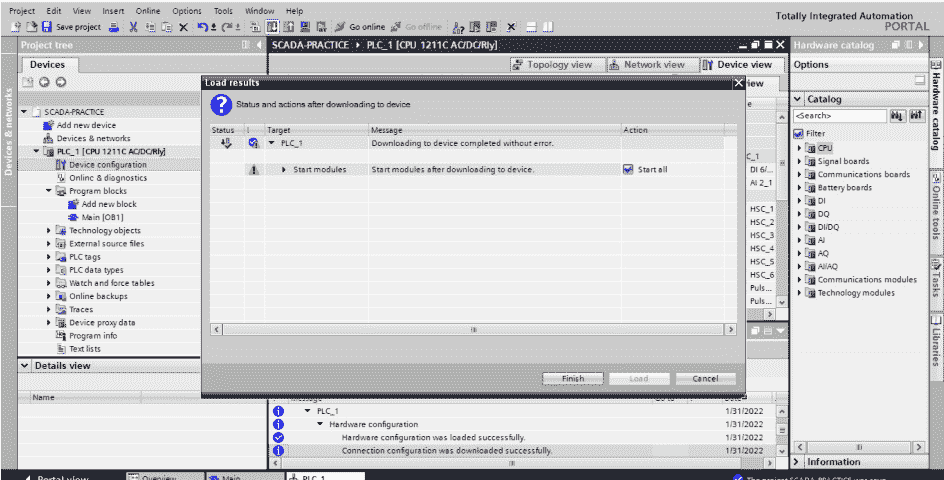

##### 图 11.24 – 加载后的屏幕，在“消息”部分显示“加载完成”

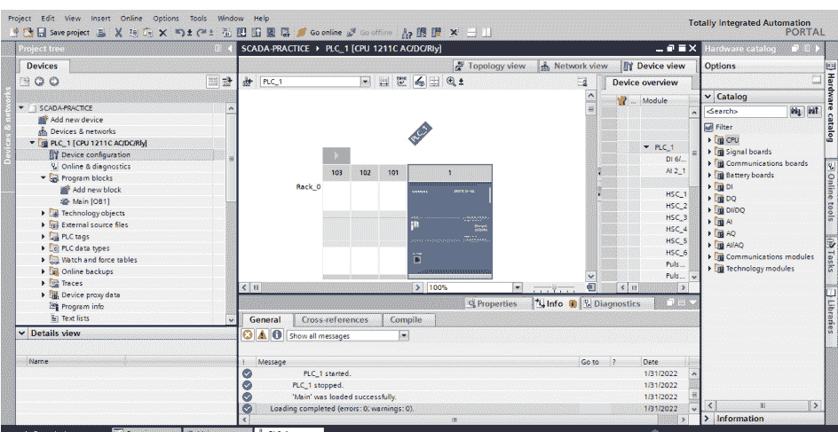

恭喜！您已成功为 PLC 分配了 IP 地址（192.168.0.1），并将 PLC 程序和配置加载到了真实的 PLC（S7 1200，CPU 1211C）上。

现在，让我们继续为 PC 分配 IP 地址：

- 1. 右键单击任务栏上的网络图标。

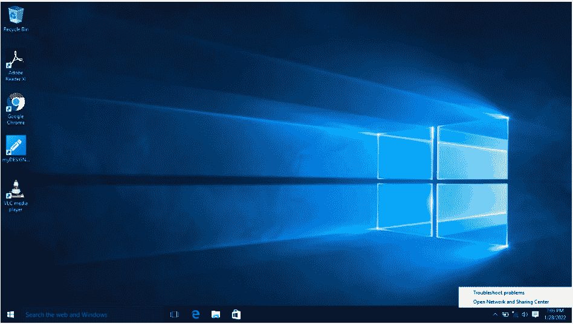

图 11.25 – 右键单击任务栏上的网络图标

- 2. 单击“打开网络和共享中心”：

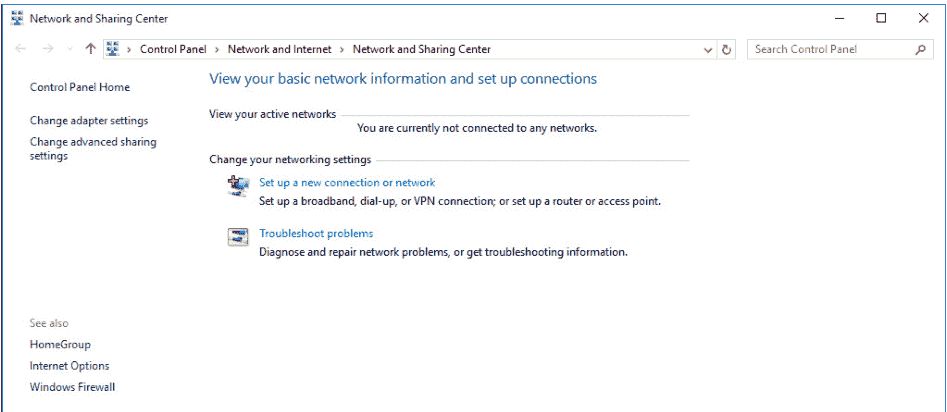

图 11.26 – 网络和共享中心

3. 单击“更改适配器设置”：

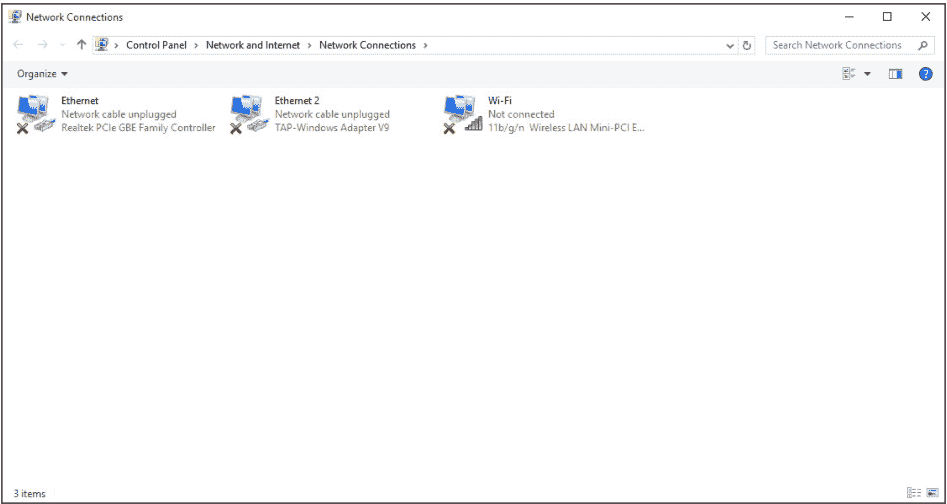

图 11.27 – 更改适配器设置

4. 右键单击“以太网”：

图 11.28 – 以太网 – 右键单击

5. 单击“属性”：

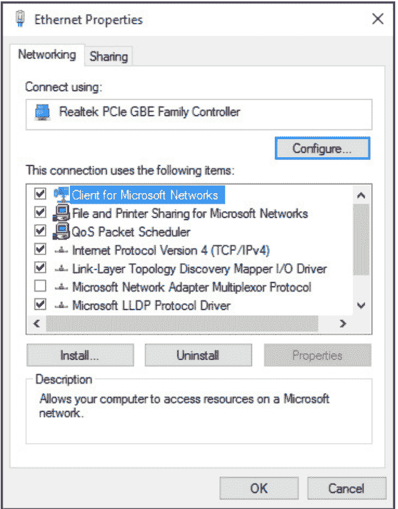

图 11.29 – 以太网属性对话框

6. 选择“Internet 协议版本 4 (TCP/IPv4)”并单击“属性”：

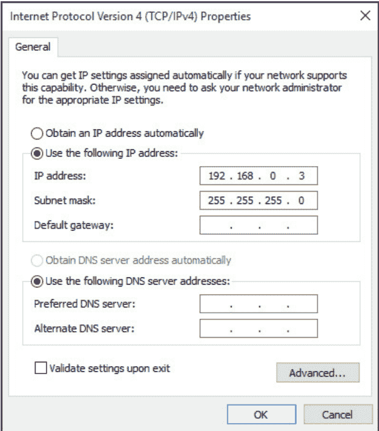

图 11.30 – Internet 协议版本 4 (TCP/IPv4) 属性 – 已选择“使用下面的 IP 地址”

- 7. 选择“使用下面的 IP 地址”，然后输入 IP 地址（例如 192.168.0.3）和子网掩码（例如 255.255.255.0）。单击“确定”：

恭喜！您已成功为 PC 的以太网卡分配了 IP 地址（192.168.0.3）和子网掩码（255.255.255.0）。

我们现在将在 myDESIGNER 中创建一个新项目，并设计屏幕，以显示作为输入的按钮和显示泵状态的指示灯。

让我们开始吧：

3. 双击左侧的项目名称，然后双击“连接”。接着，单击“添加连接”：

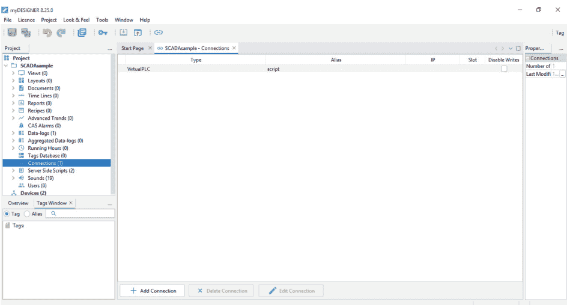

图 11.33 – 项目（SCADASample）– 连接

4. 单击“PLC”，然后单击“添加连接”：

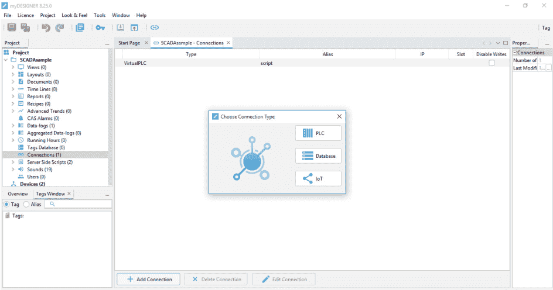

##### 图 11.34 – 项目（SCADASample）– 添加连接

5. 按照以下屏幕截图所示进行必要设置，然后点击“添加”：

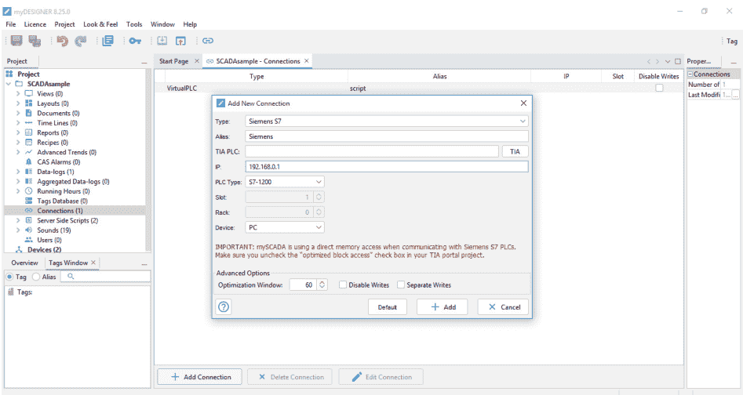

##### 图 11.35 – 项目（SCADASample）–“添加新连接”对话框

您应该会看到新添加的连接：

图 11.36 – 项目（SCADASample）– 已添加新连接

6. 接下来，双击“设备”并点击“添加设备”。按照以下屏幕截图所示配置设置，然后点击“测试设备”：

图 11.37 – 项目（SCADASample）– 添加设备

7. 点击“取消”，然后点击“添加”：

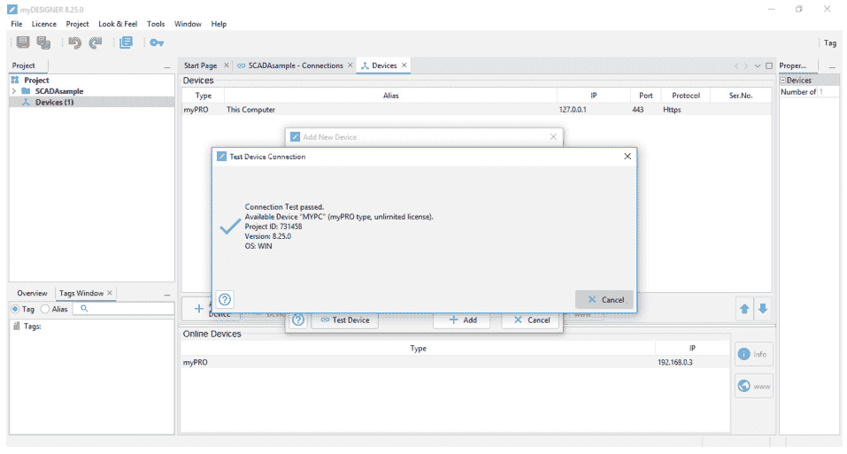

图 11.38 – 项目（SCADASample）– PLC 与 PC 之间的连接已测试且正常

您应该会看到新添加的设备：

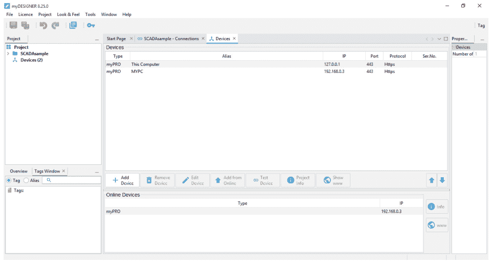

##### 图 11.39 – 项目（SCADASample）– 已添加设备

- 8. 双击项目标题，然后双击**标签数据库**。  
  点击**添加**：

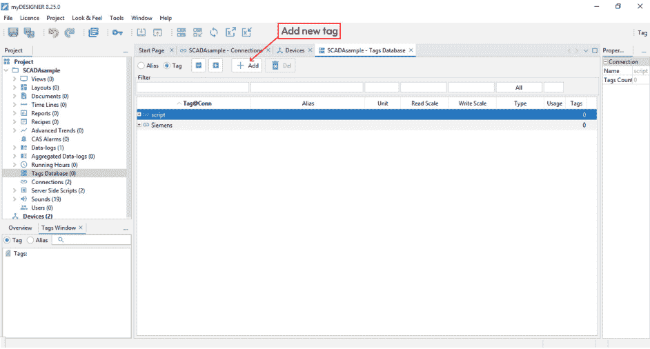

##### 图 11.40 – 项目（SCADASample）– 标签数据库

- 9. 选择您的 PLC 名称，如下面的屏幕截图所示：

图 11.42 – 项目（SCADASample）–“添加新标签”对话框（2）

11. 点击“添加并关闭”。您应该会看到以下屏幕：

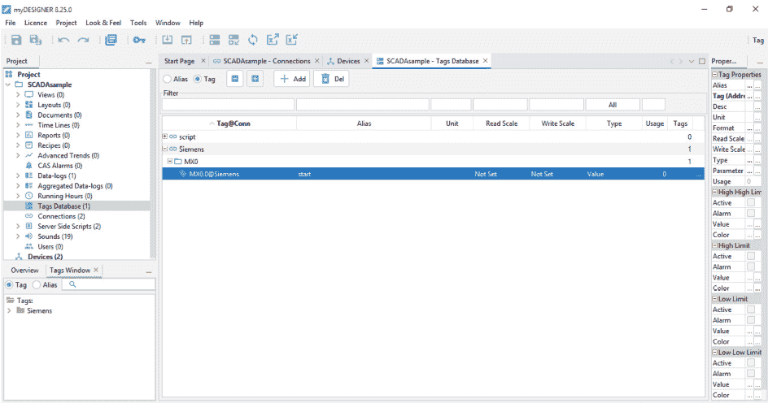

图 11.43 – 项目（SCADASample）– 已添加新标签

12. 点击“添加”，并按照下面的屏幕截图所示指定标签的必要详细信息：

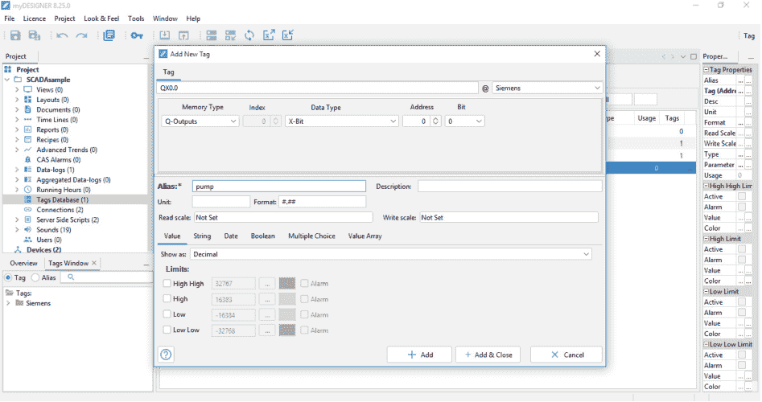

图 11.44 – 项目（SCADASample）–“添加新标签”对话框

13. 点击**添加并关闭**。您应该会看到以下屏幕：

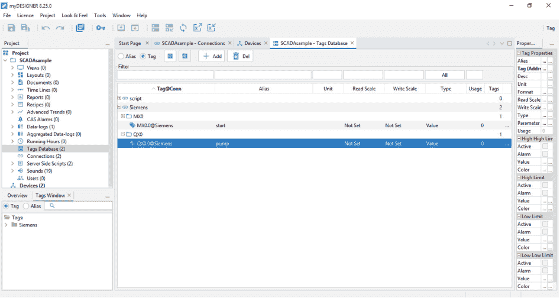

图 11.45 – 项目（SCADASample）– 已添加新标签

恭喜！您已成功将必要的标签添加到标签数据库中。

现在，让我们继续使用必要的组件和标签创建屏幕：

- 1. 右键单击“视图”，然后选择“添加新视图”：

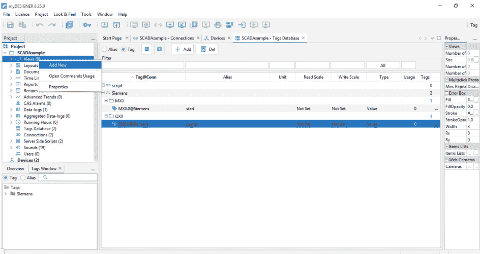

图 11.46 – 项目（SCADASample）– 右键单击“视图”

- 2. 按照以下屏幕截图所示进行必要设置。完成后，点击“添加”：

图 11.47 – 项目（SCADASample）– 添加新视图

3. 现在让我们开始添加组件。单击“组件编辑”图标：

图 11.48 – 项目（SCADASample）– 已添加新视图（SCADA-GUI）

##### 图 11.50 – 项目（SCADASample）– 新视图（SCADA-GUI）–“组件”对话框（2）

- 6. 展开`Siemens|MX0`，然后选择开关的标签——例如，`MX0.00@Siemens [*start]`。然后，点击**确定**：

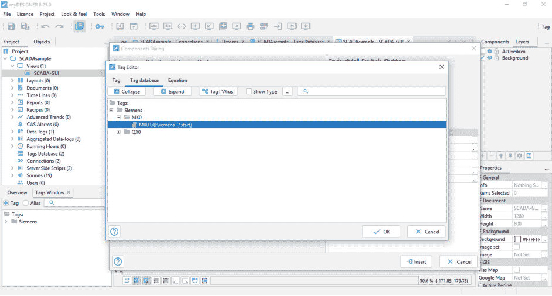

##### 图 11.51 – 项目（SCADASample）– 新视图（SCADA-GUI）– 为组件指定标签

- 7. 点击**插入**，然后点击屏幕：

图 11.52 – 项目（SCADASample）– 新视图（SCADA-GUI）–“组件”对话框

8. 您可以选择它来调整大小，或将其移动到屏幕上任意想要的位置：

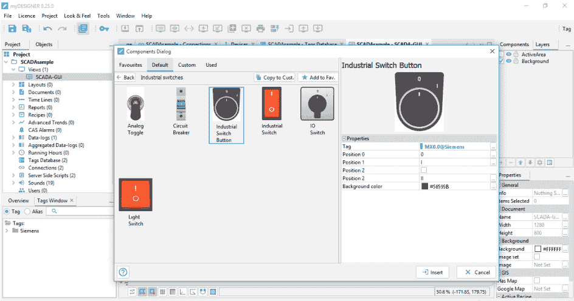

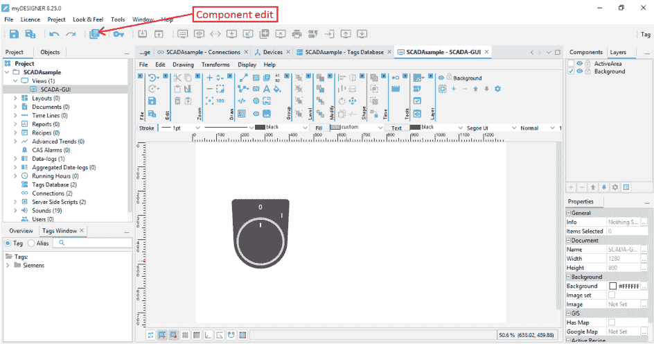

图 11.53 – 项目（SCADASample）– 新视图（SCADA-GUI）– 已添加组件

9. 单击“组件编辑”，然后在类别中选择“控制灯”：

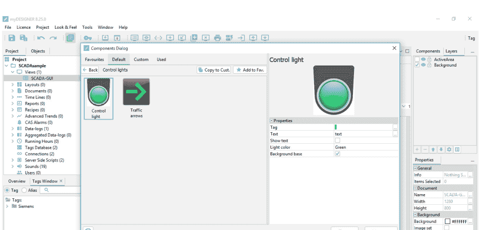

图 11.54 – 项目（SCADASample）– 新视图（SCADA-GUI）–“组件”对话框

10. 单击 ... 以指定标签。展开 QX0 并选择 QX0.0@Siemens [*pump]，如下面的屏幕截图所示，然后点击“确定”：

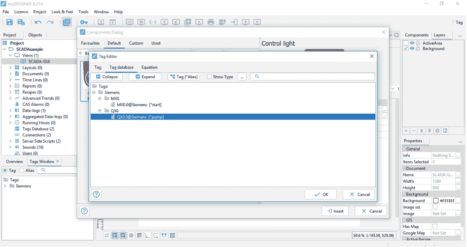

图 11.55 – 项目（SCADASample）– 新视图（SCADA-GUI）– 为组件指定标签

- 11. 点击**插入**，然后点击屏幕：

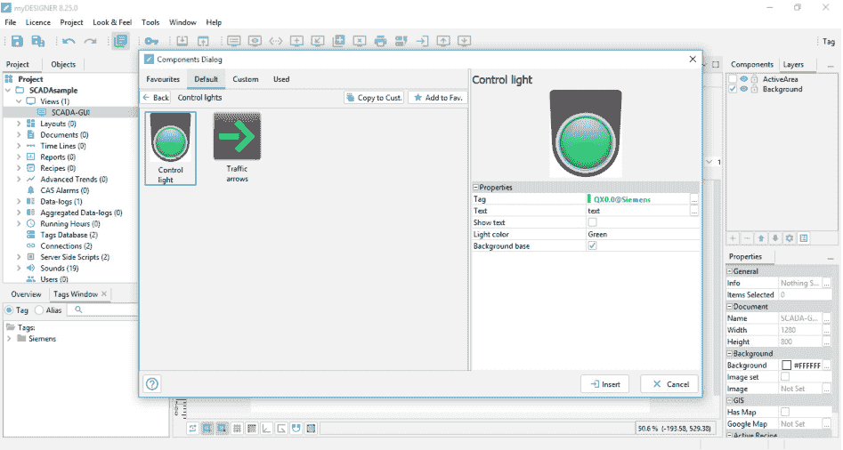

图 11.56 – 项目（SCADASample）– 新视图（SCADA-GUI）–“组件”对话框

12. 现在您可以在屏幕上看到控制灯。接下来，选择开关，如下面的屏幕截图所示：

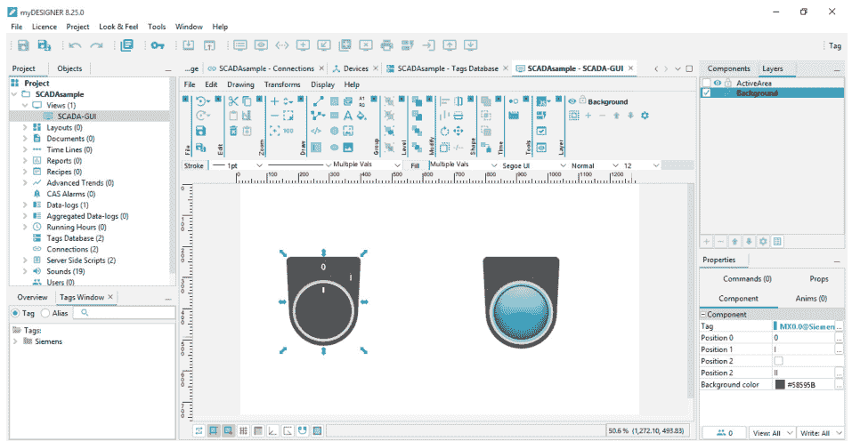

图 11.57 – 项目（SCADASample）– 新视图（SCADA-GUI）– 已选择开关

13. 单击“命令”，然后点击 ...：

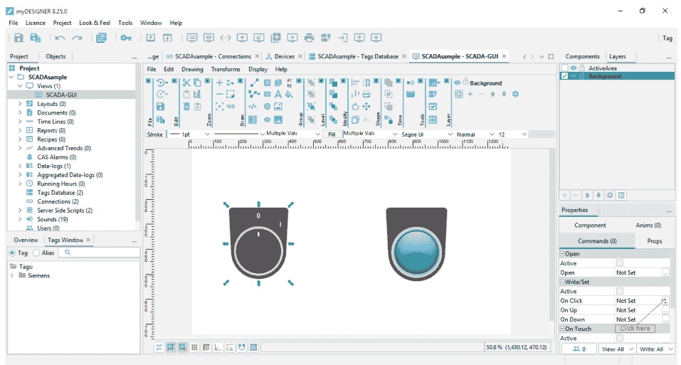

图 11.58 – 项目（SCADASample）– 新视图（SCADA-GUI）– 为开关添加命令（1）

14. 点击“切换”，然后点击 ...：

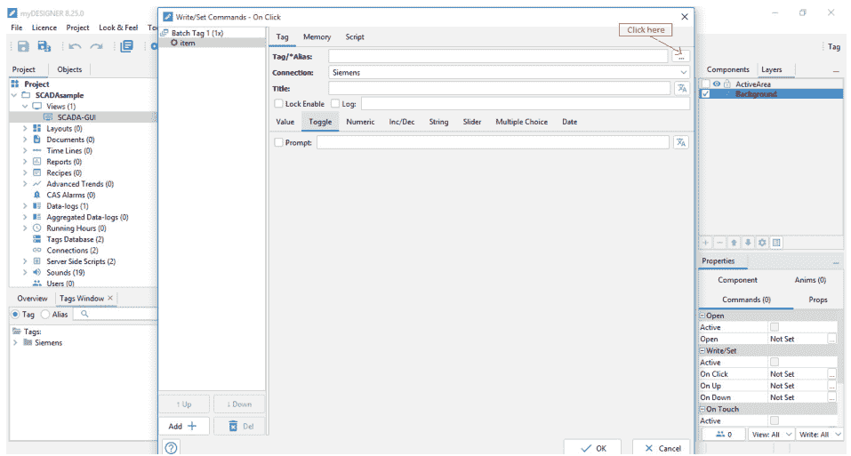

图 11.59 – 项目（SCADASample）– 新视图（SCADA-GUI）– 为开关添加命令（2）

15. 展开标签，如下面的屏幕截图所示：

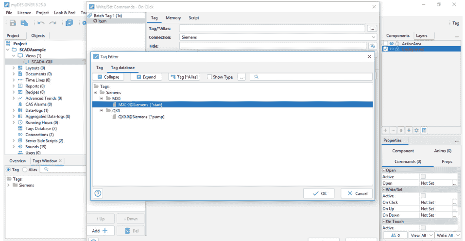

图 11.60 – 项目（SCADASample）– 新视图（SCADA-GUI）– 为开关添加命令（3）

16. 为开关选择标签 MX0.0@Siemens [*start]。

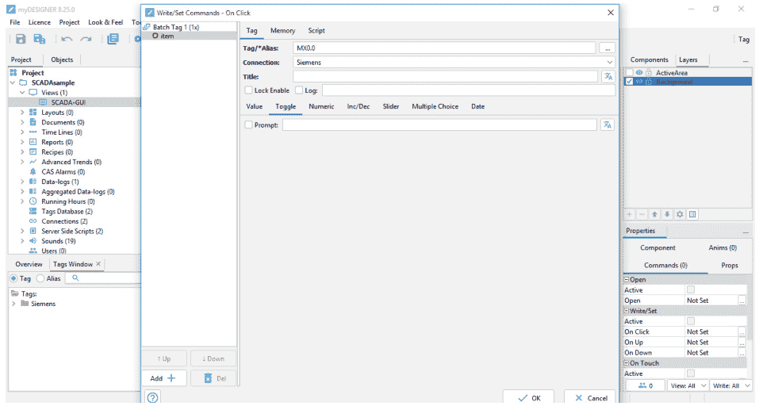

图 11.61 – 项目（SCADASample）– 新视图（SCADA-GUI）– 为开关添加命令（4）

17. 点击**确定**返回屏幕。

###### 注意

您可以使用创建文本元素工具来输入文本、调整其大小，并将其放置在屏幕上任意想要的位置，如下面的屏幕截图所示：

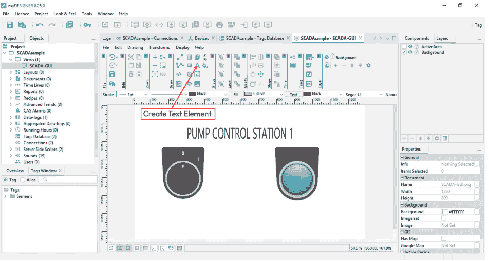

图 11.62 – 项目（SCADASample）– 新视图（SCADA-GUI）– 已添加命令并创建文本元素

恭喜！您已成功完成一个用于监控和控制泵运行的屏幕。

现在，让我们将项目下载到设备中：

- 1. 在屏幕左侧（项目树）选择您的项目名称（SCADASample）。点击**下载到设备**：

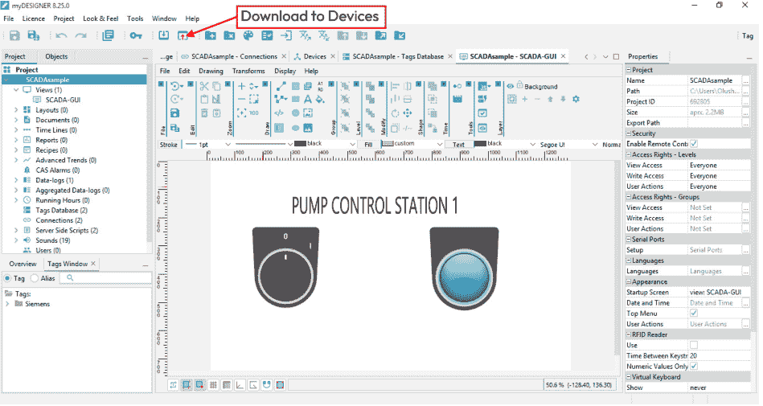

图 11.63 – 项目（SCADAsample）– 新视图（SCADA-GUI）– 已选择项目名称

+   2. 选择两个设备选项（**此计算机**和**MYPC**）：

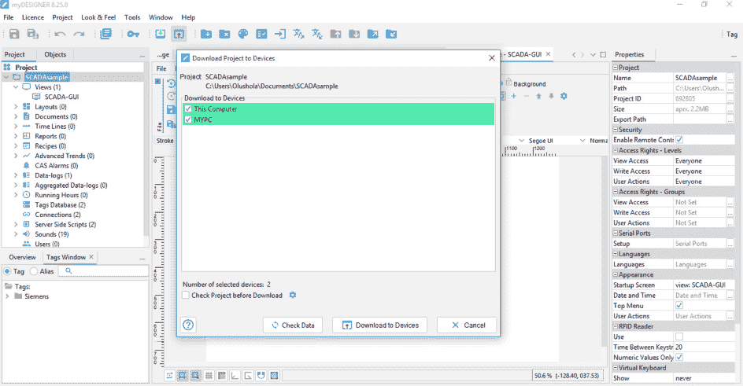

图 11.64 – 项目（SCADAsample）– 新视图（SCADA-GUI）– 下载至设备（1）

3. 点击**下载至设备**：

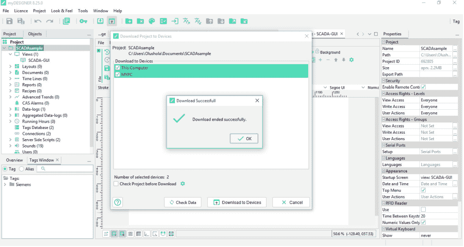

图 11.65 – 项目（SCADASample）– 新视图（SCADA-GUI）– 下载至设备（2）

###### 注意

如果出现任何消息，请仔细阅读并做出相应响应。

4. 点击**确定**返回您设计的界面。

###### 注意

如果您的系统已运行长达2小时，您需要重启系统才能继续使用该软件。这是因为您使用的是mySCADA的免费版本。

恭喜！您已成功完成SCADA画面及其监控与配置。

现在让我们查看用于监控的SCADA：

+   1. 启动mySCADA支持的任何浏览器——例如 Chrome。

2. 在地址栏输入`localhost`并按*Enter*键：

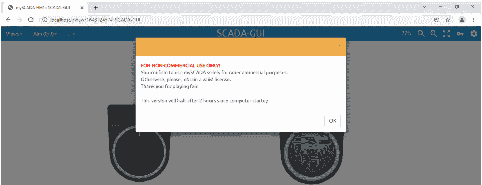

图 11.66 – 查看用于监控的SCADA

注意

您也可以输入`127.0.0.1`或您分配给PC以太网卡的IP地址来代替`localhost`。

3. 点击**确定**。下图显示了泵关闭时的SCADA画面：

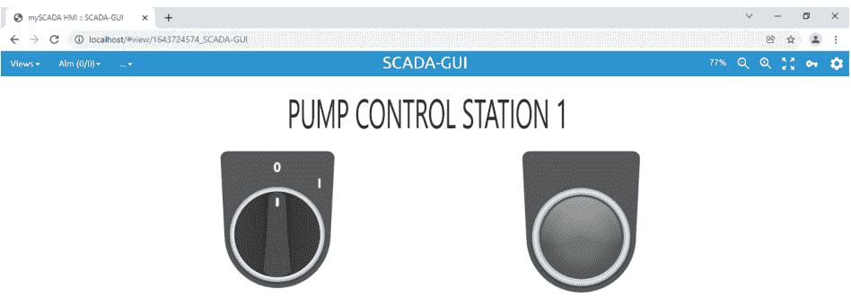

图 11.67 – 查看用于监控的SCADA（泵关闭）

4. 点击开关以开启泵：

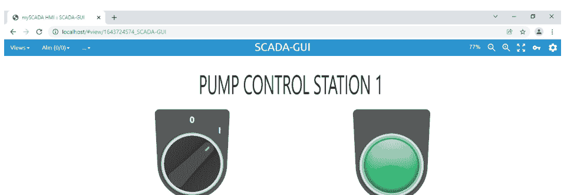

#### 泵控制站 1

图 11.68 – 查看用于监控的SCADA（泵开启）

下面的照片显示了我的设置，包括PLC（西门子S7-1200）、用于泵运行的接触器以及用于监控的笔记本电脑（泵关闭时）：

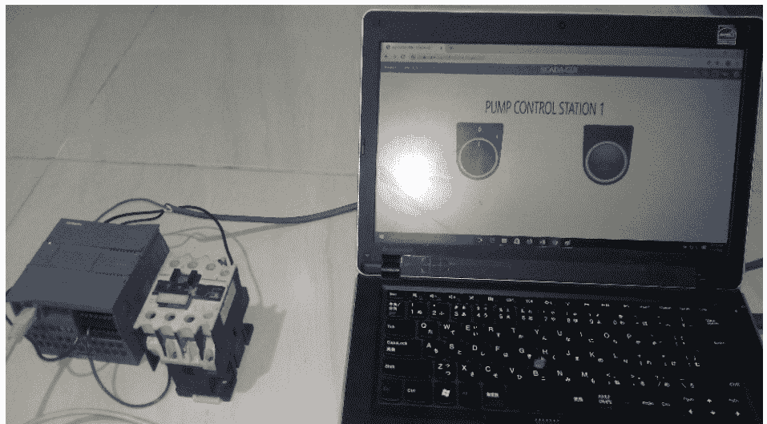

图 11.69 – 显示PLC（西门子S7-1200）、用于泵运行的接触器以及用于监控的笔记本电脑的设置（泵关闭时）

下面的照片显示了泵开启时PLC（西门子S7-1200）、用于泵运行的接触器以及用于监控的PC之间的连接：

图 11.70 – 显示PLC（西门子S7-1200）、用于泵运行的接触器以及用于监控的笔记本电脑的设置（泵开启时）

您刚刚完成了本书的最后一节，*使用mySCADA软件将SCADA与S7-1200 PLC接口连接*（一个实际项目），如果您拥有PLC（西门子S7-1200）以及其他组件和设备，您应该能够独立演示SCADA的设置。

#### 总结

恭喜！您已成功完成本书的又一章节。干得漂亮！本章以非常简单的方式对SCADA进行了很好的解释。SCADA硬件（现场设备、远程站、通信网络和主站）和软件都得到了很好的阐述。您应该能够按照分步指南自行下载并安装mySCADA软件。最后一节是一个非常有趣的部分，向您展示了如何创建简单的SCADA画面。分步指南中概述了监控所必需的配置。

下一章是另一个有趣的章节，将为您介绍各行业过程控制的基础知识。

#### 问题

以下问题用于测试您对本章节的理解。在尝试回答这些问题之前，请确保您已阅读并理解本章中的主题：

+   1. SCADA是________________________的缩写。
+   2. RTU是________________________的缩写。
+   3. ________________________指的是直接连接到机器或工厂并生成数字或模拟信号用于监控的传感器、变送器和执行器。
+   4. ________________________指的是运行SCADA软件的主计算机，该软件提供系统的图形化显示。
+   5. ________________________通常安装在主站上，用于创建监控工业设备所需的界面（GUI），并执行所有必要的配置。
