### 过程控制 – 基础知识

工业中进行的许多过程都需要控制。没有控制，就无法获得高质量的产品。制造业、石油和天然气、农业以及其他行业都需要化学或机械操作，这些操作需要被控制以达到最终产品或预期结果。即使在我们的家中，过程控制也发生在许多我们使用的设备或机器中。以下是一些集成了过程控制的家用电器示例：

+   - **冰箱**：它包括一个过程控制系统，使其循环开关，以将您的食物和饮料保持在特定温度。
+   - **空调**：这是另一种集成了过程控制的设备。您使用遥控器设定特定温度，它确保房间温度维持在该设定值。
+   - **熨斗**：它包含一个恒温器或温度开关，当温度达到一定水平（可称为设定值）时自动关闭。
+   - **房间加热器**：它使用加热器和温度开关将房间温度保持在特定温度。

任何行业的过程控制都将包括传感器、执行器和控制器，我们在前面的章节中已经学习过这些内容——这种控制有时也可能涉及通信网络。它们协同工作以确保达到所需的产品质量。

完成本章后，您应该理解过程控制以及适用于工业过程控制的各种测量和设备。您将动手学习如何使用温度控制器来控制温度。最后一节提供了关于可编程逻辑控制器（PLC）中模拟输入信号处理的实践知识，这是PLC编程的高级部分。您将

通过提供的分步指南，亲自动手理解西门子S7 1200 PLC模拟输入的接线和编程。

在本章中，您将涵盖以下主题：

+   - 过程控制简介
+   - 探索过程控制术语
+   - ISA符号
+   - 温度测量与变送器
+   - 压力测量与变送器
+   - 液位测量与变送器
+   - 流量测量与变送器
+   - 理解过程控制回路
+   - 单回路过程控制的实际示例
+   - 为过程控制接线和编程PLC（西门子S7 1200）的模拟输入（动手实践）

#### 过程控制简介

简单来说，我们可以将过程控制定义为监控和调整过程以产生预期结果的技术。

在当今工业中，原材料在成为成品之前要经过一系列程序（过程）。这些过程需要被仔细监控和调整，以确保高效、经济、安全地生产出高质量的产品。过程的监控和必要的调整通常使用控制系统进行自动化。如果监控和调整需要手动完成，则需要更多的工人，而且由于人为错误，我们无法以这种方式达到最佳结果。

#### 过程控制系统类型

自动过程控制可归类为以下一种：

- 开环
- 闭环（反馈）
- 前馈
- 前馈-反馈

让我们逐一查看这些类型。

##### 开环控制

在开环过程控制中，输出不会改变控制动作。它没有传感器或反馈系统。依赖时间的运行是开环的典型例子——例如，洗衣机有一个计时器，操作员会将其设定到期望的时间。机器运行并在规定时间内完成必要的过程以清洗衣物。它没有传感器来判断衣物是否已清洗干净。它会在设定时间到达时停止。在这里，输出不会影响控制动作。下面的图示显示了开环控制系统的框图：

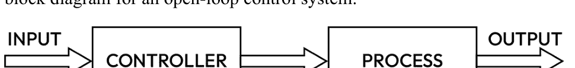

图 12.1 – 开环过程控制系统的框图

##### 闭环（反馈）控制

在闭环过程控制中，输出会影响控制动作。它的输出端有一个传感器，该传感器将反馈信号馈送到输入端。反馈信号与设定值进行比较以产生误差信号，该信号用于确定将过程驱动到期望输出或结果所需的必要动作。出于这个原因，闭环控制系统也可以称为反馈控制系统。输出被反馈到输入，它使用测量的输出（过程变量）和给定的设定值来控制输入，使输出保持在期望值。下面的图示显示了反馈过程控制系统的框图：

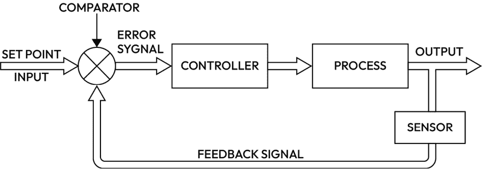

图 12.2 – 反馈过程控制系统的框图

反馈控制是各种行业中常用的技术，例如航空航天（例如，自驾仪和火箭）、加工（例如，石油和天然气、化工、核反应堆、食品和饮料、制药以及水处理）以及自动化制造（例如，机器人和数控机床）。

在牛奶制造行业中，生产过程之一是将牛奶在 15 秒内加热到约 70 摄氏度，然后立即冷却到约 3 摄氏度，以杀灭细菌并延长保质期（该过程称为巴氏杀菌）。通常使用**高温短时（HTST）**巴氏杀菌设备。

该设备使用卫生板式换热器，利用热水或蒸汽提高牛奶温度。此加热阶段随后进行快速冷却阶段。HTST 巴氏杀菌设备使用过程控制系统，通常是反馈控制系统，以确保牛奶得到充分巴氏杀菌。

反馈控制在我们的家庭中也很常见。空调就是一个常见例子。它有一个传感器读取环境的温度——该读数被馈送到具有设定值（你用遥控器设定的期望温度值——例如，16 摄氏度）的控制器，设定值与反馈信号进行比较以产生误差信号。控制器使用产生的误差信号来决定所需的控制动作，以驱动压缩机确保维持期望的温度值。其输出端的传感器使其能够确定是否达到期望温度，而不像开环。

##### 前馈控制

在前馈控制中，会测量扰动并在扰动影响系统之前采取纠正措施。它是一种预见到扰动并在扰动影响系统之前提供控制动作的控制系统。前馈控制基于负载变量或输入的状态而不是输出的状态来确定控制动作，而不像反馈控制。它监控负载变量，并在过程变量（或输出）偏离设定值之前采取必要的措施。输出不会被反馈，而不像反馈控制。

下面的图示显示了前馈过程控制系统的框图：

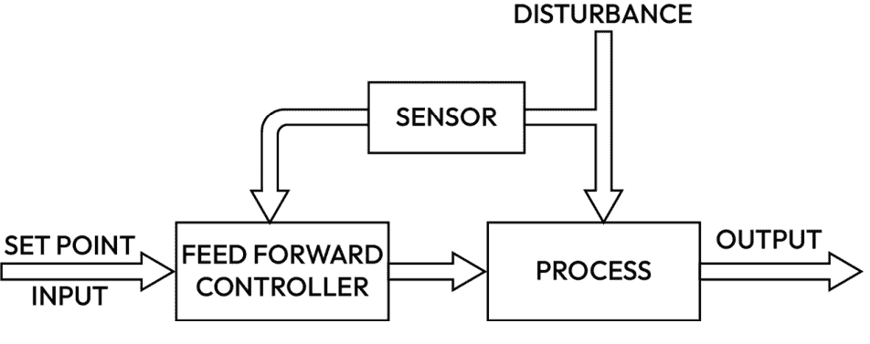

图 12.3 – 前馈过程控制系统的框图

##### 前馈-反馈控制

前馈在工业中并非单独使用——它通常与反馈控制一起使用。因此，前馈-反馈控制可以被视为一种过程控制类型。前馈元件对任何扰动提供快速响应，而反馈元件通过准确地作用于最终发生的误差来提供剩余的响应。它同时利用前馈和反馈控制器，如下图所示：

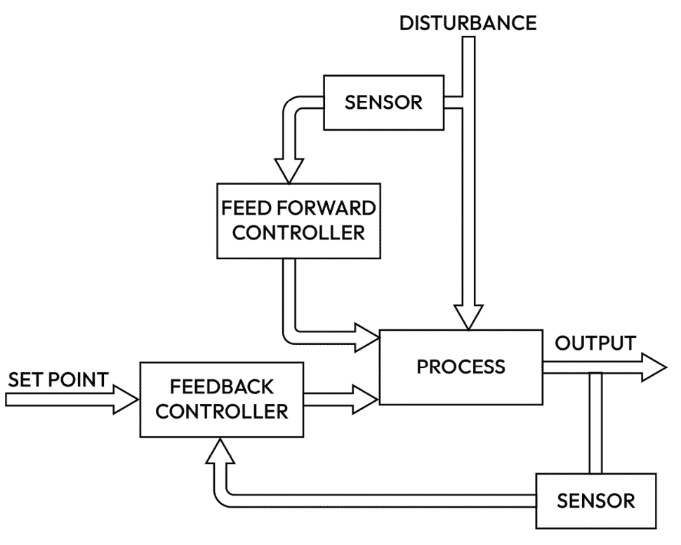

图 12.4 – 前馈-反馈过程控制系统的框图

我们刚刚介绍了过程控制以及可用的各种类型。让我们继续到下一节学习一些过程控制术语。

#### 探索过程控制术语

在这里，我们将研究与过程控制相关的一些常见术语：

- 过程：过程是任何操作或事件（或一系列操作或事件），它对输入造成物理或化学变化。工业中的原材料在成为成品之前会经历某种操作序列，例如加热、研磨或混合。
- **传感器：**传感器是一种检测或感应某物的装置——正如我们有耳朵听、眼睛看、鼻子闻、舌头尝一样。我们有传感器来感应或检测各种物理特性，例如温度、压力、液位或流量。传感器基本上将物理特性转换为电量。

因此，过程控制中常用的四个传感器是温度传感器、压力传感器、液位传感器和流量传感器——其他一些包括 pH 传感器、速度传感器或位置传感器。在*第 2 章，开关和传感器 – 工作原理、应用和接线*中，我们讨论了传感器，但我们的重点是产生数字输出的传感器，如**LOW**或**HIGH**（0 或 1）。在本章中，我们将重点关注产生模拟信号的传感器。
- **变送器：**变送器是一种将传感器产生的信号转换为标准信号（4 至 20 mA、0 至 10 V 或 3 至 15 psi）的装置，该标准信号适用于过程控制。传感器输出信号可能太小，需要放大或调理以产生标准信号。因此，传感器通常连接到变送器以产生标准信号输出——例如，下图显示了 RTD 温度传感器和 RTD 温度变送器如何布线以产生随温度变化的 4 至 20 mA 输出：

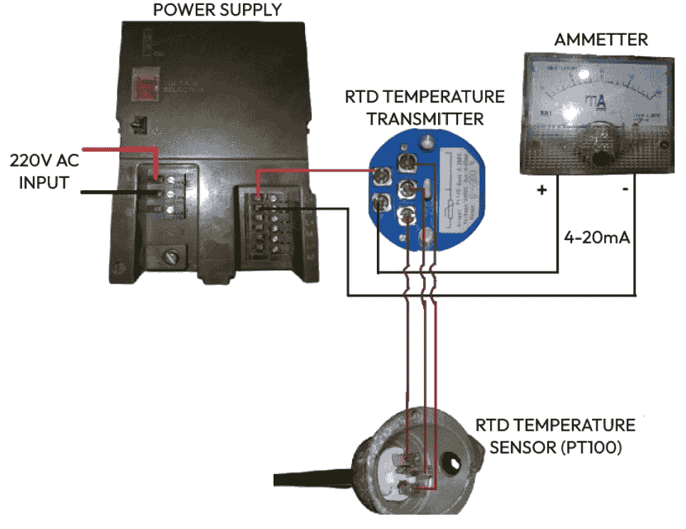

图 12.5 – RTD 温度传感器和 RTD 温度变送器如何布线以产生随温度变化的 4 至 20 mA 输出（Credit: Showlight Technologies Ltd.: [www.showlight.com.ng](http://www.showlight.com.ng))
- **过程变量或过程值（PVs）：**这是我们测量的特定量的实际值或当前值。这可以是温度、压力、液位、流量或其他量。
- **设定值：**这可以称为过程变量的目标值。它是我们希望过程变量保持的值。例如，锅炉的目标温度可以称为锅炉的设定值。
- **误差：**这是过程变量或测量值与设定值之间的差值。
- **控制器：**这是一种提供必要控制动作以使过程变量保持在设定点的装置。它作用于误差信号并向最终控制元件提供必要的控制动作，以使误差保持为零，从而维持设定点。
- **控制元件或最终控制元件：**这些是控制器操作以使过程变量保持在设定点的装置。示例包括接触器、继电器、电磁阀、气动控制阀和变频驱动器。

因此，我们刚刚学习了一些常见过程控制术语。熟悉这些术语很重要，因为你会在任何与过程控制相关的文档或讨论中频繁遇到它们。现在让我们继续到下一节，在那里我们将学习 ISA 符号。

#### ISA 符号

**国际自动化协会（ISA）**是一个由工程师、技术人员和管理人员组成的非营利专业协会，从事工业自动化。ISA 是过程控制行业领先的标准组织之一。他们开发了一套用于过程控制回路和其他工程图设计中使用的符号。这套符号被称为 ISA 符号，详细说明在其出版物之一（*ISA5.1, Instrumentation Symbols and Identification*）中，你可以在其网站（https://www.isa.org/）上购买。

ISA 符号用于创建**过程（或管道）和仪表图（P&IDs）**。

P&ID 是一张图，描绘了加工厂中使用的管道和仪表的细节。*图 12.14* 显示了一个基本液位控制过程控制回路的简单 P&ID。它通常在工业过程工厂的设计阶段从**过程流程图（PFD）**开发而来。PFD 显示了工业过程工厂的基本流程。它仅显示过程工厂中的主要组件。

以下是从 ISA5.1《Instrumentation Symbols and Identification》中提取的部分 ISA 符号：

| ISA symbol | Description |
|---|---|
| ○ | 这用于表示安装在现场的设备或仪器，例如变送器、传感器或探测器。示例：TT 现场安装的温度变送器。PT 现场安装的压力变送器。 |
| — | 这用于表示安装在现场的设备或仪器，例如变送器、传感器或探测器。示例：LIC 101 液位指示控制器。FIC 100 流量指示控制器。 |
| --- | 这用于表示位于主面板后方（不可见）的设备或仪器。 |
| = | 这用于表示安装或安装在次要或辅助面板正面（可见）的设备或仪器。 |

Table 12.1 – ISA symbols for devices and instruments

Note

单个设备和测量仪器，如变送器、传感器和探测器，均由一个圆圈表示。

下表显示了 PLC 或 DCS 的 ISA 符号：

| ISA symbol | Description |
|---|---|
| [Square with diamond inside] | 这用于表示安装在现场的 PLC。 |
| [Square with diamond and horizontal solid line] | 这用于表示位于主面板正面的 PLC（面板正面可见）。 |
| [Square with diamond and horizontal dashed line] | 这用于表示位于主面板后方的 PLC（不可见）。 |
| [Square with diamond and horizontal solid line through the center] | 这用于表示安装在次要或辅助面板正面（可见）的 PLC。 |

Table 12.2 – ISA symbols for a PLC or DCS

##### Note

PLC 或 DCS 由一个正方形和内部的菱形表示。

下表显示了执行显示和控制功能的设备的 ISA 符号：

| ISA symbol | Description |
|---|---|
|  | 该符号用于表示现场安装的既显示读数又执行某种控制功能的设备。 |
|  | 这用于表示在主面板正面（面板正面可见）既显示读数又执行某种控制功能的设备。 |
|  | 这用于表示在主面板后方（不可见）既显示读数又执行某种控制功能的设备。 |
|  | 这用于表示在次要或辅助面板正面（可见）既显示读数又执行某种控制功能的设备。 |

Table 12.3 – Display and control instruments

Note

既显示又执行某种控制功能的仪器由内部带圆圈的正方形表示。

下表显示了计算机系统的 ISAs 符号：

| ISA symbol | Description |
|---|---|
| ⬡ | 这用于表示安装在现场的计算机系统。 |
| ⬡ with a single horizontal line | 这用于表示位于主面板正面的计算机系统（面板正面可见）。 |
| ⬡ with a dashed horizontal line | 这用于表示位于主面板后方的计算机系统（不可见）。 |
| ⬡ with a double horizontal line | 这用于表示安装在次要或辅助面板正面的计算机系统（可见）。 |

Table 12.4 – ISA symbols for a computer system

##### Note

执行某种控制功能的计算机系统由六边形表示。

*Table 12.1* 至 *Table 12.4* 中的 ISA 符号可在此处总结，以便更容易理解：

- 没有线穿过中心的形状表示位于现场的仪器或设备。
- 穿过中心有一条水平实线的形状表示仪器或设备位于主面板正面（面板正面可见）。
- 穿过中心有一条虚线的形状表示仪器或功能位于主面板后方（不可见）。
- 穿过中心有一条双线的形状表示仪器或功能位于次要或辅助面板正面（可见）。

以下是从 *ISA5.1*、*Instrumentation symbols and identification* 中提取的其他 ISA 符号：

##### Table 12.5 – Other ISA symbols

可在 *ISA5.1, Instrumentation symbols and identification* 文档中找到更多信息。

我们刚刚学习了 ISA 符号。这一知识将帮助我们解读 P&ID 图。学习更多内容可使用 *ISA5.1, Instrumentation symbols and identification* 文档以及网上提供的其他资源。

在以下部分，您将学习各种量（温度、压力、液位和流量）的测量及其相关变送器。

#### Temperature measurement and transmitters

温度是衡量某物热度或冷度的指标。温度测量是过程工业中的一项重要任务，可借助传感器和变送器实现。常见的传感器有 **resistant temperature detectors (RTDs)** 和 **thermocouples.**

RTD 是一种随温度变化电阻也会变化的器件。其温度范围为 -260 至 850 摄氏度。其灵敏度优于热电偶，但价格更贵。按电阻元件材料分类的 RTD 传感器类型有 Pt100、Pt1000、Ni120 和 Cu100。字母代表元件的材料，而数字代表 0 摄氏度时的电阻。Pt100 是最常见的 RTD。电阻元件为铂，在 0 摄氏度时电阻为 100 欧姆。

RTD 温度传感器需要 RTD 变送器来产生标准信号输出（例如，4 至 20 mA），以便随温度变化的电阻。图 12.6 显示了 PT100 的 RTD 温度变送器。温度范围为 0 至 300 摄氏度，模拟信号输出为 4 至 20 mA。这意味着变送器将在 0 摄氏度时产生 4 mA，在 300 摄氏度时产生 20 mA。

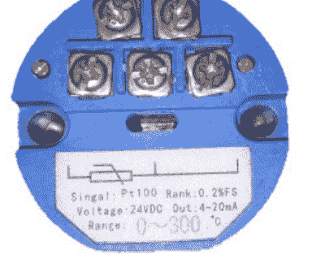

Figure 12.6 – An RTD temperature transmitter for PT100 (Credit: Showlight Technologies Ltd.: www.showlight.com.ng)

图 12.5 显示了 RTD 温度传感器和 RTD 变送器的接线方式。

热电偶由两根不同金属的导线在一端连接形成传感接点。会产生电压（以 mV 计），并随温度变化而变化。其温度范围为 -270 至 1800 摄氏度。现有的热电偶温度传感器包括 Type K、Type J、type T、Type E、Type N 和 Type S。每种类型都有一个温度范围。Type K 是最常见的热电偶温度传感器，温度范围为 -270 至 1,260 摄氏度。

热电偶温度传感器需要热电偶温度变送器来产生标准信号输出（例如，4 至 20 mA 或 0 至 10 V），因为随温度变化产生的 mV 会发生变化。图 12.7 显示了 Type K 热电偶的热电偶温度变送器。温度范围为 0 至 400 摄氏度，模拟信号输出为 4 至 20 mA。这意味着变送器将在 0 摄氏度时产生 4 mA，在 400 摄氏度时产生 20 mA。

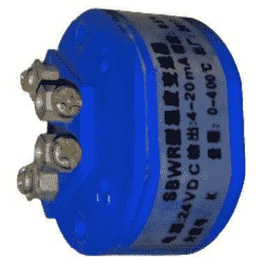

Figure 12.7 – A thermocouple temperature transmitter for a Type K thermocouple sensor (Credit: Showlight Technologies Ltd.: www.showlight.com.ng)

您刚刚学习了温度测量和变送器。让我们继续下一部分学习压力测量和变送器。

#### Pressure measurement and transmitters

压力可定义为单位面积上施加的力（F/A）。工业中的工艺需要准确可靠的压力测量以确保安全操作和生产优质产品。压力的影响包括位置移动、电阻变化或其他可测量的物理变化。常见的压力传感器采用波登管、膜片、波纹管、力平衡或可变电容等结构。

需要压力变送器来根据传感器所基于的压力效应产生标准信号（4 至 20 mA 或 0 至 10 V）。大多数情况下，压力变送器自带内置传感器并作为单个包装出售，如下图所示：

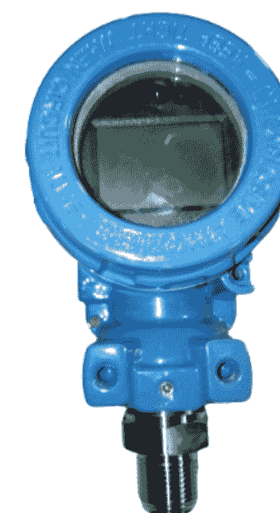

Figure 12.8 – A front view of a pressure transmitter (Credit: Showlight Technologies Ltd.: www.showlight.com.ng)

The following figure shows a simple connection to a pressure transmitter to produce a signal of 4 to 20 mA as the pressure varies:

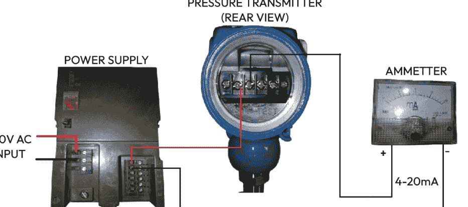

Figure 12.9 – A connection to a pressure transmitter (Credit: Showlight Technologies Ltd.: [www.showlight.com.ng](http://www.showlight.com.ng))

The ammeter can be replaced with the analog input of a PLC that supports the current input (4 to 20 mA) if the signal will be fed to a PLC to perform a control function. If the analog input of the PLC only supports a voltage input (0 to 10 V), there will be a need to convert the current input of 4 to 20 mA to a voltage by connecting a 500-Ohm resistor across the signal. The last section of this chapter demonstrates this with a practical example.

You’ve now learned about pressure measurement and transmitters. Let’s proceed to learn about level measurement and transmitters in the following section.

#### Level measurement and transmitters

The accurate measurement of levels is required in industry to maintain the proper fluid levels for safe operation, quality production, or the smooth running of equipment. Various sensor technologies are available for measuring levels in liquid and also in solids. Capacitance level sensors measure the change in capacitance to determine liquid levels. An ultrasonic level sensor emits a sound wave. The liquid level is directly proportional to the time delay between the wave emission and its reflection. Differential pressure sensor uses the difference in pressure between two points in a tank to determine the level. Level sensors mostly have a transmitter integrated that enables them to produce a standard signal of 4 to 20 mA or 0 to 10 V as a level varies.

There are various level transmitters. The following figure shows a hydrostatic level transmitter that is usually immersed in water or some liquid whose level is to be measured:

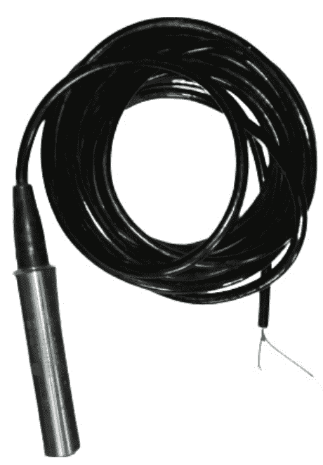

Figure 12.10 – A hydrostatic level transmitter (Credit: Showlight Technologies Ltd.: www.showlight.com.ng)

The following figure shows the wiring of a level transmitter that will produce an output of 4 to 20 mA as the level of water varies:

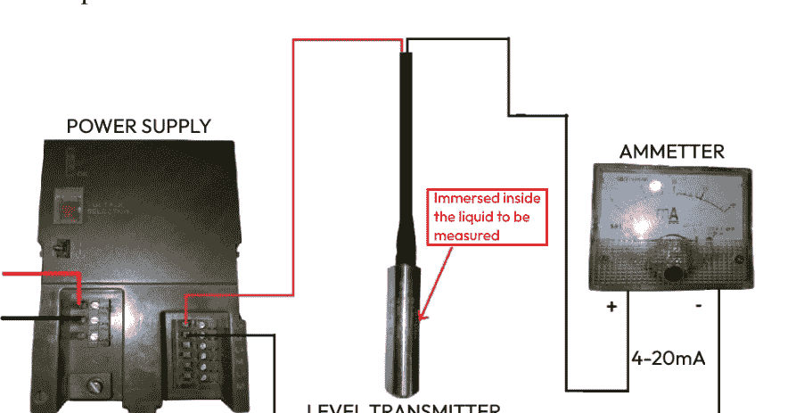

Figure 12.11 – The wiring of a level transmitter that will produce an output of 4 to 20 mA as the level of water varies (Credit: Showlight Technologies Ltd.: [www.showlight.com.ng](http://www.showlight.com.ng))

The ammeter can be replaced with an analog input of PLC that supports the current input (4 to 20 mA) if the signal will be fed to a PLC to perform a control function. If the analog input of the PLC only supports a voltage input (0 to 10 V), there will be a need to convert the 4 to 20 mA input to a voltage by connecting a 500-Ohm resistor across the signal. The last section of this chapter demonstrates this with a practical example.

You have now learned about level measurement and transmitters. Let’s proceed to the next section to learn about flow measurement and transmitters.

#### Flow measurement and transmitters

Flow measurement is an operation carried out to measure the flow of fluids in a pipe using an instrument. Several flow-measuring instruments exist, which include the following:

- **A differential pressure flow meter:** This uses a pressure difference created by a sensing element (for example, an orifice plate or a Venturi tube) to determine the rate of a flow. A differential pressure transmitter has a high- and low-pressure port to which the high- and low-pressure side of the sensing element will be connected and it produces a standard signal of 4 to 20 mA that corresponds to the flow rate.

The following figure shows a Rosemount differential pressure transmitter:

Figure 12.12 – A Rosemount differential pressure transmitter (this file is licensed under the Creative Commons Attribution-Share Alike 4.0 International license)

- **A velocity flow meter**: This determines a flow rate by measuring the flow velocity. Velocity flow meters include the following:

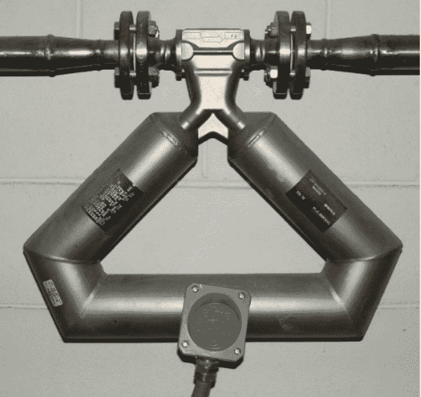

Figure 12.14 – A Coriolis mass flow meter (this file is licensed under the Creative Commons Attribution-Share Alike 4.0 International license)

- *A thermal mass flow meter:* This relates the mass flow rate to the quantity of energy transferred from a heated probe to the flowing fluid. It is suitable for measuring gases. *Figure 12.15* shows a thermal mass flow meter.

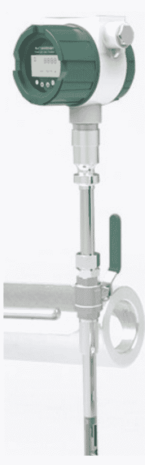

Figure 12.15 – A thermal mass flow meter (this file is licensed under the Creative Commons Attribution-Share Alike 4.0 International license)

We have just learned about flow meters (differential pressure, velocity, and mass flow meters), which should give you a basic idea of flow measurement. Let’s proceed to the following section to compound our knowledge about process control.

#### Understanding the process control loop

The process control loop is a set of devices and tools designed to maintain the desired output from a process variable. Control loop components and instruments measure the variable, respond to it, and control it to maintain a setpoint.

A control loop system can be either an open-loop or closed-loop system, which we explained in an earlier section of this chapter. It usually consists of a sensor or transmitter, a controller, and an actuator. The following figure shows a process control loop for level control:

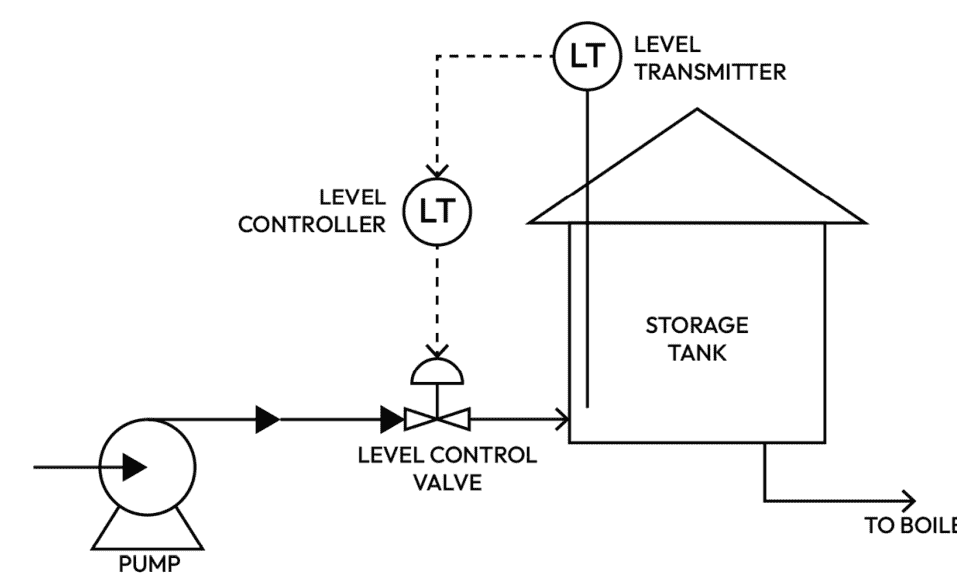

Figure 12.16 – The process control loop for level control

The process control loop in the preceding figure is explained briefly as follows: the pump supplies water to the tank and a control valve (the final control element) controls the flow rate depending on what it learns about the tank level through the signal it receives from the level controller, which has a setpoint. The level transmitter provides a feedback signal to the level controller. The level controller compares the feedback signal from the level transmitter to the setpoint and decides the control signal to give to the control valve to ensure an appropriate flow rate depending on the level of the liquid in the tank.

#### A practical example of single-loop process control

Here, we will use a temperature sensor, a temperature controller, and a contactor (actuator) to keep the temperature of a heater at the desired level (or setpoint).

##### Materials/devices

The required materials include the following:

- A thermocouple temperature sensor (Type K)
- A temperature controller (JTC903)
- A contactor
- A heating element

##### Wiring

Make the connection as shown in the following diagram (*Figure 12.17*):

- this will energize the contactor because the A2 coil terminal of the contactor is connected to Neutral (N) of the AC supply while the A1 coil terminal that is connected to terminal 6 will now be on Live (L).

4. When the temperature of the heater is equal to the setpoint, the common (C) terminal of the temperature controller (terminal 7) will be disconnected from terminal 6 and connected to terminal 8. This will de-energize the coil of the contactor and power will no longer flow to the heater. Hence, the heater cools gradually and as it falls below 100, the coil is energized again and the process repeats.

This is a simple control that is not very effective, as you cannot maintain the exact setpoint because there will always be an overshoot. A better controller to use is a **Proportional-Integral-Derivative (PID)** temperature controller, which can be properly tuned to maintain the desired temperature.

In this section, we have practically demonstrated a simple process control for temperature. You can do this on your own by sourcing the required devices and making the connections as provided in the wiring (*Figure 12.17*). This should give you hands-on experience with a simple process control system.

In the following section, we will learn how to wire and program the analog input of a Siemens PLC to control a process.

#### Wiring and programming the analog input of a PLC (Siemens S7 1200) for process control (hands-on)

In this section, we are going to dig deeper into our PLC wiring and programming by learning how to wire and program the analog input of PLC to control a process. Analog programming is often seen as the complicated aspect of using a PLC. I have made it simple and easy to understand here.

实际操作部分（动手实践）将帮助你更好地理解。尽管本书的每个部分都很重要，特别是第7章《理解PLC硬件和布线》、第8章《理解PLC软件及使用TIA Portal进行编程》以及第9章《使用TIA Portal深入PLC编程》，都是为了便于理解本节内容而必不可少的。

有专门为温度控制设计的控制器——例如上一节中用于温度控制的JTC903控制器。我们也有专门用于测量压力或液位的控制器。然而，PLC可以布线并编程以控制任何可测量的物理量，如温度、液位或压力。我们只需要使用合适的传感器或变送器和执行器，以正确的方式进行布线，并将其编程为执行所需的控制功能。因此，PLC是过程控制中的关键组件。

让我们简要了解一下模拟信号，以便更好地理解接下来的实践部分。

#### 理解模拟信号

与只能处于两种状态（0或1）的数字信号不同，模拟信号具有从最小值到最大值之间的连续取值范围。它们可以表示0（最小值，例如0 V或4 mA）和1（最大值，例如5 V、10 V或20 mA）之间的值。当电压从0 V变化到10 V，或当电流从4 mA变化到20 mA时，就称为模拟信号。产生模拟信号输出的传感器和变送器的例子有温度变送器、压力变送器和流量变送器。在PLC能够处理模拟值之前，必须先将其转换为数字信息——这由PLC模拟模块中的模数转换器（ADC）完成。模拟模块的一个重要特性是其以位的分辨率。

基本上，8位模拟模块将0到254表示为4 mA到20 mA或0 V到10 V，具体取决于连接到其上的模拟信号是电流还是电压。10位模拟模块将具有0到1023

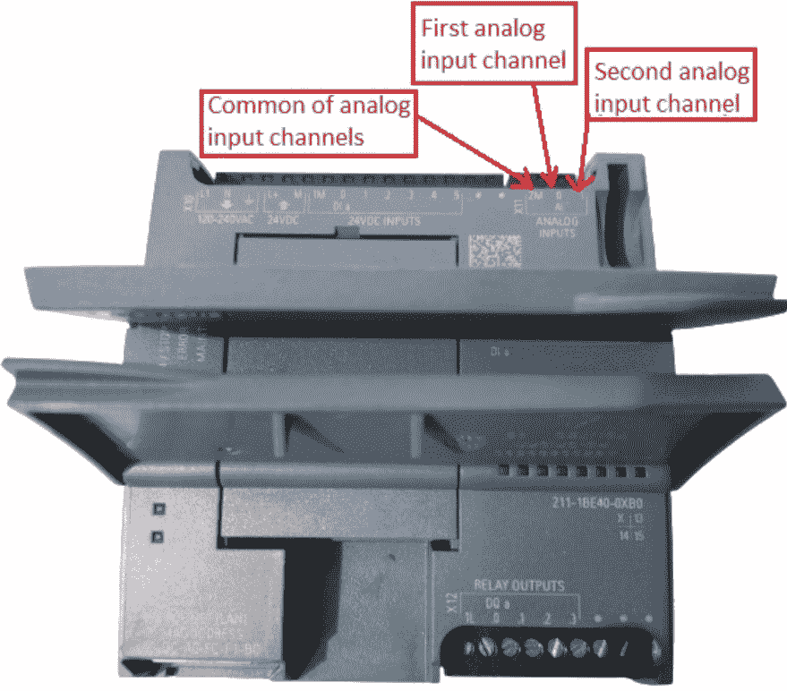

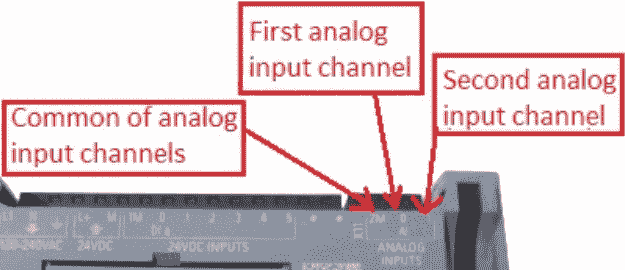

图12.18 – 一台S7-1200（CPU 1211C，AC/DC/RLY）PLC显示模拟输入通道（Credit: Showlight Technologies Ltd.: www.showlight.com.ng）

西门子S7-1200控制器有多种数据类型，包括`bool`、`byte`、`word`、`INT`和`REAL`类型。在模拟信号处理中最常用的数据类型是`INT`和`REAL`，因为读入的模拟信号值以16位整数存在，而`INT`可以容纳，因为`INT`为16位。为了避免舍入误差，应使用`REAL`以获得更精确的结果，因为`REAL`可以容纳浮点数或小数。

#### 读取模拟值

对于S7-1200，第一个模拟输入通道的地址是%IW64，而第二个是%IW66。变送器的4至20 mA、0至10 V或2至10 V模拟输出连接到第一个或第二个通道。

无论分辨率如何，西门子PLC始终将电压或电流转换为字值（数字化值），其中额定最大值为27,648，数据类型为INT。因此，0至10或4至20 mA将被评定为0至27,648，如下表所示：

| 模拟值（4至20 mA） | 4 mA | 8 mA | 12 mA | 16 mA | 20 mA |
| 模拟值（0至10 V） | 0 V | 2.5 V | 5 V | 7.5 V | 10 V |
| 数字化值 | 0 | 6,912 | 13,824 | 20,736 | 27,648 |

表12.7 – 西门子从最小值（0 mA或0 V）到最大值（20 mA或10 V）的五个模拟信号的数字化值

0至27,648是西门子用于表示其模拟模块中0至10 V或4至20 mA模拟信号输入的标准（额定范围）。它不依赖于分辨率且不可更改。然而，以前解释的分辨率会影响读取的准确性。分辨率越高，你的读取中可以捕捉到的细节就越多。27,648并不是实际的最大值——它只是额定最大值。实际最大值为32,768（即15位=2^15），可用于计算以确定分辨率的影响，如下所示：

- 8位分辨率是2^8 = 256。你能产生的最小变化将为32,768/256 = 128。因此，你可以以128为增量从0变化到27,648，对应0 V至10 V，如0、128、256......27,648。
- 12位分辨率是2^12 = 4,096。你能产生的最小变化将为32,768/4,096 = 8。因此，你可以以8为增量从0变化到27,648，对应0至10 V，如0、8、16......27,648。
- 15位分辨率是2^15 = 32,768。你能产生的最小变化将为32,768/32,768 = 1。因此，你可以以1为增量从0变化到27,648，对应0至10 V，如0、1、2、3、4......27,648。

0至27,648的数字化值需要进行归一化以便进一步处理。

#### 归一化和缩放

**Normalize**是S7-1200中的内置功能，用于将任何给定数据从最小值到最大值转换为0到1的浮点值。它要求你输入最小值和最大值以及包含待转换数据的寄存器——例如，如果模拟信号连接到第一个模拟输入通道，则为`%IW64`。最小值为0，而最大值为27,648。我们的实践课程将展示如何使用**normalize**。

**Scale**是S7-1200中的内置功能，用于将归一化值从0到1转换为所需的范围。你将在实践课程中学习如何**scale**。

#### 模拟输入信号处理（实践演示）

在了解了模拟信号处理的基础知识后，让我们动手实践以对理论有更深入的理解。我们将从使用虚拟PLC进行仿真开始，以便没有真实PLC的人也能演示。然后我们将使用真实PLC，任何能够负担得起PLC和其他所需材料的人都可以练习。

#### 仿真（使用虚拟PLC）

以下逐步指南要求你在笔记本电脑或PC上安装了TIA Portal。参考*第8章《理解PLC软件及使用TIA Portal进行编程》*，学习如何下载和安装TIA Portal。你可以下载并使用21天：

1. 启动TIA Portal并为S7-1200（CPU 1211C AC/DC/RLY）创建一个新项目，以生成以下环境：

图12.19 – 创建的项目

2. 展开程序块并双击Main [OB1]以进入编程环境：

图12.20 – 编程环境

3. 在屏幕右侧的基本指令列表中展开转换操作，并将NORM_X命令拖到网络1：

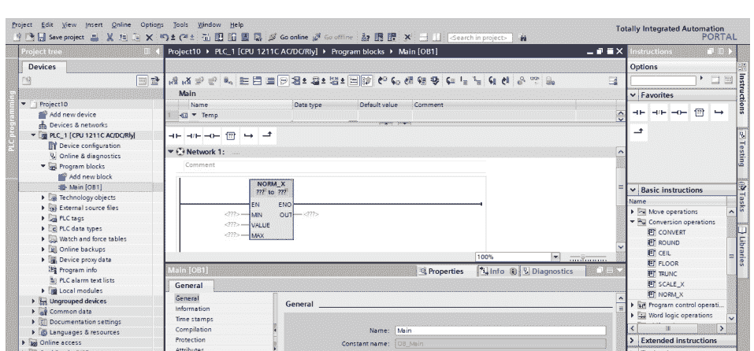

图12.21 – NORM_X指令1

4. 在NORM_X指令下方的???到???字段中将数据类型设置为INT到REAL：

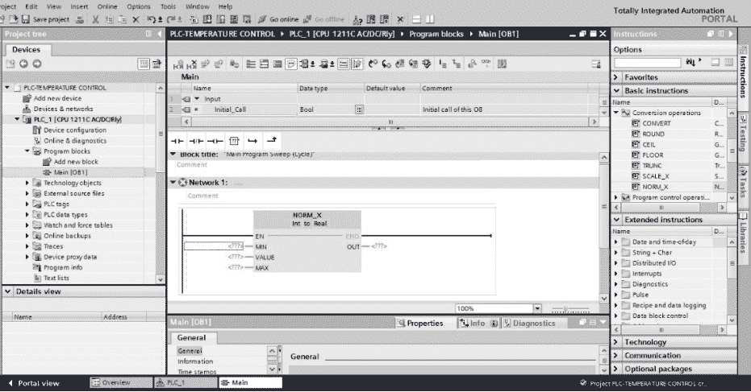

##### 图12.22 — NORM_X指令2

- 5. 为`MIN`输入0，为`MAX`输入27648。
- 6. 指定将保存要用于测试的`VALUE`数据的寄存器——例如，`MD0`。

##### Note

如果使用真实的S7-1200 PLC，如果模拟信号连接到第一个模拟输入通道，则为`VALUE`指定`%IW64`。如果模拟信号连接到第二个模拟输入通道，则为`VALUE`指定`%IW66`。

- 7. 指定将保存归一化数据的寄存器以用于`OUT`——例如，`MD4`。

图12.23 – NORM_X指令3

##### Note

使用真实PLC时，MD0将被PLC模拟输入通道的地址替换。

- 8. 在屏幕右侧的基本指令列表中展开转换操作，并将SCALE_X命令拖到网络1：

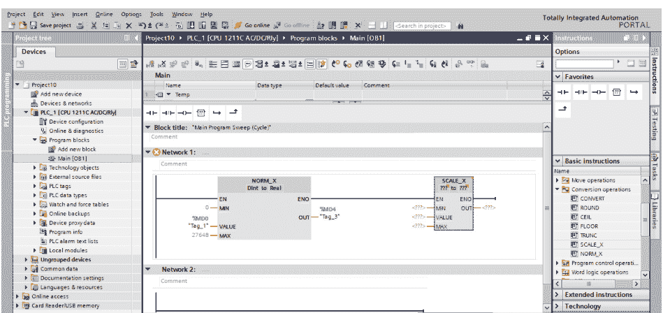

##### 图12.24 – SCALE_X指令1

- 9. 在SCALE_X指令下方的???到???字段中将数据类型设置为REAL到REAL。
- 10. 为MIN输入0，为MAX输入300，因为我们将使用的变送器输出为4至20 mA，范围为0至300摄氏度。
- 11. 为VALUE指定归一化数据的寄存器（例如，MD4）。
- 12. 为OUT指定将包含缩放结果的寄存器——例如，MD8。

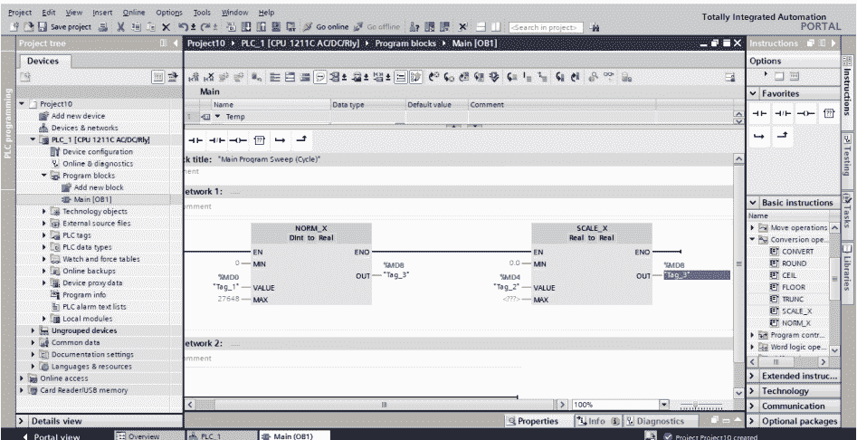

Figure 12.25 – SCALE_X instruction 2

13. Click Compile to ensure there are no errors.

Let’s now simulate it to see how it works. Refer to the steps in Chapter 9, Deep Dive into PLC Programming with TIA Portal, to learn about how to get to the simulation environment:

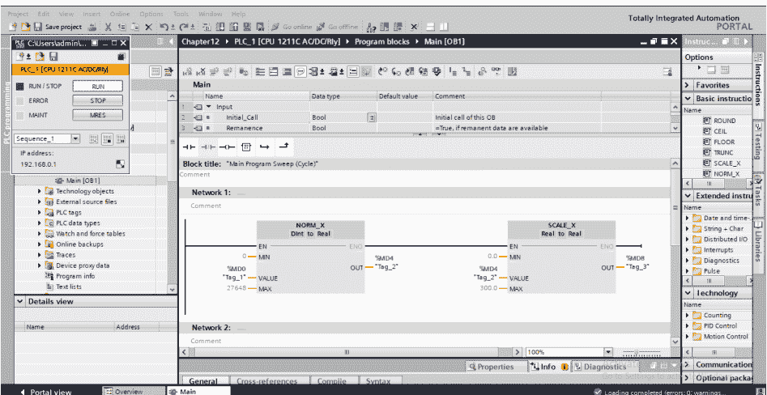

Figure 12.26 – The simulator started

14. Click Monitoring on/off:

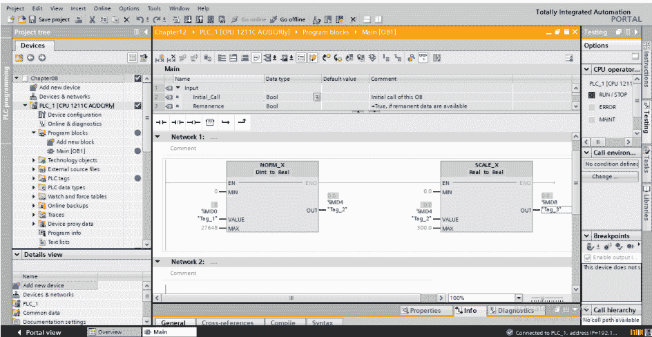

Figure 12.27 – Monitoring on/off

15. Right-click the tag for MD0, hover over Modify, then Display format, and click Decimal:

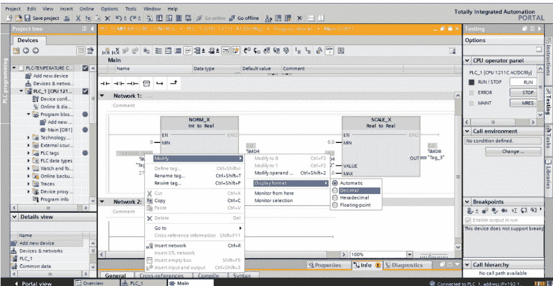

Figure 12.28 – Changing the display format

16. Repeat the preceding steps for the tag for MD8 and choose Floating point:

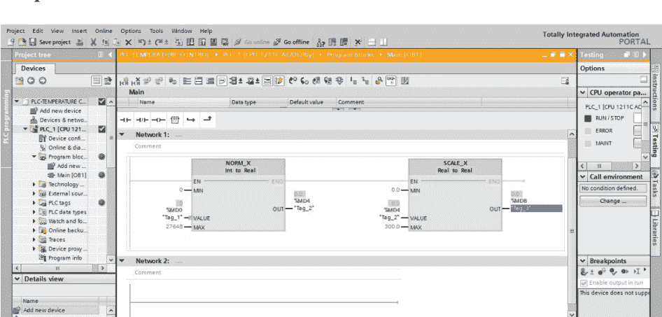

Figure 12.29 – The simulation running

17. Now, right-click the tag for the input value (tag_1), hover over Modify, and click Modify operand:

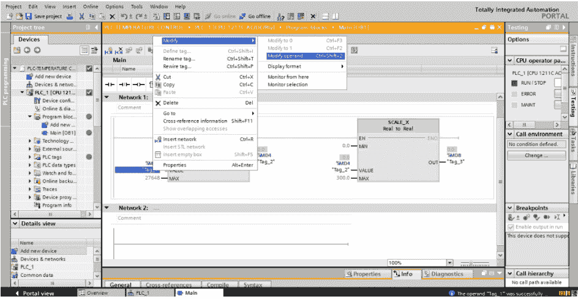

Figure 12.30 – Modifying operand 1

18. Change the format from HEX to DEC (decimal) and then fill in Modify value – for example, 13824. Click OK:

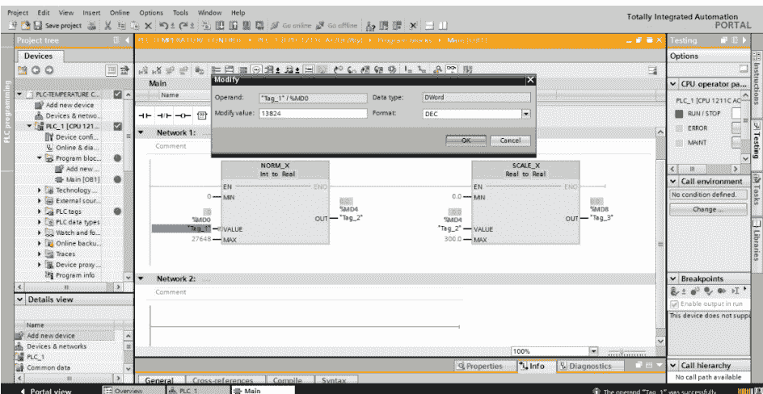

Figure 12.31 – Modifying operand 2

It can be seen from the simulation result in Figure 12.32 that when the digitized value (the value at MD0) in NORM_X is half the full value (that is, 13824), the output became 0.5, which means half of 1 since normalize (NORM_X) converts the input to a value from 0 to 1. It can also be seen that scale (SCALE_X) converted the normalized value of 0 to 1 to 0 to 300, as we can see that the 0.5 (half of 1) gave 150.0 (half of 300) at the output of SCALE_X:

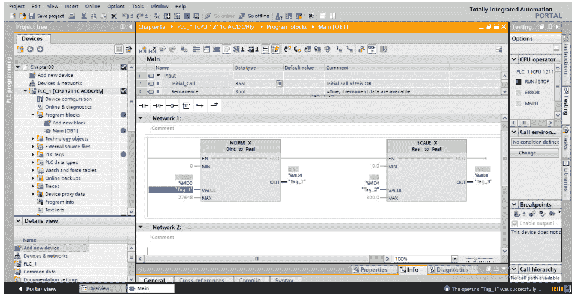

Figure 12.32 – Simulation result 1

You can play with various other values at MD0 to see how normalize and scale work.

Try 4608 as the digitized value in MD0 – you should get 50.0 at MD8, as shown here:

Figure 12.33 – Simulation result 2

Let’s go further.

We will now use the analog signal result to energize an Assignment (coil) to get an understanding of using an analog signal input to control a digital output:

1. Stop the simulation by clicking Monitoring on/off and Yes to go offline in the message that appears.
2. Expand Comparator operations in the Basic instructions list on the right-hand side of the screen and drag the CMP>= instruction to Network 2:

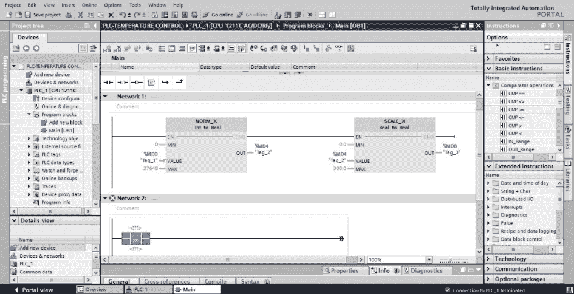

Figure 12.34 – CMP>= instruction 1

3. Double-click the ??? field in the middle of the comparator command and select Real as the data type, as shown:

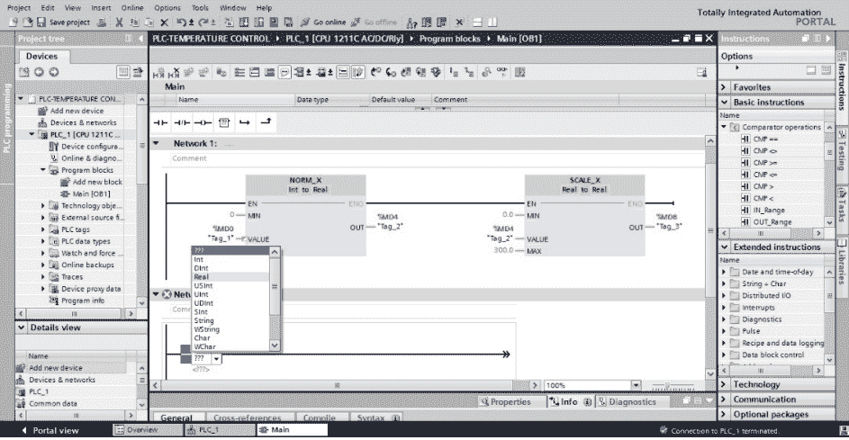

Figure 12.35 – CMP>= instruction 2

4. Input %MD8 in the ??? field at the top of the comparator instruction.

5. Input 50 at the ??? field at the bottom of the comparator instruction:

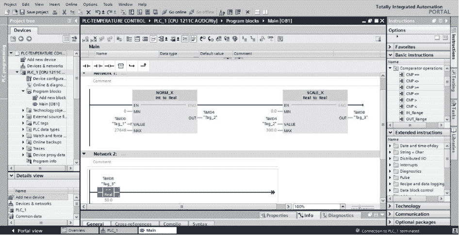

Figure 12.36 – CMP>= instruction 3

6. Expand **Bit logic operations** under the **Basic instructions** list on the right-hand side of the screen and drag the Assignment (coil) instruction to your **Network 2**:

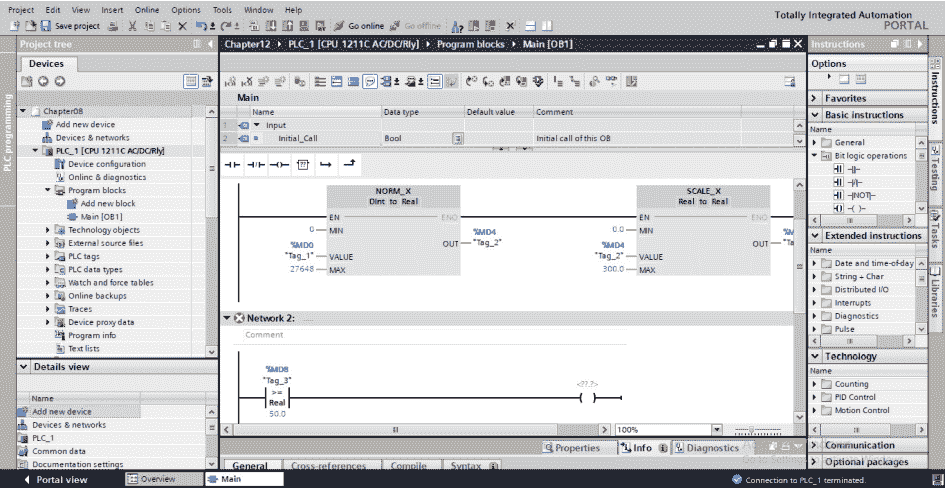

Figure 12.37 – Assignment (coil) instruction 1

7. Input %Q0.0 as the output coil address for the coil:

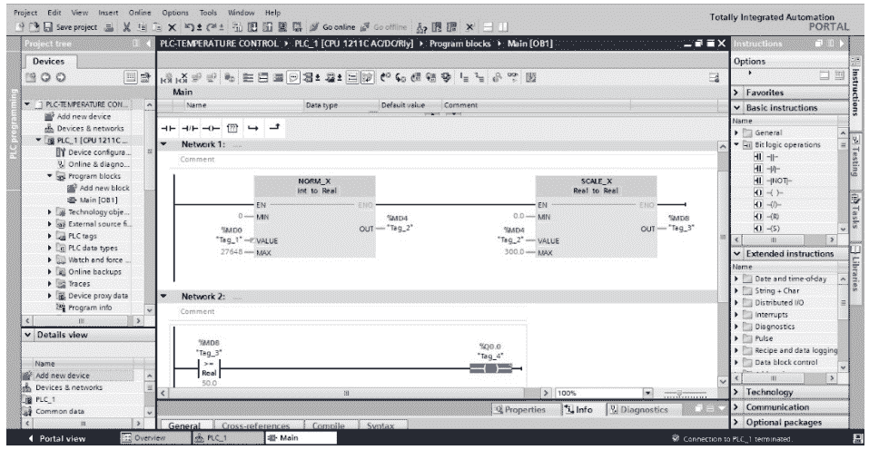

Figure 12.38 – Assignment (coil) instruction 2

Now, let’s simulate:

1. Click Compile and click Download since our simulator has already started:

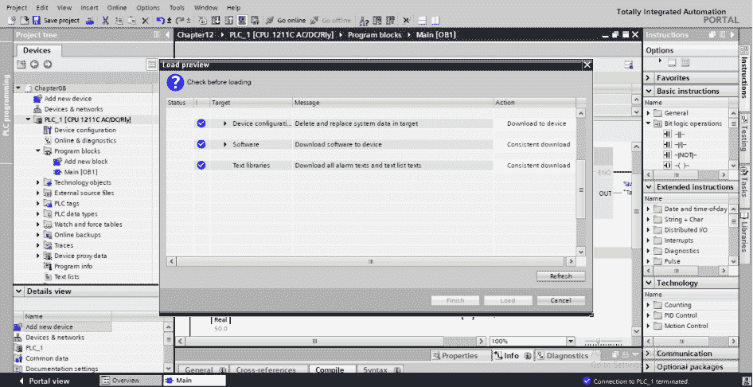

Figure 12.39 – The Load preview pop-up window

2. Click **Load** and click **Monitoring on/off**:

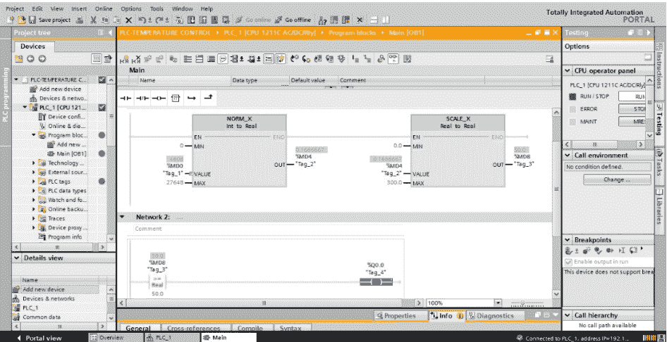

Figure 12.40 – Simulation result 1

The simulation result here shows that the coil (Q0.0) became energized when the value at MD0 (the digitized value) is 4608, which was normalized to 0.1666667 and scaled to 50.0.

If we input 5000 as the digitized value at MD0, it will be normalized to 0.1808449 and scaled to 54.25347. Q0.0 will still be energized because the condition is still met (that is, 54.25347 is greater than 50), as shown here:

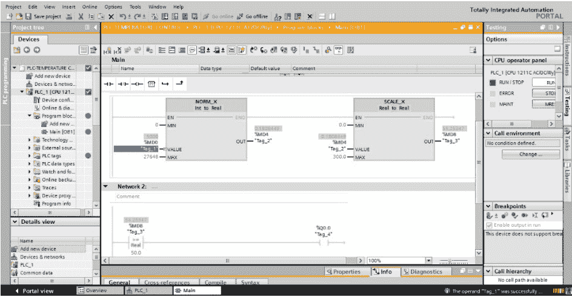

Figure 12.41 – Simulation result 2

Now, input 3000 as the digitized value at MD0 – it will be normalized to 0.1085069 and scaled to 32.55209. Q0.0 will be de-energized because the condition is no longer met (32.55209 is now less than 50), as shown here:

6. You will be asked to save changes to the current project – click Yes:

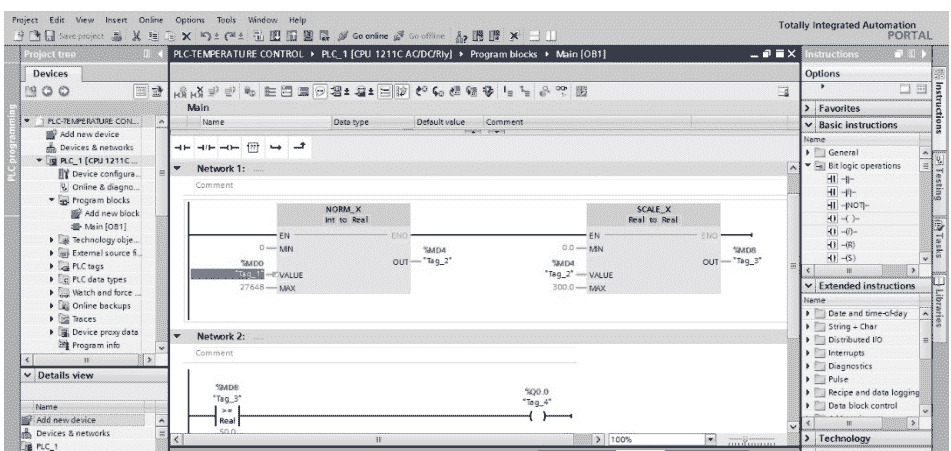

Figure 12.44 – Closing the simulator

You can now close the main project (PLC-TEMPERATURE CONTROL).

##### Note

This same project will be used to learn about how to use a real PLC to process analog input signals.

#### Using a real PLC (Siemens S7-1200 – CPU 1211C – AC/DC/RLY)

In this example, we will wire and program a PLC to keep a heater turned on until the value at MD8 (the scaled value) is greater than or equal to 100. This is a simple control system technique that can be applied to temperature, pressure, or level control.

##### Requirements

In addition to TIA Portal used in the simulation, the following devices are also required to demonstrate analog input signal processing with a real PLC:

- An RTD temperature sensor (Pt100)
- An RTD temperature transmitter
- A power supply (220 V AC to 24 V DC)
- A PLC (Siemens S7-1200)
- A contactor
- A heating element
- An Ethernet cable
- A PC or laptop with TIA Portal installed

##### Wiring

1. Connect the power to the AC input of the power supply using a breaker. Connect the power to the AC input of the PLC through the circuit breaker. Also connect AC power to terminal 1 (L1) and terminal 3 (L2) of the contactor as shown in the diagram.
2. Connect the two terminals of the heater to terminal 2 (T1) and 4 (T2) of the contactor as shown.
3. A three-wire Pt100 RTD comes with three wires – two of the wires have a resistance of 100 Ohms between them. The two wires should be connected to the two terminals with a resistance symbol in between them while the last (third wire) should be connected to the other terminal with no resistance sign as shown.
4. Connect the positive terminal of the 24 V DC to the positive terminal of the transmitter.
5. Connect the negative terminal of the transmitter to the first analog input channel (0).
6. Connect the negative terminal of the power supply unit to the negative terminal of the 24 V DC output of the PLC (M) and also connect it to the common terminal of the analog input channel (2M) as shown.
7. Connect a 500-Ohm resistor between the first analog input (0) and 2M as shown.
8. Connect Q0.0 on the PLC to A1 on the contactor and connect 1L on the PLC to live (L) on the breaker. Also, connect A2 on the contactor to Neutral (N) on the breaker as shown:

The 500-Ohm resistor converts the 4 to 20 mA current from the transmitter to 2 to 10 V

AC SUPPLY
220V AC

CIRCUIT BREAKER

POWER SUPPLY UNIT

PLC
(SIEMENS S7-1200)

RTD TEMPERATURE TRANSMITTER

RTD TEMPERATURE SENSOR
(Pt100)

HEATER

CONTACTOR

Figure 12.45 – A wiring diagram showing the wiring of a temperature control system using a PLC, a temperature sensor, and a 4 to 20 mA transmitter

##### Programming

We are going to open the previous program (`PLC-TEMPERATURE CONTROL`) and modify it to turn on a heater when the value in register MD8 is greater than or equal to 100:

1. Open the saved project (`PLC-TEMPERATURE CONTROL`). You can refer to the steps for opening a saved project in *Chapter 9, Deep Dive into PLC Programming with TIA Portal*:

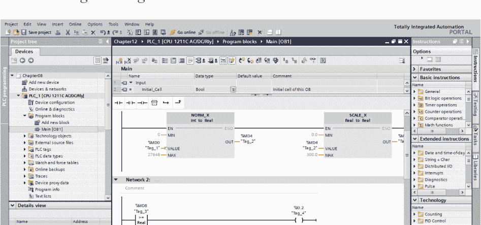

Figure 12.46 – Opening the saved project

2. Select the tag name for MD0 and press Delete on the keyboard to delete both the tag name (`Tag_1`) and register (MD0). Also, select the tag name for Q0.0 and press Delete on the keyboard to delete both the tag name (`Tag_4`) and register Q0.0. You should see something similar to the following figure:

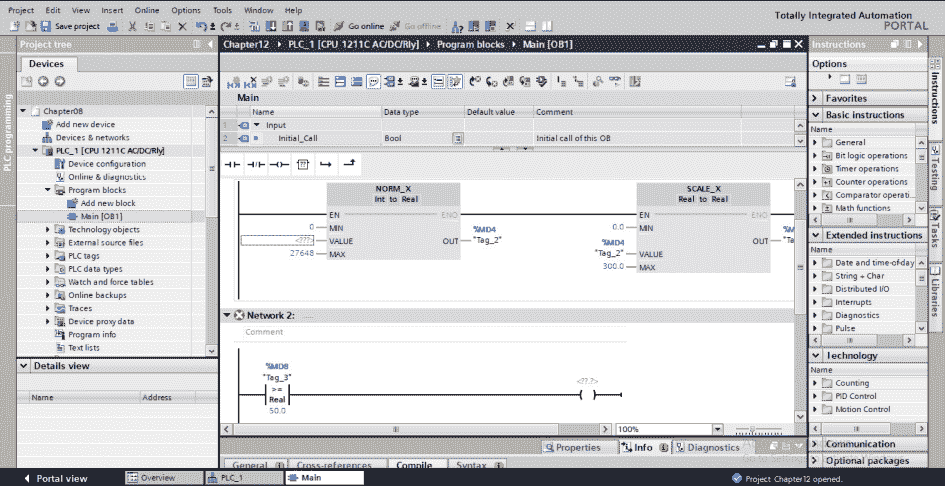

Figure 12.47 — 删除 MD0 和 Q0.0 的标签

3. 现在，将第一个模拟输入通道的地址（即 `%IW64`）作为 **Network 1** 中 `NORM_X` 的值输入。另将一个存储器位地址（即 `M0.0`）作为 **Network 2** 中输出的地址输入。你应该会看到与以下类似的图：

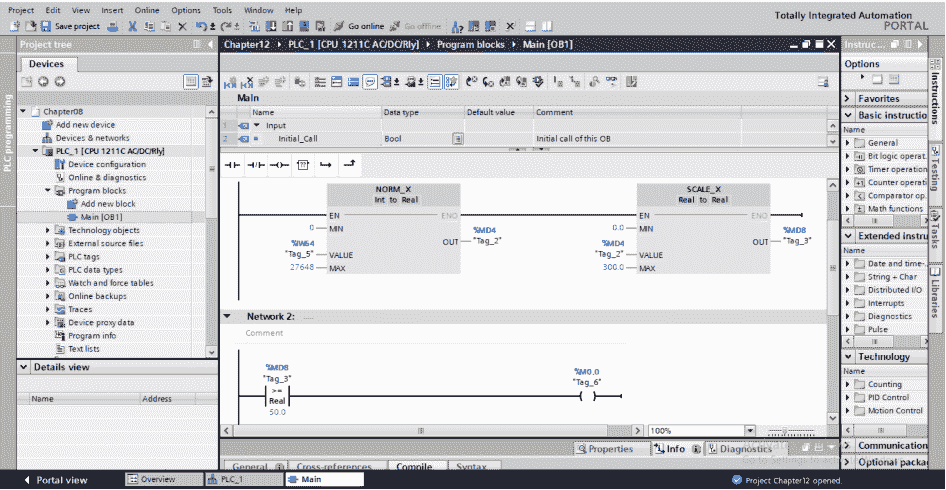

Figure 12.48 – %IW64 现在用作 NORM_X 的值，M0.0 现在用作 Assignment（线圈）的寄存器

+   4. 双击 **compare** 指令底部 `50.0` 的值并输入 `100` 以将设定点更改为 100：

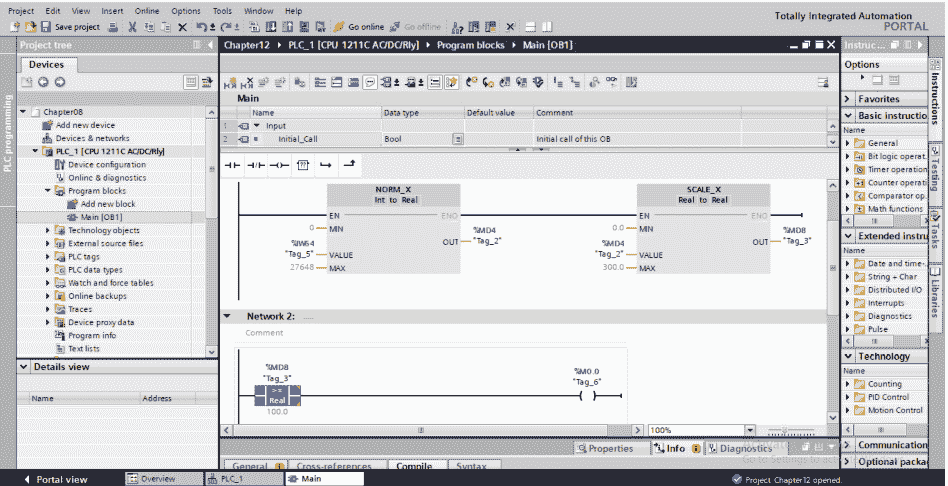

Figure 12.49 – 50 改为 100

+   5. 在屏幕右侧的 **Basic instructions** 列表下展开 **Bit logic operations** 并将常闭指令拖到 **Network 3**：

Figure 12.50 – 常闭触点指令已添加到 Network 3

6. 现在，在常闭触点的 ??? 字段中输入 %M0.0：

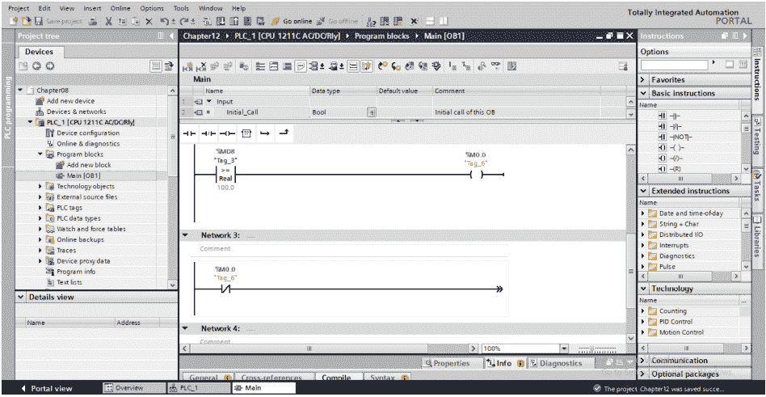

Figure 12.51 – 常闭触点现在具有 M0.0 寄存器

7. 在屏幕右侧的 **Basic instructions** 列表下展开 Bit logic operations 并将 assignment（Coil）

###### instruction 拖到 Network 3：

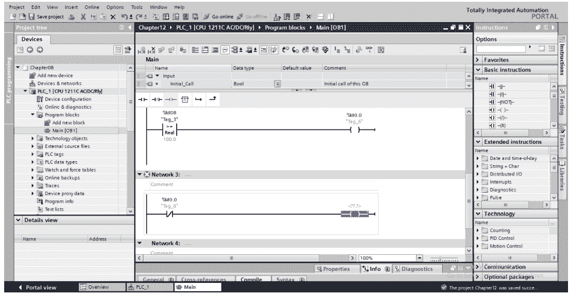

Figure 12.52 – Assignment（Coil）指令已添加到 Network 3

8. 现在，在 assignment（coil）的 ??? 字段中输入 %Q0.0 以获得与以下类似的图：

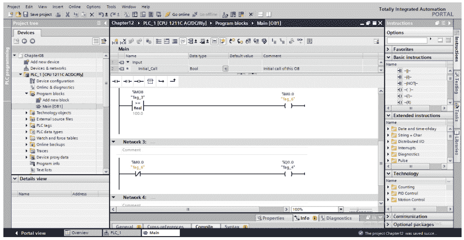

Figure 12.53 – Assignment（Coil）被赋予 Q0.0 的地址

我们已经完成了程序。以下屏幕截图显示了从 Network 1 到 Network 3 的完整程序：

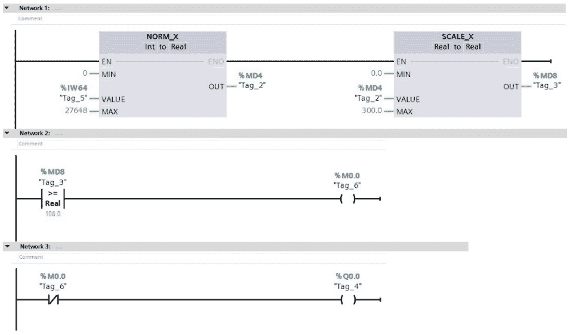

Figure 12.54 – 完整的程序（一个模拟输入程序）

#### 配置 IP 地址并将程序下载到真实 PLC

现在，让我们继续将程序下载到真实 PLC：

+   1. 确保接线图（Figure 12.45）中的所有连接都已正确设置。打开断路器为设备供电。同时，确保 PLCSIM（模拟器）未运行。
+   2. 将通信电缆（一根以太网电缆）的一端连接到笔记本电脑或 PC，另一端连接到 PLC。Figure 12.55 显示了我用于演示目的的简单设置：

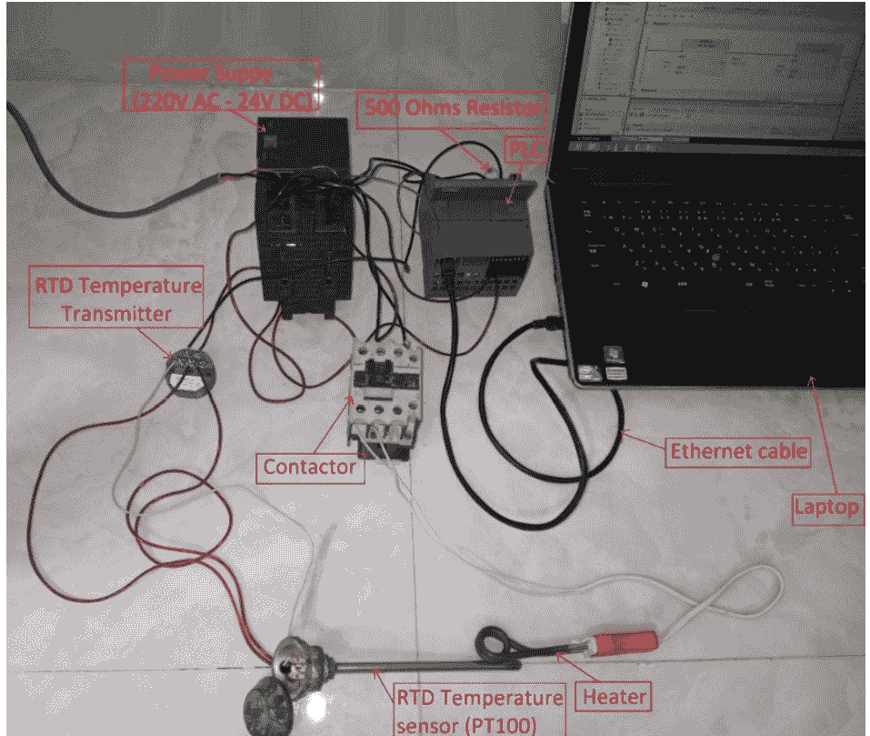

Figure 12.55 – 我用于演示目的的设置

3. 双击 Device configuration：

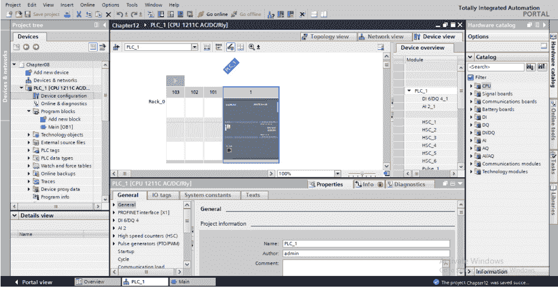

Figure 12.56 — 设备配置

+   4. 导航到 **Properties | General** 选项卡，然后单击 **PROFINET Interface [X1]**：

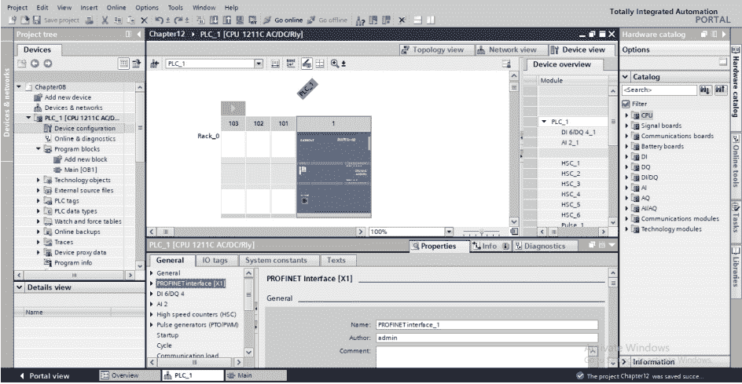

Figure 12.57 — PROFINET 接口 [X1]

+   5. 滚动到 IP 协议并输入您选择的 IP 地址（例如，`192.168.0.6`）和子网掩码（例如，`255.255.255.0`）如下所示：

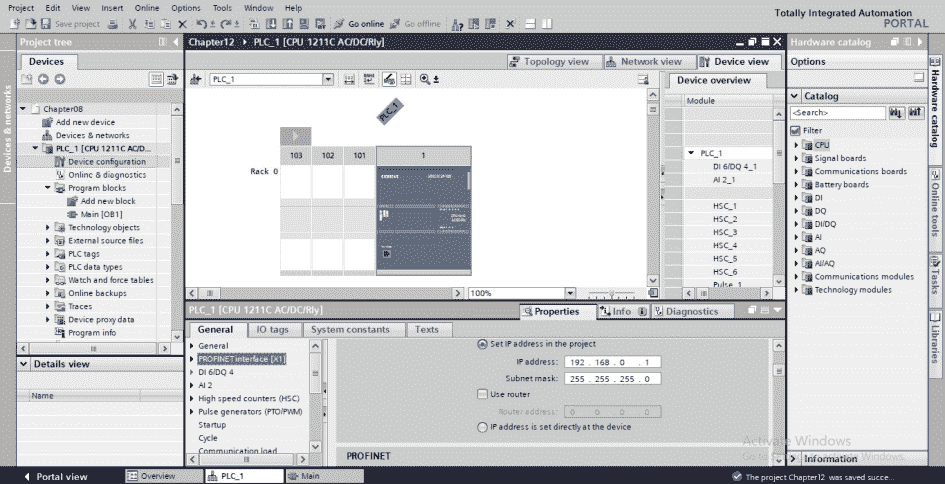

Figure 12.58 — 添加 IP 地址和子网掩码

+   6. 单击 **Save project** 并单击 PLC 以选择它。您应该会看到 PLC 被高亮显示。**Compile** 和 **Download to device** 命令将变为活动状态，如下所示：

Figure 12.60 – 已选择的 PG/PC 接口

10. 单击 Load：

Figure 12.61 – 扩展下载到设备窗口

11. 单击 Yes：

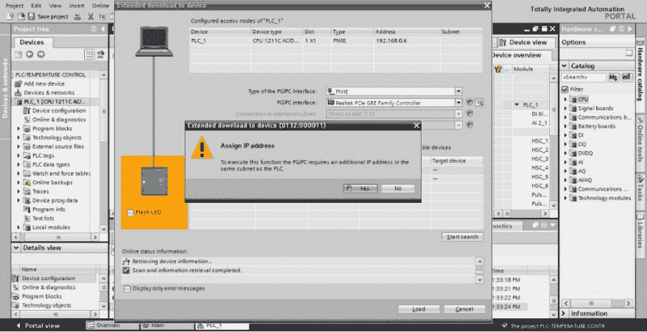

Figure 12.62 – 扩展下载到设备（消息 1）

+   12. 单击 **OK**：

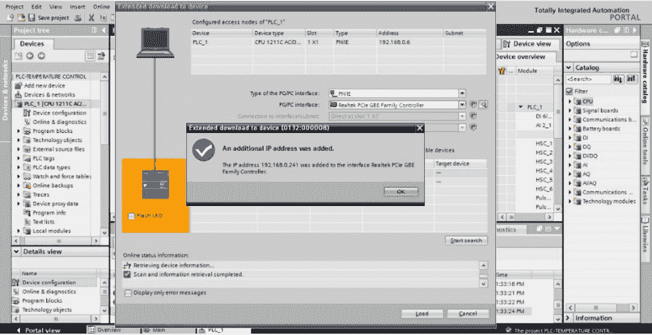

Figure 12.63 – 扩展下载到设备（消息 2）

+   13. 选择 **Stop all**：

Figure 12.64 – 加载预览（1）

14. 单击 Load：

Figure 12.65 – 加载预览（2）

15. 勾选 Start all 如图所示并单击 Finish：

Figure 12.66 – 加载结果

恭喜！您已成功将程序下载到 PLC，PLC 将开始按程序运行：

Figure 12.67 – 加载完成且无错误

让我们上线监控 PLC 在处理模拟信号并执行程序时发生的情况。按照以下步骤监控 PLC 程序执行指令时的情况：

+   1. 双击 **Program blocks | Main [OB1]**。
+   2. 单击 **Monitoring on/off**。

#### 程序的观察与解释

您会观察到 `%IW64` 的值在加热器打开时会变化。这是连接到模拟输入模块第一个通道的模拟信号的数字化值。随着温度升高，模拟信号增加，数字化值也随之增加。`MD4` 处的值为归一化值，而 `MD8` 处的值为缩放值。

在下图中，**Network 1** 显示 `%IW64` 处的数字化值为 `9215`。`MD4` 处的归一化值为 `0.3332972`，而 `MD8` 处的缩放值为 `99.98915`。

MD8 为 105.1649。

在 Network 2 中，比较器中有输出以使能或打开 M0.0 Assignment（Coil），因为条件满足，即 MD8 处的 105.1649 大于 100。

在 Network 3 中，常闭触点（M0.0）因 M0.0 为 ON 而打开。这阻止了信号流向 Q0.0，从而使接触器失电，加热器关闭。

Figure 12.69 – 监控 PLC 程序执行指令时的情况（2）

在本节中，您学习了如何在 PLC 中使用模拟输入信号。现在您应该能够对 PLC（S7-1200）进行编程和模拟以处理模拟输入信号。您还应该能够将 4 至 20 mA 输出的变送器连接到真实 PLC 的模拟输入并对其进行编程以在所需设定点执行简单的控制（例如，停止加热器）。

本节简化了模拟信号处理，许多工业自动化工程师或 PLC 专家认为这是困难的。本书仅关注模拟输入信号，我们已使用它在满足条件时发出数字控制信号。也可以发出模拟信号（4 至 20 mA）或使用具有 PID 功能的 PLC 以获得比此处示例更好的控制。

#### 总结

做得好！您已成功完成本章，这是工业自动化的重要阶段。您现在应该了解过程控制并能够解释各种过程控制术语并根据 *ISA5.1* 理解 ISA 符号。您还学习了温度测量、液位测量、压力测量和流量测量所需的传感器和变送器，这些在工业中很常见。您现在应该能够将温度传感器和变送器、液位变送器和压力变送器接线以产生 4 至 20 mA 模拟输出，这对过程控制非常重要。我们还学习了如何使用温度控制器将加热器的温度保持在所需水平。

最后一节涵盖了工业自动化领域的更高级主题，我们讨论了您需要了解的关于 PLC（S7-1200）中模拟输入信号处理的基本理论，其中包括读取模拟信号、归一化和缩放。我们学习了如何按照分步指南（模拟）对 PLC（S7-1200）进行编程以处理模拟输入信号，我们还使用真实 PLC 学习了如何接线和编程真实 PLC 的模拟输入以按照分步指南执行控制动作。

下一章涉及您作为工业自动化工程师所需的其他重要知识。不要错过。

#### 问题

以下是一些测试你对本章理解程度的问题。在尝试回答这些问题之前，请确保你已经阅读并理解了本章的主题：

- 1. 在__________过程控制中，输出不会改变控制作用。
- 2. 在__________过程控制中，输出对控制作用有影响。
- 3. 在__________控制中，扰动被测量，并在误差到达系统之前采取纠正措施。
- 4. __________是一种将传感器产生的信号转换为适用于过程控制的标准信号（4至20 mA、0至10 V或3至15 psi）的设备。
- 5. __________可称为过程变量的目标值。
- 6. __________是过程变量或测量值与设定点之间的差值。
- 7. 控制器为保持过程变量在设定点而操作的设备称为__________。
- 8. ISA是代表______________________________的缩写。
- 9. __________是一种流量计，通过测量内部旋转涡轮或齿轮的速度来测量流量。
- 10. __________是S7-1200控制器的内置功能，用于将任意给定数据从最小值到最大值转换为0到1的浮点值。
- 11. __________是S7-1200控制器的内置功能，用于将0到1的归一化值转换为所需范围。
- 12. PID是________________的缩写。
- 13. P&ID代表________________。
